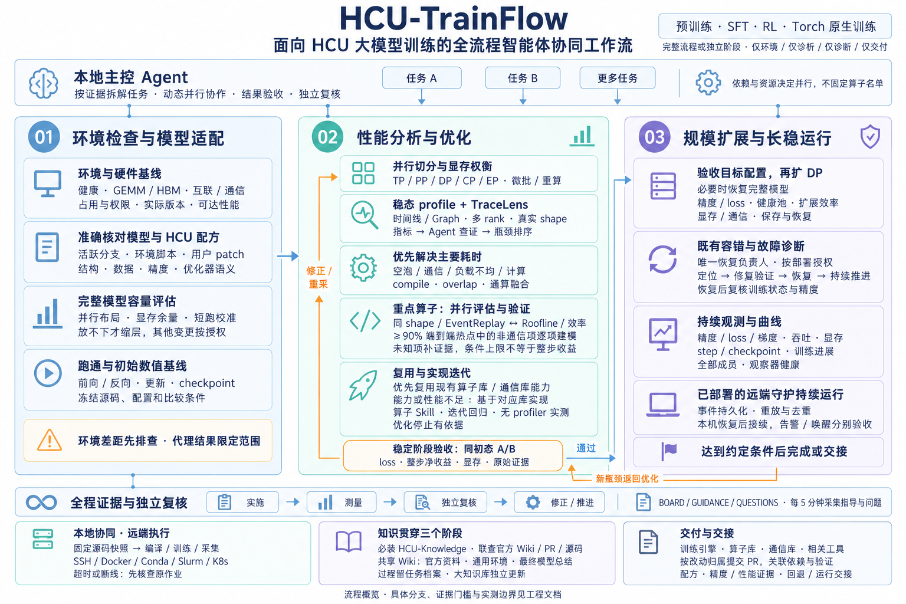

# HCU-TrainFlow

## 面向 HCU 大模型训练的全流程智能体协同工作流

An agentic workflow for end-to-end large-model training adaptation, optimization, and resilient scaling on HCU.

给出模型、环境和目标，由本地主控 Agent 协调适配、分析与优化、扩容验证及长训容错。候选与阶段结果以实际证据推进，经过独立复核和修正；有界初筛、局部试参和未变化的证据按需复用，不逐条命令审核。人在看板中补充意见，Agent 读取、回复并调整后续工作。适用于预训练、SFT、RL，以及 Torch 原生的视频生成、VLA、世界模型等训练，也支持只检查环境、只分析性能或只诊断故障。

**当前版本：`0.6.7`。** 已结合真实 SSH + Docker HCU 环境验证固定快照执行、代理模型训练、多 rank 性能分析、代表性算子迭代和有界跨节点恢复；主控接手、阶段交接及工具逻辑有本地回归。新站点、完整模型收敛、长期告警/Agent 自动唤醒仍须分别验收。见 [能力与验证边界](docs/capabilities.md)及[变更记录](CHANGELOG.md)。

**首次了解工程，建议阅读 [HCU-TrainFlow 工程介绍](docs/project-overview.md)**：从接到一个新模型和环境开始，讲清三个阶段如何推进、如何选择优化对象、怎样保护训练质量，以及多 Agent、知识检索和持续守护如何配合。

## 如何开始

安装后，在支持 Skill 的 Agent 中说：

> `$hcu-trainflow` 在这个 HCU 集群上适配并优化 `<模型>` 的预训练，最后扩到 `<目标卡数>`。环境信息在 `<文件或说明>`。

主控先按[接手与阶段交接指南](docs/agent-playbook.md)确认现场、任务范围与已有证据，再调用当前阶段 Skill，按主要瓶颈推进。安装会给 Skill 保存本机工程位置；换目录开新任务也可定位，任务 workspace 与资源权限仍单独确认。

主控会建立任务、确认缺失的关键条件，然后按阶段推进。已知环境和授权可以复用；正常步骤持续执行，遇到权限缺口、数值异常、收益平台期或需要专家判断时再提出具体问题。内部任务文件和命令由 Agent 管理。

默认只在[任务工作空间及其远端/容器映射目录](docs/workspace-boundaries.md)内写入，包括代码、缓存、日志和 checkpoint；外部资料可按需读取。必要的外部修改先核对具体范围与已有授权，避免污染共享环境。

### 使用示例

说清楚想做什么，附上已有的环境或工程资料即可。检查项、分析方法、验证和记录规则已内置在工作流中，无需重复写进 prompt；缺少必要信息时，Agent 会补充确认。下面的 `<...>` 替换为实际信息。

**从新模型开始完整推进**

> `$hcu-trainflow` 在 `<环境>` 上用 Megatron 跑通并优化 `<模型>` 的预训练，最后扩到 `<目标卡数>`。环境和数据说明在 `<路径>`。

**只检查环境**

> `$hcu-trainflow` 全面检查一下这个 HCU 集群是否适合训练，环境信息在 `<路径>`。

**只分析性能**

> `$hcu-trainflow` 帮我分析 `<模型>` 的训练瓶颈，日志、trace 和启动脚本在 `<目录>`。这次只分析，暂不优化。

**适配完成，继续优化**

> `$hcu-trainflow` 这个模型已经跑通了，继续优化训练性能。工程和启动脚本在 `<目录>`。

**扩规模并持续观察训练**

> `$hcu-trainflow` 这个模型已经优化好了，从 `<当前卡数>` 扩到 `<目标卡数>`，接入容错并持续观察训练。任务资料在 `<目录>`。

**只诊断故障**

> `$hcu-trainflow` 这个训练作业卡住了，帮我排查原因。作业和日志信息在 `<路径>`。

**审查改动并提 PR**

> `$hcu-trainflow` 帮我审查 `<本地分支或补丁>`，整理后向 `<目标仓库/分支>` 提 PR。

**查询 Wiki**

> `$hcu-trainflow-wiki-search` 查一下 Megatron TP overlap 的启用条件和显存代价，我用的版本是 `<版本>`。

**更新 Wiki 与 Skill**

> `$hcu-trainflow-wiki-skill-update` 更新当前任务相关的 Wiki 和 Skill，并整理这个已完成任务的可复用经验：`<任务目录>`。

## 工作流总览

[](docs/assets/workflow-overview.png)

[工程介绍](docs/project-overview.md) · [详细流程图与验收规则](docs/workflow-map.md)

### 1. 环境检查与模型适配

- **发现并验收现场**：确认节点与卡的授权、占用、拓扑、镜像、DTK 和关键库版本，复用当前 Cluster Manager、run_nhc、检查脚本及 DTK 工具。检查健康、GEMM、HBM、机内互联和机间通信，逐项对照有来源的预期；缺项、性能差距和排查结果明确记录，需要时请专家介入。
- **准确适配模型**：选择适用且活跃的 HCU 仓库/分支，优先核对已有启动脚本、环境变量和现场激活链；结合官方实现确认模型结构、数据、精度、优化器与训练语义，保留用户 patch 和执行基线。预训练、SFT、RL 与 Torch 原生训练分别补查其数据和执行语义。
- **先评估完整模型容量**：参考 HCU Train Sim、当前模型源码、实际可用卡数和硬件参数，预算最重 rank 的显存与余量并短跑校准。能放下就直接全参适配；资源不足才优先缩 layer，其他维度变化须明确授权并记录代理范围。
- **建立可信基线**：验证前向、反向、参数更新和 checkpoint，冻结源码、配置、初始数值及比较条件。有 NVIDIA 环境时补充跨平台对照；未覆盖范围保留到后续验收。

### 2. 性能分析、优化与质量验证

- **并行切分与显存取舍**：先评估 TP/PP/DP/CP/EP、微批、累积、重算、状态切分及 overlap，在显存峰值、必要余量、通信和实际吞吐之间选择配置。调参保持训练语义可比，GPU_MAX_HW_QUEUES 等按当前 runtime 与实测核验。
- **按主要瓶颈推进**：采集稳态端到端 profile，每个实际非单例并行组至少覆盖两个代表 rank，结合 TraceLens 分析空泡、通信、负载不均、计算和显存。谁占主要时间就先处理谁；通信达到单测预期仍大量暴露时，再考虑 overlap、调度或通算融合。
- **重点算子持续迭代**：对累计 ≥90% 端到端热点中的非通信算子，按实际贡献排序，评估瓶颈、可达上限、当前效率和剩余空间。同 shape 独立实测与上限建模可以并行，用于区分实现差距和模型内资源竞争；保留空泡、重叠和未归因时间的正确口径。
- **复用与实现迭代**：优先复用现有 HCU 算子库、通信库的能力；能力或性能不足时，基于对应库补充实现并借助算子 Skill 持续优化。对齐接口与数值契约，以实际性能分析、局部回归和整步收益验证结果；具体工程分工见[库联动指南](skills/hcu-train-analyze-and-optimize/references/hcu-library-integration.md)。
- **稳定阶段验 loss**：每轮做局部正确性、多形状和无 profiler 性能回归，集成后重测整步净收益；稳定阶段从同一冻结初态与配方比较 loss、性能和显存。达到目标、接近可达上限、无稳定收益或受阻，都须给出证据与停止依据。

同一阶段包含 [Torch 原生训练专项](skills/hcu-train-analyze-and-optimize/references/torch-native-training.md) 和 [通信优化专项](skills/hcu-train-analyze-and-optimize/references/communication-optimization.md)，覆盖输入流水、autograd、compile/断图/重编译、DDP/FSDP，以及 bucket/chunk、同步、overlap、通算融合和资源竞争。按瓶颈联查 [Megatron](knowledge/projects/megatron/knowledgebase/local/overview/overview.md)、[TorchTitan](knowledge/projects/torchtitan/knowledgebase/local/overview/overview.md)、[DeepSpeed](knowledge/projects/deepspeed/knowledgebase/local/overview/engineering-guide.md)、[AMD Primus](knowledge/projects/primus/knowledgebase/local/overview/engineering-guide.md)、[MindSpeed 系列](knowledge/projects/mindspeed/knowledgebase/local/overview/engineering-guide.md)和 [LoongForge](knowledge/projects/loongforge/knowledgebase/local/overview/engineering-guide.md)的教程、PR 与实现；SFT/RL、训推协同和底层依赖见[参考选择表](docs/optimization-reference-map.md)。需要改底层时，按实际归属修改 HCU 算子、通信、数学库或编译器/Runtime，并隔离构建验证，见[仓库与修改归属](skills/hcu-train-analyze-and-optimize/references/hcu-library-integration.md)。详见[热点排序与算子迭代](skills/hcu-train-analyze-and-optimize/references/operator-ceiling-iteration.md)。

**TraceLens 贯穿分析和验证**：时间线与 Graph 关联真实训练调用，Roofline/效率分析提供带条件的上限，EventReplay 支持按真实输入做独立对照；hipprof JSON/pftrace 与 XProf/XCompute 证据按各自口径接入。原生 Agent 指标准备、实际推理和复核分别记录，高占比未知项继续补证据。报告生成、分析完成和训练验收是不同状态，预测空间须由无 profiler 的整步收益及质量对照验证。见 [TraceLens 分析与实测边界](docs/tracelens-analysis.md)。

### 3. 规模扩展与长稳运行

- **逐级扩容**：完整模型目标必要时先恢复并验收完整配置；获准的代理任务可以扩选定代理配置的 DP，并保留完整模型验证缺口。以 Cluster Manager 为主筛机、交叉检查疑似节点并维护健康池，逐级核对精度/loss、吞吐、扩展效率、通信、显存和训练语义；新瓶颈返回优化。
- **验证恢复链路**：接入现场既有容错并明确唯一恢复负责人，按部署授权诊断卡住、core dump、OOM、泄露等问题。验证旧进程处理、checkpoint 完整性、重新拉起及训练状态恢复，复核恢复后的精度与 loss，观察 step 是否真实持续推进。
- **长时观察与接续**：持续记录精度与 loss/梯度异常、吞吐、显存、全部必需成员、checkpoint 和恢复状态，生成曲线并检查观察器自身健康。本机离线时由已部署并验收的远端守护和既有容错继续工作；恢复后核对现场、重放事件并接续 Agent，告警和自动唤醒分别验收。

### 贯穿全程的协同与交付

**模型精度诊断**贯穿适配、优化和长稳：有 NV 环境进行同初态、同样本的分层对照；没有 NV 则用可信基线、独立参考和 HCU 自查。按需结合 HCU Probe 定位前向、梯度、更新或通信的首处分歧，局部修复回归后在稳定里程碑验 loss。详见[精度诊断方法](docs/practices/model-accuracy-diagnosis.md)和[精度分支图](docs/workflow-map.md#35-模型精度诊断跨阶段复用)。

本地主控按依赖和收益拆解任务，独立方向并行，共享资源测量与耦合修改协调执行；代码以固定快照同步远端，超时或断线先核查原作业。HCU-Knowledge、HCU-TrainFlow-Wiki、PR 与源码查证贯穿三个阶段，看板持续展示技术结论并采集指导。各阶段按范围交付代码、配方、验证和回退方法；完整任务在执行基线上完成约定验证后再整合目标主仓，精选通用经验和最终里程碑进入共享 Wiki。

**改动按工程归属交付**：训练引擎、算子库、通信库及相关工具分别向对应仓提交 PR，关联跨仓依赖、集成版本和验证结果；同时交接启动配方、精度与性能证据、回退方案及运行责任。

阶段入口分别为 `$hcu-train-check-and-adapt`（环境检查与模型适配）、`$hcu-train-analyze-and-optimize`（性能分析与优化）、`$hcu-train-scale-and-stability`（规模扩展与长稳运行）；统一委托仍使用 `$hcu-trainflow`。也可仅委托接手已有修改、代码审查或提 PR，直接执行[交付规范](docs/change-delivery.md)，无需重新开展训练阶段。发生异常时按 [故障诊断指南](skills/hcu-train-scale-and-stability/references/diagnosis.md) 分流，结合 HCU 知识库、线上 PR 与实际源码查证，修复后回到对应阶段验收。

完整分支、优化回路、独立任务与验收条件见 [工作流全景](docs/workflow-map.md)。

## 如何与 Agent 协作

每个任务在私有工作区生成：

```text
collaboration/<task>/BOARD.md       进度、待决问题、轮次复核和证据入口
collaboration/<task>/DETAILS.md     环境验收、热点/优化结果、质量与长训的详细证据
collaboration/<task>/GUIDANCE.md    人的评论、回答和优先级调整
collaboration/<task>/QUESTIONS.md   问题、Agent 回答和追问
```

在 `GUIDANCE.md` 写意见，默认每 **5 分钟**采集一次；主控在后续实验与推进前检查已采集的指导并记录处理结果。需要立即生效时可让 Agent 刷新，或运行 `flow-board` / `flow-watch --once`。文件轮询本身不运行模型。会话关闭后的自动接续需要部署 Agent bridge；本机离线时，已部署并验收的远端守护和原有容错继续运行。详见 [协作循环与文件交互](docs/collaboration.md) 和 [长训守护](docs/operations.md)。

解释性问题可写入 `QUESTIONS.md`，主控按同一周期读取并在原问题下回答，保留问题与回答版本。问题不自动改变资源或重启授权；采集器不会代替离线的 Agent 生成答案。

工作区清理在实验批次收尾、阶段交接或恢复核销时进行，同阶段长训默认每6小时一次，不随五分钟交互频繁扫盘。明确启用的策略可回收过期缓存、已退役的无效临时 checkpoint 和调试大文件；最新有效/最佳/基线/恢复点、原件和使用中的文件保留。大写入前只查容量，空间不足及时报告，本地/远端共享盘分别由唯一负责人维护；默认 dry-run，旧目录不自动删除。模型/实验 context 换代时使用独立观察 Store，重新核对全部成员监测及独立 sentinel。见 [工作区维护与观察交接](docs/workspace-maintenance.md)。

## 多 Agent 如何协同

主控根据模型与实测热点动态生成任务和 Agent 分工，不预设固定算子名单。环境与启动配方核对、系统分析，以及不同算子的详细分析和优化均可并行；某个算子具备实施条件后即可优化，无需等待其他算子的分析全部完成。相关 Agent 可提问、答复、共享发现和报告阻塞，消息与处理回执保存在同一任务中。

卡数充足时，也可用多个隔离的完整模型最小可行 DP 实例并行验证不同优化方向，公共基线与质量契约保持一致，Agent 及时互通进展，由主控复验并集成兼容结果。见[容量预估与并行实验](docs/practices/capacity-and-parallel-experiments.md)。

下游只消费已验收的结果；共享 GPU 的测量、耦合代码修改、集成和阶段 loss 验证由主控安排。任务领取、真实 Agent 会话、返回报告和验收分别记录，避免重复派发或把“已经返回”误当成“已经完成”。详见 [任务拆解与 Agent 协同](docs/multi-agent.md)。

## 知识如何参与工作流

**HCU-Knowledge 是完整安装的必需组成，贯穿三个阶段。** 按问题检索硬件、工具、HCU 工程、配方、优化与故障案例，并联查任务私有档案和 HCU-TrainFlow-Wiki；本地证据不足时继续在线搜索 PR、阅读讨论并追到对应版本的源码和底层依赖。必需安装不表示每个命令都强制查询。

官方资料按 `knowledge/projects/<project>/knowledgebase/{upstream,local}` 统一组织，原文/PR 与整理后的机制解释分开；HCU 仓库知识通过 HCU-Knowledge 联查，本仓仅维护工作流接口和有复用价值的经验。

HCU-TrainFlow-Wiki 可按问题和版本变化自主更新，并联动复核相关 Skill、命令与解析器用法；普通查询或训练任务不附带更新 HCU-Knowledge，也不会自动替换正在运行的训练依赖。共享 Wiki 只收录官方资料、跨项目可复用的环境经验，以及模型最终优化里程碑的总结和关键数据。环境经验放 `knowledge/sites/`，最终总结放 `knowledge/experiments/`，必要证据随仓提交。中间候选、调参试验和临时排查留在 workspace 与看板；外部 Cookbook 的发布要求单独处理。参见 [知识归属与跨任务复用](docs/knowledge-architecture.md)。详见 [知识检索与维护](docs/wiki.md) 和 [训练经验记录](docs/experience-knowledge.md)。

任务初期在确认模型、环境和执行分支后，主控检查相关官方资料的新鲜度，必要时定向更新；环境验收、优化阶段结束和任务最终完成前，筛选通用经验与已验收的最终总结。中断恢复复用处理记录，没有可复用内容就如实记录。`flow-start` / `flow-next` 的维护提示由在线 Agent 执行，不是后台自动采集，也不会每轮全量刷新。详见 [知识维护时机](docs/knowledge-architecture.md#任务中的维护时机)。

每次更新先检查内容相关性与复用价值，再联动复核总览、专题、案例和使用入口。来源登记收录范围及带理由的排除项，防止已清理的低相关文档在自动同步时重新入库；完整源码导航与按问题查 PR/代码的能力保留。更新并验证后同步本机包和六个 TrainFlow Skill，保持安装内容与工程一致。

性能分析的证据刷新、热点/重叠/融合三表、上限判读、组合验证与停滞处理，见 [性能方法与参考来源](docs/practices/performance-methods.md)。故障调查沿各阶段 Skill 共用的诊断指南推进，结合 HCU 大知识库和当前源码持续查证。

## 安装

Python 3.10+、Git、Git LFS，以及 HCU-Knowledge 仓库读取权限。使用 SSH/Docker/Slurm/K8s 时需对应客户端与资源权限；HCU 训练软件由实际环境提供。

```bash
git clone https://github.com/yuguo-Jack/HCU-TrainFlow.git
cd HCU-TrainFlow
git lfs install
```

PowerShell 中完成依赖、知识库本机索引和 **11 个 Skill** 的安装（六个 TrainFlow、三个算子、两个 HCU 知识库）：

```powershell
python scripts/setup_trainflow.py --skills-dir "$HOME/.codex/skills"
$env:TRAINFLOW_PROJECT = (Get-Location).Path
$env:TRAINFLOW_WORKSPACE = "D:/trainflow-work/my-task"
```

HCU-Knowledge 默认从 GitHub 获取；内部人员首次安装可加 `--knowledge-source gitlab`，使用[内部 GitLab 镜像](http://42.228.13.241:10068/dcutoolkit/deeplearing/hcu-knowledge)，无需 GitHub 私有仓权限，仍需 GitLab 项目读取权限。已有 checkout 保留其来源。

已有独立知识库时加 `--knowledge-root /path/to/HCU-Knowledge`，支持上述两处来源，复用原件、索引与配置，不重复克隆、不拉取其上游更新。缺少仓库权限、LFS 原件或索引不可用时安装会报告未完成；不会静默跳过。飞书等在线能力另用本人账号授权。详见 [依赖与安装说明](docs/integrations.md)。

可选安装 [KernelWiki](https://github.com/mit-han-lab/KernelWiki) 为算子优化提供 NVIDIA 案例、PR 和源码参考：在上面的安装命令加 `--with-kernelwiki`，共安装 12 个 Skill。默认不安装；已有环境的单独补装方式见[安装说明](docs/integrations.md#可选-kernelwiki)。

### 后续更新

日常维护使用 `$hcu-trainflow-wiki-skill-update`，由 Agent 检查相关官方与 HCU 工程变化、整理符合收录规则的环境经验和最终模型总结，并更新受影响的流程与 Skill，验证后同步本机安装。旧的 `hcu-engine-wiki-*` 安装名称会在升级时迁移为 `hcu-trainflow-wiki-*`，菜单显示名称与实际英文 Skill ID 一致。普通维护不更新 HCU-Knowledge，也不自动替换正在运行的训练依赖。

已有完整安装时，更新 Skill 和本工程维护流程都会在验证后执行本机同步；手动 pull 后也可执行：

```powershell
python scripts/sync_local_install.py --target "$HOME/.codex/skills"
python scripts/sync_local_install.py --target "$HOME/.codex/skills" --check
```

它刷新本仓 Python 包、六个 Skill/reference 并检查绑定与阅读资源，成功后清理本次临时旧备份。只运行 Git pull 或 wiki-update CLI 不会自动安装。首次安装、搬家或依赖清单变化仍用完整安装命令并加 `--replace`；普通同步不升级其他工程。完成后新开 Agent 会话。具体步骤见[维护与本机同步](docs/integrations.md#skills账号与升级)。

## 本地验证与阅读入口

```bash
hcu-trainflow --version
python -m pip install -e ".[test]"
hcu-trainflow collaboration-demo .work/collaboration-first
hcu-trainflow demo .work/analysis-first
python -m pytest -q
python scripts/validate_knowledge.py
python scripts/check_skill_resources.py
```

两个 demo 使用合成输入，分别演示协作协议和训练分析/监测；不需要 GPU，不构成真实训练验证。每次演示使用新目录。

| 目录 | 内容 |
| --- | --- |
| `skills/` | 入口、阶段决策与 Wiki 检索/更新；各自 `references/` 保存对应详细方法 |
| `src/hcu_trainflow/` | 持久任务、复核循环、执行与证据、分析和监测 |
| `knowledge/` | 官方训练引擎与生态 Wiki、通用站点经验、最终模型总结，以及固定来源与维护关联 |
| `docs/` | 协作约定、安装、契约、部署及验证说明 |
| `examples/`、`tests/` | 合成示例与本地回归 |
| `thirdparty/` | 依赖清单和忽略提交的工具 checkout |

安装后，Skill/reference 位于 Agent 系统目录，共享 docs 和 Wiki 通过 `workspace.json` 读取工程中的同一份内容，需保留 checkout。[阅读导航](docs/skill-reading-map.md) 列出每个模式的开始与条件入口；[性能方法来源](docs/practices/performance-methods.md) 说明 Hyperloom、GEAK、BBuf 的采用位置与调整依据。

任务源码、完整日志/trace/checkpoint、数据与看板保存在独立 workspace；默认 `.work/` 忽略提交。工程 Wiki 仅包含官方资料、可复用环境经验和模型最终优化总结；工作流方法在 docs/skills，过程记录不进入 Wiki；凭据、私钥和 token 不入仓。

- [工程介绍](docs/project-overview.md) / [工作流全景](docs/workflow-map.md) / [协作循环](docs/collaboration.md) / [多 Agent 协同](docs/multi-agent.md) / [三个阶段工作流](docs/workflows.md)
- [快速开始与 CLI](docs/quickstart.md) / [架构](docs/architecture.md)
- [性能分析](docs/profiling.md) / [远程执行](docs/remote-execution.md)
- [真实训练观察](docs/training-observation.md) / [离线训练图表](docs/training-dashboard.md) / [容量清理与观察换代](docs/workspace-maintenance.md)
- [HCU-TrainFlow-Wiki](knowledge/README.md) / [搜索与更新](docs/wiki.md) / [私有训练经验与 Cookbook 记录](docs/experience-knowledge.md)
- [贡献与公开边界](CONTRIBUTING.md) / [参考工程](THIRD_PARTY_NOTICES.md)
