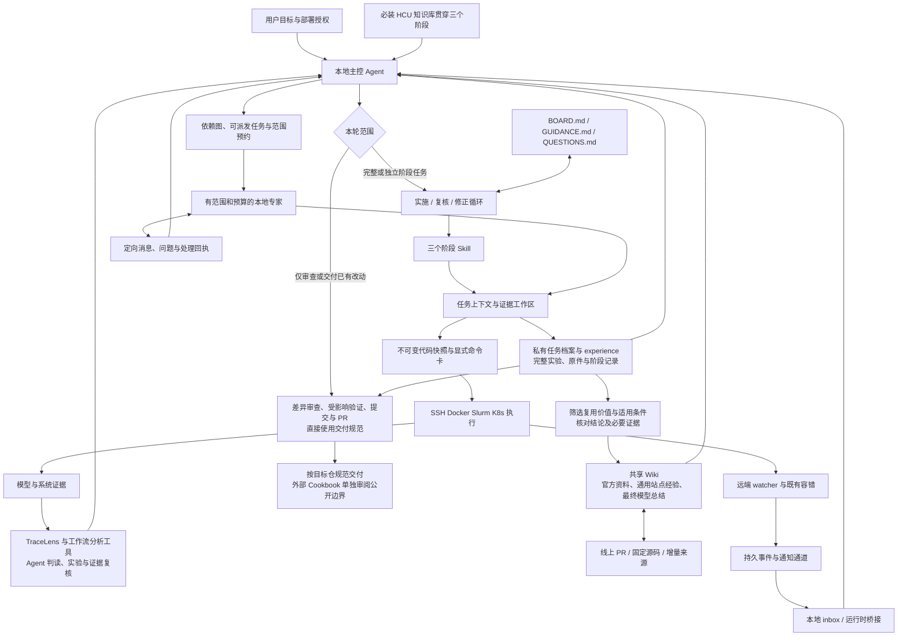

# 架构与边界

按训练任务推进顺序阅读 [工作流全景与阶段细图](workflow-map.md)；本页说明系统职责和实现边界。

## 任务状态与证据

TaskSpec 保存模式、目标、context、权限、预算和 recovery_owner。context 是比较任务的身份，包含初始基线、模型、数据、环境和验证契约；每轮具体实现另外保存在 candidate.snapshot。环境/数据/验证契约变化后旧证据仍可读，但状态回到 prepared，旧报告不能直接用于当前门槛。

full 模式按 prepared→environment_checked→baseline_validated→profiling→optimizing→scale_ready→training→completed 推进；中断状态需说明原因。独立 analyze/environment/diagnose 模式可以交付“不充分或不通过”的报告，但不会把它当作训练准入。

仅交付请求直接走[改动审查与交付](change-delivery.md)，不新建训练 TaskSpec/flow，不借此推进或关闭其他训练任务。其验证范围由改动影响和目标仓规范决定。

SQLite 保存任务、报告、事件、租约、操作和游标；大对象按 SHA256 存储。写入事件与 outbox 同事务。资源 fencing token 防止过期控制者继续发新命令；未明结局的执行阻止该资源重新取得执行权，必须先 reconcile。

统一入口还登记 flow 的目标版本、候选轮次、独立 review、人的指导和问题。`flow-next` 决定工作、修正、复核、推进或介入；`task-transition` 也检查已挂接 flow 的最新复核，不能绕过。候选和 review 对齐具体 context、goal、revision 与 artifact；报告被替换、上下文变化或新指导到来都会使未推进的旧结论失效。完整契约见 [协作循环](collaboration.md)。

## 执行边界

命令卡显式提供 argv、cwd、env、backend、timeout 和来源依据，默认不执行未授权命令。执行意图先持久化，stdout/stderr 写文件；超时、控制器崩溃或 SSH 断线不能简单认定远端已终止，操作进入待核对状态。

这不是权限沙箱，也无法约束任意外部 shell 或另一个控制器。部署依赖 OS/调度器隔离及统一的资源 ID，不能以 Python 租约替代真实资源管理。

## 数据隔离

公共 checkout：通用源码、Skill、文档、示例，以及官方资料、通用站点经验和最终模型总结组成的共享 Wiki。私有工作区：site、任务、参考源码、开发 worktree、运行快照、数据指纹、完整日志、报告、事件与通知配置。模型权重与数据集在站点管理的存储，不加入 bundle。

任务记录不会整批提升到 Wiki。共享页按[知识归属与筛选规则](knowledge-architecture.md)保留适用条件、结论和必要固定证据；官方来源同步遵守文档范围与带理由的排除项。更新后复核相关页、Skill/命令和解析器，验证并同步本机安装；不自动更新 HCU 大知识库或替换运行中的训练依赖。

## Agent 与长训

主控通过带依赖的 assignment 划分分析/实现范围并验收，具体见 [多 Agent 协同](multi-agent.md)。SQLite 原子领取避免名额、资源或修改范围的重复占用；领取 token 和实际 session 分开保存。依赖绑定已验收的报告哈希，消息区分问题/答案/发现/阻塞/交接以及 seen/handled。主控用宿主原生工具派发，库不绑定模型 API。

远端运行训练软件、编译/采集工具，以及已部署的归一化器、Python watcher 和既有容错，不要求远端部署 LLM Agent。守护进程托管、独立观察器、通知通道和恢复规则需按站点接好并验收。Agent bridge 在本机运行，可接站点/用户自己的 Codex CLI launcher；bridge 退出成功仅表示投递返回，事件仍需消费者完成回执。已登记且资源独立的成员操作可以并行，未明结局的操作不能盲目重试；集成和训练阶段推进检查全任务未完成工作。

TraceLens 报告、Graph、Roofline、EventReplay 和原生 Agent 的接入关系见[分析指南](tracelens-analysis.md)与[流程细图](workflow-map.md#36-tracelens-证据怎样进入优化闭环)。指标生成、Agent 推理复核和真实训练验证是分开的状态，工具结果不能直接代替质量与性能验收。

人的文件指导与告警共用持久事件队列。文件轮询和 watcher 都不进行模型推理，具体运行时必须提供 Agent 会话/桥接；本地合成闭环不能证明真实多 Agent 调度、离线唤醒或集群容错已验收。三个阶段 Skill 可独立调用，统一入口不改变 environment/analyze/diagnose 的范围。
