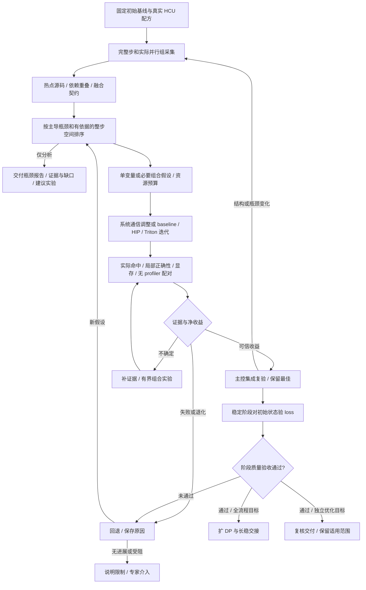

# 性能方法的来源与训练场景适配

本页说明 TrainFlow 采用哪些参考方法、如何核对、为何保留差异。执行方法见优化 Skill 的 [证据驱动闭环](../../skills/hcu-train-analyze-and-optimize/references/evidence-driven-loop.md) 和 [算子上限迭代](../../skills/hcu-train-analyze-and-optimize/references/operator-ceiling-iteration.md)。这些是工作流方法，不是新 Agent 编排系统或额外必装运行时。

引擎原生优化项的发现、实际生效检查，以及调参与依赖补齐的双向衔接，统一见[原生能力调优](../../skills/hcu-train-analyze-and-optimize/references/native-engine-tuning.md)。这项方法同时覆盖官方已合入、候选 PR 和 HCU 特有配置，与并行/显存取舍共同进入现有证据闭环；不新增参数搜索器或宣称全部选项已实测。

## 固定参考与采用范围

2026-10-10 读取以下公开版本的文档和相关源码。这里只复核列出的性能/诊断方法，未运行它们的 AMD/NV 工作负载，未宣称整个参考仓已更新到本仓 Wiki；Wiki 原有锁定快照继续有效。

| 参考 | 固定版本与原始入口 | 采用与调整 |
|---|---|---|
| Hyperloom | AMD-AGI `880c1672a84cb718e48f640def0bd79e24294d44`：[闭环](https://github.com/AMD-AGI/Hyperloom/blob/880c1672a84cb718e48f640def0bd79e24294d44/docs/conceptual/optimization-loop.md)、[分析刷新策略](https://github.com/AMD-AGI/Hyperloom/blob/880c1672a84cb718e48f640def0bd79e24294d44/src/kernelforge/loop/analysis_refresh_policy.py)、[搜索策略](https://github.com/AMD-AGI/Hyperloom/blob/880c1672a84cb718e48f640def0bd79e24294d44/src/kernelforge/loop/search_policy.py)、[工作占比警告](https://github.com/AMD-AGI/Hyperloom/blob/880c1672a84cb718e48f640def0bd79e24294d44/src/hyperloom/orchestrator/trace_analysis/_idle_gate.py) | 初始/最佳/候选分离，主控复测、近似配方起点、热点刷新、停滞后换机制；训练按实际结构和证据变化刷新，不依赖固定收益百分比。空白先排除缺采集和依赖等待，不直接定性 CPU 瓶颈；保持有价值的独立算子分析并行。 |
| GEAK | AMD-AGI `ba509ef31d416350269266b626ec455e9d9475d1`：[端到端](https://github.com/AMD-AGI/GEAK/blob/ba509ef31d416350269266b626ec455e9d9475d1/perf_knowledge/workflows/optimize_e2e_model.md)、[集成验收](https://github.com/AMD-AGI/GEAK/blob/ba509ef31d416350269266b626ec455e9d9475d1/e2e_workflow/roles/e2e_integrator.md)、[profile 角色](https://github.com/AMD-AGI/GEAK/blob/ba509ef31d416350269266b626ec455e9d9475d1/kernel_workflow/roles/profile_engineer.md)、[wrapper](https://github.com/AMD-AGI/GEAK/blob/ba509ef31d416350269266b626ec455e9d9475d1/kernel_workflow/knowledge/wrapper_optimization.md)、[停滞反思](https://github.com/AMD-AGI/GEAK/blob/ba509ef31d416350269266b626ec455e9d9475d1/kernel_workflow/knowledge/self_monitoring.md) | 先证明命中，逐 shape 建模、资源与等待分析、API 包装成本、组合回归和原始 oracle。单卡 TP=1、固定 0.5% 门槛、推理输出对齐、统一 AMD 峰值/计数器、每轮清编译缓存不作为训练默认。训练保留 autograd、状态更新、显存和阶段 loss；不确定小收益只能待组合验证。 |
| BBuf | `6dc9c66a008daded66f214022919ff88b2186252`：[profiler Skill](https://github.com/BBuf/AI-Infra-Auto-Driven-SKILLS/blob/6dc9c66a008daded66f214022919ff88b2186252/skills/llm-torch-profiler-analysis/SKILL.md)、[归因边界](https://github.com/BBuf/AI-Infra-Auto-Driven-SKILLS/blob/6dc9c66a008daded66f214022919ff88b2186252/skills/llm-torch-profiler-analysis/references/heuristics.md)、[重叠案例](https://github.com/BBuf/AI-Infra-Auto-Driven-SKILLS/blob/6dc9c66a008daded66f214022919ff88b2186252/skills/llm-torch-profiler-analysis/references/overlap-catalog.md)、[故障分流](https://github.com/BBuf/AI-Infra-Auto-Driven-SKILLS/blob/6dc9c66a008daded66f214022919ff88b2186252/skills/sglang-prod-incident-triage/SKILL.md)、[复现/二分](https://github.com/BBuf/AI-Infra-Auto-Driven-SKILLS/blob/6dc9c66a008daded66f214022919ff88b2186252/skills/sglang-prod-incident-triage/references/replay-trace-profile.md) | 调用映射与正式时间分开；热点源码、overlap、fusion 三表；先保存失败条件再复现定位。训练扩展到 fwd/bwd/重算/更新、真实并行组与跨 rank join；区间重叠不等于因果隐藏，推理 HTTP/CUDA 调试命令不移植到 HCU 训练。 |

上述方法按 2026-10-10 的固定源码复核；后文 TraceLens 专项另列参考版本，两者范围不同，不表示已更新或覆盖用户的 Hyperloom fork。

2026-10-20 增量复核中，BBuf [`e51089a`](https://github.com/BBuf/AI-Infra-Auto-Driven-SKILLS/tree/e51089a7b5b25939d5ab6f2216df0ba07be30225) 的 profiler/incident 两个登记方法入口正文未变；新增讲解视频资料不改变训练分析与诊断契约。登记 Hyperloom fork 的固定文档仍为 [`0425bde`](https://github.com/yuguo-Jack/Hyperloom/tree/0425bde3f6e76e1588400c37d056dfd3bb75ac11)，采用规则继续按下文专项解释。GEAK 和 AMD Hyperloom 的通用规则复用上表固定源码，仅重读有关测量、证据刷新和停止策略；这不构成未登记来源或全仓最新实现已同步的声明。原有 dispatch/oracle、重叠归因、组合回归和训练状态门槛继续适用，不引入外部的固定阈值或自动编排器。

TraceLens 原生 Agent 的方法另按 HCU fork `f22c517ee6a87850bcc3668facc6452c1b3b5bd2` 的[分析步骤](https://github.com/yuguo-Jack/TraceLens/blob/f22c517ee6a87850bcc3668facc6452c1b3b5bd2/TraceLens/Agent/Analysis/skills/analysis-orchestrator/reference.md)复核。其 top-10 选项和 idle >15% 的 CPU 分析触发条件是该工具的筛选策略，不是 TrainFlow 的 ≥90% 端到端覆盖标准；未生成某类 finding 也不证明不存在该瓶颈。Agent 的字段/表一致性检查只验证报告契约，实际因果、训练正确性与收益仍按本仓闭环复验。`fusion_flagged` 去重不能作为已近上限或停止算子迭代的理由。

## 真实训练案例的采用边界

2026-10-11 核对以下官方实战或论文主源。案例用于建立候选机制；移植时仍核对阶段、模型规模、硬件、依赖、精度和测量范围，不继承原性能数字或验收状态。

| 主源与实际范围 | 可复用的方法与限制 |
|---|---|
| [PyTorch FSDP](https://pytorch.org/blog/maximizing-training/)：7B、128 A100，完成 2T token 训练 | 联合判断容量、重算和吞吐；不同规模采用不同重算策略。MFU 的有用工作与 HFU 的实际执行/重算 FLOPs 分开，不能把 kernel 效率当完整训练利用率。 |
| [PyTorch FSDP + compile](https://pytorch.org/blog/maximizing-training-throughput/)：RoPE 编译适配、输入流水排障、loss/grad norm 与评估，后续 448 GPU 的 7B 训练 | 减少断图还需验证真实 dispatch、数据处理、完整步收益和训练质量；扩大数据规模可能暴露新的 CPU 瓶颈。 |
| [FlashAttention 论文 v2](https://arxiv.org/html/2205.14135v2)：前后向算法、HBM/SRAM IO 模型与实际训练实验 | 重算可增加 FLOPs 同时减少 IO；按当前算法、tiling 与阶段建模，输入输出最小字节量不能代替实际流量。不同序列长度的质量实验不当作同负载加速。 |
| [AMD/PyTorch FP8 训练](https://pytorch.org/blog/fp8-training-on-amd-gpus-with-torchtitan-and-torchao-upstreaming-performance-improvements/)及 [#3972 固定合入](https://github.com/pytorch/ao/commit/7bb7f061ad4d612b4bb3a23b5dedcafa27da8e49)、[#4311 固定合入](https://github.com/pytorch/ao/commit/41cf132b23ee5ae129f7d60bd47aa42909d3621a) | 必要组合保留消融，逐 shape 保留退化，前向/dgrad/wgrad 的精度分别核对。#4311 的 DeepSeek-V3 收益实际来自四层 all-MoE、EP=8、steps 2–10 的代理，不能证明完整 671B 容量、长期 loss 或当前 HCU 收益。 |
| [NVIDIA MLPerf Training 6.0](https://developer.nvidia.com/blog/nvidia-blackwell-tops-mlperf-training-6-0-with-industry-leading-scale-and-performance/)：大规模 Llama/DeepSeek 训练至 benchmark 质量门槛 | 整步 Graph 联合解决动态 MoE 同步、buffer 生命周期和 CPU 提交；通信优先级、延迟 wgrad 与 PP 均衡通过整步实验验证。CUDA 支持与数字不成为 HCU 支持承诺，benchmark 达标不证明完整预训练收敛。 |

引用案例时同时保留原始实验范围和固定代码来源；新闻标题、摘要或一个代理的吞吐不能扩大为完整模型结论。训练 Graph/算子回放的输入、状态与归因边界见 [profiling](../profiling.md) 和 [模型内外对照](../../skills/hcu-train-analyze-and-optimize/references/operator-comparison.md)。

## 与 HCU 知识连接

通过 `$hcu-knowledge-search` 定位下列 ID；路径属于独立 HCU-Knowledge，不要求把内部材料复制到本公开工程。先读正文、原件与固定来源，再核对现场版本。

| HCU 页面 ID | 对流程的约束 |
|---|---|
| `xprof-xcompute-workflow` | PMC/SQTT/replay 的作用与副作用；occupancy 理论上限、实际活跃 wave、小网格要分开；通信重放与 UTCL2 扰动需按手册处理 |
| `hipprof-2610-metrics` | MMOP 与 VALU 口径、L2 与 HBM 流量区别、wave 指标和不同架构支持；不能混用 XProf 与 hipprof 参数 |
| `infra-resource-critical-path` | 同资源工作先相加、独立资源可重叠、依赖阶段不能跨越；tile、融合和共驻资源的代价 |
| `runtime-failure-triage`、`rccl-sm-free-p2p` | 数据/通信契约和异步错误；减少占用 CU 的路径是否有利，要看实际调用和模型重叠而非变量存在 |
| `pytorch-memory-stream-graph-lifecycle`、`torchcomms-async-functional-watchdog` | 调用返回、设备完成、消费 stream 依赖和 host 检测不同；buffer/graph/异步通信生命周期 |
| `aiter-int8-fp8-collective-contract`、`rocshmem-hcu-engineering`、`deepep-current-hcu` | 位传输、数值规约与量化的 oracle 分开；真实消费者的固定依赖、provider 和原地输出协议决定安全回退，独立库 HEAD 的新能力不能直接外推 |
| `primus-turbo-current-maintenance-line`、`te-fp8-state-and-recompute`、`te-linear-norm-communication-lifecycle` | 每次 backward 的主梯度累加、编译准备阶段的写入副作用、低精度持久状态和 UB 编译缓存须随候选复核；compile 支持与 Graph 资格分开 |
| `dcc-engineering-handbook`、`galaxy-engineering-handbook`、`triton-hcu-mls-pipeline-contract`、`tilelang-hcu-pass-ownership` | 前端/后端/runtime 与生成代码分别固定；同步所有权、memory scope、capture 限制与 launch ABI 变化会使旧证据失效，静态资源数字不替代计数器或硬件回归 |
| `rocblas-kme-padding-contract` | 孔明e GEMM padding 案例；分析 GEMM 连同额外 copy/workspace，不能只量主矩阵指令 |

以上联查入口于 2026-10-20 对照 HCU-Knowledge `3829ef06e7c7` 复核；ID 以当前 KB 索引为准，缺项时按标题/机制搜索。具体接口检查落在优化 Skill 的[库接入](../../skills/hcu-train-analyze-and-optimize/references/hcu-library-integration.md)和[通信专项](../../skills/hcu-train-analyze-and-optimize/references/communication-optimization.md)，不在本页复制一套实现说明。知识中的源码分析和历史实验都有各自范围，不自动成为当前硬件的性能基线。

## 在现有流程中的位置

已有 TrainFlow 的模式边界、主控独立复核、动态 Agent 分工、同形状对照、数学库 tune 输入、三项算子 Skill 和阶段 loss 继续沿用。参考工程不新增固定 Agent 人数、并行硬件争用或另一套账本。

## 维护与验证边界

### TraceLens 调用链核对

2026-10-13 专项核对的固定源码为 Hyperloom `0425bde`、GEAK `c0c0e2a`，与前文通用方法的参考版本分别保留。它们并未要求每次执行全部 TraceLens 工具。

| 参考实现 | 实际采用的方法 | TrainFlow 的落点 |
|---|---|---|
| Hyperloom [tracelens_skill_runner.py](https://github.com/AMD-AGI/Hyperloom/blob/0425bde3f6e76e1588400c37d056dfd3bb75ac11/src/hyperloom/agents/kernel/tools/tracelens_skill_runner.py) | 给原生分析 orchestrator 传实际 trace、平台、capture 和输出目录，接收报告；分析阶段不直接改 kernel | `agent` 准备指标后由当前 Agent 查证；不自动启动另一套宿主/多 Agent 审核 |
| Hyperloom [tracelens_analysis.py](https://github.com/AMD-AGI/Hyperloom/blob/0425bde3f6e76e1588400c37d056dfd3bb75ac11/src/hyperloom/agents/kernel/tools/tracelens_analysis.py) | 结构化候选、shape/效率线索、源码位置与可修改性；按源码函数归并候选 | 热点→源码→调用契约→实现任务，归并实现但保留各 shape/phase 的证据 |
| GEAK [profiler.md](https://github.com/AMD-AGI/GEAK/blob/c0c0e2aee5e2bec70583253058382523bdf7a3ab/e2e_workflow/roles/profiler.md) | 初始轮可复用 TraceLens 先验；shape/dtype 回查稳态原 trace；变更后重新采集；模型估计仅供建议 | 复用条件写入现有证据刷新规则，保留 ≥90% 覆盖与高占比未知项 |
| GEAK [run_e2e.py](https://github.com/AMD-AGI/GEAK/blob/c0c0e2aee5e2bec70583253058382523bdf7a3ab/interface/run_e2e.py) | 向端到端流程传递可选的既有 TraceLens 报告 | 通过固定任务证据链接交接，不把报告文件存在等同于当前候选已分析 |

切分、合并、TraceDiff 和索引是本仓按训练分析需要补齐的原生入口，不宣称以上两个框架默认调用了每项功能。详细选择与命令见 [TraceLens 分析](../tracelens-analysis.md)。

更新 Wiki/Skill 时一起复核上述固定路径的新版本与本仓采用规则；重点看默认门槛、测量方法、profile 刷新、dispatch、oracle、模式/重放副作用和支持范围。只比较相关差异，不机械合并上游流程或下载整个依赖生态。相关能力变化还应检查 `analysis.py`、质量评估、TraceLens 解析、主控交接和三个阶段的异常路由。

上述实战方法经源码/知识查证和本地回归，未在 HCU 复现这些案例的完整训练或故障注入。TraceLens 工具另在 gfx936 上完成有界真实采集、Graph、回放和校准，范围见 [分析与验证](../tracelens-analysis.md)。现场跨节点因果、模型实际算子效率和生产故障恢复仍以任务验证为准。文档中的 Amdahl、Roofline 是带假设的评估方法，不能自动证明物理瓶颈、实际加速或训练收敛。
