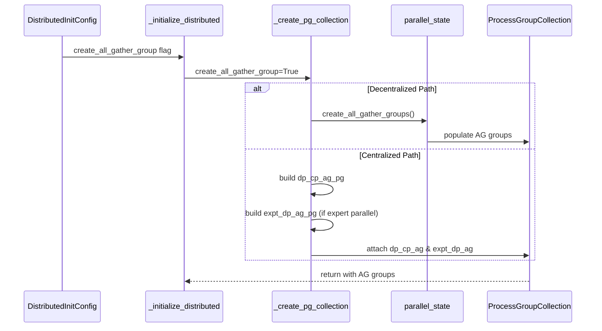

# Add AG/RS overlap distributed init support

[Upstream PR](https://github.com/NVIDIA-NeMo/Megatron-Bridge/pull/2487) · state: open · merged: False

## Original PR description

# What does this PR do ?

Enable AG/RS overlap process-group plumbing in Megatron-Bridge distributed initialization by adding support for `create_all_gather_group`, including expert-parallel all-gather groups when `EP > 1`, and wiring these groups into `ProcessGroupCollection`.

# Changelog

- Add `create_all_gather_group: bool = False` to `DistributedInitConfig` in `src/megatron/bridge/training/config.py`.
- Update `src/megatron/bridge/training/initialize.py` to thread `create_all_gather_group` through distributed init.
- In the decentralized (`HyperCommGrid`) path, create and attach:
  - `dp_cp_ag` (DP+CP all-gather group)
  - `expt_dp_ag` (expert-DP all-gather group when EP is enabled)
- In the centralized path, call `parallel_state.create_all_gather_groups(...)` after model-parallel init and attach returned AG groups to `ProcessGroupCollection`.
- Keep default behavior unchanged when `create_all_gather_group=False` (no AG group creation, existing behavior preserved).
- No intended packaging/build-system changes are part of this PR (`pyproject.toml` local testing override is excluded).

# GitHub Actions CI

See the [CI section](https://github.com/NVIDIA-NeMo/Megatron-Bridge/blob/main/CONTRIBUTING.md#-running-github-ci) in the Contributing doc for how to trigger the CI. A Nvidia developer will need to approve and trigger the CI for external contributors.

# Before your PR is "Ready for review"

**Pre checks**:

- [x] Make sure you read and followed [Contributor guidelines](https://github.com/NVIDIA-NeMo/Megatron-Bridge/blob/main/CONTRIBUTING.md)
- [ ] Did you write any new necessary tests?
- [ ] Did you add or update any necessary documentation?
- [x] Does the PR affect components that are optional to install? **No**
  - [x] Reviewer: Does the PR have correct import guards for all optional libraries? **N/A**

If you haven't finished some of the above items you can still open "Draft" PR.

# Additional Information

- Related to [#<issue-number>](https://github.com/NVIDIA/Megatron-LM/pull/3249)
- Supposed to replace this PR : https://github.com/NVIDIA-NeMo/NeMo/pull/15253
- Manual validation status:
  - PR behavior tested end-to-end and training works.
  - Nsight Systems shows AG/RS overlap in tested runs.

<!-- This is an auto-generated comment: release notes by coderabbit.ai -->

## Summary by CodeRabbit

* **New Features**
  * Added a configuration option to enable optimized process groups for improved distributed training performance.

<!-- end of auto-generated comment: release notes by coderabbit.ai -->

## Review and discussion

### reviews

- yaoyu-33 · DISMISSED · 2026-03-02T00:51:06Z · [source](https://github.com/NVIDIA-NeMo/Megatron-Bridge/pull/2487#pullrequestreview-3873654456)

(No body; status only.)

- cspades · COMMENTED · 2026-03-16T15:46:06Z · [source](https://github.com/NVIDIA-NeMo/Megatron-Bridge/pull/2487#pullrequestreview-3954822643)

(No body; status only.)

- cspades · DISMISSED · 2026-03-16T15:46:55Z · [source](https://github.com/NVIDIA-NeMo/Megatron-Bridge/pull/2487#pullrequestreview-3954829071)

(No body; status only.)

- yaoyu-33 · COMMENTED · 2026-03-16T16:28:43Z · [source](https://github.com/NVIDIA-NeMo/Megatron-Bridge/pull/2487#pullrequestreview-3955148685)

(No body; status only.)

- jeffnvidia · COMMENTED · 2026-03-17T15:31:51Z · [source](https://github.com/NVIDIA-NeMo/Megatron-Bridge/pull/2487#pullrequestreview-3961737723)

(No body; status only.)

### issue_comments

- copy-pr-bot[bot] · comment · 2026-02-23T10:35:03Z · [source](https://github.com/NVIDIA-NeMo/Megatron-Bridge/pull/2487#issuecomment-3943936602)

This pull request requires additional validation before any workflows can run on NVIDIA's runners.

Pull request vetters can view their responsibilities [here](https://docs.gha-runners.nvidia.com/cpr/vetters).

Contributors can view more details about this message [here](https://docs.gha-runners.nvidia.com/cpr/contributors).

- coderabbitai[bot] · comment · 2026-02-23T10:41:18Z · [source](https://github.com/NVIDIA-NeMo/Megatron-Bridge/pull/2487#issuecomment-3943968195)

<!-- This is an auto-generated comment: summarize by coderabbit.ai -->
No actionable comments were generated in the recent review. 🎉

ℹ️ Recent review info

**Configuration used**: Path: .coderabbit.yaml

**Review profile**: CHILL

**Plan**: Pro

📥 Commits

Reviewing files that changed from the base of the PR and between 9ecee6cfae7629210f0b0d3c58b7902fdf7a2837 and 7f4e63f547cbbf484a8d934f92bbb28c1cdaca29.

📒 Files selected for processing (2)

* `src/megatron/bridge/training/config.py`
* `src/megatron/bridge/training/initialize.py`

---

<!-- walkthrough_start -->

📝 Walkthrough

## Walkthrough

This change adds a new configuration field `create_all_gather_group` to `DistributedInitConfig` and implements conditional creation and integration of all-gather process groups into the `ProcessGroupCollection` during distributed initialization, with support for both decentralized and centralized initialization paths.

## Changes

|Cohort / File(s)|Summary|
|---|---|
|**Configuration**   `src/megatron/bridge/training/config.py`|Added new boolean field `create_all_gather_group` to `DistributedInitConfig` class with documentation explaining its role in enabling AG/RS overlap optimization for FSDP training.|
|**Initialization Logic**   `src/megatron/bridge/training/initialize.py`|Added `create_all_gather_group` parameter to `_create_pg_collection` function to conditionally build and attach `dp_cp_ag` and `expt_dp_ag` process groups. Parameter propagated through `_initialize_distributed` with separate code paths for decentralized and centralized initialization modes.|

## Sequence Diagram(s)

## Estimated code review effort

🎯 3 (Moderate) | ⏱️ ~25 minutes

## Possibly related PRs

- NVIDIA-NeMo/Megatron-Bridge#1062 — Exposes `pg_collection` on `GlobalState` and integrates it into setup/training, directly building upon the `ProcessGroupCollection` plumbing being extended here for all-gather groups.

## Suggested reviewers

- ananthsub

<!-- walkthrough_end -->

<!-- pre_merge_checks_walkthrough_start -->

🚥 Pre-merge checks | ✅ 3 | ❌ 1

### ❌ Failed checks (1 warning)

|           Check name           | Status     | Explanation                                                                                                                          | Resolution                                                                                                                                                                                                     |
| :----------------------------: | :--------- | :----------------------------------------------------------------------------------------------------------------------------------- | :------------------------------------------------------------------------------------------------------------------------------------------------------------------------------------------------------------- |
| Test Results For Major Changes | ⚠️ Warning | PR lacks documented test results and performance metrics for major AG/RS overlap optimization feature in distributed initialization. | Add comprehensive unit tests for create_all_gather_group, quantified performance benchmarks with specific metrics, hardware configuration details, convergence validation, and complete documentation updates. |

✅ Passed checks (3 passed)

|     Check name     | Status   | Explanation                                                                                                                               |
| :----------------: | :------- | :---------------------------------------------------------------------------------------------------------------------------------------- |
|  Description Check | ✅ Passed | Check skipped - CodeRabbit’s high-level summary is enabled.                                                                               |
|     Title check    | ✅ Passed | The title clearly and concisely summarizes the main change: adding support for AG/RS overlap in distributed initialization configuration. |
| Docstring Coverage | ✅ Passed | Docstring coverage is 100.00% which is sufficient. The required threshold is 80.00%.                                                      |

✏️ Tip: You can configure your own custom pre-merge checks in the settings.

<!-- pre_merge_checks_walkthrough_end -->

<!-- finishing_touch_checkbox_start -->

✨ Finishing Touches

- [ ] <!-- {"checkboxId": "7962f53c-55bc-4827-bfbf-6a18da830691"} --> 📝 Generate docstrings (stacked PR)
- [ ] <!-- {"checkboxId": "3e1879ae-f29b-4d0d-8e06-d12b7ba33d98"} --> 📝 Generate docstrings (commit on current branch)

🧪 Generate unit tests (beta)

- [ ] <!-- {"checkboxId": "f47ac10b-58cc-4372-a567-0e02b2c3d479", "radioGroupId": "utg-output-choice-group-unknown_comment_id"} -->   Create PR with unit tests
- [ ] <!-- {"checkboxId": "07f1e7d6-8a8e-4e23-9900-8731c2c87f58", "radioGroupId": "utg-output-choice-group-unknown_comment_id"} -->   Post copyable unit tests in a comment

<!-- finishing_touch_checkbox_end -->

<!-- announcements_start -->

> [!TIP]
> [Issue Planner](https://www.coderabbit.ai/issue-planner) is now in beta. Read the [docs](https://docs.coderabbit.ai/issues/planning) and try it out! Share your feedback on [Discord](https://discord.com/invite/coderabbit).

<!-- announcements_end -->

<!-- tips_start -->

---

Thanks for using [CodeRabbit](https://coderabbit.ai?utm_source=oss&utm_medium=github&utm_campaign=NVIDIA-NeMo/Megatron-Bridge&utm_content=2487)! It's free for OSS, and your support helps us grow. If you like it, consider giving us a shout-out.

❤️ Share

- [X](https://twitter.com/intent/tweet?text=I%20just%20used%20%40coderabbitai%20for%20my%20code%20review%2C%20and%20it%27s%20fantastic%21%20It%27s%20free%20for%20OSS%20and%20offers%20a%20free%20trial%20for%20the%20proprietary%20code.%20Check%20it%20out%3A&url=https%3A//coderabbit.ai)
- [Mastodon](https://mastodon.social/share?text=I%20just%20used%20%40coderabbitai%20for%20my%20code%20review%2C%20and%20it%27s%20fantastic%21%20It%27s%20free%20for%20OSS%20and%20offers%20a%20free%20trial%20for%20the%20proprietary%20code.%20Check%20it%20out%3A%20https%3A%2F%2Fcoderabbit.ai)
- [Reddit](https://www.reddit.com/submit?title=Great%20tool%20for%20code%20review%20-%20CodeRabbit&text=I%20just%20used%20CodeRabbit%20for%20my%20code%20review%2C%20and%20it%27s%20fantastic%21%20It%27s%20free%20for%20OSS%20and%20offers%20a%20free%20trial%20for%20proprietary%20code.%20Check%20it%20out%3A%20https%3A//coderabbit.ai)
- [LinkedIn](https://www.linkedin.com/sharing/share-offsite/?url=https%3A%2F%2Fcoderabbit.ai&mini=true&title=Great%20tool%20for%20code%20review%20-%20CodeRabbit&summary=I%20just%20used%20CodeRabbit%20for%20my%20code%20review%2C%20and%20it%27s%20fantastic%21%20It%27s%20free%20for%20OSS%20and%20offers%20a%20free%20trial%20for%20proprietary%20code)

Comment `@coderabbitai help` to get the list of available commands and usage tips.

<!-- tips_end -->

<!-- internal state start -->

<!-- DwQgtGAEAqAWCWBnSTIEMB26CuAXA9mAOYCmGJATmriQCaQDG+Ats2bgFyQAOFk+AIwBWJBrngA3EsgEBPRvlqU0AgfFwA6NPEgQAfACgjoCEYDEZyAAUASpETZWaCrKPR1AGxJcAgrXo+AOIA9DYAyvxSFB5o3JC0SLgU8AJ4dCgY6vbY3Nz4FLiQABS2kGYATAAsABwA7ACUbgjIpWj+yA65+YUAZvmMFCTU8BhE6B4exNSwlMVB9TwU+AzSyERLOcgEkGQqXpBBoRH4UTFx3B6OaqMZkACyJETUSxhgAELJtKTxicmpNPQRup4GgPPAAF7DfAYDSQADCsEwpGQIwYlyUHCMUB8VgAksEmBgevAiJjILoDv4BkMaAB9UEeWlPXAzChMjbcLgCfD4DyQAC8kAAYqDECRINsACK/FJpWi4zK4OHQ4ljIqICgMYJsZkvYICT6kYJJbSZUYElUkjTcWT1DQGclQOCDNrU6gkekTJnTSjs/A5CWwDZEWA/RBJWUAjJZEb2TXax7PaH6w0kY1UIHmoHiUEQkjW2T2gxQN4kRESeD5MkUgDqMywDBddIZ3pZvvW/riqF2Ai8tAANAdApAO5t0IM3VHMPQAO7wQaAjDbKxLFaIRCBDnKiaicTQ+2OyCS0TsKhg8HpIoACVk3EoytYm/gtAW3GmXEbNPF0/QuFwaAYUNaG4WkGBAtA1Voag0DAN8zy8PkAGpGBmBgAGs8hGXBggZKY2z4UduAWH8SAAD24XBaWA+k1TIu8CjASUrHGSZmVZEcOUgGd60gABRZi9EgABGO0HQpOFT1zC96DfFkPwZHhnAZEhGXDd0NE/d1PUZNj2w5RAig0IziJ6Gg+GYRQVNgpSdz5bN0AwehqH/QDIEGXBsAocgAmHQitnwaxV1WTdO23LwxErGExKgY8ejQbAPEKAQyzQCt+l4aRKCkWceM05svV0tlCP5EUPDFYoMACoIOM7SdItE4tIAAeXwyBKpoRBqygAA5AK33QiCRiIfVsHgDxaDARBZHDEhmBQpFpAyNFsCUegihtXh8BEMQNAIZg+Q8ZZQQlaRxBuE5KE+cUyOW1bRMPOFcS4bqADVcUlXEfHiEgpEO+j0FyJYJGOwYAEdRoXCUAojIhSD4QJ1CvbABAOCLoWQR6eFmQY8kQdR8nkOEmu66AbFxN4AFVoFxbrh1oZYDwpFcSDAQDRDQzqFCXP48H6IhRqUMFyGQPoJnwGc6AAbhO8NkB/emGEcdgoSwHIoI68dxXahRmAuEgAUZqAbBU91Z3yNCuEGHpKDINdIFe97PuCB5dWhMAABk7msOwfzQRZKz4bqSDuALSiwshVqhyBkrckgLgAuhDfuTBsGO4GwXVyKuAjsACDACOZYBQcTUzMYZ3NxBBx/bq8ZDQowmmmhmA6WBxeQQ5wkiSgzluDqowobAMEQIt9GMcAoAL/AehwPPSHIKgoyYVh2C4Xh+GEXdJEWuQFCUKhVHULQdFHkwnWaFA5aweLZ7IZRF5YNgl0ttAZ2yJwXGj+QmD3lQ1E0bRdBgEMGPUwBgNRah1EmDAKZnxGhLmaYahJVQFkxAAInQQYCwBxcTEFvgvdIDh37yCnvNUY0gsSUloHLNqJBX7cGRmCBgXNVSeRVpAYkKl6B5Q9C2Qqfochch5HyQUpVypShlP8OgCp1DKiJFaGAMx2HwE4UtdEi0/ZKEQI2eAFEt7xGWOGZINw6IxFLoGagKBCjcI6HHJSNAWJ4XYptNcax9LsP6B3Y4pxYj8F0cwCEbDYxCjCExCUGYEGDh7ELMYF1og+OSrgCWZB3EUBnM4JyExHGzB/AIACaE0kUHoAubAKxJoMGcrMJezBB7wHKXuIeUd4C6yBuKeifQKDMEwCsWEcBUCoD9vQicbQEj1Kjm2eI0FIAWUFlxdQoZKooGXgkd00cUppTPKQ5ERYKFhBJBgagnlxSAQWp1aK8IYjri4NKQxkYpGKlkaqYo4CEyu2gQaWBaZ4FDQtHIogBZGiHj8JHehvZam/gjJIj8TYeEFR9EVDkgjeQCmFKKEgZzJTLCVkuFWXARhC3FArG5NwlD/jGkNHgnlcbfkcos/qhRoRDiOF3OJXYsDBKYuYSwPhEp30iv5QMBLRAxAXny/g086LdHSOlBhYL2DAnIY1B4LJFDoH8HQZ60I0VQCVa3egtd9keQnGrU2GryCNRes4EEvZxSDH2WwWgpqtXWBlUwuVuB5CgjMuqyh6QOHjUnDCnScL+GcmjkI5FojxTbDRGgdcR4JFymkUqS0YxYzPMgUkZM7yvifPCd8pBVobRGHdiMRaxyyEOsgIhWowQwAAAYjC8XDE002u8bU/WUa/EgPR2mcHuHQeAjgDDoNQViUB6bEyZreamdMppvnZhBOefMNo0EYKwT4HBc874EMcJ0j+JDy3IgoUC9IftyCv25LyIYWA4JoDYGZAN2lWyshDVHUC0LaTcCIKBXk4VRnbHwLo6EDJ5CpDGk5GlqJ8h5HwQ4wqixlirBqmOIo1U/ILCwtDRRgwHCJXJSuRD64Qo5DCpvfcjU6zJO4U+vhhEL4wAHiQQc76vyfu/UwHcaMsCVS7RgJW+DL70DA+NLY5chzIe4Kcw81EwI0TY1wP2TFWbQhoKRbCzikN0dzEQbysyWQCviCBWTX63KYA5knOilFqIQXkw5HY5FKC4EYsxXC8G6NFHgOKhzBRFLwRUkgOa3Z9nWpfIzOAmUJNyyGX+ACMx6DbHGThhKZ0xgEZccR7gpGuPoGQDJ8CYwSLkSs/l2OiA7wRV+oWRqm03zMiOR+3hwa6MsmDKGcZCQbmSMXMCKSbDZKwC6pAWkC6pIeg6xCuUbVxaKXXItcbP7fkaQa7C/Cr7MNDeo1+n9nH6lJ1xNPebBa/nYDFFRE83NRu0DY/R6AjGq6mUqU2cl4y1KOXSZFwcaG3HOHq1+NaFYBk2QQrSNSNAlusca6t9DDkZKAYSq29bfs0vBS3L+sjGBBzcVqaGVA7lPK6aGNEeQ2wTtRsUV9zsw8zn7fE35TWsdwanXSLGcZKwLtLpktMYuijv6/fdIJ8FsW5tGZK4ViiVESvrfGcjojqOduRVWe09thqEH2m1SMfohJM18h6IdV+bQhAndwI/XAyAyAOAnBTscP2A30GhB4eQ3Fklg2wEziDTkJyEjxjNJcDv7NUvoADgzILGGBUIxuOXf6FfhwoHFbpRhOUHB5SK9GYzFFKBjSnhpJCJUFClXwEPsqlzysQBQnVKr9UHKNdwdW3qAAGLGtJbY41H6ERRpkqQW6qQcfHmBUQTQCWkgHxD+IvGyEYr21yDlIJRWayV/BDVpFQDAHN+S9XINP/Wn78B43qbSOfdAEijCX2ZxAa/NX1Dr5AQASYSQAb5t9jaOuPt8soyI7PfHD9863KIffi8zj6Hn/AwCnxHC3wPwX2P2X1X3XyY1AMolxmBGhH32YHnyP2/SgLPxgMHGo0hxfUIkRWERRTKhIEv1uDrwnVeRgRzVnVLmCBGyXQLDr0TzuEwE81OmFDGnFB8H2QdzH2LVLWQEPW9UQkqEqFrQbQMCbRH1bV51jgrFoR2B7W6C4CvBJFgGHQwWLCARAQnhpRIWvkIC3XwS4QfhXlM1fkIT3VAy/ksn3j/iPkAUMFPh1n8UomfEQCXw7VoToBB3/B81HgMGcNqB6EqBIAADYABmHoAAVkqFqAYFUBCOqEqDQGqFoAAE4IjKgeh0jyhVABByhqgGAhIGAoJylyh0jHCdCXD1BhsqFPD5CJYrsC4T5x5FgPQ2AKBSBQJUIOZfDnBCgAiABvMSVBJAWwN4Q6dCOgB8E3KwHfAEVBLgOKYg/sUYxAVuBKWgSY5YNCWwJY9hVFNY8kMYxAJqKIT4JQDAA4lYsUY4yAVBBIWgGwQeDFBgMICMUYRABEdmA4pIV3e4x458F4jAdwXALwH49CP4u7UYp4kE48LRZIIDDASEtCG4o40YoWNCKRdcV3RAD4igA49BQEi5JUXo42XDU3A4gAbTEnJBGPJEZIeLZnQm6jvRICJIRO0WRPhF6NQXuKZNQVBxO2hIBLpMZNQRMUwBViJNRPsDQh0TvHoCgGVCUBsF/nUEAEwCZABAEMMALwX6N+Kw+jKJROfk8Uk4jvIkgpBBc0pkk4/IEkEYUEVEtktgIkzRbk+pUdJkgAXwFMgAZPtNQRZLQjdI5K4FQTBP2FDLtODOFMQFFKYwtIeKlINUiiJPCwlE8COS8GcD9x/EJAYCQBUnkEsMtQvC2EUU6VjCEIUwgLGE6Bg16A8RCE7liR7ljHGx5ijHoICVGSO1YV2zjMFKtMjJtKGhHIlMGEHMGHRNWJTNQUdKIGdI8FdPZKJPEHBI5PFP9PFKDMFNDPDM5IMU+LGGVCiAgg5IDJOITKTJvNTPIhiHTOhBPIYCJTGCYEvO+FQCEjrTrQ0H/IAFIuIEBXJUAHAe1allElwelsMSBwZ5x0gWtpBW5/VUBqgALgKNApzLTLJrTnBbSHylzkgVyeD1z3TIzCUzzEzdyAyDyJS0yZTIzSgYh0JctMUTdkL2CktEoBc2l8hOlgDxR71kh3yUkpk0AhBWymUOyfFh8ml+yFdrYq9xQuyB9mdFRF0lL9xcKHicNeQ8AMzIygUdYMp6w8YpBIAalCg+4RZNdlsg0ocORBxwZMBxAOEZJKB2khKVhVlgDYA90OY9NQwytRBPMwVRLalK5IBERCkCkjkU0hyFcSVtAypsDoQog54/L05nwVYq4aUl49Z7EFYsV/xRljUOocLiKjyNzIzoB2CKTktkAhR+gWDpK+AEQTk9LUExyHiJzRgeq7zliMT7T9LRAkq5yRqFyxqSKnTyLejjzIzFZwwWAfTGTfSxIABdEk2NXAWwLkpE70yM8oaI4I2gaoAQMIhgSoCooSNAOtWoEgAooSOoGoMI0Q6I9IutWgSI2oJ6oSEgcoBgCI9I2gcpGoDIhgcoNAEgISL62oWgAQaIutHoaoaIuM1BUk2waMiMh48oWgSodIlYV6/8wm6oCI5I2G0QNAcoHoWgLIgQdI2oaoEgaIq6gQBm/wKoSGy6+GkgImoSWoNoHIgQCIlQVIyoTG6ioxIgC85QUgBUMyHgj490A4hioU+MDNPUbNOBPNLMLS0bAsdWxcggf8DwIUQeLjRMrgcoYinoK2+pRAGsOZN4j8m2yAcoXcsSTazawItojKWkTo7o0Mjwlo7Q5wgwz9eKU7UHD0NSfw7QgwIYrGvaqwGOugHwXAY2RomYh+GRf0JcJYutP2yO3maO0nfoukcOvQIAA= -->

<!-- internal state end -->

- yaoyu-33 · comment · 2026-03-02T00:52:03Z · [source](https://github.com/NVIDIA-NeMo/Megatron-Bridge/pull/2487#issuecomment-3981451301)

/ok to test 7f4e63f547cbbf484a8d934f92bbb28c1cdaca29

- jeffnvidia · comment · 2026-03-19T11:53:54Z · [source](https://github.com/NVIDIA-NeMo/Megatron-Bridge/pull/2487#issuecomment-4089601727)

@cspades @yaoyu-33 , let me know if I need to do additional changes, thanks !

### inline_comments

- cspades · comment · 2026-03-16T15:46:07Z · [source](https://github.com/NVIDIA-NeMo/Megatron-Bridge/pull/2487#discussion_r2941248965)

File: `src/megatron/bridge/training/initialize.py` · line None

Note to self: Adding this to the PG collection will be passed to the Megatron-FSDP DDP `FullyShardedDataParallel` adapter which then passes it to the `FSDPDistIndex` / `MegatronFSDP` class API.

- yaoyu-33 · comment · 2026-03-16T16:28:43Z · [source](https://github.com/NVIDIA-NeMo/Megatron-Bridge/pull/2487#discussion_r2941519737)

File: `src/megatron/bridge/training/initialize.py` · line None

why "grid.create_pg(...)" not working? ideally shouldn't use internal api here, bit risky.

- jeffnvidia · comment · 2026-03-17T15:31:51Z · [source](https://github.com/NVIDIA-NeMo/Megatron-Bridge/pull/2487#discussion_r2947660454)

File: `src/megatron/bridge/training/initialize.py` · line None

From what I can tell, grid.create_pg(["dp", "cp"]) can't be used here because it was already called on line 415 to create dp_cp_pg. 

If I understand correctly, calling it again would raise a KeyError — create_pg keys by dimension names only (line 151 of hyper_comm_grid.py), so any second call with ["dp", "cp"] would collide with the existing "dp-cp" entry, regardless of group_desc or pg_options. 

The AG group needs the same ranks but as an independent NCCL communicator, so I used _gen_rank_enum to get the rank lists and passed them to new_subgroups_by_enumeration directly. Same situation for the expert grid on line 516. 

That said, I'm not super familiar with the HyperCommGrid internals — happy to refactor if there's a preferred way to create a second PG with the same rank topology ?

## Changed files and fixed code

- `docs/fern/versions/nightly/pages/training/megatron-fsdp.mdx` · modified · additions 19 / deletions 0
  - [head](https://github.com/jeffnvidia/Megatron-Bridge/blob/f48e05eb50f377027ac7e2f3f147d975479cad50/docs/fern/versions/nightly/pages/training/megatron-fsdp.mdx)
  - [base](https://github.com/NVIDIA-NeMo/Megatron-Bridge/blob/e301c817218e4e626c8c264aee9935514559a04b/docs/fern/versions/nightly/pages/training/megatron-fsdp.mdx)
- `docs/training/megatron-fsdp.md` · modified · additions 19 / deletions 0
  - [head](https://github.com/jeffnvidia/Megatron-Bridge/blob/f48e05eb50f377027ac7e2f3f147d975479cad50/docs/training/megatron-fsdp.md)
  - [base](https://github.com/NVIDIA-NeMo/Megatron-Bridge/blob/e301c817218e4e626c8c264aee9935514559a04b/docs/training/megatron-fsdp.md)
- `src/megatron/bridge/training/config.py` · modified · additions 8 / deletions 0
  - [head](https://github.com/jeffnvidia/Megatron-Bridge/blob/f48e05eb50f377027ac7e2f3f147d975479cad50/src/megatron/bridge/training/config.py)
  - [base](https://github.com/NVIDIA-NeMo/Megatron-Bridge/blob/e301c817218e4e626c8c264aee9935514559a04b/src/megatron/bridge/training/config.py)
- `src/megatron/bridge/training/initialize.py` · modified · additions 46 / deletions 1
  - [head](https://github.com/jeffnvidia/Megatron-Bridge/blob/f48e05eb50f377027ac7e2f3f147d975479cad50/src/megatron/bridge/training/initialize.py)
  - [base](https://github.com/NVIDIA-NeMo/Megatron-Bridge/blob/e301c817218e4e626c8c264aee9935514559a04b/src/megatron/bridge/training/initialize.py)
- `tests/unit_tests/training/test_decentralized_pg.py` · modified · additions 131 / deletions 7
  - [head](https://github.com/jeffnvidia/Megatron-Bridge/blob/f48e05eb50f377027ac7e2f3f147d975479cad50/tests/unit_tests/training/test_decentralized_pg.py)
  - [base](https://github.com/NVIDIA-NeMo/Megatron-Bridge/blob/e301c817218e4e626c8c264aee9935514559a04b/tests/unit_tests/training/test_decentralized_pg.py)

## Evidence and interpretation boundary

[Original JSON, discussions and patches](../../../../../../evidence/prs/NVIDIA-NeMo--Megatron-Bridge/2487-330f3cf25d25b9d5d75f7923f3830171585898590494d5fddc2d67319903a431.json) · SHA-256 `330f3cf25d25b9d5d75f7923f3830171585898590494d5fddc2d67319903a431`.

Diff complete: True. Missing/binary/truncated patches require pinned source inspection. This is a source page, not an independently verified optimization case. Open, merged and released are different states; recheck the deployed dependency.
