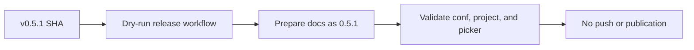

# [ci] test: exercise release docs preparation

[Upstream PR](https://github.com/NVIDIA-NeMo/Megatron-Bridge/pull/5641) · state: open · merged: False

## Original PR description

## Background

Companion validation for [NVIDIA-NeMo/FW-CI-templates#554](https://github.com/NVIDIA-NeMo/FW-CI-templates/pull/554). Megatron-Bridge `v0.5.1` contains package version `0.5.1` but docs metadata version `0.5.0`.

## What changed

- Pin `_release_library.yml` to the FW-CI-templates PR commit.
- Enable release docs metadata preparation.

## Details

This PR must not merge with the temporary FW-CI commit pin. After FW-CI-templates#554 is released, replace the pin with the released immutable tag SHA.

## Tested

- `git diff --check`
- `actionlint .github/workflows/release.yaml` — workflow parsed; only pre-existing SC2086 findings remain in the untouched release-summary block.
- `uv run --no-sync pre-commit run --all-files` — passed all hooks. The initial sync attempt was blocked by the existing isolated `fast-hadamard-transform` build missing Torch.
- [Release dry-run 32137007085](https://github.com/NVIDIA-NeMo/Megatron-Bridge/actions/runs/32137007085) — `success`; bump job [95710720969](https://github.com/NVIDIA-NeMo/Megatron-Bridge/actions/runs/32137007085/job/95710720969) resolved `0.5.1`, prepared and validated `docs/conf.py`, `docs/project.json`, and `docs/versions1.json`, and skipped push/merge under `dry-run=true`; wheel validation, dry-run release finalization, docs build/linkcheck, and dry-run docs publication all succeeded.

## Review and discussion

### reviews

### issue_comments

- copy-pr-bot[bot] · comment · 2026-08-18T12:27:10Z · [source](https://github.com/NVIDIA-NeMo/Megatron-Bridge/pull/5641#issuecomment-5328147119)

Auto-sync is disabled for draft pull requests in this repository. Workflows must be run manually.

Contributors can view more details about this message [here](https://docs.gha-runners.nvidia.com/cpr/auto-sync).

### inline_comments

## Changed files and fixed code

- `.github/workflows/release.yaml` · modified · additions 2 / deletions 1
  - [head](https://github.com/NVIDIA-NeMo/Megatron-Bridge/blob/6770a7d9a9fb1f073fa8591ffb7b779a0cbe79ab/.github/workflows/release.yaml)
  - [base](https://github.com/NVIDIA-NeMo/Megatron-Bridge/blob/3f87ba60823a268b0c5102e9be3b3bd0012923cd/.github/workflows/release.yaml)

## Evidence and interpretation boundary

[Original JSON, discussions and patches](../../../../../../evidence/prs/NVIDIA-NeMo--Megatron-Bridge/5641-3e5717c6a483cff26d2667c8e60622b1485bef902d0825e5eafe8b2e5f002bf3.json) · SHA-256 `3e5717c6a483cff26d2667c8e60622b1485bef902d0825e5eafe8b2e5f002bf3`.

Diff complete: True. Missing/binary/truncated patches require pinned source inspection. This is a source page, not an independently verified optimization case. Open, merged and released are different states; recheck the deployed dependency.
