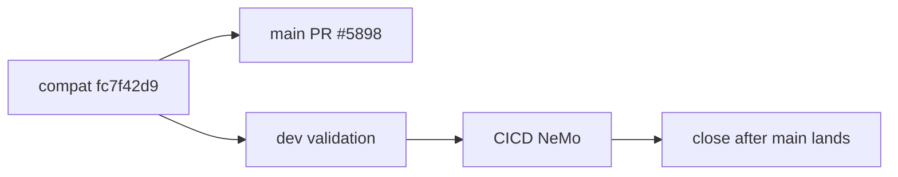

# test: AUT-2155 validate Megatron Core dev compatibility

[Upstream PR](https://github.com/NVIDIA-NeMo/Megatron-Bridge/pull/5899) · state: closed · merged: False

## Original PR description

## Background

Temporary companion to main landing PR #5898. This PR must never merge; it validates compatibility commit `fc7f42d90a8bd71695cd68f41ce578c2468a4b0a` against frozen MCore dev `c8cd108b`.

## What changed

- Retain both frozen commit files, the dev gitlink, dev metadata, and dev lockfile.
- Carry the same dual-compatible Bridge fixes as the main lane.
- Merge current Bridge `main` without changing dependency or build inputs.

## Details

Only #5898 may land.

## Tested

The prior configure failure was caused by base drift and an empty merge SHA. `CICD NeMo` must rerun on this head. Local GPU admission is blocked by repeated pre-run pod loss.

## Review and discussion

### reviews

### issue_comments

- copy-pr-bot[bot] · comment · 2026-08-30T19:54:57Z · [source](https://github.com/NVIDIA-NeMo/Megatron-Bridge/pull/5899#issuecomment-5470910370)

This pull request requires additional validation before any workflows can run on NVIDIA's runners.

Pull request vetters can view their responsibilities [here](https://docs.gha-runners.nvidia.com/cpr/vetters).

Contributors can view more details about this message [here](https://docs.gha-runners.nvidia.com/cpr/contributors).

- svcnvidia-nemo-ci · comment · 2026-08-30T20:42:52Z · [source](https://github.com/NVIDIA-NeMo/Megatron-Bridge/pull/5899#issuecomment-5471143625)

/ok to test 39eab251ff58368a9b628e3814657e365810f014

- svcnvidia-nemo-ci · comment · 2026-08-30T20:56:50Z · [source](https://github.com/NVIDIA-NeMo/Megatron-Bridge/pull/5899#issuecomment-5471210117)

/ok to test 8a4c5d7942f1df42fe75d44e2b5a48ea22f858ff

- svcnvidia-nemo-ci · comment · 2026-08-30T22:15:55Z · [source](https://github.com/NVIDIA-NeMo/Megatron-Bridge/pull/5899#issuecomment-5471591859)

/ok to test 385630157eb4ef808cb2ecdbf77833db4defb698

- svcnvidia-nemo-ci · comment · 2026-08-30T22:45:17Z · [source](https://github.com/NVIDIA-NeMo/Megatron-Bridge/pull/5899#issuecomment-5471727063)

/ok to test 2f6c4875ef222ef494e0e87354498df05704cf82

- svcnvidia-nemo-ci · comment · 2026-08-30T23:22:15Z · [source](https://github.com/NVIDIA-NeMo/Megatron-Bridge/pull/5899#issuecomment-5471898616)

/ok to test 23039d17b38b364ca43b052b3daea8f029077eec

- svcnvidia-nemo-ci · comment · 2026-08-31T01:19:54Z · [source](https://github.com/NVIDIA-NeMo/Megatron-Bridge/pull/5899#issuecomment-5472535520)

/ok to test 720980c8a88da00ef37cdc1225d175c1c8027601

- svcnvidia-nemo-ci · comment · 2026-08-31T02:11:06Z · [source](https://github.com/NVIDIA-NeMo/Megatron-Bridge/pull/5899#issuecomment-5472840362)

/ok to test d23e5433c611d5f2d8bd1b398bb889656eb416f3

- svcnvidia-nemo-ci · comment · 2026-08-31T07:48:52Z · [source](https://github.com/NVIDIA-NeMo/Megatron-Bridge/pull/5899#issuecomment-5475371038)

/ok to test 06fa6f2753d609b636a68b7a6f06fd218b9c35db

- svcnvidia-nemo-ci · comment · 2026-08-31T09:54:48Z · [source](https://github.com/NVIDIA-NeMo/Megatron-Bridge/pull/5899#issuecomment-5476698129)

/ok to test 1e2d960c8e0cce2a8f26271ce044ed39cde63ff1

- svcnvidia-nemo-ci · comment · 2026-08-31T10:58:00Z · [source](https://github.com/NVIDIA-NeMo/Megatron-Bridge/pull/5899#issuecomment-5477352398)

/ok to test 6de3bbcf02e812a0282da201b11a8b4ff175e9f8

- svcnvidia-nemo-ci · comment · 2026-08-31T17:14:06Z · [source](https://github.com/NVIDIA-NeMo/Megatron-Bridge/pull/5899#issuecomment-5481834308)

/ok to test d2b5de357b3cd04332196174bf6b7360f6274001

- svcnvidia-nemo-ci · comment · 2026-08-31T19:13:27Z · [source](https://github.com/NVIDIA-NeMo/Megatron-Bridge/pull/5899#issuecomment-5483224635)

/ok to test d2f3a0313f32eb5313ba84b27c1e7dda6bb5a74a

### inline_comments

## Changed files and fixed code

- `.dev.commit` · modified · additions 1 / deletions 1
  - [head](https://github.com/svcnemo-autobot/Megatron-Bridge/blob/d2f3a0313f32eb5313ba84b27c1e7dda6bb5a74a/.dev.commit)
  - [base](https://github.com/NVIDIA-NeMo/Megatron-Bridge/blob/deadfb12cd28d46da9f9ad728fb3f5f7f9dcdd02/.dev.commit)
- `.github/workflows/cicd-main.yml` · modified · additions 6 / deletions 1
  - [head](https://github.com/svcnemo-autobot/Megatron-Bridge/blob/d2f3a0313f32eb5313ba84b27c1e7dda6bb5a74a/.github/workflows/cicd-main.yml)
  - [base](https://github.com/NVIDIA-NeMo/Megatron-Bridge/blob/deadfb12cd28d46da9f9ad728fb3f5f7f9dcdd02/.github/workflows/cicd-main.yml)
- `.main.commit` · modified · additions 1 / deletions 1
  - [head](https://github.com/svcnemo-autobot/Megatron-Bridge/blob/d2f3a0313f32eb5313ba84b27c1e7dda6bb5a74a/.main.commit)
  - [base](https://github.com/NVIDIA-NeMo/Megatron-Bridge/blob/deadfb12cd28d46da9f9ad728fb3f5f7f9dcdd02/.main.commit)
- `3rdparty/Megatron-LM` · modified · additions 1 / deletions 1
  - [head](https://github.com/svcnemo-autobot/Megatron-Bridge/blob/d2f3a0313f32eb5313ba84b27c1e7dda6bb5a74a/3rdparty/Megatron-LM)
  - [base](https://github.com/NVIDIA-NeMo/Megatron-Bridge/blob/deadfb12cd28d46da9f9ad728fb3f5f7f9dcdd02/3rdparty/Megatron-LM)
- `pyproject.toml` · modified · additions 4 / deletions 16
  - [head](https://github.com/svcnemo-autobot/Megatron-Bridge/blob/d2f3a0313f32eb5313ba84b27c1e7dda6bb5a74a/pyproject.toml)
  - [base](https://github.com/NVIDIA-NeMo/Megatron-Bridge/blob/deadfb12cd28d46da9f9ad728fb3f5f7f9dcdd02/pyproject.toml)
- `src/megatron/bridge/inference/vlm/qwenvl_inference_wrapper.py` · modified · additions 25 / deletions 1
  - [head](https://github.com/svcnemo-autobot/Megatron-Bridge/blob/d2f3a0313f32eb5313ba84b27c1e7dda6bb5a74a/src/megatron/bridge/inference/vlm/qwenvl_inference_wrapper.py)
  - [base](https://github.com/NVIDIA-NeMo/Megatron-Bridge/blob/deadfb12cd28d46da9f9ad728fb3f5f7f9dcdd02/src/megatron/bridge/inference/vlm/qwenvl_inference_wrapper.py)
- `src/megatron/bridge/models/conversion/model_bridge.py` · modified · additions 4 / deletions 2
  - [head](https://github.com/svcnemo-autobot/Megatron-Bridge/blob/d2f3a0313f32eb5313ba84b27c1e7dda6bb5a74a/src/megatron/bridge/models/conversion/model_bridge.py)
  - [base](https://github.com/NVIDIA-NeMo/Megatron-Bridge/blob/deadfb12cd28d46da9f9ad728fb3f5f7f9dcdd02/src/megatron/bridge/models/conversion/model_bridge.py)
- `src/megatron/bridge/models/deepseek/attention.py` · modified · additions 41 / deletions 4
  - [head](https://github.com/svcnemo-autobot/Megatron-Bridge/blob/d2f3a0313f32eb5313ba84b27c1e7dda6bb5a74a/src/megatron/bridge/models/deepseek/attention.py)
  - [base](https://github.com/NVIDIA-NeMo/Megatron-Bridge/blob/deadfb12cd28d46da9f9ad728fb3f5f7f9dcdd02/src/megatron/bridge/models/deepseek/attention.py)
- `src/megatron/bridge/models/transformer_config.py` · modified · additions 53 / deletions 0
  - [head](https://github.com/svcnemo-autobot/Megatron-Bridge/blob/d2f3a0313f32eb5313ba84b27c1e7dda6bb5a74a/src/megatron/bridge/models/transformer_config.py)
  - [base](https://github.com/NVIDIA-NeMo/Megatron-Bridge/blob/deadfb12cd28d46da9f9ad728fb3f5f7f9dcdd02/src/megatron/bridge/models/transformer_config.py)
- `src/megatron/bridge/training/gtp.py` · modified · additions 8 / deletions 2
  - [head](https://github.com/svcnemo-autobot/Megatron-Bridge/blob/d2f3a0313f32eb5313ba84b27c1e7dda6bb5a74a/src/megatron/bridge/training/gtp.py)
  - [base](https://github.com/NVIDIA-NeMo/Megatron-Bridge/blob/deadfb12cd28d46da9f9ad728fb3f5f7f9dcdd02/src/megatron/bridge/training/gtp.py)
- `src/megatron/bridge/training/initialize.py` · modified · additions 6 / deletions 2
  - [head](https://github.com/svcnemo-autobot/Megatron-Bridge/blob/d2f3a0313f32eb5313ba84b27c1e7dda6bb5a74a/src/megatron/bridge/training/initialize.py)
  - [base](https://github.com/NVIDIA-NeMo/Megatron-Bridge/blob/deadfb12cd28d46da9f9ad728fb3f5f7f9dcdd02/src/megatron/bridge/training/initialize.py)
- `tests/functional_tests/test_groups/training/test_pretrain.py` · modified · additions 12 / deletions 2
  - [head](https://github.com/svcnemo-autobot/Megatron-Bridge/blob/d2f3a0313f32eb5313ba84b27c1e7dda6bb5a74a/tests/functional_tests/test_groups/training/test_pretrain.py)
  - [base](https://github.com/NVIDIA-NeMo/Megatron-Bridge/blob/deadfb12cd28d46da9f9ad728fb3f5f7f9dcdd02/tests/functional_tests/test_groups/training/test_pretrain.py)
- `tests/mcore_dev.py` · added · additions 28 / deletions 0
  - [head](https://github.com/svcnemo-autobot/Megatron-Bridge/blob/d2f3a0313f32eb5313ba84b27c1e7dda6bb5a74a/tests/mcore_dev.py)
  - [base](https://github.com/NVIDIA-NeMo/Megatron-Bridge/blob/deadfb12cd28d46da9f9ad728fb3f5f7f9dcdd02/tests/mcore_dev.py)
- `tests/unit_tests/data/collators/test_model_collators.py` · modified · additions 28 / deletions 14
  - [head](https://github.com/svcnemo-autobot/Megatron-Bridge/blob/d2f3a0313f32eb5313ba84b27c1e7dda6bb5a74a/tests/unit_tests/data/collators/test_model_collators.py)
  - [base](https://github.com/NVIDIA-NeMo/Megatron-Bridge/blob/deadfb12cd28d46da9f9ad728fb3f5f7f9dcdd02/tests/unit_tests/data/collators/test_model_collators.py)
- `tests/unit_tests/inference/test_tokenizer.py` · modified · additions 17 / deletions 3
  - [head](https://github.com/svcnemo-autobot/Megatron-Bridge/blob/d2f3a0313f32eb5313ba84b27c1e7dda6bb5a74a/tests/unit_tests/inference/test_tokenizer.py)
  - [base](https://github.com/NVIDIA-NeMo/Megatron-Bridge/blob/deadfb12cd28d46da9f9ad728fb3f5f7f9dcdd02/tests/unit_tests/inference/test_tokenizer.py)
- `tests/unit_tests/models/deepseek/test_deepseek_attention.py` · modified · additions 12 / deletions 0
  - [head](https://github.com/svcnemo-autobot/Megatron-Bridge/blob/d2f3a0313f32eb5313ba84b27c1e7dda6bb5a74a/tests/unit_tests/models/deepseek/test_deepseek_attention.py)
  - [base](https://github.com/NVIDIA-NeMo/Megatron-Bridge/blob/deadfb12cd28d46da9f9ad728fb3f5f7f9dcdd02/tests/unit_tests/models/deepseek/test_deepseek_attention.py)
- `tests/unit_tests/models/hybrid/test_hybrid_provider.py` · modified · additions 2 / deletions 2
  - [head](https://github.com/svcnemo-autobot/Megatron-Bridge/blob/d2f3a0313f32eb5313ba84b27c1e7dda6bb5a74a/tests/unit_tests/models/hybrid/test_hybrid_provider.py)
  - [base](https://github.com/NVIDIA-NeMo/Megatron-Bridge/blob/deadfb12cd28d46da9f9ad728fb3f5f7f9dcdd02/tests/unit_tests/models/hybrid/test_hybrid_provider.py)
- `tests/unit_tests/models/nemotron_omni/test_nemotron_omni_model.py` · modified · additions 1 / deletions 2
  - [head](https://github.com/svcnemo-autobot/Megatron-Bridge/blob/d2f3a0313f32eb5313ba84b27c1e7dda6bb5a74a/tests/unit_tests/models/nemotron_omni/test_nemotron_omni_model.py)
  - [base](https://github.com/NVIDIA-NeMo/Megatron-Bridge/blob/deadfb12cd28d46da9f9ad728fb3f5f7f9dcdd02/tests/unit_tests/models/nemotron_omni/test_nemotron_omni_model.py)
- `tests/unit_tests/models/nemotron_vl/test_nemotron_vl_provider.py` · modified · additions 2 / deletions 3
  - [head](https://github.com/svcnemo-autobot/Megatron-Bridge/blob/d2f3a0313f32eb5313ba84b27c1e7dda6bb5a74a/tests/unit_tests/models/nemotron_vl/test_nemotron_vl_provider.py)
  - [base](https://github.com/NVIDIA-NeMo/Megatron-Bridge/blob/deadfb12cd28d46da9f9ad728fb3f5f7f9dcdd02/tests/unit_tests/models/nemotron_vl/test_nemotron_vl_provider.py)
- `tests/unit_tests/models/test_model_bridge.py` · modified · additions 0 / deletions 3
  - [head](https://github.com/svcnemo-autobot/Megatron-Bridge/blob/d2f3a0313f32eb5313ba84b27c1e7dda6bb5a74a/tests/unit_tests/models/test_model_bridge.py)
  - [base](https://github.com/NVIDIA-NeMo/Megatron-Bridge/blob/deadfb12cd28d46da9f9ad728fb3f5f7f9dcdd02/tests/unit_tests/models/test_model_bridge.py)
- `tests/unit_tests/training/megatron_mimo/test_megatron_mimo_checkpointing.py` · modified · additions 1 / deletions 0
  - [head](https://github.com/svcnemo-autobot/Megatron-Bridge/blob/d2f3a0313f32eb5313ba84b27c1e7dda6bb5a74a/tests/unit_tests/training/megatron_mimo/test_megatron_mimo_checkpointing.py)
  - [base](https://github.com/NVIDIA-NeMo/Megatron-Bridge/blob/deadfb12cd28d46da9f9ad728fb3f5f7f9dcdd02/tests/unit_tests/training/megatron_mimo/test_megatron_mimo_checkpointing.py)
- `tests/unit_tests/training/test_decentralized_pg.py` · modified · additions 4 / deletions 5
  - [head](https://github.com/svcnemo-autobot/Megatron-Bridge/blob/d2f3a0313f32eb5313ba84b27c1e7dda6bb5a74a/tests/unit_tests/training/test_decentralized_pg.py)
  - [base](https://github.com/NVIDIA-NeMo/Megatron-Bridge/blob/deadfb12cd28d46da9f9ad728fb3f5f7f9dcdd02/tests/unit_tests/training/test_decentralized_pg.py)
- `tests/unit_tests/training/test_gtp.py` · modified · additions 5 / deletions 0
  - [head](https://github.com/svcnemo-autobot/Megatron-Bridge/blob/d2f3a0313f32eb5313ba84b27c1e7dda6bb5a74a/tests/unit_tests/training/test_gtp.py)
  - [base](https://github.com/NVIDIA-NeMo/Megatron-Bridge/blob/deadfb12cd28d46da9f9ad728fb3f5f7f9dcdd02/tests/unit_tests/training/test_gtp.py)
- `tests/unit_tests/utils/test_common_utils.py` · modified · additions 18 / deletions 8
  - [head](https://github.com/svcnemo-autobot/Megatron-Bridge/blob/d2f3a0313f32eb5313ba84b27c1e7dda6bb5a74a/tests/unit_tests/utils/test_common_utils.py)
  - [base](https://github.com/NVIDIA-NeMo/Megatron-Bridge/blob/deadfb12cd28d46da9f9ad728fb3f5f7f9dcdd02/tests/unit_tests/utils/test_common_utils.py)
- `uv.lock` · modified · additions 261 / deletions 359
  - [head](https://github.com/svcnemo-autobot/Megatron-Bridge/blob/d2f3a0313f32eb5313ba84b27c1e7dda6bb5a74a/uv.lock)
  - [base](https://github.com/NVIDIA-NeMo/Megatron-Bridge/blob/deadfb12cd28d46da9f9ad728fb3f5f7f9dcdd02/uv.lock)

## Evidence and interpretation boundary

[Original JSON, discussions and patches](../../../../../../evidence/prs/NVIDIA-NeMo--Megatron-Bridge/5899-7ffabb7c000837497a6751dd05ef10b85e34a404ad3abd2800074520670766df.json) · SHA-256 `7ffabb7c000837497a6751dd05ef10b85e34a404ad3abd2800074520670766df`.

Diff complete: False. Missing/binary/truncated patches require pinned source inspection. This is a source page, not an independently verified optimization case. Open, merged and released are different states; recheck the deployed dependency.
