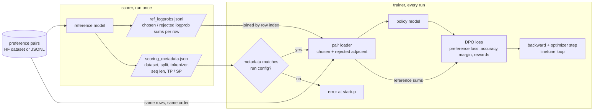

# feat(training): add DPO training with offline-scored reference model

[Upstream PR](https://github.com/NVIDIA-NeMo/Megatron-Bridge/pull/6092) · state: closed · merged: True

## Original PR description

# What does this PR do ?

Adds DPO (Direct Preference Optimization) as a training mode. The reference model's log-probabilities are scored once, offline, and read back during training, so the trainer holds one model and runs at SFT memory and step time.

# Changelog

- `--mode dpo` in `scripts/training/run_recipe.py`, backed by `dpo_train()` in `training/dpo_train.py`: validates the run config and the reference artifact, then hands off to the existing `finetune` loop.
- Preference-pair dataset, config and loader under `data/datasets/preference*.py` and `data/builders/dpo.py`. Rows are TRL-style chat pairs from an HF dataset or a JSONL file. Chosen and rejected rows of a pair always land in the same micro batch, next to each other.
- DPO loss and forward step in `training/dpo.py` and `training/dpo_step.py`: sigmoid preference loss, optional SFT term, metrics for preference loss, accuracy, margin and chosen/rejected rewards.
- `scripts/dpo/score_reference_logprobs.py`, the offline scorer. You run it with the same TP, EP and ETP you'll train with. Extra GPUs beyond that become data-parallel replicas, and rank 0 collects the results and writes the artifact.
- Recipe `qwen3_30b_a3b_dpo_config` (TP=4, PP=2, EP=4, ETP=1, SP).
- Docs: `scripts/dpo/README.md` and a DPO section in `scripts/training/README.md`.

# Why the reference is scored offline

The usual DPO trainer keeps a frozen copy of the reference model and runs it every step - a second set of resident weights, an extra forward per step, and the reference is stuck with the policy's parallel layout

Instead, the scorer runs the reference over the dataset once and writes `ref_logprobs.jsonl` (chosen and rejected completion logprob sums per row) and `scoring_metadata.json` (dataset, split, tokenizer, sequence length, Parallelism type, prompt key). At startup the trainer compares that metadata against its own config and refuses to run on a mismatch. Without the check a stale or mis-scored artifact does not crash anything, the margins could possibly be wrong.

Pipeline parallelism is not recorded: it only decides which rank runs a layer. Scoring at PP=2 and PP=1 gave the same results over sums on all 8,320 pairs; TP=4 vs TP=8 differed on every pair, so TP is recorded.

The artifact stores plain logprob sums with no beta applied, so one scoring run covers every learning rate and beta you try afterwards.



# Usage

```bash
# score the reference once
uv run python -m torch.distributed.run --nproc_per_node=8 scripts/dpo/score_reference_logprobs.py \
    --model Qwen/Qwen3-30B-A3B --dataset HuggingFaceH4/ultrafeedback_binarized --split train_prefs \
    --num-pairs 8192 --max-seq-length 4096 --tp 4 --ep 4 --etp 1 --sequence-parallel \
    --output /data/uf_ref_logprobs

# train
uv run python -m torch.distributed.run --nproc_per_node=8 scripts/training/run_recipe.py \
    --model qwen3_30b_a3b --mode dpo --pretrained_checkpoint /checkpoints/qwen3-30b-a3b \
    dataset.source.path_or_dataset=HuggingFaceH4/ultrafeedback_binarized dataset.source.split=train_prefs \
    dataset.ref_artifact=/data/uf_ref_logprobs dataset.num_pairs=8192
```

# Results

Qwen/Qwen3-30B-A3B with `qwen3_30b_a3b_dpo_config` at its defaults, 2 nodes x 8 H100 80GB.

| | |
|---|---|
| Data | `HuggingFaceH4/ultrafeedback_binarized` `train_prefs`, 8,192 pairs, one epoch. Validation on 128 pairs of `test_prefs` every 32 steps |
| Parallelism | TP=4, PP=2, EP=4, ETP=1, SP, DP=2, distributed optimizer |
| Batch | 64 pairs per step: micro batch 1 pair (2 rows) × 32 accumulation × DP 2; seq length 4096 |
| DPO | beta 0.05, lr 5e-7 |
| Speed | 20 s / step mean, 19 s median after warmup (16-34 s range) |

Step 1 preference loss is 0.691, i.e. ln 2, as it should be when the policy starts from the reference.

W&B curves from the run above, validation split. The model learns to prefer chosen over rejected


Training preference loss per 32-step window: 0.681, 0.652, 0.636, 0.634. 

Accuracy plateaus at 0.68-0.70, in line with published DPO results on UltraFeedback.

# Tests

Unit tests, no GPU: `tests/unit_tests/data/builders/test_dpo.py`, `data/datasets/test_preference.py`, `data/datasets/test_preference_tokenization.py`, `training/test_dpo.py`, `training/test_dpo_step.py`, `training/test_dpo_train.py`, `scripts/dpo/test_score_reference_logprobs.py`, plus cases in `training/test_config.py`, `training/utils/test_pg_utils.py`, `recipes/qwen/test_qwen3_recipes.py` and the `scripts/training` runner tests.

## Review and discussion

### reviews

- cuichenx · COMMENTED · 2026-10-12T06:13:49Z · [source](https://github.com/NVIDIA-NeMo/Megatron-Bridge/pull/6092#pullrequestreview-5434540712)

Could you also add at least 1 L1 functional test


- Josephasafg · COMMENTED · 2026-10-12T08:25:33Z · [source](https://github.com/NVIDIA-NeMo/Megatron-Bridge/pull/6092#pullrequestreview-5488173470)

(No body; status only.)

- Josephasafg · COMMENTED · 2026-10-12T09:12:25Z · [source](https://github.com/NVIDIA-NeMo/Megatron-Bridge/pull/6092#pullrequestreview-5488615860)

(No body; status only.)

- Josephasafg · COMMENTED · 2026-10-12T10:35:51Z · [source](https://github.com/NVIDIA-NeMo/Megatron-Bridge/pull/6092#pullrequestreview-5489546891)

(No body; status only.)

- Josephasafg · COMMENTED · 2026-10-12T11:11:54Z · [source](https://github.com/NVIDIA-NeMo/Megatron-Bridge/pull/6092#pullrequestreview-5489908837)

(No body; status only.)

- cuichenx · APPROVED · 2026-10-14T18:18:51Z · [source](https://github.com/NVIDIA-NeMo/Megatron-Bridge/pull/6092#pullrequestreview-5522588688)

(No body; status only.)

### issue_comments

- copy-pr-bot[bot] · comment · 2026-09-14T08:30:02Z · [source](https://github.com/NVIDIA-NeMo/Megatron-Bridge/pull/6092#issuecomment-5661192456)

This pull request requires additional validation before any workflows can run on NVIDIA's runners.

Pull request vetters can view their responsibilities [here](https://docs.gha-runners.nvidia.com/cpr/vetters).

Contributors can view more details about this message [here](https://docs.gha-runners.nvidia.com/cpr/contributors).


- Josephasafg · comment · 2026-10-12T11:25:51Z · [source](https://github.com/NVIDIA-NeMo/Megatron-Bridge/pull/6092#issuecomment-6123311643)

@cuichenx Thanks for the great comments. I've updated the PR. PTAL. Thanks!

- Josephasafg · comment · 2026-10-12T20:27:20Z · [source](https://github.com/NVIDIA-NeMo/Megatron-Bridge/pull/6092#issuecomment-6132047126)

> Could you also add at least 1 L1 functional test

@cuichenx Ive added an L1 test as requested

- cuichenx · comment · 2026-10-12T23:43:30Z · [source](https://github.com/NVIDIA-NeMo/Megatron-Bridge/pull/6092#issuecomment-6134756098)

/ok to test https://github.com/NVIDIA-NeMo/Megatron-Bridge/pull/6092/commits/74f8998ffa50e1873126d132111ea2cb3d84afe6

- github-actions[bot] · comment · 2026-10-12T23:43:48Z · [source](https://github.com/NVIDIA-NeMo/Megatron-Bridge/pull/6092#issuecomment-6134759296)

<!-- review-command-hint -->
Automatic Claude reviews have been retired. To request a pull-request review, post a comment containing:

```
/review
```

Add `model=claude` to use a Claude reviewer (the default is `model=codex`). `mode=light|strict` selects the review depth; for example, `/review model=claude mode=strict`. Comment `/review help` for all options.

- cuichenx · comment · 2026-10-12T23:54:19Z · [source](https://github.com/NVIDIA-NeMo/Megatron-Bridge/pull/6092#issuecomment-6134874023)

/ok to test https://github.com/NVIDIA-NeMo/Megatron-Bridge/pull/6092/commits/59570d8b32980e4348e32e12ebc93bbaa31f2268

- Josephasafg · comment · 2026-10-13T06:31:41Z · [source](https://github.com/NVIDIA-NeMo/Megatron-Bridge/pull/6092#issuecomment-6139743656)

@cuichenx Thanks! Seems like two unrelated tests are failing

### inline_comments

- cuichenx · comment · 2026-10-08T16:41:08Z · [source](https://github.com/NVIDIA-NeMo/Megatron-Bridge/pull/6092#discussion_r4221676128)

File: `src/megatron/bridge/recipes/common.py` · line None

can we move model building outside the common function 

- cuichenx · comment · 2026-10-08T16:43:23Z · [source](https://github.com/NVIDIA-NeMo/Megatron-Bridge/pull/6092#discussion_r4221705031)

File: `src/megatron/bridge/training/config.py` · line 1583

can we add a few more validate functions here, calculate_per_token_loss=True, ddp.average_in_collective=False, context_parallel_size == 1, mtp_num_layers is None (and others if they make sense)

- cuichenx · comment · 2026-10-08T16:44:12Z · [source](https://github.com/NVIDIA-NeMo/Megatron-Bridge/pull/6092#discussion_r4221712700)

File: `src/megatron/bridge/data/sources/jsonl.py` · line None

can this use `HFDatasetSourceConfig` instead? is it absolutely needed for dpo dataset

- cuichenx · comment · 2026-10-08T20:39:09Z · [source](https://github.com/NVIDIA-NeMo/Megatron-Bridge/pull/6092#discussion_r4223899472)

File: `scripts/dpo/score_reference_logprobs.py` · line 100

can this function take in `--recipe qwen3_30b_a3b_dpo_config` instead of rebuilding everything from scratch?

- Josephasafg · comment · 2026-10-12T08:25:33Z · [source](https://github.com/NVIDIA-NeMo/Megatron-Bridge/pull/6092#discussion_r4245994036)

File: `src/megatron/bridge/recipes/common.py` · line None

Good point - done

- Josephasafg · comment · 2026-10-12T09:12:25Z · [source](https://github.com/NVIDIA-NeMo/Megatron-Bridge/pull/6092#discussion_r4246358822)

File: `src/megatron/bridge/training/config.py` · line 1583

Done. These checks already existed in `validate_dpo_run_config` in `dpo_train.py`, so this moves them which now runs for any DPO dataset 

- Josephasafg · comment · 2026-10-12T10:35:51Z · [source](https://github.com/NVIDIA-NeMo/Megatron-Bridge/pull/6092#discussion_r4247052071)

File: `src/megatron/bridge/data/sources/jsonl.py` · line None

I removed it and now JSONL goes through the HF json loader like SFT does.

- Josephasafg · comment · 2026-10-12T11:11:53Z · [source](https://github.com/NVIDIA-NeMo/Megatron-Bridge/pull/6092#discussion_r4247352164)

File: `scripts/dpo/score_reference_logprobs.py` · line 100

Good idea. Done. The scorer now uses the training recipe

## Changed files and fixed code

- `scripts/dpo/README.md` · added · additions 110 / deletions 0
  - [head](https://github.com/Josephasafg/Megatron-Bridge/blob/59570d8b32980e4348e32e12ebc93bbaa31f2268/scripts/dpo/README.md)
  - [base](https://github.com/NVIDIA-NeMo/Megatron-Bridge/blob/9dfd9f53693f49c19303b2ab5cfce57eb9ce4933/scripts/dpo/README.md)
- `scripts/dpo/score_reference_logprobs.py` · added · additions 406 / deletions 0
  - [head](https://github.com/Josephasafg/Megatron-Bridge/blob/59570d8b32980e4348e32e12ebc93bbaa31f2268/scripts/dpo/score_reference_logprobs.py)
  - [base](https://github.com/NVIDIA-NeMo/Megatron-Bridge/blob/9dfd9f53693f49c19303b2ab5cfce57eb9ce4933/scripts/dpo/score_reference_logprobs.py)
- `scripts/training/README.md` · modified · additions 4 / deletions 3
  - [head](https://github.com/Josephasafg/Megatron-Bridge/blob/59570d8b32980e4348e32e12ebc93bbaa31f2268/scripts/training/README.md)
  - [base](https://github.com/NVIDIA-NeMo/Megatron-Bridge/blob/9dfd9f53693f49c19303b2ab5cfce57eb9ce4933/scripts/training/README.md)
- `scripts/training/recipe_metadata.py` · modified · additions 6 / deletions 1
  - [head](https://github.com/Josephasafg/Megatron-Bridge/blob/59570d8b32980e4348e32e12ebc93bbaa31f2268/scripts/training/recipe_metadata.py)
  - [base](https://github.com/NVIDIA-NeMo/Megatron-Bridge/blob/9dfd9f53693f49c19303b2ab5cfce57eb9ce4933/scripts/training/recipe_metadata.py)
- `scripts/training/recipe_runner.py` · modified · additions 3 / deletions 0
  - [head](https://github.com/Josephasafg/Megatron-Bridge/blob/59570d8b32980e4348e32e12ebc93bbaa31f2268/scripts/training/recipe_runner.py)
  - [base](https://github.com/NVIDIA-NeMo/Megatron-Bridge/blob/9dfd9f53693f49c19303b2ab5cfce57eb9ce4933/scripts/training/recipe_runner.py)
- `scripts/training/run_recipe.py` · modified · additions 25 / deletions 4
  - [head](https://github.com/Josephasafg/Megatron-Bridge/blob/59570d8b32980e4348e32e12ebc93bbaa31f2268/scripts/training/run_recipe.py)
  - [base](https://github.com/NVIDIA-NeMo/Megatron-Bridge/blob/9dfd9f53693f49c19303b2ab5cfce57eb9ce4933/scripts/training/run_recipe.py)
- `src/megatron/bridge/data/builders/__init__.py` · modified · additions 8 / deletions 0
  - [head](https://github.com/Josephasafg/Megatron-Bridge/blob/59570d8b32980e4348e32e12ebc93bbaa31f2268/src/megatron/bridge/data/builders/__init__.py)
  - [base](https://github.com/NVIDIA-NeMo/Megatron-Bridge/blob/9dfd9f53693f49c19303b2ab5cfce57eb9ce4933/src/megatron/bridge/data/builders/__init__.py)
- `src/megatron/bridge/data/builders/direct_hf_sft.py` · modified · additions 6 / deletions 12
  - [head](https://github.com/Josephasafg/Megatron-Bridge/blob/59570d8b32980e4348e32e12ebc93bbaa31f2268/src/megatron/bridge/data/builders/direct_hf_sft.py)
  - [base](https://github.com/NVIDIA-NeMo/Megatron-Bridge/blob/9dfd9f53693f49c19303b2ab5cfce57eb9ce4933/src/megatron/bridge/data/builders/direct_hf_sft.py)
- `src/megatron/bridge/data/builders/dpo.py` · added · additions 249 / deletions 0
  - [head](https://github.com/Josephasafg/Megatron-Bridge/blob/59570d8b32980e4348e32e12ebc93bbaa31f2268/src/megatron/bridge/data/builders/dpo.py)
  - [base](https://github.com/NVIDIA-NeMo/Megatron-Bridge/blob/9dfd9f53693f49c19303b2ab5cfce57eb9ce4933/src/megatron/bridge/data/builders/dpo.py)
- `src/megatron/bridge/data/conversation_processing.py` · modified · additions 18 / deletions 6
  - [head](https://github.com/Josephasafg/Megatron-Bridge/blob/59570d8b32980e4348e32e12ebc93bbaa31f2268/src/megatron/bridge/data/conversation_processing.py)
  - [base](https://github.com/NVIDIA-NeMo/Megatron-Bridge/blob/9dfd9f53693f49c19303b2ab5cfce57eb9ce4933/src/megatron/bridge/data/conversation_processing.py)
- `src/megatron/bridge/data/datasets/preference.py` · added · additions 295 / deletions 0
  - [head](https://github.com/Josephasafg/Megatron-Bridge/blob/59570d8b32980e4348e32e12ebc93bbaa31f2268/src/megatron/bridge/data/datasets/preference.py)
  - [base](https://github.com/NVIDIA-NeMo/Megatron-Bridge/blob/9dfd9f53693f49c19303b2ab5cfce57eb9ce4933/src/megatron/bridge/data/datasets/preference.py)
- `src/megatron/bridge/data/datasets/preference_pair.py` · added · additions 132 / deletions 0
  - [head](https://github.com/Josephasafg/Megatron-Bridge/blob/59570d8b32980e4348e32e12ebc93bbaa31f2268/src/megatron/bridge/data/datasets/preference_pair.py)
  - [base](https://github.com/NVIDIA-NeMo/Megatron-Bridge/blob/9dfd9f53693f49c19303b2ab5cfce57eb9ce4933/src/megatron/bridge/data/datasets/preference_pair.py)
- `src/megatron/bridge/data/datasets/preference_tokenization.py` · added · additions 130 / deletions 0
  - [head](https://github.com/Josephasafg/Megatron-Bridge/blob/59570d8b32980e4348e32e12ebc93bbaa31f2268/src/megatron/bridge/data/datasets/preference_tokenization.py)
  - [base](https://github.com/NVIDIA-NeMo/Megatron-Bridge/blob/9dfd9f53693f49c19303b2ab5cfce57eb9ce4933/src/megatron/bridge/data/datasets/preference_tokenization.py)
- `src/megatron/bridge/data/loaders.py` · modified · additions 71 / deletions 1
  - [head](https://github.com/Josephasafg/Megatron-Bridge/blob/59570d8b32980e4348e32e12ebc93bbaa31f2268/src/megatron/bridge/data/loaders.py)
  - [base](https://github.com/NVIDIA-NeMo/Megatron-Bridge/blob/9dfd9f53693f49c19303b2ab5cfce57eb9ce4933/src/megatron/bridge/data/loaders.py)
- `src/megatron/bridge/data/samplers.py` · modified · additions 4 / deletions 0
  - [head](https://github.com/Josephasafg/Megatron-Bridge/blob/59570d8b32980e4348e32e12ebc93bbaa31f2268/src/megatron/bridge/data/samplers.py)
  - [base](https://github.com/NVIDIA-NeMo/Megatron-Bridge/blob/9dfd9f53693f49c19303b2ab5cfce57eb9ce4933/src/megatron/bridge/data/samplers.py)
- `src/megatron/bridge/data/sources/hf.py` · modified · additions 8 / deletions 1
  - [head](https://github.com/Josephasafg/Megatron-Bridge/blob/59570d8b32980e4348e32e12ebc93bbaa31f2268/src/megatron/bridge/data/sources/hf.py)
  - [base](https://github.com/NVIDIA-NeMo/Megatron-Bridge/blob/9dfd9f53693f49c19303b2ab5cfce57eb9ce4933/src/megatron/bridge/data/sources/hf.py)
- `src/megatron/bridge/data/utils.py` · modified · additions 3 / deletions 0
  - [head](https://github.com/Josephasafg/Megatron-Bridge/blob/59570d8b32980e4348e32e12ebc93bbaa31f2268/src/megatron/bridge/data/utils.py)
  - [base](https://github.com/NVIDIA-NeMo/Megatron-Bridge/blob/9dfd9f53693f49c19303b2ab5cfce57eb9ce4933/src/megatron/bridge/data/utils.py)
- `src/megatron/bridge/recipes/common.py` · modified · additions 38 / deletions 1
  - [head](https://github.com/Josephasafg/Megatron-Bridge/blob/59570d8b32980e4348e32e12ebc93bbaa31f2268/src/megatron/bridge/recipes/common.py)
  - [base](https://github.com/NVIDIA-NeMo/Megatron-Bridge/blob/9dfd9f53693f49c19303b2ab5cfce57eb9ce4933/src/megatron/bridge/recipes/common.py)
- `src/megatron/bridge/recipes/qwen/__init__.py` · modified · additions 2 / deletions 0
  - [head](https://github.com/Josephasafg/Megatron-Bridge/blob/59570d8b32980e4348e32e12ebc93bbaa31f2268/src/megatron/bridge/recipes/qwen/__init__.py)
  - [base](https://github.com/NVIDIA-NeMo/Megatron-Bridge/blob/9dfd9f53693f49c19303b2ab5cfce57eb9ce4933/src/megatron/bridge/recipes/qwen/__init__.py)
- `src/megatron/bridge/recipes/qwen/h100/__init__.py` · modified · additions 1 / deletions 0
  - [head](https://github.com/Josephasafg/Megatron-Bridge/blob/59570d8b32980e4348e32e12ebc93bbaa31f2268/src/megatron/bridge/recipes/qwen/h100/__init__.py)
  - [base](https://github.com/NVIDIA-NeMo/Megatron-Bridge/blob/9dfd9f53693f49c19303b2ab5cfce57eb9ce4933/src/megatron/bridge/recipes/qwen/h100/__init__.py)
- `src/megatron/bridge/recipes/qwen/h100/qwen3_moe.py` · modified · additions 68 / deletions 1
  - [head](https://github.com/Josephasafg/Megatron-Bridge/blob/59570d8b32980e4348e32e12ebc93bbaa31f2268/src/megatron/bridge/recipes/qwen/h100/qwen3_moe.py)
  - [base](https://github.com/NVIDIA-NeMo/Megatron-Bridge/blob/9dfd9f53693f49c19303b2ab5cfce57eb9ce4933/src/megatron/bridge/recipes/qwen/h100/qwen3_moe.py)
- `src/megatron/bridge/recipes/qwen/qwen3_moe.py` · modified · additions 4 / deletions 0
  - [head](https://github.com/Josephasafg/Megatron-Bridge/blob/59570d8b32980e4348e32e12ebc93bbaa31f2268/src/megatron/bridge/recipes/qwen/qwen3_moe.py)
  - [base](https://github.com/NVIDIA-NeMo/Megatron-Bridge/blob/9dfd9f53693f49c19303b2ab5cfce57eb9ce4933/src/megatron/bridge/recipes/qwen/qwen3_moe.py)
- `src/megatron/bridge/training/config.py` · modified · additions 36 / deletions 1
  - [head](https://github.com/Josephasafg/Megatron-Bridge/blob/59570d8b32980e4348e32e12ebc93bbaa31f2268/src/megatron/bridge/training/config.py)
  - [base](https://github.com/NVIDIA-NeMo/Megatron-Bridge/blob/9dfd9f53693f49c19303b2ab5cfce57eb9ce4933/src/megatron/bridge/training/config.py)
- `src/megatron/bridge/training/dpo.py` · added · additions 150 / deletions 0
  - [head](https://github.com/Josephasafg/Megatron-Bridge/blob/59570d8b32980e4348e32e12ebc93bbaa31f2268/src/megatron/bridge/training/dpo.py)
  - [base](https://github.com/NVIDIA-NeMo/Megatron-Bridge/blob/9dfd9f53693f49c19303b2ab5cfce57eb9ce4933/src/megatron/bridge/training/dpo.py)
- `src/megatron/bridge/training/dpo_step.py` · added · additions 151 / deletions 0
  - [head](https://github.com/Josephasafg/Megatron-Bridge/blob/59570d8b32980e4348e32e12ebc93bbaa31f2268/src/megatron/bridge/training/dpo_step.py)
  - [base](https://github.com/NVIDIA-NeMo/Megatron-Bridge/blob/9dfd9f53693f49c19303b2ab5cfce57eb9ce4933/src/megatron/bridge/training/dpo_step.py)
- `src/megatron/bridge/training/dpo_train.py` · added · additions 112 / deletions 0
  - [head](https://github.com/Josephasafg/Megatron-Bridge/blob/59570d8b32980e4348e32e12ebc93bbaa31f2268/src/megatron/bridge/training/dpo_train.py)
  - [base](https://github.com/NVIDIA-NeMo/Megatron-Bridge/blob/9dfd9f53693f49c19303b2ab5cfce57eb9ce4933/src/megatron/bridge/training/dpo_train.py)
- `src/megatron/bridge/training/losses.py` · modified · additions 34 / deletions 32
  - [head](https://github.com/Josephasafg/Megatron-Bridge/blob/59570d8b32980e4348e32e12ebc93bbaa31f2268/src/megatron/bridge/training/losses.py)
  - [base](https://github.com/NVIDIA-NeMo/Megatron-Bridge/blob/9dfd9f53693f49c19303b2ab5cfce57eb9ce4933/src/megatron/bridge/training/losses.py)
- `src/megatron/bridge/training/utils/pg_utils.py` · modified · additions 34 / deletions 1
  - [head](https://github.com/Josephasafg/Megatron-Bridge/blob/59570d8b32980e4348e32e12ebc93bbaa31f2268/src/megatron/bridge/training/utils/pg_utils.py)
  - [base](https://github.com/NVIDIA-NeMo/Megatron-Bridge/blob/9dfd9f53693f49c19303b2ab5cfce57eb9ce4933/src/megatron/bridge/training/utils/pg_utils.py)
- `tests/functional_tests/launch_scripts/h100/active/L1_Launch_training_dpo.sh` · added · additions 29 / deletions 0
  - [head](https://github.com/Josephasafg/Megatron-Bridge/blob/59570d8b32980e4348e32e12ebc93bbaa31f2268/tests/functional_tests/launch_scripts/h100/active/L1_Launch_training_dpo.sh)
  - [base](https://github.com/NVIDIA-NeMo/Megatron-Bridge/blob/9dfd9f53693f49c19303b2ab5cfce57eb9ce4933/tests/functional_tests/launch_scripts/h100/active/L1_Launch_training_dpo.sh)
- `tests/functional_tests/test_groups/training/test_dpo.py` · added · additions 238 / deletions 0
  - [head](https://github.com/Josephasafg/Megatron-Bridge/blob/59570d8b32980e4348e32e12ebc93bbaa31f2268/tests/functional_tests/test_groups/training/test_dpo.py)
  - [base](https://github.com/NVIDIA-NeMo/Megatron-Bridge/blob/9dfd9f53693f49c19303b2ab5cfce57eb9ce4933/tests/functional_tests/test_groups/training/test_dpo.py)
- `tests/unit_tests/data/builders/test_dpo.py` · added · additions 114 / deletions 0
  - [head](https://github.com/Josephasafg/Megatron-Bridge/blob/59570d8b32980e4348e32e12ebc93bbaa31f2268/tests/unit_tests/data/builders/test_dpo.py)
  - [base](https://github.com/NVIDIA-NeMo/Megatron-Bridge/blob/9dfd9f53693f49c19303b2ab5cfce57eb9ce4933/tests/unit_tests/data/builders/test_dpo.py)
- `tests/unit_tests/data/datasets/test_preference.py` · added · additions 139 / deletions 0
  - [head](https://github.com/Josephasafg/Megatron-Bridge/blob/59570d8b32980e4348e32e12ebc93bbaa31f2268/tests/unit_tests/data/datasets/test_preference.py)
  - [base](https://github.com/NVIDIA-NeMo/Megatron-Bridge/blob/9dfd9f53693f49c19303b2ab5cfce57eb9ce4933/tests/unit_tests/data/datasets/test_preference.py)
- `tests/unit_tests/data/datasets/test_preference_tokenization.py` · added · additions 173 / deletions 0
  - [head](https://github.com/Josephasafg/Megatron-Bridge/blob/59570d8b32980e4348e32e12ebc93bbaa31f2268/tests/unit_tests/data/datasets/test_preference_tokenization.py)
  - [base](https://github.com/NVIDIA-NeMo/Megatron-Bridge/blob/9dfd9f53693f49c19303b2ab5cfce57eb9ce4933/tests/unit_tests/data/datasets/test_preference_tokenization.py)
- `tests/unit_tests/data/preference_fakes.py` · added · additions 54 / deletions 0
  - [head](https://github.com/Josephasafg/Megatron-Bridge/blob/59570d8b32980e4348e32e12ebc93bbaa31f2268/tests/unit_tests/data/preference_fakes.py)
  - [base](https://github.com/NVIDIA-NeMo/Megatron-Bridge/blob/9dfd9f53693f49c19303b2ab5cfce57eb9ce4933/tests/unit_tests/data/preference_fakes.py)
- `tests/unit_tests/recipes/qwen/test_qwen3_recipes.py` · modified · additions 30 / deletions 2
  - [head](https://github.com/Josephasafg/Megatron-Bridge/blob/59570d8b32980e4348e32e12ebc93bbaa31f2268/tests/unit_tests/recipes/qwen/test_qwen3_recipes.py)
  - [base](https://github.com/NVIDIA-NeMo/Megatron-Bridge/blob/9dfd9f53693f49c19303b2ab5cfce57eb9ce4933/tests/unit_tests/recipes/qwen/test_qwen3_recipes.py)
- `tests/unit_tests/scripts/training/test_recipe_metadata.py` · modified · additions 2 / deletions 0
  - [head](https://github.com/Josephasafg/Megatron-Bridge/blob/59570d8b32980e4348e32e12ebc93bbaa31f2268/tests/unit_tests/scripts/training/test_recipe_metadata.py)
  - [base](https://github.com/NVIDIA-NeMo/Megatron-Bridge/blob/9dfd9f53693f49c19303b2ab5cfce57eb9ce4933/tests/unit_tests/scripts/training/test_recipe_metadata.py)
- `tests/unit_tests/scripts/training/test_recipe_runner.py` · modified · additions 1 / deletions 0
  - [head](https://github.com/Josephasafg/Megatron-Bridge/blob/59570d8b32980e4348e32e12ebc93bbaa31f2268/tests/unit_tests/scripts/training/test_recipe_runner.py)
  - [base](https://github.com/NVIDIA-NeMo/Megatron-Bridge/blob/9dfd9f53693f49c19303b2ab5cfce57eb9ce4933/tests/unit_tests/scripts/training/test_recipe_runner.py)
- `tests/unit_tests/scripts/training/test_run_recipe.py` · modified · additions 13 / deletions 0
  - [head](https://github.com/Josephasafg/Megatron-Bridge/blob/59570d8b32980e4348e32e12ebc93bbaa31f2268/tests/unit_tests/scripts/training/test_run_recipe.py)
  - [base](https://github.com/NVIDIA-NeMo/Megatron-Bridge/blob/9dfd9f53693f49c19303b2ab5cfce57eb9ce4933/tests/unit_tests/scripts/training/test_run_recipe.py)
- `tests/unit_tests/training/test_config.py` · modified · additions 86 / deletions 0
  - [head](https://github.com/Josephasafg/Megatron-Bridge/blob/59570d8b32980e4348e32e12ebc93bbaa31f2268/tests/unit_tests/training/test_config.py)
  - [base](https://github.com/NVIDIA-NeMo/Megatron-Bridge/blob/9dfd9f53693f49c19303b2ab5cfce57eb9ce4933/tests/unit_tests/training/test_config.py)
- `tests/unit_tests/training/test_dpo.py` · added · additions 78 / deletions 0
  - [head](https://github.com/Josephasafg/Megatron-Bridge/blob/59570d8b32980e4348e32e12ebc93bbaa31f2268/tests/unit_tests/training/test_dpo.py)
  - [base](https://github.com/NVIDIA-NeMo/Megatron-Bridge/blob/9dfd9f53693f49c19303b2ab5cfce57eb9ce4933/tests/unit_tests/training/test_dpo.py)
- `tests/unit_tests/training/test_dpo_step.py` · added · additions 106 / deletions 0
  - [head](https://github.com/Josephasafg/Megatron-Bridge/blob/59570d8b32980e4348e32e12ebc93bbaa31f2268/tests/unit_tests/training/test_dpo_step.py)
  - [base](https://github.com/NVIDIA-NeMo/Megatron-Bridge/blob/9dfd9f53693f49c19303b2ab5cfce57eb9ce4933/tests/unit_tests/training/test_dpo_step.py)
- `tests/unit_tests/training/test_dpo_train.py` · added · additions 90 / deletions 0
  - [head](https://github.com/Josephasafg/Megatron-Bridge/blob/59570d8b32980e4348e32e12ebc93bbaa31f2268/tests/unit_tests/training/test_dpo_train.py)
  - [base](https://github.com/NVIDIA-NeMo/Megatron-Bridge/blob/9dfd9f53693f49c19303b2ab5cfce57eb9ce4933/tests/unit_tests/training/test_dpo_train.py)

## Evidence and interpretation boundary

[Original JSON, discussions and patches](../../../../../../evidence/prs/NVIDIA-NeMo--Megatron-Bridge/6092-357e21f7be35d8cd2913ec6e499242ea773b101f7ebd40b7d4b6046ee9d1376d.json) · SHA-256 `357e21f7be35d8cd2913ec6e499242ea773b101f7ebd40b7d4b6046ee9d1376d`.

Diff complete: True. Missing/binary/truncated patches require pinned source inspection. This is a source page, not an independently verified optimization case. Open, merged and released are different states; recheck the deployed dependency.
