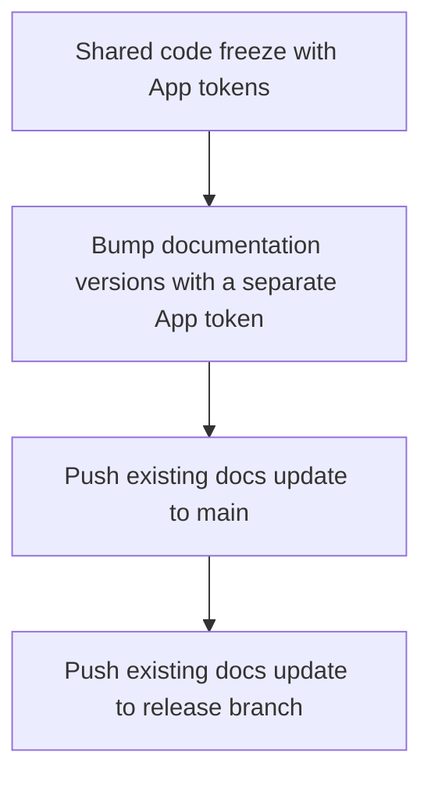

# ci(code-freeze): use github app authentication

[Upstream PR](https://github.com/NVIDIA-NeMo/Megatron-Bridge/pull/6335) · state: open · merged: False

## Original PR description

## Background

Move code-freeze writes to the existing [nemo-automation-bot](https://github.com/apps/nemo-automation-bot), App ID `1605575`, using `vars.BOT_ID` and `secrets.BOT_KEY`. The shared implementation is [FW-CI-templates #592](https://github.com/NVIDIA-NeMo/FW-CI-templates/pull/592).

## What changed

- Pass `app-id` and `BOT_KEY` to the reusable workflow and remove the legacy PAT mapping where present.
- Preserve the `main` release environment, dispatch inputs, package/version settings, dry-run guards, and Slack notifications.
- Limit `GITHUB_TOKEN` to `contents: read`; write jobs mint their own repository-scoped App installation tokens.

## Details

Pins the merged commit from [FW-CI-templates #592](https://github.com/NVIDIA-NeMo/FW-CI-templates/pull/592): [`61445a177938967f70c94094b98402e979452151`](https://github.com/NVIDIA-NeMo/FW-CI-templates/commit/61445a177938967f70c94094b98402e979452151). The shared template dependency is satisfied. Shared PAT secrets remain in place because other workflows still use them.

The follow-up `bump-docs-versions` job also replaces its PAT checkout with a job-local App token. It requests contents and administration write permissions for the existing direct pushes to main and the release branch.



## Tested

- 2026-10-09 pin update: verified the diff only changes the template SHA. `git diff --check`, `actionlint -shellcheck= .github/workflows/release-freeze.yml`, and `uv run --no-project pre-commit run --all-files` passed. Full ShellCheck diagnostics match the previous commit.
- `actionlint -shellcheck= .github/workflows/release-freeze.yml` — passed. Full `actionlint` reports only the same ShellCheck findings as the unchanged base workflow; comparison found no new diagnostics.
- `uv run --no-project pre-commit run --all-files` — passed.
- `git diff --check` — passed. YAML comparison confirmed dispatch inputs, existing non-authentication arguments, and notification secret mappings are unchanged.
- Shared template checks passed in [FW-CI-templates Actions run 37660625929](https://github.com/NVIDIA-NeMo/FW-CI-templates/actions/runs/37660625929).
- No production code freeze was dispatched. Live App authentication and protected-branch smoke validation remain pending rollout checks.

## Before your PR is ready for review

- [x] Read the contributor guidelines; commits are signed and DCO signed off.
- [x] Authentication tests and usage documentation are included in the shared template PR.
- [x] FW-CI-templates #592 merged; caller pinned to its merged commit.
- [ ] Live App authentication and protected-branch smoke validation completed.

Application, GPU, and optional-library code is unchanged.


## Review and discussion

### reviews

### issue_comments

- copy-pr-bot[bot] · comment · 2026-10-07T08:55:01Z · [source](https://github.com/NVIDIA-NeMo/Megatron-Bridge/pull/6335#issuecomment-6034489657)

Auto-sync is disabled for draft pull requests in this repository. Workflows must be run manually.

Contributors can view more details about this message [here](https://docs.gha-runners.nvidia.com/cpr/auto-sync).


- github-actions[bot] · comment · 2026-10-08T11:36:57Z · [source](https://github.com/NVIDIA-NeMo/Megatron-Bridge/pull/6335#issuecomment-6059007300)

<!-- review-command-hint -->
Automatic Claude reviews have been retired. To request a pull-request review, post a comment containing:

```
/review
```

Add `model=claude` to use a Claude reviewer (the default is `model=codex`). `mode=light|strict` selects the review depth; for example, `/review model=claude mode=strict`. Comment `/review help` for all options.

### inline_comments

## Changed files and fixed code

- `.github/workflows/release-freeze.yml` · modified · additions 17 / deletions 4
  - [head](https://github.com/NVIDIA-NeMo/Megatron-Bridge/blob/dc06593d36fd8c580cceb7d8e4b12cf226c042db/.github/workflows/release-freeze.yml)
  - [base](https://github.com/NVIDIA-NeMo/Megatron-Bridge/blob/8e2fdb88de2e9d842f28d00120df1af30acffa8a/.github/workflows/release-freeze.yml)

## Evidence and interpretation boundary

[Original JSON, discussions and patches](../../../../../../evidence/prs/NVIDIA-NeMo--Megatron-Bridge/6335-f3b8eb2db6348171c3a7a7929f89033623b5280060994d0b83c775d3e3664862.json) · SHA-256 `f3b8eb2db6348171c3a7a7929f89033623b5280060994d0b83c775d3e3664862`.

Diff complete: True. Missing/binary/truncated patches require pinned source inspection. This is a source page, not an independently verified optimization case. Open, merged and released are different states; recheck the deployed dependency.
