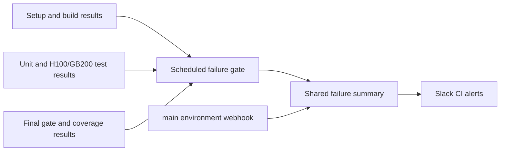

# ci(notifications): alert on scheduled pipeline failures

[Upstream PR](https://github.com/NVIDIA-NeMo/Megatron-Bridge/pull/6503) · state: closed · merged: True

## Original PR description

# What does this PR do ?

Send scheduled Megatron Bridge CI failures to Slack through the shared failure notification action. The reference [run 38830191559](https://github.com/NVIDIA-NeMo/Megatron-Bridge/actions/runs/38830191559) succeeded; this adds notifications for future failures.

# Changelog

- Add `notify-nightly-failure` after the complete scheduled pipeline: setup, lint, container builds, imports, unit tests, H100/GB200 functional tiers, the final gate, and coverage.
- Restrict alerts to failed, uncancelled scheduled runs on the canonical repository's default branch. Do not depend on setup outputs, so setup failures still qualify when downstream jobs are skipped.
- Bind the job to `environment: main`, which defines `SLACK_WEBHOOK`; use the pinned shared notifier at `631c404d00a9e60afc591cd071d35d2e18f82fc6` with `toJSON(needs)`.
- Use an Ubuntu hosted runner with empty token permissions and no checkout.



# GitHub Actions CI

## Tested

- `gh api repos/NVIDIA-NeMo/Megatron-Bridge/actions/runs/38830191559`: confirmed the reference is a successful scheduled run of `cicd-main.yml` on `main`.
- `gh secret list --repo NVIDIA-NeMo/Megatron-Bridge --env main`: confirmed the environment defines `SLACK_WEBHOOK`. Environment metadata has no deployment branch restrictions.
- `uv run --no-project --with pre-commit pre-commit run --all-files`: passed every applicable hook. Used an isolated tooling environment to avoid installing model/GPU dependencies.
- `git diff --check`: passed.
- Parsed YAML comparison against `origin/main`: all existing workflow configuration is identical; the added job depends on all 22 applicable pipeline jobs. `Coverage_Fake` is excluded because it only applies to non-CI workloads.
- Actionlint comparison: both base and candidate report the same 10 existing diagnostics, with no new findings.
- GPU/model tests skipped because only notification configuration changed. Live Slack delivery remains unverified; no test message was sent.

# Before your PR is "Ready for review"

- [x] Read and followed contributor guidelines.
- [x] Validated workflow wiring and applicable lint checks; reused the existing shared notifier.
- [x] No user-facing API or documentation changes needed.
- [x] No optional component installation changes.

# Additional Information

Primary area: `area:build`. Type: `ci`.


## Review and discussion

### reviews

- chtruong814 · APPROVED · 2026-10-16T15:37:14Z · [source](https://github.com/NVIDIA-NeMo/Megatron-Bridge/pull/6503#pullrequestreview-5550069577)

(No body; status only.)

### issue_comments

- github-actions[bot] · comment · 2026-10-16T11:42:19Z · [source](https://github.com/NVIDIA-NeMo/Megatron-Bridge/pull/6503#issuecomment-6214717792)

<!-- review-command-hint -->
Automatic Claude reviews have been retired. To request a pull-request review, post a comment containing:

```
/review
```

Add `model=claude` to use a Claude reviewer (the default is `model=codex`). `mode=light|strict` selects the review depth; for example, `/review model=claude mode=strict`. Comment `/review help` for all options.

### inline_comments

## Changed files and fixed code

- `.github/workflows/cicd-main.yml` · modified · additions 41 / deletions 0
  - [head](https://github.com/NVIDIA-NeMo/Megatron-Bridge/blob/2bb03f66f36474d4f78637aab4b22557397369f3/.github/workflows/cicd-main.yml)
  - [base](https://github.com/NVIDIA-NeMo/Megatron-Bridge/blob/76cf8ca3402c3fb28465bcc9ef5fbb58d92181bc/.github/workflows/cicd-main.yml)

## Evidence and interpretation boundary

[Original JSON, discussions and patches](../../../../../../evidence/prs/NVIDIA-NeMo--Megatron-Bridge/6503-b94940f59ae9f355e50ef71bd34c01f8807bcb7274b3844b0273c2986f6fdd17.json) · SHA-256 `b94940f59ae9f355e50ef71bd34c01f8807bcb7274b3844b0273c2986f6fdd17`.

Diff complete: True. Missing/binary/truncated patches require pinned source inspection. This is a source page, not an independently verified optimization case. Open, merged and released are different states; recheck the deployed dependency.
