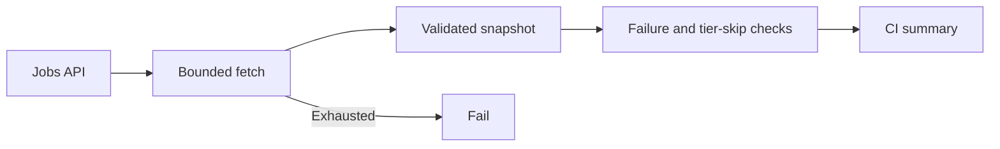

# fix(ci): AUT-2559 retry and reuse workflow job results

[Upstream PR](https://github.com/NVIDIA-NeMo/Megatron-Bridge/pull/6538) · state: closed · merged: True

## Original PR description

## Background

[Nemo_CICD_Test failed](https://github.com/NVIDIA-NeMo/Megatron-Bridge/actions/runs/39121745769/job/117745057247) on PR #6537 when GitHub's jobs API returned HTTP 502. That PR is already merged.

## What changed

- Fetch one complete jobs snapshot, with at most three attempts and 5s/10s backoff.
- Reuse it for all failure/skip assertions and diagnostics; fail closed on exhausted retries or invalid responses.
- Return success for intentionally disabled tiers under `set -e`.
- Run shell regression coverage in the existing lint job. Test triggers and failure/skip policies are unchanged.

## Details



## Tested

- 31 shell regression cases passed: retry recovery/exhaustion, partial/invalid responses, failure conclusions, H100/GB200 expected and intentional skips.
- Existing cache-key, dependency-layer and queue-bypass checks passed. Signing was disabled only for disposable dependency-test fixture commits.
- All-files pre-commit, Bash syntax, YAML wiring and diff checks passed.
- Merge-tree validation against main `74dbbe81` passed; tree equals the candidate tree.
- Model/GPU tests excluded: no model code, dependencies or test-launch payload changed. Upstream exact-head CI pending.

## Review and discussion

### reviews

- ko3n1g · APPROVED · 2026-10-18T18:34:48Z · [source](https://github.com/NVIDIA-NeMo/Megatron-Bridge/pull/6538#pullrequestreview-5564303406)

(No body; status only.)

- svcnvidia-nemo-ci · COMMENTED · 2026-10-18T18:42:15Z · [source](https://github.com/NVIDIA-NeMo/Megatron-Bridge/pull/6538#pullrequestreview-5564327752)

<!-- nemo-ci-review-impact:v1 ceiling=none -->

Reviewed all three changed files, including summary-job and lint wiring. No verified findings within the light-review scope. The bounded retries discard failed-fetch output, and assertions and diagnostics reuse the same snapshot.

Static review only; tests were not executed. No perf tests impacted.

### Suggested test cases
Retain these cases in the [shell regression suite](https://github.com/NVIDIA-NeMo/Megatron-Bridge/blob/458dea4ce85a43257d495124c010e36629a98a57/.github/scripts/test_workflow_result.sh#L63-L106):
- `passing jobs with disabled tiers and summary in progress`
- `transient API failure then success`
- `two API failures then success`
- `API retry exhaustion fails closed`

> **Note:** formal approval is not available for this request, so this review is posted as a comment only.

*Review generated by codex*

<!-- nemo-ci-review-rendering:inline-v1 -->
<!-- nemo-ci-formal-review:8c8a4eca26091678dfbc00891ce20cb77a22b7f729db7f3b47c207d718b4cecd:9cf5ab0b67efd18f9b470fbf8acfa2a5fc41c12b4e71c2d98ee59baf2ed9f359 -->

- ko3n1g · APPROVED · 2026-10-18T19:08:58Z · [source](https://github.com/NVIDIA-NeMo/Megatron-Bridge/pull/6538#pullrequestreview-5564497808)

(No body; status only.)

### issue_comments

- copy-pr-bot[bot] · comment · 2026-10-18T18:34:12Z · [source](https://github.com/NVIDIA-NeMo/Megatron-Bridge/pull/6538#issuecomment-6253592242)

This pull request requires additional validation before any workflows can run on NVIDIA's runners.

Pull request vetters can view their responsibilities [here](https://docs.gha-runners.nvidia.com/cpr/vetters).

Contributors can view more details about this message [here](https://docs.gha-runners.nvidia.com/cpr/contributors).


- svcnvidia-nemo-ci · comment · 2026-10-18T18:34:50Z · [source](https://github.com/NVIDIA-NeMo/Megatron-Bridge/pull/6538#issuecomment-6253598904)

/ok to test 458dea4ce85a43257d495124c010e36629a98a57

- github-actions[bot] · comment · 2026-10-18T18:35:05Z · [source](https://github.com/NVIDIA-NeMo/Megatron-Bridge/pull/6538#issuecomment-6253601372)

<!-- review-command-hint -->
Automatic Claude reviews have been retired. To request a pull-request review, post a comment containing:

```
/review
```

Add `model=claude` to use a Claude reviewer (the default is `model=codex`). `mode=light|strict` selects the review depth; for example, `/review model=claude mode=strict`. Comment `/review help` for all options.

- ko3n1g · comment · 2026-10-18T18:35:56Z · [source](https://github.com/NVIDIA-NeMo/Megatron-Bridge/pull/6538#issuecomment-6253610276)

/review

### inline_comments

## Changed files and fixed code

- `.github/scripts/check_workflow_result.sh` · added · additions 58 / deletions 0
  - [head](https://github.com/svcnemo-autobot/Megatron-Bridge/blob/458dea4ce85a43257d495124c010e36629a98a57/.github/scripts/check_workflow_result.sh)
  - [base](https://github.com/NVIDIA-NeMo/Megatron-Bridge/blob/74dbbe8196e037956559686687b10fc135003a24/.github/scripts/check_workflow_result.sh)
- `.github/scripts/test_workflow_result.sh` · added · additions 106 / deletions 0
  - [head](https://github.com/svcnemo-autobot/Megatron-Bridge/blob/458dea4ce85a43257d495124c010e36629a98a57/.github/scripts/test_workflow_result.sh)
  - [base](https://github.com/NVIDIA-NeMo/Megatron-Bridge/blob/74dbbe8196e037956559686687b10fc135003a24/.github/scripts/test_workflow_result.sh)
- `.github/workflows/cicd-main.yml` · modified · additions 2 / deletions 42
  - [head](https://github.com/svcnemo-autobot/Megatron-Bridge/blob/458dea4ce85a43257d495124c010e36629a98a57/.github/workflows/cicd-main.yml)
  - [base](https://github.com/NVIDIA-NeMo/Megatron-Bridge/blob/74dbbe8196e037956559686687b10fc135003a24/.github/workflows/cicd-main.yml)

## Evidence and interpretation boundary

[Original JSON, discussions and patches](../../../../../../evidence/prs/NVIDIA-NeMo--Megatron-Bridge/6538-fcfd2cef2dcccc51a1b21c419c1ca1dd327968753fd0669ef9b8760cf354bf2b.json) · SHA-256 `fcfd2cef2dcccc51a1b21c419c1ca1dd327968753fd0669ef9b8760cf354bf2b`.

Diff complete: True. Missing/binary/truncated patches require pinned source inspection. This is a source page, not an independently verified optimization case. Open, merged and released are different states; recheck the deployed dependency.
