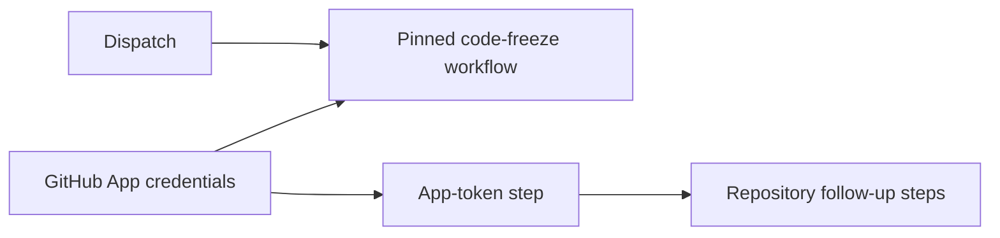

# cp: use GitHub App authentication for code freeze

[Upstream PR](https://github.com/NVIDIA-NeMo/Megatron-Bridge/pull/6539) · state: closed · merged: True

## Original PR description

## Background

Copy #6335 at pinned source head `dc06593d36fd8c580cceb7d8e4b12cf226c042db` onto `main`.

## What changed

Use GitHub App authentication in the code-freeze workflow, including its App-token job, and update the shared workflow pin.

## Details

Both source commits retain cherry-pick provenance. Only `.github/workflows/release-freeze.yml` differs; its final blob matches the pinned source.



## Tested

- Native changed-file pre-commit completed; nonmatching hooks skipped natively.
- Diff whitespace, source identity, signatures, signoffs, and remote head verified.
- ML/GPU tests excluded: product/dependency inputs unchanged.
- actionlint unavailable due denied asset access. No release dispatched locally. Required CI and secret-plumbing approval pending.

## Review and discussion

### reviews

- ko3n1g · APPROVED · 2026-10-19T08:57:40Z · [source](https://github.com/NVIDIA-NeMo/Megatron-Bridge/pull/6539#pullrequestreview-5569124570)

(No body; status only.)

### issue_comments

- copy-pr-bot[bot] · comment · 2026-10-18T19:14:41Z · [source](https://github.com/NVIDIA-NeMo/Megatron-Bridge/pull/6539#issuecomment-6254017664)

This pull request requires additional validation before any workflows can run on NVIDIA's runners.

Pull request vetters can view their responsibilities [here](https://docs.gha-runners.nvidia.com/cpr/vetters).

Contributors can view more details about this message [here](https://docs.gha-runners.nvidia.com/cpr/contributors).


- svcnvidia-nemo-ci · comment · 2026-10-18T19:15:36Z · [source](https://github.com/NVIDIA-NeMo/Megatron-Bridge/pull/6539#issuecomment-6254028964)

/ok to test b8e67c306396f366df14ec08ce945395b453d23b

- github-actions[bot] · comment · 2026-10-18T19:15:51Z · [source](https://github.com/NVIDIA-NeMo/Megatron-Bridge/pull/6539#issuecomment-6254031913)

<!-- review-command-hint -->
Automatic Claude reviews have been retired. To request a pull-request review, post a comment containing:

```
/review
```

Add `model=claude` to use a Claude reviewer (the default is `model=codex`). `mode=light|strict` selects the review depth; for example, `/review model=claude mode=strict`. Comment `/review help` for all options.

### inline_comments

## Changed files and fixed code

- `.github/workflows/release-freeze.yml` · modified · additions 17 / deletions 4
  - [head](https://github.com/svcnemo-autobot/Megatron-Bridge/blob/b8e67c306396f366df14ec08ce945395b453d23b/.github/workflows/release-freeze.yml)
  - [base](https://github.com/NVIDIA-NeMo/Megatron-Bridge/blob/74dbbe8196e037956559686687b10fc135003a24/.github/workflows/release-freeze.yml)

## Evidence and interpretation boundary

[Original JSON, discussions and patches](../../../../../../evidence/prs/NVIDIA-NeMo--Megatron-Bridge/6539-fd0a709128fb11ec0f70d31566c044c81824b34c6b0601a6c68b18f4ab6ef6c3.json) · SHA-256 `fd0a709128fb11ec0f70d31566c044c81824b34c6b0601a6c68b18f4ab6ef6c3`.

Diff complete: True. Missing/binary/truncated patches require pinned source inspection. This is a source page, not an independently verified optimization case. Open, merged and released are different states; recheck the deployed dependency.
