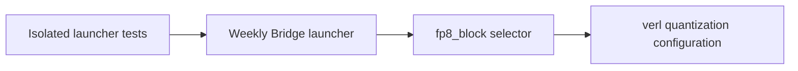

# fix(ci): AUT-2636 use supported verl FP8 rollout quantization

[Upstream PR](https://github.com/NVIDIA-NeMo/Megatron-Bridge/pull/6668) · state: closed · merged: True

## Original PR description

## Background

AUT-2636: scheduled [weekly run 40279403467](https://github.com/NVIDIA-NeMo/Megatron-Bridge/actions/runs/40279403467), attempt 1, failed in the expert-parallel leg. verl rejected `linear='FP8'`; its reported supported schemes include `FP8_BLOCK`.

## What changed

- Use `ROLLOUT_QUANTIZATION=fp8_block` in the Bridge-owned launcher.
- Add two isolated launcher tests for variant settings, failure propagation, and checkpoint cleanup.
- Preserve all three variants, topology, data, and timeout settings. No MCore change.

## Details


The unquantized variant completed in the failed run. The quantized variant failed before the later LoRA variant could run. Tests stub the external commands; they do not execute verl or prove training recovery.

## Tested

- `uv run python -m pytest -q tests/unit_tests/scripts/test_verl_ci.py`: 2 passed.
- `uv run mypy --strict tests/unit_tests/scripts/test_verl_ci.py`: passed.
- Repository pre-commit all-files hooks, Bash syntax, and all four lint-check shell scripts: passed.
- Revalidated against upstream base `25cdf971`; authoring head unchanged.

Required GitHub CI and review are pending. Local verl E2E execution is unavailable by policy. A later trusted scheduled run must pass the quantized and LoRA variants before E2E recovery is confirmed.

## Review and discussion

### reviews

- ko3n1g · APPROVED · 2026-10-26T20:56:51Z · [source](https://github.com/NVIDIA-NeMo/Megatron-Bridge/pull/6668#pullrequestreview-5658877308)

(No body; status only.)

- cuichenx · APPROVED · 2026-10-26T20:59:06Z · [source](https://github.com/NVIDIA-NeMo/Megatron-Bridge/pull/6668#pullrequestreview-5658908982)

(No body; status only.)

### issue_comments

- copy-pr-bot[bot] · comment · 2026-10-26T18:50:59Z · [source](https://github.com/NVIDIA-NeMo/Megatron-Bridge/pull/6668#issuecomment-6424598762)

This pull request requires additional validation before any workflows can run on NVIDIA's runners.

Pull request vetters can view their responsibilities [here](https://docs.gha-runners.nvidia.com/cpr/vetters).

Contributors can view more details about this message [here](https://docs.gha-runners.nvidia.com/cpr/contributors).


- svcnvidia-nemo-ci · comment · 2026-10-26T18:51:41Z · [source](https://github.com/NVIDIA-NeMo/Megatron-Bridge/pull/6668#issuecomment-6424612710)

/ok to test 9369a1728e4c8a5c31c7a45bbb1e2b16fbb0bf9b

- github-actions[bot] · comment · 2026-10-26T18:53:15Z · [source](https://github.com/NVIDIA-NeMo/Megatron-Bridge/pull/6668#issuecomment-6424643684)

<!-- review-command-hint -->
Automatic Claude reviews have been retired. To request a pull-request review, post a comment containing:

```
/review
```

Add `model=claude` to use a Claude reviewer (the default is `model=codex`). `mode=light|strict` selects the review depth; for example, `/review model=claude mode=strict`. Comment `/review help` for all options.

### inline_comments

## Changed files and fixed code

- `.github/workflows/verl_ci/run_megatron_moe_expert_parallel.sh` · modified · additions 1 / deletions 1
  - [head](https://github.com/svcnemo-autobot/Megatron-Bridge/blob/9369a1728e4c8a5c31c7a45bbb1e2b16fbb0bf9b/.github/workflows/verl_ci/run_megatron_moe_expert_parallel.sh)
  - [base](https://github.com/NVIDIA-NeMo/Megatron-Bridge/blob/25cdf971a36f770f1f1a0f6e7e6e2e48ad755b66/.github/workflows/verl_ci/run_megatron_moe_expert_parallel.sh)
- `tests/unit_tests/scripts/test_verl_ci.py` · added · additions 76 / deletions 0
  - [head](https://github.com/svcnemo-autobot/Megatron-Bridge/blob/9369a1728e4c8a5c31c7a45bbb1e2b16fbb0bf9b/tests/unit_tests/scripts/test_verl_ci.py)
  - [base](https://github.com/NVIDIA-NeMo/Megatron-Bridge/blob/25cdf971a36f770f1f1a0f6e7e6e2e48ad755b66/tests/unit_tests/scripts/test_verl_ci.py)

## Evidence and interpretation boundary

[Original JSON, discussions and patches](../../../../../../evidence/prs/NVIDIA-NeMo--Megatron-Bridge/6668-28c1e72a94ef08c43132a908d1722bcea8552355a1ce7ce9ec26545e8222d2d1.json) · SHA-256 `28c1e72a94ef08c43132a908d1722bcea8552355a1ce7ce9ec26545e8222d2d1`.

Diff complete: True. Missing/binary/truncated patches require pinned source inspection. This is a source page, not an independently verified optimization case. Open, merged and released are different states; recheck the deployed dependency.
