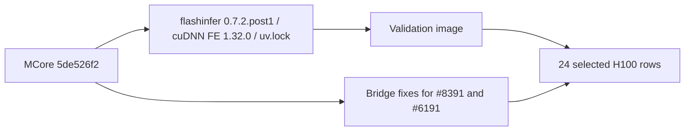

# chore(deps): AUT-2662 bump Megatron-Core main to 5de526f2

[Upstream PR](https://github.com/NVIDIA-NeMo/Megatron-Bridge/pull/6717) · state: closed · merged: True

## Original PR description

## Background

Nightly Megatron-Core `main` bump (AUT-2662). `.main.commit` and `3rdparty/Megatron-LM` move from `a2965235` to `5de526f2` (21 MCore commits). `.dev.commit` is unchanged.

## What changed

- Pin: `.main.commit` and the gitlink now point to `5de526f232464e1b1ff1d6645fe2c4aaf01bc0d8`.
- Dependency alignment: MCore #8013 requires `flashinfer-python>=0.7.2,<0.8.0` and `nvidia-cudnn-frontend[cutedsl]==1.32.0`, which conflicts with Bridge's flashinfer `0.6.18.post1`. `flashinfer-python` and `flashinfer-cubin` move together to `0.7.2.post1`, and the cuDNN Frontend override is now `1.32.0`. `docker/common/fw_pyproject.toml` stays in sync. `uv.lock` was regenerated with uv 0.7.2 (revision 3).
- MCore #8391: MCore added a `sft_tokenizer_prompt_format` field to its tokenizer config, and Bridge's read-only property of the same name broke every `TokenizerConfig` construction with `AttributeError`. The property is removed. `__post_init__` and `build_tokenizer` now copy `tokenizer_prompt_format` into the field. A new unit test covers this.
- MCore #6191: the hybrid-resume optimizer unit test now gives its scaffold a single-rank `data_parallel_group`, because dp-reshardable loading now reads it.

## Details


Follow-up, not in this PR: MCore #8210 moved its arm64-only MoK build to `7a8cfb7f` without a patch. Bridge `docker/Dockerfile.ci` still pins MoK `a2ad2d0c` with `docker/patches/mok.patch`. Bridge source and tests do not use MoK.

## Tested

Local H100 runs used the exact tree of this head and a validation image built from this lock:
- 24 selected unit and functional rows: 23 passed, 0 skipped_upstream, 1 skipped_platform.
- skipped_platform: Core unit shard 1/3 had 5191 passed and 2 failed. The `Qwen/Qwen3.5-122B-A10B` `config.json` is not in the offline HF cache, and the test pods have no egress. The affected cases are `test_qwen35_vl_122b_h100_pipeline_layout` with the bf16 and fp8cs `-8-2` parameters. They were not validated.
- Rows outside the impact-selected set were not run.
- GitHub CI: pending.

## Review and discussion

### reviews

### issue_comments

- copy-pr-bot[bot] · comment · 2026-10-29T15:51:09Z · [source](https://github.com/NVIDIA-NeMo/Megatron-Bridge/pull/6717#issuecomment-6501510503)

This pull request requires additional validation before any workflows can run on NVIDIA's runners.

Pull request vetters can view their responsibilities [here](https://docs.gha-runners.nvidia.com/cpr/vetters).

Contributors can view more details about this message [here](https://docs.gha-runners.nvidia.com/cpr/contributors).


- svcnvidia-nemo-ci · comment · 2026-10-29T15:59:26Z · [source](https://github.com/NVIDIA-NeMo/Megatron-Bridge/pull/6717#issuecomment-6501707752)

/ok to test 8c46505464f53ee9421caa5d8b42f19840629b05

- github-actions[bot] · comment · 2026-10-29T16:00:22Z · [source](https://github.com/NVIDIA-NeMo/Megatron-Bridge/pull/6717#issuecomment-6501729303)

<!-- review-command-hint -->
Automatic Claude reviews have been retired. To request a pull-request review, post a comment containing:

```
/review
```

Add `model=claude` to use a Claude reviewer (the default is `model=codex`). `mode=light|strict` selects the review depth; for example, `/review model=claude mode=strict`. Comment `/review help` for all options.

- svcnvidia-nemo-ci · comment · 2026-10-29T17:58:53Z · [source](https://github.com/NVIDIA-NeMo/Megatron-Bridge/pull/6717#issuecomment-6504409756)

/ok to test 80b6f58ed8cccd4fb9fcfc529407523b1ea0e548

- cuichenx · comment · 2026-10-29T22:37:04Z · [source](https://github.com/NVIDIA-NeMo/Megatron-Bridge/pull/6717#issuecomment-6510070517)

all tests passed 

### inline_comments

## Changed files and fixed code

- `.main.commit` · modified · additions 1 / deletions 1
  - [head](https://github.com/svcnemo-autobot/Megatron-Bridge/blob/80b6f58ed8cccd4fb9fcfc529407523b1ea0e548/.main.commit)
  - [base](https://github.com/NVIDIA-NeMo/Megatron-Bridge/blob/e301c817218e4e626c8c264aee9935514559a04b/.main.commit)
- `3rdparty/Megatron-LM` · modified · additions 1 / deletions 1
  - [head](https://github.com/svcnemo-autobot/Megatron-Bridge/blob/80b6f58ed8cccd4fb9fcfc529407523b1ea0e548/3rdparty/Megatron-LM)
  - [base](https://github.com/NVIDIA-NeMo/Megatron-Bridge/blob/e301c817218e4e626c8c264aee9935514559a04b/3rdparty/Megatron-LM)
- `docker/common/fw_pyproject.toml` · modified · additions 2 / deletions 2
  - [head](https://github.com/svcnemo-autobot/Megatron-Bridge/blob/80b6f58ed8cccd4fb9fcfc529407523b1ea0e548/docker/common/fw_pyproject.toml)
  - [base](https://github.com/NVIDIA-NeMo/Megatron-Bridge/blob/e301c817218e4e626c8c264aee9935514559a04b/docker/common/fw_pyproject.toml)
- `docker/common/install.sh` · modified · additions 9 / deletions 0
  - [head](https://github.com/svcnemo-autobot/Megatron-Bridge/blob/80b6f58ed8cccd4fb9fcfc529407523b1ea0e548/docker/common/install.sh)
  - [base](https://github.com/NVIDIA-NeMo/Megatron-Bridge/blob/e301c817218e4e626c8c264aee9935514559a04b/docker/common/install.sh)
- `pyproject.toml` · modified · additions 3 / deletions 3
  - [head](https://github.com/svcnemo-autobot/Megatron-Bridge/blob/80b6f58ed8cccd4fb9fcfc529407523b1ea0e548/pyproject.toml)
  - [base](https://github.com/NVIDIA-NeMo/Megatron-Bridge/blob/e301c817218e4e626c8c264aee9935514559a04b/pyproject.toml)
- `src/megatron/bridge/training/tokenizers/config.py` · modified · additions 9 / deletions 5
  - [head](https://github.com/svcnemo-autobot/Megatron-Bridge/blob/80b6f58ed8cccd4fb9fcfc529407523b1ea0e548/src/megatron/bridge/training/tokenizers/config.py)
  - [base](https://github.com/NVIDIA-NeMo/Megatron-Bridge/blob/e301c817218e4e626c8c264aee9935514559a04b/src/megatron/bridge/training/tokenizers/config.py)
- `src/megatron/bridge/training/tokenizers/tokenizer.py` · modified · additions 6 / deletions 0
  - [head](https://github.com/svcnemo-autobot/Megatron-Bridge/blob/80b6f58ed8cccd4fb9fcfc529407523b1ea0e548/src/megatron/bridge/training/tokenizers/tokenizer.py)
  - [base](https://github.com/NVIDIA-NeMo/Megatron-Bridge/blob/e301c817218e4e626c8c264aee9935514559a04b/src/megatron/bridge/training/tokenizers/tokenizer.py)
- `tests/unit_tests/training/test_optim.py` · modified · additions 2 / deletions 0
  - [head](https://github.com/svcnemo-autobot/Megatron-Bridge/blob/80b6f58ed8cccd4fb9fcfc529407523b1ea0e548/tests/unit_tests/training/test_optim.py)
  - [base](https://github.com/NVIDIA-NeMo/Megatron-Bridge/blob/e301c817218e4e626c8c264aee9935514559a04b/tests/unit_tests/training/test_optim.py)
- `tests/unit_tests/training/test_tokenizer.py` · modified · additions 16 / deletions 0
  - [head](https://github.com/svcnemo-autobot/Megatron-Bridge/blob/80b6f58ed8cccd4fb9fcfc529407523b1ea0e548/tests/unit_tests/training/test_tokenizer.py)
  - [base](https://github.com/NVIDIA-NeMo/Megatron-Bridge/blob/e301c817218e4e626c8c264aee9935514559a04b/tests/unit_tests/training/test_tokenizer.py)
- `uv.lock` · modified · additions 84 / deletions 66
  - [head](https://github.com/svcnemo-autobot/Megatron-Bridge/blob/80b6f58ed8cccd4fb9fcfc529407523b1ea0e548/uv.lock)
  - [base](https://github.com/NVIDIA-NeMo/Megatron-Bridge/blob/e301c817218e4e626c8c264aee9935514559a04b/uv.lock)

## Evidence and interpretation boundary

[Original JSON, discussions and patches](../../../../../../evidence/prs/NVIDIA-NeMo--Megatron-Bridge/6717-19b3c5d4c1b99a39f305df525479ecd1e6e135e7ff0aa5ffb3f3a80355b8d8f5.json) · SHA-256 `19b3c5d4c1b99a39f305df525479ecd1e6e135e7ff0aa5ffb3f3a80355b8d8f5`.

Diff complete: True. Missing/binary/truncated patches require pinned source inspection. This is a source page, not an independently verified optimization case. Open, merged and released are different states; recheck the deployed dependency.
