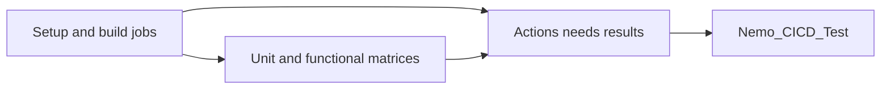

# fix(ci): derive workflow summary from dependency results

[Upstream PR](https://github.com/NVIDIA-NeMo/Megatron-Bridge/pull/6748) · state: closed · merged: False

## Original PR description

`Nemo_CICD_Test` failed in [run 41071688341](https://github.com/NVIDIA-NeMo/Megatron-Bridge/actions/runs/41071688341/job/124230956921) after the GitHub jobs API returned HTTP 502 on all three attempts. The required summary should use dependency results already supplied by Actions.

Pass `toJSON(needs)` to the summary script and include every prerequisite before the summary, excluding the intentionally nonblocking flaky lanes. Reject failed/cancelled aggregate results, missing expected tiers and unexpected tier skips; retain the membership and GB200-disable exceptions. The summary no longer calls the jobs API or needs a GitHub token.



Tested:

- `bash .github/scripts/test_workflow_result.sh`: 67 regression cases passed. Cases cover every dependency failing/cancelling, matrix aggregate failures, optional/required tier skips, missing results, GB200 exceptions and invalid input. A rejecting `gh` stub proves passing summaries do not call GitHub.
- `bash -n .github/scripts/check_workflow_result.sh .github/scripts/test_workflow_result.sh`: passed.
- `uv run --no-sync pre-commit run --all-files`: passed.
- Original job logs confirm three HTTP 502 responses from the jobs API followed by retry exhaustion.


## Review and discussion

### reviews

### issue_comments

- github-actions[bot] · comment · 2026-11-02T14:11:21Z · [source](https://github.com/NVIDIA-NeMo/Megatron-Bridge/pull/6748#issuecomment-6579277897)

<!-- review-command-hint -->
Automatic Claude reviews have been retired. To request a pull-request review, post a comment containing:

```
/review
```

Add `model=claude` to use a Claude reviewer (the default is `model=codex`). `mode=light|strict` selects the review depth; for example, `/review model=claude mode=strict`. Comment `/review help` for all options.

### inline_comments

## Changed files and fixed code

- `.github/scripts/check_workflow_result.sh` · modified · additions 29 / deletions 39
  - [head](https://github.com/NVIDIA-NeMo/Megatron-Bridge/blob/ad751ddbab54e91e6fc4852d4020076b56c33d94/.github/scripts/check_workflow_result.sh)
  - [base](https://github.com/NVIDIA-NeMo/Megatron-Bridge/blob/32d7094ed873ba8fbba2f2a34088acb1bdce7ffa/.github/scripts/check_workflow_result.sh)
- `.github/scripts/test_workflow_result.sh` · modified · additions 51 / deletions 61
  - [head](https://github.com/NVIDIA-NeMo/Megatron-Bridge/blob/ad751ddbab54e91e6fc4852d4020076b56c33d94/.github/scripts/test_workflow_result.sh)
  - [base](https://github.com/NVIDIA-NeMo/Megatron-Bridge/blob/32d7094ed873ba8fbba2f2a34088acb1bdce7ffa/.github/scripts/test_workflow_result.sh)
- `.github/workflows/cicd-main.yml` · modified · additions 8 / deletions 2
  - [head](https://github.com/NVIDIA-NeMo/Megatron-Bridge/blob/ad751ddbab54e91e6fc4852d4020076b56c33d94/.github/workflows/cicd-main.yml)
  - [base](https://github.com/NVIDIA-NeMo/Megatron-Bridge/blob/32d7094ed873ba8fbba2f2a34088acb1bdce7ffa/.github/workflows/cicd-main.yml)

## Evidence and interpretation boundary

[Original JSON, discussions and patches](../../../../../../evidence/prs/NVIDIA-NeMo--Megatron-Bridge/6748-f33c1d85c63fdeed6ffa908ceea0b592a5c894f600ff0a565d67bd1a6bb4d759.json) · SHA-256 `f33c1d85c63fdeed6ffa908ceea0b592a5c894f600ff0a565d67bd1a6bb4d759`.

Diff complete: True. Missing/binary/truncated patches require pinned source inspection. This is a source page, not an independently verified optimization case. Open, merged and released are different states; recheck the deployed dependency.
