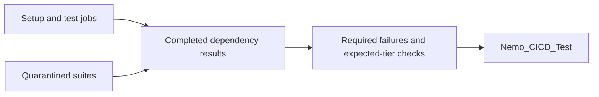

# fix(ci): AUT-2715 derive summary from workflow dependency results

[Upstream PR](https://github.com/NVIDIA-NeMo/Megatron-Bridge/pull/6749) · state: closed · merged: True

## Original PR description

## Background

[Nemo_CICD_Test failed](https://github.com/NVIDIA-NeMo/Megatron-Bridge/actions/runs/41071688341/job/124230956921) after three jobs API HTTP 502 responses, while every other job succeeded or was skipped. Retries from #6538 did not prevent this false failure.

## What changed

- Read `${{ toJSON(needs) }}` instead of querying the jobs API.
- Explicitly wait for all 20 preceding jobs, including setup, matrix generators, and opt-in flaky suites.
- Block on failed/cancelled required dependencies. Keep the two quarantined suites informational, as the tier contract requires.
- Reject malformed input and skipped/missing expected H100/GB200 tiers; preserve intentional skips.
- Remove API credentials and reduce summary permissions to `contents: read`.

## Details



Summary evaluation no longer depends on jobs API availability. Quarantined failures stay visible in their own jobs but do not block the summary or coverage. Test commands and triggers are unchanged.

## Tested

- 82 shell cases passed: all 18 required dependencies failing/cancelled, both informational suites, mixed diagnostics, expected/intentional skips, malformed input, and no API calls.
- Existing cache-key, dependency-layer, and queue-bypass checks passed. Signing was disabled only for disposable fixture commits.
- All-files pre-commit, Bash syntax, YAML wiring, scope, and diff checks passed.
- `b5aa3721` validated against main `32d7094e`; candidate and merge trees match.
- Model/GPU tests excluded: no model code, dependencies, gitlinks, data, or test-launch payload changed. Authoritative exact-head CI remains pending.

## Review and discussion

### reviews

- svcnvidia-nemo-ci · CHANGES_REQUESTED · 2026-11-02T15:01:49Z · [source](https://github.com/NVIDIA-NeMo/Megatron-Bridge/pull/6749#pullrequestreview-5738543354)

<!-- nemo-ci-review-impact:v1 ceiling=moderate -->

One blocking logic issue remains: the summary now waits for quarantined suites and treats their failures as blocking, contrary to the repository's informational-only tier contract.

I reviewed all three changed files and traced the affected dependency, tier-selection, failure-propagation, and coverage paths. I didn't execute tests or workflows in this read-only review.

### Suggested test cases
- `flaky_results_are_informational` — proposed: each quarantined dependency fails or is cancelled while other dependencies succeed; expect summary exit 0.
- `required_dependency_results_block_summary` — proposed: each other dependency fails or is cancelled; expect exit 1 and its diagnostic.
- `expected_tier_skip_and_missing_result` — proposed: each expected H100/GB200 tier is skipped or missing; expect exit 1.
- `queue bypass and disabled flaky suites` — retain exit 0 and the no-API-call assertion.
- No perf tests impacted.

*Review generated by codex. This was a full review. Request a full review with `/review reset=true`.*

<!-- nemo-ci-review-rendering:inline-v1 -->
<!-- nemo-ci-formal-review:7fbb9579d38ffb354eb3fdfcd63e124fe4fe9e01298a926d2da016064f26c92c:42f3d1e75608f86f71a3b9d10fe811e108c256bb59797924977feebd16a3375e -->

- svcnvidia-nemo-ci · APPROVED · 2026-11-02T17:06:13Z · [source](https://github.com/NVIDIA-NeMo/Megatron-Bridge/pull/6749#pullrequestreview-5740292352)

<!-- nemo-ci-review-impact:v1 ceiling=none -->

No qualifying findings. I reviewed all three changed files and traced dependency scheduling, tier selection, failure propagation, regression-test wiring, permissions, and downstream coverage.

The prior quarantined-suite finding is fixed: the [evaluator](https://github.com/NVIDIA-NeMo/Megatron-Bridge/blob/b5aa37210566012f652ba15ebbdaf80f6d4cde03/.github/scripts/check_workflow_result.sh#L17-L48) excludes exactly the two informational suites from failure counts and diagnostics. The [regression cases](https://github.com/NVIDIA-NeMo/Megatron-Bridge/blob/b5aa37210566012f652ba15ebbdaf80f6d4cde03/.github/scripts/test_workflow_result.sh#L73-L104) retain blocking behavior for required dependencies, including mixed failures.

I didn't execute tests or workflows. Remote reusable-workflow implementations aren't mounted, so I checked their pinned caller contracts. The delegated harness report wasn't available; I inspected that scope directly.

### Suggested test cases
These are proposed checks, not execution results.
- `required_dependency_results_block_summary` — each required dependency fails or is cancelled; expect exit 1 and its diagnostic.
- `quarantined_results_are_informational` — each quarantined suite fails or is cancelled while required dependencies succeed; expect exit 0 without an API call.
- `mixed_required_and_quarantined_failures` — expect exit 1, with only required failures counted and listed.
- `expected_tier_result_skipped_or_missing` — each enabled H100/GB200 tier is skipped or absent; expect exit 1.
- `intentional_skip_paths` — retain success for disabled tiers, disabled/non-member GB200, docs-only changes, deployment, and queue bypass.
- `invalid_dependency_results` — malformed or missing input exits 1 with the invalid-input diagnostic.
- `coverage_after_quarantined_failure` — active suites succeed and a quarantined suite fails; expect summary success and coverage eligibility.
- No perf tests impacted.

*Review generated by codex. This was a full review. Request a full review with `/review reset=true`.*

<!-- nemo-ci-review-rendering:inline-v1 -->
<!-- nemo-ci-formal-review:73499a481d39cdbea25d92453712dbb994ab2d1bd99401962e10ad454b4583dc:891652fcbc2e66f41b0517e456ee94b37e22a8b90d2f28db52e9688b11b2b3f8 -->

### issue_comments

- copy-pr-bot[bot] · comment · 2026-11-02T14:35:53Z · [source](https://github.com/NVIDIA-NeMo/Megatron-Bridge/pull/6749#issuecomment-6579831195)

This pull request requires additional validation before any workflows can run on NVIDIA's runners.

Pull request vetters can view their responsibilities [here](https://docs.gha-runners.nvidia.com/cpr/vetters).

Contributors can view more details about this message [here](https://docs.gha-runners.nvidia.com/cpr/contributors).


- svcnvidia-nemo-ci · comment · 2026-11-02T14:36:39Z · [source](https://github.com/NVIDIA-NeMo/Megatron-Bridge/pull/6749#issuecomment-6579849090)

/ok to test b63c9cd83ccc9f4ef7d8536eeaa07d7055cc3c3a

- github-actions[bot] · comment · 2026-11-02T14:36:57Z · [source](https://github.com/NVIDIA-NeMo/Megatron-Bridge/pull/6749#issuecomment-6579856022)

<!-- review-command-hint -->
Automatic Claude reviews have been retired. To request a pull-request review, post a comment containing:

```
/review
```

Add `model=claude` to use a Claude reviewer (the default is `model=codex`). `mode=light|strict` selects the review depth; for example, `/review model=claude mode=strict`. Comment `/review help` for all options.

- ko3n1g · comment · 2026-11-02T14:41:20Z · [source](https://github.com/NVIDIA-NeMo/Megatron-Bridge/pull/6749#issuecomment-6579954947)

/review-approve

- svcnvidia-nemo-ci · comment · 2026-11-02T15:21:45Z · [source](https://github.com/NVIDIA-NeMo/Megatron-Bridge/pull/6749#issuecomment-6580877180)

/ok to test b5aa37210566012f652ba15ebbdaf80f6d4cde03

- ko3n1g · comment · 2026-11-02T16:48:05Z · [source](https://github.com/NVIDIA-NeMo/Megatron-Bridge/pull/6749#issuecomment-6582832173)

/review-approve reset=true

- ko3n1g · comment · 2026-11-02T16:57:07Z · [source](https://github.com/NVIDIA-NeMo/Megatron-Bridge/pull/6749#issuecomment-6583030163)

/review-approve reset=true

### inline_comments

- svcnvidia-nemo-ci · comment · 2026-11-02T15:01:49Z · [source](https://github.com/NVIDIA-NeMo/Megatron-Bridge/pull/6749#discussion_r4443919826)

File: `.github/workflows/cicd-main.yml` · line 1229

**Blocking: keep quarantined suite failures informational.** On a manual `test_suite=all` run, let every active suite succeed and a slower H100 or GB200 flaky suite fail afterward. These new dependencies force `Nemo_CICD_Test` to wait for that failure, and the [unconditional failure count](https://github.com/NVIDIA-NeMo/Megatron-Bridge/blob/b63c9cd83ccc9f4ef7d8536eeaa07d7055cc3c3a/.github/scripts/check_workflow_result.sh#L17) fails the required summary, which also [prevents coverage aggregation](https://github.com/NVIDIA-NeMo/Megatron-Bridge/blob/b63c9cd83ccc9f4ef7d8536eeaa07d7055cc3c3a/.github/workflows/cicd-main.yml#L1297-L1306). The trusted [tier contract](https://github.com/NVIDIA-NeMo/Megatron-Bridge/blob/32d7094ed873ba8fbba2f2a34088acb1bdce7ffa/skills/testing/SKILL.md#L29-L37) says quarantined failures are informational, not blocking. The [base dependency graph](https://github.com/NVIDIA-NeMo/Megatron-Bridge/blob/32d7094ed873ba8fbba2f2a34088acb1bdce7ffa/.github/workflows/cicd-main.yml#L1218-L1231) allowed the summary to succeed before that later failure; this change makes it block deterministically. The base API checker could already catch an earlier flaky failure, so that older inconsistency isn't the newly introduced case here.

**Correction:** retain the complete dependency snapshot, but exclude exactly these two informational job IDs from both the failure count and diagnostic queries in [the evaluator](https://github.com/NVIDIA-NeMo/Megatron-Bridge/blob/b63c9cd83ccc9f4ef7d8536eeaa07d7055cc3c3a/.github/scripts/check_workflow_result.sh#L17-L43). Insert this suggested filter immediately after `to_entries[] |` in both queries:
```jq
select(.key != "cicd-functional-tests-flaky" and
       .key != "cicd-functional-tests-gb200-flaky") |
```
Update the [per-dependency regression loop](https://github.com/NVIDIA-NeMo/Megatron-Bridge/blob/b63c9cd83ccc9f4ef7d8536eeaa07d7055cc3c3a/.github/scripts/test_workflow_result.sh#L73-L81) to expect success for those two IDs rather than requiring their failures to block. The invariant is that quarantined results remain visible in their own jobs without failing the summary, while active-suite and setup failures still block it.

**Acceptance checks — proposed, not executed:** with otherwise successful dependency results, set each flaky job individually to `failure` and `cancelled`; expect exit 0. Repeat for each of the other 18 dependencies; retain exit 1 and the failing job's diagnostic. Preserve rejection of skipped/missing expected tiers and malformed input, acceptance of intentional tier skips and disabled/non-member GB200 skips, and the no-API-call assertion. Verify the suggested filter before adopting it.

## Changed files and fixed code

- `.github/scripts/check_workflow_result.sh` · modified · additions 30 / deletions 33
  - [head](https://github.com/svcnemo-autobot/Megatron-Bridge/blob/b5aa37210566012f652ba15ebbdaf80f6d4cde03/.github/scripts/check_workflow_result.sh)
  - [base](https://github.com/NVIDIA-NeMo/Megatron-Bridge/blob/32d7094ed873ba8fbba2f2a34088acb1bdce7ffa/.github/scripts/check_workflow_result.sh)
- `.github/scripts/test_workflow_result.sh` · modified · additions 101 / deletions 66
  - [head](https://github.com/svcnemo-autobot/Megatron-Bridge/blob/b5aa37210566012f652ba15ebbdaf80f6d4cde03/.github/scripts/test_workflow_result.sh)
  - [base](https://github.com/NVIDIA-NeMo/Megatron-Bridge/blob/32d7094ed873ba8fbba2f2a34088acb1bdce7ffa/.github/scripts/test_workflow_result.sh)
- `.github/workflows/cicd-main.yml` · modified · additions 12 / deletions 3
  - [head](https://github.com/svcnemo-autobot/Megatron-Bridge/blob/b5aa37210566012f652ba15ebbdaf80f6d4cde03/.github/workflows/cicd-main.yml)
  - [base](https://github.com/NVIDIA-NeMo/Megatron-Bridge/blob/32d7094ed873ba8fbba2f2a34088acb1bdce7ffa/.github/workflows/cicd-main.yml)

## Evidence and interpretation boundary

[Original JSON, discussions and patches](../../../../../../evidence/prs/NVIDIA-NeMo--Megatron-Bridge/6749-eeee75500a0441fb66765857c555718f44534c5829317d027674d05406891636.json) · SHA-256 `eeee75500a0441fb66765857c555718f44534c5829317d027674d05406891636`.

Diff complete: True. Missing/binary/truncated patches require pinned source inspection. This is a source page, not an independently verified optimization case. Open, merged and released are different states; recheck the deployed dependency.
