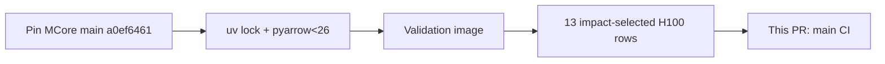

# chore(deps): AUT-2723 bump Megatron-Core main to a0ef6461

[Upstream PR](https://github.com/NVIDIA-NeMo/Megatron-Bridge/pull/6780) · state: open · merged: False

## Original PR description

## Background

Nightly MCore `main` bump (AUT-2723). It moves the main pin from `e0a4bfed` to `a0ef6461`. `.dev.commit` is unchanged.

## What changed

- `.main.commit` and `3rdparty/Megatron-LM`: `e0a4bfed` → `a0ef6461`.
- `uv.lock`: regenerated with uv 0.7.2, which matches `UV_VERSION` in `Dockerfile.ci`. The lock revision is preserved.
- `pyproject.toml`: adds `pyarrow<26` to `constraint-dependencies`. pyarrow 26 needs NumPy 2 or newer at import time but doesn't declare that dependency, while `nvdlfw-inspect==0.2.1` pins `numpy==1.26.4`. Without the constraint, the lock picked pyarrow 26.0.1 and the first test wave failed on import. The lock now keeps pyarrow 25.0.1, the same version as `main`.

## Details

This PR changes `pyproject.toml`, so it isn't a pin-only bump and needs human review.



## Tested

I ran these on local H100s with 2 GPUs per row. Each row tested this head merged with `main` at `4ea55798`, in a validation image built from this head (`sha256:283cbf30…`).
- I picked rows by tracing the MCore changes (CUDA graph helpers, pipeline schedule nodes, attention offload checks, Megatron-FSDP traversal) and the lock change to the Bridge code that uses them.
- Unit rows: Core shards 0/3, 1/3 and 2/3, plus Diffusion.
- Functional L0 rows: data, megatron_fsdp, models_flux, models_nemotron_omni, recipes_perf_config, training_finetune and training_pretrain.
- Functional L1 and L2 rows: recipes_nemotronh and recipes_llama_cuda_graphs.
- Result: 13 passed, 0 skipped upstream, 0 skipped for platform reasons. Some tests inside passing rows skipped themselves: 19, 22 and 17 in the three Core shards, and 1 in pretrain (`DistTrain layout expects world_size=8`).
- Excluded: launchers that exist only for GB200. No H100 functional launcher exercises MoE communication overlap or offload, so only the unit shards and perf_config cover those paths.
- Required CI on this PR hasn't run yet.

## Review and discussion

### reviews

- ko3n1g · APPROVED · 2026-11-04T11:16:02Z · [source](https://github.com/NVIDIA-NeMo/Megatron-Bridge/pull/6780#pullrequestreview-5767370590)

(No body; status only.)

### issue_comments

- copy-pr-bot[bot] · comment · 2026-11-04T11:15:15Z · [source](https://github.com/NVIDIA-NeMo/Megatron-Bridge/pull/6780#issuecomment-6629206964)

This pull request requires additional validation before any workflows can run on NVIDIA's runners.

Pull request vetters can view their responsibilities [here](https://docs.gha-runners.nvidia.com/cpr/vetters).

Contributors can view more details about this message [here](https://docs.gha-runners.nvidia.com/cpr/contributors).


- svcnvidia-nemo-ci · comment · 2026-11-04T11:16:10Z · [source](https://github.com/NVIDIA-NeMo/Megatron-Bridge/pull/6780#issuecomment-6629222025)

/ok to test 1d3fc7cb2b261bc53a6d63a1e780b5e81f09efb0

- github-actions[bot] · comment · 2026-11-04T11:16:27Z · [source](https://github.com/NVIDIA-NeMo/Megatron-Bridge/pull/6780#issuecomment-6629226650)

<!-- review-command-hint -->
Automatic Claude reviews have been retired. To request a pull-request review, post a comment containing:

```
/review
```

Add `model=claude` to use a Claude reviewer (the default is `model=codex`). `mode=light|strict` selects the review depth; for example, `/review model=claude mode=strict`. Comment `/review help` for all options.

### inline_comments

## Changed files and fixed code

- `.main.commit` · modified · additions 1 / deletions 1
  - [head](https://github.com/svcnemo-autobot/Megatron-Bridge/blob/1d3fc7cb2b261bc53a6d63a1e780b5e81f09efb0/.main.commit)
  - [base](https://github.com/NVIDIA-NeMo/Megatron-Bridge/blob/4ea55798a38a9b1d99b8c03a5f84897b27857b78/.main.commit)
- `3rdparty/Megatron-LM` · modified · additions 1 / deletions 1
  - [head](https://github.com/svcnemo-autobot/Megatron-Bridge/blob/1d3fc7cb2b261bc53a6d63a1e780b5e81f09efb0/3rdparty/Megatron-LM)
  - [base](https://github.com/NVIDIA-NeMo/Megatron-Bridge/blob/4ea55798a38a9b1d99b8c03a5f84897b27857b78/3rdparty/Megatron-LM)
- `pyproject.toml` · modified · additions 3 / deletions 1
  - [head](https://github.com/svcnemo-autobot/Megatron-Bridge/blob/1d3fc7cb2b261bc53a6d63a1e780b5e81f09efb0/pyproject.toml)
  - [base](https://github.com/NVIDIA-NeMo/Megatron-Bridge/blob/4ea55798a38a9b1d99b8c03a5f84897b27857b78/pyproject.toml)
- `uv.lock` · modified · additions 96 / deletions 82
  - [head](https://github.com/svcnemo-autobot/Megatron-Bridge/blob/1d3fc7cb2b261bc53a6d63a1e780b5e81f09efb0/uv.lock)
  - [base](https://github.com/NVIDIA-NeMo/Megatron-Bridge/blob/4ea55798a38a9b1d99b8c03a5f84897b27857b78/uv.lock)

## Evidence and interpretation boundary

[Original JSON, discussions and patches](../../../../../../evidence/prs/NVIDIA-NeMo--Megatron-Bridge/6780-50942e71db8ec56cb52f8e5b0fba29b6e412dd3258812e784681b319bd453ec5.json) · SHA-256 `50942e71db8ec56cb52f8e5b0fba29b6e412dd3258812e784681b319bd453ec5`.

Diff complete: True. Missing/binary/truncated patches require pinned source inspection. This is a source page, not an independently verified optimization case. Open, merged and released are different states; recheck the deployed dependency.
