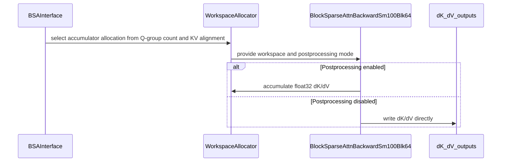

# BSA: fuse single-group SM100 blk64 dK/dV epilogue

[Upstream PR](https://github.com/NVIDIA/cudnn-frontend/pull/1091) · state: closed · merged: True

## Original PR description

## Before submitting

- [x] I agree to license this contribution under the terms of [LICENSE.txt](https://github.com/NVIDIA/cudnn-frontend/blob/develop/LICENSE.txt).
- [x] I ran `pre-commit run` on every changed file.
- [x] I reviewed the applicable Hard Rules in `AGENTS.md`.
- [x] Required labels are applied: `cat-perf-bug`, `area:sparse_attention`, `orig-external`.

## Affected area

FE OSS kernels or CuTeDSL — SM100/SM103 blk64 block-sparse attention backward.

## Summary

For one reverse-CSR Q group with a KV64-aligned physical K extent, each KV tile has one CTA owner. This specialization keeps dK/dV accumulators in FP32 TMEM, scales dK, and writes BF16 dK/dV directly to caller outputs. It removes both FP32 dK/dV workspaces; the existing dQ conversion kernel zeroes empty KV owners. Multiple Q groups and K tails retain the atomic FP32 workspace/postprocess path.

The compile key includes the epilogue policy. The public API and default numerical contract are unchanged.

The branch incorporates `develop@52928eeb` in merge commit `95374e82`. Workspace allocation preserves upstream `zero_kv_accum` and appends `include_dkv_accum`; the shared CSR builder retains upstream's framework-neutral device query. Tests follow the upstream move to `test/python/block_sparse_attention/cutedsl/`.

## Performance

Rerun on 2026-10-12 on NVIDIA B20Z / SM100, comparing unmodified `develop@52928eeb` with `95374e82`. BF16 `B=1,H=32,Sq=Sk=8192,D=128`, BHSD, exact 50% K64 sparsity, prebuilt reverse CSR, preallocated outputs. Each row is an ABBA midpoint of independent process medians, using identical CPU-seeded inputs verified by SHA256. The two-group control uses `bucket_size_blocks=64`.

| Workload, warmups / samples per process | Baseline ms | Candidate ms | Latency change | Throughput change |
|---|---:|---:|---:|---:|
| Single Q group, 20 / 500 | 2.250808 | 2.134336 | -5.17% | +5.46% |
| Single Q group, 100 / 5,000 | 2.267408 | 2.151728 | -5.10% | +5.38% |
| Two Q groups, 20 / 500 | 2.365832 | 2.361744 | -0.17% | +0.17% |

Single-group long-run throughput: **606.15 → 638.74 TFLOP/s**, using the active five-GEMM `10D` numerator. Peak live temporary allocation: **386 → 130 MiB**, saving **256 MiB**. Both two-group paths use 386 MiB; their 0.17% timing difference is within observed run variation.

CUDA events time CUDA Graph replay of the backward component, including workspace zeroing and pre/main/post kernels. Forward, CSR construction, initial compilation and CPU dispatch are outside timing. GPU contention was checked before/after measurements; clocks were not locked. These numbers do not measure end-to-end model throughput.

Environment: driver 580.95.05, Python 3.13, PyTorch 2.13.0+cu130, CuTeDSL 4.6.2, cuda-bindings 13.4.3, TVM-FFI 0.1.14.post1. Frontend bindings were built from merged source using system cuDNN 9.22 headers; standalone benchmark processes loaded backend 9.20, while pytest bootstrap loaded 9.22. Both benchmark variants use identical bindings and dependencies, with verified checkout-specific Python imports.

## Related issues

Fixes #1089.

## API and compatibility impact

None. The direct path is selected internally only for a single reverse-CSR Q group with an aligned physical K extent. Multi-group and K-tail calls retain the existing implementation.

## Testing

```bash
cd test/python
pytest -q -rA -m "L0 or L1 or L2" \
  block_sparse_attention/cutedsl/test_BSA_attention_forward.py \
  block_sparse_attention/cutedsl/test_BSA_attention_backward.py
# 24 passed, 23 architecture-specific skips
```

Coverage includes direct and multi-group dispatch, dirty preallocated outputs, empty KV owners, partial `block_sizes`, custom softmax scale, K-tail fallback and FP32 reference numerics. All 12 benchmark processes also passed baseline gradient parity and poisoned-output CUDA Graph replay; maximum observed absolute gradient difference was `0.0009765625`.

The single-group dispatch regression was rechecked RED against unmodified `develop@52928eeb` (`[True] != [False]`) and is green on this branch.

The CSR module imports successfully with torch imports blocked. `pre-commit` passed on all four changed files. The current rerun covers SM100 and Torch BHSD; SM103/SM110/SM90, JAX and multi-GPU were not rerun.

<!-- This is an auto-generated comment: release notes by coderabbit.ai -->
## Summary by CodeRabbit

* **Performance**
  * Reduced backward-pass workspace use for eligible sparse attention cases by writing key and value gradients directly to the output buffers.
* **Bug Fixes**
  * Ensured key and value gradients are correctly initialized for KV blocks without associated query blocks.
  * Added coverage for sparse layouts, sequence tails, and custom softmax scaling.
<!-- end of auto-generated comment: release notes by coderabbit.ai -->


## Review and discussion

### reviews

- YangXu1990uiuc · APPROVED · 2026-09-16T08:32:13Z · [source](https://github.com/NVIDIA/cudnn-frontend/pull/1091#pullrequestreview-5220368102)

**Codex bot review · model: `gpt-6-astra`**

Reviewed `af55c52c5fb5` against base `2cf27d377e06`.

The single-owner specialization is sound: the direct path is restricted to one Q group and aligned KV tiles, the compile key distinguishes the policy, and empty KV owners are explicitly zeroed. I found no defect introduced by this change that blocks approval.

Validation: Independently ran the BSA forward/backward selection on SM100: 24 passed and 23 architecture-specific skips with CuTe DSL 4.8; the same 24/23 result at the supported DSL 4.6.2 floor. Additional DSL 4.6.2 probes passed for B=2/H=3, BHSD and physically contiguous BSHD, varying sparse counts, partial blocks, poisoned/guarded outputs and exact-zero empty KV rows. A 17-Q-block reverse row also passed. ABBA SM100 spot check, BF16 B=1/H=8/Sq=Sk=2048/D=128, 50% sparsity, prebuilt reverse CSR and preallocated outputs: single-group GPU replay fell from 175.33-175.38 us to 147.51-147.55 us; workspace fell from 25,296,896 to 8,519,680 bytes. Two-group control stayed around 195 us. CPU enqueue medians overlapped (single group 75.5-78.0 us baseline, 76.7-78.7 us head). Correctness and changed-input/poisoned-output CUDA Graph replay passed before timing. Baseline needed only the missing torch import supplied to execute its old kernel; these are backward-component measurements, not end-to-end model results. Started OSS pipeline 68138680 and approved the fork Style check. Style, all builds, all three C++ sanitizer lanes, OSS SM80/SM90, SM100 shard1 and Rubin passed. SM100 shard0 has only the two existing JAX BSA/DSL4.6.2 import failures (2,062 passed); API-index analysis also remains red. The CI mirror includes newer develop fixes, so this is integration evidence alongside the independent head-only tests above.

Limitations: A separate Sq=131 Q-tail probe fails in both develop and this head on identical inputs, with identical maximum dQ/dK/dV errors (0.4371/0.1407/0.1876). This predates the epilogue change; the passing K-tail regression does not establish arbitrary Q-tail correctness. Independent local hardware coverage is SM100. The independent tests do not establish SM103/SM110 coverage; JAX coverage remains limited by the CI dependency-floor failures.

Approved: no P0 or high-risk P1 found. Remaining findings stay with the owner; merge timing stays with the owner.

<!-- codex-fe-review:v2:1091:af55c52c5fb5ae46f464c725028e8bfa1646e4ec:complete:no-blocker -->

### issue_comments

- coderabbitai · comment · 2026-09-16T07:16:04Z · [source](https://github.com/NVIDIA/cudnn-frontend/pull/1091#issuecomment-5693541435)

<!-- This is an auto-generated comment: summarize by coderabbit.ai -->
<!-- review_stack_entry_start -->

<a href="https://app.coderabbit.ai/change-stack/NVIDIA/cudnn-frontend/pull/1091?scope=ghh_OusAJGA4HG8ljoOV0wJvVx8NmnZIjc2DdjmxOu0xZWA&amp;cs_source=review_comment"><picture><source media="(prefers-color-scheme: dark)" srcset="https://storage.googleapis.com/coderabbit_public_assets/review-stack-in-coderabbit-ui-dark.svg?v=3"><source media="(prefers-color-scheme: light)" srcset="https://storage.googleapis.com/coderabbit_public_assets/review-stack-in-coderabbit-ui.svg?v=3"></picture></a>

<!-- review_stack_entry_end -->
<!-- recent_review_start -->

No actionable comments were generated in the recent review. 🎉

<details>
<summary><strong>ℹ️ Recent review info</strong></summary>
<dl>
<dd>
<dl>
<dd>

<details>
<summary><strong>⚙️ Run configuration</strong></summary>
<dl>
<dd>
<dl>
<dd>

- **Configuration used**: Repository: NVIDIA/cudnn-frontend/.coderabbit.yaml
- **Review profile**: CHILL
- **Plan**: Advanced
- **Run ID**: `9ef22ecf-9935-40a3-83b3-58a84471033f`

<hr>

</dd>
</dl>

<hr>

</dd>
</dl>
</details>

<details>
<summary><strong>📥 Commits</strong></summary>
<dl>
<dd>
<dl>
<dd>

Reviewing files that changed from the base of the PR and between af55c52c5fb5ae46f464c725028e8bfa1646e4ec and 95374e82f46da3bba8f90eb97db5b48fcdf1160b.

<hr>

</dd>
</dl>

<hr>

</dd>
</dl>
</details>

<details>
<summary><strong>📒 Files selected for processing (4)</strong></summary>
<dl>
<dd>
<dl>
<dd>

* `python/cudnn/block_sparse_attention/_interface.py`
* `python/cudnn/block_sparse_attention/csrc/bwd/sm100_blk64/bsa_bwd_sm100.py`
* `test/python/block_sparse_attention/cutedsl/bsa_reference.py`
* `test/python/block_sparse_attention/cutedsl/test_BSA_attention_backward.py`

<hr>

</dd>
</dl>

<hr>

</dd>
</dl>
</details>

**Included review availability:** This review used your included allowance. Your plan provides up to 4 included reviews per hour; 3 remain after this review.

<hr>

</dd>
</dl>

<hr>

</dd>
</dl>
</details>

---


<!-- recent_review_end -->
<!-- walkthrough_start -->

<details>
<summary><strong>📝 Walkthrough</strong></summary>
<dl>
<dd>

<details>
<summary><strong>📝 Walkthrough</strong></summary>
<dl>
<dd>

## Walkthrough

The SM100 blk64 backward path now selects between float32 dK/dV accumulation and direct output writes. The interface uses Q-group count and KV sequence alignment to select the mode. The backward reference and tests now accept and exercise configurable softmax scales.

### Changes

**SM100 dK/dV accumulation optimization**

|Layer / File(s)|Summary|
|:---|:---|
|**Workspace mode selection** <br> `python/cudnn/block_sparse_attention/_interface.py`|The interface retains the CSR Q-group count and selects dK/dV postprocessing based on group count and KV sequence alignment. Workspace allocation, the compile-cache key, and the kernel argument reflect this mode.|
|**Kernel dK/dV output paths** <br> `python/cudnn/block_sparse_attention/csrc/bwd/sm100_blk64/bsa_bwd_sm100.py`|With postprocessing enabled, the kernel uses float32 dK/dV workspace. Otherwise, it writes dK/dV directly to caller outputs and zeros KV blocks with no reverse-row work.|
|**Reference and backward coverage** <br> `test/python/block_sparse_attention/cutedsl/bsa_reference.py`, `test/python/block_sparse_attention/cutedsl/test_BSA_attention_backward.py`|The reference accepts an optional softmax scale. Tests exercise multiple bucket sizes, K lengths, scales, preallocated outputs, and workspace modes.|

<!-- change_assessment_start -->
**Priority:** ➖ Normal


**Estimated code review effort:** 4 (Complex) | ~40 minutes

<!-- change_assessment_commit:"95374e82f46da3bba8f90eb97db5b48fcdf1160b" -->
**Change:** Feature
<!-- change_assessment_end -->

### Sequence Diagram(s)



**Suggested reviewers:** `jiayus-nvidia`, `hwanseoc`

<hr>

</dd>
</dl>
</details>

<hr>

</dd>
</dl>
</details>

<!-- walkthrough_end -->
<!-- final_review_risk_start -->
**Merge Risk:** **⚪ Minimal** · up to `95374`
<!-- final_review_risk_coverage:{"sourceCommitId":"95374e82f46da3bba8f90eb97db5b48fcdf1160b","coveredCommitId":"95374e82f46da3bba8f90eb97db5b48fcdf1160b","kind":"reviewed"} -->

No actionable merge-blocking issue remains; the direct-write path is restricted to the single-owner case. Normal checks can proceed.
<!-- final_review_risk_end -->
<!-- pre_merge_checks_walkthrough_start -->

<details>
<summary><strong>Pre-merge checks | <sup><picture></picture></sup> 4 | <sup><picture></picture></sup> 1</strong></summary>
<dl>
<dd>

### ❌ Failed checks (1 warning)

|     Check name     |                                              Status                                              | Explanation                                                                                                                                                                                 | Resolution                                                                         |
| :---------------- | :----------------------------------------------------------------------------------------------: | :------------------------------------------------------------------------------------------------------------------------------------------------------------------------------------------ | :--------------------------------------------------------------------------------- |
| Docstring Coverage |  | Docstring coverage is 20.00% which is insufficient. The required threshold is 80.00%. Docstring coverage is scoped to functions touched by this diff. Analyzed 15 functions across 7 files. | Write docstrings for the functions missing them to satisfy the coverage threshold. |

<details>
<summary><strong>✅ Passed checks (4 passed)</strong></summary>
<dl>
<dd>

|         Check name         |                                             Status                                             | Explanation                                                                                                                                                                                               |
| :------------------------ | :--------------------------------------------------------------------------------------------: | :-------------------------------------------------------------------------------------------------------------------------------------------------------------------------------------------------------- |
|     Linked Issues check    |  | The PR meets the coding requirements in `#1089`. The interface selects the direct epilogue for one reverse-CSR Q group with a KV64-aligned physical K extent. The SM100 blk64 path keeps dK/dV in FP32 TME… |
| Out of Scope Changes check |  | The changes remain within `#1089`. The conditional workspace selection and compile-time epilogue policy support the requested optimization. The reference softmax-scale update and expanded backward tests… |
|         Title check        |  | The title clearly identifies the main change: fusing the single-group SM100 blk64 dK/dV epilogue.                                                                                                         |
|      Description check     |  | The description follows the required template and provides complete details for the affected area, summary, rationale, related issue, compatibility impact, testing, and performance results.             |

</dd>
</dl>
</details>

<hr>

</dd>
</dl>
</details>

<!-- pre_merge_checks_walkthrough_end -->

- [ ] <!-- {"checkboxId":"585bb3f6-faf5-4dbf-96d2-74e382adf19a"} --> Fix all pre-merge checks with AI
<!-- finishing_touch_checkbox_start -->

<details>
<summary><strong>✨ Finishing Touches</strong></summary>
<dl>
<dd>
<dl>
<dd>

<details open>
<summary><strong>🧪 Generate unit tests (beta)</strong></summary>
<dl>
<dd>
<dl>
<dd>

- [ ] <!-- {"checkboxId": "f47ac10b-58cc-4372-a567-0e02b2c3d479", "radioGroupId": "utg-output-choice-group-unknown_comment_id"} --> Create a new PR

</dd>
</dl>

<hr>

</dd>
</dl>
</details>

<hr>

</dd>
</dl>

<hr>

</dd>
</dl>
</details>

<!-- finishing_touch_checkbox_end -->
<!-- tips_start -->

---


<sub>Comment `@coderabbitai help` to get the list of available commands.</sub>

<!-- tips_end -->

- wplf · comment · 2026-09-16T07:16:19Z · [source](https://github.com/NVIDIA/cudnn-frontend/pull/1091#issuecomment-5693544015)

As an external contributor I cannot set repository labels, Milestone, or Projects. Could a maintainer please apply `cat-perf-bug`, `area:sparse_attention`, and `orig-external`, assign the appropriate Milestone/Project, and run the OSS CI after review? Local SM103 validation and the full performance protocol are included in the PR description.

- YangXu1990uiuc · comment · 2026-09-16T07:59:59Z · [source](https://github.com/NVIDIA/cudnn-frontend/pull/1091#issuecomment-5694070900)

I am starting OSS CI for `af55c52c5fb5` and approving the pending fork Style check. The following standalone `@cudnn-ci-bot run oss` comment is a Codex bot CI action.

For future updates, request a maintainer to post that exact standalone command if you lack trigger permission; fork GitHub Actions may also need a maintainer's approval. This revision inherits the develop SDPA stats enum build issue, so build failures need to be distinguished from the OSS GPU test results.

Codex bot review — model `gpt-6-astra`.

<!-- codex-fe-ci:v1:1091:af55c52c5fb5ae46f464c725028e8bfa1646e4ec:oss-af55c52-notice -->

- YangXu1990uiuc · comment · 2026-09-16T08:00:59Z · [source](https://github.com/NVIDIA/cudnn-frontend/pull/1091#issuecomment-5694084826)

I am requesting test CI for `af55c52c5fb5` with the following standalone command: `@cudnn-ci-bot run oss`. For future updates, request the appropriate test target before review; a maintainer may need to trigger it.

Codex bot review — model `gpt-6-astra`.

<!-- codex-fe-ci:v1:1091:af55c52c5fb5ae46f464c725028e8bfa1646e4ec:oss-af55c52-trigger-notice -->

- YangXu1990uiuc · comment · 2026-09-16T08:01:06Z · [source](https://github.com/NVIDIA/cudnn-frontend/pull/1091#issuecomment-5694086511)

@cudnn-ci-bot run oss

- cudnn-ci-bot · comment · 2026-09-16T08:01:10Z · [source](https://github.com/NVIDIA/cudnn-frontend/pull/1091#issuecomment-5694087626)

🏁 Pipeline finished

SHA: `af55c52`
Targets: `oss`
Branch: [cudnn-gh/pr-1091-af55c52](https://nv/cudnn-gitlab-ci/-/tree/cudnn-gh/pr-1091-af55c52)
Pipeline: [68138680](https://nv/cudnn-gitlab-ci/-/pipelines/68138680)
Last updated: 2026-09-16 08:24 UTC

**22 passed, 2 failed, 6 manual**

### <code>manual</code>

- <code>manual:python_samples</code> - Manual
- <code>manual:python_tests</code> - Manual
- <code>manual:frost</code> - Manual
- <code>manual:oss</code> - ✅ Passed
- <code>manual:pycudnn</code> - Manual
- <code>manual:multi_gpu</code> - Manual
- <code>manual:backend</code> - Manual

### <code>analysis</code>

- <code>analysis:cudnn_clang_disable_exception</code> - ✅ Passed
- <code>analysis:cudnn_v9_no_half_conversion</code> - ✅ Passed
- <code>analysis:cudnn_clang</code> - ✅ Passed
- <code>analysis:check-relative-includes</code> - ✅ Passed
- <code>analysis:check-CUDNN_FRONTEND_SKIP_JSON_LIB</code> - ✅ Passed
- <code>analysis:guardwords_scan</code> - ✅ Passed
- <code>analysis:jax-import-guard</code> - ✅ Passed
- <code>san:build</code> - ✅ Passed

### <code>build</code>

- <code>analysis:api_index</code> - ❌ Failed
- <code>build:dev:linux:amd64</code> - ✅ Passed
- <code>build:rel:linux:amd64</code> - ✅ Passed
- <code>build:dev:linux:arm64</code> - ✅ Passed
- <code>build:rel:linux:arm64</code> - ✅ Passed
- <code>build:rel:win:amd64</code> - ✅ Passed

### <code>oss_tests</code>

- <code>oss:cutlass-rel:sm80</code> - ✅ Passed
- <code>oss:cutlass-rel:sm90</code> - ✅ Passed
- <code>oss:cutlass-rel:sm100-shard0</code> - ❌ Failed
- <code>oss:cutlass-rel:sm100-shard1</code> - ✅ Passed
- <code>oss:cutlass-4.8:sm107</code> - ✅ Passed

### <code>sanitizer_tests</code>

- <code>san:cpp_test:sm80</code> - ✅ Passed
- <code>san:cpp_test:sm90</code> - ✅ Passed
- <code>san:cpp_test:sm100</code> - ✅ Passed

### <code>triage</code>

- <code>triage:ai</code> - ✅ Passed

- github-actions · comment · 2026-10-08T02:51:54Z · [source](https://github.com/NVIDIA/cudnn-frontend/pull/1091#issuecomment-6051184425)

This PR has been inactive for 3 weeks and is now marked stale. It will be closed in 3 more weeks unless there is new activity (a comment, a push, or removal of the stale label).

- jiayus-nvidia · comment · 2026-10-12T06:59:32Z · [source](https://github.com/NVIDIA/cudnn-frontend/pull/1091#issuecomment-6119357177)

Please resolve conflicts, thanks! @wplf 

- wplf · comment · 2026-10-12T07:26:32Z · [source](https://github.com/NVIDIA/cudnn-frontend/pull/1091#issuecomment-6119711589)

> Please resolve conflicts, thanks! @wplf

Conflicts are resolved, please check it.


### inline_comments

## Changed files and fixed code

- `python/cudnn/block_sparse_attention/_interface.py` · modified · additions 14 / deletions 3
  - [head](https://github.com/wplf/cudnn-frontend/blob/95374e82f46da3bba8f90eb97db5b48fcdf1160b/python/cudnn/block_sparse_attention/_interface.py)
  - [base](https://github.com/NVIDIA/cudnn-frontend/blob/52928eeb06c15b4f4da59d5d80bf173549a3ea7b/python/cudnn/block_sparse_attention/_interface.py)
- `python/cudnn/block_sparse_attention/csrc/bwd/sm100_blk64/bsa_bwd_sm100.py` · modified · additions 85 / deletions 34
  - [head](https://github.com/wplf/cudnn-frontend/blob/95374e82f46da3bba8f90eb97db5b48fcdf1160b/python/cudnn/block_sparse_attention/csrc/bwd/sm100_blk64/bsa_bwd_sm100.py)
  - [base](https://github.com/NVIDIA/cudnn-frontend/blob/52928eeb06c15b4f4da59d5d80bf173549a3ea7b/python/cudnn/block_sparse_attention/csrc/bwd/sm100_blk64/bsa_bwd_sm100.py)
- `test/python/block_sparse_attention/cutedsl/bsa_reference.py` · modified · additions 3 / deletions 2
  - [head](https://github.com/wplf/cudnn-frontend/blob/95374e82f46da3bba8f90eb97db5b48fcdf1160b/test/python/block_sparse_attention/cutedsl/bsa_reference.py)
  - [base](https://github.com/NVIDIA/cudnn-frontend/blob/52928eeb06c15b4f4da59d5d80bf173549a3ea7b/test/python/block_sparse_attention/cutedsl/bsa_reference.py)
- `test/python/block_sparse_attention/cutedsl/test_BSA_attention_backward.py` · modified · additions 56 / deletions 3
  - [head](https://github.com/wplf/cudnn-frontend/blob/95374e82f46da3bba8f90eb97db5b48fcdf1160b/test/python/block_sparse_attention/cutedsl/test_BSA_attention_backward.py)
  - [base](https://github.com/NVIDIA/cudnn-frontend/blob/52928eeb06c15b4f4da59d5d80bf173549a3ea7b/test/python/block_sparse_attention/cutedsl/test_BSA_attention_backward.py)

## Evidence and interpretation boundary

[Original JSON, discussions and patches](../../../../../../evidence/prs/NVIDIA--cudnn-frontend/1091-21cb12c49914e0f3772ceaf69ec52fc7b79a5482bee1f530679a8f72b51f1fb2.json) · SHA-256 `21cb12c49914e0f3772ceaf69ec52fc7b79a5482bee1f530679a8f72b51f1fb2`.

Diff complete: True. Missing/binary/truncated patches require pinned source inspection. This is a source page, not an independently verified optimization case. Open, merged and released are different states; recheck the deployed dependency.
