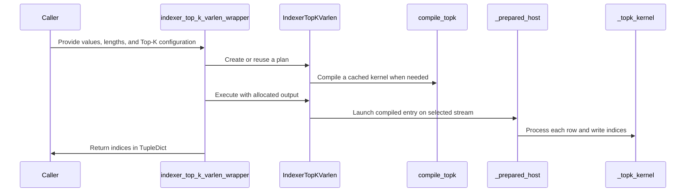

# [DSA] Add prepared BF16 variable-length Top-K for GB300 and Rubin

[Upstream PR](https://github.com/NVIDIA/cudnn-frontend/pull/1298) · state: open · merged: False

## Original PR description

## Summary

Add `cudnn.IndexerTopKVarlen` and an allocating wrapper for indices-only BF16 variable-length Top-K on GB300 (SM103) and Rubin (SM107). The prepared API writes caller-owned Int32 output, performs signed Int64 length arithmetic, clamps to the physical score width, and pads short rows with `-1`.

## Why

Sparse indexers need variable per-row lengths and capture-safe output ownership. This adds a separate prepared API with zero scratch workspace, current-buffer/current-stream binding, and compiled-artifact reuse across row counts. The existing IndexerTopK interface is unchanged.

## API and compatibility impact

Contiguous BF16 scores, Int32 lengths/output, T=1..512, N=1..262144, K in {512,1024,2048}; positive next_n dividing T and positive Int32 compress_ratio. The input-device architecture and CuTe DSL version are checked before private kernel import (4.7+ for SM103, 4.8+ with target support for SM107). Compile before graph capture. NaNs inside an eligible prefix are unsupported; storage outside the prefix is ignored. Equal-valued selections are unordered.

## Testing

- Actual wheels built and installed independently on both architectures; installed Python and native binary identities checked against those wheels.
- From `test/python`: `python -m pytest deepseek_sparse_attention/cutedsl/test_DSA_indexer_top_k_varlen.py core/test_import_boundaries.py::test_importing_cudnn_pulls_no_framework -m "L0 or L1" -n 1 --max-worker-restart=0 -rA`: **37 passed** on each architecture (17 warnings, zero skipped/failed).
- `pre-commit run --files <all 11 changed files>`: passed.
- The installed prepared API passed 18,162 output/input checks per architecture across the scoped performance suite, including changed-input graph replay and concurrent calls on separate streams.

### B300 benchmark update (2026-09-30)

Measured on **NVIDIA GB300, SM103 (152 SMs)**. The expanded sweep covers **39 shapes**, full and ragged lengths, two seeds, and warm/cold cache regimes: **312 paired profiles passed, with 22,152 correctness checks** across both implementations. Checks include changed-input graph replay, exact selected-value multisets, unique/in-range indices, short-row padding, unchanged inputs, and output guards; no failures were exempted.

For the 30-shape full-length K=512 grid, warm speedups include **13 wins above 1.05×, 14 losses below 0.95×, and 3 within 5%**; cold results have **12 wins, 13 losses, and 5 within 5%**. These are descriptive bands, not confidence intervals. For example, T=512, N=131072 reaches **2.07× warm / 1.78× cold**, while T=32, N=262144 reaches **0.37× warm / 0.42× cold**. Performance depends on shape; these measurements do not support enabling this backend for the entire supported domain.

**Method:** BF16 scores, Int32 lengths/output, `next_n=compress_ratio=1`, no length hints. Candidate: `flashinfer.top_k_varlen(..., backend="cudnn")`, invoking the installed public `cudnn.IndexerTopKVarlen`; baseline: `backend="auto"`. `FLASHINFER_ALLOW_EXPERIMENTAL_AUTO_BACKENDS=0` for both arms, so the baseline retains the existing auto choice and the explicit candidate bypasses the experimental auto allowlist. Observed baseline routes were radix/radix-filter. Outputs are preallocated and timing measures CUDA graph device execution, excluding host allocation and JIT compilation.

Each table value is the geometric mean of two seed medians (seeds 20260930 and 20261001), with five samples per seed. Warm samples time 20 replays of a 16-call graph on the same inputs. Each cold sample is the median of 10 one-call graph timings, each preceded by a 3×L2 capacity sweep outside the timed interval. Paired arm order is randomized; calls run sequentially on one stream. The cold regime establishes eviction pressure, not a measured cache-miss rate. Full rows use length N; ragged lengths are sampled uniformly from K+1 through N. No time subtraction or serving/concurrency performance claim.

**Reading the tables:** T is query rows, N is candidate scores per row, and K is selected indices. FE / FI columns give cuDNN Frontend / FlashInfer-auto latency in microseconds; speedup is FI / FE, so values above 1 favor cuDNN. K=512 matches DSv4.1 Flash's attention indexer; K=1024/2048 provide additional scaling coverage.

Full-length results — all 39 shapes

| T | N | K | Warm FE / FI (µs) | Speedup | Cold FE / FI (µs) | Speedup |
| ---: | ---: | ---: | ---: | ---: | ---: | ---: |
| 1 | 4096 | 512 | 4.29 / 4.23 | 0.99× | 9.38 / 10.33 | 1.10× |
| 1 | 16384 | 512 | 6.34 / 7.91 | 1.25× | 13.42 / 13.44 | 1.00× |
| 1 | 32768 | 512 | 8.44 / 7.88 | 0.93× | 15.46 / 14.40 | 0.93× |
| 1 | 65536 | 512 | 13.07 / 8.96 | 0.69× | 19.58 / 15.49 | 0.79× |
| 1 | 131072 | 512 | 17.16 / 10.37 | 0.60× | 24.74 / 18.81 | 0.76× |
| 1 | 262144 | 512 | 30.89 / 12.67 | 0.41× | 38.02 / 19.59 | 0.52× |
| 8 | 4096 | 512 | 4.36 / 4.29 | 0.99× | 11.13 / 11.40 | 1.02× |
| 8 | 16384 | 512 | 6.40 / 8.02 | 1.25× | 12.90 / 13.44 | 1.04× |
| 8 | 32768 | 512 | 8.71 / 8.07 | 0.93× | 15.50 / 13.44 | 0.87× |
| 8 | 65536 | 512 | 18.83 / 9.03 | 0.48× | 25.76 / 15.47 | 0.60× |
| 8 | 131072 | 512 | 17.48 / 10.45 | 0.60× | 25.74 / 17.56 | 0.68× |
| 8 | 262144 | 512 | 31.28 / 16.14 | 0.52× | 38.74 / 23.66 | 0.61× |
| 32 | 4096 | 512 | 4.49 / 4.36 | 0.97× | 11.38 / 11.41 | 1.00× |
| 32 | 16384 | 512 | 6.53 / 8.10 | 1.24× | 13.43 / 14.96 | 1.11× |
| 32 | 32768 | 512 | 8.77 / 13.84 | 1.58× | 15.49 / 21.63 | 1.40× |
| 32 | 65536 | 512 | 19.06 / 16.62 | 0.87× | 27.08 / 23.68 | 0.87× |
| 32 | 131072 | 512 | 17.62 / 21.76 | 1.24× | 25.72 / 29.83 | 1.16× |
| 32 | 262144 | 512 | 86.61 / 32.04 | 0.37× | 94.35 / 40.08 | 0.42× |
| 128 | 4096 | 512 | 4.49 / 4.23 | 0.94× | 11.38 / 11.39 | 1.00× |
| 128 | 16384 | 512 | 6.60 / 8.20 | 1.24× | 13.44 / 15.49 | 1.15× |
| 128 | 32768 | 512 | 8.84 / 12.42 | 1.40× | 15.50 / 19.58 | 1.26× |
| 128 | 65536 | 512 | 26.61 / 20.49 | 0.77× | 33.93 / 27.78 | 0.82× |
| 128 | 131072 | 512 | 17.86 / 32.25 | 1.81× | 27.78 / 40.06 | 1.44× |
| 128 | 262144 | 512 | 86.92 / 58.79 | 0.68× | 99.19 / 68.98 | 0.70× |
| 512 | 4096 | 512 | 11.46 / 9.76 | 0.85× | 17.55 / 15.49 | 0.88× |
| 512 | 16384 | 512 | 23.39 / 29.48 | 1.26× | 31.87 / 38.00 | 1.19× |
| 512 | 32768 | 512 | 25.62 / 46.41 | 1.81× | 33.92 / 54.43 | 1.60× |
| 512 | 65536 | 512 | 57.50 / 77.49 | 1.35× | 70.04 / 91.23 | 1.30× |
| 512 | 131072 | 512 | 56.94 / 117.96 | 2.07× | 70.78 / 126.10 | 1.78× |
| 512 | 262144 | 512 | 182.86 / 248.77 | 1.36× | 183.84 / 259.19 | 1.41× |
| 32 | 16384 | 1024 | 6.91 / 8.39 | 1.21× | 13.42 / 15.47 | 1.15× |
| 32 | 16384 | 2048 | 7.81 / 8.65 | 1.11× | 13.42 / 15.47 | 1.15× |
| 32 | 131072 | 1024 | 22.57 / 22.33 | 0.99× | 30.57 / 29.82 | 0.98× |
| 32 | 131072 | 2048 | 22.50 / 23.24 | 1.03× | 31.36 / 30.34 | 0.97× |
| 512 | 16384 | 1024 | 24.89 / 30.59 | 1.23× | 33.90 / 39.04 | 1.15× |
| 512 | 16384 | 2048 | 28.42 / 33.13 | 1.17× | 35.95 / 40.06 | 1.11× |
| 512 | 131072 | 1024 | 75.88 / 117.95 | 1.55× | 87.18 / 126.10 | 1.45× |
| 512 | 131072 | 2048 | 76.37 / 118.55 | 1.55× | 87.17 / 126.08 | 1.45× |
| 256 | 131072 | 512 | 28.98 / 64.21 | 2.22× | 42.13 / 72.85 | 1.73× |

Ragged-length results — all 39 shapes

| T | N | K | Warm FE / FI (µs) | Speedup | Cold FE / FI (µs) | Speedup |
| ---: | ---: | ---: | ---: | ---: | ---: | ---: |
| 1 | 4096 | 512 | 3.83 / 4.03 | 1.05× | 9.34 / 10.32 | 1.10× |
| 1 | 16384 | 512 | 5.29 / 5.26 | 0.99× | 11.40 / 12.15 | 1.07× |
| 1 | 32768 | 512 | 5.76 / 8.26 | 1.43× | 11.40 / 14.43 | 1.27× |
| 1 | 65536 | 512 | 11.44 / 8.84 | 0.77× | 18.53 / 15.49 | 0.84× |
| 1 | 131072 | 512 | 11.72 / 10.18 | 0.87× | 18.60 / 17.62 | 0.95× |
| 1 | 262144 | 512 | 19.70 / 11.60 | 0.59× | 26.59 / 17.55 | 0.66× |
| 8 | 4096 | 512 | 4.23 / 4.68 | 1.11× | 10.30 / 11.39 | 1.11× |
| 8 | 16384 | 512 | 6.34 / 7.41 | 1.17× | 12.93 / 13.46 | 1.04× |
| 8 | 32768 | 512 | 7.14 / 9.99 | 1.40× | 13.44 / 15.52 | 1.15× |
| 8 | 65536 | 512 | 12.79 / 9.80 | 0.77× | 19.58 / 16.48 | 0.84× |
| 8 | 131072 | 512 | 16.96 / 10.44 | 0.62× | 24.70 / 17.54 | 0.71× |
| 8 | 262144 | 512 | 30.41 / 16.11 | 0.53× | 37.50 / 23.18 | 0.62× |
| 32 | 4096 | 512 | 4.36 / 4.80 | 1.10× | 9.85 / 11.38 | 1.15× |
| 32 | 16384 | 512 | 6.73 / 8.52 | 1.27× | 13.42 / 15.48 | 1.15× |
| 32 | 32768 | 512 | 8.80 / 13.90 | 1.58× | 15.49 / 20.59 | 1.33× |
| 32 | 65536 | 512 | 13.64 / 16.49 | 1.21× | 19.86 / 23.70 | 1.19× |
| 32 | 131072 | 512 | 17.55 / 22.10 | 1.26× | 25.71 / 29.81 | 1.16× |
| 32 | 262144 | 512 | 29.91 / 32.12 | 1.07× | 36.97 / 40.04 | 1.08× |
| 128 | 4096 | 512 | 4.46 / 4.49 | 1.01× | 11.39 / 11.40 | 1.00× |
| 128 | 16384 | 512 | 6.92 / 8.77 | 1.27× | 13.46 / 15.50 | 1.15× |
| 128 | 32768 | 512 | 8.98 / 12.69 | 1.41× | 15.46 / 19.57 | 1.27× |
| 128 | 65536 | 512 | 18.71 / 20.13 | 1.08× | 27.08 / 27.76 | 1.03× |
| 128 | 131072 | 512 | 18.11 / 31.36 | 1.73× | 25.74 / 38.00 | 1.48× |
| 128 | 262144 | 512 | 52.33 / 57.76 | 1.10× | 61.84 / 66.69 | 1.08× |
| 512 | 4096 | 512 | 10.15 / 9.04 | 0.89× | 17.52 / 15.49 | 0.88× |
| 512 | 16384 | 512 | 21.13 / 28.40 | 1.34× | 29.82 / 36.48 | 1.22× |
| 512 | 32768 | 512 | 22.21 / 41.05 | 1.85× | 31.37 / 50.30 | 1.60× |
| 512 | 65536 | 512 | 37.22 / 67.97 | 1.83× | 48.26 / 78.98 | 1.64× |
| 512 | 131072 | 512 | 46.95 / 103.98 | 2.21× | 56.40 / 110.60 | 1.96× |
| 512 | 262144 | 512 | 121.84 / 202.52 | 1.66× | 129.91 / 210.06 | 1.62× |
| 32 | 16384 | 1024 | 7.42 / 8.57 | 1.15× | 13.44 / 14.98 | 1.11× |
| 32 | 16384 | 2048 | 8.02 / 9.16 | 1.14× | 14.49 / 15.50 | 1.07× |
| 32 | 131072 | 1024 | 22.30 / 22.36 | 1.00× | 29.82 / 29.82 | 1.00× |
| 32 | 131072 | 2048 | 21.88 / 23.62 | 1.08× | 29.82 / 30.34 | 1.02× |
| 512 | 16384 | 1024 | 23.23 / 28.83 | 1.24× | 31.88 / 36.97 | 1.16× |
| 512 | 16384 | 2048 | 24.53 / 29.18 | 1.19× | 32.88 / 35.98 | 1.09× |
| 512 | 131072 | 1024 | 55.12 / 99.63 | 1.81× | 66.14 / 107.08 | 1.62× |
| 512 | 131072 | 2048 | 56.61 / 120.98 | 2.14× | 68.75 / 128.11 | 1.86× |
| 256 | 131072 | 512 | 32.23 / 58.56 | 1.82× | 40.78 / 65.66 | 1.61× |

Measured implementation: cuDNN Frontend PR head `21343ed785c563d42d9e1a78bf1aa93855165abb`; FlashInfer integration `ccb576ef297813c1e93e82ae085093e6bda521c9` ([PR #5733](https://github.com/flashinfer-ai/flashinfer/pull/5733)), based on `f558e9fd4e56807b6d12f147591efd44901d1d23`. CUDA 13.3, CuTe DSL 4.8.0, PyTorch `2.13.0a0+8145d630e8.nv26.06`. Benchmark run 3199902; raw profiles SHA-256: `c00a5ddec2116305fd05d5e0cffc861321feb5c994149552ba1a9e63ff144806`.

## Affected area

FE OSS kernels / CuTeDSL, Python API, packaging, documentation and tests.

## Related issues

Standalone additive API; downstream FlashInfer integration will be linked separately.

## Before submitting

- [x] I agree to license this contribution under the terms of LICENSE.txt.
- [x] I ran pre-commit and committed formatting changes.
- [x] I reviewed the applicable AGENTS.md Hard Rules. Plans retain metadata/code only; prepared execution performs no allocation, conversion, D2H read or synchronization.
- [x] Required category, area and origin labels applied.

<!-- This is an auto-generated comment: release notes by coderabbit.ai -->

## Summary by CodeRabbit

- **New Features**
  - Added variable-length Top-K selection for BF16 inputs on supported SM103 and SM107 GPUs. Results contain up to the requested number of distinct indices per row, with unused slots padded by `-1`.
  - Choose a convenience wrapper that allocates the output or a prepared API that reuses compiled execution with caller-provided output buffers.

- **Documentation**
  - Added API guidance covering inputs, outputs, supported configurations, and prepared execution.

<!-- end of auto-generated comment: release notes by coderabbit.ai -->

## Review and discussion

### reviews

- yihuawei · APPROVED · 2026-09-30T11:09:32Z · [source](https://github.com/NVIDIA/cudnn-frontend/pull/1298#pullrequestreview-5365358695)

**Codex bot review · model: `gpt-6-astra`**

Reviewed `21343ed785c5` against base `c92f95a266c1`.

No actionable findings. Reviewed the radix selection and overflow fallback, signed length arithmetic, prepared buffer/stream ownership, architecture gates, lazy exports, packaging, documentation and tests.

Validation: The repository import-boundary and device-source identity checks passed; 35 architecture-dependent cases skipped on my available hardware. Independent algorithm experiment: explicitly compiled the unchanged device algorithm for the actual H100 (sm_90a), without changing the public API's architecture gate. Twelve algorithm tests passed against a floating-point Top-K oracle, covering all three K values, odd/even widths, cache boundaries, maximum width, candidate overflow, extreme Int32 lengths/compression, empty/short rows, infinities/signed zero, non-NaN BF16 bit patterns, ignored NaN tails, input/output guards, fresh bindings, runtime row-count reuse and changed-input graph replay. A separate host-only recording-entry test passed for fresh pointer/stream binding, sample lifetime, malformed operands, alignment and output-alias rejection. The public API correctly declined the H100. Four representative configurations cross-compiled to verified sm_103a PTX, including cached/uncached and packed/unpacked routes. Current-head Style and Docs checks also passed.

Limitations: The H100 experiment validates the device algorithm on an explicitly different target; it is not a supported-architecture end-to-end API test. I could not independently run the prepared API on SM103/SM107 or compile SM107 with my installed DSL 4.7.1. The reported GB300/Rubin wheel tests and performance comparisons are author-provided evidence; I did not independently reproduce those measurements.

Approved: no P0 or high-risk P1 found. Remaining findings stay with the owner; merge timing stays with the owner.

<!-- codex-fe-review:v2:1298:21343ed785c563d42d9e1a78bf1aa93855165abb:complete:no-blocker -->

### issue_comments

- coderabbitai[bot] · comment · 2026-09-30T10:42:37Z · [source](https://github.com/NVIDIA/cudnn-frontend/pull/1298#issuecomment-5909582529)

<!-- This is an auto-generated comment: summarize by coderabbit.ai -->
<!-- review_stack_entry_start -->

Navigate logical layers of code changes, visualize relationships, and explore their blast radius.

<!-- review_stack_entry_end -->
<!-- recent_review_start -->

No actionable comments were generated in the recent review. 🎉

ℹ️ Recent review info

⚙️ Run configuration

**Configuration used**: Repository: NVIDIA/cudnn-frontend/.coderabbit.yaml

**Review profile**: CHILL

**Plan**: Enterprise

**Run ID**: `1ea9c8e3-7d70-4ad0-8219-f899f5908db8`

📥 Commits

Reviewing files that changed from the base of the PR and between c92f95a266c1c73741221c711c652c9abe4e3276 and 21343ed785c563d42d9e1a78bf1aa93855165abb.

📒 Files selected for processing (11)

* `docs/fe-oss-apis/dsa.md`
* `docs/fe-oss-apis/indexer_top_k_varlen.md`
* `docs/fe-oss-apis/overview.md`
* `pyproject.toml`
* `python/cudnn/__init__.py`
* `python/cudnn/deepseek_sparse_attention/__init__.py`
* `python/cudnn/deepseek_sparse_attention/indexer_top_k/__init__.py`
* `python/cudnn/deepseek_sparse_attention/indexer_top_k/varlen_api.py`
* `python/cudnn/deepseek_sparse_attention/indexer_top_k/varlen_kernel.py`
* `python/cudnn/deepseek_sparse_attention/indexer_top_k/varlen_provenance.json`
* `test/python/deepseek_sparse_attention/cutedsl/test_DSA_indexer_top_k_varlen.py`

**Included review availability:** This review used your included allowance. Your plan provides up to 12 included reviews per hour; 11 remain after this review.

---

<!-- recent_review_end -->
<!-- walkthrough_start -->

📝 Walkthrough

## Walkthrough

The pull request adds an experimental prepared variable-length BF16 Top-K API for SM103 and SM107. It includes a compiled kernel, an output-allocating wrapper, lazy package exports, API documentation, packaged provenance data, and tests.

### Changes

**Variable-Length Top-K API**

|Layer / File(s)|Summary|
|---|---|
|**API contract and public exports**   `python/cudnn/deepseek_sparse_attention/indexer_top_k/varlen_api.py`, `python/cudnn/deepseek_sparse_attention/indexer_top_k/__init__.py`, `python/cudnn/deepseek_sparse_attention/__init__.py`, `python/cudnn/__init__.py`, `docs/fe-oss-apis/indexer_top_k_varlen.md`, `docs/fe-oss-apis/dsa.md`, `docs/fe-oss-apis/overview.md`|Defines and documents the input, output, and supported-device contract. Adds lazy exports for the new API and wrapper.|
|**Kernel selection and compilation**   `python/cudnn/deepseek_sparse_attention/indexer_top_k/varlen_kernel.py`, `python/cudnn/deepseek_sparse_attention/indexer_top_k/varlen_provenance.json`, `pyproject.toml`|Adds the row-wise selection kernel and cached compiler. Adds provenance metadata and includes its manifest in package data.|
|**Plan execution and validation**   `python/cudnn/deepseek_sparse_attention/indexer_top_k/varlen_api.py`, `test/python/deepseek_sparse_attention/cutedsl/test_DSA_indexer_top_k_varlen.py`|Adds plan compilation, caller-owned output execution, and the allocating wrapper. Tests selection results, input validation, stream handling, graph replay, and compiled artifact reuse.|

<!-- change_assessment_start -->
**Priority:** ⬇️ Low

**Estimated code review effort:** 4 (Complex) | ~45 minutes

<!-- change_assessment_commit:"21343ed785c563d42d9e1a78bf1aa93855165abb" -->
**Change:** Feature
<!-- change_assessment_end -->

### Sequence Diagram(s)

**Suggested reviewers:** `yangxu1990uiuc`

<!-- walkthrough_end -->
<!-- final_review_risk_start -->
**Merge Risk:** _⚪ Minimal_ · up to `21343`
<!-- final_review_risk_coverage:{"sourceCommitId":"21343ed785c563d42d9e1a78bf1aa93855165abb","coveredCommitId":"21343ed785c563d42d9e1a78bf1aa93855165abb","kind":"reviewed"} -->

This change adds a new experimental BF16 variable-length Top-K API for GB300 and Rubin and leaves the existing Top-K interface unchanged. The review found no confirmed defects, so the change appears ready to merge.
<!-- final_review_risk_end -->
<!-- pre_merge_checks_walkthrough_start -->

🚥 Pre-merge checks | ✅ 4 | ❌ 1

### ❌ Failed checks (1 warning)

|     Check name     | Status     | Explanation                                                                                                                                                                                               | Resolution                                                                         |
| :----------------: | :--------- | :-------------------------------------------------------------------------------------------------------------------------------------------------------------------------------------------------------- | :--------------------------------------------------------------------------------- |
| Docstring Coverage | ⚠️ Warning | Docstring coverage is 3.92% which is insufficient. The required threshold is 80.00%. Docstring coverage is scoped to functions touched by this diff. Analyzed 51 functions across 6 files. (5 skipped: 5… | Write docstrings for the functions missing them to satisfy the coverage threshold. |

✅ Passed checks (4 passed)

|         Check name         | Status   | Explanation                                                                                                                                                                                 |
| :------------------------: | :------- | :------------------------------------------------------------------------------------------------------------------------------------------------------------------------------------------ |
|     Linked Issues check    | ✅ Passed | Check skipped because no linked issues were found for this pull request.                                                                                                                    |
| Out of Scope Changes check | ✅ Passed | Check skipped because no linked issues were found for this pull request.                                                                                                                    |
|         Title check        | ✅ Passed | The title clearly and concisely identifies the addition of the prepared BF16 variable-length Top-K API for GB300 and Rubin, matching the main changes.                                      |
|      Description check     | ✅ Passed | The description includes all required sections and provides detailed scope, rationale, API compatibility, testing results, affected areas, related issues, and submission checklist status. |

Full details: Docstring Coverage

**Explanation**

Docstring coverage is 3.92% which is insufficient. The required threshold is 80.00%. Docstring coverage is scoped to functions touched by this diff. Analyzed 51 functions across 6 files. (5 skipped: 5 unsupported.)

<!-- pre_merge_checks_walkthrough_end -->

- [ ] <!-- {"checkboxId":"585bb3f6-faf5-4dbf-96d2-74e382adf19a"} --> Fix all pre-merge checks with AI
<!-- finishing_touch_checkbox_start -->

✨ Finishing Touches 💡 1

<!-- finishing_touch_suggestion:fix_ci -->

🛠️ Fix failing CI checks 💡

- [ ] <!-- {"checkboxId": "9f0d24fb-b419-4f01-baf0-8b26b6424f34", "radioGroupId": "fix-ci-output-choice-group-unknown_comment_id"} --> Commit to this branch
- [ ] <!-- {"checkboxId": "6d21cfe8-ec3f-40e2-9222-b8318b64d3b0", "radioGroupId": "fix-ci-output-choice-group-unknown_comment_id"} --> Create a new PR

🧪 Generate unit tests (beta)

- [ ] <!-- {"checkboxId": "f47ac10b-58cc-4372-a567-0e02b2c3d479", "radioGroupId": "utg-output-choice-group-unknown_comment_id"} --> Create a new PR

<!-- finishing_touch_checkbox_end -->
<!-- tips_start -->

---

Comment `@coderabbitai help` to get the list of available commands.

<!-- tips_end -->

- YangXu1990uiuc · comment · 2026-09-30T23:15:59Z · [source](https://github.com/NVIDIA/cudnn-frontend/pull/1298#issuecomment-5921370283)

Supplementing [the earlier review](https://github.com/NVIDIA/cudnn-frontend/pull/1298#pullrequestreview-5365358695) with **native SM107 prepared-API validation** on the same head, `21343ed785c563d42d9e1a78bf1aa93855165abb`. **No new blocker found.**

The complete `test_DSA_indexer_top_k_varlen.py` suite with `-m "L0 or L1"` passed **35 tests**; the only skip requires two visible CUDA devices. This used the unmodified public API and architecture gates, a native extension built from this head, and an asserted source import path.

Coverage includes all three K values; odd widths and N=262144; extreme signed Int32 lengths; empty/short rows and ignored NaN tails; tied-value overflow fallback; fresh bindings and changed-input graph replay; independent streams/graphs; metadata-only preparation and allocation/host-sync guards; and fresh-process compiled-artifact reload with JIT forbidden.

Environment: native SM107, CuTe DSL `4.8.0a0+20260913123000.1c73812`, PyTorch `2.13.0+cu130`, CUDA toolkit 13.2 and cuDNN 9.26. I also attempted Compute Sanitizer on the odd-width and maximum-width cases: both numerical tests passed, but the installed sanitizer reported **device not supported** plus runtime initialization API errors and exited nonzero. That attempt does **not** qualify memory-safety coverage.

This closes the earlier native SM107 execution gap for the tested prepared API. Native SM103 and the two-device path remain outside my independent validation; no performance claim is added. Existing approval is preserved. I also filled the established project and current develop milestone.

Codex bot review — model `gpt-6-astra`.

<!-- codex-fe-ci:v1:1298:21343ed785c563d42d9e1a78bf1aa93855165abb:native-validation-sm107 -->

### inline_comments

## Changed files and fixed code

- `docs/fe-oss-apis/dsa.md` · modified · additions 4 / deletions 0
  - [head](https://github.com/Anerudhan/cudnn-frontend/blob/21343ed785c563d42d9e1a78bf1aa93855165abb/docs/fe-oss-apis/dsa.md)
  - [base](https://github.com/NVIDIA/cudnn-frontend/blob/c92f95a266c1c73741221c711c652c9abe4e3276/docs/fe-oss-apis/dsa.md)
- `docs/fe-oss-apis/indexer_top_k_varlen.md` · added · additions 95 / deletions 0
  - [head](https://github.com/Anerudhan/cudnn-frontend/blob/21343ed785c563d42d9e1a78bf1aa93855165abb/docs/fe-oss-apis/indexer_top_k_varlen.md)
  - [base](https://github.com/NVIDIA/cudnn-frontend/blob/c92f95a266c1c73741221c711c652c9abe4e3276/docs/fe-oss-apis/indexer_top_k_varlen.md)
- `docs/fe-oss-apis/overview.md` · modified · additions 1 / deletions 0
  - [head](https://github.com/Anerudhan/cudnn-frontend/blob/21343ed785c563d42d9e1a78bf1aa93855165abb/docs/fe-oss-apis/overview.md)
  - [base](https://github.com/NVIDIA/cudnn-frontend/blob/c92f95a266c1c73741221c711c652c9abe4e3276/docs/fe-oss-apis/overview.md)
- `pyproject.toml` · modified · additions 1 / deletions 0
  - [head](https://github.com/Anerudhan/cudnn-frontend/blob/21343ed785c563d42d9e1a78bf1aa93855165abb/pyproject.toml)
  - [base](https://github.com/NVIDIA/cudnn-frontend/blob/c92f95a266c1c73741221c711c652c9abe4e3276/pyproject.toml)
- `python/cudnn/__init__.py` · modified · additions 2 / deletions 0
  - [head](https://github.com/Anerudhan/cudnn-frontend/blob/21343ed785c563d42d9e1a78bf1aa93855165abb/python/cudnn/__init__.py)
  - [base](https://github.com/NVIDIA/cudnn-frontend/blob/c92f95a266c1c73741221c711c652c9abe4e3276/python/cudnn/__init__.py)
- `python/cudnn/deepseek_sparse_attention/__init__.py` · modified · additions 2 / deletions 0
  - [head](https://github.com/Anerudhan/cudnn-frontend/blob/21343ed785c563d42d9e1a78bf1aa93855165abb/python/cudnn/deepseek_sparse_attention/__init__.py)
  - [base](https://github.com/NVIDIA/cudnn-frontend/blob/c92f95a266c1c73741221c711c652c9abe4e3276/python/cudnn/deepseek_sparse_attention/__init__.py)
- `python/cudnn/deepseek_sparse_attention/indexer_top_k/__init__.py` · modified · additions 22 / deletions 12
  - [head](https://github.com/Anerudhan/cudnn-frontend/blob/21343ed785c563d42d9e1a78bf1aa93855165abb/python/cudnn/deepseek_sparse_attention/indexer_top_k/__init__.py)
  - [base](https://github.com/NVIDIA/cudnn-frontend/blob/c92f95a266c1c73741221c711c652c9abe4e3276/python/cudnn/deepseek_sparse_attention/indexer_top_k/__init__.py)
- `python/cudnn/deepseek_sparse_attention/indexer_top_k/varlen_api.py` · added · additions 206 / deletions 0
  - [head](https://github.com/Anerudhan/cudnn-frontend/blob/21343ed785c563d42d9e1a78bf1aa93855165abb/python/cudnn/deepseek_sparse_attention/indexer_top_k/varlen_api.py)
  - [base](https://github.com/NVIDIA/cudnn-frontend/blob/c92f95a266c1c73741221c711c652c9abe4e3276/python/cudnn/deepseek_sparse_attention/indexer_top_k/varlen_api.py)
- `python/cudnn/deepseek_sparse_attention/indexer_top_k/varlen_kernel.py` · added · additions 528 / deletions 0
  - [head](https://github.com/Anerudhan/cudnn-frontend/blob/21343ed785c563d42d9e1a78bf1aa93855165abb/python/cudnn/deepseek_sparse_attention/indexer_top_k/varlen_kernel.py)
  - [base](https://github.com/NVIDIA/cudnn-frontend/blob/c92f95a266c1c73741221c711c652c9abe4e3276/python/cudnn/deepseek_sparse_attention/indexer_top_k/varlen_kernel.py)
- `python/cudnn/deepseek_sparse_attention/indexer_top_k/varlen_provenance.json` · added · additions 66 / deletions 0
  - [head](https://github.com/Anerudhan/cudnn-frontend/blob/21343ed785c563d42d9e1a78bf1aa93855165abb/python/cudnn/deepseek_sparse_attention/indexer_top_k/varlen_provenance.json)
  - [base](https://github.com/NVIDIA/cudnn-frontend/blob/c92f95a266c1c73741221c711c652c9abe4e3276/python/cudnn/deepseek_sparse_attention/indexer_top_k/varlen_provenance.json)
- `test/python/deepseek_sparse_attention/cutedsl/test_DSA_indexer_top_k_varlen.py` · added · additions 589 / deletions 0
  - [head](https://github.com/Anerudhan/cudnn-frontend/blob/21343ed785c563d42d9e1a78bf1aa93855165abb/test/python/deepseek_sparse_attention/cutedsl/test_DSA_indexer_top_k_varlen.py)
  - [base](https://github.com/NVIDIA/cudnn-frontend/blob/c92f95a266c1c73741221c711c652c9abe4e3276/test/python/deepseek_sparse_attention/cutedsl/test_DSA_indexer_top_k_varlen.py)

## Evidence and interpretation boundary

[Original JSON, discussions and patches](../../../../../../evidence/prs/NVIDIA--cudnn-frontend/1298-b837e28a0c649f00ca95eb5184fb54e0f80fc822c46b2e1f5ab50bc796205cf9.json) · SHA-256 `b837e28a0c649f00ca95eb5184fb54e0f80fc822c46b2e1f5ab50bc796205cf9`.

Diff complete: True. Missing/binary/truncated patches require pinned source inspection. This is a source page, not an independently verified optimization case. Open, merged and released are different states; recheck the deployed dependency.
