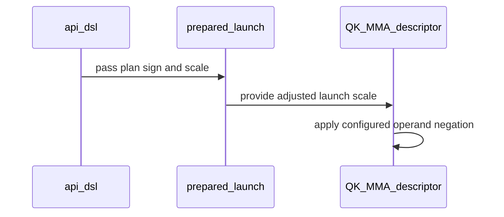

# [Auto-FE] SM100/SM107 SDPA forward: serve a negative attn_scale by negating Q in BMM1

[Upstream PR](https://github.com/NVIDIA/cudnn-frontend/pull/1445) · state: closed · merged: True

## Original PR description

## Before submitting

- [ ] I agree to license this contribution under the terms of [LICENSE.txt](https://github.com/NVIDIA/cudnn-frontend/blob/develop/LICENSE.txt).
- [x] I ran `pre-commit run` and committed any formatting changes.
- [x] I reviewed the Hard Rules in the `AGENTS.md` for each directory this PR touches (see [root AGENTS.md § Reviewing a PR](https://github.com/NVIDIA/cudnn-frontend/blob/develop/AGENTS.md#reviewing-a-pr-human-or-agent)) and my changes comply, or I explain the exception below.
- [x] I added GitHub labels: one `cat-*`, one or more `area:*` / `op:*`, and one `orig-*` (see [label list](https://github.com/NVIDIA/cudnn-frontend/labels)).

## Affected area

FE OSS kernels or CuTeDSL

## Summary

The SM100/SM107 FROST forward rows (half, FP8, MXFP8) accept a negative `attn_scale`, but the kernels return NaN for it whenever any mask applies. That includes causal masks, padding, and the tail of a KV length that is not a tile multiple. This is part of #1435.

**Mechanism.** The kernels take the row max over raw, unscaled scores, with masked entries already at `-inf`. They then fold the scale into the `exp2` argument. That is only valid for a positive scale. With a negative scale, the masked `-inf` entries become `+inf` after scaling, and the max no longer bounds the scaled scores.

**Fix.** A new `TemplateParams.negate_scores` field (appended, default False) sets the tcgen05 instruction descriptor's `a_negate` bit on BMM1. BMM1 then computes `-Q·Kᵀ`, and the kernel runs its unchanged softmax at `|attn_scale|`. This:
- costs one descriptor bit in each of the 28 SM100/SM107 forward kernels;
- leaves the hardware fused-max (`LDTM.STAT`) arms correct, because they now see `-S`;
- keeps the positive path's descriptor bit-identical.

**FP8 descale sign.** The per-tensor FP8 kernels fold the device scalars `descale_q * descale_k` into the softmax scale, so the multiplier's sign is not known at plan time. Their MMA warp XORs BMM1's `a_negate` with `descale_q * descale_k < 0`, read on the device, and every softmax fold runs at `|scale * descale_q * descale_k|`. The first revision (e6f89de) regressed a negative `attn_scale` combined with a negative `descale_q` (review P1). This fix also covers a positive `attn_scale` with a negative descale product, which was wrong on the base. MXFP8 block scales are unsigned E8M0, so those kernels need no change.

The adapter sets `negate_scores` from the plan's scale and passes `|scale|` to every host path (dense, THD, staged, FP8/MXFP8 prepared, the native frame templates). It refuses an execute-time `scale_softmax` whose sign differs from the plan's.

`attn_scale = 0` stays declined on these rows, because a negate bit cannot express a zero scale (#1435). The SM120 forward kernels have no descriptor negate. They still return NaN for a negative scale under a mask, except FP8 d512, which flips Q's sign at runtime. That is left for a separate change (#1435). `SUPPORT_MATRIX_TRACKER.md` records the new state.

## Testing (B200, cuDNN 9.26)

New tests, checked against an fp32 reference (O and Stats). RED is the same tests on this PR's base (a6d452306):

| Test | Cases | RED on base | This PR |
|---|---|---|---|
| `test_dsl_sm100_negative_attn_scale`: d512 (role-split and 2x2), d256, d192/d128, d128, d64 × fp16/bf16 × {no mask with a ragged KV tail, causal, padding + sink + bottom-right} | 36 | 36 failed (NaN) | 36 passed |
| `test_dsl_sm100_decode_negative_attn_scale`: decode d128 / d256, s_q 1 and 4 | 4 | 2 failed (d128; the d256 decode kernel already scales before masking) | 4 passed |
| `test_fp8_negative_attn_scale`: per-tensor FP8, 5 flavors × {none, causal} | 10 | 5 failed (causal) | 10 passed |
| `test_mxfp8_negative_attn_scale`: MXFP8, 5 flavors × {none, causal} | 10 | 5 failed (causal) | 10 passed |
| `test_dsl_sm100_execute_scale_sign_must_match_the_plan` | 1 | failed | passed |
| `test_fp8_negative_descale_product`: per-tensor FP8, 5 flavors × {none, causal} × ±attn_scale, negative `descale_q` on −Q8, bit-identical to the positive-descale run | 20 | 20 failed (e6f89de: also 20 failed) | 20 passed |

A probe confirmed that the decode cases load `decode_d128_f16.py` and `decode_d256_f16.py` with `negate_scores=True`.

Full `sdpa/frost` on B200, all levels: 9697 passed, 0 failures from this change. The first run reported 48 failures, all in `test_sdpa_native_sm80_binding.py`. They were caused by an extension `.so` built from another branch. After rebuilding from this branch, that file and the SM100 forward suite pass (1795 passed).

After the descale fix (d1e80d2ac), `test_sdpa_fwd_{fp8,mxfp8,dsl}_sm100.py` at all levels: 1677 passed. FP8 E4M3 → bf16 perf vs e6f89de, medians of 3–5 alternating rounds (B=2, H=16):

| Shape | Δ |
|---|---|
| d128 causal S=4096 | −0.5% |
| d128 unmasked S=4096 | 0.0% |
| d192×d128 causal S=4096 | +0.3% |
| d256 causal S=4096 (noisy; the minimum is +0.3%) | +0.65% |
| d512 causal S=2048 | +0.3% |
| d512 unmasked S=2048 | −0.2% |

The SM107 kernels get the same one-line descriptor change but are not run here. The CI sm107 lane runs the same test files.

note to self: claude::fb66556f-59ca-4f79-8a53-539948bcd387 — "Cudnn fe autonomous evolution" · cwd /home/scratch.yanxu_libs/cudnn_frontend · workspace /home/scratch.yanxu_gpu/fe-autonomous-pipeline-20261002 (evidence/sm100-negative-scale, evidence/sm100-signed-descale, evidence/fp8-signed-descale-perf)

🤖 Generated with [Claude Code](https://claude.com/claude-code)

<!-- This is an auto-generated comment: release notes by coderabbit.ai -->
## Summary by CodeRabbit

* **New Features**
  * Forward attention on SM100 and SM107 GPUs now supports negative attention scales. Execution requires a scale with the same sign as the compiled plan; its magnitude may differ.
  * The SM120 FP8 D512 kernel supports negative attention scales at runtime.
* **Bug Fixes**
  * Negative scales no longer produce NaN outputs on the supported SM100 and SM107 paths. Other SM120 kernels may still produce NaNs for negative scales when using a mask.
<!-- end of auto-generated comment: release notes by coderabbit.ai -->

## Review and discussion

### reviews

- vedaanta · APPROVED · 2026-10-07T12:57:45Z · [source](https://github.com/NVIDIA/cudnn-frontend/pull/1445#pullrequestreview-5442610923)

**Codex bot review · model: `gpt-6-astra`**

Reviewed `9aa97fdea2dd` against `0a97923e2c23`. No approval-blocking finding; one nonblocking P2 test-portability finding is inline. Traced the sign specialization through all 28 BMM1 descriptors, prepared dense/THD templates, staged and quantized execution, split paths, and execute-time sign validation. BMM2 and positive-scale descriptor values remain unchanged.

Independent validation on SM100:

- **703 host contract tests passed**, 177 skipped.
- The new negative-scale/sign suite produced **60 passes and one failure**: causal per-tensor FP8 D192/V128 reaches max O error **0.0425929**, above its **0.04** bound, on this 68-SM device. The equivalent positive-scale problem with Q negated produces bit-identical O/LSE/Amax on the PR, and the base kernel gives the same reference error. This is a reproducible test-data/tolerance edge, not evidence of a regression caused by the descriptor sign bit.
- **Nine additional negative-scale path checks passed**: native/staged half, split/unsplit execution, FP64 O/LSE checks with changed-input capture replay, native THD graph execution, and per-tensor FP8/MXFP8 THD with both length forms. A masked native dense control fails on the base and passes here.
- **Four additional negative-scale paged graph/standalone capture/rebinding checks passed**, D128/D256 × NHD/HND.

For two positive-scale BF16 causal graphs (B=2, Hq/Hkv=8/2, S=1024), median CPU enqueue/GPU replay times in microseconds were D128 **14.04/32.37 → 14.00/32.70**, D256 **13.62/43.85 → 13.65/43.80**; both versions passed the same FP64 output/Stats and changed-input checks. No material regression in those samples.

The available Rubin host still cannot initialize CUDA, so SM107 execution/compiler qualification remains unverified independently here. Current-head CI is already running; no duplicate trigger was sent.

<!-- codex-fe-review:github-only:vedaanta:1445:9aa97fdea2dd751ffd340a92667b80ebc30d6636:complete -->

- YangXu1990uiuc · COMMENTED · 2026-10-07T13:10:03Z · [source](https://github.com/NVIDIA/cudnn-frontend/pull/1445#pullrequestreview-5442772151)

**Codex bot review · model: `gpt-6-astra`**

Reviewed `9aa97fdea2dd` against base `75bc3664aab4`.

No new approval-blocking finding. The negative-score specialization is consistent across the 28 BMM1 descriptors and dense/THD/staged prepared launch paths; BMM2 is unchanged. I independently reproduced the existing nonblocking FP8 test-portability finding and added coverage of negative-scale paged/split capture and dynamic-length execution. Auto-FE recommendation: KEEP this bounded correctness fix, address the existing test comment, and finish current-head CI before landing; no broader redesign or additional optimization campaign is needed for this fix.

- **[P2] Still open:** [New causal D192 FP8 test has a reproducible reference-tolerance edge](https://github.com/NVIDIA/cudnn-frontend/pull/1445#discussion_r4207149824).

Validation: Exact-head execution on a 68-SM SM100, with both the Python package and matching native extension verified to resolve inside the isolated snapshot. 21 additional negative-scale prepared/capture tests passed: D128/D256 paged native graph and legacy tensor execution, NHD/HND, FP16/BF16, pointer/table rebinding and side-stream replay; D64/D128/D256 paged LPT with changing full/prefix/empty lengths; split-KV with packed GQA, batch-one and multi-batch, token/head-major Stats and natural/log2 LSE; D128/D256/D512 staged split/unsplit calls with allocation tripwires, changed-input replay and output canaries. The new half/decode/FP8/MXFP8/sign-contract selection produced 60 passes and the one existing P2 failure (24 deselected). The causal FP8 D192/V128 failure is max|O-ref|=0.04259288311004639 versus 0.04, matching Vedaanta's report; no test tolerance was changed. Checked the specialization in the template/cache identity and the absolute-scale propagation into native graph, standalone, quantized and staged execution. Same-sign magnitude overrides remain allowed; opposite-sign execution is rejected. Existing labels, project and milestone are appropriate, and an owner-triggered current-head pipeline is already running. No duplicate CI was triggered.

Limitations: SM107 execution is not independently qualified in this run. Pending CI is not passing evidence. No second independent performance A/B was run: the existing same-head review already reports positive-scale CPU-enqueue and GPU-replay controls. Those measurements remain attributed to that reviewer.

Comment only: GitHub does not allow reviewing one's own PR with approval/request-changes.

<!-- codex-fe-review:v2:1445:9aa97fdea2dd751ffd340a92667b80ebc30d6636:complete:no-blocker -->

- YangXu1990uiuc · COMMENTED · 2026-10-07T13:10:52Z · [source](https://github.com/NVIDIA/cudnn-frontend/pull/1445#pullrequestreview-5442783471)

(No body; status only.)

- vedaanta · COMMENTED · 2026-10-07T13:32:15Z · [source](https://github.com/NVIDIA/cudnn-frontend/pull/1445#pullrequestreview-5443064267)

Codex bot review · model: `gpt-6-astra`

Reviewed the two-file test-only follow-up `e6f89dee` against the previously reviewed `9aa97fde`. The [P2 test-portability finding](https://github.com/NVIDIA/cudnn-frontend/pull/1445#discussion_r4207149824) is resolved. No new findings.

All 20 revised FP8/MXFP8 negative-scale tests passed on the same 68-SM SM100 that reproduced the old causal D192 reference edge. The exact negative-scale Q versus positive-scale -Q comparison avoids widening numerical tolerances. Four deliberate ignored-sign controls failed the new assertions, and four cases using the base kernels also failed them, confirming the sign/NaN regression checks remain effective.

Production code is unchanged, so the earlier source, capture and performance evidence remains applicable. Existing approval remains in place; this is a follow-up comment. Current-head CI is already running. SM107 execution remains outside my independent validation.

<!-- codex-fe-review:github-only:vedaanta:1445:e6f89dee609cd2fa934d9e5aece6b3acefde3243:complete -->

- YangXu1990uiuc · COMMENTED · 2026-10-07T13:46:19Z · [source](https://github.com/NVIDIA/cudnn-frontend/pull/1445#pullrequestreview-5443256515)

**Codex bot review · model: `gpt-6-astra`**

Reviewed `e6f89dee609c` against base `75bc3664aab4`.

The previously reported P2 test-portability issue is resolved. No new finding in this two-file test-only follow-up. The negative-scale Q versus positive-scale -Q comparison is valid for both sign-symmetric quantizers and retains an exact O/Amax sign-regression check without widening a tolerance. Auto-FE recommendation: KEEP — finish the bounded fix and merge once current-head CI and existing review requirements are met; no additional optimization work is needed. Existing approval remains in place.

Validation: All 20 revised FP8/MXFP8 negative-scale cases passed independently on a 148-SM SM100. This complements the peer's successful rerun on the 68-SM device where the old reference comparison failed. Verified exact-head Python imports and the matching unchanged native extension. Confirmed that only the two test files changed since reviewed head 9aa97fde. Existing production-code, prepared/capture and performance evidence remains applicable. Read the peer's four ignored-sign and four base-kernel RED controls; those results are attributed to that review, not counted as additional tests here. Checked the quantizers' absolute-value scale computation, deterministic paired inputs and independent returned output/Amax buffers. Current-head pipeline is already running; no duplicate CI trigger. Labels, milestone and project remain appropriate.

Limitations: This is a focused incremental review, not a repeated full regression or performance sweep. SM107 remains outside my independent native validation; pending CI is not passing evidence.

Comment only: GitHub does not allow reviewing one's own PR with approval/request-changes.

<!-- codex-fe-review:v2:1445:e6f89dee609cd2fa934d9e5aece6b3acefde3243:complete:no-blocker -->

- vedaanta · COMMENTED · 2026-10-07T14:16:23Z · [source](https://github.com/NVIDIA/cudnn-frontend/pull/1445#pullrequestreview-5443668053)

Codex bot review · model: `gpt-6-astra`

**Correction to my earlier approval: please address the P1 signed-device-descale regression below before merging this revision.** I missed this combination in the original review; the test-portability P2 remains resolved, but that does not cover this separate runtime issue.

While checking the related [SM120 finding](https://github.com/NVIDIA/cudnn-frontend/pull/1448#discussion_r4207805834), I reproduced the same regression here on actual SM100 hardware, without an architecture/admission override. With negative `attn_scale` and negative `descale_q * descale_k`, the base's effective softmax multiplier is positive. This PR takes the absolute host scale and negates Q, leaving the device-folded multiplier negative; the raw maximum no longer stabilizes the masked softmax.

Independent standalone reproduction: B=1, Hq/Hkv=2/1, Sq/Skv=17/65, D=128, E4M3 inputs/BF16 output, causal masking, `attn_scale=-0.1`, `descale_q=-1`, other device scales=1. Against FP64, base max O error is **0.00726**, versus **0.5** here; base LSE is finite and accurate, while this revision's LSE is nonfinite. The positive-descale control passes here.

I also reproduced it through the graph API using the existing FP8 helper with seed 748 and only the Q descale's sign flipped: base max O error **0.003872**, current revision **1.285190**, again with nonfinite current LSE. Both paths use the unmodified SM100 implementation. This is high-risk P1 because accepted runtime scalar values silently corrupt results. Handle the combined sign on-device and retain a signed-descale regression case.

<!-- codex-fe-review:github-only:vedaanta:1445:e6f89dee609cd2fa934d9e5aece6b3acefde3243:signed-descale-correction -->

- YangXu1990uiuc · COMMENTED · 2026-10-07T15:57:15Z · [source](https://github.com/NVIDIA/cudnn-frontend/pull/1445#pullrequestreview-5444899639)

(No body; status only.)

- vedaanta · COMMENTED · 2026-10-07T16:21:59Z · [source](https://github.com/NVIDIA/cudnn-frontend/pull/1445#pullrequestreview-5445188535)

Codex bot review · model: `gpt-6-astra`

Re-reviewed `35dac5e3` against `7e7e617f`. The [P1 signed-device-descale regression](https://github.com/NVIDIA/cudnn-frontend/pull/1445#discussion_r4208010027) is resolved; no remaining approval-blocking findings. All eight per-tensor FP8 kernels now combine the device-descale sign with the plan sign in BMM1 and use an absolute softmax multiplier. The intervening merge matches the automatic merge across all 50 affected files.

Independent SM100 validation:

- 567 host checks and all 30 selected negative-scale/negative-descale regression tests passed.
- 40 captured standalone sign combinations across D128, D192/V128, D256 and D512 matched equivalent positive-descale computations exactly for O, Stats and Amax, including device-sign changes during replay. Eight additional D192/D256 packed graph comparisons passed with both host signs and both length forms.
- The original graph reproducer now returns finite Stats and max O error **0.003872**, matching the pre-regression baseline; the faulty revision had error **1.285190** and nonfinite Stats. The standalone D128 reproducer also returns to its baseline error of **0.00726**.
- Three alternating positive-scale performance pairs (B2, Hq/Hkv8/2, S1024, E4M3/BF16, causal) showed median GPU replay **30.325 → 30.368 µs** at D128 and **37.548 → 37.416 µs** at D256. CPU enqueue was **23.60 → 23.51 µs** and **25.15 → 25.61 µs**, respectively. O/Stats/Amax were bit-identical before/after. A stricter-than-suite FP64 Stats probe exposed the same existing D256 approximation error on both revisions, not a new regression.

SM107 execution remains outside my independent validation. Current-head CI is running; Style passed. This is a follow-up comment because the existing approval remains effective.

<!-- codex-fe-review:github-only:vedaanta:1445:35dac5e3bb396470034d2315bce1b2351178b04b:complete -->

- YangXu1990uiuc · COMMENTED · 2026-10-07T16:46:36Z · [source](https://github.com/NVIDIA/cudnn-frontend/pull/1445#pullrequestreview-5445495499)

**Codex bot review · model: `gpt-6-astra`**

Reviewed `35dac5e3bb39` against base `b8e39555bbcc`.

The signed-device-descale P1 reported after the previous review is resolved. All eight per-tensor FP8 templates now combine the device-descale sign with the plan sign in BMM1 and use the absolute folded softmax multiplier. No remaining actionable findings in this follow-up. Auto-FE recommendation: KEEP — finish the bounded change and merge once existing review/CI requirements are met. Existing approval stays in place; this comment adds independent B200 confirmation of the repair.

Validation: Native B200, CuTeDSL 4.7: all 20 new signed-descale regression cases passed, including both host-scale signs, masked/unmasked attention and all five graph head-dimension cases. An additional 22 native graph capture/replay cases passed across D128, D192/V128, D256 and D512, dense/THD layouts, both host-scale signs, E4M3 plus the separate D192 E5M2 branches, and D128/D192 split=4. Every case changes device Q/K descales through all four sign pairs without recapturing; O, LSE and Amax match an independent FP64 reference, and the double-negative/double-positive pair agrees exactly. Prepared execution is protected by a compile tripwire. Total: 42 distinct passing correctness cases on the PR head. Positive E4M3/BF16 graph-path performance on B200: B=2/Hq=4/Hkv=2/Sq=Skv=1024, unmasked, unpacked, split=1, with O/Stats/Amax checked before and after capture replay. Interleaved previous-kernel/head/head/previous-kernel samples on otherwise identical current-head sources showed median CPU enqueue / GPU replay (us): D128 17.33/15.84 -> 17.40/15.84; D192/V128 19.66/18.03 -> 19.16/18.00; D256 19.32/13.43 -> 18.98/13.48; D512 19.05/19.91 -> 18.82/19.90. No material regression in these samples. Develop advanced during review. The isolated merge with b8e39555 is conflict-free; 464 selected host geometry/configuration/knob/adapter checks and 15 additional prefolded-scale contract checks passed on that merge result. This specifically checks compatibility with the newly merged SM107 half-exponent/prefolded-scale work; device metadata was simulated for host admission checks. Verified matching native build inputs and exact-head Python/extension provenance. Checked the descriptor's a_negate bit against the installed DSL implementation and all eight edited MMA helper call sites. Previously reviewed half/MXFP8 evidence remains applicable. Style and whitespace checks pass; metadata is already complete. Current-head CI is running, so no duplicate trigger.

Limitations: Native SM107 execution, including the newly merged softmax options, remains outside this independent validation. SM100 execution and simulated host admission do not qualify SM107. Current-head CI is pending. This is a focused follow-up, not a repeated full regression suite or serving benchmark. Timing results cover warm graph-API enqueue and CUDA Graph replay for the stated workloads.

Comment only: GitHub does not allow reviewing one's own PR with approval/request-changes.

<!-- codex-fe-review:v2:1445:35dac5e3bb396470034d2315bce1b2351178b04b:complete:no-blocker -->

### issue_comments

- YangXu1990uiuc · comment · 2026-10-07T12:38:05Z · [source](https://github.com/NVIDIA/cudnn-frontend/pull/1445#issuecomment-6038066887)

@cudnn-ci-bot run python_tests,frost

- cudnn-ci-bot · comment · 2026-10-07T12:38:09Z · [source](https://github.com/NVIDIA/cudnn-frontend/pull/1445#issuecomment-6038067905)

🏁 Pipeline finished

SHA: `9aa97fd`
Targets: `python_tests`, `frost`
Branch: [cudnn-gh/pr-1445-9aa97fd](https://nv/cudnn-gitlab-ci/-/tree/cudnn-gh/pr-1445-9aa97fd)
Pipeline: [72161684](https://nv/cudnn-gitlab-ci/-/pipelines/72161684)
Last updated: 2026-10-07 13:13 UTC

**30 passed, 8 canceled, 7 manual**

### <code>manual</code>

- <code>manual:python_samples</code> - Manual
- <code>manual:python</code> - ✅ Passed
- <code>manual:python/sdpa/frost</code> - ✅ Passed
- <code>manual:python/linear_attention/frost</code> - ✅ Passed
- <code>manual:python/gemm/frost</code> - ✅ Passed
- <code>manual:python/*/frost</code> - ✅ Passed
- <code>manual:python/gemm/cutedsl</code> - Manual
- <code>manual:python/*/cutedsl</code> - Manual
- <code>manual:python/*/jax</code> - Manual
- <code>manual:pycudnn</code> - Manual
- <code>manual:multi_gpu</code> - Manual
- <code>manual:backend</code> - Manual

### <code>analysis</code>

- <code>analysis:cudnn_clang_disable_exception</code> - ✅ Passed
- <code>analysis:cudnn_v9_no_half_conversion</code> - ✅ Passed
- <code>analysis:cudnn_clang</code> - ✅ Passed
- <code>analysis:check-relative-includes</code> - ✅ Passed
- <code>analysis:check-CUDNN_FRONTEND_SKIP_JSON_LIB</code> - ✅ Passed
- <code>analysis:guardwords_scan</code> - ✅ Passed
- <code>analysis:jax-import-guard</code> - ✅ Passed
- <code>analysis:pytest-gpu</code> - ✅ Passed
- <code>san:build</code> - ✅ Passed

### <code>build</code>

- <code>analysis:api_index</code> - ✅ Passed
- <code>build:dev:linux:amd64</code> - ✅ Passed
- <code>build:rel:linux:amd64</code> - ✅ Passed
- <code>build:dev:linux:arm64</code> - ✅ Passed
- <code>build:rel:linux:arm64</code> - ✅ Passed
- <code>build:rel:win:amd64</code> - ✅ Passed

### <code>frost_tests</code>

- <code>python/sdpa/frost:cutlass-rel:sm80</code> - Canceled
- <code>python/sdpa/frost:cutlass-rel:sm100</code> - ✅ Passed
- <code>python/sdpa/frost:cutlass-rel:sm120</code> - Canceled
- <code>python/linear_attention/frost:cutlass-rel:sm100</code> - ✅ Passed
- <code>python/gemm/frost:cutlass-rel:sm100</code> - ✅ Passed
- <code>python/*/frost:cutlass-rel:sm100</code> - ✅ Passed
- <code>python/sdpa/frost:cutlass-rel:sm103</code> - Canceled
- <code>python/sdpa/frost:cutlass-4.8:sm107</code> - Canceled

### <code>python_tests</code>

- <code>python:dev:sm80</code> - Canceled
- <code>python:dev:sm90</code> - ✅ Passed
- <code>python:dev:sm100</code> - ✅ Passed
- <code>python:rel:sm80</code> - Canceled
- <code>python:rel:sm90</code> - ✅ Passed
- <code>python:rel:sm100</code> - ✅ Passed

### <code>sanitizer_tests</code>

- <code>san:cpp_test:sm80</code> - Canceled
- <code>san:cpp_test:sm90</code> - ✅ Passed
- <code>san:cpp_test:sm100</code> - ✅ Passed

### <code>triage</code>

- <code>triage:ai</code> - Canceled

- coderabbitai[bot] · comment · 2026-10-07T12:38:30Z · [source](https://github.com/NVIDIA/cudnn-frontend/pull/1445#issuecomment-6038073567)

<!-- This is an auto-generated comment: summarize by coderabbit.ai -->
<!-- review_stack_entry_start -->

<!-- review_stack_entry_end -->
<!-- recent_review_start -->

No actionable comments were generated in the recent review. 🎉

ℹ️ Recent review info

⚙️ Run configuration

- **Configuration used**: Repository: NVIDIA/cudnn-frontend/.coderabbit.yaml
- **Review profile**: CHILL
- **Plan**: Enterprise
- **Run ID**: `18b3bbeb-383d-4b4a-a426-6b7d2c735477`

📥 Commits

Reviewing files that changed from the base of the PR and between e6f89dee609cd2fa934d9e5aece6b3acefde3243 and 35dac5e3bb396470034d2315bce1b2351178b04b.

📒 Files selected for processing (12)

* `python/cudnn/sdpa/frost/SUPPORT_MATRIX_TRACKER.md`
* `python/cudnn/sdpa/fwd/api_dsl.py`
* `python/cudnn/sdpa/fwd/kernels/_quantized.py`
* `python/cudnn/sdpa/fwd/kernels/sm100/prefill_d128_fp8.py`
* `python/cudnn/sdpa/fwd/kernels/sm100/prefill_d192_d128_fp8.py`
* `python/cudnn/sdpa/fwd/kernels/sm100/prefill_d256_fp8.py`
* `python/cudnn/sdpa/fwd/kernels/sm100/prefill_d512_fp8.py`
* `python/cudnn/sdpa/fwd/kernels/sm107/prefill_d128_fp8.py`
* `python/cudnn/sdpa/fwd/kernels/sm107/prefill_d192_d128_fp8.py`
* `python/cudnn/sdpa/fwd/kernels/sm107/prefill_d256_fp8.py`
* `python/cudnn/sdpa/fwd/kernels/sm107/prefill_d512_fp8.py`
* `test/python/sdpa/frost/test_sdpa_fwd_fp8_sm100.py`

🚧 Files skipped from review as they are similar to previous changes (1)

* python/cudnn/sdpa/frost/SUPPORT_MATRIX_TRACKER.md

**Included review availability:** This review used your included allowance. Your plan provides up to 12 included reviews per hour; 9 remain after this review.

---

<!-- recent_review_end -->
<!-- walkthrough_start -->

📝 Walkthrough

## Walkthrough

SM100 and SM107 forward attention plans now configure QK operand negation for negative attention scales and adjust launch scale conversion. Execution rejects a scale whose sign differs from the compiled plan. FP8 kernels also account for Q/K descale signs. Tests cover negative-scale results across multiple kernel types and attention configurations.

### Changes

**Negative Attention Scale**

|Layer / File(s)|Summary|
|:---|:---|
|**Plan and execution scale contract**   `python/cudnn/sdpa/fwd/api_dsl.py`, `python/cudnn/sdpa/fwd/config_sm100.py`, `python/cudnn/sdpa/fwd/prepared.py`|The API records the resolved scale sign and passes it into kernel template parameters. Execution rejects a scale with a different sign and uses its absolute value. Dense and THD launch construction adjusts scale conversion when scores are negated.|
|**QK negation in SM100 and SM107 kernels**   `python/cudnn/sdpa/fwd/kernels/sm100/*`, `python/cudnn/sdpa/fwd/kernels/sm107/*`|SM100 and SM107 decode and prefill QK MMA descriptors set `a_negate` from `negate_scores`.|
|**FP8 scale and descale-sign handling**   `python/cudnn/sdpa/fwd/kernels/_quantized.py`, `python/cudnn/sdpa/fwd/kernels/sm100/*fp8.py`, `python/cudnn/sdpa/fwd/kernels/sm107/*fp8.py`|The quantized helper derives an operand-negation bit from the Q/K descale product. FP8 kernels use nonnegative fused scales and combine the descale-derived bit with configured score negation.|
|**Scale coverage and support rules**   `test/python/sdpa/frost/test_sdpa_fwd_dsl_sm100.py`, `test/python/sdpa/frost/test_sdpa_fwd_fp8_sm100.py`, `test/python/sdpa/frost/test_sdpa_fwd_mxfp8_sm100.py`, `python/cudnn/sdpa/frost/SUPPORT_MATRIX_TRACKER.md`|Tests compare negative-scale outputs and statistics with references, check for NaNs, and verify execution-time sign validation. FP8 tests also compare negative-descale runs with positive-sign runs. The support matrix records behavior for SM100, SM107, and SM120.|

<!-- change_assessment_start -->
**Priority:** ➖ Normal

**Estimated code review effort:** 3 (Moderate) | ~25 minutes

<!-- change_assessment_commit:"35dac5e3bb396470034d2315bce1b2351178b04b" -->
**Change:** Bug fix
<!-- change_assessment_end -->

### Sequence Diagram(s)

**Suggested reviewers:** `romananders90`

<!-- walkthrough_end -->
<!-- final_review_risk_start -->
**Merge Risk:** _⚪ Minimal_ · up to `35dac`
<!-- final_review_risk_coverage:{"sourceCommitId":"35dac5e3bb396470034d2315bce1b2351178b04b","coveredCommitId":"35dac5e3bb396470034d2315bce1b2351178b04b","kind":"reviewed"} -->

No actionable current-head issue is established. The reviewed change is mergeable after normal checks.
<!-- final_review_risk_end -->
<!-- pre_merge_checks_walkthrough_start -->

🚥 Pre-merge checks | ✅ 4 | ❌ 1

### ❌ Failed checks (1 warning)

|     Check name     | Status     | Explanation                                                                                                                                                                                               | Resolution                                                                         |
| :----------------: | :--------- | :-------------------------------------------------------------------------------------------------------------------------------------------------------------------------------------------------------- | :--------------------------------------------------------------------------------- |
| Docstring Coverage | ⚠️ Warning | Docstring coverage is 64.29% which is insufficient. The required threshold is 80.00%. Docstring coverage is scoped to functions touched by this diff. Analyzed 56 functions across 34 files. (1 skipped:… | Write docstrings for the functions missing them to satisfy the coverage threshold. |

✅ Passed checks (4 passed)

|         Check name         | Status   | Explanation                                                                                                                                                                                               |
| :------------------------: | :------- | :-------------------------------------------------------------------------------------------------------------------------------------------------------------------------------------------------------- |
|     Linked Issues check    | ✅ Passed | Check skipped because no linked issues were found for this pull request.                                                                                                                                  |
| Out of Scope Changes check | ✅ Passed | Check skipped because no linked issues were found for this pull request.                                                                                                                                  |
|         Title check        | ✅ Passed | The title clearly and concisely identifies the main change: supporting negative attn_scale values in SM100/SM107 SDPA forward kernels by negating Q in BMM1.                                              |
|      Description check     | ✅ Passed | The description covers the affected area, problem, implementation, scope limitations, related issue context, and detailed test results. It is mostly complete, although it omits dedicated Related issue… |

Full details: Docstring Coverage

**Explanation**

Docstring coverage is 64.29% which is insufficient. The required threshold is 80.00%. Docstring coverage is scoped to functions touched by this diff. Analyzed 56 functions across 34 files. (1 skipped: 1 unsupported.)

<!-- pre_merge_checks_walkthrough_end -->

- [ ] <!-- {"checkboxId":"585bb3f6-faf5-4dbf-96d2-74e382adf19a"} --> Fix all pre-merge checks with AI
<!-- finishing_touch_checkbox_start -->

✨ Finishing Touches

🧪 Generate unit tests (beta)

- [ ] <!-- {"checkboxId": "f47ac10b-58cc-4372-a567-0e02b2c3d479", "radioGroupId": "utg-output-choice-group-unknown_comment_id"} --> Create a new PR

<!-- finishing_touch_checkbox_end -->

<!-- autopilot:start -->
- [ ] <!-- {"checkboxId":"2708ad07-9f24-4260-9c11-7dc76a49f2e3"} --> <strong title="Keep fixing CodeRabbit findings and required CI, and resolving merge conflicts">Autopilot</strong> · Keep fixing CodeRabbit findings and required CI, and resolving merge conflicts
<!-- autopilot:end -->
<!-- tips_start -->

---

Comment `@coderabbitai help` to get the list of available commands.

<!-- tips_end -->

- YangXu1990uiuc · comment · 2026-10-07T13:10:54Z · [source](https://github.com/NVIDIA/cudnn-frontend/pull/1445#issuecomment-6038650737)

@cudnn-ci-bot run python_tests,frost

- cudnn-ci-bot · comment · 2026-10-07T13:10:58Z · [source](https://github.com/NVIDIA/cudnn-frontend/pull/1445#issuecomment-6038651951)

🏁 Pipeline finished

SHA: `e6f89de`
Targets: `python_tests`, `frost`
Branch: [cudnn-gh/pr-1445-e6f89de](https://nv/cudnn-gitlab-ci/-/tree/cudnn-gh/pr-1445-e6f89de)
Pipeline: [72169667](https://nv/cudnn-gitlab-ci/-/pipelines/72169667)
Cancelled this PR's older pipelines: 72161684
Last updated: 2026-10-07 15:40 UTC

**36 passed, 2 failed, 7 manual**

### <code>manual</code>

- <code>manual:python_samples</code> - Manual
- <code>manual:python</code> - ✅ Passed
- <code>manual:python/sdpa/frost</code> - ✅ Passed
- <code>manual:python/linear_attention/frost</code> - ✅ Passed
- <code>manual:python/gemm/frost</code> - ✅ Passed
- <code>manual:python/*/frost</code> - ✅ Passed
- <code>manual:python/gemm/cutedsl</code> - Manual
- <code>manual:python/*/cutedsl</code> - Manual
- <code>manual:python/*/jax</code> - Manual
- <code>manual:pycudnn</code> - Manual
- <code>manual:multi_gpu</code> - Manual
- <code>manual:backend</code> - Manual

### <code>analysis</code>

- <code>analysis:cudnn_clang_disable_exception</code> - ✅ Passed
- <code>analysis:cudnn_v9_no_half_conversion</code> - ✅ Passed
- <code>analysis:cudnn_clang</code> - ✅ Passed
- <code>analysis:check-relative-includes</code> - ✅ Passed
- <code>analysis:check-CUDNN_FRONTEND_SKIP_JSON_LIB</code> - ✅ Passed
- <code>analysis:guardwords_scan</code> - ✅ Passed
- <code>analysis:jax-import-guard</code> - ✅ Passed
- <code>analysis:pytest-gpu</code> - ✅ Passed
- <code>san:build</code> - ✅ Passed

### <code>build</code>

- <code>analysis:api_index</code> - ✅ Passed
- <code>build:dev:linux:amd64</code> - ✅ Passed
- <code>build:rel:linux:amd64</code> - ✅ Passed
- <code>build:dev:linux:arm64</code> - ✅ Passed
- <code>build:rel:linux:arm64</code> - ✅ Passed
- <code>build:rel:win:amd64</code> - ✅ Passed

### <code>frost_tests</code>

- <code>python/sdpa/frost:cutlass-rel:sm80</code> - ✅ Passed
- <code>python/sdpa/frost:cutlass-rel:sm100</code> - ✅ Passed
- <code>python/sdpa/frost:cutlass-rel:sm120</code> - ✅ Passed
- <code>python/linear_attention/frost:cutlass-rel:sm100</code> - ✅ Passed
- <code>python/gemm/frost:cutlass-rel:sm100</code> - ✅ Passed
- <code>python/*/frost:cutlass-rel:sm100</code> - ✅ Passed
- <code>python/sdpa/frost:cutlass-rel:sm103</code> - ✅ Passed
- <code>python/sdpa/frost:cutlass-4.8:sm107</code> - ❌ **New Failure!** (nightly passed)

### <code>python_tests</code>

- <code>python:dev:sm80</code> - ✅ Passed
- <code>python:dev:sm90</code> - ✅ Passed
- <code>python:dev:sm100</code> - ✅ Passed
- <code>python:rel:sm80</code> - ✅ Passed
- <code>python:rel:sm90</code> - ✅ Passed
- <code>python:rel:sm100</code> - ❌ **New Failure!** (nightly passed)

### <code>sanitizer_tests</code>

- <code>san:cpp_test:sm80</code> - ✅ Passed
- <code>san:cpp_test:sm90</code> - ✅ Passed
- <code>san:cpp_test:sm100</code> - ✅ Passed

### <code>triage</code>

- <code>triage:ai</code> - ✅ Passed

- YangXu1990uiuc · comment · 2026-10-07T15:57:32Z · [source](https://github.com/NVIDIA/cudnn-frontend/pull/1445#issuecomment-6041647382)

@cudnn-ci-bot run python_tests,frost

- cudnn-ci-bot · comment · 2026-10-07T15:57:35Z · [source](https://github.com/NVIDIA/cudnn-frontend/pull/1445#issuecomment-6041648341)

🏁 Pipeline finished

SHA: `35dac5e`
Targets: `python_tests`, `frost`
Branch: [cudnn-gh/pr-1445-35dac5e](https://nv/cudnn-gitlab-ci/-/tree/cudnn-gh/pr-1445-35dac5e)
Pipeline: [72199719](https://nv/cudnn-gitlab-ci/-/pipelines/72199719)
Last updated: 2026-10-07 18:19 UTC

**37 passed, 1 failed, 7 manual**

### <code>manual</code>

- <code>manual:python_samples</code> - Manual
- <code>manual:python</code> - ✅ Passed
- <code>manual:python/sdpa/frost</code> - ✅ Passed
- <code>manual:python/linear_attention/frost</code> - ✅ Passed
- <code>manual:python/gemm/frost</code> - ✅ Passed
- <code>manual:python/*/frost</code> - ✅ Passed
- <code>manual:python/gemm/cutedsl</code> - Manual
- <code>manual:python/*/cutedsl</code> - Manual
- <code>manual:python/*/jax</code> - Manual
- <code>manual:pycudnn</code> - Manual
- <code>manual:multi_gpu</code> - Manual
- <code>manual:backend</code> - Manual

### <code>analysis</code>

- <code>analysis:cudnn_clang_disable_exception</code> - ✅ Passed
- <code>analysis:cudnn_v9_no_half_conversion</code> - ✅ Passed
- <code>analysis:cudnn_clang</code> - ✅ Passed
- <code>analysis:check-relative-includes</code> - ✅ Passed
- <code>analysis:check-CUDNN_FRONTEND_SKIP_JSON_LIB</code> - ✅ Passed
- <code>analysis:guardwords_scan</code> - ✅ Passed
- <code>analysis:jax-import-guard</code> - ✅ Passed
- <code>analysis:pytest-gpu</code> - ✅ Passed
- <code>san:build</code> - ✅ Passed

### <code>build</code>

- <code>analysis:api_index</code> - ✅ Passed
- <code>build:dev:linux:amd64</code> - ✅ Passed
- <code>build:rel:linux:amd64</code> - ✅ Passed
- <code>build:dev:linux:arm64</code> - ✅ Passed
- <code>build:rel:linux:arm64</code> - ✅ Passed
- <code>build:rel:win:amd64</code> - ✅ Passed

### <code>frost_tests</code>

- <code>python/sdpa/frost:cutlass-rel:sm80</code> - ✅ Passed
- <code>python/sdpa/frost:cutlass-rel:sm100</code> - ✅ Passed
- <code>python/sdpa/frost:cutlass-rel:sm120</code> - ✅ Passed
- <code>python/linear_attention/frost:cutlass-rel:sm100</code> - ✅ Passed
- <code>python/gemm/frost:cutlass-rel:sm100</code> - ✅ Passed
- <code>python/*/frost:cutlass-rel:sm100</code> - ✅ Passed
- <code>python/sdpa/frost:cutlass-rel:sm103</code> - ✅ Passed
- <code>python/sdpa/frost:cutlass-4.8:sm107</code> - ❌ **Old Failure** (nightly failed)

### <code>python_tests</code>

- <code>python:dev:sm80</code> - ✅ Passed
- <code>python:dev:sm90</code> - ✅ Passed
- <code>python:dev:sm100</code> - ✅ Passed
- <code>python:rel:sm80</code> - ✅ Passed
- <code>python:rel:sm90</code> - ✅ Passed
- <code>python:rel:sm100</code> - ✅ Passed

### <code>sanitizer_tests</code>

- <code>san:cpp_test:sm80</code> - ✅ Passed
- <code>san:cpp_test:sm90</code> - ✅ Passed
- <code>san:cpp_test:sm100</code> - ✅ Passed

### <code>triage</code>

- <code>triage:ai</code> - ✅ Passed

### inline_comments

- vedaanta · comment · 2026-10-07T12:57:44Z · [source](https://github.com/NVIDIA/cudnn-frontend/pull/1445#discussion_r4207149824)

File: `test/python/sdpa/frost/test_sdpa_fwd_fp8_sm100.py` · line None

[P2] Make the new causal D192 test tolerate the established reference edge. On a 68-SM SM100 (cuDNN 9.27, Torch 2.13+cu130), this seeded case deterministically fails with max|O-ref|=0.042592883 > 0.04; Amax error is only 0.00342059. I isolated the same data with positive scale and Q negated: O, LSE and Amax are bit-identical to the new negative-scale path, and the base kernel also has the same 0.042592883 reference error. Thus this newly added test can fail for an existing numerical edge on a supported device. Please use a reproducible qualified dataset or a justified, bounded reference allowance for this case while retaining the NaN/sign-regression detector; an unexplained global tolerance increase would mask unrelated defects. Nonblocking for the kernel fix.

- YangXu1990uiuc · comment · 2026-10-07T13:10:52Z · [source](https://github.com/NVIDIA/cudnn-frontend/pull/1445#discussion_r4207289919)

File: `test/python/sdpa/frost/test_sdpa_fwd_fp8_sm100.py` · line None

Fixed in e6f89dee6. The FP8 and MXFP8 negative-scale tests no longer compare against the fp32 reference. Each case runs twice from the same seed: once at -scale on Q, once at +scale on -Q (new append-only `negate_q` knob on `_run`). It asserts that O and Amax are bit-identical, plus no NaN. Quantization is sign-symmetric, so this is exact and independent of the reference edge you isolated. It still fails on the base kernels (NaN) and would fail if the sign were ignored (the outputs would differ). B200: 20/20 pass.

- vedaanta · comment · 2026-10-07T14:16:23Z · [source](https://github.com/NVIDIA/cudnn-frontend/pull/1445#discussion_r4208010027)

File: `python/cudnn/sdpa/fwd/api_dsl.py` · line 2862

[P1] Preserve the sign of the complete per-tensor FP8 multiplier. Taking abs(attn_scale) and specializing BMM1 to negate Q regresses negative attn_scale with negative descale_q*descale_k: the kernel later folds the signed device descales into this positive host scale and applies a negative multiplier after its raw-score maximum. On actual SM100, a causal E4M3/BF16 D128 graph (B1, Hq/Hkv2/1, Sq/Skv17/65) accepted by the public API changes from base max O error 0.003872 to 1.285190 with nonfinite LSE; a standalone FP64 control independently reproduces it. Account for the combined host/device sign in the kernel, without host readback, and add a regression with a negative descale product. This is approval-blocking because it silently corrupts an accepted computation; please fix before merging.

- YangXu1990uiuc · comment · 2026-10-07T15:57:15Z · [source](https://github.com/NVIDIA/cudnn-frontend/pull/1445#discussion_r4209045432)

File: `python/cudnn/sdpa/fwd/api_dsl.py` · line 2862

Fixed in d1e80d2ac. Thanks for the repro.

**Fix.** The per-tensor FP8 kernels (SM100 and SM107, d128 / d192×d128 / d256 / d512) now handle the combined sign on the device, with no host readback:
- The MMA warp XORs BMM1's `a_negate` with `descale_q * descale_k < 0`, read on the device (`_quantized._descale_qk_negate_bit`).
- Every softmax fold site runs at `|scale * descale_q * descale_k|`.

This also fixes a positive `attn_scale` with a negative descale product, which was already wrong on the base. MXFP8 is unchanged: its E8M0 block scales are unsigned, and it has no per-tensor Q/K descale.

**Regression test.** The new `test_fp8_negative_descale_product` covers 5 flavors × {none, causal} × ±attn_scale at your geometry (B1, Hq/Hkv 2/1, Sq/Skv 17/65). It runs a negative `descale_q` on −Q8 (the same dequantized Q) and asserts O and Amax are bit-identical to the positive-descale run, plus no NaN.

**B200 results:**
- Base a6d452306: 20/20 fail. One side of each pair was already wrong there.
- e6f89de: 20/20 fail, including the −scale/−descale regression you found.
- d1e80d2ac: 20/20 pass.
- `test_sdpa_fwd_{fp8,mxfp8,dsl}_sm100.py`, all levels: 1677 passed.
- FP8 perf vs e6f89de (medians of 3–5 alternating rounds, B=2, H=16): d128 causal −0.5%, d128 nomask 0.0%, d192 causal +0.3%, d256 causal +0.65% (noisy shape; the minimum is +0.3%), d512 causal +0.3%, d512 nomask −0.2%.

## Changed files and fixed code

- `python/cudnn/sdpa/frost/SUPPORT_MATRIX_TRACKER.md` · modified · additions 6 / deletions 0
  - [head](https://github.com/YangXu1990uiuc/cudnn-frontend/blob/35dac5e3bb396470034d2315bce1b2351178b04b/python/cudnn/sdpa/frost/SUPPORT_MATRIX_TRACKER.md)
  - [base](https://github.com/NVIDIA/cudnn-frontend/blob/7e7e617f232858e9bdc6ed0424f0f42a73234252/python/cudnn/sdpa/frost/SUPPORT_MATRIX_TRACKER.md)
- `python/cudnn/sdpa/fwd/api_dsl.py` · modified · additions 5 / deletions 0
  - [head](https://github.com/YangXu1990uiuc/cudnn-frontend/blob/35dac5e3bb396470034d2315bce1b2351178b04b/python/cudnn/sdpa/fwd/api_dsl.py)
  - [base](https://github.com/NVIDIA/cudnn-frontend/blob/7e7e617f232858e9bdc6ed0424f0f42a73234252/python/cudnn/sdpa/fwd/api_dsl.py)
- `python/cudnn/sdpa/fwd/config_sm100.py` · modified · additions 3 / deletions 0
  - [head](https://github.com/YangXu1990uiuc/cudnn-frontend/blob/35dac5e3bb396470034d2315bce1b2351178b04b/python/cudnn/sdpa/fwd/config_sm100.py)
  - [base](https://github.com/NVIDIA/cudnn-frontend/blob/7e7e617f232858e9bdc6ed0424f0f42a73234252/python/cudnn/sdpa/fwd/config_sm100.py)
- `python/cudnn/sdpa/fwd/kernels/_quantized.py` · modified · additions 9 / deletions 0
  - [head](https://github.com/YangXu1990uiuc/cudnn-frontend/blob/35dac5e3bb396470034d2315bce1b2351178b04b/python/cudnn/sdpa/fwd/kernels/_quantized.py)
  - [base](https://github.com/NVIDIA/cudnn-frontend/blob/7e7e617f232858e9bdc6ed0424f0f42a73234252/python/cudnn/sdpa/fwd/kernels/_quantized.py)
- `python/cudnn/sdpa/fwd/kernels/sm100/decode_d128_f16.py` · modified · additions 1 / deletions 0
  - [head](https://github.com/YangXu1990uiuc/cudnn-frontend/blob/35dac5e3bb396470034d2315bce1b2351178b04b/python/cudnn/sdpa/fwd/kernels/sm100/decode_d128_f16.py)
  - [base](https://github.com/NVIDIA/cudnn-frontend/blob/7e7e617f232858e9bdc6ed0424f0f42a73234252/python/cudnn/sdpa/fwd/kernels/sm100/decode_d128_f16.py)
- `python/cudnn/sdpa/fwd/kernels/sm100/decode_d256_f16.py` · modified · additions 1 / deletions 0
  - [head](https://github.com/YangXu1990uiuc/cudnn-frontend/blob/35dac5e3bb396470034d2315bce1b2351178b04b/python/cudnn/sdpa/fwd/kernels/sm100/decode_d256_f16.py)
  - [base](https://github.com/NVIDIA/cudnn-frontend/blob/7e7e617f232858e9bdc6ed0424f0f42a73234252/python/cudnn/sdpa/fwd/kernels/sm100/decode_d256_f16.py)
- `python/cudnn/sdpa/fwd/kernels/sm100/prefill_d128_f16.py` · modified · additions 1 / deletions 0
  - [head](https://github.com/YangXu1990uiuc/cudnn-frontend/blob/35dac5e3bb396470034d2315bce1b2351178b04b/python/cudnn/sdpa/fwd/kernels/sm100/prefill_d128_f16.py)
  - [base](https://github.com/NVIDIA/cudnn-frontend/blob/7e7e617f232858e9bdc6ed0424f0f42a73234252/python/cudnn/sdpa/fwd/kernels/sm100/prefill_d128_f16.py)
- `python/cudnn/sdpa/fwd/kernels/sm100/prefill_d128_fp8.py` · modified · additions 10 / deletions 2
  - [head](https://github.com/YangXu1990uiuc/cudnn-frontend/blob/35dac5e3bb396470034d2315bce1b2351178b04b/python/cudnn/sdpa/fwd/kernels/sm100/prefill_d128_fp8.py)
  - [base](https://github.com/NVIDIA/cudnn-frontend/blob/7e7e617f232858e9bdc6ed0424f0f42a73234252/python/cudnn/sdpa/fwd/kernels/sm100/prefill_d128_fp8.py)
- `python/cudnn/sdpa/fwd/kernels/sm100/prefill_d128_mxfp8.py` · modified · additions 1 / deletions 0
  - [head](https://github.com/YangXu1990uiuc/cudnn-frontend/blob/35dac5e3bb396470034d2315bce1b2351178b04b/python/cudnn/sdpa/fwd/kernels/sm100/prefill_d128_mxfp8.py)
  - [base](https://github.com/NVIDIA/cudnn-frontend/blob/7e7e617f232858e9bdc6ed0424f0f42a73234252/python/cudnn/sdpa/fwd/kernels/sm100/prefill_d128_mxfp8.py)
- `python/cudnn/sdpa/fwd/kernels/sm100/prefill_d192_d128_f16.py` · modified · additions 1 / deletions 0
  - [head](https://github.com/YangXu1990uiuc/cudnn-frontend/blob/35dac5e3bb396470034d2315bce1b2351178b04b/python/cudnn/sdpa/fwd/kernels/sm100/prefill_d192_d128_f16.py)
  - [base](https://github.com/NVIDIA/cudnn-frontend/blob/7e7e617f232858e9bdc6ed0424f0f42a73234252/python/cudnn/sdpa/fwd/kernels/sm100/prefill_d192_d128_f16.py)
- `python/cudnn/sdpa/fwd/kernels/sm100/prefill_d192_d128_fp8.py` · modified · additions 12 / deletions 4
  - [head](https://github.com/YangXu1990uiuc/cudnn-frontend/blob/35dac5e3bb396470034d2315bce1b2351178b04b/python/cudnn/sdpa/fwd/kernels/sm100/prefill_d192_d128_fp8.py)
  - [base](https://github.com/NVIDIA/cudnn-frontend/blob/7e7e617f232858e9bdc6ed0424f0f42a73234252/python/cudnn/sdpa/fwd/kernels/sm100/prefill_d192_d128_fp8.py)
- `python/cudnn/sdpa/fwd/kernels/sm100/prefill_d192_d128_mxfp8.py` · modified · additions 1 / deletions 0
  - [head](https://github.com/YangXu1990uiuc/cudnn-frontend/blob/35dac5e3bb396470034d2315bce1b2351178b04b/python/cudnn/sdpa/fwd/kernels/sm100/prefill_d192_d128_mxfp8.py)
  - [base](https://github.com/NVIDIA/cudnn-frontend/blob/7e7e617f232858e9bdc6ed0424f0f42a73234252/python/cudnn/sdpa/fwd/kernels/sm100/prefill_d192_d128_mxfp8.py)
- `python/cudnn/sdpa/fwd/kernels/sm100/prefill_d256_f16.py` · modified · additions 1 / deletions 0
  - [head](https://github.com/YangXu1990uiuc/cudnn-frontend/blob/35dac5e3bb396470034d2315bce1b2351178b04b/python/cudnn/sdpa/fwd/kernels/sm100/prefill_d256_f16.py)
  - [base](https://github.com/NVIDIA/cudnn-frontend/blob/7e7e617f232858e9bdc6ed0424f0f42a73234252/python/cudnn/sdpa/fwd/kernels/sm100/prefill_d256_f16.py)
- `python/cudnn/sdpa/fwd/kernels/sm100/prefill_d256_fp8.py` · modified · additions 12 / deletions 4
  - [head](https://github.com/YangXu1990uiuc/cudnn-frontend/blob/35dac5e3bb396470034d2315bce1b2351178b04b/python/cudnn/sdpa/fwd/kernels/sm100/prefill_d256_fp8.py)
  - [base](https://github.com/NVIDIA/cudnn-frontend/blob/7e7e617f232858e9bdc6ed0424f0f42a73234252/python/cudnn/sdpa/fwd/kernels/sm100/prefill_d256_fp8.py)
- `python/cudnn/sdpa/fwd/kernels/sm100/prefill_d256_mxfp8.py` · modified · additions 1 / deletions 0
  - [head](https://github.com/YangXu1990uiuc/cudnn-frontend/blob/35dac5e3bb396470034d2315bce1b2351178b04b/python/cudnn/sdpa/fwd/kernels/sm100/prefill_d256_mxfp8.py)
  - [base](https://github.com/NVIDIA/cudnn-frontend/blob/7e7e617f232858e9bdc6ed0424f0f42a73234252/python/cudnn/sdpa/fwd/kernels/sm100/prefill_d256_mxfp8.py)
- `python/cudnn/sdpa/fwd/kernels/sm100/prefill_d512_f16.py` · modified · additions 1 / deletions 0
  - [head](https://github.com/YangXu1990uiuc/cudnn-frontend/blob/35dac5e3bb396470034d2315bce1b2351178b04b/python/cudnn/sdpa/fwd/kernels/sm100/prefill_d512_f16.py)
  - [base](https://github.com/NVIDIA/cudnn-frontend/blob/7e7e617f232858e9bdc6ed0424f0f42a73234252/python/cudnn/sdpa/fwd/kernels/sm100/prefill_d512_f16.py)
- `python/cudnn/sdpa/fwd/kernels/sm100/prefill_d512_f16_2x2.py` · modified · additions 1 / deletions 0
  - [head](https://github.com/YangXu1990uiuc/cudnn-frontend/blob/35dac5e3bb396470034d2315bce1b2351178b04b/python/cudnn/sdpa/fwd/kernels/sm100/prefill_d512_f16_2x2.py)
  - [base](https://github.com/NVIDIA/cudnn-frontend/blob/7e7e617f232858e9bdc6ed0424f0f42a73234252/python/cudnn/sdpa/fwd/kernels/sm100/prefill_d512_f16_2x2.py)
- `python/cudnn/sdpa/fwd/kernels/sm100/prefill_d512_fp8.py` · modified · additions 8 / deletions 2
  - [head](https://github.com/YangXu1990uiuc/cudnn-frontend/blob/35dac5e3bb396470034d2315bce1b2351178b04b/python/cudnn/sdpa/fwd/kernels/sm100/prefill_d512_fp8.py)
  - [base](https://github.com/NVIDIA/cudnn-frontend/blob/7e7e617f232858e9bdc6ed0424f0f42a73234252/python/cudnn/sdpa/fwd/kernels/sm100/prefill_d512_fp8.py)
- `python/cudnn/sdpa/fwd/kernels/sm100/prefill_d512_mxfp8.py` · modified · additions 1 / deletions 0
  - [head](https://github.com/YangXu1990uiuc/cudnn-frontend/blob/35dac5e3bb396470034d2315bce1b2351178b04b/python/cudnn/sdpa/fwd/kernels/sm100/prefill_d512_mxfp8.py)
  - [base](https://github.com/NVIDIA/cudnn-frontend/blob/7e7e617f232858e9bdc6ed0424f0f42a73234252/python/cudnn/sdpa/fwd/kernels/sm100/prefill_d512_mxfp8.py)
- `python/cudnn/sdpa/fwd/kernels/sm107/prefill_d128_f16.py` · modified · additions 1 / deletions 0
  - [head](https://github.com/YangXu1990uiuc/cudnn-frontend/blob/35dac5e3bb396470034d2315bce1b2351178b04b/python/cudnn/sdpa/fwd/kernels/sm107/prefill_d128_f16.py)
  - [base](https://github.com/NVIDIA/cudnn-frontend/blob/7e7e617f232858e9bdc6ed0424f0f42a73234252/python/cudnn/sdpa/fwd/kernels/sm107/prefill_d128_f16.py)
- `python/cudnn/sdpa/fwd/kernels/sm107/prefill_d128_fp8.py` · modified · additions 10 / deletions 2
  - [head](https://github.com/YangXu1990uiuc/cudnn-frontend/blob/35dac5e3bb396470034d2315bce1b2351178b04b/python/cudnn/sdpa/fwd/kernels/sm107/prefill_d128_fp8.py)
  - [base](https://github.com/NVIDIA/cudnn-frontend/blob/7e7e617f232858e9bdc6ed0424f0f42a73234252/python/cudnn/sdpa/fwd/kernels/sm107/prefill_d128_fp8.py)
- `python/cudnn/sdpa/fwd/kernels/sm107/prefill_d128_mxfp8.py` · modified · additions 1 / deletions 0
  - [head](https://github.com/YangXu1990uiuc/cudnn-frontend/blob/35dac5e3bb396470034d2315bce1b2351178b04b/python/cudnn/sdpa/fwd/kernels/sm107/prefill_d128_mxfp8.py)
  - [base](https://github.com/NVIDIA/cudnn-frontend/blob/7e7e617f232858e9bdc6ed0424f0f42a73234252/python/cudnn/sdpa/fwd/kernels/sm107/prefill_d128_mxfp8.py)
- `python/cudnn/sdpa/fwd/kernels/sm107/prefill_d192_d128_f16.py` · modified · additions 1 / deletions 0
  - [head](https://github.com/YangXu1990uiuc/cudnn-frontend/blob/35dac5e3bb396470034d2315bce1b2351178b04b/python/cudnn/sdpa/fwd/kernels/sm107/prefill_d192_d128_f16.py)
  - [base](https://github.com/NVIDIA/cudnn-frontend/blob/7e7e617f232858e9bdc6ed0424f0f42a73234252/python/cudnn/sdpa/fwd/kernels/sm107/prefill_d192_d128_f16.py)
- `python/cudnn/sdpa/fwd/kernels/sm107/prefill_d192_d128_fp8.py` · modified · additions 10 / deletions 2
  - [head](https://github.com/YangXu1990uiuc/cudnn-frontend/blob/35dac5e3bb396470034d2315bce1b2351178b04b/python/cudnn/sdpa/fwd/kernels/sm107/prefill_d192_d128_fp8.py)
  - [base](https://github.com/NVIDIA/cudnn-frontend/blob/7e7e617f232858e9bdc6ed0424f0f42a73234252/python/cudnn/sdpa/fwd/kernels/sm107/prefill_d192_d128_fp8.py)
- `python/cudnn/sdpa/fwd/kernels/sm107/prefill_d192_d128_mxfp8.py` · modified · additions 1 / deletions 0
  - [head](https://github.com/YangXu1990uiuc/cudnn-frontend/blob/35dac5e3bb396470034d2315bce1b2351178b04b/python/cudnn/sdpa/fwd/kernels/sm107/prefill_d192_d128_mxfp8.py)
  - [base](https://github.com/NVIDIA/cudnn-frontend/blob/7e7e617f232858e9bdc6ed0424f0f42a73234252/python/cudnn/sdpa/fwd/kernels/sm107/prefill_d192_d128_mxfp8.py)
- `python/cudnn/sdpa/fwd/kernels/sm107/prefill_d256_f16.py` · modified · additions 1 / deletions 0
  - [head](https://github.com/YangXu1990uiuc/cudnn-frontend/blob/35dac5e3bb396470034d2315bce1b2351178b04b/python/cudnn/sdpa/fwd/kernels/sm107/prefill_d256_f16.py)
  - [base](https://github.com/NVIDIA/cudnn-frontend/blob/7e7e617f232858e9bdc6ed0424f0f42a73234252/python/cudnn/sdpa/fwd/kernels/sm107/prefill_d256_f16.py)
- `python/cudnn/sdpa/fwd/kernels/sm107/prefill_d256_fp8.py` · modified · additions 10 / deletions 1
  - [head](https://github.com/YangXu1990uiuc/cudnn-frontend/blob/35dac5e3bb396470034d2315bce1b2351178b04b/python/cudnn/sdpa/fwd/kernels/sm107/prefill_d256_fp8.py)
  - [base](https://github.com/NVIDIA/cudnn-frontend/blob/7e7e617f232858e9bdc6ed0424f0f42a73234252/python/cudnn/sdpa/fwd/kernels/sm107/prefill_d256_fp8.py)
- `python/cudnn/sdpa/fwd/kernels/sm107/prefill_d256_mxfp8.py` · modified · additions 1 / deletions 0
  - [head](https://github.com/YangXu1990uiuc/cudnn-frontend/blob/35dac5e3bb396470034d2315bce1b2351178b04b/python/cudnn/sdpa/fwd/kernels/sm107/prefill_d256_mxfp8.py)
  - [base](https://github.com/NVIDIA/cudnn-frontend/blob/7e7e617f232858e9bdc6ed0424f0f42a73234252/python/cudnn/sdpa/fwd/kernels/sm107/prefill_d256_mxfp8.py)
- `python/cudnn/sdpa/fwd/kernels/sm107/prefill_d512_f16.py` · modified · additions 1 / deletions 0
  - [head](https://github.com/YangXu1990uiuc/cudnn-frontend/blob/35dac5e3bb396470034d2315bce1b2351178b04b/python/cudnn/sdpa/fwd/kernels/sm107/prefill_d512_f16.py)
  - [base](https://github.com/NVIDIA/cudnn-frontend/blob/7e7e617f232858e9bdc6ed0424f0f42a73234252/python/cudnn/sdpa/fwd/kernels/sm107/prefill_d512_f16.py)
- `python/cudnn/sdpa/fwd/kernels/sm107/prefill_d512_f16_2x2.py` · modified · additions 1 / deletions 0
  - [head](https://github.com/YangXu1990uiuc/cudnn-frontend/blob/35dac5e3bb396470034d2315bce1b2351178b04b/python/cudnn/sdpa/fwd/kernels/sm107/prefill_d512_f16_2x2.py)
  - [base](https://github.com/NVIDIA/cudnn-frontend/blob/7e7e617f232858e9bdc6ed0424f0f42a73234252/python/cudnn/sdpa/fwd/kernels/sm107/prefill_d512_f16_2x2.py)
- `python/cudnn/sdpa/fwd/kernels/sm107/prefill_d512_fp8.py` · modified · additions 8 / deletions 1
  - [head](https://github.com/YangXu1990uiuc/cudnn-frontend/blob/35dac5e3bb396470034d2315bce1b2351178b04b/python/cudnn/sdpa/fwd/kernels/sm107/prefill_d512_fp8.py)
  - [base](https://github.com/NVIDIA/cudnn-frontend/blob/7e7e617f232858e9bdc6ed0424f0f42a73234252/python/cudnn/sdpa/fwd/kernels/sm107/prefill_d512_fp8.py)
- `python/cudnn/sdpa/fwd/kernels/sm107/prefill_d512_mxfp8.py` · modified · additions 1 / deletions 0
  - [head](https://github.com/YangXu1990uiuc/cudnn-frontend/blob/35dac5e3bb396470034d2315bce1b2351178b04b/python/cudnn/sdpa/fwd/kernels/sm107/prefill_d512_mxfp8.py)
  - [base](https://github.com/NVIDIA/cudnn-frontend/blob/7e7e617f232858e9bdc6ed0424f0f42a73234252/python/cudnn/sdpa/fwd/kernels/sm107/prefill_d512_mxfp8.py)
- `python/cudnn/sdpa/fwd/prepared.py` · modified · additions 4 / deletions 2
  - [head](https://github.com/YangXu1990uiuc/cudnn-frontend/blob/35dac5e3bb396470034d2315bce1b2351178b04b/python/cudnn/sdpa/fwd/prepared.py)
  - [base](https://github.com/NVIDIA/cudnn-frontend/blob/7e7e617f232858e9bdc6ed0424f0f42a73234252/python/cudnn/sdpa/fwd/prepared.py)
- `test/python/sdpa/frost/test_sdpa_fwd_dsl_sm100.py` · modified · additions 70 / deletions 0
  - [head](https://github.com/YangXu1990uiuc/cudnn-frontend/blob/35dac5e3bb396470034d2315bce1b2351178b04b/test/python/sdpa/frost/test_sdpa_fwd_dsl_sm100.py)
  - [base](https://github.com/NVIDIA/cudnn-frontend/blob/7e7e617f232858e9bdc6ed0424f0f42a73234252/test/python/sdpa/frost/test_sdpa_fwd_dsl_sm100.py)
- `test/python/sdpa/frost/test_sdpa_fwd_fp8_sm100.py` · modified · additions 44 / deletions 0
  - [head](https://github.com/YangXu1990uiuc/cudnn-frontend/blob/35dac5e3bb396470034d2315bce1b2351178b04b/test/python/sdpa/frost/test_sdpa_fwd_fp8_sm100.py)
  - [base](https://github.com/NVIDIA/cudnn-frontend/blob/7e7e617f232858e9bdc6ed0424f0f42a73234252/test/python/sdpa/frost/test_sdpa_fwd_fp8_sm100.py)
- `test/python/sdpa/frost/test_sdpa_fwd_mxfp8_sm100.py` · modified · additions 20 / deletions 0
  - [head](https://github.com/YangXu1990uiuc/cudnn-frontend/blob/35dac5e3bb396470034d2315bce1b2351178b04b/test/python/sdpa/frost/test_sdpa_fwd_mxfp8_sm100.py)
  - [base](https://github.com/NVIDIA/cudnn-frontend/blob/7e7e617f232858e9bdc6ed0424f0f42a73234252/test/python/sdpa/frost/test_sdpa_fwd_mxfp8_sm100.py)

## Evidence and interpretation boundary

[Original JSON, discussions and patches](../../../../../../evidence/prs/NVIDIA--cudnn-frontend/1445-ef96ea2fa3e73b0649d942ada49ba8f01567114e5bf1f0221ddd88dfc1cbec81.json) · SHA-256 `ef96ea2fa3e73b0649d942ada49ba8f01567114e5bf1f0221ddd88dfc1cbec81`.

Diff complete: True. Missing/binary/truncated patches require pinned source inspection. This is a source page, not an independently verified optimization case. Open, merged and released are different states; recheck the deployed dependency.
