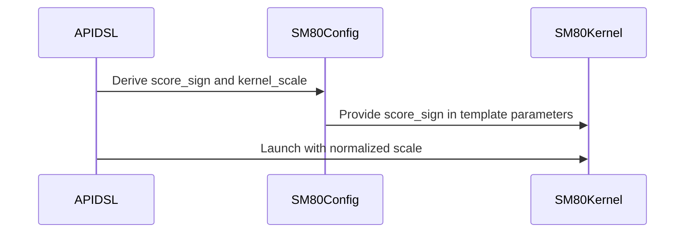

# [Auto-FE] SM80 SDPA forward: serve attn_scale <= 0 with a compile-time score sign

[Upstream PR](https://github.com/NVIDIA/cudnn-frontend/pull/1446) · state: closed · merged: True

## Original PR description

## Before submitting

- [ ] I agree to license this contribution under the terms of [LICENSE.txt](https://github.com/NVIDIA/cudnn-frontend/blob/develop/LICENSE.txt).
- [x] I ran `pre-commit run` and committed any formatting changes.
- [x] I reviewed the Hard Rules in the `AGENTS.md` for each directory this PR touches (see [root AGENTS.md § Reviewing a PR](https://github.com/NVIDIA/cudnn-frontend/blob/develop/AGENTS.md#reviewing-a-pr-human-or-agent)) and my changes comply, or I explain the exception below.
- [x] I added GitHub labels: one `cat-*`, one or more `area:*` / `op:*`, and one `orig-*` (see [label list](https://github.com/NVIDIA/cudnn-frontend/labels)).

## Affected area

FE OSS kernels or CuTeDSL

## Summary

`sdpa_fwd_prefill_sm80` mishandles a non-positive `attn_scale`. This is the SM80 part of #1435:
- `attn_scale = 0` is declined since #1430, so the backend serves it.
- A negative scale is accepted, and returns NaN under any mask.

The cause is that the kernels take the row max over raw scores and fold the scale into `exp2`. That is only valid for a positive scale.

**Fix.** A compile-time `TemplateParams.score_sign` (+1 / 0 / -1, default +1) is set from the plan's scale.
- Both SM80 forward kernels (`prefill_f16.py`, `prefill_d256_f16.py`) negate the raw scores (sign -1) or zero them (sign 0) before the bias and the mask.
- The kernel then runs at `config_sm80.kernel_scale(scale)`: `|scale|`, or 1 for zero.
- The positive specialization traces exactly as before.

The host passes the kernel scale on every path:
- the native dense binder;
- the native THD binder (#1434), by passing the kernel scale to it;
- the Python reference binder used by the tests.

Each binder refuses an execute-time scale whose sign differs from the compiled plan's. With this, the SM80 forward row claims `zero_scale`. `SUPPORT_MATRIX_TRACKER.md` and the analyzer's claim test are updated.

The zero case also depends on the masked-row clamp from #1442 (merged): a zero scale runs at kernel scale 1, which is above ln 2.

## Testing (A100, cuDNN 9.26)

| Test | Result |
|---|---|
| `test_sm80_prepared_nonpositive_scale` (d64/d128/d256 × {0, -0.3} × causal × padding+bias+sink), fp64 reference | 24 passed. On #1430's kernels, all 12 cases at -0.3 return NaN. |
| `test_thd_nonpositive_and_large_scale` (packed THD, d64/d128/d256 × {0, -0.3, 1.0} × {causal, bottom-right + SWA + sink}) | passed |
| `test_sm80_actual_host_frame_matches_python` (native binder vs reference, planned scale {0.125, 0, -0.25} × execute scale {None, 0, 0.25, -0.5}) | passed; sign mismatches raise in both binders |
| All `sdpa/frost/test_*sm80*.py` + `test_sdpa_graph_analyzer.py`, all levels | 1850 passed, 49 skipped, 0 failed |
| `sdpa/graph/test_mhas_v2.py` L0 with FROST enabled (862 graphs on `sdpa_fwd_prefill_sm80`) | 2473 passed |

note to self: claude::fb66556f-59ca-4f79-8a53-539948bcd387 — "Cudnn fe autonomous evolution" · cwd /home/scratch.yanxu_libs/cudnn_frontend · workspace /home/scratch.yanxu_gpu/fe-autonomous-pipeline-20261002 (evidence/fwd-score-sign)

🤖 Generated with [Claude Code](https://claude.com/claude-code)

<!-- This is an auto-generated comment: release notes by coderabbit.ai -->

## Summary by CodeRabbit

* **New Features**
  * SM80 and SM90 forward attention now support an explicit zero attention scale.
  * SM80 forward attention now supports negative attention scales, including when masks are applied.
  * SM80 packed-sequence attention supports zero and negative scales, with or without optional features.
* **Tests**
  * Added coverage for zero and negative scales across supported attention modes and configurations.

<!-- end of auto-generated comment: release notes by coderabbit.ai -->

## Review and discussion

### reviews

- vedaanta · APPROVED · 2026-10-07T13:11:24Z · [source](https://github.com/NVIDIA/cudnn-frontend/pull/1446#pullrequestreview-5442790847)

**Codex bot review · model: `gpt-6-astra`**

Reviewed `8c4e7563ff82` against `0a97923e2c23`. No actionable finding. Checked the score-sign transform before bias/masking, positive kernel-scale conversion in dense and packed paths, native execute-time sign validation, staged binding, and the zero-scale capability/documentation update.

Built the native extension from this head. Independent validation:

- **922 host contract/binder tests passed**, 20 skipped, including native/reference frame comparisons across planned and execution scale signs.
- **307 A100 tests passed** across prepared dense, packed THD, staged-copy and RoPE suites (68 deselected). This includes the new nonpositive-scale cases and the prior large-scale masked-row regression.
- **12 additional FP16/BF16 cases passed** with FP64 O/Stats checks: changed Q/V/bias/sink under capture; changing a live request to zero KV with a sink; staged zero/negative execution; opposite-sign rejection with unchanged output/workspace sentinels; and valid same-sign recovery, including signed zero. Four masked negative-scale controls fail on the base and pass here.

For positive-scale BF16 graphs (B=2, Hq/Hkv=8/2, S=1024), median CPU enqueue/GPU replay times in microseconds were D128 unmasked **11.68/100.16 → 11.73/100.68**, D128 causal **11.29/56.98 → 11.39/56.99**, and D256 causal **11.28/100.36 → 11.46/100.42**. Both versions passed the same FP64 output/Stats and changed-input replay checks; no material regression in these samples.

Current-head CI is already running, so no duplicate run was requested.

<!-- codex-fe-review:github-only:vedaanta:1446:8c4e7563ff826f38a1fe5e0993472adbe1acc5cd:complete -->

- YangXu1990uiuc · COMMENTED · 2026-10-07T13:23:04Z · [source](https://github.com/NVIDIA/cudnn-frontend/pull/1446#pullrequestreview-5442944007)

**Codex bot review · model: `gpt-6-astra`**

Reviewed `8c4e7563ff82` against base `75bc3664aab4`.

No actionable finding. The sign transform occurs before bias and masking, and the positive kernel scale preserves the original units of bias and sink logits. Native dense, staged and packed paths carry that contract consistently. Auto-FE recommendation: KEEP and finish this bounded correctness fix for landing after current-head CI; restoring correct zero/negative-scale behavior is useful, and this change does not need a broader redesign or additional optimization work.

Validation: Built a matching Release native extension from this head and verified the imported Python package and extension paths before native A100 validation. 42 new dense/THD nonpositive-scale tests passed on A100. An additional 22 independent cases passed: FP16/BF16 staged envelope shapes with bias, sink and causal masking; changed-input capture replay; valid same-sign magnitude changes and signed zero; rejection of sign/category changes before output or workspace writes; THD rebinding and changed prefix lengths; disk artifact reload and changed packed capacities with a JIT tripwire; zero-scale independence from Q/K while retaining bias/sink effects. The complete native SM80 binder and graph-analyzer selection passed, with four multi-GPU cases skipped on the single-device allocation. Together with the cases above: 1002 passed and four skipped. Native/reference host frames include positive, negative and zero plan/execute combinations. Positive-scale spot check against parent 0a97923 on A100, BF16 B=2/Hq=8/Hkv=2/S=1024, confirmed the SM80 FROST route and FP64 output before/after timed replay. Across interleaved base/head/head/base runs, median CPU enqueue / GPU graph-replay times (us) were D128 causal 9.32/55.97 -> 9.23/55.98, D128 unmasked 9.56/98.16 -> 9.49/98.00, D256 causal 9.43/100.30 -> 9.47/100.20. No material regression in these samples. Existing labels, project and milestone are appropriate. Current-head CI is already running, so no duplicate pipeline was triggered. The existing independent approval is preserved.

Limitations: The four cross-device cases require multiple visible GPUs and were skipped. Performance results are bounded warm enqueue/replay measurements, not a serving benchmark. Current-head CI remains pending evidence.

Comment only: GitHub does not allow reviewing one's own PR with approval/request-changes.

<!-- codex-fe-review:v2:1446:8c4e7563ff826f38a1fe5e0993472adbe1acc5cd:complete:no-blocker -->

### issue_comments

- YangXu1990uiuc · comment · 2026-10-07T12:45:55Z · [source](https://github.com/NVIDIA/cudnn-frontend/pull/1446#issuecomment-6038200036)

@cudnn-ci-bot run python_tests,frost

- cudnn-ci-bot · comment · 2026-10-07T12:45:59Z · [source](https://github.com/NVIDIA/cudnn-frontend/pull/1446#issuecomment-6038201169)

🏁 Pipeline finished

SHA: `8c4e756`
Targets: `python_tests`, `frost`
Branch: [cudnn-gh/pr-1446-8c4e756](https://nv/cudnn-gitlab-ci/-/tree/cudnn-gh/pr-1446-8c4e756)
Pipeline: [72163173](https://nv/cudnn-gitlab-ci/-/pipelines/72163173)
Last updated: 2026-10-07 15:07 UTC

**37 passed, 1 failed, 7 manual**

### <code>manual</code>

- <code>manual:python_samples</code> - Manual
- <code>manual:python</code> - ✅ Passed
- <code>manual:python/sdpa/frost</code> - ✅ Passed
- <code>manual:python/linear_attention/frost</code> - ✅ Passed
- <code>manual:python/gemm/frost</code> - ✅ Passed
- <code>manual:python/*/frost</code> - ✅ Passed
- <code>manual:python/gemm/cutedsl</code> - Manual
- <code>manual:python/*/cutedsl</code> - Manual
- <code>manual:python/*/jax</code> - Manual
- <code>manual:pycudnn</code> - Manual
- <code>manual:multi_gpu</code> - Manual
- <code>manual:backend</code> - Manual

### <code>analysis</code>

- <code>analysis:cudnn_clang_disable_exception</code> - ✅ Passed
- <code>analysis:cudnn_v9_no_half_conversion</code> - ✅ Passed
- <code>analysis:cudnn_clang</code> - ✅ Passed
- <code>analysis:check-relative-includes</code> - ✅ Passed
- <code>analysis:check-CUDNN_FRONTEND_SKIP_JSON_LIB</code> - ✅ Passed
- <code>analysis:guardwords_scan</code> - ✅ Passed
- <code>analysis:jax-import-guard</code> - ✅ Passed
- <code>analysis:pytest-gpu</code> - ✅ Passed
- <code>san:build</code> - ✅ Passed

### <code>build</code>

- <code>analysis:api_index</code> - ✅ Passed
- <code>build:dev:linux:amd64</code> - ✅ Passed
- <code>build:rel:linux:amd64</code> - ✅ Passed
- <code>build:dev:linux:arm64</code> - ✅ Passed
- <code>build:rel:linux:arm64</code> - ✅ Passed
- <code>build:rel:win:amd64</code> - ✅ Passed

### <code>frost_tests</code>

- <code>python/sdpa/frost:cutlass-rel:sm80</code> - ✅ Passed
- <code>python/sdpa/frost:cutlass-rel:sm100</code> - ✅ Passed
- <code>python/sdpa/frost:cutlass-rel:sm120</code> - ✅ Passed
- <code>python/linear_attention/frost:cutlass-rel:sm100</code> - ✅ Passed
- <code>python/gemm/frost:cutlass-rel:sm100</code> - ✅ Passed
- <code>python/*/frost:cutlass-rel:sm100</code> - ✅ Passed
- <code>python/sdpa/frost:cutlass-rel:sm103</code> - ✅ Passed
- <code>python/sdpa/frost:cutlass-4.8:sm107</code> - ❌ **New Failure!** (nightly passed)

### <code>python_tests</code>

- <code>python:dev:sm80</code> - ✅ Passed
- <code>python:dev:sm90</code> - ✅ Passed
- <code>python:dev:sm100</code> - ✅ Passed
- <code>python:rel:sm80</code> - ✅ Passed
- <code>python:rel:sm90</code> - ✅ Passed
- <code>python:rel:sm100</code> - ✅ Passed

### <code>sanitizer_tests</code>

- <code>san:cpp_test:sm80</code> - ✅ Passed
- <code>san:cpp_test:sm90</code> - ✅ Passed
- <code>san:cpp_test:sm100</code> - ✅ Passed

### <code>triage</code>

- <code>triage:ai</code> - ✅ Passed

- coderabbitai[bot] · comment · 2026-10-07T12:46:13Z · [source](https://github.com/NVIDIA/cudnn-frontend/pull/1446#issuecomment-6038205247)

<!-- This is an auto-generated comment: summarize by coderabbit.ai -->
<!-- review_stack_entry_start -->

<!-- review_stack_entry_end -->
<!-- recent_review_start -->

No actionable comments were generated in the recent review. 🎉

ℹ️ Recent review info

⚙️ Run configuration

- **Configuration used**: Repository: NVIDIA/cudnn-frontend/.coderabbit.yaml
- **Review profile**: CHILL
- **Plan**: Enterprise
- **Run ID**: `80fa99c8-722a-4e55-871b-9fe436ebe70f`

📥 Commits

Reviewing files that changed from the base of the PR and between 0a97923e2c23481a15a03c1fdd7f58e96a7a12c8 and 8c4e7563ff826f38a1fe5e0993472adbe1acc5cd.

📒 Files selected for processing (12)

* `python/cudnn/sdpa/frost/SUPPORT_MATRIX_TRACKER.md`
* `python/cudnn/sdpa/fwd/api_dsl.py`
* `python/cudnn/sdpa/fwd/config_sm80.py`
* `python/cudnn/sdpa/fwd/engines.py`
* `python/cudnn/sdpa/fwd/kernels/sm80/prefill_d256_f16.py`
* `python/cudnn/sdpa/fwd/kernels/sm80/prefill_f16.py`
* `python/pygraph/sdpa_sm80_binding.cpp`
* `test/python/sdpa/frost/sm80_binding_reference.py`
* `test/python/sdpa/frost/test_sdpa_graph_analyzer.py`
* `test/python/sdpa/frost/test_sdpa_native_sm80_binding.py`
* `test/python/sdpa/frost/test_sdpa_prepared_sm80.py`
* `test/python/sdpa/frost/test_sdpa_sm80_thd_forward_prepared.py`

**Included review availability:** This review used your included allowance. Your plan provides up to 12 included reviews per hour; 10 remain after this review.

---

<!-- recent_review_end -->
<!-- walkthrough_start -->

📝 Walkthrough

## Walkthrough

SM80 forward SDPA now accepts zero and negative attention scales. Compilation records the scale sign, kernels adjust scores accordingly, and runtime binding checks sign compatibility. Tests cover dense and THD execution, binding behavior, and support-matrix claims.

### Changes

**SM80 scale-sign support**

|Layer / File(s)|Summary|
|:---|:---|
|**Scale-sign compilation and dispatch**   `python/cudnn/sdpa/fwd/config_sm80.py`, `python/cudnn/sdpa/fwd/api_dsl.py`, `python/cudnn/sdpa/fwd/engines.py`|SM80 configuration derives a sign category and normalized kernel scale. Forward paths no longer reject zero scales, and engine metadata enables zero-scale support.|
|**SM80 score transformation**   `python/cudnn/sdpa/fwd/kernels/sm80/prefill*.py`|The prefill kernels clear scores for a zero sign and negate scores for a negative sign before bias addition and masking.|
|**Runtime binding and scale coverage**   `python/pygraph/sdpa_sm80_binding.cpp`, `test/python/sdpa/frost/*`, `python/cudnn/sdpa/frost/SUPPORT_MATRIX_TRACKER.md`|Binders check that runtime and compiled scales have matching sign categories, then normalize the scale. Tests cover zero and negative scales in prepared dense and THD execution, binding checks, and support-matrix claims.|

<!-- change_assessment_start -->
**Priority:** ➖ Normal

**Estimated code review effort:** 3 (Moderate) | ~25 minutes

<!-- change_assessment_commit:"8c4e7563ff826f38a1fe5e0993472adbe1acc5cd" -->
**Change:** Bug fix
<!-- change_assessment_end -->

### Sequence Diagram(s)

**Suggested reviewers:** `romananders90`

<!-- walkthrough_end -->
<!-- final_review_risk_start -->
**Merge Risk:** _⚪ Minimal_ · up to `8c4e7`
<!-- final_review_risk_coverage:{"sourceCommitId":"8c4e7563ff826f38a1fe5e0993472adbe1acc5cd","coveredCommitId":"8c4e7563ff826f38a1fe5e0993472adbe1acc5cd","kind":"reviewed"} -->

SM80 forward SDPA gains support for zero and negative attention scales, with tests covering dense and THD execution and binder sign checks. No actionable merge-blocking risk was identified; the CI pipeline results are still pending.
<!-- final_review_risk_end -->
<!-- pre_merge_checks_walkthrough_start -->

🚥 Pre-merge checks | ✅ 4 | ❌ 1

### ❌ Failed checks (1 warning)

|     Check name     | Status     | Explanation                                                                                                                                                                                               | Resolution                                                                         |
| :----------------: | :--------- | :-------------------------------------------------------------------------------------------------------------------------------------------------------------------------------------------------------- | :--------------------------------------------------------------------------------- |
| Docstring Coverage | ⚠️ Warning | Docstring coverage is 25.00% which is insufficient. The required threshold is 80.00%. Docstring coverage is scoped to functions touched by this diff. Analyzed 24 functions across 11 files. (1 skipped:… | Write docstrings for the functions missing them to satisfy the coverage threshold. |

✅ Passed checks (4 passed)

|         Check name         | Status   | Explanation                                                                                                                                                                                               |
| :------------------------: | :------- | :-------------------------------------------------------------------------------------------------------------------------------------------------------------------------------------------------------- |
|         Title check        | ✅ Passed | The title clearly summarizes the main change: SM80 SDPA forward now supports non-positive attention scales through compile-time score-sign handling.                                                      |
|      Description check     | ✅ Passed | The description gives a clear summary, rationale, implementation details, and specific test results. It does not include the API and compatibility impact section, leaves the license agreement unchecke… |
|     Linked Issues check    | ✅ Passed | Check skipped because no linked issues were found for this pull request.                                                                                                                                  |
| Out of Scope Changes check | ✅ Passed | Check skipped because no linked issues were found for this pull request.                                                                                                                                  |

Full details: Docstring Coverage

**Explanation**

Docstring coverage is 25.00% which is insufficient. The required threshold is 80.00%. Docstring coverage is scoped to functions touched by this diff. Analyzed 24 functions across 11 files. (1 skipped: 1 unsupported.)

<!-- pre_merge_checks_walkthrough_end -->

- [ ] <!-- {"checkboxId":"585bb3f6-faf5-4dbf-96d2-74e382adf19a"} --> Fix all pre-merge checks with AI
<!-- finishing_touch_checkbox_start -->

✨ Finishing Touches 💡 1

<!-- finishing_touch_suggestion:fix_ci -->

🛠️ Fix failing CI checks 💡

- [ ] <!-- {"checkboxId": "9f0d24fb-b419-4f01-baf0-8b26b6424f34", "radioGroupId": "fix-ci-output-choice-group-unknown_comment_id"} --> Commit to this branch
- [ ] <!-- {"checkboxId": "6d21cfe8-ec3f-40e2-9222-b8318b64d3b0", "radioGroupId": "fix-ci-output-choice-group-unknown_comment_id"} --> Create a new PR

🧪 Generate unit tests (beta)

- [ ] <!-- {"checkboxId": "f47ac10b-58cc-4372-a567-0e02b2c3d479", "radioGroupId": "utg-output-choice-group-unknown_comment_id"} --> Create a new PR

<!-- finishing_touch_checkbox_end -->

<!-- autopilot:start -->
- [ ] <!-- {"checkboxId":"2708ad07-9f24-4260-9c11-7dc76a49f2e3"} --> <strong title="Keep fixing CodeRabbit findings and required CI, and resolving merge conflicts">Autopilot</strong> · Keep fixing CodeRabbit findings and required CI, and resolving merge conflicts
<!-- autopilot:end -->
<!-- tips_start -->

---

Comment `@coderabbitai help` to get the list of available commands.

<!-- tips_end -->

### inline_comments

## Changed files and fixed code

- `python/cudnn/sdpa/frost/SUPPORT_MATRIX_TRACKER.md` · modified · additions 4 / deletions 3
  - [head](https://github.com/YangXu1990uiuc/cudnn-frontend/blob/8c4e7563ff826f38a1fe5e0993472adbe1acc5cd/python/cudnn/sdpa/frost/SUPPORT_MATRIX_TRACKER.md)
  - [base](https://github.com/NVIDIA/cudnn-frontend/blob/0a97923e2c23481a15a03c1fdd7f58e96a7a12c8/python/cudnn/sdpa/frost/SUPPORT_MATRIX_TRACKER.md)
- `python/cudnn/sdpa/fwd/api_dsl.py` · modified · additions 4 / deletions 6
  - [head](https://github.com/YangXu1990uiuc/cudnn-frontend/blob/8c4e7563ff826f38a1fe5e0993472adbe1acc5cd/python/cudnn/sdpa/fwd/api_dsl.py)
  - [base](https://github.com/NVIDIA/cudnn-frontend/blob/0a97923e2c23481a15a03c1fdd7f58e96a7a12c8/python/cudnn/sdpa/fwd/api_dsl.py)
- `python/cudnn/sdpa/fwd/config_sm80.py` · modified · additions 13 / deletions 0
  - [head](https://github.com/YangXu1990uiuc/cudnn-frontend/blob/8c4e7563ff826f38a1fe5e0993472adbe1acc5cd/python/cudnn/sdpa/fwd/config_sm80.py)
  - [base](https://github.com/NVIDIA/cudnn-frontend/blob/0a97923e2c23481a15a03c1fdd7f58e96a7a12c8/python/cudnn/sdpa/fwd/config_sm80.py)
- `python/cudnn/sdpa/fwd/engines.py` · modified · additions 3 / deletions 2
  - [head](https://github.com/YangXu1990uiuc/cudnn-frontend/blob/8c4e7563ff826f38a1fe5e0993472adbe1acc5cd/python/cudnn/sdpa/fwd/engines.py)
  - [base](https://github.com/NVIDIA/cudnn-frontend/blob/0a97923e2c23481a15a03c1fdd7f58e96a7a12c8/python/cudnn/sdpa/fwd/engines.py)
- `python/cudnn/sdpa/fwd/kernels/sm80/prefill_d256_f16.py` · modified · additions 7 / deletions 0
  - [head](https://github.com/YangXu1990uiuc/cudnn-frontend/blob/8c4e7563ff826f38a1fe5e0993472adbe1acc5cd/python/cudnn/sdpa/fwd/kernels/sm80/prefill_d256_f16.py)
  - [base](https://github.com/NVIDIA/cudnn-frontend/blob/0a97923e2c23481a15a03c1fdd7f58e96a7a12c8/python/cudnn/sdpa/fwd/kernels/sm80/prefill_d256_f16.py)
- `python/cudnn/sdpa/fwd/kernels/sm80/prefill_f16.py` · modified · additions 7 / deletions 0
  - [head](https://github.com/YangXu1990uiuc/cudnn-frontend/blob/8c4e7563ff826f38a1fe5e0993472adbe1acc5cd/python/cudnn/sdpa/fwd/kernels/sm80/prefill_f16.py)
  - [base](https://github.com/NVIDIA/cudnn-frontend/blob/0a97923e2c23481a15a03c1fdd7f58e96a7a12c8/python/cudnn/sdpa/fwd/kernels/sm80/prefill_f16.py)
- `python/pygraph/sdpa_sm80_binding.cpp` · modified · additions 10 / deletions 4
  - [head](https://github.com/YangXu1990uiuc/cudnn-frontend/blob/8c4e7563ff826f38a1fe5e0993472adbe1acc5cd/python/pygraph/sdpa_sm80_binding.cpp)
  - [base](https://github.com/NVIDIA/cudnn-frontend/blob/0a97923e2c23481a15a03c1fdd7f58e96a7a12c8/python/pygraph/sdpa_sm80_binding.cpp)
- `test/python/sdpa/frost/sm80_binding_reference.py` · modified · additions 3 / deletions 2
  - [head](https://github.com/YangXu1990uiuc/cudnn-frontend/blob/8c4e7563ff826f38a1fe5e0993472adbe1acc5cd/test/python/sdpa/frost/sm80_binding_reference.py)
  - [base](https://github.com/NVIDIA/cudnn-frontend/blob/0a97923e2c23481a15a03c1fdd7f58e96a7a12c8/test/python/sdpa/frost/sm80_binding_reference.py)
- `test/python/sdpa/frost/test_sdpa_graph_analyzer.py` · modified · additions 3 / deletions 3
  - [head](https://github.com/YangXu1990uiuc/cudnn-frontend/blob/8c4e7563ff826f38a1fe5e0993472adbe1acc5cd/test/python/sdpa/frost/test_sdpa_graph_analyzer.py)
  - [base](https://github.com/NVIDIA/cudnn-frontend/blob/0a97923e2c23481a15a03c1fdd7f58e96a7a12c8/test/python/sdpa/frost/test_sdpa_graph_analyzer.py)
- `test/python/sdpa/frost/test_sdpa_native_sm80_binding.py` · modified · additions 11 / deletions 9
  - [head](https://github.com/YangXu1990uiuc/cudnn-frontend/blob/8c4e7563ff826f38a1fe5e0993472adbe1acc5cd/test/python/sdpa/frost/test_sdpa_native_sm80_binding.py)
  - [base](https://github.com/NVIDIA/cudnn-frontend/blob/0a97923e2c23481a15a03c1fdd7f58e96a7a12c8/test/python/sdpa/frost/test_sdpa_native_sm80_binding.py)
- `test/python/sdpa/frost/test_sdpa_prepared_sm80.py` · modified · additions 13 / deletions 0
  - [head](https://github.com/YangXu1990uiuc/cudnn-frontend/blob/8c4e7563ff826f38a1fe5e0993472adbe1acc5cd/test/python/sdpa/frost/test_sdpa_prepared_sm80.py)
  - [base](https://github.com/NVIDIA/cudnn-frontend/blob/0a97923e2c23481a15a03c1fdd7f58e96a7a12c8/test/python/sdpa/frost/test_sdpa_prepared_sm80.py)
- `test/python/sdpa/frost/test_sdpa_sm80_thd_forward_prepared.py` · modified · additions 18 / deletions 3
  - [head](https://github.com/YangXu1990uiuc/cudnn-frontend/blob/8c4e7563ff826f38a1fe5e0993472adbe1acc5cd/test/python/sdpa/frost/test_sdpa_sm80_thd_forward_prepared.py)
  - [base](https://github.com/NVIDIA/cudnn-frontend/blob/0a97923e2c23481a15a03c1fdd7f58e96a7a12c8/test/python/sdpa/frost/test_sdpa_sm80_thd_forward_prepared.py)

## Evidence and interpretation boundary

[Original JSON, discussions and patches](../../../../../../evidence/prs/NVIDIA--cudnn-frontend/1446-d78981b6960649834465c56ccb9b1ad14a381d945dc647063a87d2cc6c3d4980.json) · SHA-256 `d78981b6960649834465c56ccb9b1ad14a381d945dc647063a87d2cc6c3d4980`.

Diff complete: True. Missing/binary/truncated patches require pinned source inspection. This is a source page, not an independently verified optimization case. Open, merged and released are different states; recheck the deployed dependency.
