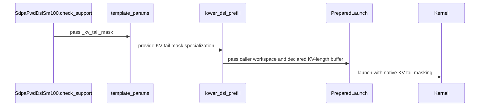

# [Auto-FE] SDPA forward SM100/SM107: mask a ragged mask-free KV tail in-kernel instead of synthesizing lengths

[Upstream PR](https://github.com/NVIDIA/cudnn-frontend/pull/1520) · state: closed · merged: True

## Original PR description

## Before submitting

- [ ] I agree to license this contribution under the terms of [LICENSE.txt](https://github.com/NVIDIA/cudnn-frontend/blob/develop/LICENSE.txt).
- [x] I ran `pre-commit run` and committed any formatting changes.
- [x] I reviewed the Hard Rules in the `AGENTS.md` for each directory this PR touches (see [root AGENTS.md § Reviewing a PR](https://github.com/NVIDIA/cudnn-frontend/blob/develop/AGENTS.md#reviewing-a-pr-human-or-agent)) and my changes comply, or I explain the exception below.
- [x] I added GitHub labels: one `cat-*`, one or more `area:*` / `op:*`, and one `orig-*` (see [label list](https://github.com/NVIDIA/cudnn-frontend/labels)).

## Affected area

FE OSS kernels or CuTeDSL

## Summary

A dense, mask-free SDPA forward graph whose `S_kv` is not a multiple of the 128-row KV tile no longer synthesizes per-batch KV lengths. The SM100/SM107 kernels now mask the partial last KV tile against the scalar `S_kv`. Such graphs take the native prepared launch, and their host cost matches a tile-aligned graph.

- New appended `TemplateParams.kv_tail_mask`: compiles `MASK_PADDED` without `SEQ_KV_LENS_PRESENT`. The kernels already separate the two (`_resolve_seqlen_kv` falls back to the scalar `S_kv`), so no kernel source changes.
- The adapter sets `kv_tail_mask` where it used to synthesize lengths. The prepared spec marks the plan `kv_tail_native`. The lowering no longer fills a lengths buffer or reserves workspace for it.
- These graphs now also accept execute-time `S_kv` shape overrides within the plan's envelope.
- `SUPPORT_MATRIX_TRACKER.md` is updated (Rule S2).

## Why

The synthesized-lengths path was declined by the prepared launch. Every execute ran the tensor executor plus a `fill_` of the lengths buffer, about 3–5x the host time of the same graph at an aligned `S_kv` (#1425). Keeping a plan-owned lengths buffer instead would break Rule 8 (no plan-owned device memory).

## Related issues

Partially addresses #1425: this fixes the host cost. Split-KV still does not ride the KV-tail mask (`mismatch` says so), so #1425 stays open for that.

## API and compatibility impact

None in the public API. `TemplateParams.kv_tail_mask` is appended with default `False`. Numerics are unchanged: the same `MASK_PADDED` code masks the same columns.

## Testing

B200, cuDNN 9.26.0.51, `nvidia-cutlass-dsl` 4.7.0 (cu13), head rebased on `gh/develop` 19fe6ef37.

- `pytest -m "L0 or L1 or L2 or L3 or L4" -n 8 sdpa/frost`: **10774 passed, 4655 skipped, 0 failed**.
- New `test_dsl_sm100_kv_tail_mask_takes_the_native_prepared_launch[bf16|fp8]`:
  - asserts the native prepared launch and no lengths;
  - asserts zero workspace (bf16);
  - forbids the Python binders;
  - executes with `S_kv` overrides 200/72/128/129/199 against a torch reference.
- Graph-analyzer and split-KV heuristic tests are updated for the new reason strings.

Host time per eager `graph.execute`, B=1, H=24/3, S_q=18, D=128, `heur_mode.A` with the FROST SM100 engine pinned. Best of 5×200 calls after a 3000-call warm-up; two interleaved rounds:

| | base S_kv=128 | base S_kv=71 | this PR S_kv=128 | this PR S_kv=71 |
|---|---|---|---|---|
| FP8 E4M3 | 16.0 / 16.1 µs | 49.4 / 51.6 µs | 16.0 / 16.0 µs | 16.1 / 16.2 µs |
| BF16 | 11.2 / 11.3 µs | 63.1 / 56.2 µs | 11.1 / 10.9 µs | 11.2 / 10.9 µs |

With only 50 warm-up calls, the first shape timed in a process is sometimes 1.5–2.5x slower on both trees (GPU-bound before clocks settle), so the long warm-up matters for these numbers.

Not measured on this rebased head:
- GPU kernel time. Before the rebase it was neutral to −4% over 12 shapes.
- SM107 (Rubin) hardware; its config change mirrors SM100.

note to self: claude::fb66556f-59ca-4f79-8a53-539948bcd387 — "Cudnn fe autonomous evolution" · cwd /home/scratch.yanxu_libs/cudnn_frontend · workspace /home/scratch.yanxu_gpu/fe-autonomous-pipeline-20261002 (evidence/synth-padding-host)

🤖 Generated with [Claude Code](https://claude.com/claude-code)

<!-- This is an auto-generated comment: release notes by coderabbit.ai -->

## Summary by CodeRabbit

* **New Features**
  * Dense attention inputs with KV lengths that do not align to tile boundaries can now use native tail masking in supported plans, without requiring a per-batch sequence-length buffer.
  * Paged attention graphs can split when the declared maximum KV length is not a multiple of the tile size.
* **Bug Fixes**
  * Improved support for ragged KV lengths in BF16 and FP8 graph execution, with outputs validated against PyTorch.
  * Prepared runtime overrides can remain admissible for supported mask-free KV tails.

<!-- end of auto-generated comment: release notes by coderabbit.ai -->

## Review and discussion

### reviews

- vedaanta · APPROVED · 2026-10-09T09:36:15Z · [source](https://github.com/NVIDIA/cudnn-frontend/pull/1520#pullrequestreview-5468348509)

**Codex bot review · model: `gpt-6-astra`**

Reviewed `31e646f6` against its parent `19fe6ef3`, with a clean integration check onto current develop `77804a0b`. No actionable findings. Traced mask specialization, scalar KV-length binding, D192 canonicalization, prepared override admission and the unchanged split exclusion.

Validation with freshly built bindings: 988 planning/binding tests passed, 21 skipped; eight submitted/existing tail regressions passed on each of SM100 and SM107. Nine additional configurations per device checked O, Stats and FP8 Amax against numerical references, including runtime KV lengths 200/128/129/7, negative-scale right bands, sinks and capture/replay after changing Q/V. Two affected SM107 MXFP8 configurations also passed. The short-KV FP8 reference explicitly accounts for the existing P-to-FP8 cast: the same ideal-softmax discrepancy reproduced on the parent, and both revisions passed the quantization-aware reference without increasing tolerances.

Repeated head/parent comparisons for B1, Hq/Hkv=24/3, Q=18, D=128, KV=71: SM100 CPU submission fell from approximately 93–100 us to 13–20 us; SM107 from 60–63 us to 9–16 us. SM100 GPU replay was approximately flat for BF16 and improved for FP8; warmed SM107 GPU replay improved from 9.4 to 5.0 us for BF16 and 8.5 to 7.5 us for FP8. KV=128 controls were broadly unchanged. These are focused comparisons, not a full performance qualification. SM100 used DSL 4.7; the SM107 compiler differs from CI.

Existing pipeline 72647278 is still running; its result remains pending. No duplicate CI requested.

<!-- codex-fe-review:github-only:vedaanta:1520:31e646f6edcc4b82b5411a3c59b7e51264d14c5a:complete -->

- YangXu1990uiuc · COMMENTED · 2026-10-09T09:41:00Z · [source](https://github.com/NVIDIA/cudnn-frontend/pull/1520#pullrequestreview-5468392394)

**Codex bot review · model: `gpt-6-astra`**

Reviewed `31e646f6edcc` against base `77804a0b697d`.

No actionable findings on this head. Traced scalar versus per-batch length resolution, template/cache identity, D192 FP8 canonicalization and native override admission. KEEP — finish this bounded change and merge once existing review/CI requirements are met. Removing synthesized length-buffer fills makes the prepared path useful for the existing short/ragged-KV workloads without expanding public APIs or admitting unsupported split-KV cases; keep split-KV tail support as a separate follow-up. Preserving the existing independent approval.

Validation: Built matching native bindings from this head. On SM100 with DSL 4.7, the focused graph-analysis/split-policy and submitted/existing KV-tail selection completed with 702 passed, 3 deselected. The corresponding eight GPU tail cases also passed on SM107 (3 deselected). An additional SM100 probe passed seven configurations: D192/D256 FP8, D128 FP8 decode, D192/D256/D512 BF16 and a right-widened BF16 band. Each used native prepared execution at runtime KV lengths 72/128/129/199 and a CUDA Graph replay after changing Q/V: 28 dynamic-length executions plus seven replay checks. Checked O, LSE, FP8 Amax and output/Stats guard regions. Reused Vedaanta's independently posted same-head parent/head performance checks rather than duplicating them: the measured SM100 KV=71 cases substantially reduced CPU submission, with BF16 GPU replay approximately flat and FP8 replay improved; aligned KV=128 controls were broadly unchanged. Those performance measurements are his evidence, not a new benchmark from this review.

Limitations: Existing pipeline 72647278 is still pending; no duplicate CI requested. This was focused validation, not a full workload/performance sweep. The extra seven-configuration probe above ran on SM100; my SM107 validation covered the eight selected suite cases. Vedaanta's separate review supplies broader same-head SM107 coverage.

Comment only: GitHub does not allow reviewing one's own PR with approval/request-changes.

<!-- codex-fe-review:v2:1520:31e646f6edcc4b82b5411a3c59b7e51264d14c5a:complete:no-blocker -->

### issue_comments

- YangXu1990uiuc · comment · 2026-10-09T09:04:22Z · [source](https://github.com/NVIDIA/cudnn-frontend/pull/1520#issuecomment-6077846873)

@cudnn-ci-bot run python/sdpa/frost

- cudnn-ci-bot · comment · 2026-10-09T09:04:27Z · [source](https://github.com/NVIDIA/cudnn-frontend/pull/1520#issuecomment-6077847936)

🏁 Pipeline finished

SHA: `31e646f`
Targets: `python/sdpa/frost`
Branch: [cudnn-gh/pr-1520-31e646f](https://nv/cudnn-gitlab-ci/-/tree/cudnn-gh/pr-1520-31e646f)
Pipeline: [72647278](https://nv/cudnn-gitlab-ci/-/pipelines/72647278)
Last updated: 2026-10-09 09:51 UTC

**25 passed, 3 skipped, 11 manual**

### <code>manual</code>

- <code>manual:python_samples</code> - Manual
- <code>manual:python</code> - Manual
- <code>manual:python/sdpa/frost</code> - ✅ Passed
- <code>manual:python/linear_attention/frost</code> - Manual
- <code>manual:python/gemm/frost</code> - Manual
- <code>manual:python/*/frost</code> - Manual
- <code>manual:python/gemm/cutedsl</code> - Manual
- <code>manual:python/*/cutedsl</code> - Manual
- <code>manual:python/*/jax</code> - Manual
- <code>manual:pycudnn</code> - Manual
- <code>manual:multi_gpu</code> - Manual
- <code>manual:backend</code> - Manual

### <code>analysis</code>

- <code>analysis:cudnn_clang_disable_exception</code> - ✅ Passed
- <code>analysis:cudnn_v9_no_half_conversion</code> - ✅ Passed
- <code>analysis:cudnn_clang</code> - ✅ Passed
- <code>analysis:check-relative-includes</code> - ✅ Passed
- <code>analysis:check-CUDNN_FRONTEND_SKIP_JSON_LIB</code> - ✅ Passed
- <code>analysis:guardwords_scan</code> - ✅ Passed
- <code>analysis:jax-import-guard</code> - ✅ Passed
- <code>analysis:pytest-gpu</code> - ✅ Passed
- <code>san:build</code> - ✅ Passed

### <code>build</code>

- <code>analysis:api_index</code> - ✅ Passed
- <code>build:dev:linux:amd64</code> - ✅ Passed
- <code>build:rel:linux:amd64</code> - ✅ Passed
- <code>build:dev:linux:arm64</code> - ✅ Passed
- <code>build:rel:linux:arm64</code> - ✅ Passed
- <code>build:rel:win:amd64</code> - ✅ Passed

### <code>frost_tests</code>

- <code>python/sdpa/frost:cutlass-rel:sm80</code> - ✅ Passed
- <code>python/sdpa/frost:cutlass-rel:sm100</code> - ✅ Passed
- <code>python/sdpa/frost:cutlass-rel:sm120</code> - ✅ Passed
- <code>python/linear_attention/frost:cutlass-rel:sm100</code> - Skipped
- <code>python/gemm/frost:cutlass-rel:sm100</code> - Skipped
- <code>python/*/frost:cutlass-rel:sm100</code> - Skipped
- <code>python/sdpa/frost:cutlass-rel:sm103</code> - ✅ Passed
- <code>python/sdpa/frost:cutlass-4.8:sm107</code> - ✅ Passed

### <code>sanitizer_tests</code>

- <code>san:cpp_test:sm80</code> - ✅ Passed
- <code>san:cpp_test:sm90</code> - ✅ Passed
- <code>san:cpp_test:sm100</code> - ✅ Passed

### <code>triage</code>

- <code>triage:ai</code> - ✅ Passed

- coderabbitai · comment · 2026-10-09T09:04:42Z · [source](https://github.com/NVIDIA/cudnn-frontend/pull/1520#issuecomment-6077851735)

<!-- This is an auto-generated comment: summarize by coderabbit.ai -->
<!-- review_stack_entry_start -->

<!-- review_stack_entry_end -->
<!-- recent_review_start -->

No actionable comments were generated in the recent review. 🎉

ℹ️ Recent review info

⚙️ Run configuration

- **Configuration used**: Repository: NVIDIA/cudnn-frontend/.coderabbit.yaml
- **Review profile**: CHILL
- **Plan**: Enterprise
- **Run ID**: `09bf12bb-8e84-43b6-85a2-73c3deaab1b1`

📥 Commits

Reviewing files that changed from the base of the PR and between 77804a0b697d6a36480c5ed679a9ea8c69f14d43 and 31e646f6edcc4b82b5411a3c59b7e51264d14c5a.

📒 Files selected for processing (11)

* `python/cudnn/sdpa/frost/SUPPORT_MATRIX_TRACKER.md`
* `python/cudnn/sdpa/fwd/api_dsl.py`
* `python/cudnn/sdpa/fwd/config_sm100.py`
* `python/cudnn/sdpa/fwd/config_sm107.py`
* `python/cudnn/sdpa/fwd/engines.py`
* `python/cudnn/sdpa/fwd/heuristics.py`
* `python/cudnn/sdpa/fwd/placement.py`
* `python/cudnn/sdpa/fwd/prepared.py`
* `test/python/sdpa/frost/test_sdpa_fwd_dsl_sm100.py`
* `test/python/sdpa/frost/test_sdpa_graph_analyzer.py`
* `test/python/sdpa/frost/test_split_kv_heuristic.py`

**Included review availability:** This review used your included allowance. Your plan provides up to 12 included reviews per hour; 11 remain after this review.

---

<!-- recent_review_end -->
<!-- walkthrough_start -->

📝 Walkthrough

## Walkthrough

The forward DSL now represents uncovered, non-tile-aligned dense KV tails with a scalar-`S_kv` padded mask. Non-split plans can use this path without synthesized per-batch KV-length buffers or their workspace allocation. Prepared launches and tests cover native tail masking; split-KV plans that require the mask remain rejected.

### Changes

**Dense KV-tail masking**

|Layer / File(s)|Summary|
|:---|:---|
|**KV-tail mask specialization**   `python/cudnn/sdpa/fwd/api_dsl.py`, `python/cudnn/sdpa/fwd/config_sm100.py`, `python/cudnn/sdpa/fwd/config_sm107.py`|The API sets and forwards `kv_tail_mask` when an uncovered dense KV tail is not tile-aligned. SM100 and SM107 configuration enable `MASK_PADDED` for that flag.|
|**Adapter and prepared execution**   `python/cudnn/sdpa/fwd/engines.py`, `python/cudnn/sdpa/fwd/prepared.py`|Engine lowering removes synthesized KV-length buffers and their workspace allocation. Prepared execution recognizes the API tail-mask flag. Split-KV plans that need the mask remain rejected.|
|**Validation and support descriptions**   `test/python/sdpa/frost/*`, `python/cudnn/sdpa/fwd/{heuristics,placement}.py`, `python/cudnn/sdpa/frost/SUPPORT_MATRIX_TRACKER.md`|Tests cover BF16 and FP8 prepared execution with varying KV lengths and accept a mask-free graph with `s_kv=129`. Comments and tracker entries describe scalar-tail masking and related split-KV behavior. The tracker also records that paged split-KV does not require the declared maximum KV length to be tile-aligned.|

<!-- change_assessment_start -->
**Priority:** ➖ Normal

**Estimated code review effort:** 3 (Moderate) | ~25 minutes

<!-- change_assessment_commit:"31e646f6edcc4b82b5411a3c59b7e51264d14c5a" -->
**Change:** Bug fix
<!-- change_assessment_end -->

### Sequence Diagram(s)

**Suggested reviewers:** `vedaanta`

<!-- walkthrough_end -->
<!-- final_review_risk_start -->
**Merge Risk:** **⚪ Minimal** · up to `31e64`
<!-- final_review_risk_coverage:{"sourceCommitId":"31e646f6edcc4b82b5411a3c59b7e51264d14c5a","coveredCommitId":"31e646f6edcc4b82b5411a3c59b7e51264d14c5a","kind":"reviewed"} -->

The change masks a ragged KV tail in-kernel instead of synthesizing KV lengths. No concrete merge-blocking issue was found in the supplied review, and the author reports passing tests on B200 hardware.
<!-- final_review_risk_end -->
<!-- pre_merge_checks_walkthrough_start -->

🚥 Pre-merge checks | ✅ 4 | ❌ 1

### ❌ Failed checks (1 warning)

|     Check name     |                                              Status                                              | Explanation                                                                                                                                                                                               | Resolution                                                                         |
| :---------------- | :----------------------------------------------------------------------------------------------: | :-------------------------------------------------------------------------------------------------------------------------------------------------------------------------------------------------------- | :--------------------------------------------------------------------------------- |
| Docstring Coverage |  | Docstring coverage is 76.92% which is insufficient. The required threshold is 80.00%. Docstring coverage is scoped to functions touched by this diff. Analyzed 26 functions across 10 files. (1 skipped:… | Write docstrings for the functions missing them to satisfy the coverage threshold. |

✅ Passed checks (4 passed)

|         Check name         |                                             Status                                             | Explanation                                                                                                                                                                                               |
| :------------------------ | :--------------------------------------------------------------------------------------------: | :-------------------------------------------------------------------------------------------------------------------------------------------------------------------------------------------------------- |
|         Title check        |  | The title clearly identifies the SDPA forward targets and the primary change: in-kernel masking of ragged, mask-free KV tails instead of synthesized lengths.                                             |
|      Description check     |  | The description follows the template and covers the affected area, summary, rationale, related issue, compatibility impact, and detailed testing. The license-agreement checkbox remains unchecked, but … |
|     Linked Issues check    |  | Check skipped because no linked issues were found for this pull request.                                                                                                                                  |
| Out of Scope Changes check |  | Check skipped because no linked issues were found for this pull request.                                                                                                                                  |

Full details: Docstring Coverage

**Explanation**

Docstring coverage is 76.92% which is insufficient. The required threshold is 80.00%. Docstring coverage is scoped to functions touched by this diff. Analyzed 26 functions across 10 files. (1 skipped: 1 unsupported.)

<!-- pre_merge_checks_walkthrough_end -->

- [ ] <!-- {"checkboxId":"585bb3f6-faf5-4dbf-96d2-74e382adf19a"} --> Fix all pre-merge checks with AI
<!-- finishing_touch_checkbox_start -->

✨ Finishing Touches 💡 1

<!-- finishing_touch_suggestion:fix_ci -->

🛠️ Fix failing CI checks 💡

- [ ] <!-- {"checkboxId": "9f0d24fb-b419-4f01-baf0-8b26b6424f34", "radioGroupId": "fix-ci-output-choice-group-unknown_comment_id"} --> Commit to this branch
- [ ] <!-- {"checkboxId": "6d21cfe8-ec3f-40e2-9222-b8318b64d3b0", "radioGroupId": "fix-ci-output-choice-group-unknown_comment_id"} --> Create a new PR

🧪 Generate unit tests (beta)

- [ ] <!-- {"checkboxId": "f47ac10b-58cc-4372-a567-0e02b2c3d479", "radioGroupId": "utg-output-choice-group-unknown_comment_id"} --> Create a new PR

<!-- finishing_touch_checkbox_end -->

<!-- autopilot:start -->
- [ ] <!-- {"checkboxId":"2708ad07-9f24-4260-9c11-7dc76a49f2e3"} --> <strong title="Keep fixing CodeRabbit findings and required CI, and resolving merge conflicts">Autofix</strong> · Keep fixing CodeRabbit findings and required CI, and resolving merge conflicts
<!-- autopilot:end -->
<!-- tips_start -->

---

Comment `@coderabbitai help` to get the list of available commands.

<!-- tips_end -->

- YangXu1990uiuc · comment · 2026-10-09T14:04:31Z · [source](https://github.com/NVIDIA/cudnn-frontend/pull/1520#issuecomment-6082512906)

_Posted by Claude Code, an AI agent acting for @YangXu1990uiuc._

Follow-up: this PR serves a dense mask-free KV tail through the same adapter that gated_attention_block uses, so 15 GAB tests that pinned the old "multiple of 128" decline failed with `DID NOT RAISE` on `python/*/cutedsl:cutlass-4.8:sm107` (schedule 72675160). This PR's CI ran `python_tests,frost`, which does not include that lane. #1522 turns those cells into served-and-checked tests: oracle, bitwise and fp64-autograd checks, plus a dense quantized backward cell.

### inline_comments

## Changed files and fixed code

- `python/cudnn/sdpa/frost/SUPPORT_MATRIX_TRACKER.md` · modified · additions 12 / deletions 11
  - [head](https://github.com/YangXu1990uiuc/cudnn-frontend/blob/31e646f6edcc4b82b5411a3c59b7e51264d14c5a/python/cudnn/sdpa/frost/SUPPORT_MATRIX_TRACKER.md)
  - [base](https://github.com/NVIDIA/cudnn-frontend/blob/77804a0b697d6a36480c5ed679a9ea8c69f14d43/python/cudnn/sdpa/frost/SUPPORT_MATRIX_TRACKER.md)
- `python/cudnn/sdpa/fwd/api_dsl.py` · modified · additions 8 / deletions 9
  - [head](https://github.com/YangXu1990uiuc/cudnn-frontend/blob/31e646f6edcc4b82b5411a3c59b7e51264d14c5a/python/cudnn/sdpa/fwd/api_dsl.py)
  - [base](https://github.com/NVIDIA/cudnn-frontend/blob/77804a0b697d6a36480c5ed679a9ea8c69f14d43/python/cudnn/sdpa/fwd/api_dsl.py)
- `python/cudnn/sdpa/fwd/config_sm100.py` · modified · additions 5 / deletions 2
  - [head](https://github.com/YangXu1990uiuc/cudnn-frontend/blob/31e646f6edcc4b82b5411a3c59b7e51264d14c5a/python/cudnn/sdpa/fwd/config_sm100.py)
  - [base](https://github.com/NVIDIA/cudnn-frontend/blob/77804a0b697d6a36480c5ed679a9ea8c69f14d43/python/cudnn/sdpa/fwd/config_sm100.py)
- `python/cudnn/sdpa/fwd/config_sm107.py` · modified · additions 1 / deletions 1
  - [head](https://github.com/YangXu1990uiuc/cudnn-frontend/blob/31e646f6edcc4b82b5411a3c59b7e51264d14c5a/python/cudnn/sdpa/fwd/config_sm107.py)
  - [base](https://github.com/NVIDIA/cudnn-frontend/blob/77804a0b697d6a36480c5ed679a9ea8c69f14d43/python/cudnn/sdpa/fwd/config_sm107.py)
- `python/cudnn/sdpa/fwd/engines.py` · modified · additions 25 / deletions 46
  - [head](https://github.com/YangXu1990uiuc/cudnn-frontend/blob/31e646f6edcc4b82b5411a3c59b7e51264d14c5a/python/cudnn/sdpa/fwd/engines.py)
  - [base](https://github.com/NVIDIA/cudnn-frontend/blob/77804a0b697d6a36480c5ed679a9ea8c69f14d43/python/cudnn/sdpa/fwd/engines.py)
- `python/cudnn/sdpa/fwd/heuristics.py` · modified · additions 2 / deletions 2
  - [head](https://github.com/YangXu1990uiuc/cudnn-frontend/blob/31e646f6edcc4b82b5411a3c59b7e51264d14c5a/python/cudnn/sdpa/fwd/heuristics.py)
  - [base](https://github.com/NVIDIA/cudnn-frontend/blob/77804a0b697d6a36480c5ed679a9ea8c69f14d43/python/cudnn/sdpa/fwd/heuristics.py)
- `python/cudnn/sdpa/fwd/placement.py` · modified · additions 4 / deletions 3
  - [head](https://github.com/YangXu1990uiuc/cudnn-frontend/blob/31e646f6edcc4b82b5411a3c59b7e51264d14c5a/python/cudnn/sdpa/fwd/placement.py)
  - [base](https://github.com/NVIDIA/cudnn-frontend/blob/77804a0b697d6a36480c5ed679a9ea8c69f14d43/python/cudnn/sdpa/fwd/placement.py)
- `python/cudnn/sdpa/fwd/prepared.py` · modified · additions 2 / deletions 1
  - [head](https://github.com/YangXu1990uiuc/cudnn-frontend/blob/31e646f6edcc4b82b5411a3c59b7e51264d14c5a/python/cudnn/sdpa/fwd/prepared.py)
  - [base](https://github.com/NVIDIA/cudnn-frontend/blob/77804a0b697d6a36480c5ed679a9ea8c69f14d43/python/cudnn/sdpa/fwd/prepared.py)
- `test/python/sdpa/frost/test_sdpa_fwd_dsl_sm100.py` · modified · additions 82 / deletions 6
  - [head](https://github.com/YangXu1990uiuc/cudnn-frontend/blob/31e646f6edcc4b82b5411a3c59b7e51264d14c5a/test/python/sdpa/frost/test_sdpa_fwd_dsl_sm100.py)
  - [base](https://github.com/NVIDIA/cudnn-frontend/blob/77804a0b697d6a36480c5ed679a9ea8c69f14d43/test/python/sdpa/frost/test_sdpa_fwd_dsl_sm100.py)
- `test/python/sdpa/frost/test_sdpa_graph_analyzer.py` · modified · additions 7 / deletions 8
  - [head](https://github.com/YangXu1990uiuc/cudnn-frontend/blob/31e646f6edcc4b82b5411a3c59b7e51264d14c5a/test/python/sdpa/frost/test_sdpa_graph_analyzer.py)
  - [base](https://github.com/NVIDIA/cudnn-frontend/blob/77804a0b697d6a36480c5ed679a9ea8c69f14d43/test/python/sdpa/frost/test_sdpa_graph_analyzer.py)
- `test/python/sdpa/frost/test_split_kv_heuristic.py` · modified · additions 2 / deletions 2
  - [head](https://github.com/YangXu1990uiuc/cudnn-frontend/blob/31e646f6edcc4b82b5411a3c59b7e51264d14c5a/test/python/sdpa/frost/test_split_kv_heuristic.py)
  - [base](https://github.com/NVIDIA/cudnn-frontend/blob/77804a0b697d6a36480c5ed679a9ea8c69f14d43/test/python/sdpa/frost/test_split_kv_heuristic.py)

## Evidence and interpretation boundary

[Original JSON, discussions and patches](../../../../../../evidence/prs/NVIDIA--cudnn-frontend/1520-ab9e4a3560ea5c23745c2fdcad4fe4924e7d6f37c3e41dbd26999624e6728bb6.json) · SHA-256 `ab9e4a3560ea5c23745c2fdcad4fe4924e7d6f37c3e41dbd26999624e6728bb6`.

Diff complete: True. Missing/binary/truncated patches require pinned source inspection. This is a source page, not an independently verified optimization case. Open, merged and released are different states; recheck the deployed dependency.
