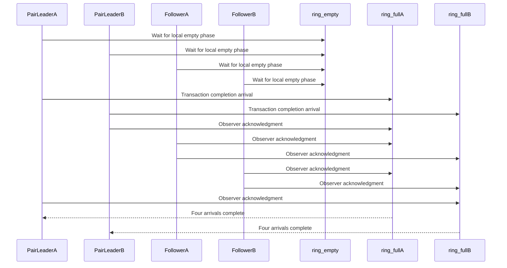

# Fix D512 backward shared-ring phase reuse on SM100 and SM107

[Upstream PR](https://github.com/NVIDIA/cudnn-frontend/pull/1521) · state: closed · merged: True

## Original PR description

A passive CTA in the shared K/V ring can be delayed before it observes its local empty-barrier phase. The other CTAs can recycle that slot before the observer catches up, so the parity wait can hang. Polling changes the wait instruction but does not supply the missing ordering.

Keep every CTA's empty wait and make each pair leader's full barrier count four arrivals: its own expect-tx arrival and one acknowledgment from each other CTA after that CTA observes empty. Both MMA consumers must therefore wait for all four observations before releasing the next empty phase. The nonshared K/V path, transfer byte counts, and ring drains retain their existing behavior. The SM107 sibling uses the same protocol with its eight-stage ring.

Regression coverage in this change:

- Replace the probabilistic backward test that required an old wait form to hang with a positive test that delays a passive observer at a reused slot, then checks gradients and CUDA Graph replay in a watchdogged child. Keep the existing natural contention test and diagnostic knobs.
- Update arrival ledgers and affected rendering records. Cover SM100 THD lowering structurally instead of pinning a byte hash: identical MLIR can produce different PTX under the same compiler build. Existing THD numerical and capture coverage stays in place.
- Disable the in-process compile memo in the existing SM107 compile-spy helper, which already disables the disk cache, so its uncached assertion is meaningful.

Validation: SDPA CI pipeline 72677712 completed successfully on `b2f5a79fc6e2d5d0b44b8cae29d40e162ea9533b`, with all 25 executed jobs passing, including the SM80, SM100, SM103, SM107 and SM120 lanes. Current-head reviews have no unresolved findings. This backward fix does not close the separate forward capture watchdog investigation associated with #1476. No dispatch or heuristic changes.

Fixes #1519.

## Review and discussion

### reviews

- vedaanta · APPROVED · 2026-10-09T12:48:29Z · [source](https://github.com/NVIDIA/cudnn-frontend/pull/1521#pullrequestreview-5470218742)

**Codex bot review · model: `gpt-6-astra`**

Reviewed `b2f5a79f` against parent `77804a0b`, with a clean integration check onto develop `2838e269`. No actionable findings. Traced the four-arrival full-barrier accounting, both consumer gates, uniform cluster trip counts, unchanged pair-local protocol and ring drains. Independently inspected emitted SM100/SM107 instructions: the successful empty-phase wait precedes the peer acknowledgments and leader expect-tx arrival.

Validation: 91 host/configuration tests passed; the new delayed-observer regression passed on both architectures, including reference gradients and eight poisoned-output graph replays. SM100 bitwise/SASS checks passed 9 tests; SM107 numerical, fork-equivalence, SASS and launch-count checks passed 24. Five SM100 ragged boundary cases and two additional forced-twin prepared length-rebinding/capture cases passed. The natural contention detector completed 100 launches on each architecture while another process loaded the GPU.

Repeated head/parent comparisons for B1/H8/D512 BF16, dense S512 and causal S2048, showed no material regression in CPU submission or GPU replay: approximately 99–101/567–570 us on SM100 and 46/147–148 us on SM107. These are focused measurements, not full performance qualification. SM100 used DSL 4.7; the SM107 compiler differs from CI. Finite stress passes supplement the ordering analysis and do not resolve the separate forward watchdog investigation.

Pipeline 72677712 is still running; CI remains pending.

<!-- codex-fe-review:github-only:vedaanta:1521:b2f5a79fc6e2d5d0b44b8cae29d40e162ea9533b:complete -->

- YangXu1990uiuc · COMMENTED · 2026-10-09T12:51:17Z · [source](https://github.com/NVIDIA/cudnn-frontend/pull/1521#pullrequestreview-5470247808)

**Codex bot review · model: `gpt-6-astra`**

Reviewed `b2f5a79fc6e2` against base `2838e2695fc4`.

No actionable findings. The ACK protocol addresses the actual phase-lifetime issue: each leader's full barrier requires its own expect-tx arrival plus the other three CTAs' post-wait acknowledgments, so both consumers and the next empty release follow all four observations. This matches the [PTX mbarrier phase requirement](https://docs.nvidia.com/cuda/archive/12.1.1/parallel-thread-execution/index.html#parallel-synchronization-and-communication-instructions-mbarrier-phase). Checked the generated SM100 PTX as well as source: all eight chunk waits precede their two predicated ACK sites, with full-barrier arrival count four. Keeping polling separate from this ordering fix, and replacing the probabilistic must-hang test with delayed-observer validation, makes sense. No blocker from this review; existing GPU CI remains pending. Milestone and project are now set.

Validation: SM100: 51 passed in the config/protocol, delayed-observer and six bitwise-versus-role-split cases. The delayed-observer case checks reference gradients and eight CUDA Graph replays. The dense/causal/SWA/bottom-right/GQA/FP16 comparisons checked intermediate S/dS and final gradients. Additional SM100 THD validation passed for one-sided empty sequences, GQA and bottom-right masking. All four prepared-THD length-rebinding/replay cases also passed with STAGE2_2X2 explicitly enabled and the served template asserted, so these checks exercised the affected twin. Three SM100 structural SASS cases passed, including THD. SM107: 13 selected dense delayed-observer/short-trip/non-tile/GQA/bottom-right cases passed, followed by eight THD empty/GQA/rebinding/replay cases. Source imports and the selected twin were checked. These are native execution results, separate from the disassembly limitation below. Bounded SM100 performance check, BF16 B1/D512 dense, H4/S1024 and H8/S2048, using parent/head stage-2 templates in the same current backward chain with interleaved warm measurements: median full-chain GPU replay 144.8 -> 145.1 us and 635.0 -> 637.7 us; CPU enqueue 24.9 -> 25.0 us and 29.2 -> 28.9 us. Outputs remained bitwise identical after timing. No material regression in these two cases; this is a 68-SM device spot check, not a B200 qualification or serving benchmark.

Limitations: Existing current-head pipeline 72677712 is still running; no duplicate CI requested. I did not repeat the long natural two-process contention campaign or deliberately wedge the shared GPU with the old delayed-observer kernel. The native positive tests and generated-code inspection support this fix without claiming exhaustive liveness proof. The SM107 structural probes compiled, but their two SASS assertions skipped because the available nvdisasm could not decode SM107a. SM100 DSL 4.7 also skipped the two SM107 compile targets; neither skip is counted as passing coverage. SM107 runtime cases above did run.

Comment only: GitHub does not allow reviewing one's own PR with approval/request-changes.

<!-- codex-fe-review:v2:1521:b2f5a79fc6e2d5d0b44b8cae29d40e162ea9533b:complete:no-blocker -->

### issue_comments

- coderabbitai[bot] · comment · 2026-10-09T12:15:25Z · [source](https://github.com/NVIDIA/cudnn-frontend/pull/1521#issuecomment-6080677777)

<!-- This is an auto-generated comment: summarize by coderabbit.ai -->
<!-- review_stack_entry_start -->

<!-- review_stack_entry_end -->
<!-- recent_review_start -->

No actionable comments were generated in the recent review. 🎉

ℹ️ Recent review info

⚙️ Run configuration

- **Configuration used**: Repository: NVIDIA/cudnn-frontend/.coderabbit.yaml
- **Review profile**: CHILL
- **Plan**: Enterprise
- **Run ID**: `84f858c3-23a3-4b04-873a-db7634ae7ab6`

📥 Commits

Reviewing files that changed from the base of the PR and between 2838e2695fc494ff73faf0bb72efd44c1df4b0a4 and b2f5a79fc6e2d5d0b44b8cae29d40e162ea9533b.

📒 Files selected for processing (9)

* `python/cudnn/sdpa/AGENTS.md`
* `python/cudnn/sdpa/bwd/kernels/sm100/bprop_d512_f16_2x2.py`
* `python/cudnn/sdpa/bwd/kernels/sm107/bprop_d512_f16_2x2.py`
* `test/python/sdpa/frost/frost_test_utils.py`
* `test/python/sdpa/frost/renderings/md5_stage2_2x2_sm100a.txt`
* `test/python/sdpa/frost/renderings/md5_stage2_2x2_sm107a.txt`
* `test/python/sdpa/frost/test_sdpa_bwd_config_sm100_2x2.py`
* `test/python/sdpa/frost/test_sdpa_bwd_d512_sm107.py`
* `test/python/sdpa/frost/test_sdpa_bwd_dsl_sm100.py`

**Included review availability:** This review used your included allowance. Your plan provides up to 12 included reviews per hour; 11 remain after this review.

---

<!-- recent_review_end -->
<!-- walkthrough_start -->

📝 Walkthrough

## Walkthrough

The SM100 and SM107 D512 backward kernels now require four arrivals at each shared-KV ring barrier. New delayed-observer tests check gradient results and CUDA graph replays. Rendering and SASS checks are updated to cover the protocol and relevant kernels.

### Changes

**D512 shared-ring protocol and validation**

|Layer / File(s)|Summary|
|:---|:---|
|**Shared-ring acknowledgment protocol**   `python/cudnn/sdpa/bwd/kernels/sm100/bprop_d512_f16_2x2.py`, `python/cudnn/sdpa/bwd/kernels/sm107/bprop_d512_f16_2x2.py`, `python/cudnn/sdpa/AGENTS.md`|In shared-KV mode, each `ring_full` barrier counts the leader’s transaction arrival and acknowledgments from the other CTAs after they observe their local `ring_empty` phase. Pair-local mode retains its existing protocol. The guidance and kernel notes describe the phase-lifetime requirement and distinguish it from cross-pair polling.|
|**Delayed-observer regression**   `test/python/sdpa/frost/frost_test_utils.py`, `test/python/sdpa/frost/test_sdpa_bwd_config_sm100_2x2.py`, `test/python/sdpa/frost/test_sdpa_bwd_d512_sm107.py`, `test/python/sdpa/frost/test_sdpa_bwd_dsl_sm100.py`|A subprocess test delays a passive CTA, checks `dq`, `dk`, and `dv`, and repeats the checks across eight CUDA graph replays. SM100 and SM107 tests call the regression, and barrier-count expectations use `CGA_M`.|
|**Rendering and SASS validation**   `test/python/sdpa/frost/test_sdpa_bwd_dsl_sm100.py`, `test/python/sdpa/frost/test_sdpa_bwd_d512_sm107.py`, `test/python/sdpa/frost/renderings/md5_stage2_2x2_*.txt`|The SASS probe counts instructions from the main stage-2 kernel section and adds SM100 THD coverage. THD PTX hashes are removed; the rendering records are refreshed for the protocol changes.|

<!-- change_assessment_start -->
**Priority:** ➖ Normal

**Estimated code review effort:** 3 (Moderate) | ~25 minutes

<!-- change_assessment_commit:"b2f5a79fc6e2d5d0b44b8cae29d40e162ea9533b" -->
**Change:** Bug fix · **Severity of issue fixed:** Medium
<!-- change_assessment_end -->

### Sequence Diagram(s)

**Suggested reviewers:** `vedaanta`

<!-- walkthrough_end -->
<!-- final_review_risk_start -->
**Merge Risk:** **⚪ Minimal** · up to `b2f5a`
<!-- final_review_risk_coverage:{"sourceCommitId":"b2f5a79fc6e2d5d0b44b8cae29d40e162ea9533b","coveredCommitId":"b2f5a79fc6e2d5d0b44b8cae29d40e162ea9533b","kind":"reviewed"} -->

No actionable merge-blocking issue was identified. Complete the requested SDPA CI run before merging.
<!-- final_review_risk_end -->
<!-- pre_merge_checks_walkthrough_start -->

🚥 Pre-merge checks | ✅ 5

✅ Passed checks (5 passed)

|         Check name         |                                             Status                                             | Explanation                                                                                                                                                                                               |
| :------------------------ | :--------------------------------------------------------------------------------------------: | :-------------------------------------------------------------------------------------------------------------------------------------------------------------------------------------------------------- |
|     Linked Issues check    |  | The PR addresses the coding requirements in `#1519`. The SM100 and SM107 shared-ring paths now require acknowledgments from all four CTAs before slot reuse. Both consumers wait for all observations. The… |
| Out of Scope Changes check |  | The changes remain within `#1519`. Kernel protocol updates, source ledgers, rendering records, structural SM100 THD coverage, the delayed-observer utility, and the SM107 compile-cache test change suppor… |
|     Docstring Coverage     |  | Docstring coverage is 87.50% which is sufficient. The required threshold is 80.00%. Docstring coverage is scoped to functions touched by this diff. Analyzed 16 functions across 6 files. (3 skipped: 3 … |
|      Description check     |  | The description clearly explains the phase-reuse issue, protocol fix, regression coverage, compatibility impact, testing results, and related issue. It does not include the template headings or checkl… |
|         Title check        |  | The title clearly and concisely identifies the D512 backward shared-ring phase-reuse fix and names both affected architectures, SM100 and SM107.                                                          |

<!-- pre_merge_checks_walkthrough_end -->
<!-- finishing_touch_checkbox_start -->

✨ Finishing Touches 💡 1

<!-- finishing_touch_suggestion:fix_ci -->

🛠️ Fix failing CI checks 💡

- [ ] <!-- {"checkboxId": "9f0d24fb-b419-4f01-baf0-8b26b6424f34", "radioGroupId": "fix-ci-output-choice-group-unknown_comment_id"} --> Commit to this branch
- [ ] <!-- {"checkboxId": "6d21cfe8-ec3f-40e2-9222-b8318b64d3b0", "radioGroupId": "fix-ci-output-choice-group-unknown_comment_id"} --> Create a new PR

🧪 Generate unit tests (beta)

- [ ] <!-- {"checkboxId": "f47ac10b-58cc-4372-a567-0e02b2c3d479", "radioGroupId": "utg-output-choice-group-unknown_comment_id"} --> Create a new PR

<!-- finishing_touch_checkbox_end -->

<!-- autopilot:start -->
- [ ] <!-- {"checkboxId":"2708ad07-9f24-4260-9c11-7dc76a49f2e3"} --> <strong title="Keep fixing CodeRabbit findings and required CI, and resolving merge conflicts">Autofix</strong> · Keep fixing CodeRabbit findings and required CI, and resolving merge conflicts
<!-- autopilot:end -->
<!-- tips_start -->

---

Comment `@coderabbitai help` to get the list of available commands.

<!-- tips_end -->

- YangXu1990uiuc · comment · 2026-10-09T12:16:28Z · [source](https://github.com/NVIDIA/cudnn-frontend/pull/1521#issuecomment-6080693635)

@cudnn-ci-bot run python/sdpa/frost

- cudnn-ci-bot · comment · 2026-10-09T12:16:32Z · [source](https://github.com/NVIDIA/cudnn-frontend/pull/1521#issuecomment-6080694679)

🏁 Pipeline finished

SHA: `9f48315`
Targets: `python/sdpa/frost`
Branch: [cudnn-gh/pr-1521-9f48315](https://nv/cudnn-gitlab-ci/-/tree/cudnn-gh/pr-1521-9f48315)
Pipeline: [72676220](https://nv/cudnn-gitlab-ci/-/pipelines/72676220)
Last updated: 2026-10-09 12:29 UTC

**10 passed, 15 canceled, 3 skipped, 11 manual**

### <code>manual</code>

- <code>manual:python_samples</code> - Manual
- <code>manual:python</code> - Manual
- <code>manual:python/sdpa/frost</code> - ✅ Passed
- <code>manual:python/linear_attention/frost</code> - Manual
- <code>manual:python/gemm/frost</code> - Manual
- <code>manual:python/*/frost</code> - Manual
- <code>manual:python/gemm/cutedsl</code> - Manual
- <code>manual:python/*/cutedsl</code> - Manual
- <code>manual:python/*/jax</code> - Manual
- <code>manual:pycudnn</code> - Manual
- <code>manual:multi_gpu</code> - Manual
- <code>manual:backend</code> - Manual

### <code>analysis</code>

- <code>analysis:cudnn_clang_disable_exception</code> - ✅ Passed
- <code>analysis:cudnn_v9_no_half_conversion</code> - ✅ Passed
- <code>analysis:cudnn_clang</code> - ✅ Passed
- <code>analysis:check-relative-includes</code> - ✅ Passed
- <code>analysis:check-CUDNN_FRONTEND_SKIP_JSON_LIB</code> - ✅ Passed
- <code>analysis:guardwords_scan</code> - ✅ Passed
- <code>analysis:jax-import-guard</code> - Canceled
- <code>analysis:pytest-gpu</code> - ✅ Passed
- <code>san:build</code> - Canceled

### <code>build</code>

- <code>analysis:api_index</code> - Canceled
- <code>build:dev:linux:amd64</code> - Canceled
- <code>build:rel:linux:amd64</code> - Canceled
- <code>build:dev:linux:arm64</code> - ✅ Passed
- <code>build:rel:linux:arm64</code> - ✅ Passed
- <code>build:rel:win:amd64</code> - Canceled

### <code>frost_tests</code>

- <code>python/sdpa/frost:cutlass-rel:sm80</code> - Canceled
- <code>python/sdpa/frost:cutlass-rel:sm100</code> - Canceled
- <code>python/sdpa/frost:cutlass-rel:sm120</code> - Canceled
- <code>python/linear_attention/frost:cutlass-rel:sm100</code> - Skipped
- <code>python/gemm/frost:cutlass-rel:sm100</code> - Skipped
- <code>python/*/frost:cutlass-rel:sm100</code> - Skipped
- <code>python/sdpa/frost:cutlass-rel:sm103</code> - Canceled
- <code>python/sdpa/frost:cutlass-4.8:sm107</code> - Canceled

### <code>sanitizer_tests</code>

- <code>san:cpp_test:sm80</code> - Canceled
- <code>san:cpp_test:sm90</code> - Canceled
- <code>san:cpp_test:sm100</code> - Canceled

### <code>triage</code>

- <code>triage:ai</code> - Canceled

- YangXu1990uiuc · comment · 2026-10-09T12:23:17Z · [source](https://github.com/NVIDIA/cudnn-frontend/pull/1521#issuecomment-6080799384)

@cudnn-ci-bot run python/sdpa/frost

- cudnn-ci-bot · comment · 2026-10-09T12:28:17Z · [source](https://github.com/NVIDIA/cudnn-frontend/pull/1521#issuecomment-6080884079)

🏁 Pipeline finished

SHA: `b2f5a79`
Targets: `python/sdpa/frost`
Branch: [cudnn-gh/pr-1521-b2f5a79](https://nv/cudnn-gitlab-ci/-/tree/cudnn-gh/pr-1521-b2f5a79)
Pipeline: [72677712](https://nv/cudnn-gitlab-ci/-/pipelines/72677712)
Last updated: 2026-10-09 13:57 UTC

**25 passed, 3 skipped, 11 manual**

### <code>manual</code>

- <code>manual:python_samples</code> - Manual
- <code>manual:python</code> - Manual
- <code>manual:python/linear_attention/frost</code> - Manual
- <code>manual:python/gemm/frost</code> - Manual
- <code>manual:python/*/frost</code> - Manual
- <code>manual:python/gemm/cutedsl</code> - Manual
- <code>manual:python/*/cutedsl</code> - Manual
- <code>manual:python/*/jax</code> - Manual
- <code>manual:pycudnn</code> - Manual
- <code>manual:multi_gpu</code> - Manual
- <code>manual:backend</code> - Manual
- <code>manual:python/sdpa/frost</code> - ✅ Passed

### <code>analysis</code>

- <code>analysis:cudnn_clang_disable_exception</code> - ✅ Passed
- <code>analysis:cudnn_v9_no_half_conversion</code> - ✅ Passed
- <code>analysis:cudnn_clang</code> - ✅ Passed
- <code>analysis:check-relative-includes</code> - ✅ Passed
- <code>analysis:check-CUDNN_FRONTEND_SKIP_JSON_LIB</code> - ✅ Passed
- <code>analysis:guardwords_scan</code> - ✅ Passed
- <code>analysis:jax-import-guard</code> - ✅ Passed
- <code>analysis:pytest-gpu</code> - ✅ Passed
- <code>san:build</code> - ✅ Passed

### <code>build</code>

- <code>analysis:api_index</code> - ✅ Passed
- <code>build:dev:linux:amd64</code> - ✅ Passed
- <code>build:rel:linux:amd64</code> - ✅ Passed
- <code>build:dev:linux:arm64</code> - ✅ Passed
- <code>build:rel:linux:arm64</code> - ✅ Passed
- <code>build:rel:win:amd64</code> - ✅ Passed

### <code>frost_tests</code>

- <code>python/sdpa/frost:cutlass-rel:sm80</code> - ✅ Passed
- <code>python/sdpa/frost:cutlass-rel:sm100</code> - ✅ Passed
- <code>python/sdpa/frost:cutlass-rel:sm120</code> - ✅ Passed
- <code>python/linear_attention/frost:cutlass-rel:sm100</code> - Skipped
- <code>python/gemm/frost:cutlass-rel:sm100</code> - Skipped
- <code>python/*/frost:cutlass-rel:sm100</code> - Skipped
- <code>python/sdpa/frost:cutlass-rel:sm103</code> - ✅ Passed
- <code>python/sdpa/frost:cutlass-4.8:sm107</code> - ✅ Passed

### <code>sanitizer_tests</code>

- <code>san:cpp_test:sm80</code> - ✅ Passed
- <code>san:cpp_test:sm90</code> - ✅ Passed
- <code>san:cpp_test:sm100</code> - ✅ Passed

### <code>triage</code>

- <code>triage:ai</code> - ✅ Passed

- YangXu1990uiuc · comment · 2026-10-09T12:38:50Z · [source](https://github.com/NVIDIA/cudnn-frontend/pull/1521#issuecomment-6081054556)

This fix is now ready for review. @Anerudhan, could you assign the appropriate Milestone and Project when available? The merge-requirements check currently reports both fields missing; the repository guide reserves these assignments for maintainers, so I have left them unchanged. Review and GPU CI still need to complete before merge.

### inline_comments

## Changed files and fixed code

- `python/cudnn/sdpa/AGENTS.md` · modified · additions 30 / deletions 41
  - [head](https://github.com/YangXu1990uiuc/cudnn-frontend/blob/b2f5a79fc6e2d5d0b44b8cae29d40e162ea9533b/python/cudnn/sdpa/AGENTS.md)
  - [base](https://github.com/NVIDIA/cudnn-frontend/blob/2838e2695fc494ff73faf0bb72efd44c1df4b0a4/python/cudnn/sdpa/AGENTS.md)
- `python/cudnn/sdpa/bwd/kernels/sm100/bprop_d512_f16_2x2.py` · modified · additions 48 / deletions 34
  - [head](https://github.com/YangXu1990uiuc/cudnn-frontend/blob/b2f5a79fc6e2d5d0b44b8cae29d40e162ea9533b/python/cudnn/sdpa/bwd/kernels/sm100/bprop_d512_f16_2x2.py)
  - [base](https://github.com/NVIDIA/cudnn-frontend/blob/2838e2695fc494ff73faf0bb72efd44c1df4b0a4/python/cudnn/sdpa/bwd/kernels/sm100/bprop_d512_f16_2x2.py)
- `python/cudnn/sdpa/bwd/kernels/sm107/bprop_d512_f16_2x2.py` · modified · additions 48 / deletions 34
  - [head](https://github.com/YangXu1990uiuc/cudnn-frontend/blob/b2f5a79fc6e2d5d0b44b8cae29d40e162ea9533b/python/cudnn/sdpa/bwd/kernels/sm107/bprop_d512_f16_2x2.py)
  - [base](https://github.com/NVIDIA/cudnn-frontend/blob/2838e2695fc494ff73faf0bb72efd44c1df4b0a4/python/cudnn/sdpa/bwd/kernels/sm107/bprop_d512_f16_2x2.py)
- `test/python/sdpa/frost/frost_test_utils.py` · modified · additions 110 / deletions 0
  - [head](https://github.com/YangXu1990uiuc/cudnn-frontend/blob/b2f5a79fc6e2d5d0b44b8cae29d40e162ea9533b/test/python/sdpa/frost/frost_test_utils.py)
  - [base](https://github.com/NVIDIA/cudnn-frontend/blob/2838e2695fc494ff73faf0bb72efd44c1df4b0a4/test/python/sdpa/frost/frost_test_utils.py)
- `test/python/sdpa/frost/renderings/md5_stage2_2x2_sm100a.txt` · modified · additions 7 / deletions 13
  - [head](https://github.com/YangXu1990uiuc/cudnn-frontend/blob/b2f5a79fc6e2d5d0b44b8cae29d40e162ea9533b/test/python/sdpa/frost/renderings/md5_stage2_2x2_sm100a.txt)
  - [base](https://github.com/NVIDIA/cudnn-frontend/blob/2838e2695fc494ff73faf0bb72efd44c1df4b0a4/test/python/sdpa/frost/renderings/md5_stage2_2x2_sm100a.txt)
- `test/python/sdpa/frost/renderings/md5_stage2_2x2_sm107a.txt` · modified · additions 7 / deletions 15
  - [head](https://github.com/YangXu1990uiuc/cudnn-frontend/blob/b2f5a79fc6e2d5d0b44b8cae29d40e162ea9533b/test/python/sdpa/frost/renderings/md5_stage2_2x2_sm107a.txt)
  - [base](https://github.com/NVIDIA/cudnn-frontend/blob/2838e2695fc494ff73faf0bb72efd44c1df4b0a4/test/python/sdpa/frost/renderings/md5_stage2_2x2_sm107a.txt)
- `test/python/sdpa/frost/test_sdpa_bwd_config_sm100_2x2.py` · modified · additions 2 / deletions 2
  - [head](https://github.com/YangXu1990uiuc/cudnn-frontend/blob/b2f5a79fc6e2d5d0b44b8cae29d40e162ea9533b/test/python/sdpa/frost/test_sdpa_bwd_config_sm100_2x2.py)
  - [base](https://github.com/NVIDIA/cudnn-frontend/blob/2838e2695fc494ff73faf0bb72efd44c1df4b0a4/test/python/sdpa/frost/test_sdpa_bwd_config_sm100_2x2.py)
- `test/python/sdpa/frost/test_sdpa_bwd_d512_sm107.py` · modified · additions 13 / deletions 3
  - [head](https://github.com/YangXu1990uiuc/cudnn-frontend/blob/b2f5a79fc6e2d5d0b44b8cae29d40e162ea9533b/test/python/sdpa/frost/test_sdpa_bwd_d512_sm107.py)
  - [base](https://github.com/NVIDIA/cudnn-frontend/blob/2838e2695fc494ff73faf0bb72efd44c1df4b0a4/test/python/sdpa/frost/test_sdpa_bwd_d512_sm107.py)
- `test/python/sdpa/frost/test_sdpa_bwd_dsl_sm100.py` · modified · additions 27 / deletions 21
  - [head](https://github.com/YangXu1990uiuc/cudnn-frontend/blob/b2f5a79fc6e2d5d0b44b8cae29d40e162ea9533b/test/python/sdpa/frost/test_sdpa_bwd_dsl_sm100.py)
  - [base](https://github.com/NVIDIA/cudnn-frontend/blob/2838e2695fc494ff73faf0bb72efd44c1df4b0a4/test/python/sdpa/frost/test_sdpa_bwd_dsl_sm100.py)

## Evidence and interpretation boundary

[Original JSON, discussions and patches](../../../../../../evidence/prs/NVIDIA--cudnn-frontend/1521-801ca01f10410db32fae7f7f6584cf3ea63e8d3dcfcefe8d2a524e26db77c20c.json) · SHA-256 `801ca01f10410db32fae7f7f6584cf3ea63e8d3dcfcefe8d2a524e26db77c20c`.

Diff complete: True. Missing/binary/truncated patches require pinned source inspection. This is a source page, not an independently verified optimization case. Open, merged and released are different states; recheck the deployed dependency.
