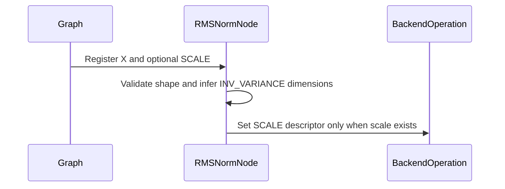

# [Auto-FE] norms: optional RMSNorm scale (#188); Python graph stats dims match the C++ node

[Upstream PR](https://github.com/NVIDIA/cudnn-frontend/pull/1542) · state: closed · merged: True

## Original PR description

## Before submitting

- [ ] I agree to license this contribution under the terms of [LICENSE.txt](https://github.com/NVIDIA/cudnn-frontend/blob/develop/LICENSE.txt).
- [x] I ran `pre-commit run` and committed any formatting changes.
- [x] I reviewed the Hard Rules in the `AGENTS.md` for each directory this PR touches (see [root AGENTS.md § Reviewing a PR](https://github.com/NVIDIA/cudnn-frontend/blob/develop/AGENTS.md#reviewing-a-pr-human-or-agent)) and my changes comply, or I explain the exception below.
- [x] I added GitHub labels: one `cat-*`, one or more `area:*` / `op:*`, and one `orig-*` (see [label list](https://github.com/NVIDIA/cudnn-frontend/labels)).

## Affected area

C++ frontend API or graph construction; Python API or bindings

## Summary

1. **RMSNorm forward: `scale` is optional (#188).**
   - `Graph::rmsnorm(x, nullptr, attrs)` keeps the null scale out of the node's inputs map. The node sets `CUDNN_ATTR_OPERATION_NORM_FWD_SCALE_DESC` only when a scale is present.
   - The pybind `rmsnorm` defaults `scale=None`. The Python graph's lowering omits absent ports, so it needs that default.
2. **No-scale axis contract.** Without a scale, the node accepts a graph only when the normalization axes are unambiguous:
   - `x` has at most one non-unit dim after the first; or
   - in training, the caller set the `INV_VARIANCE` dims.

   Anything else returns `INVALID_VALUE` with a message saying what to do. Documented in `docs/operations/Normalizations.md`.
3. **Python graph: forward-norm stats dims after `validate()` now match the C++ node.** That rule is: input dims, with 1 wherever the scale is not 1. adalayernorm keeps the batch axis, as its C++ node does.
   - Previously rmsnorm, layernorm and adalayernorm reported stats with only axis 0 kept. For `x = {B,S,H}` and `scale = {1,1,H}` that meant `{B,1,1}`, while the kernel writes `B*S` values.
   - These dims are refreshed from C++ at `build_operation_graph()`. So the wrong value is visible only between `validate()` and build, but anything allocated from it in that window is overrun `S`-fold.

## Why

- **Training crash.** Before this change, `rmsnorm(x, nullptr)` in TRAINING crashed with SIGSEGV: `infer_properties_node` dereferenced the null scale. In INFERENCE it failed with "Tensor SCALE not set". The backend itself accepts a null scale.
- **Why the contract is needed.** Without a scale, the backend still has to pick the normalization axes, and it picks them differently for inference and training. Measured with a standalone probe on B200, H100 and A100 (cuDNN 9.27):

  | x | phase | axes the backend normalized over |
  |---|---|---|
  | `{N,H,1,1}` | inference / training | H; identical to scale = 1 |
  | `{B,S,H}` | inference | H only |
  | `{B,S,H}` | training, FE-inferred `INV_VARIANCE` `{B,1,1}` | S and H |
  | `{B,S,H}` | training, `INV_VARIANCE` `{B,S,1}` set | H only |
  | `{2,3,4,32}` | inference | all non-batch dims |

  So the same `{B,S,H}` graph would normalize over different axes in inference and in training. Refusing that case is safer than picking one.
- **Python stats dims.** Measured with a NaN guard band behind an inv_var buffer sized from the `{B,1,1}` dims (B=2, S=8): the kernel wrote all 16 rows, 14 of them past the buffer. The new test fails on develop with `[2, 1, 1] == [2, 8, 1]` for both rmsnorm and layernorm.

## Related issues

Part of #188. This covers the RMSNorm forward, which is the line the issue links. The layernorm forward still requires `scale` and `bias` (a null `bias` is also dereferenced in its `infer_properties_node`), and the norm backwards are unchanged, so #188 stays open for those.

## API and compatibility impact

- **Additive only.** `scale` gains a default in the Python binding. The signature order is unchanged.
- **No change for graphs with a scale**, except the corrected Python stats dims after `validate()`.
- **Backend versions:**
  - The no-scale path was verified on Hopper with cuDNN 9.20 / 9.24 / 9.27, and on Ampere and Blackwell with 9.27.
  - cuDNN 9.10 and 9.0 could not be qualified here: in this CUDA 13.2 environment even the with-scale control fails on them. A backend that rejects a null scale surfaces as an ordinary "no valid engine configs" error.

## Testing

| Where | Command | Result |
|---|---|---|
| C++ samples, cuDNN 9.27 | `samples "[rmsnorm]"` (adds "RmsNorm Training without scale", checked against a CPU reference) | B200: 6/6 passed; H100, A100: 4 passed / 2 skipped |
| C++ tests, cuDNN 9.27 | `tests "[validate]"` (adds "Rmsnorm forward without scale", host-only) | 7/7 passed |
| Python, B200, rebuilt extension | `pytest -m "L0 or L1 or L2 or L3 or L4" -n 6 norm/graph` | 5176 passed, 1 failed |
| Python, develop | the new `test_norm_forward_inferred_stats_dims_cover_what_the_kernel_writes[rmsnorm,layernorm]` | both fail, as expected |
| Python, this branch | the same test | both pass |

- The one failure in the full `norm/graph` run is `test_sm100_rms_norm_silu_graph_api.py::test_stream_captured_graph_outlives_the_cudnn_graph`, with "OSS RmsNorm+SiLU engine not built". It fails identically on develop in this environment.
- The sm100 RmsNorm+SiLU OSS matcher still requires a scale. For a no-scale graph it logs "No OSS engine matched" and the regular engine runs.

note to self: claude::fb66556f-59ca-4f79-8a53-539948bcd387 — "Cudnn fe autonomous evolution" · cwd /home/scratch.yanxu_libs/cudnn_frontend · workspace /home/scratch.yanxu_gpu/fe-autonomous-pipeline-20261002 (evidence/norm188)

🤖 Generated with [Claude Code](https://claude.com/claude-code)

<!-- This is an auto-generated comment: release notes by coderabbit.ai -->

## Summary by CodeRabbit

* **New Features**
  * RMSNorm can now be used without a scale tensor in C++ and Python. Training still provides inverse variance, with shape restrictions for scale-free inputs.
  * Normalization statistics dimensions are inferred from the input and scale shapes.
* **Documentation**
  * Added guidance on RMSNorm without a scale tensor, including shape requirements and training behavior.

<!-- end of auto-generated comment: release notes by coderabbit.ai -->

## Review and discussion

### reviews

- vedaanta · APPROVED · 2026-10-09T22:26:33Z · [source](https://github.com/NVIDIA/cudnn-frontend/pull/1542#pullrequestreview-5475913334)

**Codex bot review · model: `gpt-6-astra`**

Reviewed all eight changed files at `fe312b79a9e4`. No actionable finding. Checked optional-scale lowering through the Python and C++ APIs, the ambiguity guard, preservation of explicitly assigned statistics dimensions, and the different batch-axis rule for adaptive LayerNorm. Python's inferred dimensions are not pushed back as user-assigned dimensions, so they do not bypass the C++ ambiguity guard. Current-develop integration is clean.

Independent validation on SM100 with cuDNN 9.27 and a freshly built native extension: **33 RMSNorm/LayerNorm tests passed**, plus **9 additional controls passed**. Those controls cover omitted-scale calls, both ambiguous-phase refusals, explicitly specified last-axis and multi-axis statistics, retained capture with three changed-input replays, and RMSNorm/LayerNorm/adaptive-LayerNorm output and statistics checks with guarded allocations.

The no-scale-plus-bias combination still receives an explicit backend rejection on this backend; it is not a served combination. I did not independently qualify older backends or run the C++ sample executables. The current-head numerical CI is still running.

<!-- codex-fe-review:github-only:vedaanta:1542:fe312b79a9e4ec1007ffb4da6f902d45fadd7d78:complete -->

### issue_comments

- YangXu1990uiuc · comment · 2026-10-09T22:11:19Z · [source](https://github.com/NVIDIA/cudnn-frontend/pull/1542#issuecomment-6090103298)

@cudnn-ci-bot run python_tests

- cudnn-ci-bot · comment · 2026-10-09T22:11:22Z · [source](https://github.com/NVIDIA/cudnn-frontend/pull/1542#issuecomment-6090103994)

🏁 Pipeline finished

SHA: `fe312b7`
Targets: `python_tests`
Branch: [cudnn-gh/pr-1542-fe312b7](https://nv/cudnn-gitlab-ci/-/tree/cudnn-gh/pr-1542-fe312b7)
Pipeline: [72781706](https://nv/cudnn-gitlab-ci/-/pipelines/72781706)
Last updated: 2026-10-09 22:47 UTC

**20 passed, 6 failed, 11 manual**

### <code>manual</code>

- <code>manual:python_samples</code> - Manual
- <code>manual:python</code> - ✅ Passed
- <code>manual:python/sdpa/frost</code> - Manual
- <code>manual:python/linear_attention/frost</code> - Manual
- <code>manual:python/gemm/frost</code> - Manual
- <code>manual:python/*/frost</code> - Manual
- <code>manual:python/gemm/cutedsl</code> - Manual
- <code>manual:python/*/cutedsl</code> - Manual
- <code>manual:python/*/jax</code> - Manual
- <code>manual:pycudnn</code> - Manual
- <code>manual:multi_gpu</code> - Manual
- <code>manual:backend</code> - Manual

### <code>analysis</code>

- <code>analysis:cudnn_clang_disable_exception</code> - ✅ Passed
- <code>analysis:cudnn_v9_no_half_conversion</code> - ✅ Passed
- <code>analysis:cudnn_clang</code> - ✅ Passed
- <code>analysis:check-relative-includes</code> - ✅ Passed
- <code>analysis:check-CUDNN_FRONTEND_SKIP_JSON_LIB</code> - ✅ Passed
- <code>analysis:guardwords_scan</code> - ✅ Passed
- <code>analysis:jax-import-guard</code> - ✅ Passed
- <code>analysis:pytest-gpu</code> - ✅ Passed
- <code>san:build</code> - ✅ Passed

### <code>build</code>

- <code>analysis:api_index</code> - ✅ Passed
- <code>build:dev:linux:amd64</code> - ✅ Passed
- <code>build:rel:linux:amd64</code> - ✅ Passed
- <code>build:dev:linux:arm64</code> - ✅ Passed
- <code>build:rel:linux:arm64</code> - ✅ Passed
- <code>build:rel:win:amd64</code> - ✅ Passed

### <code>python_tests</code>

- <code>python:dev:sm80</code> - ❌ **New Failure!** (nightly passed)
- <code>python:dev:sm90</code> - ❌ **New Failure!** (nightly passed)
- <code>python:dev:sm100</code> - ❌ **New Failure!** (nightly passed)
- <code>python:rel:sm80</code> - ❌ **New Failure!** (nightly passed)
- <code>python:rel:sm90</code> - ❌ **New Failure!** (nightly passed)
- <code>python:rel:sm100</code> - ❌ **New Failure!** (nightly passed)

### <code>sanitizer_tests</code>

- <code>san:cpp_test:sm80</code> - ✅ Passed
- <code>san:cpp_test:sm90</code> - ✅ Passed
- <code>san:cpp_test:sm100</code> - ✅ Passed

### <code>triage</code>

- <code>triage:ai</code> - ✅ Passed

- coderabbitai · comment · 2026-10-09T22:11:37Z · [source](https://github.com/NVIDIA/cudnn-frontend/pull/1542#issuecomment-6090107059)

<!-- This is an auto-generated comment: summarize by coderabbit.ai -->
<!-- review_stack_entry_start -->

<!-- review_stack_entry_end -->
<!-- recent_review_start -->

No actionable comments were generated in the recent review. 🎉

ℹ️ Recent review info

⚙️ Run configuration

- **Configuration used**: Repository: NVIDIA/cudnn-frontend/.coderabbit.yaml
- **Review profile**: CHILL
- **Plan**: Enterprise
- **Run ID**: `69e13e6e-18cd-42b2-8f54-83b3f4c66512`

📥 Commits

Reviewing files that changed from the base of the PR and between 5666b7974c953a034831bfdca1c67861b58b8060 and fe312b79a9e4ec1007ffb4da6f902d45fadd7d78.

📒 Files selected for processing (8)

* `docs/operations/Normalizations.md`
* `include/cudnn_frontend/graph_interface.h`
* `include/cudnn_frontend/node/rmsnorm.h`
* `python/cudnn/_pygraph.py`
* `python/pygraph/norm.cpp`
* `samples/cpp/norm/rmsnorm.cpp`
* `test/cpp/validate.cpp`
* `test/python/norm/graph/test_rmsnorm.py`

**Included review availability:** This review used your included allowance. Your plan provides up to 12 included reviews per hour; 10 remain after this review.

---

<!-- recent_review_end -->
<!-- walkthrough_start -->

📝 Walkthrough

## Walkthrough

RMSNorm graph APIs now accept a missing scale. Shape validation and statistics-dimension inference handle scale-free inputs. Python normalization statistics inference also uses scale dimensions. C++ and Python tests cover these behaviors.

### Changes

**Optional RMSNorm Scale**

|Layer / File(s)|Summary|
|:---|:---|
|**Optional-scale RMSNorm execution**   `include/cudnn_frontend/graph_interface.h`, `include/cudnn_frontend/node/rmsnorm.h`, `python/pygraph/norm.cpp`, `docs/operations/Normalizations.md`|The graph API omits `SCALE` when its tensor is null. RMSNorm handles a missing scale during inference, validation, and backend operation creation. The Python binding defaults `scale` to `None`, and the documentation describes scale-free shape restrictions.|
|**Normalization statistics shape inference**   `python/cudnn/_pygraph.py`|Layernorm and RMSNorm infer statistics dimensions from axis 0. Adaptive layernorm uses axis 1. The inference uses scale dimensions when a scale is present.|
|**Optional-scale behavior coverage**   `test/cpp/validate.cpp`, `samples/cpp/norm/rmsnorm.cpp`, `test/python/norm/graph/test_rmsnorm.py`|C++ and Python tests cover scale-free shape validation, inferred statistics dimensions, and RMSNorm results. Python tests also check scale-aware statistics dimensions and buffer guard regions.|

<!-- change_assessment_start -->
**Priority:** ➖ Normal

**Estimated code review effort:** 3 (Moderate) | ~20 minutes

<!-- change_assessment_commit:"fe312b79a9e4ec1007ffb4da6f902d45fadd7d78" -->
**Change:** Bug fix · **Severity of issue fixed:** Low
<!-- change_assessment_end -->

### Sequence Diagram(s)

**Suggested reviewers:** `anerudhan`

<!-- walkthrough_end -->
<!-- final_review_risk_start -->
**Merge Risk:** **⚪ Minimal** · up to `fe312`
<!-- final_review_risk_coverage:{"sourceCommitId":"fe312b79a9e4ec1007ffb4da6f902d45fadd7d78","coveredCommitId":"fe312b79a9e4ec1007ffb4da6f902d45fadd7d78","kind":"reviewed"} -->

No demonstrated issue currently blocks merging. The behavior of scale-free RMSNorm for {B,S,1} remains unverified.
<!-- final_review_risk_end -->
<!-- pre_merge_checks_walkthrough_start -->

Pre-merge checks | <picture></picture> 4 | <picture></picture> 1

### ❌ Failed checks (1 warning)

|     Check name     |                                              Status                                              | Explanation                                                                                                                                                                                               | Resolution                                                                         |
| :---------------- | :----------------------------------------------------------------------------------------------: | :-------------------------------------------------------------------------------------------------------------------------------------------------------------------------------------------------------- | :--------------------------------------------------------------------------------- |
| Docstring Coverage |  | Docstring coverage is 26.67% which is insufficient. The required threshold is 80.00%. Docstring coverage is scoped to functions touched by this diff. Analyzed 15 functions across 7 files. (1 skipped: … | Write docstrings for the functions missing them to satisfy the coverage threshold. |

✅ Passed checks (4 passed)

|         Check name         |                                             Status                                             | Explanation                                                                                                                                                                                               |
| :------------------------ | :--------------------------------------------------------------------------------------------: | :-------------------------------------------------------------------------------------------------------------------------------------------------------------------------------------------------------- |
|     Linked Issues check    |  | Issue `#188` requires optional scale support in the linked RMSNorm frontend path. The PR implements this for RMSNorm forward: `Graph::rmsnorm` omits a null `SCALE`, `RMSNormNode` sets the backend scale … |
| Out of Scope Changes check |  | The changes remain connected to the stated RMSNorm and normalization graph objectives. The documentation describes the new no-scale contract. The Python stats-dimension correction for RMSNorm, layerno… |
|         Title check        |  | The title clearly identifies both primary changes: optional RMSNorm scale support and corrected Python graph statistics dimensions.                                                                       |
|      Description check     |  | The description includes all required sections with detailed scope, rationale, compatibility impact, related issue, and test results. The license agreement checkbox remains unchecked, but the descript… |

Full details: Docstring Coverage

**Explanation**

Docstring coverage is 26.67% which is insufficient. The required threshold is 80.00%. Docstring coverage is scoped to functions touched by this diff. Analyzed 15 functions across 7 files. (1 skipped: 1 unsupported.)

<!-- pre_merge_checks_walkthrough_end -->

- [ ] <!-- {"checkboxId":"585bb3f6-faf5-4dbf-96d2-74e382adf19a"} --> Fix all pre-merge checks with AI
<!-- finishing_touch_checkbox_start -->

✨ Finishing Touches 💡 1

<!-- finishing_touch_suggestion:fix_ci -->

🛠️ Fix failing CI checks 💡

- [ ] <!-- {"checkboxId": "9f0d24fb-b419-4f01-baf0-8b26b6424f34", "radioGroupId": "fix-ci-output-choice-group-unknown_comment_id"} --> Commit to this branch
- [ ] <!-- {"checkboxId": "6d21cfe8-ec3f-40e2-9222-b8318b64d3b0", "radioGroupId": "fix-ci-output-choice-group-unknown_comment_id"} --> Create a new PR

🧪 Generate unit tests (beta)

- [ ] <!-- {"checkboxId": "f47ac10b-58cc-4372-a567-0e02b2c3d479", "radioGroupId": "utg-output-choice-group-unknown_comment_id"} --> Create a new PR

<!-- finishing_touch_checkbox_end -->

<!-- autopilot:start -->
- [ ] <!-- {"checkboxId":"2708ad07-9f24-4260-9c11-7dc76a49f2e3"} --> <strong title="Keep fixing CodeRabbit findings and required CI, and resolving merge conflicts">Autofix</strong> · Keep fixing CodeRabbit findings and required CI, and resolving merge conflicts
<!-- autopilot:end -->
<!-- tips_start -->

---

Comment `@coderabbitai help` to get the list of available commands.

<!-- tips_end -->

### inline_comments

## Changed files and fixed code

- `docs/operations/Normalizations.md` · modified · additions 14 / deletions 0
  - [head](https://github.com/YangXu1990uiuc/cudnn-frontend/blob/fe312b79a9e4ec1007ffb4da6f902d45fadd7d78/docs/operations/Normalizations.md)
  - [base](https://github.com/NVIDIA/cudnn-frontend/blob/5666b7974c953a034831bfdca1c67861b58b8060/docs/operations/Normalizations.md)
- `include/cudnn_frontend/graph_interface.h` · modified · additions 5 / deletions 2
  - [head](https://github.com/YangXu1990uiuc/cudnn-frontend/blob/fe312b79a9e4ec1007ffb4da6f902d45fadd7d78/include/cudnn_frontend/graph_interface.h)
  - [base](https://github.com/NVIDIA/cudnn-frontend/blob/5666b7974c953a034831bfdca1c67861b58b8060/include/cudnn_frontend/graph_interface.h)
- `include/cudnn_frontend/node/rmsnorm.h` · modified · additions 39 / deletions 10
  - [head](https://github.com/YangXu1990uiuc/cudnn-frontend/blob/fe312b79a9e4ec1007ffb4da6f902d45fadd7d78/include/cudnn_frontend/node/rmsnorm.h)
  - [base](https://github.com/NVIDIA/cudnn-frontend/blob/5666b7974c953a034831bfdca1c67861b58b8060/include/cudnn_frontend/node/rmsnorm.h)
- `python/cudnn/_pygraph.py` · modified · additions 17 / deletions 3
  - [head](https://github.com/YangXu1990uiuc/cudnn-frontend/blob/fe312b79a9e4ec1007ffb4da6f902d45fadd7d78/python/cudnn/_pygraph.py)
  - [base](https://github.com/NVIDIA/cudnn-frontend/blob/5666b7974c953a034831bfdca1c67861b58b8060/python/cudnn/_pygraph.py)
- `python/pygraph/norm.cpp` · modified · additions 1 / deletions 1
  - [head](https://github.com/YangXu1990uiuc/cudnn-frontend/blob/fe312b79a9e4ec1007ffb4da6f902d45fadd7d78/python/pygraph/norm.cpp)
  - [base](https://github.com/NVIDIA/cudnn-frontend/blob/5666b7974c953a034831bfdca1c67861b58b8060/python/pygraph/norm.cpp)
- `samples/cpp/norm/rmsnorm.cpp` · modified · additions 75 / deletions 0
  - [head](https://github.com/YangXu1990uiuc/cudnn-frontend/blob/fe312b79a9e4ec1007ffb4da6f902d45fadd7d78/samples/cpp/norm/rmsnorm.cpp)
  - [base](https://github.com/NVIDIA/cudnn-frontend/blob/5666b7974c953a034831bfdca1c67861b58b8060/samples/cpp/norm/rmsnorm.cpp)
- `test/cpp/validate.cpp` · modified · additions 42 / deletions 0
  - [head](https://github.com/YangXu1990uiuc/cudnn-frontend/blob/fe312b79a9e4ec1007ffb4da6f902d45fadd7d78/test/cpp/validate.cpp)
  - [base](https://github.com/NVIDIA/cudnn-frontend/blob/5666b7974c953a034831bfdca1c67861b58b8060/test/cpp/validate.cpp)
- `test/python/norm/graph/test_rmsnorm.py` · modified · additions 89 / deletions 0
  - [head](https://github.com/YangXu1990uiuc/cudnn-frontend/blob/fe312b79a9e4ec1007ffb4da6f902d45fadd7d78/test/python/norm/graph/test_rmsnorm.py)
  - [base](https://github.com/NVIDIA/cudnn-frontend/blob/5666b7974c953a034831bfdca1c67861b58b8060/test/python/norm/graph/test_rmsnorm.py)

## Evidence and interpretation boundary

[Original JSON, discussions and patches](../../../../../../evidence/prs/NVIDIA--cudnn-frontend/1542-b6ae279ec099f6a6ef363e80cbb91a87383ccf2c2582bdc41b23c0c3dbb0bc22.json) · SHA-256 `b6ae279ec099f6a6ef363e80cbb91a87383ccf2c2582bdc41b23c0c3dbb0bc22`.

Diff complete: True. Missing/binary/truncated patches require pinned source inspection. This is a source page, not an independently verified optimization case. Open, merged and released are different states; recheck the deployed dependency.
