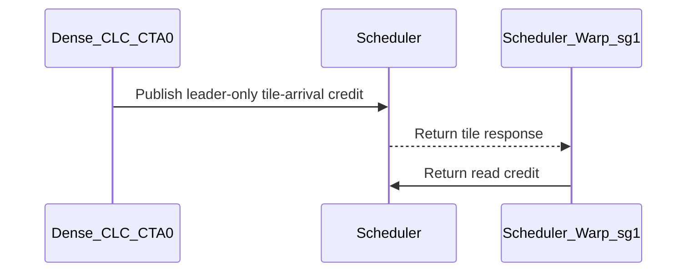

# sdpa: close scheduler-reader and D512 SWA barrier back-edges

[Upstream PR](https://github.com/NVIDIA/cudnn-frontend/pull/1547) · state: closed · merged: True

## Original PR description

**Approved and independently qualified at `e15bdfb2e39c72612f4b1ad4fd07ca628fc00965`; proceeding with the normal merge.** [Roman's exact-head approval](https://github.com/NVIDIA/cudnn-frontend/pull/1547#pullrequestreview-5552778746) accepts the barrier fixes and restored lowering choices. The author accepts the [completed independent SM107 qualification](https://github.com/NVIDIA/cudnn-frontend/pull/1547#issuecomment-6225201571) in place of waiting for another internal lane run. This is an explicit closeout decision; the interrupted internal jobs remain failed, and no later reviewer confirmation is implied. The D192/GB200 approximately 0.5% residual remains a nonblocking follow-up outside this PR.

A follow-up to #1541 found three phase-lifetime gaps: a scheduler reader that does not return a credit can miss a whole parity cycle (including the terminal response), and a once-per-tile observer cannot safely wait on a signal that completes twice per tile.

- Common dense CLC runs only its publishing scheduler warp and returns read credits only to CTA 0. Peer credit barriers receive zero arrivals, never complete, and have no waiters. The 26 caller-module aliases select this policy only for common CLC; persistent THD and local predecode retain broadcast credits. Arrival counts, payload arming and fence order are unchanged. Credit calls require a converged warp.
- Five D512 role-split kernels stop the idle sg0 TMA-store role from consuming scheduler responses. This role has no output work and was never included in the read-credit count.
- SM100 D512 MXFP8 SWA=128 softmax waits on the existing once-per-tile Q/O alias signal, after both Dv256 slices drain, with its bootstrap phase accounted for. The twice-per-tile O-empty signal remains in the per-slice output protocol.

No public knob, host execute work, heuristic change, or extra kernel launch is introduced.

Current revision `e15bdfb2e39c72612f4b1ad4fd07ca628fc00965` integrates develop `f793c4f` (including #1631 and #1632) and addresses [Roman's GB200 remeasurement](https://github.com/NVIDIA/cudnn-frontend/pull/1547#issuecomment-6173762223):

- Dense SM100 D128 MXFP8 again uses the branch form; masked specializations keep the predicated form. Removed the `or PARAMS.exp2_fma_split` condition and restored the historical measured note with its original scope. The module's executable AST is identical to Roman's CTL `5cdb548`; the shared scheduler helper and D192 module are also unchanged from that CTL.
- The earlier engineering-board result had the opposite sign from the two-GPU GB200 result, so it does not justify changing every cc 10.0 specialization. This revision makes no new performance claim. D192's previously measured approximately 0.5% GB200 residual is retained as a LOW follow-up outside this PR, as accepted in Roman's final approval.
- The leader-only helper honors `predicated`, retaining the original lane/address geometry and targeting CTA 0. The previously reviewed SM107 D512 causal-window choice, config validation under Python `-O`, S9 detector and literal-CGA1 sparse caller guard remain intact.
- Module tests verify that every credit site consumes the selected lowering; they do not freeze the winning expression. No SASS pin, spill bound or numerical tolerance changed. The six backward PTX records regenerated twice under pinned DSL 4.7.0 in the earlier revision remain unchanged.

The D512 regression delays softmax in a private template copy after retained P is published, then checks dense/THD O, LSE and Amax after eager execution and four CUDA Graph replays. Only that private THD copy enables the existing one-CTA launch cap; production launch sizing is unchanged.

**RED evidence and scope:** [Roman's review](https://github.com/NVIDIA/cudnn-frontend/pull/1547#pullrequestreview-5497346817) reports running the committed child verbatim on SM100: parent `46786f137` **24/24 exit 70** (12 dense and 12 THD), original PR head `0d04be32` **24/24 pass**. These are his independent runs. Our earlier bounded device-wait/trap control was a separate experiment. Claims 1 and 2 retain their static lifetime proofs and runtime coverage: Roman's natural probes completed 12/12 per tree/probe; his delayed controls completed 4/4 per tree/claim and were inconclusive. We do not claim a newly reproduced natural hang for those two findings.

Validation for this revision:

- Fresh-native RED/GREEN: the old native extension fails all five list-geometry architecture fixtures with `std::bad_cast`; the freshly built extension passes them. On SM107 / CUDA13.5 / cuDNN9.27 / DSL4.8.0, the broader native/protocol/loop-bound/geometry suite is **1,143 passed / 2 skipped**; those two skips are SM100-only D512 delayed-output tests.
- SM100 / CUDA13.0 / cuDNN9.27 / DSL4.7.0: **488 unchanged-source checks passed**, covering native backward binding, THD numerics/rebinding/replay, 48 MXFP8 forward checks and 23 historical regression/protocol checks. Eight two-device cases skip on the single GPU. Original CI test34 and #1621's narrow-band detector both report the FROST MXFP8 route. No runtime hang or numerical failure observed. This is functional coverage, not full-power B200/GB200 performance qualification.
- **Local profiler limitation remains explicit:** the first of six launch-count cases returns an empty CUDA event list under this old PyTorch2.8 image, failing `0 launches != 18`; five remaining cases were not run after fail-fast. Exact unmodified develop `f793c4f` fails identically. A CPU+CUDA recording attempt also fails for FROST and is preserved, while an independent tensor-add control records its expected three CUDA events with CPU+CUDA enabled. This local result is not counted as a pass. Current-head SM100 CI subsequently passed all six launch-count cases and all five native-binder geometry fixtures; its JUnit contains 14,880 passed / 6,057 skipped / 0 failures, closing this qualification gap.
- All **5 affected SASS checks passed** under pinned DSL4.7.0 / CUDA13.5, with unchanged pins and spill bounds. The three causal spill counts are 0/0, 12/12 and 3/3. SM103 here is cross-compilation, not native execution.
- Changed-file format/license hooks passed. Both remote 38-file candidate manifests match the committed source. A missing DLPack header and stale `typing_extensions` in local images were repaired only in task-owned environments; original failure logs remain in the report.

CI provenance: completed pipeline [73722953](https://nv/cudnn-gitlab-ci/-/pipelines/73722953) tested the old `a2b7df8` head. Its SM100 and SM103 lanes each had 25 failures, all standalone-backward `std::bad_cast`; the tested source still contained the two tuple casts corrected by #1631. This revision integrates that fix and its #1632 regression tests and rebuilds the native extension. Those old pipeline failures remain recorded; local passes do not replace fresh CI for this head.

The [round-3 validation report](https://sc.talos.nvidia.com/view/home/scratch.yanxu_libs/cudnn_frontend/.prefill-auto-20261007/barrier-fix-20261010/revision-20261014-round3/REPORT.md) preserves source/native hashes, RED/GREEN binder evidence, exact dependency repairs, test logs and qualification limits. Earlier performance experiments are retained in the [prior report](https://sc.talos.nvidia.com/view/home/scratch.yanxu_libs/cudnn_frontend/.prefill-auto-20261007/barrier-fix-20261010/revision-20261014/REPORT.md); its D128 dispatch conclusion is superseded by the rollback above. Private-platform performance remains internal.

Current-head CI: [pipeline 73899966](https://gitlab-master.nvidia.com/cudnn/cudnn_frontend/-/pipelines/73899966), immutable mirror `f6c728e10096d1fc10f1c0ac7bd104c4642535e6`, with the full GitHub head marker verified. SM80, SM100, SM103 and SM120 SDPA lanes passed. Original SM107 job 487882864 timed out while still waiting for Slurm resources, before tests ran. Retry 492231543 reached 68% pytest progress, then the runner was terminated and GitLab recorded `unknown_failure`; there is no completed result or JUnit artifact. Its initiator is unconfirmed. The trace is an interrupted run, not a completed pass or evidence of a newly diagnosed kernel hang. That lane was recovered as [job 492258855](https://gitlab-master.nvidia.com/cudnn/cudnn_frontend/-/jobs/492258855), which also progressed to 74% before its build-script/systemd unit was terminated. It likewise ended `failed / unknown_failure`, without JUnit or a completed test result. The initiator remains unconfirmed; [runner-side investigation is requested](https://github.com/NVIDIA/cudnn-frontend/pull/1547#issuecomment-6224065218), with no further retry launched. **Independent exact-head SM107 qualification is complete and accepted for this merge:** the same six CI modules finished with **15,508 passed / 2,372 skipped / 5 existing xfailed**, plus **431 passed / 2 SM100-only skipped** in focused validation. Both runs exited 0, complete JUnit has zero failures/errors, and four-device health checks passed. The local driver was 620.43 rather than CI's 620.62; full provenance and limits are in [the validation comment](https://github.com/NVIDIA/cudnn-frontend/pull/1547#issuecomment-6225201571). No source changes, additional CI retry or whole-pipeline rerun were made.

This PR does not fix or attribute native-backend issue #1538 and does not include #1544's separate numerical follow-up.

### Public GB200 performance evidence

The following is Roman's independent, already-public [round-3 experiment](https://github.com/NVIDIA/cudnn-frontend/pull/1547#issuecomment-6173762223), not a new author run at the current head. GB200, 152 SMs, 1830 MHz locked, exclusive GPU, dense E4M3 MXFP8 forward, B=1 / Hq=24 / Hkv=8. Explicit engine `sdpa_fwd_prefill_sm100_mxfp8`, PACK_GQA=0, natural scheduling, SPLIT_KV=1, TILE_CGA_M=2, TILE_M=TILE_N=128. Fresh process per slot, 5 warm-up and 100 timed iterations, CUPTI device-time medians, three interleaved A/C/H rounds plus closing A; replicated on a second GPU with swapped order. No power-cap counter increase.

BASE = develop `10b2280ef`; CTL = `5cdb548ec`; rejected widening = `a2b7df8f9`. Current `e15bdfb2e` restores executable AST equality with CTL in D128, D192 and the shared scheduler. Roman explicitly accepted reusing that measured control. Times below are rounded; percentages use the underlying measurements. Deltas are `earlier/later - 1`, so negative means later is slower; parentheses are the second GPU.

| Shape | BASE time (us) | CTL time (us) | Rejected widening (us) | Widening vs CTL | CTL vs BASE | Adjacent BASE control |
|---|---:|---:|---:|---:|---:|---:|
| D128, S16384 | 1786 | 1789 | 1865 | -4.08% (-3.93%) | -0.17% (-0.22%) | 0.11% |
| D128, S8192 | 499 | 500 | 519 | -3.58% (-3.69%) | -0.18% (-0.21%) | 0.06% |
| D128, S4096 | 138 | 138 | 142 | -2.61% (-2.51%) | -0.20% (-0.27%) | 0.27% |
| D192/V128, S8192 | 518 | 520 | 521 | -0.20% (+0.00%) | -0.38% (-0.45%) | 0.10% |

The D128 widening is removed. D192 is unchanged between CTL and the rejected revision; its roughly 0.5% residual versus BASE remains tracked outside this PR. These GB200 measurements do not establish B200 results. Rubin performance tables remain internal; current-head functional CI is reported separately above.

### Nonblocking review follow-ups

- Restore a narrow regression check for the measured SM100 D128 credit-lowering choices (dense branch; causal/padded predicated), without introducing timing thresholds or general heuristic winner tests. The existing SASS counts alone cannot distinguish the dense forms.
- Document the rationale for the existing SM107 D512 MXFP8 causal-window choice without publishing private platform measurements.
- Retain the D192/V128 GB200 residual as a separate LOW performance follow-up.

These follow-ups do not change the current reviewed source head; Roman explicitly permits them immediately after merge.

<!-- This is an auto-generated comment: release notes by coderabbit.ai -->
## Summary by CodeRabbit

* **Bug Fixes**
  * Improved scheduling and synchronization for dense scaled dot-product attention, including large-dimension and MXFP8 workloads.
  * Corrected output-phase coordination to help prevent incomplete results or stalls during repeated execution.
  * Preserved existing scheduling behavior for variable-length workloads.

* **Configuration**
  * Configurations combining sliding-window attention masking with fused correction and split-P processing are now rejected.
<!-- end of auto-generated comment: release notes by coderabbit.ai -->

## Review and discussion

### reviews

- vedaanta · APPROVED · 2026-10-10T07:25:58Z · [source](https://github.com/NVIDIA/cudnn-frontend/pull/1547#pullrequestreview-5478128294)

**Codex bot review · model: `gpt-6-astra`**

Reviewed all 30 changed files at `0d04be32cc249066e908787447acda48e791007d`. The scheduler selection and credit routing agree at all 26 common-CLC callers, including the three Rubin MXFP8 callers that also use CLC for THD. The idle SG0 store roles have no credit/store work to retain, and the D512 SWA wait follows the once-per-tile Q/O signal with the correct bootstrap phase. No approval-blocking finding; one nonblocking P2 below concerns stale generated-code test records.

Validation with cuDNN 9.27:
- **SM100: 41 checks passed**, including the complete back-edge module, delayed dense/THD softmax with graph replays, BF16/FP8/MXFP8 forward controls, repeated THD work, D512 forward datapaths and backward bitwise comparisons.
- **Rubin: 46 checks passed, 16 expected skips.** Two reference calculations initially failed because this Torch build's Triton assembler does not support `sm_107a`; they passed with a process-local ATen BMM reference fallback, retaining the original assertions and tolerances.
- **Exact-parent comparison:** both dense-BF16 backward PTX-golden checks pass on the parent and fail on this head under the pinned public DSL 4.7.0, confirming the fixture update needed below.
- **SM100 performance spot check:** interleaved parent/head/head/parent, BF16 B1/H16/S1024, unsplit D128 and D512 role-split paths. Mean per-run median GPU times were 30.69→30.93 µs and 121.97→120.97 µs; host enqueue times were 13.40→13.57 µs and 13.83→13.88 µs. No material regression in these two cases.

All changed files integrate cleanly with current develop. I did not independently reproduce the original natural scheduler hangs or run on SM103; passing tests establish the exercised paths, not an incidence estimate. Existing current-head CI reports its SM100/SM103 failures as old failures; no duplicate pipeline was requested.

<!-- codex-fe-review:github-only:vedaanta:1547:0d04be32cc249066e908787447acda48e791007d:complete -->

- YangXu1990uiuc · COMMENTED · 2026-10-12T06:52:20Z · [source](https://github.com/NVIDIA/cudnn-frontend/pull/1547#pullrequestreview-5487319457)

**Codex bot review · model: `gpt-6-astra`**

Reviewed `0d04be32cc24` against base `52928eeb06c1`.

Supplement to Vedaanta's same-head review: no new approval-blocking correctness finding, and the existing approval is retained. The scheduler/credit pairing is consistent across all 26 common-CLC callers; THD persistent/predecode paths retain their local protocol. There is an additional P2 beyond the already reported backward PTX records: four forward SASS checks pass on the exact parent and fail on this head. Please include these in the generated-code/performance follow-up before landing. I am respecting the explicit request to wait for Roman's review; this comment is not a merge action.

**[P2] Update the forward credit-arrive pins and qualify the changed spill counts** ([source](https://github.com/NVIDIA/cudnn-frontend/blob/0d04be32cc249066e908787447acda48e791007d/python/cudnn/frost/tile_dsl/scheduler.py#L214))

The leader-only helper also changes the forward generated-code contracts. With the same local DSL 4.7.1 toolchain, all four checks pass on exact parent 46786f137c97 and fail on 0d04be32cc24: test_sm100_d128_mxfp8_credit_arrive_sass_pins[dense], test_sm100_d192_f16_exp2_split_sass_pins[causal], test_sm103_d192_f16_exp2_split_is_folded_out_sass_pins[causal], and test_sm103_d128_fp8_exp2_split_is_folded_out_sass_pins[causal]. The dense MXFP8 expectation still encodes the old broadcast/branch implementation (BSSY 15 versus the new 8; SYNCS_ARRIVE 55 versus 48). The other three are actual spill-count changes: STL/LDL are now 6/6, 28/32 and 8/8, exceeding their existing bounds. Update the obsolete credit-arrive assertion/provenance, and qualify the affected causal specializations before deliberately refreshing spill bounds; simply increasing their global tolerance would remove useful coverage. These exact four failures are also present in both failed CI lanes, so they are not explained by the job-level 'Old Failure' label. My small SM100 A/B did not show a material slowdown, but it does not qualify SM103.

Evidence: Exact-parent targeted pytest: 4 passed in 27.30s; exact-head same selection: 4 failed in 25.68s. Existing pipeline 72824597 jobs 479371855 and 479371860 show the same four SASS failures, in addition to six backward PTX hash mismatches and four paged-decline message assertions. Attribution: Introduced by this scheduler/credit protocol change. Extends, rather than repeats, the earlier finding about backward PTX records.

- **[P2] Still open:** [Previously reported backward PTX records still need refresh](https://github.com/NVIDIA/cudnn-frontend/pull/1547#discussion_r4236858489).

Validation: Independently checked the 26 common-CLC caller guards against their leader-only credit aliases, the five idle SG0 store roles, and the D512 MXFP8 Q/O signal's once-per-tile completion and bootstrap phase. None of the 30 PR-owned files changed between the parent and current develop. Fresh matching native bindings; source-pinned parent/head runs with cuDNN 9.27 and CuTe DSL 4.7.1 on a local NVIDIA DRIVE P2021 SM100. Interleaved parent/head/head/parent: MXFP8 D128 dense, B1/Hq24/Hkv8/S4096, GPU time 471.63 to 435.24 us; BF16 D192x128 causal with Stats and explicitly selected LPT_L2/cga2/split1, B1/H16/S2048, 89.90 to 90.56 us. These are warm CUDA Graph times per invocation, with timing events captured around 20 invocations. Outputs matched their references and were bit-identical across revisions and after replay. No material regression in these two cases; this is not a B200/SM103 or serving qualification. For the BF16 LPT case, warm host enqueue remained approximately 11.8 us on both revisions. The MXFP8 host samples were variable; I do not infer a CPU speedup from them. Compilation and setup were outside all reported timings. Reused the prior same-head review's broader SM100/SM107 correctness evidence without claiming to have rerun it. Inspected the actual failed CI traces rather than relying on the job-level baseline label. No duplicate CI run was requested; labels, project and milestone are already present.

Limitations: No new SM103 hardware performance run, sanitizer run, or reproduction of the original natural scheduler hang. The SM103 spill changes still need target-hardware assessment. The four paged-decline message failures in the existing CI were not attributed by this follow-up. Generated-code fixture failures remain unresolved, and Roman's requested review remains a separate landing condition.

Comment only: GitHub does not allow reviewing one's own PR with approval/request-changes.

<!-- codex-fe-review:v2:1547:0d04be32cc249066e908787447acda48e791007d:complete:no-blocker -->

- RomanAnders90 · CHANGES_REQUESTED · 2026-10-13T00:23:48Z · [source](https://github.com/NVIDIA/cudnn-frontend/pull/1547#pullrequestreview-5497346817)

## Review of #1547 at head `0d04be32c` (merge-base `46786f137`)

**Reading guide -- the two HIGHs.** (1) `read_tile_id_arrive_on_leader` accepts `predicated=` and ignores it, so a measured per-kernel credit-arrive form is overridden at all 135 sites: Rubin d512 fp8 32K causal **-1.17 %** against a 0.07 % control spread, and the +8 % / +7 % B200 form of the two MXFP8 kernels reverted unmeasured. (2) New spills in the softmax warpgroup bodies of three causal specializations; three nightly SASS pins red.
**What we ask.** Honour or delete the kwarg, then A/B/A the affected cells on Rubin and B200; re-derive the four SASS pins and the six stage-2 md5 records with provenance (no tolerance widened); commit or record the RED half of the new test; rebase and make the pipeline green. The barrier fixes themselves are correct and we want them in.

**Verdict.** The three barrier changes are correct: the issuing-lane ledger balances at the head on every touched barrier, every remaining waiter of the scheduler ring has its own back-edge, and the D512 SWA=128 fix is RED-then-GREEN at runtime (the committed child wedges 24/24 at the parent and passes 24/24 at the head on cc 10.0). It cannot land as is: the new credit helper silently replaces a measured per-kernel lowering (a -1.2 % regression on the Rubin d512 fp8 causal kernel at 32K; an unmeasured revert of the +8 % / +7 % B200 form on the two MXFP8 kernels), adds real softmax-body spills on three causal specializations, and leaves 10 PR-introduced CI failures. Request changes; the author's hold stands.

### Findings, most severe first

**1. HIGH -- `python/cudnn/frost/tile_dsl/scheduler.py:204-219`: `read_tile_id_arrive_on_leader` accepts `predicated=` and ignores it; all 135 credit sites now lower to `if elect_sync(): arrive(mapa(mb, 0))` (a local arrive at cga 1).** The credit form is a measured per-kernel, per-specialization constant, never a library default -- the helper's own comment says so and carries the measurements (`scheduler.py:136-141`, `:185-190`): `sm100/prefill_d128_mxfp8.py:81` and `sm100/prefill_d192_d128_mxfp8.py:67` select the branch form that measured +8.14 % / +6.84 % on B200 for the unmasked specializations (`test_sdpa_fwd_mxfp8_sm100.py:2737-2761`). At the head both get a one-arrive lowering: the red `test_sm100_d128_mxfp8_credit_arrive_sass_pins[dense]` (BSSY 15 -> 8, SYNCS_ARRIVE 55 -> 48 at DSL 4.7.0 and 4.8.0) is that lever's detector, not a stale pin, and the source pins at `:2793` stay green on a dead kwarg; on sm_107a the d512 fp8 kernel's measured -3.62 % predicated form becomes a third, unmeasured form. Measured (table 1): **d512 fp8 32K causal -1.17 % against a 0.07 % control spread** (rounds -1.26 / -1.19 / -1.15, equal clocks, no power-cap event; -0.47 % at 8K), while fp8 dense gains +0.8 / +1.0 % and bf16 causal +1.5 / +1.9 % -- a per-specialization sign, which is why the form is kept per kernel. No B200 number exists (the DRIVE P2021 spot check is one MXFP8 shape -- d128 dense S 4096, not the lever's 16K -- one parent / head / head / parent interleave, no control pair). Principles: the credit-arrive form is a measured per-kernel, per-arch constant, and a scheduler change is claimed only for an arch it was A/B'd on; a moved pin is re-derived from a measurement, never widened. **Fix:** honour `predicated` in the single-target helper (the parent's predicated arm with the peer fixed at rank 0: `pred = lane == 0`, `mbarrier.arrive.release.cta.shared::cluster.b64` on `mapa(mb, 0)`) -- or delete the kwarg, both constants and both source pins -- then A/B/A (3 rounds x 100, control pair, sampled clock) on an exclusive Rubin GPU (d512 fp8 causal) and on B200 (d128 / d192x128 MXFP8 dense at S 16K / 8K), and re-derive the pin from that measurement; it must not move to 8 / 48 without it.

**2. HIGH -- new spills in the softmax warpgroup bodies of the causal LPT_L2 specializations.** `sm100/prefill_d192_d128_f16.py` (credit sites `:1546`, `:1790`, `:2471`): sm_100a 0/0 -> 4/4 STL/LDL at DSL 4.8.0 (1/1 -> 6/6 at the CI's 4.7.0, the 1/1 being the pin's own recorded develop count at that toolchain, `test_sdpa_fwd_dsl_sm100.py:3258-3259`, not a render of the parent), sm_103a fold-out 10/10 -> 20/20 (28/32 at 4.7.0, bound 12 + 4); `sm100/prefill_d128_fp8.py` sm_103a fold-out 1/1 -> 8/8 at 4.7.0 only (the 1/1 again the pin's recorded develop count, `test_sdpa_fwd_fp8_sm100.py:2323-2324`). Pins `test_sdpa_fwd_dsl_sm100.py:3274`, `:3300`, `test_sdpa_fwd_fp8_sm100.py:2363`. Splitting the SASS at every `USETMAXREG`, every new STL/LDL sits in the two register-increase softmax regions (2+2 and 5+5 per warpgroup), none in the 40- / 88-register roles; the reloads feed a tile-coordinate IMAD and an integer-division sequence, i.e. per-tile LPT_L2 decode scalars kept across the KV loop. The same mechanism moves the other way on sm100 d128 bf16 dense (STL 9 -> 3, LDL 28 -> 3). Scenario: local-memory traffic in the KV loop of the d192x128 bf16 causal kernel on B200 and GB300, unmeasured; three nightly pins red on every CI run. Principles: spills are read on every new rendering; a moved pin is re-derived with provenance, never widened (`frost_test_utils.py:413`, `SPILL_TOLERANCE = 4` stays -- its comment at `:405-412` is the pin's own contract: a spill pin is the count measured on the branch's own toolchain plus the DSL / ptxas jitter, and a real regression adds tens of STL / LDL). **Fix:** the predicated single-target form first; otherwise A/B the d192x128 bf16 causal LPT_L2 cell on B200 and GB300 and re-derive each pin with provenance. The neutral Rubin d192x128 cell is an sm_107a rendering and says nothing about sm_100a / sm_103a.

**3. MEDIUM -- CI pipeline 72824597: the sm100 and sm103 `cutlass-rel` jobs fail 14 ids each; 4 are pre-existing at the parent (`test_sdpa_fwd_paged_sm100.py` decline regexes, fixed by #1557, gone after a rebase), 10 are introduced here** (six md5 cells, finding 4; the four pins). The "Old Failure" label is wrong for those 10. The local validation ("94 passed / 73 passed", DSL 4.8.0, selection unnamed) cannot see any of them: the md5 cells skip off the pinned 4.7.0 toolchain and all 10 are `nightly_only` tier cells. The green sm107 job runs a fixed list covering at most 4 of the 13 touched sm107 forward kernels (our head-only Rubin runs cover the rest functionally, table 3). CodeRabbit's pre-merge note on this PR says the same: complete the requested GPU CI run before merging.

**4. MEDIUM -- `test/python/sdpa/frost/renderings/md5_stage2_{4x1,2x2}_sm100a.txt` are byte-identical to the parent while the three backward d512 stage-2 renderings moved**; six `test_stage2*_rendering_ptx_md5_is_unchanged` cells fail on both jobs with identical new hashes (4x1 `1d01849e..` / `d86b0bb5..` / `a2fbdf2b..`, 2x2 `326697a4..` / `b2b2bd28..` / `56b39172..`). `thd_bf16` is intact: the parent and head THD PTX are byte-identical at 4.8.0 (`95d0378b..`), the proof that the `if not _THD:` guard holds. Principle: a rendering identity is pinned against a committed record that names its toolchain (`python/cudnn/sdpa/AGENTS.md`, "A pin whose record is local-only has never run": the records live under `test/python/sdpa/frost/renderings/` with a `dsl=` line), and a record that no longer matches is regenerated under that toolchain, never left stale. Fix: re-render under the record's `dsl=4.7.0` toolchain, twice in independent processes, with a header naming this change; a 4.8.0 box cannot write that record.

**5. MEDIUM -- `test/python/sdpa/frost/test_sdpa_fwd_o_empty_backedge.py:120-230` exercises claim 3 only, its RED half is neither committed nor recorded, and claims 1 and 2 ship with no regression test and no launch counts.** We ran the committed child verbatim, 12 fresh processes per layout per tree, on cc 10.0: parent 24/24 exit 70 (the child's 45 s device-wait budget), head 24/24 pass after one eager execute and four graph replays -- the RED half is on record from our side; please commit the control or state that run in the body. The natural-run counts for claims 1 and 2 (table 2) show no hang at either tree: consistent with "not reproduced", not evidence of the fix. Principles: a regression cell is evidence only with its RED half (`test/AGENTS.md`, "A regression test must be seen RED": a test written for a bug and never seen to fail is asserting an unknown); an intermittent hang is counted over >= 12 fresh processes with the exit codes reported, never a verdict. Our own control for claims 1 and 2 -- a 20 ms pre-loop delay injected into each removed observer (the d512 test's own method), 4 fresh processes per claim and tree on Rubin -- completed 4 / 0 / 0 on both trees: the parent did not hang, so it is inconclusive, not a RED half (the d128 cell cannot park by construction at 4-5 work items per cluster -- on a depth-2 ring 4k+1 / 4k+2 rounds let a fully delayed observer exit, 4k+3 / 4k+4 park it -- and the d512 probe never confirms the delay executed). Fix: a control that goes RED at the parent -- a shape whose per-cluster round count parks the observer, the delay's execution asserted, >= 12 fresh processes per tree -- or the recorded counts.

**6. LOW -- `test_sdpa_fwd_o_empty_backedge.py:199`: `torch.testing.assert_close(lse.float(), expected_lse.float(), atol=3e-3, rtol=3e-3)` has no stated source.** The fixed arm's max |LSE - ref| measures 4.3e-3 .. 5.8e-3 on all ten SWA cells at both trees (|LSE| ~ 5-8), so the assertion passes through its rtol term only; the suite's constants are `_THD_STATS_ATOL/_RTOL = 2e-2` (`test_sdpa_fwd_mxfp8_sm100.py:2016`) and the 1e-4 dense LSE pin. State the derivation or reuse a named constant.

**7. LOW -- the pairing "module runs `scheduler_warp_loop` <=> module aliases `read_tile_id_arrive_on_leader` under the same guard" holds in all 26 modules but only by convention.** A future persistent or predecode arm inheriting the on-leader alias makes every peer scheduler warp wait credits that never come: a hang at every shape, invisible to a cga1 test. Principle: a pairing the kernel body depends on is pinned by a test, not left to convention -- a config or import that disagrees with its body fails without a diagnostic. Fix: a source pin over `python/cudnn` (on-leader alias <=> non-THD `scheduler_warp_loop(` arm; broadcast wherever a per-CTA scheduler loop runs).

**8. LOW -- `python/cudnn/sdpa/AGENTS.md:284-303` prescribes MUST behaviour but is unnumbered between Rule S8 and the 2x2 lessons; number it (S9), as the root `AGENTS.md` asks ("Each Hard Rule is numbered so it can be cited by number in review comments").** The text is consistent with the barrier arithmetic (`SUM(issuing lanes) == init count` per barrier per CTA: count unchanged, target narrowed), with its own back-edge sentence (`:286-287`: every scheduler payload reader returns a credit or has a back-edge) and with the per-kernel credit-form constant. Also state in the body that peers' `mb_read_tile_id` barriers now receive 0 arrives and never complete, and note in the helper's docstring that it needs a converged warp at the call site (true at all 135 sites today).

**9. NOTE -- the APPROVED review (2026-10-10) predates the four pin failures (reported 2026-10-12, comment-only); it does not cover findings 1-2.**

### Verified (PASS)

| item | result |
|---|---|
| Barrier arithmetic, `SUM(issuing lanes) == init count` per barrier per CTA at the head | `mb_read_tile_id` on CTA 0 = 29 (2-CTA d128 / d192x128: 16 softmax + 8 correction + 2 TMA-LDG + 2 TMA-STG + 1 MMA leader) and 25 (d512 cga4x1: 16 compute + 4 TMA-LDG + 1 sg0 MMA + 2 sg1 MMA + 2 sg1 TMA-STG), both ledgered per arrive site; 30 (2-CTA MXFP8), 42 (2x2), 28 (bwd d512), 11 (decode) are the configs' derivations re-read at the head (same calling-warp set, one arrive each at CTA 0 from the uniform helper; no init count in the diff); peers 0 arrives / 0 waiters; `mb_scheduler` 1 arm per CTA per round; `mb_q_o_alias` 1; `mb_o_empty` 32. No init count changed, none needed to |
| Parity waiters' back-edges (every parity waiter needs its own back-edge) | the parent had three parity observers without a back-edge (peer scheduler warps in `scheduler_warp_loop`; the sg0 TMA-STG warp of the five role-split kernels; the SWA softmax waiting a twice-per-tile barrier once per tile); all removed or retargeted, every remaining waiter credits or arms |
| Drains (every cross-CTA arrive has a reachable wait before kernel exit) | credits sit at the top of each role loop and the loop exits on the terminal decode: no terminal credit is issued, CTA 0's scheduler warp is mid-wait when the last credits land; no new async cross-CTA arrive, drains untouched |
| claim 2 | sg0 TMA-STG was in no init / expect_tx / drain / named-barrier count; no code after its loop |
| claim 3 | the softmax waits parity t % 2 = TMA-LDG's sequence; completion #(t+2) needs tile t+1's P, produced after the wait, so at most one completion lands between observations; every once-per-tile edge fires on empty THD units; `_SWA_REUSE_P` and `FUSED_CORR_SPLIT_P` are mutually exclusive (a trace-time assertion would make the new `if/elif` explicit) |
| SASS, sm_107a d512 fp8 and sm_100a d128 f16, parent vs head | CGAERRBAR and MEMBAR.ALL.GPU stay at zero (`.release.cta` kept, no GPU-scope drain); wait forms unchanged (` SYNCS.PHASECHK` 68 / 164, `USYNCS.PHASECHK` 78); no new divergence at the credit sites (BSSY 7 -> 6 / 6 -> 6: the elect-gated plain arrive is the single-warp branch form that stays a branch -- only the expect_tx / commit / peer-arrive producers take a predicate -- lowered to a uniform `USYNCS.ARRIVE` on sm_107a); REG 156 / 128 unchanged |
| OFF arms of `sm100/prefill_d512_mxfp8.py` | dense / causal / SWA 640 PTX byte-identical (0 differing lines); SWA 128 differs in 46 lines = the waited barrier's address and parity. A cubin md5 is not a rendering identity on sm_100a + DSL 4.8.0 (three renders of one tree, three md5s, identical opcode counts): compare PTX md5 or opcode counts |

### Table 1 -- A/B/A on one exclusive Rubin GPU, 212 SMs @ 2376 MHz (cc 10.7)

Parent `46786f137` (A) vs head `0d04be32c` (B), A B A B A B A, one fresh process per slot, CUPTI device-time median over 100 launches after 5 warm-ups, 256 MiB L2 flush per launch, the first FROST plan pinned (A == B on every cell), SM clock locked and back-computed per slot, the SW power-cap counter sampled before / after each cell; cuDNN 9.27, DSL 4.8.0. Sub-ms cells are read from the TFLOPS column (the ms column is quantized to 1 us). Control spread = max |delta| between adjacent A slots; inside it = neutral. Other GPUs of the same node carried unrelated functional work throughout; the control pair is the defence.

| cell (B 1, H 16) | engine pinned (A == B) | base us | head us | delta % (+ = head faster) | control spread % | rounds | note |
|---|---|---|---|---|---|---|---|
| d512 fp8 8k dense | `sm107_fp8 SCHED_POLICY=0, TILE_CGA_M=2` | 371 | 368 | +0.84 (TFLOPS column) | 0.03 | [0.86, 0.89, 0.81] | **head faster**; MHz 2374-2377 |
| d512 fp8 8k causal | `sm107_fp8 SCHED_POLICY=0, TILE_CGA_M=2` | 224 | 226 | -0.47 (TFLOPS column) | 0.49 | [-0.69, -0.85, -0.39] | neutral (same sign as 32K); MHz 2375-2378 |
| d128 bf16 8k dense | `sm107 SCHED_POLICY=0, TILE_CGA_M=2` | 182 | 182 | +0.00 (TFLOPS column) | 0.03 | [0.07, 0.0, -0.03] | neutral; MHz 2375-2377 |
| d128 bf16 8k causal | `sm107 SCHED_POLICY=1, TILE_CGA_M=2` | 107 | 105 | +1.53 (TFLOPS column) | 0.12 | [1.52, 1.51, 1.55] | **head faster**; MHz 2374-2378 |
| d512 bf16 8k dense | `sm107 SCHED_POLICY=0, TILE_CGA_M=2` | 723 | 724 | -0.15 (TFLOPS column) | 0.10 | [-0.16, -0.13, -0.13] | neutral; MHz 2374-2377 |
| d512 bf16 8k causal | `sm107 SCHED_POLICY=0, TILE_CGA_M=2` | 410 | 410 | -0.04 (TFLOPS column) | 0.41 | [0.15, 0.22, -0.3] | neutral; MHz 2375-2377 |
| d128 fp8 8k dense | `sm107_fp8 SCHED_POLICY=0, TILE_CGA_M=2` | 150 | 150 | -0.14 (TFLOPS column) | 0.11 | [-0.19, -0.14, 0.08] | neutral; MHz 2374-2378 |
| d128 fp8 8k causal | `sm107_fp8 SCHED_POLICY=1, TILE_CGA_M=2` | 86 | 86 | -0.45 (TFLOPS column) | 0.28 | [-0.4, -0.62, -0.5] | **head slower, 1.6x the control**; MHz 2373-2378 |
| d256 bf16 8k dense | `sm107 SCHED_POLICY=0, TILE_CGA_M=2` | 320 | 319 | +0.15 (TFLOPS column) | 0.32 | [0.09, 0.26, 0.2] | neutral; MHz 2374-2377 |
| d256 bf16 8k causal | `sm107 SCHED_POLICY=1, TILE_CGA_M=2` | 180 | 180 | -0.08 (TFLOPS column) | 0.13 | [0.1, -0.1, -0.13] | neutral; MHz 2375-2378 |
| d192x128 bf16 8k dense | `sm107 SCHED_POLICY=0, TILE_CGA_M=2` | 228 | 227 | +0.05 (TFLOPS column) | 0.03 | [0.07, 0.03, 0.03] | neutral; MHz 2375-2376 |
| d192x128 bf16 8k causal | `sm107 SCHED_POLICY=0, TILE_CGA_M=2` | 172 | 171 | -0.10 (TFLOPS column) | 1.67 | [1.26, -0.35, -0.6] | neutral; MHz 2376-2378 |
| d512 mxfp8 8k causal swa640 | `sm107_mxfp8 SCHED_POLICY=0, TILE_CGA_M=2` | 77 | 77 | +0.23 (TFLOPS column) | 0.23 | [0.19, 0.28, -0.05] | neutral; MHz 2372-2379 |
| d512 fp8 32k dense | `sm107_fp8 SCHED_POLICY=0, TILE_CGA_M=2` | 5294 | 5244 | +0.96 (ms column) | 0.02 | [0.97, 0.95, 0.97] | **head faster**; MHz 2376-2377 |
| d512 fp8 32k causal | `sm107_fp8 SCHED_POLICY=0, TILE_CGA_M=2` | 2752 | 2784 | **-1.17** (ms column) | 0.07 | [-1.26, -1.19, -1.15] | **head SLOWER, beyond the control spread**; MHz 2374-2377; no power-cap event |
| d128 bf16 32k dense | `sm107 SCHED_POLICY=0, TILE_CGA_M=2` | 2274 | 2274 | +0.02 (ms column) | 1.91 | [-0.04, 0.35, 0.66] | neutral; MHz 2375-2377; power-cap counter moved 1.8 s during the cell (lower bound) |
| d128 bf16 32k causal | `sm107 SCHED_POLICY=1, TILE_CGA_M=2` | 1157 | 1135 | +1.94 (ms column) | 0.00 | [1.94, 1.94, 1.85] | **head faster**; MHz 2375-2377 |
| d512 bf16 32k dense | `sm107 SCHED_POLICY=0, TILE_CGA_M=2` | 11551 | 11557 | -0.05 (ms column) | 1.35 | [-0.07, 0.42, -0.95] | neutral; MHz 2375-2377; power-cap counter moved 9.9 s during the cell (lower bound) |
| d512 bf16 32k causal | `sm107 SCHED_POLICY=0, TILE_CGA_M=2` | 5568 | 5573 | -0.10 (ms column) | 0.89 | [-0.72, 1.05, -0.29] | neutral; MHz 2374-2377; power-cap counter moved 5.3 s during the cell (lower bound) |
| d128 fp8 32k dense | `sm107_fp8 SCHED_POLICY=0, TILE_CGA_M=2` | 1814 | 1814 | +0.00 (ms column) | 0.00 | [0.0, 0.06, 0.0] | neutral; MHz 2375-2378 |
| d128 fp8 32k causal | `sm107_fp8 SCHED_POLICY=1, TILE_CGA_M=2` | 884 | 879 | +0.63 (TFLOPS column) | 0.02 | [0.64, 0.64, 0.62] | **head faster**; MHz 2374-2378 |
| d256 bf16 32k dense | `sm107 SCHED_POLICY=0, TILE_CGA_M=2` | 5088 | 5077 | +0.22 (ms column) | 1.06 | [-0.67, 0.0, 0.04] | neutral; MHz 2375-2378; power-cap counter moved 4.6 s during the cell (lower bound) |
| d256 bf16 32k causal | `sm107 SCHED_POLICY=1, TILE_CGA_M=2` | 2394 | 2410 | -0.68 (ms column) | 0.99 | [-0.66, -1.85, 1.3] | neutral; MHz 2375-2378; power-cap counter moved 2.4 s during the cell (lower bound) |
| d192x128 bf16 32k dense | `sm107 SCHED_POLICY=0, TILE_CGA_M=2` | 2896 | 2901 | -0.19 (ms column) | 2.55 | [-2.52, -0.03, -0.52] | neutral; MHz 2375-2376; power-cap counter moved 2.7 s during the cell (lower bound) |
| d192x128 bf16 32k causal | `sm107 SCHED_POLICY=0, TILE_CGA_M=2` | 1658 | 1662 | -0.24 (ms column) | 0.30 | [-0.72, -0.3, -0.18] | neutral; MHz 2375-2377 |
| d512 mxfp8 32k causal swa640 | `sm107_mxfp8 SCHED_POLICY=0, TILE_CGA_M=2` | 269 | 268 | +0.20 (TFLOPS column) | 0.04 | [0.2, 0.28, 0.2] | neutral; MHz 2373-2379 |

Reading (26 of 26 cells): the d512 fp8 causal kernel loses at both lengths (-0.47 % at 8K inside its control, **-1.17 % at 32K against 0.07 %**), the d128 fp8 causal kernel is mixed (-0.45 % at 8K, +0.63 % at 32K), fp8 dense is flat or positive (+0.84 / +0.96 % on d512), bf16 causal gains +1.5 / +1.9 % on d128; everything else is neutral. A per-specialization sign, as for the spills of finding 2. Six long bf16 32K cells ran under intermittent power capping and are lower bounds.

### Table 2 -- hang-class counts (fresh processes; ok / exit 124 / other; counts, not a verdict)

| probe | part | parent `46786f137` | head `0d04be32c` |
|---|---|---|---|
| the committed `_D512_SWA_CHILD`, dense (B 1, Hq 64, Hkv 1, S 512, causal + band 128, Stats) | SM100 cc 10.0, 148 SMs | 0 / 0 / **12 (exit 70 = the 45 s device-wait budget)** | **12** / 0 / 0 |
| same, THD (`[512, 256]` x `[512, 0]`, one cluster reusing the CTA) | SM100 cc 10.0 | 0 / 0 / **12 (exit 70)** | **12** / 0 / 0 |
| the #1541 cga2 d128 bf16 split-KV bottom-right child, 20 executes + fp32 reference | SM100 cc 10.0 | 12 / 0 / 0 | 12 / 0 / 0 |
| d512 bf16 + fp8 role-split, dense + causal, 8 executes, 240 s watchdog | SM100 cc 10.0 | 12 / 0 / 0 | 12 / 0 / 0 |
| the #1541 cga2 child (B 1, H 32, S 2048, SPLIT_KV 16, TILE_CGA_M 2) | Rubin cc 10.7, 212 SMs @ 2376 MHz | 12 / 0 / 0 | 12 / 0 / 0 |
| d128 bf16 8K dense cga2, 20 executes, bitwise-identical O + fp32 reference | Rubin | 12 / 0 / 0 | 12 / 0 / 0 |
| d512 bf16 8K causal, same probe | Rubin | 12 / 0 / 0 | 12 / 0 / 0 |
| d512 bf16 8K dense, same probe | Rubin | 12 / 0 / 0 | 12 / 0 / 0 |
| d512 fp8 8K dense (2 + 20 launches, no numerics) | Rubin | 12 / 0 / 0 | 12 / 0 / 0 |
| d512 mxfp8 8K causal + SWA 640, same probe | Rubin | 12 / 0 / 0 | 12 / 0 / 0 |
| d128 fp8 8K dense, same probe | Rubin | 12 / 0 / 0 | 12 / 0 / 0 |
| delay-injected controls for the two removed observers: a 20 ms pre-loop delay in the non-leader CTA's scheduler warp (d128 bf16 8K dense, TILE_CGA_M 2) and in the sg0 TMA-STG warp (d512 bf16 8K causal), 4 fresh processes per claim and tree | Rubin | 4 / 0 / 0 (both claims) | 4 / 0 / 0 (both claims) |

The last row ran and is inconclusive, not a RED half: the parent does not reproduce under the injected delay (the d128 cell cannot park by construction at 4-5 work items per cluster), and the probe does not confirm the delay executed.

### Table 3 -- functional and codegen

| run | parent | head |
|---|---|---|
| `test_sdpa_fwd_o_empty_backedge.py` whole, SM100 cc 10.0 | 12 passed (the new test does not exist at the parent) | 14 passed |
| same module, Rubin (the new test skips off cc 10.0 / 10.3 by design) | -- | 12 passed, 2 skipped |
| `test_sdpa_fwd_dsl_sm107.py` (the whole sm107 forward suite incl. fp8 / mxfp8), Rubin | -- | 607 passed, 17 skipped |
| `test_sdpa_fwd_d512_2x2_sm107.py` + `test_sdpa_fwd_paged_mxfp8_sm107.py`, Rubin | -- | 58 passed |
| SMOKE tier of the three sm100 forward modules (one cell per code path), SM100 | -- | 77 passed |
| `sm100/prefill_d512_mxfp8.py` SWA 128 / 129 / 640 dense at S 512 / 1024 / 2048 and THD (keyless + live second sequence), 10 cells, SM100 | all pass | all pass, numerically identical to the parent |
| the four forward SASS pins re-rendered from the pytest cells (DSL 4.8.0; CI 4.7.0 in brackets) | credit pin 15 / 55; d192 f16 causal 0/0 [1/1]; sm_103a fold-out 10/10; d128 fp8 sm_103a 0/0 [1/1] | **8 / 48**; **4/4 [6/6]**; **20/20 [28/32]**; 0/0 [**8/8**] |
| stage-2 PTX md5, bwd d512 (DSL 4.8.0 host renders) | -- | all six dense / causal renderings moved; `thd_bf16` byte-identical |

Bracketed parent values in the pins row are the pins' own recorded develop counts at 4.7.0 (`test_sdpa_fwd_dsl_sm100.py:3258-3259`, `test_sdpa_fwd_fp8_sm100.py:2323-2324`), not a render of the parent under 4.7.0; the bracketed head values are the CI traces.

### Not verified

- No B200 / GB200 / GB300 performance number today: the SM100 part we ran is a 148-SM development box (functional only) and the CI jobs are functional. The B200 A/B of the two MXFP8 kernels and the GB300 qualification of the spills are outstanding.
- Rubin: all 26 perf cells and all 7 natural-run hang probes are in (table 2: 7 cells x 2 trees x 12 fresh processes, every pair 12 / 0 / 0); the delay-injected controls for claims 1 and 2 ran on their Rubin kernels and completed 4 / 0 / 0 on both trees -- inconclusive (the parent does not reproduce; the probe does not confirm the delay), so claims 1 and 2 still carry natural-run counts only, no RED half.
- The 4.7.0-only pin values (6/6, 8/8) could not be reproduced on a 4.8.0 box; the CI job traces (479371855 / 479371860, read directly) are the source.
- The data rings (`mb_k/v/q_*`, `mb_bmm*`, `*_xfer_*`, `mb_tma_o_*`, `mb_tmem_dealloc`) are byte-identical in the diff and were not re-audited.
- The "independent static barrier review" has no record in the PR; its number (135 credit sites in the 26 aliased modules) checks out.

### Requests before merge

1. Decide the `predicated` contract (honour or delete), then A/B/A x 3 x 100 with a control pair and sampled clocks on an exclusive Rubin GPU (d512 fp8 causal, 8K and 32K) and on B200 (d128 / d192x128 MXFP8 dense at 16K / 8K), parent `46786f137` vs the fixed head, numbers with part and clock policy in the body (the credit-arrive form is a per-kernel, per-arch constant; a scheduler change is claimed only for an arch it was A/B'd on).
2. Re-derive the four forward SASS pins with provenance; qualify or remove the three spill increases; never widen `SPILL_TOLERANCE`.
3. Regenerate the six stage-2 PTX md5 records under DSL 4.7.0 with a header naming this change.
4. Commit or record the RED half of the d512 test; add a delay-injected control for the two removed observers that goes RED at the parent (our 20 ms control completed 4 / 0 / 0 on both trees: inconclusive), or the recorded counts.
5. Rebase onto develop (drops the 4 pre-existing paged-decline failures), make the pipeline green, name the validation selection.
6. Number the AGENTS.md section (S9), state that peers' credit barriers never complete, fix the two false-green source pins, state the source of the 3e-3 LSE tolerance.

### Merge stance

The author asks not to merge yet; we agree. Our event: **REQUEST_CHANGES** -- findings 1 and 2 are HIGH (a measured regression beyond the control spread on Rubin, an unmeasured revert of a measured B200 lever, real spills on the softmax critical path). Not a correctness block: the barrier fixes are right and we want them in.

- YangXu1990uiuc · COMMENTED · 2026-10-13T01:46:29Z · [source](https://github.com/NVIDIA/cudnn-frontend/pull/1547#pullrequestreview-5497884603)

(No body; status only.)

- YangXu1990uiuc · COMMENTED · 2026-10-13T02:18:42Z · [source](https://github.com/NVIDIA/cudnn-frontend/pull/1547#pullrequestreview-5498050557)

**Codex bot review · model: `gpt-6-astra`**

Reviewed `9c5fc189f197` against base `f9525318d156`.

Follow-up: the earlier forward generated-code/spill failures are resolved on my unchanged DSL 4.7.1 toolchain, and the revised helper consumes its predicated argument while retaining leader-only credits. No new correctness blocker found. The performance gate remains open: an interleaved local SM100 comparison shows a small, repeatable dense D128 MXFP8 slowdown, while D192 improves. Please retain the author's do-not-merge hold and Roman's follow-up until the requested B200 qualification and current-head CI finish. This COMMENT does not clear his request for changes.

- **[P2] Still open:** [Keep the existing performance qualification open for the single-target lowering](https://github.com/NVIDIA/cudnn-frontend/pull/1547#pullrequestreview-5497346817).

Validation: All 5 targeted SASS cases passed on the exact head with DSL 4.7.1, including dense/causal MXFP8 credit pins and the three previously failing SM100/SM103 causal spill checks. SPILL_TOLERANCE and the spill bounds are unchanged. SM103 here is cross-compilation, not native execution. The complete scheduler/output-backedge module passed on native SM100: 21 passed, including both delayed D512 dense/THD cases with eager execution and four graph replays, the existing split-KV repeated-launch regression, and the new layout/primitive checks. Interleaved base/head/head/base on NVIDIA DRIVE P2021 SM100, cuDNN 9.27 and DSL 4.7.1: dense E4M3 MXFP8, FP16 O, B1/Hq24/Hkv8/S4096, Dv128: Dqk128 GPU replay 475.23 -> 482.06 us (+1.44%; repeatable), Dqk192 426.58 -> 419.60 us (-1.64%). BF16 D192x128 causal with Stats, forced LPT_L2/cga2/split1, B1/H16/S2048: 90.29 -> 89.94 us. All three outputs matched references and were bit-identical across revisions and after replay. Warm host enqueue for those three cases was 18.79 -> 18.45 us, 18.27 -> 18.59 us and 11.94 -> 12.12 us. These small host differences do not establish a meaningful CPU regression or speedup; setup and compilation were excluded. Checked the newly committed backward PTX records/provenance and the SWA/split-P exclusion against configuration generation. Reused pipeline 73405340; at inspection its four active FROST lanes were still running, with no failed job yet. Existing labels, project and milestone are appropriate.

Limitations: This local GPU is not a B200/SM103 performance qualification. The requested B200 experiment and Roman's follow-up remain outstanding; native SM107 was not rerun in this follow-up. The refreshed backward byte-hash records require DSL 4.7.0. I inspected their changes but did not independently re-render all seven records in this follow-up; their author's repeated-render evidence is distinct from my five SASS passes. The committed D512 delayed regression passes on this head. Its reported 24/24 parent failures are Roman's independent evidence, not a new parent reproduction by this review. Current-head CI is pending. No duplicate CI or merge was requested.

Comment only: GitHub does not allow reviewing one's own PR with approval/request-changes.

<!-- codex-fe-review:v2:1547:9c5fc189f1974d2e88da1e64318aae287eb5c717:complete:no-blocker -->

- vedaanta · COMMENTED · 2026-10-13T21:56:04Z · [source](https://github.com/NVIDIA/cudnn-frontend/pull/1547#pullrequestreview-5510483310)

**Codex bot review · model: `gpt-6.1-sol`**

Reviewed `9c5fc189f197` against base `cb6f814e1eb1`.

Follow-up to this account's earlier review: the helper now consumes its predicated choice, and the previously reported generated-code fixture/spill checks pass on the current head. No new correctness blocker found. The requested B200 performance qualification remains open; please retain the author's do-not-merge hold and Roman's follow-up. This COMMENT does not clear his request for changes.

- **[P2] Still open:** [Keep the existing performance qualification open for the single-target lowering](https://github.com/NVIDIA/cudnn-frontend/pull/1547#pullrequestreview-5497346817).

Validation: 18 current-head protocol/source checks passed: per-warpgroup output-slot backedges, scheduler/credit layout pairing, and all lane/primitive choices for cluster sizes 1/2/4 and both predicated values. All five affected forward SASS checks passed with CuTe DSL 4.7.0: both MXFP8 D128 credit specializations and the three previously failing causal SM100/SM103 spill checks. Existing spill tolerances were retained. SM103 here is cross-compilation, not native execution. All seven pinned backward stage-2 PTX checks passed with CuTe DSL 4.7.0, covering the refreshed dense 4x1/2x2 records and unchanged 4x1 THD record. Rechecked leader-only common CLC routing, the idle D512 store roles, and the D512 MXFP8 SWA once-per-tile Q/O alias signal and bootstrap phase. The added exclusion guards the incompatible SWA-reuse/split-P combination. Verified existing pipeline 73405340: SM107, SM120, and SM80 SDPA FROST lanes succeeded; SM100 and SM103 failed. The existing CI follow-up identifies their sole failure as the inherited MXFP8 test34 hang. No duplicate CI was triggered.

Limitations: I did not rerun native numerical/capture tests or reproduce the historical hangs in this follow-up. The earlier reviews' runtime evidence is distinct from these new source/code-generation checks. No new B200 performance experiment was possible here; the configured remote Rubin host currently reports no GPU devices. Generated-code passes do not close the requested performance gate. The Python/code-generation tests used the exact-head Python tree with an older native FE extension; they do not qualify native binding ABI changes. The PTX checks were independently rendered once per record, not twice.

Comment only: this PR already has an active approval; preserving existing approvals.

<!-- codex-fe-review:v2:1547:9c5fc189f1974d2e88da1e64318aae287eb5c717:complete:no-blocker -->

- RomanAnders90 · CHANGES_REQUESTED · 2026-10-14T04:24:49Z · [source](https://github.com/NVIDIA/cudnn-frontend/pull/1547#pullrequestreview-5513045601)

## Re-review of #1547 at head `9c5fc189f` (merge-base `a386a361d`; our first review was at `0d04be32c`)

**Event: REQUEST_CHANGES** (re-affirmed on 9c5fc189f; narrowed to one remaining item, one LOW and nits).

**Resolved at 9c5fc189f.** `predicated` is consumed (both arms, RED at the parent helper / GREEN at the head); the three causal spill pins read exactly the base's counts under DSL 4.7.0 (0/0, 12/12, 3/3) with no bound widened; the six stage-2 PTX records match independent renders under DSL 4.7.0; the RED half of the D512 test is recorded in the body; S9 is numbered; the two CI reds are develop's `test_sdpa_mxfp8_fwd_L0[test34]` (the 2026-10-13 develop nightly fails the same single id on the same lanes; fixed on develop by #1621). On Rubin (212 SMs @ 2376 MHz, exclusive GPU, A/B/A x 3 + closing A, 100 launches per fresh process, CUPTI medians, engine pinned A == B, sampled clocks, control pair) the regression we reported is gone: sm107 d512 fp8 32K causal -1.17 % -> +0.35 % (control 0.07 %, replicated +0.36 % on a second GPU); d128 fp8 8K causal -0.45 % -> -0.07 % (inside its 0.12 % control); 20 of the 26 cells are inside their control spread or within one TFLOPS LSB; the PR without the fix commit still reads -1.15 % / -0.38 % against the same base and the fix commit alone recovers +1.61 % / +0.29 %.

**Remaining (1 item): the sm_100a half of finding 1.** The two MXFP8 prefill kernels' dense specialization now lowers to BSSY 8 / SYNCS.ARRIVE 55 at both DSL builds (the single-target branch is if-converted), not the base's 15 / 62, so there is no identity argument, and the only SM100 datapoint on this PR (the base/head/head/base interleave at S 4096, no control pair) reads d128 dense +1.44 % slower at the head. Our own sm_100a datapoint does not close it either -- on a GB200 (152 SMs, SM clock locked; a different class from B200's 148 SMs, so stated on its own), same protocol as the Rubin table (one exclusive GPU per cell, A/B/A x 3 rounds + closing A, 100 launches per fresh process, CUPTI medians, the engine pin identical A == B, the power-cap counter unmoved through every cell, control = the adjacent merge-base slots), base a386a361d vs 9c5fc189f, dense E4M3 MXFP8 forward at B 1 / Hq 24 / Hkv 8: d192x128 dense S 8K **-0.62 %** (control 0.05 %; rounds -0.65 / -0.60 / -0.60 %), replicated -0.55 % (control 0.05 %) on a second GPU, every round of the six negative; d128 dense S 16K -0.22 % (control 0.06 %), replicated -0.20 % (control 0.06 %, one round 0.00 %) -- at the one-LSB limit, the same sign in five of six rounds; at the interleave's own S 4096, d128 -0.33 % (control 0.13 %) and d192x128 +0.43 % head faster (control 0.11 %), the interleave's signs at a third of its magnitudes. Nothing exceeds 0.7 %, but it is a reproducible head-slower reading on the specialization whose lowering changed form, on the one sm_100a class we could measure. So the request stands, now with a measured loss behind it: please A/B/A (3 rounds x >= 100 launches, control pair, sampled clocks, one exclusive GPU) d128 dense S 16K and d192x128 dense S 8K MXFP8, base vs 9c5fc189f, on B200 (or the sm_100a part you can get, with its SM count stated; our GB200 numbers may be quoted as their own class), and put the numbers in the body. A measured loss means a different spelling of the lever for that specialization, measured -- not a pin edit; the helper now takes the per-specialization choice, which is what it is for. Also put the Rubin numbers in the body (ours may be quoted).

**LOW (not a condition).** The sm107 d512 mxfp8 causal + SWA 640 kernel reads -0.78 % at 8K (control 0.32 %, replicated on a second GPU) and -0.69 % at 32K (control 0.12 %) head vs base, while the PR without the fix commit was neutral there -- the narrowed predicate costs that one kernel a little. The candidate remedy is measured: a per-kernel `predicated=False` on that kernel (the branch arm of `read_tile_id_arrive_on_leader`, spelled the way the two sm100 MXFP8 kernels carry `PREDICATED_CREDIT_ARRIVE`, every credit site passing it) reads +1.02 % at 8K and +1.07 % at 32K against 9c5fc189f (controls 0.19 % / 0.08 %; replicated +1.21 % / +1.03 % on a second GPU) and +0.39 % / +0.28 % against the merge-base (controls 0.18 % / 0.04 %), same Rubin protocol, so it restores that kernel to parity with the base (the triangle closes: -0.78 / -0.69 % head vs base, +1.02 / +1.07 % remedy vs head, +0.39 / +0.28 % remedy vs base). On sm_107a ptxas lowers that arm to a uniform-address predicated arrive (VOTEU.ALL + SYNCSU.ARRIVE.TRANS64.RED.A1T0 under a lane-zero predicate) in place of the per-lane predicated arrive, with no BSSY, ELECT, spill or register change (BSSY 6 / ELECT 14 / STL 0 / REG 225 on both forms; 8 fewer instructions), and the kernel's d512 MXFP8 causal + window tests pass with it (10 of 10, including the masked-softmax SASS pin). The spelling is yours: the mask-keyed constant of the two sm100 MXFP8 kernels would keep the predicated form on exactly this masked specialization, so it is not a copy-paste; the other kernels on the helper's default were not measured under the branch arm, and the dense specialization of this kernel was not either.

**Nits.** `sm100/prefill_d512_mxfp8.py:341` module-level `assert` (stripped under -O) -> a `_validate_cfg` predicate; S9 could name its detector `test_scheduler_and_credit_target_select_the_same_layouts`; "restore spill bounds" in the commit title (the bounds never moved, the counts did).

### Measurement detail (ours; quotable)

Delta = base / head - 1 throughout (positive = head faster); control = the adjacent same-tree slots of the same cell; one node class per table.

Rubin, 212 SMs @ 2376 MHz, one exclusive GPU per cell, A/B/A x 3 rounds (+ closing A) x 100 launches per fresh process, CUPTI device-time median, the engine pin identical A == B on every cell, sampled clocks 2373-2381 MHz. A = the merge-base a386a361d, B = 9c5fc189f.

- The regression we reported is gone: sm107 d512 fp8 32K causal went from -1.17 % (control 0.07 %) at 0d04be32c to +0.35 % (control 0.07 %) at 9c5fc189f, replicated at +0.36 % on a second GPU; sm107 d128 fp8 8K causal from -0.45 % to -0.07 % (inside its 0.12 % control). Re-measuring the PR WITHOUT the fix commit (3ce209462) against the same base reproduces the original numbers (-1.15 % / -0.38 %), and the fix commit alone recovers +1.61 % / +0.29 % on those two cells, so the cause and the cure are the credit-site lowering, as diagnosed.
- The 26-cell set is otherwise at parity with the base: 20 of 26 cells inside their control spread or within one TFLOPS LSB (0.25 %); the earlier head-faster cells (d128 bf16 8K/32K causal +1.5 / +1.9 %, d512 fp8 32K dense +1.0 %, d128 fp8 32K causal +0.6 %) are now +0.06 / +0.26 / -0.36 (control 0.91) / -0.07 % -- the branch form's upside went away together with its regression.
- One residual to name (the LOW item above): the sm107 d512 mxfp8 causal + SWA 640 kernel reads -0.78 % at 8K (control 0.32 %, replicated -0.78 % on a second GPU) and -0.69 % at 32K (control 0.12 %) against the base; the PR without the fix was neutral there (0.00 / +0.26 %) and the fix commit alone costs -0.94 / -1.00 % on that kernel. The per-kernel branch arm on that kernel measures +1.02 / +1.07 % against the head and +0.39 / +0.28 % against the base (numbers above).
- Hang-class probes (12 fresh processes x 7 cells x {base, head}, timeout-classified) and the functional cells ran clean on the same part -- counts in our record.

GB200, 152 SMs, SM clock locked (the back-computed busy clock read 1828-1833 MHz on every slot and the power-cap counter did not move through any cell), one exclusive GPU per cell, A/B/A x 3 rounds + closing A = 7 fresh processes x 100 launches each, CUPTI device-time median, the engine pin identical A == B on every cell (`sdpa_fwd_prefill_sm100_mxfp8[PACK_GQA=0, SCHED_POLICY=0, SPLIT_KV=1, TILE_CGA_M=2, TILE_M=128, TILE_N=128]`). A = the merge-base a386a361d, B = 9c5fc189f; dense E4M3 MXFP8 forward at B 1 / Hq 24 / Hkv 8 (the interleave's B / H; our request named no B / H for the 16K / 8K shapes). Sub-millisecond cells are read from the TFLOPS column.

- d128 dense S 16K: 1.776 -> 1.780 ms (1858 -> 1853 TFLOPS), -0.22 % (control 0.06 %; rounds -0.22 / -0.17 / -0.28 %) -- at the one-LSB class limit, the same sign in all three rounds.
- d192x128 dense S 8K: 0.514 -> 0.518 ms (2004 -> 1991 TFLOPS), -0.62 % (control 0.05 %; rounds -0.65 / -0.60 / -0.60 %) -- a reproducible sub-1 % head-slower on this class.
- The interleave's own S 4096 shapes: d128 1509 -> 1504 TFLOPS, -0.33 % (control 0.13 %); d192x128 1754 -> 1761 TFLOPS, +0.43 % head faster (control 0.11 %) -- the same signs as the interleave's reading (+1.44 % slower / -1.64 % faster), smaller magnitudes under a control pair.
- Replicated with the GPUs swapped (each headline cell re-run on the other exclusive GPU, same protocol): d128 S 16K 1.780 -> 1.784 ms, -0.20 % (control 0.06 %; one of the three rounds read 0.00 %); d192x128 S 8K 0.514 -> 0.517 ms, 2006 -> 1995 TFLOPS, -0.55 % (control 0.05 %; rounds -0.50..-0.55 %). Nothing in the six cells exceeds 0.7 %. B200 (148 SMs) was not measured by us; a B200 number belongs in its own table.

### Merge stance

Our event stays REQUEST_CHANGES rather than a comment: everything the host and Rubin can settle is settled, and what is incomplete is the PR's own sm_100a evidence for a lowering change on two kernels whose form was a measured per-arch constant -- the two datapoints that exist (the interleave and our GB200 class) both read head-slower on one dense specialization. That is request 1 of our review, B200 half, unmet; the hold is yours, the open request is ours. The barrier fixes are right and we want them in.

- vedaanta · COMMENTED · 2026-10-14T06:20:54Z · [source](https://github.com/NVIDIA/cudnn-frontend/pull/1547#pullrequestreview-5513834170)

**Codex bot review · model: `gpt-6.1-sol`**

Reviewed `a2b7df8f9a8c` against base `a8de8c8e2cc4`.

No new correctness blocker in this follow-up. The localized lowering choices preserve the credit protocol, and the incompatible alias-phase check now survives Python -O. The author's new platform-scoped performance evidence is progress, but does not close the remaining cross-platform SM100/D192 qualification. Keep the do-not-merge hold and Roman's follow-up; this COMMENT does not clear his request for changes.

- **[P2] Still open:** [Retain the remaining cross-platform performance qualification](https://github.com/NVIDIA/cudnn-frontend/pull/1547#pullrequestreview-5513045601).

Validation: Reviewed the incremental semantic commit after the develop integration, the current base-relative protocol changes and merged caller contracts. The shared helper and prior backward PTX records are unchanged from 9c5fc189f. D128 changes the existing compile-time lowering only when its exp2/FMA specialization is enabled; SM107 D512 changes all five credit sites only for the unpadded causal-window mask. No new host work, public knob or launch was introduced. 18 current-head protocol/source tests passed, including all lane choices for cluster sizes 1/2/4 and both lowerings, per-warpgroup output-slot backedges and scheduler/credit layout pairing with the new single-CTA caller. 11 focused tests passed: three module-choice/source contracts and eight actual SM100 D128 MXFP8 numerical mask cases across E4M3/E5M2. The graph helper explicitly selects the FROST MXFP8 engine and compares against dequantized FP32 attention. Tested on an SM100 DRIVE device, not production B200/GB200 qualification. No timing claim. Both dense/causal D128 credit SASS checks passed using public CuTe DSL 4.7.0 and the available disassembler; existing opcode/spill bounds were retained. They initially skipped with no disassembler configured and were explicitly rerun successfully. Prior unchanged backward PTX checks remain reused evidence, not fresh executions. Under Python -O, eight valid D256/D512 dense, causal, window and THD configurations were accepted, and two incompatible SWA/fused-correction combinations were rejected by the shared validation-stage guard. The initial custom probe omitted required THD metadata and then applied shared validation after D512's stage reduction; corrected fixtures use the actual constructor validation phase. Only the final passing probe supports this claim. Used exact-head Python sources with an isolated, reused native FE extension; verified loaded paths and left source clean. Reused existing current-head targeted pipeline 73722953 on integration revision e9b6a95efc91, still running. No duplicate CI trigger. Publication recheck: the head is unchanged. The advanced base contains only the merged #1631 backward binder conversion and its regressions; no consumed forward/scheduler/config contract changed. The discussion change was a running-CI receipt refresh, with no new substantive review request. Reused completed exact-head tests.

Limitations: No independent B200/GB200 performance comparison or native Rubin execution in this follow-up. The author's performance measurements and Roman's published measurements remain separately attributed; code-generation passes do not settle their platform difference. The delayed historical hang reproducer and capture/replay children were not rerun here. Native binding ABI changes are outside this Python/kernel follow-up's validation scope. Current-head target CI is pending.

Comment only: this PR already has an active approval; preserving existing approvals.

<!-- codex-fe-review:v2:1547:a2b7df8f9a8ce395c3acea0284878735e60fc41c:complete:no-blocker -->

- vedaanta · COMMENTED · 2026-10-14T20:43:15Z · [source](https://github.com/NVIDIA/cudnn-frontend/pull/1547#pullrequestreview-5524399180)

**Codex bot review · model: `gpt-6.1-sol`**

Reviewed `e15bdfb2e39c` against base `be74eb934ef0`.

The dense D128 MXFP8 lowering is restored to the branch form requested by Roman's latest measurement; the masked form is retained. No new correctness finding in this bounded follow-up. The D192/GB200 performance qualification remains open, along with the author's do-not-merge hold and Roman's request for changes. This COMMENT does not clear that review or claim new performance qualification.

- **[P2] Still open:** [Retain the remaining D192 performance qualification](https://github.com/NVIDIA/cudnn-frontend/pull/1547#issuecomment-6173762223).

Validation: Reviewed the develop integration and the complete one-file semantic commit after the previously reviewed a2b7df8f head. Independently confirmed the executable ASTs of the D128 module, D192 module and scheduler helper all match Roman's CTL 5cdb548ec. The protocol helper, regression tests, pins and spill bounds are unchanged from the prior follow-up. Exact-head focused suite with public DSL 4.7.0: 29 passed, comprising 18 protocol/source checks, three module-choice contracts and eight native SM100 D128 MXFP8 E4M3/E5M2 mask cases. The native numerical cases use the explicit FROST engine and dequantized FP32 reference. Functional execution on a shared SM100 device; no timing inference. Both dense and causal D128 credit SASS checks passed in the corrected exact-head child-process environment with DSL 4.7.0. Existing opcode and exp2 invariants were retained. The first attempt failed to import supported_cgas_for because child processes loaded an older globally installed package; that harness failure is retained separately and is not attributed to this PR. Reused author-requested current-head pipeline 73899966 for python/sdpa/frost. Verified the D128 module, shared scheduler helper and consuming test match integration f6c728e10096d1fc10f1c0ac7bd104c4642535e6 by SHA-256. It remains running; no duplicate CI requested. Preserved the existing effective approval, Roman's request for changes and the owner hold. Existing labels and Frontend 1.32.0 milestone remain appropriate; project scope remains unavailable. Publication recheck: develop advanced only through the gated-block QSA/live-token merges. Their changes do not modify or consume this scheduler/kernel lowering contract. The discussion change is a running-CI receipt refresh; review decisions and owner hold are unchanged. Reused the completed exact-head evidence without repeating native tests.

Limitations: No new B200/GB200 performance experiment or native SM103/SM107 execution. AST equality and SASS checks do not replace Roman's requested platform qualification. Reused unchanged earlier backward PTX and delayed D512 capture/replay evidence rather than rerunning them. The native extension was reused from the merged binder fix; this follow-up makes no new ABI qualification claim. Current-head CI is pending.

Comment only: this PR already has an active approval; preserving existing approvals.

<!-- codex-fe-review:v2:1547:e15bdfb2e39c72612f4b1ad4fd07ca628fc00965:complete:no-blocker -->

- RomanAnders90 · APPROVED · 2026-10-16T19:37:46Z · [source](https://github.com/NVIDIA/cudnn-frontend/pull/1547#pullrequestreview-5552778746)

## Re-review of #1547 at head `e15bdfb2e` (merge-base `f793c4f3d`)

**Event: APPROVE.** The one condition of our 14 Oct request is met, and the two follow-ups since then are what we asked for.

**What closed it.**
- The dense SM100 D128 MXFP8 specialization is back on the branch form: `PREDICATED_CREDIT_ARRIVE = CFG.MASK_FLAGS != 0`, with the measured note restored. We re-checked by AST (text stripped) that the D128 module, the D192x128 module and the shared scheduler helper at this head are logic-identical to the control tree `5cdb548ec` we measured in round 3, where that commit's content read parity with the merge-base on the three dense d128 cells (-0.17 .. -0.27 %, at or just outside a 0.06-0.27 % control) and the predicated widening read -2.5 .. -4.1 %. No new measurement is needed for a tree we already measured.
- The SM107 D512 MXFP8 causal + window choice (`PREDICATED_CREDIT_ARRIVE = CFG.MASK_FLAGS != (MASK_CAUSAL | MASK_SWA)`, every credit site passing it) compiles the branch arm on exactly the specialization where our round-2 remedy probe measured it: +1.02 / +1.07 % against the previous head at 8K / 32K (controls 0.19 / 0.08 %, replicated on a second GPU) and +0.39 / +0.28 % against the merge-base, i.e. that kernel is back at parity with the base. The dense and causal-only specializations of that kernel keep the predicated form we measured at parity in round 2. The other sm107 d512 kernels (f16, fp8) are byte-identical to the round-2 tree.
- The alias-phase check now lives in the config validation (survives `-O`); the S9 detector is named; the single-CTA caller is covered.

**Non-blocking, please pick up before or right after merge.**
1. `test_sdpa_fwd_mxfp8_sm100.py::test_sm100_mxfp8_credit_arrive_takes_the_module_constant` lost its per-specialization VALUE assertions (dense -> False, causal / padded -> True) in `a2b7df8f9` and now only checks that the constant is a bool defined once. The SASS pins cannot tell the two forms apart on the dense cubin (both read BSSY 8 / SYNCS.ARRIVE 55), so nothing left in the suite trips if the dense form is flipped again, which is exactly the edit that cost 2.5-4.1 % last round. Please restore the three expected values (they are the measured choice, not a frozen winner: whoever re-measures changes the pin with the number).
2. The new SM107 D512 MXFP8 constant carries a one-line comment; give it the measured note the SM100 kernels carry (the -0.78 / -0.69 % predicated-form reading and the +1.02 / +1.07 % branch-arm reading at 8K / 32K on the Rubin performance class, control pairs 0.08-0.32 %), so the next person knows why the window specialization differs.
3. The body links the measurements; the two tables (Rubin 26-cell A/B/A from the 14 Oct review, GB200 round 3) are the durable record and belong in it. Ours may be quoted. The internal report links in the body are dead for external readers of this repository.
4. The d192x128 dense MXFP8 -0.5 % residual on GB200 (152 SMs) stays a LOW follow-up outside this PR; B200 (148 SMs) remains unmeasured by us.

**Merge gate:** the SM107 SDPA lane of the current-head pipeline is the only lane without a completed result (the retried job is running as of this review); the four other SDPA lanes passed at this head. Merge once it completes clean. The barrier fixes themselves were right from the first revision.

### issue_comments

- coderabbitai[bot] · comment · 2026-10-10T03:01:48Z · [source](https://github.com/NVIDIA/cudnn-frontend/pull/1547#issuecomment-6093099676)

<!-- This is an auto-generated comment: summarize by coderabbit.ai -->
<!-- review_stack_entry_start -->

<a href="https://app.coderabbit.ai/change-stack/NVIDIA/cudnn-frontend/pull/1547?scope=ghh_OusAJGA4HG8ljoOV0wJvVx8NmnZIjc2DdjmxOu0xZWA&amp;cs_source=review_comment"><picture><source media="(prefers-color-scheme: dark)" srcset="https://storage.googleapis.com/coderabbit_public_assets/review-stack-in-coderabbit-ui-dark.svg?v=3"><source media="(prefers-color-scheme: light)" srcset="https://storage.googleapis.com/coderabbit_public_assets/review-stack-in-coderabbit-ui.svg?v=3"></picture></a>

<!-- review_stack_entry_end -->
<!-- recent_review_start -->

No actionable comments were generated in the recent review. 🎉

<strong>ℹ️ Recent review info</strong>

<dl>
<dd>

<strong>⚙️ Run configuration</strong>

<dl>
<dd>

- **Configuration used**: Repository: NVIDIA/cudnn-frontend/.coderabbit.yaml
- **Review profile**: CHILL
- **Plan**: Enterprise
- **Run ID**: `5f828943-243a-4525-9440-c43b1b04e81b`

</dd>
</dl>

<strong>📥 Commits</strong>

<dl>
<dd>

Reviewing files that changed from the base of the PR and between a2b7df8f9a8ce395c3acea0284878735e60fc41c and e15bdfb2e39c72612f4b1ad4fd07ca628fc00965.

</dd>
</dl>

<strong>📒 Files selected for processing: 1</strong>

<dl>
<dd>

* `python/cudnn/sdpa/fwd/kernels/sm100/prefill_d128_mxfp8.py`

</dd>
</dl>

<strong>🚧 Files skipped from review as they are similar to previous changes: 1</strong>

<dl>
<dd>

* python/cudnn/sdpa/fwd/kernels/sm100/prefill_d128_mxfp8.py

</dd>
</dl>

**Included review availability:** This review used your included allowance. Your plan provides up to 12 included reviews per hour; 11 remain after this review.

</dd>
</dl>

<!-- recent_review_end -->
<!-- walkthrough_start -->

<strong>📝 Walkthrough</strong>

<dl>
<dd>

Dense CLC scheduling now uses leader-only tile-arrival credits. D512 store subgroups without scheduler work skip scheduler loops. The SM100 D512 MXFP8 reuse wait, configuration validation, and related tests are updated.

**Changes: Scheduler and barrier updates**

|Layer / File(s)|Summary|
|:---|:---|
|**Scheduler credit and loop behavior**   `python/cudnn/frost/tile_dsl/scheduler.py`, `python/cudnn/sdpa/AGENTS.md`|Adds a leader-only arrival helper and limits the scheduler warp loop to the first CTA. Adds guidance on reader credits and scheduler helper selection.|
|**Kernel scheduler arrival selection**   `python/cudnn/sdpa/bwd/kernels/sm100/bprop_d512_f16*.py`, `python/cudnn/sdpa/bwd/kernels/sm107/bprop_d512_f16_2x2.py`, `python/cudnn/sdpa/fwd/kernels/sm100/{decode_d128_f16.py,prefill_d128_*.py,prefill_d192_d128_*.py,prefill_d256_f16.py,prefill_d512_f16*.py,prefill_d512_fp8.py,prefill_d512_mxfp8.py}`, `python/cudnn/sdpa/fwd/kernels/sm107/{prefill_d128_*.py,prefill_d192_d128_*.py,prefill_d256_*.py,prefill_d512_*.py}`, `test/python/sdpa/frost/test_sdpa_fwd_mxfp8_sm100.py`, `test/python/sdpa/frost/renderings/md5_stage2_*.txt`|Dense CLC paths use the leader-only helper; specified THD and predecode paths retain their existing helper. Tests check helper selection and SASS counts. Rendering records update PTX hashes.|
|**D512 store subgroup scheduler loops**   `python/cudnn/sdpa/fwd/kernels/sm100/{prefill_d512_f16.py,prefill_d512_fp8.py}`, `python/cudnn/sdpa/fwd/kernels/sm107/{prefill_d512_f16.py,prefill_d512_fp8.py,prefill_d512_mxfp8.py}`|Changes TMA-store scheduler loops so sg0 skips scheduler responses and sg1 consumes responses and returns read credits. The SM107 MXFP8 kernel uses conditional credit arrivals.|
|**D512 MXFP8 barrier wait and validation**   `python/cudnn/sdpa/AGENTS.md`, `python/cudnn/sdpa/fwd/config_sm100.py`, `python/cudnn/sdpa/fwd/kernels/sm100/prefill_d512_mxfp8.py`, `test/python/sdpa/frost/test_sdpa_fwd_o_empty_backedge.py`|Uses the Q/O alias barrier for the SM100 D512 MXFP8 SWA reuse wait and rejects a combined configuration. Adds replay checks for dense and THD cases, layout-guard checks, and helper-routing tests.|

<!-- change_assessment_start -->
**Priority:** ⬆️ High

**Estimated code review effort:** 3 (Moderate) | ~25 minutes

<!-- change_assessment_commit:"e15bdfb2e39c72612f4b1ad4fd07ca628fc00965" -->
**Change:** Bug fix
<!-- change_assessment_end -->

### Sequence Diagram(s)

**Suggested reviewers:** `romananders90`, `vedaanta`

</dd>
</dl>

<!-- walkthrough_end -->

<strong>Merge Risk:</strong> <strong>⚪ Minimal</strong> · up to <code>e15bd</code>

<dl>
<dd>

<!-- final_review_risk_start -->
<!-- final_review_risk_label
**Merge Risk:** **⚪ Minimal** · up to `e15bd`
-->
<!-- final_review_risk_coverage:{"sourceCommitId":"e15bdfb2e39c72612f4b1ad4fd07ca628fc00965","coveredCommitId":"e15bdfb2e39c72612f4b1ad4fd07ca628fc00965","kind":"reviewed"} -->

No confirmed code issue remains in the supplied evidence. The PR is still marked “Do not merge”; honor that hold pending the requested qualification.
<!-- final_review_risk_end -->

</dd>
</dl>

<!-- pre_merge_checks_walkthrough_start -->

<strong>Pre-merge checks: <picture></picture> 4 · <picture></picture> 1</strong>

<dl>
<dd>

<strong><picture></picture> Failed checks: 1 warning</strong>

|     Check name     |                                              Status                                              | Explanation                                                                                                                                                                                  | Resolution                                                                         |
| :---------------- | :----------------------------------------------------------------------------------------------: | :------------------------------------------------------------------------------------------------------------------------------------------------------------------------------------------- | :--------------------------------------------------------------------------------- |
| Docstring Coverage |  | Docstring coverage is 71.70% which is insufficient. The required threshold is 80.00%. Docstring coverage is scoped to functions touched by this diff. Analyzed 53 functions across 31 files. | Write docstrings for the functions missing them to satisfy the coverage threshold. |

<strong><picture></picture> Passed checks: 4 passed</strong>

<dl>
<dd>

|         Check name         |                                             Status                                             | Explanation                                                                                                                                                                                               |
| :------------------------ | :--------------------------------------------------------------------------------------------: | :-------------------------------------------------------------------------------------------------------------------------------------------------------------------------------------------------------- |
|     Linked Issues check    |  | Check skipped because no linked issues were found for this pull request.                                                                                                                                  |
| Out of Scope Changes check |  | Check skipped because no linked issues were found for this pull request.                                                                                                                                  |
|         Title check        |  | The title is concise, specific, and accurately summarizes the scheduler-reader and D512 SWA barrier fixes.                                                                                                |
|      Description check     |  | The description provides extensive coverage of the change, rationale, compatibility impact, related issues, validation results, limitations, and follow-ups. It does not reproduce the template headings… |

<strong>Full details: Description check</strong>

<dl>
<dd>

**Explanation**

The description provides extensive coverage of the change, rationale, compatibility impact, related issues, validation results, limitations, and follow-ups. It does not reproduce the template headings or checklist, but the required information is substantially present.

</dd>
</dl>

</dd>
</dl>

</dd>
</dl>

<!-- pre_merge_checks_walkthrough_end -->

- [ ] <!-- {"checkboxId":"585bb3f6-faf5-4dbf-96d2-74e382adf19a"} --> Fix all pre-merge checks with AI
<!-- finishing_touch_checkbox_start -->

<strong>✨ Finishing Touches</strong>

<dl>
<dd>

<strong>🧪 Generate unit tests (beta)</strong>

<dl>
<dd>

- [ ] <!-- {"checkboxId": "f47ac10b-58cc-4372-a567-0e02b2c3d479", "radioGroupId": "utg-output-choice-group-unknown_comment_id"} --> Create a new PR

</dd>
</dl>

</dd>
</dl>

<!-- finishing_touch_checkbox_end -->

<!-- autopilot:start -->
- [ ] <!-- {"checkboxId":"2708ad07-9f24-4260-9c11-7dc76a49f2e3"} --> <strong title="Keep fixing CodeRabbit findings and required CI, and resolving merge conflicts">Autofix</strong> · Keep fixing CodeRabbit findings and required CI, and resolving merge conflicts
<!-- autopilot:end -->
<!-- tips_start -->

Comment `@coderabbitai help` to get the list of available commands.

<!-- tips_end -->

- YangXu1990uiuc · comment · 2026-10-10T03:02:35Z · [source](https://github.com/NVIDIA/cudnn-frontend/pull/1547#issuecomment-6093105671)

@cudnn-ci-bot run python/sdpa/frost

- cudnn-ci-bot · comment · 2026-10-10T03:02:39Z · [source](https://github.com/NVIDIA/cudnn-frontend/pull/1547#issuecomment-6093106122)

🏁 Pipeline finished

SHA: `0d04be3`
Targets: `python/sdpa/frost`
Branch: [cudnn-gh/pr-1547-0d04be3](https://nv/cudnn-gitlab-ci/-/tree/cudnn-gh/pr-1547-0d04be3)
Pipeline: [72824597](https://nv/cudnn-gitlab-ci/-/pipelines/72824597)
Last updated: 2026-10-10 03:48 UTC

**23 passed, 2 failed, 3 skipped, 11 manual**

### <code>manual</code>

- <code>manual:python_samples</code> - Manual
- <code>manual:python</code> - Manual
- <code>manual:python/sdpa/frost</code> - ✅ Passed
- <code>manual:python/linear_attention/frost</code> - Manual
- <code>manual:python/gemm/frost</code> - Manual
- <code>manual:python/*/frost</code> - Manual
- <code>manual:python/gemm/cutedsl</code> - Manual
- <code>manual:python/*/cutedsl</code> - Manual
- <code>manual:python/*/jax</code> - Manual
- <code>manual:pycudnn</code> - Manual
- <code>manual:multi_gpu</code> - Manual
- <code>manual:backend</code> - Manual

### <code>analysis</code>

- <code>analysis:cudnn_clang_disable_exception</code> - ✅ Passed
- <code>analysis:cudnn_v9_no_half_conversion</code> - ✅ Passed
- <code>analysis:cudnn_clang</code> - ✅ Passed
- <code>analysis:check-relative-includes</code> - ✅ Passed
- <code>analysis:check-CUDNN_FRONTEND_SKIP_JSON_LIB</code> - ✅ Passed
- <code>analysis:guardwords_scan</code> - ✅ Passed
- <code>analysis:jax-import-guard</code> - ✅ Passed
- <code>analysis:pytest-gpu</code> - ✅ Passed
- <code>san:build</code> - ✅ Passed

### <code>build</code>

- <code>analysis:api_index</code> - ✅ Passed
- <code>build:dev:linux:amd64</code> - ✅ Passed
- <code>build:rel:linux:amd64</code> - ✅ Passed
- <code>build:dev:linux:arm64</code> - ✅ Passed
- <code>build:rel:linux:arm64</code> - ✅ Passed
- <code>build:rel:win:amd64</code> - ✅ Passed

### <code>frost_tests</code>

- <code>python/sdpa/frost:cutlass-rel:sm80</code> - ✅ Passed
- <code>python/sdpa/frost:cutlass-rel:sm100</code> - ❌ **Old Failure** (nightly failed)
- <code>python/sdpa/frost:cutlass-rel:sm120</code> - ✅ Passed
- <code>python/linear_attention/frost:cutlass-rel:sm100</code> - Skipped
- <code>python/gemm/frost:cutlass-rel:sm100</code> - Skipped
- <code>python/*/frost:cutlass-rel:sm100</code> - Skipped
- <code>python/sdpa/frost:cutlass-rel:sm103</code> - ❌ **Old Failure** (nightly failed)
- <code>python/sdpa/frost:cutlass-4.8:sm107</code> - ✅ Passed

### <code>sanitizer_tests</code>

- <code>san:cpp_test:sm80</code> - ✅ Passed
- <code>san:cpp_test:sm90</code> - ✅ Passed
- <code>san:cpp_test:sm100</code> - ✅ Passed

### <code>triage</code>

- <code>triage:ai</code> - ✅ Passed

- YangXu1990uiuc · comment · 2026-10-10T03:05:48Z · [source](https://github.com/NVIDIA/cudnn-frontend/pull/1547#issuecomment-6093129826)

@coderabbitai review

- coderabbitai[bot] · comment · 2026-10-10T03:05:55Z · [source](https://github.com/NVIDIA/cudnn-frontend/pull/1547#issuecomment-6093130761)

<!-- This is an auto-generated reply by CodeRabbit -->
<!-- CodeRabbit review command invocation: v2:a5350b334557fbd14e25d93aea3cd5301622f657ab9b5b87183ad8c3fd5f812d -->

✅ Action performed

Review finished.

> Note: CodeRabbit is an incremental review system and does not re-review already reviewed commits. This command is applicable only when automatic reviews are paused.

- YangXu1990uiuc · comment · 2026-10-12T16:00:58Z · [source](https://github.com/NVIDIA/cudnn-frontend/pull/1547#issuecomment-6127894179)

@RomanAnders90 could you review this follow-up to #1541 when you have a chance? In particular, the common CLC reader/credit lifetime and the D512 MXFP8 SWA once-per-tile gate would benefit from your check. The PR description has the local validation and its limits.

This PR remains on hold: **please do not merge yet**.

<!-- fe1547-roman-review-20261012 -->

- RomanAnders90 · comment · 2026-10-13T00:24:24Z · [source](https://github.com/NVIDIA/cudnn-frontend/pull/1547#issuecomment-6135221292)

@YangXu1990uiuc the review is posted (request changes): two HIGH findings -- `read_tile_id_arrive_on_leader` accepts `predicated=` and ignores it, which measures **-1.17 %** on the Rubin d512 fp8 32K causal cell against a 0.07 % control spread and reverts the measured B200 form of the two MXFP8 kernels unmeasured, and new spills in the softmax warpgroup bodies of three causal specializations. The hold stands; the full measurement records (A/B/A tables, fresh-process hang counts, SASS splits) are ours to share on request.

- YangXu1990uiuc · comment · 2026-10-13T01:41:34Z · [source](https://github.com/NVIDIA/cudnn-frontend/pull/1547#issuecomment-6136226564)

@cudnn-ci-bot run python/sdpa/frost

Current head: `9c5fc189f1974d2e88da1e64318aae287eb5c717`. This includes the develop refresh and the review fixes; please include the existing nightly-only SASS/PTX cases in the normal L0 matrix. The PR remains **do not merge** pending performance qualification and Roman's follow-up.

- cudnn-ci-bot · comment · 2026-10-13T01:41:38Z · [source](https://github.com/NVIDIA/cudnn-frontend/pull/1547#issuecomment-6136227150)

Pipeline not launched

Unknown target(s): `current`, `head:`, ``9c5fc189f1974d2e88da1e64318aae287eb5c717`.`, `this`, `includes`, `the`, `develop`, `refresh`, `and`, `review`, `fixes;`, `please`, `include`, `existing`, `nightly-only`, `sass/ptx`, `cases`, `in`, `normal`, `l0`, `matrix.`, `pr`, `remains`, `**do`, `not`, `merge**`, `pending`, `performance`, `qualification`, `roman's`, `follow-up.`
Valid targets: `backend`, `frost`, `multi_gpu`, `oss`, `pycudnn`, `python`, `python/*/cutedsl`, `python/*/frost`, `python/*/jax`, `python/gemm/cutedsl`, `python/gemm/frost`, `python/linear_attention/frost`, `python/sdpa/frost`, `python_samples`, `python_tests`

Example: `@cudnn-ci-bot run python_samples,oss`.

- YangXu1990uiuc · comment · 2026-10-13T01:43:01Z · [source](https://github.com/NVIDIA/cudnn-frontend/pull/1547#issuecomment-6136241558)

@cudnn-ci-bot run python/sdpa/frost

- cudnn-ci-bot · comment · 2026-10-13T01:43:05Z · [source](https://github.com/NVIDIA/cudnn-frontend/pull/1547#issuecomment-6136242234)

🏁 Pipeline finished

SHA: `9c5fc18`
Targets: `python/sdpa/frost`
Branch: [cudnn-gh/pr-1547-9c5fc18](https://nv/cudnn-gitlab-ci/-/tree/cudnn-gh/pr-1547-9c5fc18)
Pipeline: [73405340](https://nv/cudnn-gitlab-ci/-/pipelines/73405340)
Last updated: 2026-10-13 03:15 UTC

**23 passed, 2 failed, 3 skipped, 11 manual**

### <code>manual</code>

- <code>manual:python_samples</code> - Manual
- <code>manual:python</code> - Manual
- <code>manual:python/sdpa/frost</code> - ✅ Passed
- <code>manual:python/linear_attention/frost</code> - Manual
- <code>manual:python/gemm/frost</code> - Manual
- <code>manual:python/*/frost</code> - Manual
- <code>manual:python/gemm/cutedsl</code> - Manual
- <code>manual:python/*/cutedsl</code> - Manual
- <code>manual:python/*/jax</code> - Manual
- <code>manual:pycudnn</code> - Manual
- <code>manual:multi_gpu</code> - Manual
- <code>manual:backend</code> - Manual

### <code>analysis</code>

- <code>analysis:cudnn_clang_disable_exception</code> - ✅ Passed
- <code>analysis:cudnn_v9_no_half_conversion</code> - ✅ Passed
- <code>analysis:cudnn_clang</code> - ✅ Passed
- <code>analysis:check-relative-includes</code> - ✅ Passed
- <code>analysis:check-CUDNN_FRONTEND_SKIP_JSON_LIB</code> - ✅ Passed
- <code>analysis:guardwords_scan</code> - ✅ Passed
- <code>analysis:jax-import-guard</code> - ✅ Passed
- <code>analysis:pytest-gpu</code> - ✅ Passed
- <code>san:build</code> - ✅ Passed

### <code>build</code>

- <code>analysis:api_index</code> - ✅ Passed
- <code>build:dev:linux:amd64</code> - ✅ Passed
- <code>build:rel:linux:amd64</code> - ✅ Passed
- <code>build:dev:linux:arm64</code> - ✅ Passed
- <code>build:rel:linux:arm64</code> - ✅ Passed
- <code>build:rel:win:amd64</code> - ✅ Passed

### <code>frost_tests</code>

- <code>python/sdpa/frost:cutlass-rel:sm80</code> - ✅ Passed
- <code>python/sdpa/frost:cutlass-rel:sm100</code> - ❌ **New Failure!** (nightly passed)
- <code>python/sdpa/frost:cutlass-rel:sm120</code> - ✅ Passed
- <code>python/linear_attention/frost:cutlass-rel:sm100</code> - Skipped
- <code>python/gemm/frost:cutlass-rel:sm100</code> - Skipped
- <code>python/*/frost:cutlass-rel:sm100</code> - Skipped
- <code>python/sdpa/frost:cutlass-rel:sm103</code> - ❌ **New Failure!** (nightly passed)
- <code>python/sdpa/frost:cutlass-4.8:sm107</code> - ✅ Passed

### <code>sanitizer_tests</code>

- <code>san:cpp_test:sm80</code> - ✅ Passed
- <code>san:cpp_test:sm90</code> - ✅ Passed
- <code>san:cpp_test:sm100</code> - ✅ Passed

### <code>triage</code>

- <code>triage:ai</code> - ✅ Passed

- YangXu1990uiuc · comment · 2026-10-13T01:45:56Z · [source](https://github.com/NVIDIA/cudnn-frontend/pull/1547#issuecomment-6136271878)

@RomanAnders90 I've pushed `9c5fc18` and kept the **do-not-merge** hold. For tomorrow's follow-up:

- `predicated` is now honored. Keeping the original lane/address geometry and restricting the predicate to CTA 0 brings the three causal spill checks back within their existing bounds: STL/LDL **0/0**, **12/12**, **3/3** for SM100 D192 half, SM103 D192 half, and SM103 D128 FP8 with DSL 4.7.0/CUDA 13.5. No spill tolerance was widened.
- The six stage-2 records were regenerated twice under DSL 4.7.0 and then checked by the existing host assertion bodies; THD is unchanged. All five affected SASS cases pass locally. Develop is integrated, including #1557. Current-head GPU CI **73405340** is running; I verified its immutable mirror points to the full public SHA.
- The helper-choice and scheduler/credit pairing checks are in, with RED controls for ignoring the argument and selecting the wrong layout. I also numbered S9, documented the zero-arrival peer barriers/converged-warp requirement, added the SWA/split-P exclusion assertion, and reused the named MXFP8 Stats tolerance.
- The description now explicitly attributes your 24/24 parent RED and 24/24 head PASS results. It records the natural/delayed counts and the lack of a positive runtime control for the other two observers. Current Rubin smoke is 101 passed / 1 existing E5M2 dataset-edge xfail.

The point I would like your judgment on is the **single-target branch arm**: although the False branch is now consumed, ptxas if-converts it (dense MXFP8 BSSY/SYNCS 8/55 with the integrated source). I recorded that intentional instruction-count change, but am **not** treating it as proof that the historical B200 benefit survives. The requested B200 A/B/A remains outstanding: the allocation stayed queued. A B300 allocation also failed to become usable before any target launch and was released.

The requested Rubin A/B/A has been repeated, with the detailed measurements retained privately for follow-up. Please review the remaining performance questions before we add any further branch-control machinery. The CI and performance gates remain open; I have not dismissed either HIGH finding on the strength of correctness passes alone.

- YangXu1990uiuc · comment · 2026-10-13T02:42:18Z · [source](https://github.com/NVIDIA/cudnn-frontend/pull/1547#issuecomment-6137030251)

Current-head CI update for pipeline **73405340**: SM100 job **483942878** finished with **14,405 passed and one failure**; SM103 job **483942883** finished with **14,130 passed and one failure**. Both failures are the 25-minute watchdog on `test_sdpa_mxfp8_fwd_L0[test34]`, the existing develop regression already tracked in [#1534](https://github.com/NVIDIA/cudnn-frontend/pull/1534#issuecomment-6134280207). These jobs report no additional pytest failures; this does not turn them into green qualification.

SM107 is still running and the two SM80 jobs are pending. The requested B200 performance qualification and Roman's follow-up remain open; the author's hold is unchanged.

Codex bot review — model `gpt-6-astra`.

<!-- codex-fe-ci:v1:1547:9c5fc189f1974d2e88da1e64318aae287eb5c717:pipeline-73405340-sm100-sm103-test34 -->

- YangXu1990uiuc · comment · 2026-10-14T05:49:16Z · [source](https://github.com/NVIDIA/cudnn-frontend/pull/1547#issuecomment-6161852042)

@cudnn-ci-bot run python/sdpa/frost

- cudnn-ci-bot · comment · 2026-10-14T05:49:21Z · [source](https://github.com/NVIDIA/cudnn-frontend/pull/1547#issuecomment-6161852916)

🏁 Pipeline finished

SHA: `a2b7df8`
Targets: `python/sdpa/frost`
Branch: [cudnn-gh/pr-1547-a2b7df8](https://nv/cudnn-gitlab-ci/-/tree/cudnn-gh/pr-1547-a2b7df8)
Pipeline: [73722953](https://nv/cudnn-gitlab-ci/-/pipelines/73722953)
Last updated: 2026-10-14 06:43 UTC

**23 passed, 2 failed, 3 skipped, 11 manual**

### <code>manual</code>

- <code>manual:python_samples</code> - Manual
- <code>manual:python</code> - Manual
- <code>manual:python/sdpa/frost</code> - ✅ Passed
- <code>manual:python/linear_attention/frost</code> - Manual
- <code>manual:python/gemm/frost</code> - Manual
- <code>manual:python/*/frost</code> - Manual
- <code>manual:python/gemm/cutedsl</code> - Manual
- <code>manual:python/*/cutedsl</code> - Manual
- <code>manual:python/*/jax</code> - Manual
- <code>manual:pycudnn</code> - Manual
- <code>manual:multi_gpu</code> - Manual
- <code>manual:backend</code> - Manual

### <code>analysis</code>

- <code>analysis:cudnn_clang_disable_exception</code> - ✅ Passed
- <code>analysis:cudnn_v9_no_half_conversion</code> - ✅ Passed
- <code>analysis:cudnn_clang</code> - ✅ Passed
- <code>analysis:check-relative-includes</code> - ✅ Passed
- <code>analysis:check-CUDNN_FRONTEND_SKIP_JSON_LIB</code> - ✅ Passed
- <code>analysis:guardwords_scan</code> - ✅ Passed
- <code>analysis:jax-import-guard</code> - ✅ Passed
- <code>analysis:pytest-gpu</code> - ✅ Passed
- <code>san:build</code> - ✅ Passed

### <code>build</code>

- <code>analysis:api_index</code> - ✅ Passed
- <code>build:dev:linux:amd64</code> - ✅ Passed
- <code>build:rel:linux:amd64</code> - ✅ Passed
- <code>build:dev:linux:arm64</code> - ✅ Passed
- <code>build:rel:linux:arm64</code> - ✅ Passed
- <code>build:rel:win:amd64</code> - ✅ Passed

### <code>frost_tests</code>

- <code>python/sdpa/frost:cutlass-rel:sm80</code> - ✅ Passed
- <code>python/sdpa/frost:cutlass-rel:sm100</code> - ❌ **Old Failure** (nightly failed)
- <code>python/sdpa/frost:cutlass-rel:sm120</code> - ✅ Passed
- <code>python/linear_attention/frost:cutlass-rel:sm100</code> - Skipped
- <code>python/gemm/frost:cutlass-rel:sm100</code> - Skipped
- <code>python/*/frost:cutlass-rel:sm100</code> - Skipped
- <code>python/sdpa/frost:cutlass-rel:sm103</code> - ❌ **Old Failure** (nightly failed)
- <code>python/sdpa/frost:cutlass-4.8:sm107</code> - ✅ Passed

### <code>sanitizer_tests</code>

- <code>san:cpp_test:sm80</code> - ✅ Passed
- <code>san:cpp_test:sm90</code> - ✅ Passed
- <code>san:cpp_test:sm100</code> - ✅ Passed

### <code>triage</code>

- <code>triage:ai</code> - ✅ Passed

- YangXu1990uiuc · comment · 2026-10-14T05:49:27Z · [source](https://github.com/NVIDIA/cudnn-frontend/pull/1547#issuecomment-6161854281)

@RomanAnders90 pushed `a2b7df8f` with your latest follow-up addressed; **do-not-merge remains**.

- Integrated develop `10b2280`, including #1621. The former CI test34 and the dedicated narrow-band phantom test both pass locally on the actual FROST route. The full backedge selection is 23 passed.
- Reproduced the D128 dense loss on the available clock-limited SM100 platform, then compared the existing predicated arm and an election variant. The existing predicated arm wins for the D128 exp2/FMA specialization, including the E5M2 holdout; the shared election variant regresses D192 and was discarded. D192's choice is unchanged because neither alternative gave a convincing win there. This is not a full-power B200 result, and your GB200 D192 finding remains a cross-platform follow-up.
- Applied the localized SM107 D512 causal-window branch choice, moved the SWA/split-P assertion into validation (`-O` checked), and named the S9 detector. No SASS pin, spill threshold or numerical tolerance was widened. Source tests now check choice consumption rather than freezing a performance winner; the new single-CTA sparse caller is covered with RED controls.
- Final validation: SM100 61 focused + 23 regression passes; all five affected SASS checks pass under DSL4.7.0; SM107 80 passes / 4 skips plus 12 final protocol passes. Fresh GPU CI requested for this head.

The [internal report](https://sc.talos.nvidia.com/view/home/scratch.yanxu_libs/cudnn_frontend/.prefill-auto-20261007/barrier-fix-20261010/revision-20261014/REPORT.md) includes the exact-base/head and final/develop A/B/A absolute medians, clock/power controls, independent compile controls, source manifests and raw evidence. Private-platform timings remain there. Could you recheck the D128 choice and the remaining D192/GB200 point on your setup?

- vedaanta · comment · 2026-10-14T06:37:37Z · [source](https://github.com/NVIDIA/cudnn-frontend/pull/1547#issuecomment-6162477685)

Pipeline 73722953 is still running, with SM120 pending completion. The completed SM100 and SM103 lanes each report 25 JUnit failures, all `std::bad_cast` in standalone backward binding. I checked the pipeline's tested source: it still contains both tuple casts fixed by the now-merged #1631. These reported failures are from that inherited binding regression, rather than evidence of a new scheduler-credit defect. No duplicate pipeline requested. The remaining performance qualification and author's merge hold remain open.

Codex bot review — model `gpt-6.1-sol`.

<!-- codex-fe-ci:v1:1547:a2b7df8f9a8ce395c3acea0284878735e60fc41c:pipeline-73722953-backward-badcast -->

- RomanAnders90 · comment · 2026-10-14T17:00:27Z · [source](https://github.com/NVIDIA/cudnn-frontend/pull/1547#issuecomment-6173762223)

## GB200 re-measurement of `a2b7df8f9` (round 3)

Answering the request to recheck the D128 choice and the D192 point on our setup. Same class and protocol as the measurement behind the previous review: GB200, 152 SMs, 1830 MHz locked, one exclusive GPU per run, dense E4M3 MXFP8 prefill forward, B 1 / Hq 24 / Hkv 8, engine pin `sdpa_fwd_prefill_sm100_mxfp8[PACK_GQA=0, SCHED_POLICY=0, SPLIT_KV=1, TILE_CGA_M=2, TILE_M=128, TILE_N=128]` on every slot, a fresh process per slot, 5 warm-up + 100 timed iterations, CUPTI device-time medians, interleaved A C H x 3 plus a closing A; every cell replicated on a second GPU with the arm order swapped (A H C). The power-cap counter did not move on either GPU; busy clocks read 1827-1832 MHz on every slot.

Arms: **BASE** = develop `10b2280ef` (this PR's merge-base), **CTL** = `5cdb548ec` (the PR before this commit, on the same base), **HEAD** = `a2b7df8f9`. Deltas are `earlier / later - 1` (negative = the later tree is slower); control = the largest spread between adjacent BASE slots. Replicate values in parentheses.

| cell | BASE (us / TFLOPS) | CTL | HEAD | HEAD vs BASE | HEAD vs CTL | CTL vs BASE | control |
|---|---|---|---|---|---|---|---|
| d128 dense S 16K | 1786 / 1846 | 1789 / 1844 | 1865 / 1768 | **-4.24 %** (-4.14 %) | **-4.08 %** (-3.93 %) | -0.17 % (-0.22 %) | 0.11 % |
| d128 dense S 8K | 499 / 1652 | 500 / 1649 | 519 / 1590 | **-3.75 %** (-3.90 %) | **-3.58 %** (-3.69 %) | -0.18 % (-0.21 %) | 0.06 % |
| d128 dense S 4096 | 138 / 1495 | 138 / 1492 | 142 / 1453 | **-2.81 %** (-2.77 %) | **-2.61 %** (-2.51 %) | -0.20 % (-0.27 %) | 0.27 % |
| d192x128 dense S 8K | 518 / 1988 | 520 / 1981 | 521 / 1977 | **-0.58 %** (-0.45 %) | -0.20 % (+0.00 %) | -0.38 % (-0.45 %) | 0.10 % |

Reading:

1. **The D128 choice costs 2.5 to 4.1 % on this class.** HEAD vs CTL isolates this one commit. Its only d128 kernel change is `PREDICATED_CREDIT_ARRIVE: bool = CFG.MASK_FLAGS != 0 or PARAMS.exp2_fma_split`, and `_exp2_fma_split_for` returns True for the MXFP8 d128 kernel on cc 10.0, so the dense specialization now compiles the predicated form on every cc 10.0 build. The per-round deltas are monotone (S 16K: -4.23 / -4.24 / -4.29, and -4.20 / -4.14 / -4.14 on the second GPU) and every HEAD slot sits below every BASE and CTL slot. This is the opposite sign to the clock-limited reading in the PR comment, and the same sign as the measured note this commit deleted from the kernel (branch form +8.14 % at S 16K dense on B200).
2. **d192x128 is unchanged by this commit.** The d192 kernel is byte-identical at CTL and HEAD; the swapped-order replicate reads +0.00 % for HEAD vs CTL, and the -0.20 % of the fixed-order run is arm-position bias. HEAD vs BASE -0.58 / -0.45 % is the same sub-1 % residual as last round, outside control on both GPUs, and it belongs to the PR's previous content.
3. **CTL vs BASE** on the three d128 cells is -0.17 to -0.27 %, at or just outside control: the PR as reviewed last round is at parity on d128 for this class.

For the request for changes: it stands as posted, with the open item now measured and resolved in the wrong direction. Please keep the branch form for the dense d128 MXFP8 specialization on cc 10.0 (drop the `or PARAMS.exp2_fma_split` term, or key it on a cc where it measured a win), and restore the measured note instead of the prose that replaced it. The d192x128 -0.5 % residual remains the open LOW item. B200 (148 SMs) is a separate table and still unmeasured here; the E5M2 holdout mentioned in the PR comment is the per-tensor FP8 d128 kernel and was not part of this measurement.

Method note for sub-0.3 % calls on this class: a fixed three-arm order carries a 0.1 to 0.2 % position bias (a same-source pair read -0.20 % in A C H and +0.00 % in A H C), so the replicate swaps the order.

- YangXu1990uiuc · comment · 2026-10-14T20:23:31Z · [source](https://github.com/NVIDIA/cudnn-frontend/pull/1547#issuecomment-6177631398)

@cudnn-ci-bot run python/sdpa/frost

- cudnn-ci-bot · comment · 2026-10-14T20:23:35Z · [source](https://github.com/NVIDIA/cudnn-frontend/pull/1547#issuecomment-6177632921)

🏁 Pipeline finished

SHA: `e15bdfb`
Targets: `python/sdpa/frost`
Branch: [cudnn-gh/pr-1547-e15bdfb](https://nv/cudnn-gitlab-ci/-/tree/cudnn-gh/pr-1547-e15bdfb)
Pipeline: [73899966](https://nv/cudnn-gitlab-ci/-/pipelines/73899966)
Last updated: 2026-10-14 22:29 UTC

**24 passed, 1 failed, 3 skipped, 11 manual**

### <code>manual</code>

- <code>manual:python_samples</code> - Manual
- <code>manual:python</code> - Manual
- <code>manual:python/sdpa/frost</code> - ✅ Passed
- <code>manual:python/linear_attention/frost</code> - Manual
- <code>manual:python/gemm/frost</code> - Manual
- <code>manual:python/*/frost</code> - Manual
- <code>manual:python/gemm/cutedsl</code> - Manual
- <code>manual:python/*/cutedsl</code> - Manual
- <code>manual:python/*/jax</code> - Manual
- <code>manual:pycudnn</code> - Manual
- <code>manual:multi_gpu</code> - Manual
- <code>manual:backend</code> - Manual

### <code>analysis</code>

- <code>analysis:cudnn_clang_disable_exception</code> - ✅ Passed
- <code>analysis:cudnn_v9_no_half_conversion</code> - ✅ Passed
- <code>analysis:cudnn_clang</code> - ✅ Passed
- <code>analysis:check-relative-includes</code> - ✅ Passed
- <code>analysis:check-CUDNN_FRONTEND_SKIP_JSON_LIB</code> - ✅ Passed
- <code>analysis:guardwords_scan</code> - ✅ Passed
- <code>analysis:jax-import-guard</code> - ✅ Passed
- <code>analysis:pytest-gpu</code> - ✅ Passed
- <code>san:build</code> - ✅ Passed

### <code>build</code>

- <code>analysis:api_index</code> - ✅ Passed
- <code>build:dev:linux:amd64</code> - ✅ Passed
- <code>build:rel:linux:amd64</code> - ✅ Passed
- <code>build:dev:linux:arm64</code> - ✅ Passed
- <code>build:rel:linux:arm64</code> - ✅ Passed
- <code>build:rel:win:amd64</code> - ✅ Passed

### <code>frost_tests</code>

- <code>python/sdpa/frost:cutlass-rel:sm80</code> - ✅ Passed
- <code>python/sdpa/frost:cutlass-rel:sm100</code> - ✅ Passed
- <code>python/sdpa/frost:cutlass-rel:sm120</code> - ✅ Passed
- <code>python/linear_attention/frost:cutlass-rel:sm100</code> - Skipped
- <code>python/gemm/frost:cutlass-rel:sm100</code> - Skipped
- <code>python/*/frost:cutlass-rel:sm100</code> - Skipped
- <code>python/sdpa/frost:cutlass-rel:sm103</code> - ✅ Passed
- <code>python/sdpa/frost:cutlass-4.8:sm107</code> - ❌ **New Failure!** (nightly passed)

### <code>sanitizer_tests</code>

- <code>san:cpp_test:sm80</code> - ✅ Passed
- <code>san:cpp_test:sm90</code> - ✅ Passed
- <code>san:cpp_test:sm100</code> - ✅ Passed

### <code>triage</code>

- <code>triage:ai</code> - ✅ Passed

- YangXu1990uiuc · comment · 2026-10-14T20:23:44Z · [source](https://github.com/NVIDIA/cudnn-frontend/pull/1547#issuecomment-6177636569)

@RomanAnders90 thanks for the two-GPU, swapped-order measurements. Pushed `e15bdfb2e39c72612f4b1ad4fd07ca628fc00965`:

- Removed `or PARAMS.exp2_fma_split`: dense D128 MXFP8 is back on the branch form, with the historical measured note restored and its scope clarified. The D128 module's executable AST now exactly matches your CTL `5cdb548`; the shared scheduler helper and D192 module are unchanged from that CTL. The engineering-board sign was not sufficient evidence to widen the choice to all cc 10.0.
- Integrated develop `f793c4f`, including #1631/#1632, and rebuilt the native extension. The old binary reproduces `std::bad_cast` in all five architecture fixtures; the new binary passes those fixtures and the broader native/protocol suite. The old CI's failures remain recorded rather than reclassified as green.
- Validation: 488 unchanged-source SM100 checks passed, including forward numerics and the historical test34/narrow-band hang regressions; eight two-GPU cases skipped. The five pinned-DSL SASS checks pass, with no pin/spill/tolerance changes. The native/protocol suite is 1,143 passed / 2 SM100-only skips on SM107. One local launch-count check still fails because this old PyTorch2.8 image returns zero CUDA events; exact unmodified develop fails identically, and the failed compatibility attempt is also retained. Five remaining launch-count cases were not run after fail-fast. This limitation is documented, not marked green; fresh CI must qualify it.

One small route clarification: the previous E5M2 holdout also used public `sdpa_mxfp8` and the `sdpa_fwd_prefill_sm100_mxfp8` engine, with E5 input. It was not the per-tensor FP8 kernel. This does not change the E4 GB200 result or the rollback.

I am not claiming a new full-power performance result here. Your approximately 0.5% D192 residual stays open as LOW, and **do-not-merge remains**. Fresh CI is requested for this head. Could you recheck the restored D128 choice and advise whether you want any further change for the D192 residual?

[Validation report](https://sc.talos.nvidia.com/view/home/scratch.yanxu_libs/cudnn_frontend/.prefill-auto-20261007/barrier-fix-20261010/revision-20261014-round3/REPORT.md).

- vedaanta · comment · 2026-10-14T22:41:29Z · [source](https://github.com/NVIDIA/cudnn-frontend/pull/1547#issuecomment-6180120373)

Pipeline 73899966 for reviewed head `e15bdfb2e39c` is complete. GitLab reports success because the failed SM107 lane has `allow_failure=true`; this is not an all-architecture pass. The SM80, SM100, SM103 and SM120 SDPA lanes passed. SM107 reached the two-hour job execution timeout, so it supplies no completed qualification from this run.

The passing lanes and my separately recorded focused native/code-generation checks do not close the D192/GB200 performance follow-up. The author's do-not-merge hold and Roman's request for changes remain in place. No new correctness attribution or duplicate CI request from this terminal result.

Codex bot review — model `gpt-6.1-sol`.

<!-- codex-fe-ci:v1:1547:e15bdfb2e39c72612f4b1ad4fd07ca628fc00965:pipeline-73899966-finished -->

- YangXu1990uiuc · comment · 2026-10-16T19:29:02Z · [source](https://github.com/NVIDIA/cudnn-frontend/pull/1547#issuecomment-6223114134)

CI follow-up for unchanged head `e15bdfb2e39c72612f4b1ad4fd07ca628fc00965`:

- No merge conflict with current develop. No source refresh or full-pipeline rerun was needed.
- SM80, SM100, SM103 and SM120 SDPA lanes passed. I checked the SM100 JUnit artifact directly: all six THD launch-count cases and all five native-binder list-geometry fixtures passed. This closes the launch-count qualification gap from the older local PyTorch image.
- The previous SM107 job [487882864](https://gitlab-master.nvidia.com/cudnn/cudnn_frontend/-/jobs/487882864) was still `queued and waiting for resources` when the two-hour job timeout canceled it. There is no pytest execution or JUnit artifact in that attempt. It supplies no SM107 qualification, but this trace is a resource-queue timeout, not a newly observed kernel hang.
- Retried only that lane as [job 492231543](https://gitlab-master.nvidia.com/cudnn/cudnn_frontend/-/jobs/492231543), preserving the four passing lanes. The immutable mirror remains `f6c728e10096d1fc10f1c0ac7bd104c4642535e6`, with the exact full GitHub-head marker verified.

SM107 qualification, Roman's remaining D192/GB200 LOW performance follow-up and the explicit do-not-merge hold remain open. No repeated retry loop or merge action.

- YangXu1990uiuc · comment · 2026-10-16T19:52:27Z · [source](https://github.com/NVIDIA/cudnn-frontend/pull/1547#issuecomment-6223497213)

@RomanAnders90 thanks for the exact-head approval. The public GB200 control/widening table is now included directly in the PR body, with your measurements attributed and the current-head AST equivalence stated explicitly. The D192/V128 residual stays a separate LOW follow-up. Rubin performance data remains internal.

I will pick up the two nonblocking regression-check/rationale nits separately so the approved head and its CI remain intact. The original local launch-count limitation is now closed by current-head SM100 CI: all six launch-count cases passed, along with all five binder geometry fixtures.

One CI update since your approval: SM107 retry 492231543 progressed to 68%, then the runner was terminated; GitLab reports `unknown_failure` and no completed JUnit artifact. This is not a successful qualification, and the termination initiator is unconfirmed. I preserved the trace and recovered only that lane as [492258855](https://gitlab-master.nvidia.com/cudnn/cudnn_frontend/-/jobs/492258855), on the same immutable integration commit and exact GitHub head. The four passing lanes are preserved. I will merge only after SM107 completes clean and the head/review gates are rechecked.

- YangXu1990uiuc · comment · 2026-10-16T20:26:44Z · [source](https://github.com/NVIDIA/cudnn-frontend/pull/1547#issuecomment-6224065218)

@vedaanta the remaining SM107 lane hit a second execution interruption, so I am holding off another retry until we understand it. Could you help check the runner-side cancellation reason?

- [492231543](https://gitlab-master.nvidia.com/cudnn/cudnn_frontend/-/jobs/492231543): actual pytest reached 68%, then the build-script/systemd unit was terminated (19:47 UTC).
- [492258855](https://gitlab-master.nvidia.com/cudnn/cudnn_frontend/-/jobs/492258855): actual pytest reached 74%, then the same termination path (20:14 UTC). Both jobs finish `failed / unknown_failure`; the raw trace ends `context canceled` / `Job failed: canceled`, without a completed JUnit or pytest failure summary.
- Both tested the unchanged approved head `e15bdfb2e39c72612f4b1ad4fd07ca628fc00965`, mirrored as `f6c728e10096d1fc10f1c0ac7bd104c4642535e6` in pipeline 73899966. This differs from the initial resource-queue timeout, which never ran tests.
- Another PR's job, [492255236](https://gitlab-master.nvidia.com/cudnn/cudnn_frontend/-/jobs/492255236), was still progressing on the same runner/manager after these interruptions. That rules out a continuous runner-wide outage, but does not identify the termination initiator. I could not obtain runner journal / Slurm accounting over SSH, and the available project audit events did not identify a cancellation.

No completed SM107 qualification yet; no new kernel hang is established by these traces. All logs are retained, the other four architecture lanes passed, and source/review state is unchanged. I will keep Roman's completed-clean-SM107 merge condition in place rather than use the pipeline's `allow_failure` success as a pass.

- YangXu1990uiuc · comment · 2026-10-16T21:39:06Z · [source](https://github.com/NVIDIA/cudnn-frontend/pull/1547#issuecomment-6225201571)

Independent SM107 validation is now complete for unchanged approved head `e15bdfb2e39c72612f4b1ad4fd07ca628fc00965`.

- **Full CI target list: 15,508 passed / 2,372 skipped / 5 xfailed; exit 0.** Complete JUnit accounts for all 17,885 unique cases, with no failures or errors. The five xfails are the suite's existing backend Amax_O findings; no tests, tolerances or expectations were changed.
- **Additional focused FROST validation: 431 passed / 2 skipped; exit 0.** This explicitly selects the affected FP16/BF16, per-tensor FP8 and MXFP8 forward families across D128, D192/128, D256 and D512, plus Rubin D512 backward, native-binder contracts, persistent multiwave/empty-tile cases and the delayed-observer regression. Both skips are the SM100-only two-slice D512 regression.
- The full run used a dedicated four-GPU ARM SM107 allocation with the same six CI modules and 16-worker/loadgroup scheduling. All 2,560 public-head source files were verified unchanged; the native extension comes from the matching ARM wheel in pipeline 73899966. CUDA 13.5, the PyTorch build, cuDNN artifact 9.28.0.33 and pinned DSL 4.8.0a0 build match the interrupted lane. The independent machine uses driver 620.43 rather than CI's 620.62, so this is not an identical-runtime claim. The public-head Python sources were used rather than the CI mirror's unrelated placement delta.
- Fresh four-device CUDA health checks passed before, between and after the runs. No unexpected runtime hang was observed. The final guard canary completed: its intentional backend-only planning/build probes with the guard disabled still reproduce the already documented build crash, so the existing guard remains necessary. Those subprocess crashes are not a new attention-execution hang.

Raw logs, both JUnit files, source/native hashes and runtime manifests are retained. No source changes, further CI retry or merge; no Rubin performance data is included here. Internal job492258855 remains interrupted/failed and is not being relabeled as a CI success.

@RomanAnders90 can this completed independent SM107 qualification satisfy the remaining merge condition while the runner-side termination is investigated? I am preserving your gate until that substitution is confirmed.

- YangXu1990uiuc · comment · 2026-10-16T23:50:16Z · [source](https://github.com/NVIDIA/cudnn-frontend/pull/1547#issuecomment-6226872169)

Closing out unchanged approved head `e15bdfb2e39c72612f4b1ad4fd07ca628fc00965` with the completed [independent SM107 qualification](https://github.com/NVIDIA/cudnn-frontend/pull/1547#issuecomment-6225201571): **15,508 passed** on the full CI target list and **431 passed** on focused FROST/protocol coverage, both exit 0 with complete JUnit and no unexpected runtime hang.

As the PR author, I am accepting this completed qualification for the merge, explicitly replacing the previous wait for a clean internal SM107 lane. Roman's exact-head approval remains in place; this does not imply an additional reviewer confirmation. The two interrupted internal runs remain `failed / unknown_failure`, and their runner-side termination is still unassigned. They are not being relabeled as successful tests.

The four other architecture lanes passed, public required checks are green, and there are no unresolved review threads. The reviewed/tested source head is unchanged. Proceeding with the normal SHA-matched squash merge; the nonblocking test/comment nits and D192 residual remain separate follow-ups. No Rubin performance data is disclosed here.

### inline_comments

- vedaanta · comment · 2026-10-10T07:25:58Z · [source](https://github.com/NVIDIA/cudnn-frontend/pull/1547#discussion_r4236858489)

File: `python/cudnn/frost/tile_dsl/scheduler.py` · line None

[P2] Refresh the dense backward rendering records for this protocol change

The new scheduler/credit code changes the generated stage-2 PTX, but the committed records consumed by `test_stage2_default_rendering_ptx_md5_is_unchanged` and `test_stage2_2x2_default_rendering_ptx_md5_is_unchanged` are unchanged. With their pinned `nvidia-cutlass-dsl 4.7.0`, both `dense_bf16` checks pass on exact parent `46786f137c97` and fail here: the 4x1 hash changes from `ddf510ea…` to `1d01849e…`, and the 2x2 hash from `b9998a20…` to `326697a4…`. These are expected rendering changes from the fix, but they leave reproducible failures on the supported pinned toolchain. Re-render the affected records in `test/python/sdpa/frost/renderings/md5_stage2_{4x1,2x2}_sm100a.txt` and update the provenance to identify this intentional protocol change. This is a nonblocking test-fixture issue; the corresponding runtime numerical checks passed.

- YangXu1990uiuc · comment · 2026-10-13T01:46:28Z · [source](https://github.com/NVIDIA/cudnn-frontend/pull/1547#discussion_r4253921434)

File: `python/cudnn/frost/tile_dsl/scheduler.py` · line None

Addressed in 9c5fc18. The six dense/causal records are regenerated under DSL 4.7.0, each repeated in two independent processes with identical PTX; the 4x1 THD hash is unchanged. The seven existing host-only assertion bodies also pass against the committed records. Current-head GPU CI 73405340 is running; the PR remains on hold for CI and performance qualification.

## Changed files and fixed code

- `python/cudnn/frost/tile_dsl/scheduler.py` · modified · additions 41 / deletions 1
  - [head](https://github.com/YangXu1990uiuc/cudnn-frontend/blob/e15bdfb2e39c72612f4b1ad4fd07ca628fc00965/python/cudnn/frost/tile_dsl/scheduler.py)
  - [base](https://github.com/NVIDIA/cudnn-frontend/blob/f793c4f3dd8119cf9c61f5e106b70bc53bd82b9c/python/cudnn/frost/tile_dsl/scheduler.py)
- `python/cudnn/sdpa/AGENTS.md` · modified · additions 25 / deletions 0
  - [head](https://github.com/YangXu1990uiuc/cudnn-frontend/blob/e15bdfb2e39c72612f4b1ad4fd07ca628fc00965/python/cudnn/sdpa/AGENTS.md)
  - [base](https://github.com/NVIDIA/cudnn-frontend/blob/f793c4f3dd8119cf9c61f5e106b70bc53bd82b9c/python/cudnn/sdpa/AGENTS.md)
- `python/cudnn/sdpa/bwd/kernels/sm100/bprop_d512_f16.py` · modified · additions 6 / deletions 0
  - [head](https://github.com/YangXu1990uiuc/cudnn-frontend/blob/e15bdfb2e39c72612f4b1ad4fd07ca628fc00965/python/cudnn/sdpa/bwd/kernels/sm100/bprop_d512_f16.py)
  - [base](https://github.com/NVIDIA/cudnn-frontend/blob/f793c4f3dd8119cf9c61f5e106b70bc53bd82b9c/python/cudnn/sdpa/bwd/kernels/sm100/bprop_d512_f16.py)
- `python/cudnn/sdpa/bwd/kernels/sm100/bprop_d512_f16_2x2.py` · modified · additions 6 / deletions 0
  - [head](https://github.com/YangXu1990uiuc/cudnn-frontend/blob/e15bdfb2e39c72612f4b1ad4fd07ca628fc00965/python/cudnn/sdpa/bwd/kernels/sm100/bprop_d512_f16_2x2.py)
  - [base](https://github.com/NVIDIA/cudnn-frontend/blob/f793c4f3dd8119cf9c61f5e106b70bc53bd82b9c/python/cudnn/sdpa/bwd/kernels/sm100/bprop_d512_f16_2x2.py)
- `python/cudnn/sdpa/bwd/kernels/sm107/bprop_d512_f16_2x2.py` · modified · additions 6 / deletions 0
  - [head](https://github.com/YangXu1990uiuc/cudnn-frontend/blob/e15bdfb2e39c72612f4b1ad4fd07ca628fc00965/python/cudnn/sdpa/bwd/kernels/sm107/bprop_d512_f16_2x2.py)
  - [base](https://github.com/NVIDIA/cudnn-frontend/blob/f793c4f3dd8119cf9c61f5e106b70bc53bd82b9c/python/cudnn/sdpa/bwd/kernels/sm107/bprop_d512_f16_2x2.py)
- `python/cudnn/sdpa/fwd/config_sm100.py` · modified · additions 4 / deletions 0
  - [head](https://github.com/YangXu1990uiuc/cudnn-frontend/blob/e15bdfb2e39c72612f4b1ad4fd07ca628fc00965/python/cudnn/sdpa/fwd/config_sm100.py)
  - [base](https://github.com/NVIDIA/cudnn-frontend/blob/f793c4f3dd8119cf9c61f5e106b70bc53bd82b9c/python/cudnn/sdpa/fwd/config_sm100.py)
- `python/cudnn/sdpa/fwd/kernels/sm100/decode_d128_f16.py` · modified · additions 6 / deletions 0
  - [head](https://github.com/YangXu1990uiuc/cudnn-frontend/blob/e15bdfb2e39c72612f4b1ad4fd07ca628fc00965/python/cudnn/sdpa/fwd/kernels/sm100/decode_d128_f16.py)
  - [base](https://github.com/NVIDIA/cudnn-frontend/blob/f793c4f3dd8119cf9c61f5e106b70bc53bd82b9c/python/cudnn/sdpa/fwd/kernels/sm100/decode_d128_f16.py)
- `python/cudnn/sdpa/fwd/kernels/sm100/prefill_d128_f16.py` · modified · additions 6 / deletions 0
  - [head](https://github.com/YangXu1990uiuc/cudnn-frontend/blob/e15bdfb2e39c72612f4b1ad4fd07ca628fc00965/python/cudnn/sdpa/fwd/kernels/sm100/prefill_d128_f16.py)
  - [base](https://github.com/NVIDIA/cudnn-frontend/blob/f793c4f3dd8119cf9c61f5e106b70bc53bd82b9c/python/cudnn/sdpa/fwd/kernels/sm100/prefill_d128_f16.py)
- `python/cudnn/sdpa/fwd/kernels/sm100/prefill_d128_fp8.py` · modified · additions 6 / deletions 0
  - [head](https://github.com/YangXu1990uiuc/cudnn-frontend/blob/e15bdfb2e39c72612f4b1ad4fd07ca628fc00965/python/cudnn/sdpa/fwd/kernels/sm100/prefill_d128_fp8.py)
  - [base](https://github.com/NVIDIA/cudnn-frontend/blob/f793c4f3dd8119cf9c61f5e106b70bc53bd82b9c/python/cudnn/sdpa/fwd/kernels/sm100/prefill_d128_fp8.py)
- `python/cudnn/sdpa/fwd/kernels/sm100/prefill_d128_mxfp8.py` · modified · additions 12 / deletions 3
  - [head](https://github.com/YangXu1990uiuc/cudnn-frontend/blob/e15bdfb2e39c72612f4b1ad4fd07ca628fc00965/python/cudnn/sdpa/fwd/kernels/sm100/prefill_d128_mxfp8.py)
  - [base](https://github.com/NVIDIA/cudnn-frontend/blob/f793c4f3dd8119cf9c61f5e106b70bc53bd82b9c/python/cudnn/sdpa/fwd/kernels/sm100/prefill_d128_mxfp8.py)
- `python/cudnn/sdpa/fwd/kernels/sm100/prefill_d192_d128_f16.py` · modified · additions 6 / deletions 0
  - [head](https://github.com/YangXu1990uiuc/cudnn-frontend/blob/e15bdfb2e39c72612f4b1ad4fd07ca628fc00965/python/cudnn/sdpa/fwd/kernels/sm100/prefill_d192_d128_f16.py)
  - [base](https://github.com/NVIDIA/cudnn-frontend/blob/f793c4f3dd8119cf9c61f5e106b70bc53bd82b9c/python/cudnn/sdpa/fwd/kernels/sm100/prefill_d192_d128_f16.py)
- `python/cudnn/sdpa/fwd/kernels/sm100/prefill_d192_d128_mxfp8.py` · modified · additions 6 / deletions 0
  - [head](https://github.com/YangXu1990uiuc/cudnn-frontend/blob/e15bdfb2e39c72612f4b1ad4fd07ca628fc00965/python/cudnn/sdpa/fwd/kernels/sm100/prefill_d192_d128_mxfp8.py)
  - [base](https://github.com/NVIDIA/cudnn-frontend/blob/f793c4f3dd8119cf9c61f5e106b70bc53bd82b9c/python/cudnn/sdpa/fwd/kernels/sm100/prefill_d192_d128_mxfp8.py)
- `python/cudnn/sdpa/fwd/kernels/sm100/prefill_d256_f16.py` · modified · additions 6 / deletions 0
  - [head](https://github.com/YangXu1990uiuc/cudnn-frontend/blob/e15bdfb2e39c72612f4b1ad4fd07ca628fc00965/python/cudnn/sdpa/fwd/kernels/sm100/prefill_d256_f16.py)
  - [base](https://github.com/NVIDIA/cudnn-frontend/blob/f793c4f3dd8119cf9c61f5e106b70bc53bd82b9c/python/cudnn/sdpa/fwd/kernels/sm100/prefill_d256_f16.py)
- `python/cudnn/sdpa/fwd/kernels/sm100/prefill_d512_f16.py` · modified · additions 10 / deletions 1
  - [head](https://github.com/YangXu1990uiuc/cudnn-frontend/blob/e15bdfb2e39c72612f4b1ad4fd07ca628fc00965/python/cudnn/sdpa/fwd/kernels/sm100/prefill_d512_f16.py)
  - [base](https://github.com/NVIDIA/cudnn-frontend/blob/f793c4f3dd8119cf9c61f5e106b70bc53bd82b9c/python/cudnn/sdpa/fwd/kernels/sm100/prefill_d512_f16.py)
- `python/cudnn/sdpa/fwd/kernels/sm100/prefill_d512_f16_2x2.py` · modified · additions 6 / deletions 0
  - [head](https://github.com/YangXu1990uiuc/cudnn-frontend/blob/e15bdfb2e39c72612f4b1ad4fd07ca628fc00965/python/cudnn/sdpa/fwd/kernels/sm100/prefill_d512_f16_2x2.py)
  - [base](https://github.com/NVIDIA/cudnn-frontend/blob/f793c4f3dd8119cf9c61f5e106b70bc53bd82b9c/python/cudnn/sdpa/fwd/kernels/sm100/prefill_d512_f16_2x2.py)
- `python/cudnn/sdpa/fwd/kernels/sm100/prefill_d512_fp8.py` · modified · additions 10 / deletions 1
  - [head](https://github.com/YangXu1990uiuc/cudnn-frontend/blob/e15bdfb2e39c72612f4b1ad4fd07ca628fc00965/python/cudnn/sdpa/fwd/kernels/sm100/prefill_d512_fp8.py)
  - [base](https://github.com/NVIDIA/cudnn-frontend/blob/f793c4f3dd8119cf9c61f5e106b70bc53bd82b9c/python/cudnn/sdpa/fwd/kernels/sm100/prefill_d512_fp8.py)
- `python/cudnn/sdpa/fwd/kernels/sm100/prefill_d512_mxfp8.py` · modified · additions 7 / deletions 1
  - [head](https://github.com/YangXu1990uiuc/cudnn-frontend/blob/e15bdfb2e39c72612f4b1ad4fd07ca628fc00965/python/cudnn/sdpa/fwd/kernels/sm100/prefill_d512_mxfp8.py)
  - [base](https://github.com/NVIDIA/cudnn-frontend/blob/f793c4f3dd8119cf9c61f5e106b70bc53bd82b9c/python/cudnn/sdpa/fwd/kernels/sm100/prefill_d512_mxfp8.py)
- `python/cudnn/sdpa/fwd/kernels/sm107/prefill_d128_f16.py` · modified · additions 6 / deletions 0
  - [head](https://github.com/YangXu1990uiuc/cudnn-frontend/blob/e15bdfb2e39c72612f4b1ad4fd07ca628fc00965/python/cudnn/sdpa/fwd/kernels/sm107/prefill_d128_f16.py)
  - [base](https://github.com/NVIDIA/cudnn-frontend/blob/f793c4f3dd8119cf9c61f5e106b70bc53bd82b9c/python/cudnn/sdpa/fwd/kernels/sm107/prefill_d128_f16.py)
- `python/cudnn/sdpa/fwd/kernels/sm107/prefill_d128_fp8.py` · modified · additions 6 / deletions 0
  - [head](https://github.com/YangXu1990uiuc/cudnn-frontend/blob/e15bdfb2e39c72612f4b1ad4fd07ca628fc00965/python/cudnn/sdpa/fwd/kernels/sm107/prefill_d128_fp8.py)
  - [base](https://github.com/NVIDIA/cudnn-frontend/blob/f793c4f3dd8119cf9c61f5e106b70bc53bd82b9c/python/cudnn/sdpa/fwd/kernels/sm107/prefill_d128_fp8.py)
- `python/cudnn/sdpa/fwd/kernels/sm107/prefill_d128_mxfp8.py` · modified · additions 4 / deletions 0
  - [head](https://github.com/YangXu1990uiuc/cudnn-frontend/blob/e15bdfb2e39c72612f4b1ad4fd07ca628fc00965/python/cudnn/sdpa/fwd/kernels/sm107/prefill_d128_mxfp8.py)
  - [base](https://github.com/NVIDIA/cudnn-frontend/blob/f793c4f3dd8119cf9c61f5e106b70bc53bd82b9c/python/cudnn/sdpa/fwd/kernels/sm107/prefill_d128_mxfp8.py)
- `python/cudnn/sdpa/fwd/kernels/sm107/prefill_d192_d128_f16.py` · modified · additions 6 / deletions 0
  - [head](https://github.com/YangXu1990uiuc/cudnn-frontend/blob/e15bdfb2e39c72612f4b1ad4fd07ca628fc00965/python/cudnn/sdpa/fwd/kernels/sm107/prefill_d192_d128_f16.py)
  - [base](https://github.com/NVIDIA/cudnn-frontend/blob/f793c4f3dd8119cf9c61f5e106b70bc53bd82b9c/python/cudnn/sdpa/fwd/kernels/sm107/prefill_d192_d128_f16.py)
- `python/cudnn/sdpa/fwd/kernels/sm107/prefill_d192_d128_fp8.py` · modified · additions 6 / deletions 0
  - [head](https://github.com/YangXu1990uiuc/cudnn-frontend/blob/e15bdfb2e39c72612f4b1ad4fd07ca628fc00965/python/cudnn/sdpa/fwd/kernels/sm107/prefill_d192_d128_fp8.py)
  - [base](https://github.com/NVIDIA/cudnn-frontend/blob/f793c4f3dd8119cf9c61f5e106b70bc53bd82b9c/python/cudnn/sdpa/fwd/kernels/sm107/prefill_d192_d128_fp8.py)
- `python/cudnn/sdpa/fwd/kernels/sm107/prefill_d192_d128_mxfp8.py` · modified · additions 4 / deletions 0
  - [head](https://github.com/YangXu1990uiuc/cudnn-frontend/blob/e15bdfb2e39c72612f4b1ad4fd07ca628fc00965/python/cudnn/sdpa/fwd/kernels/sm107/prefill_d192_d128_mxfp8.py)
  - [base](https://github.com/NVIDIA/cudnn-frontend/blob/f793c4f3dd8119cf9c61f5e106b70bc53bd82b9c/python/cudnn/sdpa/fwd/kernels/sm107/prefill_d192_d128_mxfp8.py)
- `python/cudnn/sdpa/fwd/kernels/sm107/prefill_d256_f16.py` · modified · additions 6 / deletions 0
  - [head](https://github.com/YangXu1990uiuc/cudnn-frontend/blob/e15bdfb2e39c72612f4b1ad4fd07ca628fc00965/python/cudnn/sdpa/fwd/kernels/sm107/prefill_d256_f16.py)
  - [base](https://github.com/NVIDIA/cudnn-frontend/blob/f793c4f3dd8119cf9c61f5e106b70bc53bd82b9c/python/cudnn/sdpa/fwd/kernels/sm107/prefill_d256_f16.py)
- `python/cudnn/sdpa/fwd/kernels/sm107/prefill_d256_fp8.py` · modified · additions 6 / deletions 0
  - [head](https://github.com/YangXu1990uiuc/cudnn-frontend/blob/e15bdfb2e39c72612f4b1ad4fd07ca628fc00965/python/cudnn/sdpa/fwd/kernels/sm107/prefill_d256_fp8.py)
  - [base](https://github.com/NVIDIA/cudnn-frontend/blob/f793c4f3dd8119cf9c61f5e106b70bc53bd82b9c/python/cudnn/sdpa/fwd/kernels/sm107/prefill_d256_fp8.py)
- `python/cudnn/sdpa/fwd/kernels/sm107/prefill_d256_mxfp8.py` · modified · additions 6 / deletions 0
  - [head](https://github.com/YangXu1990uiuc/cudnn-frontend/blob/e15bdfb2e39c72612f4b1ad4fd07ca628fc00965/python/cudnn/sdpa/fwd/kernels/sm107/prefill_d256_mxfp8.py)
  - [base](https://github.com/NVIDIA/cudnn-frontend/blob/f793c4f3dd8119cf9c61f5e106b70bc53bd82b9c/python/cudnn/sdpa/fwd/kernels/sm107/prefill_d256_mxfp8.py)
- `python/cudnn/sdpa/fwd/kernels/sm107/prefill_d512_f16.py` · modified · additions 14 / deletions 10
  - [head](https://github.com/YangXu1990uiuc/cudnn-frontend/blob/e15bdfb2e39c72612f4b1ad4fd07ca628fc00965/python/cudnn/sdpa/fwd/kernels/sm107/prefill_d512_f16.py)
  - [base](https://github.com/NVIDIA/cudnn-frontend/blob/f793c4f3dd8119cf9c61f5e106b70bc53bd82b9c/python/cudnn/sdpa/fwd/kernels/sm107/prefill_d512_f16.py)
- `python/cudnn/sdpa/fwd/kernels/sm107/prefill_d512_f16_2x2.py` · modified · additions 6 / deletions 0
  - [head](https://github.com/YangXu1990uiuc/cudnn-frontend/blob/e15bdfb2e39c72612f4b1ad4fd07ca628fc00965/python/cudnn/sdpa/fwd/kernels/sm107/prefill_d512_f16_2x2.py)
  - [base](https://github.com/NVIDIA/cudnn-frontend/blob/f793c4f3dd8119cf9c61f5e106b70bc53bd82b9c/python/cudnn/sdpa/fwd/kernels/sm107/prefill_d512_f16_2x2.py)
- `python/cudnn/sdpa/fwd/kernels/sm107/prefill_d512_fp8.py` · modified · additions 14 / deletions 10
  - [head](https://github.com/YangXu1990uiuc/cudnn-frontend/blob/e15bdfb2e39c72612f4b1ad4fd07ca628fc00965/python/cudnn/sdpa/fwd/kernels/sm107/prefill_d512_fp8.py)
  - [base](https://github.com/NVIDIA/cudnn-frontend/blob/f793c4f3dd8119cf9c61f5e106b70bc53bd82b9c/python/cudnn/sdpa/fwd/kernels/sm107/prefill_d512_fp8.py)
- `python/cudnn/sdpa/fwd/kernels/sm107/prefill_d512_mxfp8.py` · modified · additions 20 / deletions 15
  - [head](https://github.com/YangXu1990uiuc/cudnn-frontend/blob/e15bdfb2e39c72612f4b1ad4fd07ca628fc00965/python/cudnn/sdpa/fwd/kernels/sm107/prefill_d512_mxfp8.py)
  - [base](https://github.com/NVIDIA/cudnn-frontend/blob/f793c4f3dd8119cf9c61f5e106b70bc53bd82b9c/python/cudnn/sdpa/fwd/kernels/sm107/prefill_d512_mxfp8.py)
- `test/python/sdpa/frost/renderings/md5_stage2_2x2_sm100a.txt` · modified · additions 6 / deletions 3
  - [head](https://github.com/YangXu1990uiuc/cudnn-frontend/blob/e15bdfb2e39c72612f4b1ad4fd07ca628fc00965/test/python/sdpa/frost/renderings/md5_stage2_2x2_sm100a.txt)
  - [base](https://github.com/NVIDIA/cudnn-frontend/blob/f793c4f3dd8119cf9c61f5e106b70bc53bd82b9c/test/python/sdpa/frost/renderings/md5_stage2_2x2_sm100a.txt)
- `test/python/sdpa/frost/renderings/md5_stage2_4x1_sm100a.txt` · modified · additions 6 / deletions 3
  - [head](https://github.com/YangXu1990uiuc/cudnn-frontend/blob/e15bdfb2e39c72612f4b1ad4fd07ca628fc00965/test/python/sdpa/frost/renderings/md5_stage2_4x1_sm100a.txt)
  - [base](https://github.com/NVIDIA/cudnn-frontend/blob/f793c4f3dd8119cf9c61f5e106b70bc53bd82b9c/test/python/sdpa/frost/renderings/md5_stage2_4x1_sm100a.txt)
- `test/python/sdpa/frost/test_sdpa_fwd_mxfp8_sm100.py` · modified · additions 26 / deletions 49
  - [head](https://github.com/YangXu1990uiuc/cudnn-frontend/blob/e15bdfb2e39c72612f4b1ad4fd07ca628fc00965/test/python/sdpa/frost/test_sdpa_fwd_mxfp8_sm100.py)
  - [base](https://github.com/NVIDIA/cudnn-frontend/blob/f793c4f3dd8119cf9c61f5e106b70bc53bd82b9c/test/python/sdpa/frost/test_sdpa_fwd_mxfp8_sm100.py)
- `test/python/sdpa/frost/test_sdpa_fwd_o_empty_backedge.py` · modified · additions 208 / deletions 0
  - [head](https://github.com/YangXu1990uiuc/cudnn-frontend/blob/e15bdfb2e39c72612f4b1ad4fd07ca628fc00965/test/python/sdpa/frost/test_sdpa_fwd_o_empty_backedge.py)
  - [base](https://github.com/NVIDIA/cudnn-frontend/blob/f793c4f3dd8119cf9c61f5e106b70bc53bd82b9c/test/python/sdpa/frost/test_sdpa_fwd_o_empty_backedge.py)

## Evidence and interpretation boundary

[Original JSON, discussions and patches](../../../../../../evidence/prs/NVIDIA--cudnn-frontend/1547-0d5eab810bdcc8eff191b6e78b5d5d6fb844e218926da814b2bb685079ec2906.json) · SHA-256 `0d5eab810bdcc8eff191b6e78b5d5d6fb844e218926da814b2bb685079ec2906`.

Diff complete: True. Missing/binary/truncated patches require pinned source inspection. This is a source page, not an independently verified optimization case. Open, merged and released are different states; recheck the deployed dependency.
