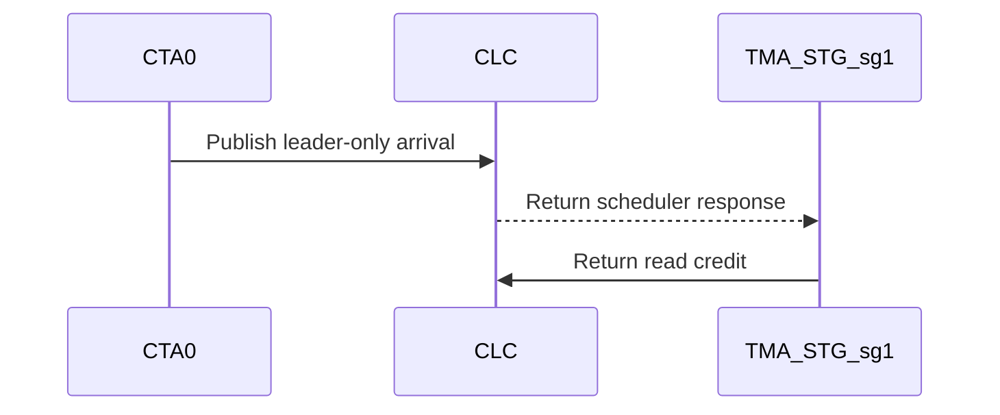

# sdpa: close scheduler-reader and D512 SWA barrier back-edges

[Upstream PR](https://github.com/NVIDIA/cudnn-frontend/pull/1547) · state: open · merged: False

## Original PR description

**Do not merge. Draft for Roman to review on Monday, October 12.**

A follow-up to #1541 found three other phase-lifetime gaps: a scheduler reader that does not return a credit can miss a whole parity cycle (including the terminal response), and a once-per-tile observer cannot safely wait on a signal that completes twice per tile.

- Common dense CLC now runs only its publishing scheduler warp and returns read credits only to CTA 0. Removing the peer loop alone would leave peer credit barriers advancing without a successful observer. The 26 caller-module aliases select this policy only for the common CLC path; persistent THD and local predecode keep their existing broadcast protocol. Arrival counts and the payload arming/fence order are unchanged.
- Five D512 role-split kernels stop the idle sg0 TMA-store role from consuming scheduler responses. This role has no output work and was never included in the read-credit count.
- SM100 D512 MXFP8 SWA=128 softmax waits on the existing once-per-tile Q/O alias signal, after both Dv256 slices drain, with its bootstrap phase accounted for. The twice-per-tile O-empty signal remains in the per-slice output protocol.

No public knob, host execute work, heuristic change, or extra kernel launch is introduced. Most changed kernel files only select the shared credit helper at template load time.

The new regression delays softmax in a private template copy after retained P is published, then checks dense and THD O, LSE and Amax after eager execution and four CUDA Graph replays. For THD, only that private copy enables the existing one-CTA launch cap so the test actually reuses a CTA; production THD launch sizing is unchanged. A separate test-private old-gate control reaches its bounded device-wait failure, while the fix completes. The other two findings have a static lifetime proof plus targeted runtime coverage; they are not claimed as newly reproduced natural CI hangs.

Validation (cuDNN 9.27, CuTe DSL 4.8.0; unique test cases):
- B300/SM103: **94 passed** across dense half/FP8/MXFP8, repeated THD work, D128 decode, both D512 backward datapaths, the complete back-edge regression module, and delayed dense/THD replay.
- SM107: **73 passed, 6 skipped**, plus **one existing D64 THD admission failure** reproduced on the exact parent. That test cannot find a FROST plan and fails before any attention kernel launch. No new runtime failure was observed.
- Independent static barrier review covered all 26 common-CLC callers and 135 existing credit sites. All 30 changed files on both test hosts match commit `0d04be32cc249066e908787447acda48e791007d`. Changed-file format/license hooks pass.

GPU CI has been requested for this exact head (bot acknowledgement: pipeline 72824597), and a manual CodeRabbit review was requested while keeping this PR Draft. Neither is claimed complete. This does not fix or attribute native-backend issue #1538, and does not include the separate numerical follow-up from #1544.

<!-- This is an auto-generated comment: release notes by coderabbit.ai -->

## Summary by CodeRabbit

* **Bug Fixes**
  * Improved attention scheduling so only the designated leader handles dense scheduler responses, while other scheduler roles no longer consume them. Variable-length workloads retain their existing scheduling behavior.
  * Corrected synchronization for select D512 MXFP8 workloads to prevent the softmax epilogue from proceeding before the required tile data is ready.
* **Tests**
  * Added coverage for dense and variable-length outputs, statistics, and Amax values, including CUDA graph replay.

<!-- end of auto-generated comment: release notes by coderabbit.ai -->

## Review and discussion

### reviews

- vedaanta · APPROVED · 2026-10-10T07:25:58Z · [source](https://github.com/NVIDIA/cudnn-frontend/pull/1547#pullrequestreview-5478128294)

**Codex bot review · model: `gpt-6-astra`**

Reviewed all 30 changed files at `0d04be32cc249066e908787447acda48e791007d`. The scheduler selection and credit routing agree at all 26 common-CLC callers, including the three Rubin MXFP8 callers that also use CLC for THD. The idle SG0 store roles have no credit/store work to retain, and the D512 SWA wait follows the once-per-tile Q/O signal with the correct bootstrap phase. No approval-blocking finding; one nonblocking P2 below concerns stale generated-code test records.

Validation with cuDNN 9.27:
- **SM100: 41 checks passed**, including the complete back-edge module, delayed dense/THD softmax with graph replays, BF16/FP8/MXFP8 forward controls, repeated THD work, D512 forward datapaths and backward bitwise comparisons.
- **Rubin: 46 checks passed, 16 expected skips.** Two reference calculations initially failed because this Torch build's Triton assembler does not support `sm_107a`; they passed with a process-local ATen BMM reference fallback, retaining the original assertions and tolerances.
- **Exact-parent comparison:** both dense-BF16 backward PTX-golden checks pass on the parent and fail on this head under the pinned public DSL 4.7.0, confirming the fixture update needed below.
- **SM100 performance spot check:** interleaved parent/head/head/parent, BF16 B1/H16/S1024, unsplit D128 and D512 role-split paths. Mean per-run median GPU times were 30.69→30.93 µs and 121.97→120.97 µs; host enqueue times were 13.40→13.57 µs and 13.83→13.88 µs. No material regression in these two cases.

All changed files integrate cleanly with current develop. I did not independently reproduce the original natural scheduler hangs or run on SM103; passing tests establish the exercised paths, not an incidence estimate. Existing current-head CI reports its SM100/SM103 failures as old failures; no duplicate pipeline was requested.

<!-- codex-fe-review:github-only:vedaanta:1547:0d04be32cc249066e908787447acda48e791007d:complete -->

- YangXu1990uiuc · COMMENTED · 2026-10-12T06:52:20Z · [source](https://github.com/NVIDIA/cudnn-frontend/pull/1547#pullrequestreview-5487319457)

**Codex bot review · model: `gpt-6-astra`**

Reviewed `0d04be32cc24` against base `52928eeb06c1`.

Supplement to Vedaanta's same-head review: no new approval-blocking correctness finding, and the existing approval is retained. The scheduler/credit pairing is consistent across all 26 common-CLC callers; THD persistent/predecode paths retain their local protocol. There is an additional P2 beyond the already reported backward PTX records: four forward SASS checks pass on the exact parent and fail on this head. Please include these in the generated-code/performance follow-up before landing. I am respecting the explicit request to wait for Roman's review; this comment is not a merge action.

**[P2] Update the forward credit-arrive pins and qualify the changed spill counts** ([source](https://github.com/NVIDIA/cudnn-frontend/blob/0d04be32cc249066e908787447acda48e791007d/python/cudnn/frost/tile_dsl/scheduler.py#L214))

The leader-only helper also changes the forward generated-code contracts. With the same local DSL 4.7.1 toolchain, all four checks pass on exact parent 46786f137c97 and fail on 0d04be32cc24: test_sm100_d128_mxfp8_credit_arrive_sass_pins[dense], test_sm100_d192_f16_exp2_split_sass_pins[causal], test_sm103_d192_f16_exp2_split_is_folded_out_sass_pins[causal], and test_sm103_d128_fp8_exp2_split_is_folded_out_sass_pins[causal]. The dense MXFP8 expectation still encodes the old broadcast/branch implementation (BSSY 15 versus the new 8; SYNCS_ARRIVE 55 versus 48). The other three are actual spill-count changes: STL/LDL are now 6/6, 28/32 and 8/8, exceeding their existing bounds. Update the obsolete credit-arrive assertion/provenance, and qualify the affected causal specializations before deliberately refreshing spill bounds; simply increasing their global tolerance would remove useful coverage. These exact four failures are also present in both failed CI lanes, so they are not explained by the job-level 'Old Failure' label. My small SM100 A/B did not show a material slowdown, but it does not qualify SM103.

Evidence: Exact-parent targeted pytest: 4 passed in 27.30s; exact-head same selection: 4 failed in 25.68s. Existing pipeline 72824597 jobs 479371855 and 479371860 show the same four SASS failures, in addition to six backward PTX hash mismatches and four paged-decline message assertions. Attribution: Introduced by this scheduler/credit protocol change. Extends, rather than repeats, the earlier finding about backward PTX records.

- **[P2] Still open:** [Previously reported backward PTX records still need refresh](https://github.com/NVIDIA/cudnn-frontend/pull/1547#discussion_r4236858489).

Validation: Independently checked the 26 common-CLC caller guards against their leader-only credit aliases, the five idle SG0 store roles, and the D512 MXFP8 Q/O signal's once-per-tile completion and bootstrap phase. None of the 30 PR-owned files changed between the parent and current develop. Fresh matching native bindings; source-pinned parent/head runs with cuDNN 9.27 and CuTe DSL 4.7.1 on a local NVIDIA DRIVE P2021 SM100. Interleaved parent/head/head/parent: MXFP8 D128 dense, B1/Hq24/Hkv8/S4096, GPU time 471.63 to 435.24 us; BF16 D192x128 causal with Stats and explicitly selected LPT_L2/cga2/split1, B1/H16/S2048, 89.90 to 90.56 us. These are warm CUDA Graph times per invocation, with timing events captured around 20 invocations. Outputs matched their references and were bit-identical across revisions and after replay. No material regression in these two cases; this is not a B200/SM103 or serving qualification. For the BF16 LPT case, warm host enqueue remained approximately 11.8 us on both revisions. The MXFP8 host samples were variable; I do not infer a CPU speedup from them. Compilation and setup were outside all reported timings. Reused the prior same-head review's broader SM100/SM107 correctness evidence without claiming to have rerun it. Inspected the actual failed CI traces rather than relying on the job-level baseline label. No duplicate CI run was requested; labels, project and milestone are already present.

Limitations: No new SM103 hardware performance run, sanitizer run, or reproduction of the original natural scheduler hang. The SM103 spill changes still need target-hardware assessment. The four paged-decline message failures in the existing CI were not attributed by this follow-up. Generated-code fixture failures remain unresolved, and Roman's requested review remains a separate landing condition.

Comment only: GitHub does not allow reviewing one's own PR with approval/request-changes.

<!-- codex-fe-review:v2:1547:0d04be32cc249066e908787447acda48e791007d:complete:no-blocker -->

### issue_comments

- coderabbitai · comment · 2026-10-10T03:01:48Z · [source](https://github.com/NVIDIA/cudnn-frontend/pull/1547#issuecomment-6093099676)

<!-- This is an auto-generated comment: summarize by coderabbit.ai -->
<!-- review_stack_entry_start -->

<!-- review_stack_entry_end -->
<!-- recent_review_start -->

No actionable comments were generated in the recent review. 🎉

<strong>ℹ️ Recent review info</strong>

<dl>
<dd>
<dl>
<dd>
<dl>
<dd>

<strong>⚙️ Run configuration</strong>

<dl>
<dd>
<dl>
<dd>
<dl>
<dd>

- **Configuration used**: Repository: NVIDIA/cudnn-frontend/.coderabbit.yaml
- **Review profile**: CHILL
- **Plan**: Enterprise
- **Run ID**: `149f3b96-dd07-426c-9042-6287fdf88081`

</dd>
</dl>

</dd>
</dl>

</dd>
</dl>

<strong>📥 Commits</strong>

<dl>
<dd>
<dl>
<dd>
<dl>
<dd>

Reviewing files that changed from the base of the PR and between 46786f137c97405c66548c018d1467e6ab23d12e and 0d04be32cc249066e908787447acda48e791007d.

</dd>
</dl>

</dd>
</dl>

</dd>
</dl>

<strong>📒 Files selected for processing (30)</strong>

<dl>
<dd>
<dl>
<dd>
<dl>
<dd>

* `python/cudnn/frost/tile_dsl/scheduler.py`
* `python/cudnn/sdpa/AGENTS.md`
* `python/cudnn/sdpa/bwd/kernels/sm100/bprop_d512_f16.py`
* `python/cudnn/sdpa/bwd/kernels/sm100/bprop_d512_f16_2x2.py`
* `python/cudnn/sdpa/bwd/kernels/sm107/bprop_d512_f16_2x2.py`
* `python/cudnn/sdpa/fwd/kernels/sm100/decode_d128_f16.py`
* `python/cudnn/sdpa/fwd/kernels/sm100/prefill_d128_f16.py`
* `python/cudnn/sdpa/fwd/kernels/sm100/prefill_d128_fp8.py`
* `python/cudnn/sdpa/fwd/kernels/sm100/prefill_d128_mxfp8.py`
* `python/cudnn/sdpa/fwd/kernels/sm100/prefill_d192_d128_f16.py`
* `python/cudnn/sdpa/fwd/kernels/sm100/prefill_d192_d128_mxfp8.py`
* `python/cudnn/sdpa/fwd/kernels/sm100/prefill_d256_f16.py`
* `python/cudnn/sdpa/fwd/kernels/sm100/prefill_d512_f16.py`
* `python/cudnn/sdpa/fwd/kernels/sm100/prefill_d512_f16_2x2.py`
* `python/cudnn/sdpa/fwd/kernels/sm100/prefill_d512_fp8.py`
* `python/cudnn/sdpa/fwd/kernels/sm100/prefill_d512_mxfp8.py`
* `python/cudnn/sdpa/fwd/kernels/sm107/prefill_d128_f16.py`
* `python/cudnn/sdpa/fwd/kernels/sm107/prefill_d128_fp8.py`
* `python/cudnn/sdpa/fwd/kernels/sm107/prefill_d128_mxfp8.py`
* `python/cudnn/sdpa/fwd/kernels/sm107/prefill_d192_d128_f16.py`
* `python/cudnn/sdpa/fwd/kernels/sm107/prefill_d192_d128_fp8.py`
* `python/cudnn/sdpa/fwd/kernels/sm107/prefill_d192_d128_mxfp8.py`
* `python/cudnn/sdpa/fwd/kernels/sm107/prefill_d256_f16.py`
* `python/cudnn/sdpa/fwd/kernels/sm107/prefill_d256_fp8.py`
* `python/cudnn/sdpa/fwd/kernels/sm107/prefill_d256_mxfp8.py`
* `python/cudnn/sdpa/fwd/kernels/sm107/prefill_d512_f16.py`
* `python/cudnn/sdpa/fwd/kernels/sm107/prefill_d512_f16_2x2.py`
* `python/cudnn/sdpa/fwd/kernels/sm107/prefill_d512_fp8.py`
* `python/cudnn/sdpa/fwd/kernels/sm107/prefill_d512_mxfp8.py`
* `test/python/sdpa/frost/test_sdpa_fwd_o_empty_backedge.py`

</dd>
</dl>

</dd>
</dl>

</dd>
</dl>

**Included review availability:** This review used your included allowance. Your plan provides up to 12 included reviews per hour; 10 remain after this review.

</dd>
</dl>

</dd>
</dl>

</dd>
</dl>

---

<!-- recent_review_end -->
<!-- walkthrough_start -->

<strong>📝 Walkthrough</strong>

<dl>
<dd>

<strong>📝 Walkthrough</strong>

<dl>
<dd>

<strong>📝 Walkthrough</strong>

<dl>
<dd>
<dl>
<dd>

## Walkthrough

The change adds a leader-only scheduler arrival helper and updates SDPA kernel call sites and D512 store-subgroup scheduler loops. It also changes an SM100 D512 MXFP8 barrier wait and adds a replay test for dense and THD cases.

### Changes

**Scheduler and barrier updates**

|Layer / File(s)|Summary|
|:---|:---|
|**Scheduler credit and loop behavior**   `python/cudnn/frost/tile_dsl/scheduler.py`, `python/cudnn/sdpa/AGENTS.md`|Adds a leader-only arrival helper and limits the scheduler warp loop to the first CTA. The guidance documents reader credit behavior and scheduler participation.|
|**Kernel scheduler arrival selection**   `python/cudnn/sdpa/bwd/kernels/sm100/bprop_d512_f16.py`, `python/cudnn/sdpa/bwd/kernels/sm100/bprop_d512_f16_2x2.py`, `python/cudnn/sdpa/bwd/kernels/sm107/bprop_d512_f16_2x2.py`, `python/cudnn/sdpa/fwd/kernels/sm100/{decode_d128_f16.py,prefill_d128_*.py,prefill_d192_d128_*.py,prefill_d256_f16.py,prefill_d512_f16*.py,prefill_d512_fp8.py}`, `python/cudnn/sdpa/fwd/kernels/sm107/{prefill_d128_*.py,prefill_d192_d128_*.py,prefill_d256_*.py,prefill_d512_*.py}`|Updates scheduler helper selection across forward and backward kernels. Dense CLC paths use the leader-only helper; several THD and predecode paths retain their prior helper.|
|**D512 store subgroup scheduler loops**   `python/cudnn/sdpa/fwd/kernels/sm100/{prefill_d512_f16.py,prefill_d512_fp8.py}`, `python/cudnn/sdpa/fwd/kernels/sm107/{prefill_d512_f16.py,prefill_d512_fp8.py,prefill_d512_mxfp8.py}`|Changes the TMA-STG scheduler loops so sg0 skips scheduler responses and sg1 continues to consume responses and return read credits. Updates comments describing the subgroup roles.|
|**D512 MXFP8 barrier wait and replay test**   `python/cudnn/sdpa/AGENTS.md`, `python/cudnn/sdpa/fwd/kernels/sm100/prefill_d512_mxfp8.py`, `test/python/sdpa/frost/test_sdpa_fwd_o_empty_backedge.py`|Uses the Q/O alias signal for the SM100 D512 MXFP8 SWA wait. Adds a dense and THD subprocess probe that checks output, LSE, and Amax after replay.|

<!-- change_assessment_start -->
**Priority:** ➖ Normal

**Estimated code review effort:** 3 (Moderate) | ~25 minutes

<!-- change_assessment_commit:"0d04be32cc249066e908787447acda48e791007d" -->
**Change:** Bug fix
<!-- change_assessment_end -->

### Sequence Diagram(s)

**Suggested reviewers:** `romananders90`, `vedaanta`

</dd>
</dl>

</dd>
</dl>

</dd>
</dl>

</dd>
</dl>

<!-- walkthrough_end -->
<!-- final_review_risk_start -->
**Merge Risk:** **⚪ Minimal** · up to `0d04b`
<!-- final_review_risk_coverage:{"sourceCommitId":"0d04be32cc249066e908787447acda48e791007d","coveredCommitId":"0d04be32cc249066e908787447acda48e791007d","kind":"reviewed"} -->

No actionable code risk was established for this change. Complete the requested GPU CI run before merging the draft.
<!-- final_review_risk_end -->
<!-- pre_merge_checks_walkthrough_start -->

<strong>Pre-merge checks | <picture></picture> 4 | <picture></picture> 1</strong>

<dl>
<dd>

### ❌ Failed checks (1 warning)

|     Check name     |                                              Status                                              | Explanation                                                                                                                                                                                               | Resolution                                                                         |
| :---------------- | :----------------------------------------------------------------------------------------------: | :-------------------------------------------------------------------------------------------------------------------------------------------------------------------------------------------------------- | :--------------------------------------------------------------------------------- |
| Docstring Coverage |  | Docstring coverage is 66.67% which is insufficient. The required threshold is 80.00%. Docstring coverage is scoped to functions touched by this diff. Analyzed 42 functions across 29 files. (1 skipped:… | Write docstrings for the functions missing them to satisfy the coverage threshold. |

<strong>✅ Passed checks (4 passed)</strong>

<dl>
<dd>

|         Check name         |                                             Status                                             | Explanation                                                                                                                                                                                               |
| :------------------------ | :--------------------------------------------------------------------------------------------: | :-------------------------------------------------------------------------------------------------------------------------------------------------------------------------------------------------------- |
|     Linked Issues check    |  | Check skipped because no linked issues were found for this pull request.                                                                                                                                  |
| Out of Scope Changes check |  | Check skipped because no linked issues were found for this pull request.                                                                                                                                  |
|         Title check        |  | The title clearly summarizes the main changes: closing scheduler-reader credit gaps and the D512 SWA barrier back-edge.                                                                                   |
|      Description check     |  | The description is detailed and covers the change scope, motivation, compatibility impact, testing results, known limitations, and related issues. It does not use the template headings or include the … |

</dd>
</dl>

<strong>Full details: Docstring Coverage</strong>

<dl>
<dd>

**Explanation**

Docstring coverage is 66.67% which is insufficient. The required threshold is 80.00%. Docstring coverage is scoped to functions touched by this diff. Analyzed 42 functions across 29 files. (1 skipped: 1 unsupported.)

</dd>
</dl>

</dd>
</dl>

<!-- pre_merge_checks_walkthrough_end -->

- [ ] <!-- {"checkboxId":"585bb3f6-faf5-4dbf-96d2-74e382adf19a"} --> Fix all pre-merge checks with AI
<!-- finishing_touch_checkbox_start -->

<strong>✨ Finishing Touches</strong>

<dl>
<dd>
<dl>
<dd>
<dl>
<dd>

<strong>🧪 Generate unit tests (beta)</strong>

<dl>
<dd>
<dl>
<dd>
<dl>
<dd>

- [ ] <!-- {"checkboxId": "f47ac10b-58cc-4372-a567-0e02b2c3d479", "radioGroupId": "utg-output-choice-group-6093129826"} --> Create a new PR

</dd>
</dl>

</dd>
</dl>

</dd>
</dl>

</dd>
</dl>

</dd>
</dl>

</dd>
</dl>

<!-- finishing_touch_checkbox_end -->

<!-- autopilot:start -->
- [ ] <!-- {"checkboxId":"2708ad07-9f24-4260-9c11-7dc76a49f2e3"} --> <strong title="Keep fixing CodeRabbit findings and required CI, and resolving merge conflicts">Autofix</strong> · Keep fixing CodeRabbit findings and required CI, and resolving merge conflicts
<!-- autopilot:end -->
<!-- tips_start -->

---

Comment `@coderabbitai help` to get the list of available commands.

<!-- tips_end -->

- YangXu1990uiuc · comment · 2026-10-10T03:02:35Z · [source](https://github.com/NVIDIA/cudnn-frontend/pull/1547#issuecomment-6093105671)

@cudnn-ci-bot run python/sdpa/frost

- cudnn-ci-bot · comment · 2026-10-10T03:02:39Z · [source](https://github.com/NVIDIA/cudnn-frontend/pull/1547#issuecomment-6093106122)

🏁 Pipeline finished

SHA: `0d04be3`
Targets: `python/sdpa/frost`
Branch: [cudnn-gh/pr-1547-0d04be3](https://nv/cudnn-gitlab-ci/-/tree/cudnn-gh/pr-1547-0d04be3)
Pipeline: [72824597](https://nv/cudnn-gitlab-ci/-/pipelines/72824597)
Last updated: 2026-10-10 03:48 UTC

**23 passed, 2 failed, 3 skipped, 11 manual**

### <code>manual</code>

- <code>manual:python_samples</code> - Manual
- <code>manual:python</code> - Manual
- <code>manual:python/sdpa/frost</code> - ✅ Passed
- <code>manual:python/linear_attention/frost</code> - Manual
- <code>manual:python/gemm/frost</code> - Manual
- <code>manual:python/*/frost</code> - Manual
- <code>manual:python/gemm/cutedsl</code> - Manual
- <code>manual:python/*/cutedsl</code> - Manual
- <code>manual:python/*/jax</code> - Manual
- <code>manual:pycudnn</code> - Manual
- <code>manual:multi_gpu</code> - Manual
- <code>manual:backend</code> - Manual

### <code>analysis</code>

- <code>analysis:cudnn_clang_disable_exception</code> - ✅ Passed
- <code>analysis:cudnn_v9_no_half_conversion</code> - ✅ Passed
- <code>analysis:cudnn_clang</code> - ✅ Passed
- <code>analysis:check-relative-includes</code> - ✅ Passed
- <code>analysis:check-CUDNN_FRONTEND_SKIP_JSON_LIB</code> - ✅ Passed
- <code>analysis:guardwords_scan</code> - ✅ Passed
- <code>analysis:jax-import-guard</code> - ✅ Passed
- <code>analysis:pytest-gpu</code> - ✅ Passed
- <code>san:build</code> - ✅ Passed

### <code>build</code>

- <code>analysis:api_index</code> - ✅ Passed
- <code>build:dev:linux:amd64</code> - ✅ Passed
- <code>build:rel:linux:amd64</code> - ✅ Passed
- <code>build:dev:linux:arm64</code> - ✅ Passed
- <code>build:rel:linux:arm64</code> - ✅ Passed
- <code>build:rel:win:amd64</code> - ✅ Passed

### <code>frost_tests</code>

- <code>python/sdpa/frost:cutlass-rel:sm80</code> - ✅ Passed
- <code>python/sdpa/frost:cutlass-rel:sm100</code> - ❌ **Old Failure** (nightly failed)
- <code>python/sdpa/frost:cutlass-rel:sm120</code> - ✅ Passed
- <code>python/linear_attention/frost:cutlass-rel:sm100</code> - Skipped
- <code>python/gemm/frost:cutlass-rel:sm100</code> - Skipped
- <code>python/*/frost:cutlass-rel:sm100</code> - Skipped
- <code>python/sdpa/frost:cutlass-rel:sm103</code> - ❌ **Old Failure** (nightly failed)
- <code>python/sdpa/frost:cutlass-4.8:sm107</code> - ✅ Passed

### <code>sanitizer_tests</code>

- <code>san:cpp_test:sm80</code> - ✅ Passed
- <code>san:cpp_test:sm90</code> - ✅ Passed
- <code>san:cpp_test:sm100</code> - ✅ Passed

### <code>triage</code>

- <code>triage:ai</code> - ✅ Passed

- YangXu1990uiuc · comment · 2026-10-10T03:05:48Z · [source](https://github.com/NVIDIA/cudnn-frontend/pull/1547#issuecomment-6093129826)

@coderabbitai review

- coderabbitai · comment · 2026-10-10T03:05:55Z · [source](https://github.com/NVIDIA/cudnn-frontend/pull/1547#issuecomment-6093130761)

<!-- This is an auto-generated reply by CodeRabbit -->
<!-- CodeRabbit review command invocation: v2:a5350b334557fbd14e25d93aea3cd5301622f657ab9b5b87183ad8c3fd5f812d -->

✅ Action performed

Review finished.

> Note: CodeRabbit is an incremental review system and does not re-review already reviewed commits. This command is applicable only when automatic reviews are paused.

### inline_comments

- vedaanta · comment · 2026-10-10T07:25:58Z · [source](https://github.com/NVIDIA/cudnn-frontend/pull/1547#discussion_r4236858489)

File: `python/cudnn/frost/tile_dsl/scheduler.py` · line 214

[P2] Refresh the dense backward rendering records for this protocol change

The new scheduler/credit code changes the generated stage-2 PTX, but the committed records consumed by `test_stage2_default_rendering_ptx_md5_is_unchanged` and `test_stage2_2x2_default_rendering_ptx_md5_is_unchanged` are unchanged. With their pinned `nvidia-cutlass-dsl 4.7.0`, both `dense_bf16` checks pass on exact parent `46786f137c97` and fail here: the 4x1 hash changes from `ddf510ea…` to `1d01849e…`, and the 2x2 hash from `b9998a20…` to `326697a4…`. These are expected rendering changes from the fix, but they leave reproducible failures on the supported pinned toolchain. Re-render the affected records in `test/python/sdpa/frost/renderings/md5_stage2_{4x1,2x2}_sm100a.txt` and update the provenance to identify this intentional protocol change. This is a nonblocking test-fixture issue; the corresponding runtime numerical checks passed.

## Changed files and fixed code

- `python/cudnn/frost/tile_dsl/scheduler.py` · modified · additions 23 / deletions 1
  - [head](https://github.com/YangXu1990uiuc/cudnn-frontend/blob/0d04be32cc249066e908787447acda48e791007d/python/cudnn/frost/tile_dsl/scheduler.py)
  - [base](https://github.com/NVIDIA/cudnn-frontend/blob/46786f137c97405c66548c018d1467e6ab23d12e/python/cudnn/frost/tile_dsl/scheduler.py)
- `python/cudnn/sdpa/AGENTS.md` · modified · additions 21 / deletions 0
  - [head](https://github.com/YangXu1990uiuc/cudnn-frontend/blob/0d04be32cc249066e908787447acda48e791007d/python/cudnn/sdpa/AGENTS.md)
  - [base](https://github.com/NVIDIA/cudnn-frontend/blob/46786f137c97405c66548c018d1467e6ab23d12e/python/cudnn/sdpa/AGENTS.md)
- `python/cudnn/sdpa/bwd/kernels/sm100/bprop_d512_f16.py` · modified · additions 6 / deletions 0
  - [head](https://github.com/YangXu1990uiuc/cudnn-frontend/blob/0d04be32cc249066e908787447acda48e791007d/python/cudnn/sdpa/bwd/kernels/sm100/bprop_d512_f16.py)
  - [base](https://github.com/NVIDIA/cudnn-frontend/blob/46786f137c97405c66548c018d1467e6ab23d12e/python/cudnn/sdpa/bwd/kernels/sm100/bprop_d512_f16.py)
- `python/cudnn/sdpa/bwd/kernels/sm100/bprop_d512_f16_2x2.py` · modified · additions 6 / deletions 0
  - [head](https://github.com/YangXu1990uiuc/cudnn-frontend/blob/0d04be32cc249066e908787447acda48e791007d/python/cudnn/sdpa/bwd/kernels/sm100/bprop_d512_f16_2x2.py)
  - [base](https://github.com/NVIDIA/cudnn-frontend/blob/46786f137c97405c66548c018d1467e6ab23d12e/python/cudnn/sdpa/bwd/kernels/sm100/bprop_d512_f16_2x2.py)
- `python/cudnn/sdpa/bwd/kernels/sm107/bprop_d512_f16_2x2.py` · modified · additions 6 / deletions 0
  - [head](https://github.com/YangXu1990uiuc/cudnn-frontend/blob/0d04be32cc249066e908787447acda48e791007d/python/cudnn/sdpa/bwd/kernels/sm107/bprop_d512_f16_2x2.py)
  - [base](https://github.com/NVIDIA/cudnn-frontend/blob/46786f137c97405c66548c018d1467e6ab23d12e/python/cudnn/sdpa/bwd/kernels/sm107/bprop_d512_f16_2x2.py)
- `python/cudnn/sdpa/fwd/kernels/sm100/decode_d128_f16.py` · modified · additions 6 / deletions 0
  - [head](https://github.com/YangXu1990uiuc/cudnn-frontend/blob/0d04be32cc249066e908787447acda48e791007d/python/cudnn/sdpa/fwd/kernels/sm100/decode_d128_f16.py)
  - [base](https://github.com/NVIDIA/cudnn-frontend/blob/46786f137c97405c66548c018d1467e6ab23d12e/python/cudnn/sdpa/fwd/kernels/sm100/decode_d128_f16.py)
- `python/cudnn/sdpa/fwd/kernels/sm100/prefill_d128_f16.py` · modified · additions 6 / deletions 0
  - [head](https://github.com/YangXu1990uiuc/cudnn-frontend/blob/0d04be32cc249066e908787447acda48e791007d/python/cudnn/sdpa/fwd/kernels/sm100/prefill_d128_f16.py)
  - [base](https://github.com/NVIDIA/cudnn-frontend/blob/46786f137c97405c66548c018d1467e6ab23d12e/python/cudnn/sdpa/fwd/kernels/sm100/prefill_d128_f16.py)
- `python/cudnn/sdpa/fwd/kernels/sm100/prefill_d128_fp8.py` · modified · additions 6 / deletions 0
  - [head](https://github.com/YangXu1990uiuc/cudnn-frontend/blob/0d04be32cc249066e908787447acda48e791007d/python/cudnn/sdpa/fwd/kernels/sm100/prefill_d128_fp8.py)
  - [base](https://github.com/NVIDIA/cudnn-frontend/blob/46786f137c97405c66548c018d1467e6ab23d12e/python/cudnn/sdpa/fwd/kernels/sm100/prefill_d128_fp8.py)
- `python/cudnn/sdpa/fwd/kernels/sm100/prefill_d128_mxfp8.py` · modified · additions 6 / deletions 0
  - [head](https://github.com/YangXu1990uiuc/cudnn-frontend/blob/0d04be32cc249066e908787447acda48e791007d/python/cudnn/sdpa/fwd/kernels/sm100/prefill_d128_mxfp8.py)
  - [base](https://github.com/NVIDIA/cudnn-frontend/blob/46786f137c97405c66548c018d1467e6ab23d12e/python/cudnn/sdpa/fwd/kernels/sm100/prefill_d128_mxfp8.py)
- `python/cudnn/sdpa/fwd/kernels/sm100/prefill_d192_d128_f16.py` · modified · additions 6 / deletions 0
  - [head](https://github.com/YangXu1990uiuc/cudnn-frontend/blob/0d04be32cc249066e908787447acda48e791007d/python/cudnn/sdpa/fwd/kernels/sm100/prefill_d192_d128_f16.py)
  - [base](https://github.com/NVIDIA/cudnn-frontend/blob/46786f137c97405c66548c018d1467e6ab23d12e/python/cudnn/sdpa/fwd/kernels/sm100/prefill_d192_d128_f16.py)
- `python/cudnn/sdpa/fwd/kernels/sm100/prefill_d192_d128_mxfp8.py` · modified · additions 6 / deletions 0
  - [head](https://github.com/YangXu1990uiuc/cudnn-frontend/blob/0d04be32cc249066e908787447acda48e791007d/python/cudnn/sdpa/fwd/kernels/sm100/prefill_d192_d128_mxfp8.py)
  - [base](https://github.com/NVIDIA/cudnn-frontend/blob/46786f137c97405c66548c018d1467e6ab23d12e/python/cudnn/sdpa/fwd/kernels/sm100/prefill_d192_d128_mxfp8.py)
- `python/cudnn/sdpa/fwd/kernels/sm100/prefill_d256_f16.py` · modified · additions 6 / deletions 0
  - [head](https://github.com/YangXu1990uiuc/cudnn-frontend/blob/0d04be32cc249066e908787447acda48e791007d/python/cudnn/sdpa/fwd/kernels/sm100/prefill_d256_f16.py)
  - [base](https://github.com/NVIDIA/cudnn-frontend/blob/46786f137c97405c66548c018d1467e6ab23d12e/python/cudnn/sdpa/fwd/kernels/sm100/prefill_d256_f16.py)
- `python/cudnn/sdpa/fwd/kernels/sm100/prefill_d512_f16.py` · modified · additions 10 / deletions 1
  - [head](https://github.com/YangXu1990uiuc/cudnn-frontend/blob/0d04be32cc249066e908787447acda48e791007d/python/cudnn/sdpa/fwd/kernels/sm100/prefill_d512_f16.py)
  - [base](https://github.com/NVIDIA/cudnn-frontend/blob/46786f137c97405c66548c018d1467e6ab23d12e/python/cudnn/sdpa/fwd/kernels/sm100/prefill_d512_f16.py)
- `python/cudnn/sdpa/fwd/kernels/sm100/prefill_d512_f16_2x2.py` · modified · additions 6 / deletions 0
  - [head](https://github.com/YangXu1990uiuc/cudnn-frontend/blob/0d04be32cc249066e908787447acda48e791007d/python/cudnn/sdpa/fwd/kernels/sm100/prefill_d512_f16_2x2.py)
  - [base](https://github.com/NVIDIA/cudnn-frontend/blob/46786f137c97405c66548c018d1467e6ab23d12e/python/cudnn/sdpa/fwd/kernels/sm100/prefill_d512_f16_2x2.py)
- `python/cudnn/sdpa/fwd/kernels/sm100/prefill_d512_fp8.py` · modified · additions 10 / deletions 1
  - [head](https://github.com/YangXu1990uiuc/cudnn-frontend/blob/0d04be32cc249066e908787447acda48e791007d/python/cudnn/sdpa/fwd/kernels/sm100/prefill_d512_fp8.py)
  - [base](https://github.com/NVIDIA/cudnn-frontend/blob/46786f137c97405c66548c018d1467e6ab23d12e/python/cudnn/sdpa/fwd/kernels/sm100/prefill_d512_fp8.py)
- `python/cudnn/sdpa/fwd/kernels/sm100/prefill_d512_mxfp8.py` · modified · additions 7 / deletions 1
  - [head](https://github.com/YangXu1990uiuc/cudnn-frontend/blob/0d04be32cc249066e908787447acda48e791007d/python/cudnn/sdpa/fwd/kernels/sm100/prefill_d512_mxfp8.py)
  - [base](https://github.com/NVIDIA/cudnn-frontend/blob/46786f137c97405c66548c018d1467e6ab23d12e/python/cudnn/sdpa/fwd/kernels/sm100/prefill_d512_mxfp8.py)
- `python/cudnn/sdpa/fwd/kernels/sm107/prefill_d128_f16.py` · modified · additions 6 / deletions 0
  - [head](https://github.com/YangXu1990uiuc/cudnn-frontend/blob/0d04be32cc249066e908787447acda48e791007d/python/cudnn/sdpa/fwd/kernels/sm107/prefill_d128_f16.py)
  - [base](https://github.com/NVIDIA/cudnn-frontend/blob/46786f137c97405c66548c018d1467e6ab23d12e/python/cudnn/sdpa/fwd/kernels/sm107/prefill_d128_f16.py)
- `python/cudnn/sdpa/fwd/kernels/sm107/prefill_d128_fp8.py` · modified · additions 6 / deletions 0
  - [head](https://github.com/YangXu1990uiuc/cudnn-frontend/blob/0d04be32cc249066e908787447acda48e791007d/python/cudnn/sdpa/fwd/kernels/sm107/prefill_d128_fp8.py)
  - [base](https://github.com/NVIDIA/cudnn-frontend/blob/46786f137c97405c66548c018d1467e6ab23d12e/python/cudnn/sdpa/fwd/kernels/sm107/prefill_d128_fp8.py)
- `python/cudnn/sdpa/fwd/kernels/sm107/prefill_d128_mxfp8.py` · modified · additions 4 / deletions 0
  - [head](https://github.com/YangXu1990uiuc/cudnn-frontend/blob/0d04be32cc249066e908787447acda48e791007d/python/cudnn/sdpa/fwd/kernels/sm107/prefill_d128_mxfp8.py)
  - [base](https://github.com/NVIDIA/cudnn-frontend/blob/46786f137c97405c66548c018d1467e6ab23d12e/python/cudnn/sdpa/fwd/kernels/sm107/prefill_d128_mxfp8.py)
- `python/cudnn/sdpa/fwd/kernels/sm107/prefill_d192_d128_f16.py` · modified · additions 6 / deletions 0
  - [head](https://github.com/YangXu1990uiuc/cudnn-frontend/blob/0d04be32cc249066e908787447acda48e791007d/python/cudnn/sdpa/fwd/kernels/sm107/prefill_d192_d128_f16.py)
  - [base](https://github.com/NVIDIA/cudnn-frontend/blob/46786f137c97405c66548c018d1467e6ab23d12e/python/cudnn/sdpa/fwd/kernels/sm107/prefill_d192_d128_f16.py)
- `python/cudnn/sdpa/fwd/kernels/sm107/prefill_d192_d128_fp8.py` · modified · additions 6 / deletions 0
  - [head](https://github.com/YangXu1990uiuc/cudnn-frontend/blob/0d04be32cc249066e908787447acda48e791007d/python/cudnn/sdpa/fwd/kernels/sm107/prefill_d192_d128_fp8.py)
  - [base](https://github.com/NVIDIA/cudnn-frontend/blob/46786f137c97405c66548c018d1467e6ab23d12e/python/cudnn/sdpa/fwd/kernels/sm107/prefill_d192_d128_fp8.py)
- `python/cudnn/sdpa/fwd/kernels/sm107/prefill_d192_d128_mxfp8.py` · modified · additions 4 / deletions 0
  - [head](https://github.com/YangXu1990uiuc/cudnn-frontend/blob/0d04be32cc249066e908787447acda48e791007d/python/cudnn/sdpa/fwd/kernels/sm107/prefill_d192_d128_mxfp8.py)
  - [base](https://github.com/NVIDIA/cudnn-frontend/blob/46786f137c97405c66548c018d1467e6ab23d12e/python/cudnn/sdpa/fwd/kernels/sm107/prefill_d192_d128_mxfp8.py)
- `python/cudnn/sdpa/fwd/kernels/sm107/prefill_d256_f16.py` · modified · additions 6 / deletions 0
  - [head](https://github.com/YangXu1990uiuc/cudnn-frontend/blob/0d04be32cc249066e908787447acda48e791007d/python/cudnn/sdpa/fwd/kernels/sm107/prefill_d256_f16.py)
  - [base](https://github.com/NVIDIA/cudnn-frontend/blob/46786f137c97405c66548c018d1467e6ab23d12e/python/cudnn/sdpa/fwd/kernels/sm107/prefill_d256_f16.py)
- `python/cudnn/sdpa/fwd/kernels/sm107/prefill_d256_fp8.py` · modified · additions 6 / deletions 0
  - [head](https://github.com/YangXu1990uiuc/cudnn-frontend/blob/0d04be32cc249066e908787447acda48e791007d/python/cudnn/sdpa/fwd/kernels/sm107/prefill_d256_fp8.py)
  - [base](https://github.com/NVIDIA/cudnn-frontend/blob/46786f137c97405c66548c018d1467e6ab23d12e/python/cudnn/sdpa/fwd/kernels/sm107/prefill_d256_fp8.py)
- `python/cudnn/sdpa/fwd/kernels/sm107/prefill_d256_mxfp8.py` · modified · additions 6 / deletions 0
  - [head](https://github.com/YangXu1990uiuc/cudnn-frontend/blob/0d04be32cc249066e908787447acda48e791007d/python/cudnn/sdpa/fwd/kernels/sm107/prefill_d256_mxfp8.py)
  - [base](https://github.com/NVIDIA/cudnn-frontend/blob/46786f137c97405c66548c018d1467e6ab23d12e/python/cudnn/sdpa/fwd/kernels/sm107/prefill_d256_mxfp8.py)
- `python/cudnn/sdpa/fwd/kernels/sm107/prefill_d512_f16.py` · modified · additions 14 / deletions 10
  - [head](https://github.com/YangXu1990uiuc/cudnn-frontend/blob/0d04be32cc249066e908787447acda48e791007d/python/cudnn/sdpa/fwd/kernels/sm107/prefill_d512_f16.py)
  - [base](https://github.com/NVIDIA/cudnn-frontend/blob/46786f137c97405c66548c018d1467e6ab23d12e/python/cudnn/sdpa/fwd/kernels/sm107/prefill_d512_f16.py)
- `python/cudnn/sdpa/fwd/kernels/sm107/prefill_d512_f16_2x2.py` · modified · additions 6 / deletions 0
  - [head](https://github.com/YangXu1990uiuc/cudnn-frontend/blob/0d04be32cc249066e908787447acda48e791007d/python/cudnn/sdpa/fwd/kernels/sm107/prefill_d512_f16_2x2.py)
  - [base](https://github.com/NVIDIA/cudnn-frontend/blob/46786f137c97405c66548c018d1467e6ab23d12e/python/cudnn/sdpa/fwd/kernels/sm107/prefill_d512_f16_2x2.py)
- `python/cudnn/sdpa/fwd/kernels/sm107/prefill_d512_fp8.py` · modified · additions 14 / deletions 10
  - [head](https://github.com/YangXu1990uiuc/cudnn-frontend/blob/0d04be32cc249066e908787447acda48e791007d/python/cudnn/sdpa/fwd/kernels/sm107/prefill_d512_fp8.py)
  - [base](https://github.com/NVIDIA/cudnn-frontend/blob/46786f137c97405c66548c018d1467e6ab23d12e/python/cudnn/sdpa/fwd/kernels/sm107/prefill_d512_fp8.py)
- `python/cudnn/sdpa/fwd/kernels/sm107/prefill_d512_mxfp8.py` · modified · additions 12 / deletions 10
  - [head](https://github.com/YangXu1990uiuc/cudnn-frontend/blob/0d04be32cc249066e908787447acda48e791007d/python/cudnn/sdpa/fwd/kernels/sm107/prefill_d512_mxfp8.py)
  - [base](https://github.com/NVIDIA/cudnn-frontend/blob/46786f137c97405c66548c018d1467e6ab23d12e/python/cudnn/sdpa/fwd/kernels/sm107/prefill_d512_mxfp8.py)
- `test/python/sdpa/frost/test_sdpa_fwd_o_empty_backedge.py` · modified · additions 115 / deletions 0
  - [head](https://github.com/YangXu1990uiuc/cudnn-frontend/blob/0d04be32cc249066e908787447acda48e791007d/test/python/sdpa/frost/test_sdpa_fwd_o_empty_backedge.py)
  - [base](https://github.com/NVIDIA/cudnn-frontend/blob/46786f137c97405c66548c018d1467e6ab23d12e/test/python/sdpa/frost/test_sdpa_fwd_o_empty_backedge.py)

## Evidence and interpretation boundary

[Original JSON, discussions and patches](../../../../../../evidence/prs/NVIDIA--cudnn-frontend/1547-8c83e1fd484f82af27f1ae68ae7ee6289852f86b4b9916a90d2f52c272f08a19.json) · SHA-256 `8c83e1fd484f82af27f1ae68ae7ee6289852f86b4b9916a90d2f52c272f08a19`.

Diff complete: True. Missing/binary/truncated patches require pinned source inspection. This is a source page, not an independently verified optimization case. Open, merged and released are different states; recheck the deployed dependency.
