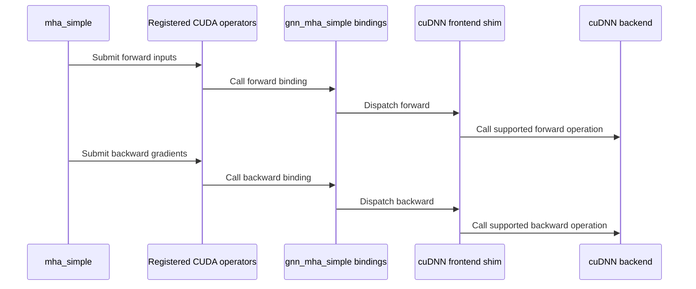

# Add GNN MHA Simple Python and PyTorch API

[Upstream PR](https://github.com/NVIDIA/cudnn-frontend/pull/1588) · state: open · merged: False

## Original PR description

## Before submitting

- [ ] I agree to license this contribution under the terms of [LICENSE.txt](https://github.com/NVIDIA/cudnn-frontend/blob/develop/LICENSE.txt).
- [ ] I ran `pre-commit run` and committed any formatting changes.
- [ ] I reviewed the Hard Rules in the `AGENTS.md` for each directory this PR touches (see [root AGENTS.md § Reviewing a PR](https://github.com/NVIDIA/cudnn-frontend/blob/develop/AGENTS.md#reviewing-a-pr-human-or-agent)) and my changes comply, or I explain the exception below.
- [ ] I added GitHub labels: one `cat-*`, one or more `area:*` / `op:*`, and one `orig-*` (see [label list](https://github.com/NVIDIA/cudnn-frontend/labels)).

## Affected area

<!-- Choose one:
- C++ frontend API or graph construction
- Python API or bindings
- FE OSS kernels or CuTeDSL
- Build, packaging, or installation
- CI or test infrastructure
- Documentation or samples
- Benchmarks or performance
- Not sure
-->

## Summary

<!-- What changed? Keep the scope concise. -->

## Why

<!-- What problem does this solve, and why is this approach appropriate? -->

## Related issues

<!-- Use "Fixes #123" or "Related to #123" where applicable. -->

## API and compatibility impact

<!-- Note public API, supported GPU/cuDNN/CUDA/Python versions, performance, or backward-compatibility changes. Write "None" if not applicable. -->

## Testing

<!-- List exact commands and results. If something was not tested, explain why. -->


<!-- This is an auto-generated comment: release notes by coderabbit.ai -->

## Summary by CodeRabbit

* **New Features**
  * Added `cudnn.gnn.mha_simple`, a PyTorch API for multi-head attention over CSC graphs, with optional edge features, attention weights, dropout, and deterministic or higher-precision gradients.
  * Added forward and backward support for cuDNN 9.28 or later. Deterministic backward requires reverse-CSC metadata.
* **Documentation**
  * Added usage and requirements documentation, including GPU and platform compatibility details.

<!-- end of auto-generated comment: release notes by coderabbit.ai -->

## Review and discussion

### reviews

### issue_comments

- coderabbitai[bot] · comment · 2026-10-12T19:22:43Z · [source](https://github.com/NVIDIA/cudnn-frontend/pull/1588#issuecomment-6131062340)

<!-- This is an auto-generated comment: summarize by coderabbit.ai -->
<!-- review_stack_entry_start -->

<a href="https://app.coderabbit.ai/change-stack/NVIDIA/cudnn-frontend/pull/1588?scope=ghh_OusAJGA4HG8ljoOV0wJvVx8NmnZIjc2DdjmxOu0xZWA&amp;cs_source=review_comment"><picture><source media="(prefers-color-scheme: dark)" srcset="https://storage.googleapis.com/coderabbit_public_assets/review-stack-in-coderabbit-ui-dark.svg?v=3"><source media="(prefers-color-scheme: light)" srcset="https://storage.googleapis.com/coderabbit_public_assets/review-stack-in-coderabbit-ui.svg?v=3"></picture></a>

<!-- review_stack_entry_end -->
<!-- This is an auto-generated comment: skip review by coderabbit.ai -->

> [!IMPORTANT]
> ## Draft PR not reviewed
> 
> Draft PRs are not automatically reviewed by default.
> 
> - [ ] <!-- {"checkboxId":"e9bb8d72-00e8-4f67-9cb2-caf3b22574fe"} --> Trigger a manual review
> 
> To automatically review draft PRs, update your CodeRabbit configuration:
> 
> ```yaml
> reviews:
>   auto_review:
>     drafts: true
> ```

<!-- end of auto-generated comment: skip review by coderabbit.ai -->

<!-- recent_review_start -->

No actionable comments were generated in the recent review. 🎉

<details>
<summary><strong>ℹ️ Recent review info</strong></summary>
<dl>
<dd>

<details>
<summary><strong>⚙️ Run configuration</strong></summary>
<dl>
<dd>

- **Configuration used**: Repository: NVIDIA/cudnn-frontend/.coderabbit.yaml
- **Review profile**: CHILL
- **Plan**: Enterprise
- **Run ID**: `3882e0dd-ea15-4877-8993-cc53fb123e51`


</dd>
</dl>
</details>

<details>
<summary><strong>📥 Commits</strong></summary>
<dl>
<dd>

Reviewing files that changed from the base of the PR and between 411012aa520dad5b30f14a24c8d738300cb945fd and 65c332cf4210b194162b7626cdcaf3c2acff41f6.


</dd>
</dl>
</details>

<details>
<summary><strong>📒 Files selected for processing (11)</strong></summary>
<dl>
<dd>

* `docs/fern/versions/latest.yml`
* `docs/operations/gnn/mha_simple.md`
* `include/cudnn_frontend_shim.h`
* `python/cudnn/__init__.py`
* `python/cudnn/gnn/__init__.py`
* `python/cudnn/gnn/mha_simple.py`
* `python/gnn.cpp`
* `test/python/api_index/api_index.txt`
* `test/python/gnn/_mha_test_utils.py`
* `test/python/gnn/test_bindings.py`
* `test/python/gnn/test_mha_simple.py`


</dd>
</dl>
</details>

**Included review availability:** This review used your included allowance. Your plan provides up to 12 included reviews per hour; 11 remain after this review.


</dd>
</dl>
</details>


<!-- recent_review_end -->
<!-- walkthrough_start -->

<details>
<summary><strong>📝 Walkthrough</strong></summary>
<dl>
<dd>

This pull request adds `cudnn.gnn.mha_simple` for multi-head attention over CSC graphs. It adds cuDNN forward and backward bindings, autograd support, input and gradient validation, tests, and API documentation.

**Changes: Simple Multi-Head Attention**

|Layer / File(s)|Summary|
|:---|:---|
|**cuDNN forward and backward bridge** <br> `include/cudnn_frontend_shim.h`, `python/gnn.cpp`|Adds version-gated shim dispatch and Python bindings for forward and backward operations.|
|**PyTorch API and autograd path** <br> `python/cudnn/gnn/mha_simple.py`, `python/cudnn/gnn/__init__.py`, `python/cudnn/__init__.py`|Adds input and gradient validation, forward and backward custom operators, fake implementations, autograd handling, and public exports for `mha_simple`.|
|**Behavior checks and API documentation** <br> `test/python/gnn/*`, `test/python/api_index/api_index.txt`, `docs/operations/gnn/mha_simple.md`, `docs/fern/versions/latest.yml`|Adds reference-based tests for outputs, attention, gradients, input cases, and execution options. Adds API index entries and documentation for the operation and its requirements.|

<!-- change_assessment_start -->
**Priority:** ➖ Normal


**Estimated code review effort:** 4 (Complex) | ~45 minutes

<!-- change_assessment_commit:"65c332cf4210b194162b7626cdcaf3c2acff41f6" -->
**Change:** Feature
<!-- change_assessment_end -->

### Sequence Diagram(s)



**Suggested reviewers:** `yangxu1990uiuc`

</dd>
</dl>
</details>

<!-- walkthrough_end -->
<details>
<summary><strong>Merge Risk:</strong> <strong>⚪ Minimal</strong> · up to <code>65c33</code></summary>
<dl>
<dd>

<!-- final_review_risk_start -->
<!-- final_review_risk_label
**Merge Risk:** **⚪ Minimal** · up to `65c33`
-->
<!-- final_review_risk_coverage:{"sourceCommitId":"65c332cf4210b194162b7626cdcaf3c2acff41f6","coveredCommitId":"65c332cf4210b194162b7626cdcaf3c2acff41f6","kind":"reviewed"} -->

This change adds the `cudnn.gnn.mha_simple` PyTorch API, its cuDNN bindings, tests and documentation. The review found no confirmed blocking issue. One open question remains: whether the dimension-normalization flag matches the backend's expected parameter type. That cannot be confirmed without the cuDNN 9.28 headers, so maintainers may want to check it against those headers.
<!-- final_review_risk_end -->

</dd>
</dl>
</details>
<!-- pre_merge_checks_walkthrough_start -->

<details>
<summary><strong>Pre-merge checks · <sup><picture></picture></sup> 3 · <sup><picture></picture></sup> 2</strong></summary>
<dl>
<dd>

<strong><sup><picture></picture></sup> Failed checks (2 warnings)</strong>

|     Check name     |                                              Status                                              | Explanation                                                                                                                                                                                               | Resolution                                                                                                                                                                                                                         |
| :---------------- | :----------------------------------------------------------------------------------------------: | :-------------------------------------------------------------------------------------------------------------------------------------------------------------------------------------------------------- | :--------------------------------------------------------------------------------------------------------------------------------------------------------------------------------------------------------------------------------- |
|  Description check |  | The description contains the template structure and checklist, but all required content sections remain unanswered. It lacks the summary, rationale, related issues information, API and compatibility i… | Complete the required checklist and provide content for Affected area, Summary, Why, Related issues, API and compatibility impact, and Testing. Include exact test commands and results, or explain why testing was not performed. |
| Docstring Coverage |  | Docstring coverage is 6.67% which is insufficient. The required threshold is 80.00%. Docstring coverage is scoped to functions touched by this diff. Analyzed 45 functions across 8 files. (3 skipped: 3… | Write docstrings for the functions missing them to satisfy the coverage threshold.                                                                                                                                                 |

<details>
<summary><strong><sup><picture></picture></sup> Passed checks (3 passed)</strong></summary>
<dl>
<dd>

|         Check name         |                                             Status                                             | Explanation                                                                                     |
| :------------------------ | :--------------------------------------------------------------------------------------------: | :---------------------------------------------------------------------------------------------- |
|         Title check        |  | The title clearly identifies the main change: adding the GNN MHA Simple Python and PyTorch API. |
|     Linked Issues check    |  | Check skipped because no linked issues were found for this pull request.                        |
| Out of Scope Changes check |  | Check skipped because no linked issues were found for this pull request.                        |


</dd>
</dl>
</details>

<details>
<summary><strong>Full details: Description check</strong></summary>
<dl>
<dd>

**Explanation**

The description contains the template structure and checklist, but all required content sections remain unanswered. It lacks the summary, rationale, related issues information, API and compatibility impact, and testing commands and results.


</dd>
</dl>
</details>

<details>
<summary><strong>Full details: Docstring Coverage</strong></summary>
<dl>
<dd>

**Explanation**

Docstring coverage is 6.67% which is insufficient. The required threshold is 80.00%. Docstring coverage is scoped to functions touched by this diff. Analyzed 45 functions across 8 files. (3 skipped: 3 unsupported.)

</dd>
</dl>
</details>


</dd>
</dl>
</details>

<!-- pre_merge_checks_walkthrough_end -->
<!-- finishing_touch_checkbox_start -->

<details>
<summary><strong>✨ Finishing Touches 💡 2</strong></summary>
<dl>
<dd>

<!-- finishing_touch_suggestion:resolve_merge_conflict -->
<details open>
<summary><strong>⚔️ Resolve merge conflicts 💡</strong></summary>
<dl>
<dd>

- [ ] <!-- {"checkboxId":"c3a5b2e1-4d7f-4a8c-b9d6-e1f2c3d4a5b6"} --> Resolve merge conflict in branch `gnn-mha-simple`


</dd>
</dl>
</details>
<!-- finishing_touch_suggestion:fix_ci -->
<details open>
<summary><strong>🛠️ Fix failing CI checks 💡</strong></summary>
<dl>
<dd>

- [ ] <!-- {"checkboxId": "9f0d24fb-b419-4f01-baf0-8b26b6424f34", "radioGroupId": "fix-ci-output-choice-group-unknown_comment_id"} --> Commit to this branch
- [ ] <!-- {"checkboxId": "6d21cfe8-ec3f-40e2-9222-b8318b64d3b0", "radioGroupId": "fix-ci-output-choice-group-unknown_comment_id"} --> Create a new PR


</dd>
</dl>
</details>
<details open>
<summary><strong>🧪 Generate unit tests (beta)</strong></summary>
<dl>
<dd>

- [ ] <!-- {"checkboxId": "f47ac10b-58cc-4372-a567-0e02b2c3d479", "radioGroupId": "utg-output-choice-group-unknown_comment_id"} --> Create a new PR

</dd>
</dl>
</details>


</dd>
</dl>
</details>

<!-- finishing_touch_checkbox_end -->

<!-- autopilot:start -->
- [ ] <!-- {"checkboxId":"2708ad07-9f24-4260-9c11-7dc76a49f2e3"} --> <strong title="Keep fixing CodeRabbit findings and required CI, and resolving merge conflicts">Autofix</strong> · Keep fixing CodeRabbit findings and required CI, and resolving merge conflicts
<!-- autopilot:end -->
<!-- tips_start -->


<sub>Comment `@coderabbitai help` to get the list of available commands.</sub>

<!-- tips_end -->

### inline_comments

## Changed files and fixed code

- `docs/fern/versions/latest.yml` · modified · additions 3 / deletions 0
  - [head](https://github.com/tingyu66/cudnn-frontend/blob/22421c14af30bffa39d636f129aef12088244b69/docs/fern/versions/latest.yml)
  - [base](https://github.com/NVIDIA/cudnn-frontend/blob/411012aa520dad5b30f14a24c8d738300cb945fd/docs/fern/versions/latest.yml)
- `docs/operations/gnn/mha_simple.md` · added · additions 73 / deletions 0
  - [head](https://github.com/tingyu66/cudnn-frontend/blob/22421c14af30bffa39d636f129aef12088244b69/docs/operations/gnn/mha_simple.md)
  - [base](https://github.com/NVIDIA/cudnn-frontend/blob/411012aa520dad5b30f14a24c8d738300cb945fd/docs/operations/gnn/mha_simple.md)
- `include/cudnn_frontend_shim.h` · modified · additions 178 / deletions 0
  - [head](https://github.com/tingyu66/cudnn-frontend/blob/22421c14af30bffa39d636f129aef12088244b69/include/cudnn_frontend_shim.h)
  - [base](https://github.com/NVIDIA/cudnn-frontend/blob/411012aa520dad5b30f14a24c8d738300cb945fd/include/cudnn_frontend_shim.h)
- `python/cudnn/__init__.py` · modified · additions 4 / deletions 0
  - [head](https://github.com/tingyu66/cudnn-frontend/blob/22421c14af30bffa39d636f129aef12088244b69/python/cudnn/__init__.py)
  - [base](https://github.com/NVIDIA/cudnn-frontend/blob/411012aa520dad5b30f14a24c8d738300cb945fd/python/cudnn/__init__.py)
- `python/cudnn/gnn/__init__.py` · modified · additions 2 / deletions 0
  - [head](https://github.com/tingyu66/cudnn-frontend/blob/22421c14af30bffa39d636f129aef12088244b69/python/cudnn/gnn/__init__.py)
  - [base](https://github.com/NVIDIA/cudnn-frontend/blob/411012aa520dad5b30f14a24c8d738300cb945fd/python/cudnn/gnn/__init__.py)
- `python/cudnn/gnn/mha_simple.py` · added · additions 727 / deletions 0
  - [head](https://github.com/tingyu66/cudnn-frontend/blob/22421c14af30bffa39d636f129aef12088244b69/python/cudnn/gnn/mha_simple.py)
  - [base](https://github.com/NVIDIA/cudnn-frontend/blob/411012aa520dad5b30f14a24c8d738300cb945fd/python/cudnn/gnn/mha_simple.py)
- `python/gnn.cpp` · modified · additions 177 / deletions 0
  - [head](https://github.com/tingyu66/cudnn-frontend/blob/22421c14af30bffa39d636f129aef12088244b69/python/gnn.cpp)
  - [base](https://github.com/NVIDIA/cudnn-frontend/blob/411012aa520dad5b30f14a24c8d738300cb945fd/python/gnn.cpp)
- `test/python/api_index/api_index.txt` · modified · additions 3 / deletions 0
  - [head](https://github.com/tingyu66/cudnn-frontend/blob/22421c14af30bffa39d636f129aef12088244b69/test/python/api_index/api_index.txt)
  - [base](https://github.com/NVIDIA/cudnn-frontend/blob/411012aa520dad5b30f14a24c8d738300cb945fd/test/python/api_index/api_index.txt)
- `test/python/gnn/_mha_test_utils.py` · modified · additions 54 / deletions 1
  - [head](https://github.com/tingyu66/cudnn-frontend/blob/22421c14af30bffa39d636f129aef12088244b69/test/python/gnn/_mha_test_utils.py)
  - [base](https://github.com/NVIDIA/cudnn-frontend/blob/411012aa520dad5b30f14a24c8d738300cb945fd/test/python/gnn/_mha_test_utils.py)
- `test/python/gnn/test_bindings.py` · modified · additions 2 / deletions 0
  - [head](https://github.com/tingyu66/cudnn-frontend/blob/22421c14af30bffa39d636f129aef12088244b69/test/python/gnn/test_bindings.py)
  - [base](https://github.com/NVIDIA/cudnn-frontend/blob/411012aa520dad5b30f14a24c8d738300cb945fd/test/python/gnn/test_bindings.py)
- `test/python/gnn/test_mha_simple.py` · added · additions 647 / deletions 0
  - [head](https://github.com/tingyu66/cudnn-frontend/blob/22421c14af30bffa39d636f129aef12088244b69/test/python/gnn/test_mha_simple.py)
  - [base](https://github.com/NVIDIA/cudnn-frontend/blob/411012aa520dad5b30f14a24c8d738300cb945fd/test/python/gnn/test_mha_simple.py)

## Evidence and interpretation boundary

[Original JSON, discussions and patches](../../../../../../evidence/prs/NVIDIA--cudnn-frontend/1588-89a77f2eebe8e8d78a4ccd530c8c20a797f43d219e878c48c3511d881b13abbc.json) · SHA-256 `89a77f2eebe8e8d78a4ccd530c8c20a797f43d219e878c48c3511d881b13abbc`.

Diff complete: True. Missing/binary/truncated patches require pinned source inspection. This is a source page, not an independently verified optimization case. Open, merged and released are different states; recheck the deployed dependency.
