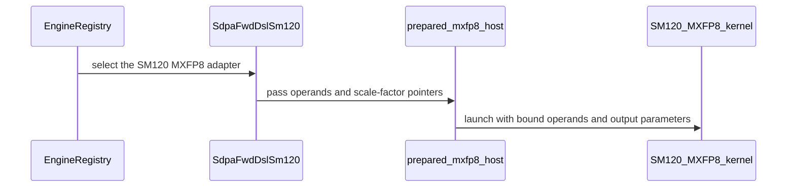

# frost(sdpa): add a specialized SM120 MXFP8 prefill kernel

[Upstream PR](https://github.com/NVIDIA/cudnn-frontend/pull/1599) · state: closed · merged: True

## Original PR description

## Before submitting

- [x] I agree to license this contribution under the terms of [LICENSE.txt](https://github.com/NVIDIA/cudnn-frontend/blob/develop/LICENSE.txt).
- [x] I ran `pre-commit run` and committed any formatting changes.
- [x] I reviewed the Hard Rules in the `AGENTS.md` for each directory this PR touches (see [root AGENTS.md § Reviewing a PR](https://github.com/NVIDIA/cudnn-frontend/blob/develop/AGENTS.md#reviewing-a-pr-human-or-agent)) and my changes comply, or I explain the exception below.
- [x] I added GitHub labels: one `cat-*`, one or more `area:*` / `op:*`, and one `orig-*` (see [label list](https://github.com/NVIDIA/cudnn-frontend/labels)).

## Affected area

FE OSS kernels or CuTeDSL

## Summary

Add a block-scaled MXFP8 prefill kernel for SM120/SM121 (`sm120/prefill_mxfp8.py`), served by a new opt-in engine `sdpa_fwd_prefill_sm120_mxfp8` (forward engine slot 18).

- Same pipeline as the SM120 FP8 template (TMA load warp, GMEM-direct Q, register softmax, P in registers), with every MMA lowered to `mma.sync.kind::mxf8f6f4.block_scale.scale_vec::1X.m16n8k32` (new `tile_dsl.mma.mma_m16n8k32_mxf8_f32`). Q/K take one E8M0 scale per 32 along D, V per 32 along S, and P takes the unit scale with the FP8 template's baked 2**4 cast bias.
- Scale tensors use the F8_128x4 atom order. Q scales load GMEM-direct into one register per 128-column plane. The load warp bulk-copies each K/V tile's scale tile into SMEM on the K/V mbarriers, using the `shared::cta` bulk-copy form: the `shared::cluster` form lowers to a runtime call on sm_120a/sm_121a, and ptxas then ignores the kernel's `setmaxnreg`.
- Rows past the valid Q length and 32-key V blocks wholly past the valid KV length use the unit scale, so NaN pad encodings never reach O.
- O may be FP16 / BF16 / E4M3 / E5M2, or the block-scaled MXFP8 O (E4M3 + UE8M0 per 32 d in `sf_o`, after an optional global `scale_o`) at d_qk = d_v = 128 on dense, unsplit graphs, as on the SM120 per-tensor FP8 row. The block-scaled output's SF_O atom-offset helper moves to `sm120/_common.py`, shared by both kernels.
- Execution goes through a prepared pointer host (`sm120/prepared_mxfp8_host.py`) for dense (unsplit and split-KV) and THD plans; other dense layouts run through the staged forward's compact copies, with the scale tensors bound unchanged.
- The SM120 tile heuristic charges the K and V scale tiles to the SMEM fit check (`config_sm120.smem_bytes(..., mxfp8=True)`).
- `SUPPORT_MATRIX_TRACKER.md` gains the SM120 MXFP8 row (Rule S2).

## Why

SM120/SM121 had no MXFP8 forward engine, so `sdpa_mxfp8` graphs on Blackwell GeForce had no FROST lowering. This fills the SM120 MXFP8 FPROP cell on the #381 board for head dims up to 256.

## Related issues

Related to #381.

## API and compatibility impact

- No public API signature or dependency changes.
- New engine `sdpa_fwd_prefill_sm120_mxfp8` is opt-in (`CUDNN_FRONTEND_ENABLE_FROST_ENGINES=1`), like the SM120 per-tensor FP8 engine.
- Served: E4M3/E5M2 Q/K/V with E8M0 block scales; independent QK and V head dims up to 256 in multiples of 16 (multiples of 32 are native, others zero-padded within the last scale block); causal, bottom-right, sliding window, padding mask and padded-Q trim, sinks, MHA/GQA/MQA, optional Stats (token- or head-major under THD), THD, split-KV, PackGQA, Amax_O.
- Not served: the (256, 512] band, the NVFP4 (FP4 E2M1) O, and `cu_seq_len_q/kv` graph inputs. The adapter's base-2 Stats are wired, but `sdpa_mxfp8` graphs have no `stats_use_log2` input.
- Dense scale tensors have plan-fixed batch and tile pitches, so prepared dense plans keep batch, S_q and S_kv fixed (same as SM100 MXFP8).
- SM121 is admitted by the cc 12.x row but not validated.

## Performance

RTX PRO 6000 Blackwell Server Edition, SM clock locked at 85% of max (`nvidia-smi -lgc`) and memory clock at max (`-lmc`). Direct adapter prepared plans, E4M3 inputs, BF16 O with Stats and Amax_O, default tiles (q128 / k128), CUDA-event timing. Four alternating MXFP8 / per-tensor FP8 process pairs per shape, median of per-pair ratios. Between-run CV was at most 0.34% on every leg (gate: 5%).

| Shape | Per-tensor FP8 (µs) | MXFP8 (µs) | MXFP8 / FP8 |
|---|---:|---:|---:|
| B1 H32/8 S4096 D128, non-causal | 518.8 | 555.5 | 1.07 |
| B1 H32/8 S4096 D128, causal | 263.4 | 276.8 | 1.05 |
| B4 H32/8 S8192 D128, causal | 3873.2 | 4077.9 | 1.05 |
| B2 H32/8 S16384 D128, causal | 7467.7 | 7856.9 | 1.05 |
| B4 H16/16 S2048 D128, non-causal | 276.3 | 295.3 | 1.07 |
| B1 H32/8 S8192 D64, non-causal | 1177.5 | 1239.3 | 1.05 |
| B1 H16/16 S4096 D192, non-causal | 368.5 | 383.4 | 1.04 |
| B1 H16/16 S4096 D192×128, non-causal | 309.9 | 327.1 | 1.06 |
| B1 H16/16 S4096 D128×256, non-causal | 379.2 | 407.1 | 1.07 |
| B1 H16/16 S4096 D192×256, non-causal | 431.2 | 475.5 | 1.10 |
| B1 H16/16 S4096 D256×192, non-causal | 410.2 | 440.9 | 1.08 |
| B1 H16/16 S4096 D256, non-causal | 470.4 | 604.8 | 1.29 |
| B1 H16/16 S4096 D256, causal | 264.3 | 333.9 | 1.26 |
| B2 H32/8 S8192 D256, causal | 3444.8 | 4535.1 | 1.32 |

MXFP8 runs 4–10% behind per-tensor FP8 up to d = 192 and on the rectangular shapes, and 1.26–1.32x behind at d_qk = d_v = 256. A dedicated d256 MXFP8 kernel is left for a follow-up.

## Testing

RTX 5080 (cc 12.0), from `test/python`:

```
pytest -m 'L0 or L1' -rs \
  sdpa/frost/test_sdpa_fwd_mxfp8_sm120.py sdpa/frost/test_sdpa_prepared_sm120_mxfp8.py \
  sdpa/frost/test_sdpa_staged_sm120_mxfp8.py sdpa/frost/test_sdpa_staged_forward_mxfp8.py \
  sdpa/frost/test_sdpa_fwd_fp8_sm120.py sdpa/frost/test_sdpa_prepared_sm120_fp8.py \
  sdpa/frost/test_sdpa_staged_forward_sm120.py sdpa/frost/test_sdpa_staged_forward_half.py \
  sdpa/frost/test_sdpa_fwd_split_kv_sm120.py sdpa/frost/test_sdpa_prepared_block_output.py \
  sdpa/frost/test_sdpa_fwd_heuristics.py sdpa/frost/test_sdpa_fwd_api_contract.py \
  sdpa/frost/test_sdpa_fwd_placement.py sdpa/frost/test_split_kv_heuristic.py \
  sdpa/test_mxfp8_block_scaled_fold.py
```

1059 passed, 165 skipped. The skips are SM100-only suites (their SM120 wrappers run them), the NVFP4 O on the MXFP8 row, two-GPU cases, and large-stride cases that need more free memory than the 5080 has.

The >2**32-byte K/V scale-stride cases in `test_sdpa_prepared_sm120_mxfp8.py` need ~17 GiB free; they passed on an RTX PRO 6000 Blackwell Server Edition (cc 12.0) together with the rest of the SM120 MXFP8 suites (417 passed, 6 skipped), on a revision before the block-scaled MXFP8 O was added.

SM121 is not tested.

🤖 Generated with [Claude Code](https://claude.com/claude-code)


<!-- This is an auto-generated comment: release notes by coderabbit.ai -->
## Summary by CodeRabbit

* **New Features**
  * Added opt-in MXFP8 support for forward scaled dot-product attention on SM120/SM121, including prepared and staged execution and head dimensions up to 256.
  * Added block-scaled MXFP8 output support for the 32-element output scale block. The new engine is available only when opt-in engines are enabled.

* **Bug Fixes**
  * Corrected MXFP8 scale-plane sizing for dimensions that are not multiples of 128.
  * Improved validation of MXFP8 scale inputs and output-scale requirements.
<!-- end of auto-generated comment: release notes by coderabbit.ai -->

## Review and discussion

### reviews

- YangXu1990uiuc · APPROVED · 2026-10-13T08:37:43Z · [source](https://github.com/NVIDIA/cudnn-frontend/pull/1599#pullrequestreview-5500895526)

**Codex bot review · model: `gpt-6-astra`**

Reviewed `8b9f600f2652` against base `9d3150670254`.

The new SM120 MXFP8 route looks sound across the tested finite-sink, layout, scale-address and prepared-launch combinations. One nonblocking P2 remains in infinite-sink finalization; a same-GPU baseline control shows this formula was inherited from the older per-tensor FP8 template. No approval-blocking finding from this review.

**[P2] Guard infinite sinks before subtracting the sink-extended maximum** ([source](https://github.com/NVIDIA/cudnn-frontend/blob/8b9f600f265209a4892aa9db5c1c138108cf841a/python/cudnn/sdpa/fwd/kernels/sm120/prefill_mxfp8.py#L1547))

A disabled sink (`-inf`) plus a keyless row makes both `row_max_nat` and `new_max` equal `-inf`, so `alpha` and `new_sum` become NaN. A `+inf` sink similarly makes the sink term `exp(inf - inf)` NaN. Native reproduction: B=1, Hq=2, Hkv=1, D=128, declared Sq=65/Skv=96, actual lengths 65/32, bottom-right causal. With sink=-inf, the first 33 rows should be O=0/LSE=-inf, but contain 8,448 NaN output elements and 66 NaN Stats elements; sink=+inf produces NaN across all 65 rows instead of O=0/LSE=+inf. Finite -100/+100 controls pass. Please handle a zero key mass and a positive-infinite sink before these subtractions, retaining the usual formula for ordinary rows, and add regression cases including changed-sink replay. This is a localized special-value boundary, not a failure of the tested finite-sink path.

Evidence: Independently reproduced on native SM120 at this head with analytic finite Q/K/V; the PR's current tests all pass. The unmodified base per-tensor FP8 route reproduces the exact same NaN counts. A minimal reproduction can reuse test_sdpa_fwd_mxfp8_sm120._run(1, 2, 1, 65, 96, seq_lens_q=[65], seq_lens_kv=[32], sdpa_kwargs={'use_causal_mask_bottom_right': True}, sinks=torch.full((1, 2, 1, 1), -torch.inf, device='cuda')); the returned output must be finite and the first 33 Stats rows must be -inf. Attribution: Copied into the new MXFP8 template from an existing per-tensor FP8 finalization boundary; not a regression of the older FP8 route introduced by this PR.

Validation: Independent native RTX PRO 6000 Blackwell Server Edition (SM120), public CuTe DSL 4.7.1: all three new suites at L0+L1 passed, 192 passed and zero skips. Source import was verified against the reviewed head. Coverage includes actual scale/output addresses above 32 bits, current-buffer rebinding, capture/replay, opaque scale carriers and staged layouts. Ten additional analytic configurations passed: D16/V48, D80/V144 and D256/V256; bottom-right trimming with finite sinks and PackGQA; three-way split-KV with a narrow left band; padded-pitch and BHSD staged layouts with poisoned padding. Three compiled plans also replayed two changed length sets with bitwise equality to their corresponding eager outputs. The two infinite-sink cases are the finding above. Cross-process compiled-cache probe passed for dense, THD and split-KV MXFP8. A fresh process with cute.compile forbidden loaded all four needed artifacts (four hits, zero misses/bypasses), executed numerically correct outputs and replayed changed device scales correctly. Seven targeted packed-envelope, ragged and poisoned-padding tests passed under memcheck with no device-memory access errors reported. The run was not a clean sanitizer exit: its 26 diagnostics were CUDA driver feature-query/API-version probes from the Python bindings, outside the attention kernels. Same-GPU baseline/head ABBA spot check of the existing per-tensor FP8 graph route, B=2/Hq=4/Hkv=2: S128/D128 host enqueue stayed 18.5–18.9 us and replay 6.16 us; S512/D256 host 18.5–19.5 us and replay 16.9–17.0 us. Matching plans, numerical checks and changed-scale replay passed; no material regression in these two warm cases. These are submission/replay measurements, not serving throughput. Verified the exact GitHub head in pipeline 73454257. SM120 CI recorded 9,496 passed / 10,724 skipped, including the new suites. The sole failure on each of SM100 and SM103 is the existing test_sdpa_mxfp8_fwd_L0[test34] failure associated with #1534, outside this change. No duplicate CI requested. git diff --check passed. Current labels, project and milestone are already appropriate.

Limitations: SM121 was not independently run. No full downstream workload or broad MXFP8-versus-other-provider performance comparison was performed.

Approved: no P0 or high-risk P1 found. Remaining findings stay with the owner; merge timing stays with the owner.

<!-- codex-fe-review:v2:1599:8b9f600f265209a4892aa9db5c1c138108cf841a:complete:no-blocker -->

- YangXu1990uiuc · COMMENTED · 2026-10-13T09:04:44Z · [source](https://github.com/NVIDIA/cudnn-frontend/pull/1599#pullrequestreview-5501208412)

**Codex bot review · model: `gpt-6-astra`**

Reviewed `c7e03c9443f8` against base `9d3150670254`.

The documentation simplification introduces no new finding. The implementation and tests are unchanged from the approved head, so the native SM120 validation remains applicable. The previously reported nonblocking infinite-sink finalization issue remains open; this follow-up preserves the existing approval.

- **[P2] Still open:** [Guard infinite sinks before subtracting the sink-extended maximum](https://github.com/NVIDIA/cudnn-frontend/pull/1599#pullrequestreview-5500895526).

Validation: Compared c7e03c9443f8 with approved 8b9f600f2652: only support-matrix prose and the prepared_host module docstring changed. The prepared-host Python AST is identical after removing the module docstring; git diff --check passed. Checked the shortened MXFP8 paragraph together with the retained head-tile/alignment footnote and prepared-launch/output sections. The dimensions, d512 exclusion and fixed-geometry restrictions remain represented. Reused the earlier independent native SM120 evidence: all 192 tests in the three new suites passed without skips, plus the scoped layout, cache/replay and existing-FP8 performance controls. No GPU tests were rerun for this documentation-only delta. Current-head Style and metadata checks passed; labels, project and milestone are present. No duplicate GPU CI requested for unchanged executable code. Previous pipeline 73454257 remains evidence for that implementation, with its separately documented unrelated SM100/SM103 test34 failures.

Limitations: SM121 remains unvalidated. The previous infinite-sink issue is still unresolved; this follow-up does not claim it was fixed.

Comment only: this PR already has an active approval; preserving existing approvals.

<!-- codex-fe-review:v2:1599:c7e03c9443f8c1b54c7612e0e827b75ad3fcaee0:complete:no-blocker -->

### issue_comments

- coderabbitai[bot] · comment · 2026-10-13T02:33:59Z · [source](https://github.com/NVIDIA/cudnn-frontend/pull/1599#issuecomment-6136938201)

<!-- This is an auto-generated comment: summarize by coderabbit.ai -->
<!-- review_stack_entry_start -->

<a href="https://app.coderabbit.ai/change-stack/NVIDIA/cudnn-frontend/pull/1599?scope=ghh_OusAJGA4HG8ljoOV0wJvVx8NmnZIjc2DdjmxOu0xZWA&amp;cs_source=review_comment"><picture><source media="(prefers-color-scheme: dark)" srcset="https://storage.googleapis.com/coderabbit_public_assets/review-stack-in-coderabbit-ui-dark.svg?v=3"><source media="(prefers-color-scheme: light)" srcset="https://storage.googleapis.com/coderabbit_public_assets/review-stack-in-coderabbit-ui.svg?v=3"></picture></a>

<!-- review_stack_entry_end -->
<!-- recent_review_start -->

No actionable comments were generated in the recent review. 🎉

<details>
<summary><strong>ℹ️ Recent review info</strong></summary>
<dl>
<dd>

<details>
<summary><strong>⚙️ Run configuration</strong></summary>
<dl>
<dd>

- **Configuration used**: Repository: NVIDIA/cudnn-frontend/.coderabbit.yaml
- **Review profile**: CHILL
- **Plan**: Enterprise
- **Run ID**: `ff9d5ece-8069-40f6-a4a9-371cbc35b9a3`

</dd>
</dl>
</details>

<details>
<summary><strong>📥 Commits</strong></summary>
<dl>
<dd>

Reviewing files that changed from the base of the PR and between 8b9f600f265209a4892aa9db5c1c138108cf841a and c7e03c9443f8c1b54c7612e0e827b75ad3fcaee0.

</dd>
</dl>
</details>

<details>
<summary><strong>📒 Files selected for processing (1)</strong></summary>
<dl>
<dd>

* `python/cudnn/sdpa/frost/SUPPORT_MATRIX_TRACKER.md`

</dd>
</dl>
</details>

**Included review availability:** This review used your included allowance. Your plan provides up to 12 included reviews per hour; 11 remain after this review.

</dd>
</dl>
</details>


<!-- recent_review_end -->
<!-- walkthrough_start -->

<details>
<summary><strong>📝 Walkthrough</strong></summary>
<dl>
<dd>

Adds an opt-in SM120 MXFP8 SDPA forward engine for supported head dimensions. The change adds block-scaled MMA, scale-factor handling, and graph, prepared, and staged execution paths. It also updates engine selection, shared-memory sizing, support records, and tests for dense and THD cases.

**Changes: SM120 MXFP8 SDPA forward**

|Layer / File(s)|Summary|
|:---|:---|
|**Scale operations and resource sizing** <br> `python/cudnn/frost/tile_dsl/mma.py`, `python/cudnn/sdpa/fwd/config_sm120.py`, `python/cudnn/sdpa/fwd/kernels/sm120/_common.py`, `python/cudnn/sdpa/fwd/kernels/sm120/prefill_fp8.py`, `python/cudnn/sdpa/fwd/prepared.py`|Adds block-scaled MMA and scale-factor sizing and address helpers. Prepared quantization sizing can use dimensions supplied by the MXFP8 kernel module.|
|**Engine registration and tile selection** <br> `python/cudnn/engines/manifest.py`, `python/cudnn/sdpa/fwd/engines.py`, `python/cudnn/sdpa/fwd/heuristics.py`, `python/cudnn/sdpa/fwd/placement.py`, `test/python/sdpa/frost/test_sdpa_fwd_heuristics.py`, `test/python/sdpa/frost/test_sdpa_fwd_placement.py`, `test/python/sdpa/frost/test_split_kv_heuristic.py`, `test/python/sdpa/mxfp8.py`, `test/python/sdpa/test_mxfp8_block_scaled_fold.py`, `test/python/sdpa/frost/test_sdpa_prepared_block_output.py`, `python/cudnn/frost/README.md`|Registers the opt-in SM120 MXFP8 engine. Tile selection includes MXFP8 scale tiles in shared-memory checks, and capability-based checks use the requested output block scale.|
|**API and prepared execution** <br> `python/cudnn/sdpa/fwd/api_dsl.py`, `python/cudnn/sdpa/fwd/kernels/sm120/prepared_mxfp8_host.py`, `python/cudnn/sdpa/fwd/prepared_staged_forward.py`, `python/cudnn/sdpa/AGENTS.md`, `test/python/sdpa/frost/test_sdpa_fwd_split_kv_sm120.py`, `test/python/sdpa/frost/test_sdpa_staged_forward_sm120.py`|Adds MXFP8-specific module selection, compile metadata, scale-factor operands, and prepared host bindings. Execution distinguishes MXFP8 from per-tensor FP8 and validates scale-factor arguments.|
|**Support records and validation** <br> `python/cudnn/sdpa/frost/SUPPORT_MATRIX_TRACKER.md`, `test/python/sdpa/frost/test_sdpa_fwd_mxfp8_sm120.py`, `test/python/sdpa/frost/test_sdpa_prepared_sm120_mxfp8.py`, `test/python/sdpa/frost/test_sdpa_staged_forward_mxfp8.py`, `test/python/sdpa/frost/test_sdpa_staged_sm120_mxfp8.py`, `test/python/sdpa/frost/test_sdpa_fwd_mxfp8_sm100.py`, `test/python/sdpa/frost/test_sdpa_fwd_api_contract.py`, `test/python/sdpa/graph/test_mhas_v2.py`|Adds SM120 MXFP8 coverage for dense and THD graph execution, prepared and staged plans, and head-dimension admission. Updates the support matrix and related test comments and expectations.|

<!-- change_assessment_start -->
**Priority:** ➖ Normal

**Estimated code review effort:** 4 (Complex) | ~55 minutes

<!-- change_assessment_commit:"c7e03c9443f8c1b54c7612e0e827b75ad3fcaee0" -->
**Change:** Feature
<!-- change_assessment_end -->

### Sequence Diagram(s)



**Possibly related PRs**

- [NVIDIA/cudnn-frontend#509](https://github.com/NVIDIA/cudnn-frontend/pull/509): Adds the original SM120 per-tensor FP8 forward engine and its adapter, engine row, SMEM sizing, heuristics, and MMA support.
- [NVIDIA/cudnn-frontend#1260](https://github.com/NVIDIA/cudnn-frontend/pull/1260): Routes FP8 and MXFP8 conversion layouts through prepared pointer plans; this change adds SM120 MXFP8 prepared lowering.
- [NVIDIA/cudnn-frontend#1229](https://github.com/NVIDIA/cudnn-frontend/pull/1229): Adds prepared SM120 FP8 pointer execution and its host contract, which this change extends to MXFP8.

**Suggested labels:** `cat-enhancements`, `mod-cutedsl`, `area:global_attention`

**Suggested reviewers:** `yangxu1990uiuc`, `romananders90`

</dd>
</dl>
</details>

<!-- walkthrough_end -->
<details>
<summary><strong>Merge Risk:</strong> <strong>⚪ Minimal</strong> · up to <code>c7e03</code></summary>
<dl>
<dd>

<!-- final_review_risk_start -->
<!-- final_review_risk_label
**Merge Risk:** **⚪ Minimal** · up to `c7e03`
-->
<!-- final_review_risk_coverage:{"sourceCommitId":"c7e03c9443f8c1b54c7612e0e827b75ad3fcaee0","coveredCommitId":"c7e03c9443f8c1b54c7612e0e827b75ad3fcaee0","kind":"reviewed"} -->

The documented SM120 MXFP8 output limits match the enforced configuration. The reported SM100/SM103 failures have not been shown to result from this change, so no actionable merge-blocking regression is established.
<!-- final_review_risk_end -->

</dd>
</dl>
</details>
<!-- pre_merge_checks_walkthrough_start -->

<details>
<summary><strong>Pre-merge checks · <sup><picture></picture></sup> 4 · <sup><picture></picture></sup> 1</strong></summary>
<dl>
<dd>

<strong><sup><picture></picture></sup> Failed checks (1 warning)</strong>

|     Check name     |                                              Status                                              | Explanation                                                                                                                                                                                               | Resolution                                                                         |
| :---------------- | :----------------------------------------------------------------------------------------------: | :-------------------------------------------------------------------------------------------------------------------------------------------------------------------------------------------------------- | :--------------------------------------------------------------------------------- |
| Docstring Coverage |  | Docstring coverage is 58.27% which is insufficient. The required threshold is 80.00%. Docstring coverage is scoped to functions touched by this diff. Analyzed 127 functions across 28 files. (1 skipped… | Write docstrings for the functions missing them to satisfy the coverage threshold. |

<details>
<summary><strong><sup><picture></picture></sup> Passed checks (4 passed)</strong></summary>
<dl>
<dd>

|         Check name         |                                             Status                                             | Explanation                                                                                                                                                              |
| :------------------------ | :--------------------------------------------------------------------------------------------: | :----------------------------------------------------------------------------------------------------------------------------------------------------------------------- |
|         Title check        |  | The title clearly and concisely identifies the main change: adding a specialized SM120 MXFP8 prefill kernel.                                                             |
|      Description check     |  | The description follows the required template and covers affected area, summary, rationale, related issue, compatibility impact, performance, and exact testing results. |
|     Linked Issues check    |  | Check skipped because no linked issues were found for this pull request.                                                                                                 |
| Out of Scope Changes check |  | Check skipped because no linked issues were found for this pull request.                                                                                                 |

</dd>
</dl>
</details>

<details>
<summary><strong>Full details: Docstring Coverage</strong></summary>
<dl>
<dd>

**Explanation**

Docstring coverage is 58.27% which is insufficient. The required threshold is 80.00%. Docstring coverage is scoped to functions touched by this diff. Analyzed 127 functions across 28 files. (1 skipped: 1 unsupported.)

</dd>
</dl>
</details>

</dd>
</dl>
</details>

<!-- pre_merge_checks_walkthrough_end -->

- [ ] <!-- {"checkboxId":"585bb3f6-faf5-4dbf-96d2-74e382adf19a"} --> Fix all pre-merge checks with AI
<!-- finishing_touch_checkbox_start -->

<details>
<summary><strong>✨ Finishing Touches</strong></summary>
<dl>
<dd>

<details open>
<summary><strong>🧪 Generate unit tests (beta)</strong></summary>
<dl>
<dd>

- [ ] <!-- {"checkboxId": "f47ac10b-58cc-4372-a567-0e02b2c3d479", "radioGroupId": "utg-output-choice-group-unknown_comment_id"} --> Create a new PR

</dd>
</dl>
</details>

</dd>
</dl>
</details>

<!-- finishing_touch_checkbox_end -->

<!-- autopilot:start -->
- [ ] <!-- {"checkboxId":"2708ad07-9f24-4260-9c11-7dc76a49f2e3"} --> <strong title="Keep fixing CodeRabbit findings and required CI, and resolving merge conflicts">Autofix</strong> · Keep fixing CodeRabbit findings and required CI, and resolving merge conflicts
<!-- autopilot:end -->
<!-- tips_start -->


<sub>Comment `@coderabbitai help` to get the list of available commands.</sub>

<!-- tips_end -->

- Aneureka · comment · 2026-10-13T03:14:27Z · [source](https://github.com/NVIDIA/cudnn-frontend/pull/1599#issuecomment-6137385573)

@cudnn-ci-bot run python/sdpa/frost

- cudnn-ci-bot · comment · 2026-10-13T03:14:31Z · [source](https://github.com/NVIDIA/cudnn-frontend/pull/1599#issuecomment-6137386215)

🏁 Pipeline finished

SHA: `f4b2ba3`
Targets: `python/sdpa/frost`
Branch: [cudnn-gh/pr-1599-f4b2ba3](https://nv/cudnn-gitlab-ci/-/tree/cudnn-gh/pr-1599-f4b2ba3)
Pipeline: [73419756](https://nv/cudnn-gitlab-ci/-/pipelines/73419756)
Last updated: 2026-10-13 05:05 UTC

**23 passed, 2 failed, 3 skipped, 11 manual**

### <code>manual</code>

- <code>manual:python_samples</code> - Manual
- <code>manual:python</code> - Manual
- <code>manual:python/sdpa/frost</code> - ✅ Passed
- <code>manual:python/linear_attention/frost</code> - Manual
- <code>manual:python/gemm/frost</code> - Manual
- <code>manual:python/*/frost</code> - Manual
- <code>manual:python/gemm/cutedsl</code> - Manual
- <code>manual:python/*/cutedsl</code> - Manual
- <code>manual:python/*/jax</code> - Manual
- <code>manual:pycudnn</code> - Manual
- <code>manual:multi_gpu</code> - Manual
- <code>manual:backend</code> - Manual

### <code>analysis</code>

- <code>analysis:cudnn_clang_disable_exception</code> - ✅ Passed
- <code>analysis:cudnn_v9_no_half_conversion</code> - ✅ Passed
- <code>analysis:cudnn_clang</code> - ✅ Passed
- <code>analysis:check-relative-includes</code> - ✅ Passed
- <code>analysis:check-CUDNN_FRONTEND_SKIP_JSON_LIB</code> - ✅ Passed
- <code>analysis:guardwords_scan</code> - ✅ Passed
- <code>analysis:jax-import-guard</code> - ✅ Passed
- <code>analysis:pytest-gpu</code> - ✅ Passed
- <code>san:build</code> - ✅ Passed

### <code>build</code>

- <code>analysis:api_index</code> - ✅ Passed
- <code>build:dev:linux:amd64</code> - ✅ Passed
- <code>build:rel:linux:amd64</code> - ✅ Passed
- <code>build:dev:linux:arm64</code> - ✅ Passed
- <code>build:rel:linux:arm64</code> - ✅ Passed
- <code>build:rel:win:amd64</code> - ✅ Passed

### <code>frost_tests</code>

- <code>python/sdpa/frost:cutlass-rel:sm80</code> - ✅ Passed
- <code>python/sdpa/frost:cutlass-rel:sm100</code> - ❌ **New Failure!** (nightly passed)
- <code>python/sdpa/frost:cutlass-rel:sm120</code> - ✅ Passed
- <code>python/linear_attention/frost:cutlass-rel:sm100</code> - Skipped
- <code>python/gemm/frost:cutlass-rel:sm100</code> - Skipped
- <code>python/*/frost:cutlass-rel:sm100</code> - Skipped
- <code>python/sdpa/frost:cutlass-rel:sm103</code> - ❌ **New Failure!** (nightly passed)
- <code>python/sdpa/frost:cutlass-4.8:sm107</code> - ✅ Passed

### <code>sanitizer_tests</code>

- <code>san:cpp_test:sm80</code> - ✅ Passed
- <code>san:cpp_test:sm90</code> - ✅ Passed
- <code>san:cpp_test:sm100</code> - ✅ Passed

### <code>triage</code>

- <code>triage:ai</code> - ✅ Passed

- Aneureka · comment · 2026-10-13T06:29:53Z · [source](https://github.com/NVIDIA/cudnn-frontend/pull/1599#issuecomment-6139716502)

@cudnn-ci-bot run python/sdpa/frost

- cudnn-ci-bot · comment · 2026-10-13T06:29:57Z · [source](https://github.com/NVIDIA/cudnn-frontend/pull/1599#issuecomment-6139717629)

🏁 Pipeline finished

SHA: `8b9f600`
Targets: `python/sdpa/frost`
Branch: [cudnn-gh/pr-1599-8b9f600](https://nv/cudnn-gitlab-ci/-/tree/cudnn-gh/pr-1599-8b9f600)
Pipeline: [73454257](https://nv/cudnn-gitlab-ci/-/pipelines/73454257)
Last updated: 2026-10-13 07:31 UTC

**23 passed, 2 failed, 3 skipped, 11 manual**

### <code>manual</code>

- <code>manual:python_samples</code> - Manual
- <code>manual:python</code> - Manual
- <code>manual:python/sdpa/frost</code> - ✅ Passed
- <code>manual:python/linear_attention/frost</code> - Manual
- <code>manual:python/gemm/frost</code> - Manual
- <code>manual:python/*/frost</code> - Manual
- <code>manual:python/gemm/cutedsl</code> - Manual
- <code>manual:python/*/cutedsl</code> - Manual
- <code>manual:python/*/jax</code> - Manual
- <code>manual:pycudnn</code> - Manual
- <code>manual:multi_gpu</code> - Manual
- <code>manual:backend</code> - Manual

### <code>analysis</code>

- <code>analysis:cudnn_clang_disable_exception</code> - ✅ Passed
- <code>analysis:cudnn_v9_no_half_conversion</code> - ✅ Passed
- <code>analysis:cudnn_clang</code> - ✅ Passed
- <code>analysis:check-relative-includes</code> - ✅ Passed
- <code>analysis:check-CUDNN_FRONTEND_SKIP_JSON_LIB</code> - ✅ Passed
- <code>analysis:guardwords_scan</code> - ✅ Passed
- <code>analysis:jax-import-guard</code> - ✅ Passed
- <code>analysis:pytest-gpu</code> - ✅ Passed
- <code>san:build</code> - ✅ Passed

### <code>build</code>

- <code>analysis:api_index</code> - ✅ Passed
- <code>build:dev:linux:amd64</code> - ✅ Passed
- <code>build:rel:linux:amd64</code> - ✅ Passed
- <code>build:dev:linux:arm64</code> - ✅ Passed
- <code>build:rel:linux:arm64</code> - ✅ Passed
- <code>build:rel:win:amd64</code> - ✅ Passed

### <code>frost_tests</code>

- <code>python/sdpa/frost:cutlass-rel:sm80</code> - ✅ Passed
- <code>python/sdpa/frost:cutlass-rel:sm100</code> - ❌ **New Failure!** (nightly passed)
- <code>python/sdpa/frost:cutlass-rel:sm120</code> - ✅ Passed
- <code>python/linear_attention/frost:cutlass-rel:sm100</code> - Skipped
- <code>python/gemm/frost:cutlass-rel:sm100</code> - Skipped
- <code>python/*/frost:cutlass-rel:sm100</code> - Skipped
- <code>python/sdpa/frost:cutlass-rel:sm103</code> - ❌ **New Failure!** (nightly passed)
- <code>python/sdpa/frost:cutlass-4.8:sm107</code> - ✅ Passed

### <code>sanitizer_tests</code>

- <code>san:cpp_test:sm80</code> - ✅ Passed
- <code>san:cpp_test:sm90</code> - ✅ Passed
- <code>san:cpp_test:sm100</code> - ✅ Passed

### <code>triage</code>

- <code>triage:ai</code> - ✅ Passed

- Aneureka · comment · 2026-10-13T09:12:45Z · [source](https://github.com/NVIDIA/cudnn-frontend/pull/1599#issuecomment-6142261429)

@cudnn-ci-bot run python/sdpa/frost

- cudnn-ci-bot · comment · 2026-10-13T09:12:48Z · [source](https://github.com/NVIDIA/cudnn-frontend/pull/1599#issuecomment-6142262566)

🏁 Pipeline finished

SHA: `c7e03c9`
Targets: `python/sdpa/frost`
Branch: [cudnn-gh/pr-1599-c7e03c9](https://nv/cudnn-gitlab-ci/-/tree/cudnn-gh/pr-1599-c7e03c9)
Pipeline: [73483895](https://nv/cudnn-gitlab-ci/-/pipelines/73483895)
Last updated: 2026-10-13 10:31 UTC

**23 passed, 2 failed, 3 skipped, 11 manual**

### <code>manual</code>

- <code>manual:python_samples</code> - Manual
- <code>manual:python</code> - Manual
- <code>manual:python/sdpa/frost</code> - ✅ Passed
- <code>manual:python/linear_attention/frost</code> - Manual
- <code>manual:python/gemm/frost</code> - Manual
- <code>manual:python/*/frost</code> - Manual
- <code>manual:python/gemm/cutedsl</code> - Manual
- <code>manual:python/*/cutedsl</code> - Manual
- <code>manual:python/*/jax</code> - Manual
- <code>manual:pycudnn</code> - Manual
- <code>manual:multi_gpu</code> - Manual
- <code>manual:backend</code> - Manual

### <code>analysis</code>

- <code>analysis:cudnn_clang_disable_exception</code> - ✅ Passed
- <code>analysis:cudnn_v9_no_half_conversion</code> - ✅ Passed
- <code>analysis:cudnn_clang</code> - ✅ Passed
- <code>analysis:check-relative-includes</code> - ✅ Passed
- <code>analysis:check-CUDNN_FRONTEND_SKIP_JSON_LIB</code> - ✅ Passed
- <code>analysis:guardwords_scan</code> - ✅ Passed
- <code>analysis:jax-import-guard</code> - ✅ Passed
- <code>analysis:pytest-gpu</code> - ✅ Passed
- <code>san:build</code> - ✅ Passed

### <code>build</code>

- <code>analysis:api_index</code> - ✅ Passed
- <code>build:dev:linux:amd64</code> - ✅ Passed
- <code>build:rel:linux:amd64</code> - ✅ Passed
- <code>build:dev:linux:arm64</code> - ✅ Passed
- <code>build:rel:linux:arm64</code> - ✅ Passed
- <code>build:rel:win:amd64</code> - ✅ Passed

### <code>frost_tests</code>

- <code>python/sdpa/frost:cutlass-rel:sm80</code> - ✅ Passed
- <code>python/sdpa/frost:cutlass-rel:sm100</code> - ❌ **New Failure!** (nightly passed)
- <code>python/sdpa/frost:cutlass-rel:sm120</code> - ✅ Passed
- <code>python/linear_attention/frost:cutlass-rel:sm100</code> - Skipped
- <code>python/gemm/frost:cutlass-rel:sm100</code> - Skipped
- <code>python/*/frost:cutlass-rel:sm100</code> - Skipped
- <code>python/sdpa/frost:cutlass-rel:sm103</code> - ❌ **New Failure!** (nightly passed)
- <code>python/sdpa/frost:cutlass-4.8:sm107</code> - ✅ Passed

### <code>sanitizer_tests</code>

- <code>san:cpp_test:sm80</code> - ✅ Passed
- <code>san:cpp_test:sm90</code> - ✅ Passed
- <code>san:cpp_test:sm100</code> - ✅ Passed

### <code>triage</code>

- <code>triage:ai</code> - ✅ Passed

### inline_comments

## Changed files and fixed code

- `python/cudnn/engines/manifest.py` · modified · additions 1 / deletions 0
  - [head](https://github.com/Aneureka/cudnn-frontend/blob/c7e03c9443f8c1b54c7612e0e827b75ad3fcaee0/python/cudnn/engines/manifest.py)
  - [base](https://github.com/NVIDIA/cudnn-frontend/blob/f9525318d15644de5f2d98275e2a55262dbea6f1/python/cudnn/engines/manifest.py)
- `python/cudnn/frost/README.md` · modified · additions 1 / deletions 0
  - [head](https://github.com/Aneureka/cudnn-frontend/blob/c7e03c9443f8c1b54c7612e0e827b75ad3fcaee0/python/cudnn/frost/README.md)
  - [base](https://github.com/NVIDIA/cudnn-frontend/blob/f9525318d15644de5f2d98275e2a55262dbea6f1/python/cudnn/frost/README.md)
- `python/cudnn/frost/tile_dsl/mma.py` · modified · additions 62 / deletions 0
  - [head](https://github.com/Aneureka/cudnn-frontend/blob/c7e03c9443f8c1b54c7612e0e827b75ad3fcaee0/python/cudnn/frost/tile_dsl/mma.py)
  - [base](https://github.com/NVIDIA/cudnn-frontend/blob/f9525318d15644de5f2d98275e2a55262dbea6f1/python/cudnn/frost/tile_dsl/mma.py)
- `python/cudnn/sdpa/AGENTS.md` · modified · additions 1 / deletions 1
  - [head](https://github.com/Aneureka/cudnn-frontend/blob/c7e03c9443f8c1b54c7612e0e827b75ad3fcaee0/python/cudnn/sdpa/AGENTS.md)
  - [base](https://github.com/NVIDIA/cudnn-frontend/blob/f9525318d15644de5f2d98275e2a55262dbea6f1/python/cudnn/sdpa/AGENTS.md)
- `python/cudnn/sdpa/frost/SUPPORT_MATRIX_TRACKER.md` · modified · additions 21 / deletions 11
  - [head](https://github.com/Aneureka/cudnn-frontend/blob/c7e03c9443f8c1b54c7612e0e827b75ad3fcaee0/python/cudnn/sdpa/frost/SUPPORT_MATRIX_TRACKER.md)
  - [base](https://github.com/NVIDIA/cudnn-frontend/blob/f9525318d15644de5f2d98275e2a55262dbea6f1/python/cudnn/sdpa/frost/SUPPORT_MATRIX_TRACKER.md)
- `python/cudnn/sdpa/fwd/api_dsl.py` · modified · additions 73 / deletions 26
  - [head](https://github.com/Aneureka/cudnn-frontend/blob/c7e03c9443f8c1b54c7612e0e827b75ad3fcaee0/python/cudnn/sdpa/fwd/api_dsl.py)
  - [base](https://github.com/NVIDIA/cudnn-frontend/blob/f9525318d15644de5f2d98275e2a55262dbea6f1/python/cudnn/sdpa/fwd/api_dsl.py)
- `python/cudnn/sdpa/fwd/config_sm120.py` · modified · additions 16 / deletions 2
  - [head](https://github.com/Aneureka/cudnn-frontend/blob/c7e03c9443f8c1b54c7612e0e827b75ad3fcaee0/python/cudnn/sdpa/fwd/config_sm120.py)
  - [base](https://github.com/NVIDIA/cudnn-frontend/blob/f9525318d15644de5f2d98275e2a55262dbea6f1/python/cudnn/sdpa/fwd/config_sm120.py)
- `python/cudnn/sdpa/fwd/engines.py` · modified · additions 46 / deletions 2
  - [head](https://github.com/Aneureka/cudnn-frontend/blob/c7e03c9443f8c1b54c7612e0e827b75ad3fcaee0/python/cudnn/sdpa/fwd/engines.py)
  - [base](https://github.com/NVIDIA/cudnn-frontend/blob/f9525318d15644de5f2d98275e2a55262dbea6f1/python/cudnn/sdpa/fwd/engines.py)
- `python/cudnn/sdpa/fwd/heuristics.py` · modified · additions 23 / deletions 25
  - [head](https://github.com/Aneureka/cudnn-frontend/blob/c7e03c9443f8c1b54c7612e0e827b75ad3fcaee0/python/cudnn/sdpa/fwd/heuristics.py)
  - [base](https://github.com/NVIDIA/cudnn-frontend/blob/f9525318d15644de5f2d98275e2a55262dbea6f1/python/cudnn/sdpa/fwd/heuristics.py)
- `python/cudnn/sdpa/fwd/kernels/sm120/_common.py` · modified · additions 12 / deletions 5
  - [head](https://github.com/Aneureka/cudnn-frontend/blob/c7e03c9443f8c1b54c7612e0e827b75ad3fcaee0/python/cudnn/sdpa/fwd/kernels/sm120/_common.py)
  - [base](https://github.com/NVIDIA/cudnn-frontend/blob/f9525318d15644de5f2d98275e2a55262dbea6f1/python/cudnn/sdpa/fwd/kernels/sm120/_common.py)
- `python/cudnn/sdpa/fwd/kernels/sm120/prefill_fp8.py` · modified · additions 3 / deletions 9
  - [head](https://github.com/Aneureka/cudnn-frontend/blob/c7e03c9443f8c1b54c7612e0e827b75ad3fcaee0/python/cudnn/sdpa/fwd/kernels/sm120/prefill_fp8.py)
  - [base](https://github.com/NVIDIA/cudnn-frontend/blob/f9525318d15644de5f2d98275e2a55262dbea6f1/python/cudnn/sdpa/fwd/kernels/sm120/prefill_fp8.py)
- `python/cudnn/sdpa/fwd/kernels/sm120/prefill_mxfp8.py` · added · additions 2368 / deletions 0
  - [head](https://github.com/Aneureka/cudnn-frontend/blob/c7e03c9443f8c1b54c7612e0e827b75ad3fcaee0/python/cudnn/sdpa/fwd/kernels/sm120/prefill_mxfp8.py)
  - [base](https://github.com/NVIDIA/cudnn-frontend/blob/f9525318d15644de5f2d98275e2a55262dbea6f1/python/cudnn/sdpa/fwd/kernels/sm120/prefill_mxfp8.py)
- `python/cudnn/sdpa/fwd/kernels/sm120/prepared_mxfp8_host.py` · added · additions 230 / deletions 0
  - [head](https://github.com/Aneureka/cudnn-frontend/blob/c7e03c9443f8c1b54c7612e0e827b75ad3fcaee0/python/cudnn/sdpa/fwd/kernels/sm120/prepared_mxfp8_host.py)
  - [base](https://github.com/NVIDIA/cudnn-frontend/blob/f9525318d15644de5f2d98275e2a55262dbea6f1/python/cudnn/sdpa/fwd/kernels/sm120/prepared_mxfp8_host.py)
- `python/cudnn/sdpa/fwd/placement.py` · modified · additions 2 / deletions 2
  - [head](https://github.com/Aneureka/cudnn-frontend/blob/c7e03c9443f8c1b54c7612e0e827b75ad3fcaee0/python/cudnn/sdpa/fwd/placement.py)
  - [base](https://github.com/NVIDIA/cudnn-frontend/blob/f9525318d15644de5f2d98275e2a55262dbea6f1/python/cudnn/sdpa/fwd/placement.py)
- `python/cudnn/sdpa/fwd/prepared.py` · modified · additions 6 / deletions 1
  - [head](https://github.com/Aneureka/cudnn-frontend/blob/c7e03c9443f8c1b54c7612e0e827b75ad3fcaee0/python/cudnn/sdpa/fwd/prepared.py)
  - [base](https://github.com/NVIDIA/cudnn-frontend/blob/f9525318d15644de5f2d98275e2a55262dbea6f1/python/cudnn/sdpa/fwd/prepared.py)
- `python/cudnn/sdpa/fwd/prepared_staged_forward.py` · modified · additions 1 / deletions 1
  - [head](https://github.com/Aneureka/cudnn-frontend/blob/c7e03c9443f8c1b54c7612e0e827b75ad3fcaee0/python/cudnn/sdpa/fwd/prepared_staged_forward.py)
  - [base](https://github.com/NVIDIA/cudnn-frontend/blob/f9525318d15644de5f2d98275e2a55262dbea6f1/python/cudnn/sdpa/fwd/prepared_staged_forward.py)
- `test/python/sdpa/frost/test_sdpa_fwd_api_contract.py` · modified · additions 1 / deletions 1
  - [head](https://github.com/Aneureka/cudnn-frontend/blob/c7e03c9443f8c1b54c7612e0e827b75ad3fcaee0/test/python/sdpa/frost/test_sdpa_fwd_api_contract.py)
  - [base](https://github.com/NVIDIA/cudnn-frontend/blob/f9525318d15644de5f2d98275e2a55262dbea6f1/test/python/sdpa/frost/test_sdpa_fwd_api_contract.py)
- `test/python/sdpa/frost/test_sdpa_fwd_heuristics.py` · modified · additions 25 / deletions 0
  - [head](https://github.com/Aneureka/cudnn-frontend/blob/c7e03c9443f8c1b54c7612e0e827b75ad3fcaee0/test/python/sdpa/frost/test_sdpa_fwd_heuristics.py)
  - [base](https://github.com/NVIDIA/cudnn-frontend/blob/f9525318d15644de5f2d98275e2a55262dbea6f1/test/python/sdpa/frost/test_sdpa_fwd_heuristics.py)
- `test/python/sdpa/frost/test_sdpa_fwd_mxfp8_sm100.py` · modified · additions 3 / deletions 3
  - [head](https://github.com/Aneureka/cudnn-frontend/blob/c7e03c9443f8c1b54c7612e0e827b75ad3fcaee0/test/python/sdpa/frost/test_sdpa_fwd_mxfp8_sm100.py)
  - [base](https://github.com/NVIDIA/cudnn-frontend/blob/f9525318d15644de5f2d98275e2a55262dbea6f1/test/python/sdpa/frost/test_sdpa_fwd_mxfp8_sm100.py)
- `test/python/sdpa/frost/test_sdpa_fwd_mxfp8_sm120.py` · added · additions 951 / deletions 0
  - [head](https://github.com/Aneureka/cudnn-frontend/blob/c7e03c9443f8c1b54c7612e0e827b75ad3fcaee0/test/python/sdpa/frost/test_sdpa_fwd_mxfp8_sm120.py)
  - [base](https://github.com/NVIDIA/cudnn-frontend/blob/f9525318d15644de5f2d98275e2a55262dbea6f1/test/python/sdpa/frost/test_sdpa_fwd_mxfp8_sm120.py)
- `test/python/sdpa/frost/test_sdpa_fwd_placement.py` · modified · additions 1 / deletions 1
  - [head](https://github.com/Aneureka/cudnn-frontend/blob/c7e03c9443f8c1b54c7612e0e827b75ad3fcaee0/test/python/sdpa/frost/test_sdpa_fwd_placement.py)
  - [base](https://github.com/NVIDIA/cudnn-frontend/blob/f9525318d15644de5f2d98275e2a55262dbea6f1/test/python/sdpa/frost/test_sdpa_fwd_placement.py)
- `test/python/sdpa/frost/test_sdpa_fwd_split_kv_sm120.py` · modified · additions 1 / deletions 1
  - [head](https://github.com/Aneureka/cudnn-frontend/blob/c7e03c9443f8c1b54c7612e0e827b75ad3fcaee0/test/python/sdpa/frost/test_sdpa_fwd_split_kv_sm120.py)
  - [base](https://github.com/NVIDIA/cudnn-frontend/blob/f9525318d15644de5f2d98275e2a55262dbea6f1/test/python/sdpa/frost/test_sdpa_fwd_split_kv_sm120.py)
- `test/python/sdpa/frost/test_sdpa_prepared_block_output.py` · modified · additions 2 / deletions 2
  - [head](https://github.com/Aneureka/cudnn-frontend/blob/c7e03c9443f8c1b54c7612e0e827b75ad3fcaee0/test/python/sdpa/frost/test_sdpa_prepared_block_output.py)
  - [base](https://github.com/NVIDIA/cudnn-frontend/blob/f9525318d15644de5f2d98275e2a55262dbea6f1/test/python/sdpa/frost/test_sdpa_prepared_block_output.py)
- `test/python/sdpa/frost/test_sdpa_prepared_sm120_mxfp8.py` · added · additions 140 / deletions 0
  - [head](https://github.com/Aneureka/cudnn-frontend/blob/c7e03c9443f8c1b54c7612e0e827b75ad3fcaee0/test/python/sdpa/frost/test_sdpa_prepared_sm120_mxfp8.py)
  - [base](https://github.com/NVIDIA/cudnn-frontend/blob/f9525318d15644de5f2d98275e2a55262dbea6f1/test/python/sdpa/frost/test_sdpa_prepared_sm120_mxfp8.py)
- `test/python/sdpa/frost/test_sdpa_staged_forward_mxfp8.py` · modified · additions 5 / deletions 5
  - [head](https://github.com/Aneureka/cudnn-frontend/blob/c7e03c9443f8c1b54c7612e0e827b75ad3fcaee0/test/python/sdpa/frost/test_sdpa_staged_forward_mxfp8.py)
  - [base](https://github.com/NVIDIA/cudnn-frontend/blob/f9525318d15644de5f2d98275e2a55262dbea6f1/test/python/sdpa/frost/test_sdpa_staged_forward_mxfp8.py)
- `test/python/sdpa/frost/test_sdpa_staged_forward_sm120.py` · modified · additions 13 / deletions 0
  - [head](https://github.com/Aneureka/cudnn-frontend/blob/c7e03c9443f8c1b54c7612e0e827b75ad3fcaee0/test/python/sdpa/frost/test_sdpa_staged_forward_sm120.py)
  - [base](https://github.com/NVIDIA/cudnn-frontend/blob/f9525318d15644de5f2d98275e2a55262dbea6f1/test/python/sdpa/frost/test_sdpa_staged_forward_sm120.py)
- `test/python/sdpa/frost/test_sdpa_staged_sm120_mxfp8.py` · added · additions 44 / deletions 0
  - [head](https://github.com/Aneureka/cudnn-frontend/blob/c7e03c9443f8c1b54c7612e0e827b75ad3fcaee0/test/python/sdpa/frost/test_sdpa_staged_sm120_mxfp8.py)
  - [base](https://github.com/NVIDIA/cudnn-frontend/blob/f9525318d15644de5f2d98275e2a55262dbea6f1/test/python/sdpa/frost/test_sdpa_staged_sm120_mxfp8.py)
- `test/python/sdpa/frost/test_split_kv_heuristic.py` · modified · additions 1 / deletions 0
  - [head](https://github.com/Aneureka/cudnn-frontend/blob/c7e03c9443f8c1b54c7612e0e827b75ad3fcaee0/test/python/sdpa/frost/test_split_kv_heuristic.py)
  - [base](https://github.com/NVIDIA/cudnn-frontend/blob/f9525318d15644de5f2d98275e2a55262dbea6f1/test/python/sdpa/frost/test_split_kv_heuristic.py)
- `test/python/sdpa/graph/test_mhas_v2.py` · modified · additions 3 / deletions 2
  - [head](https://github.com/Aneureka/cudnn-frontend/blob/c7e03c9443f8c1b54c7612e0e827b75ad3fcaee0/test/python/sdpa/graph/test_mhas_v2.py)
  - [base](https://github.com/NVIDIA/cudnn-frontend/blob/f9525318d15644de5f2d98275e2a55262dbea6f1/test/python/sdpa/graph/test_mhas_v2.py)
- `test/python/sdpa/mxfp8.py` · modified · additions 6 / deletions 6
  - [head](https://github.com/Aneureka/cudnn-frontend/blob/c7e03c9443f8c1b54c7612e0e827b75ad3fcaee0/test/python/sdpa/mxfp8.py)
  - [base](https://github.com/NVIDIA/cudnn-frontend/blob/f9525318d15644de5f2d98275e2a55262dbea6f1/test/python/sdpa/mxfp8.py)
- `test/python/sdpa/test_mxfp8_block_scaled_fold.py` · modified · additions 12 / deletions 5
  - [head](https://github.com/Aneureka/cudnn-frontend/blob/c7e03c9443f8c1b54c7612e0e827b75ad3fcaee0/test/python/sdpa/test_mxfp8_block_scaled_fold.py)
  - [base](https://github.com/NVIDIA/cudnn-frontend/blob/f9525318d15644de5f2d98275e2a55262dbea6f1/test/python/sdpa/test_mxfp8_block_scaled_fold.py)

## Evidence and interpretation boundary

[Original JSON, discussions and patches](../../../../../../evidence/prs/NVIDIA--cudnn-frontend/1599-be651c511a6978345989842f7f93363ce3904fc7e8785329301b3860cef5de9d.json) · SHA-256 `be651c511a6978345989842f7f93363ce3904fc7e8785329301b3860cef5de9d`.

Diff complete: False. Missing/binary/truncated patches require pinned source inspection. This is a source page, not an independently verified optimization case. Open, merged and released are different states; recheck the deployed dependency.
