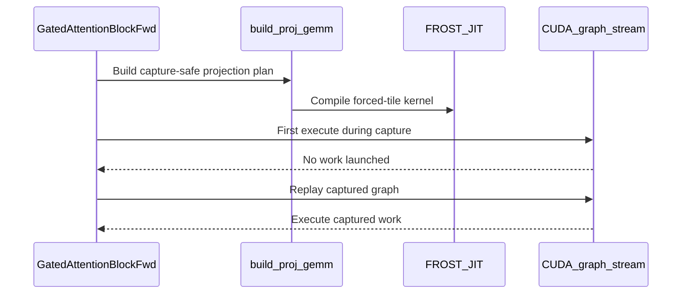

# frost(gated_attention_block): typed CUDA-graph capture refusals, the flag-free dense projection GEMM route, and the block kernels through the compiled-plan cache

[Upstream PR](https://github.com/NVIDIA/cudnn-frontend/pull/1609) · state: closed · merged: True

## Original PR description

## Before submitting

- [x] I agree to license this contribution under the terms of [LICENSE.txt](https://github.com/NVIDIA/cudnn-frontend/blob/develop/LICENSE.txt).
- [x] I ran `pre-commit run` and committed any formatting changes.
- [x] I reviewed the Hard Rules in the `AGENTS.md` for each directory this PR touches (`python/cudnn/AGENTS.md` Rule 7 -- every compile site still sits behind the stage's DSL-version gate; Rule 9 -- one caller contract: no engine-specific handling reaches a caller, every unserved spelling is a typed decline; `python/cudnn/sdpa/AGENTS.md` Rule S2 -- no `Capabilities` / `EngineSpec` change, no tracker row is touched) and my changes comply.
- [x] Labels: `cat-enhancements`, `area:frost`, `mod-frost`, `orig-nv-eng`.

## Affected area

FE OSS kernels or CuTeDSL -- the FROST gated attention block (`python/cudnn/gated_attention_block/`), frontend-only Python: the projection GEMM driver's host paths (`kernels/proj_gemm.py`), a new shared helper (`python/cudnn/frost/capture.py`), the grouped GEMM's debug-validation helper's import, the block's five forward-kernel compile sites, their docs paragraph and tests. No C++, no engine row, no change to any kernel body or to any SDPA kernel.

## Summary

Three host-side changes a serving stack needs from the block -- it captures the FIRST execute of a fresh declaration inside a CUDA graph on a NEW stream with zero eager warm-ups, it must never set a process-wide opt-in flag, and it pays the block's kernel compiles at every process start:

1. **Typed CUDA-graph capture refusals.** Two host paths of the projection GEMM driver broke a zero-warm-up capture silently: the GRAPH route created a cuDNN handle at its first execute per `(device, stream)` -- an illegal call inside a capture -- and a refused forced-tile compile fell back onto that route with a warning. Now `cudnn.frost.capture` (new: `capture_state` / `is_capturing` / `check_not_capturing`) is the ONE status query (`cuStreamGetCaptureInfo`) and the ONE typed `RuntimeError`, naming the route it refused and the remedy (compile at warm-up / run one eager execute on the capture stream); `build_proj_gemm` is refused under capture before the `cudnn.pygraph` constructor creates its handle, `handle_for_stream` refuses to create a handle inside a capture (the graph route's first execute), and the block's `compile()` under capture is refused the same way. The grouped GEMM's debug-validation helper delegates to the shared helper and keeps its own remedy wording and its module-level name. The serving declaration, `build_proj_gemm(capture_safe=True)` (an appended kwarg, default off), never enters the ranked list -- the graph is validated and built only to be analyzed: no heuristics query, no backend plan, no FROST-engine compile, whether the flag is set or not -- so the plan is JIT-only by construction, and a shape the forced tile does not divide, `pin_frost=False`, or a refused forced compile is a typed decline at compile time (`NotImplementedError` naming the tile and the reason), never the warning + graph-heuristic fallback. `_Projection.compile` forwards a stage's `capture_safe` attribute to the driver; no declaration sets it in this tree, so every plan is built exactly as before.
2. **The dense bf16 / f16 projections no longer need the opt-in flag under a forced tile.** `CUDNN_FRONTEND_ENABLE_FROST_ENGINES` is read live, when a plan's ranked list is built at `compile()` (the docs' "must be set BEFORE `import cudnn`" wording was stale), and a host module must never set it for the process -- it flips every opt-in engine into every FE graph the process builds. With the flag UNSET and a forced (or named) tile, "no `frost_gemm` in the ranked list" now takes the same JIT-only route the block-scale plans take (`plan.route == "jit-only"`: no backend plan, no cuDNN handle at execute; INFO, not WARNING), so every served geometry of the block compiles and runs with the flag unset; a dense shape WITHOUT a forced tile (the graph route IS the plan there) and the per-tensor-fp8 projections keep today's typed decline naming the flag, and a refused compile on the JIT-only route re-raises that decline with the compiler's reason chained. With the flag set nothing changes for a plain declaration (`graph+jit`). Graduating the FROST GEMM engine out of opt-in is a separate change.
3. **The block's forward kernels through the persistent compiled-plan cache.** `kernels/elementwise.py`, `kernels/qk_norm_rope_tma.py` and the three forks of the rendered GEMM template (`kernels/proj_gemm_norm_rope.py` + `_fp8` / `_mxfp8`) called `cute.compile` directly behind an in-process dict, so a serving process re-traced and re-ran ptxas for every one of them at every start. Each site now calls `cudnn.frost.compiled_cache.compile_cached` with the `template_key` convention -- the module's source digest (the template loader's file + params digest for the forks; a file digest the two plainly imported modules publish as `FROST_SOURCE_DIGEST`) joined with the function tag and the dict key's plain values -- and keeps its dict as the first memo; symbols `cudnn_block_elementwise_gate`, `cudnn_block_qk_norm_rope_tma`, `frost_gemm_norm_rope{,_fp8,_mxfp8}`. A plainly imported fork carries no digest and compiles as before; the two documented switches behave as documented (`CUDNN_FRONTEND_DISABLE_COMPILED_CACHE=1` bypasses and persists nothing; `CUDNN_FRONTEND_COMPILED_CACHE_INPROCESS_MEMO=0` lets a trace-time spy see every dict miss), and the existing TMA key test, which stubs `cute.compile`, now sets both. No kernel body changes: the rendered `sm_107a` cubins are byte-identical before / after at every site except the mxfp8 fork, whose rendering was already non-deterministic across processes on the unmodified tree (two images differing in a uniform-register renaming of 13 address lines feeding one UTCQMMA, selected by the Python hash seed; both trees render both images, `PYTHONHASHSEED=0` renders the same one on both).

The new suite `test_block_compiled_cache.py` also pins the serving cache-write kernel's compile site -- a kernel of the block's paged-KV serving form that is a separate change (#1606) -- exactly where that module is in the tree: the import is probed, and where the kernel is absent the site drops out of the static detector, its key test skips by name and the two-process reload runs the nine arms of this tree; where it is present the eleven arms, the six files and the key test run.

## Why

A serving stack (vLLM, SGLang, FlashInfer's cuDNN path) declares the layer once, then captures and replays -- with its defaults the FIRST execute of a fresh declaration is captured, on a new stream, with no eager warm-up -- and it never sets a process-wide engine flag; the block's host paths have to hold under exactly those conditions, and hold TYPED: a refusal that names the route and the remedy at `compile()` instead of an illegal call half-way through a capture or a silent fallback onto a slower route. The compiled-plan cache is the serving process's start-up time: the block's kernels were the last forward kernels of FROST's not routed through it.

Two contracts are pinned on the OUTPUT directly rather than inferred: the first execute of a flag-unset declaration captured with zero warm-ups on a new stream, under `torch.cuda.set_sync_debug_mode("error")`, launches nothing and replays bitwise the eager run (also over new inputs); and a second process reloads every compiled arm (one hit, no miss each) and writes bitwise the first process's bytes. Nothing was widened.

## Related issues

Related to #1606 (the block's paged-KV EXTEND serving form): its declaration marks both projection stages capture-safe, which this change's driver consumes through `_Projection.compile`; its suite's capture cell (the first execute of a fresh EXTEND declaration captured with no warm-up) is gated on this driver's `capture_safe` route and runs once both changes are in the tree; and its cache-write kernel's compile site is pinned by this suite under the presence probe above. The two PRs are independent of each other and merge in either order.

## API and compatibility impact

- New module `cudnn.frost.capture` (`capture_state(stream)`, `is_capturing(stream)`, `check_not_capturing(stream, what, *, remedy=None)`, `DEFAULT_REMEDY`): helpers under the frontend's `frost` package, not op functions, so `docs/fe-oss-apis/api_conventions.md`'s op-name pattern is not engaged; the names spell out what they do and name no architecture or implementation technology. `build_proj_gemm(..., capture_safe=False)` gains its kwarg at the END (append-only); the two plainly imported kernel modules gain a `FROST_SOURCE_DIGEST` constant. The grouped GEMM's `_check_not_capturing` keeps its module-level name and wording and delegates. No lazy export of `cudnn` changes; `import cudnn` still pulls neither torch nor the DSL (pinned).
- Behaviour at the defaults: with the opt-in flag set, a plain declaration is unchanged (`graph+jit`, the same pinned kernel). With the flag UNSET, a dense bf16 / f16 projection whose `N` the forced 256-wide tile divides now compiles and runs on FROST's JIT-only route where it used to raise `RuntimeError` naming the flag -- the intended change, documented in the block's "Requirements and limits"; a shape without a forced tile and the per-tensor-fp8 projections keep that `RuntimeError`; the block-scale projections keep their route. Under a live capture, what used to be an illegal call inside the capture (the graph route's handle creation, a `compile()`) is a typed `RuntimeError` naming the route and the remedy; the quantized block's first-execute scale write is NOT refused under capture (its warm-up / re-capture contract is unchanged).
- `Capabilities` / `EngineSpec` / manifest / the support-matrix tracker: unchanged (Rule S2 is not triggered; the block has no engine row).
- GPU / versions: Rubin cc 10.7 for the kernels (unchanged); the capture helper is device-agnostic (`cuda-python`, already a dependency). No new dependency; no numerics change on any path; no kernel body change (cubins byte-identical, above).

## Testing

Rubin (cc 10.7, a 204-SM development node; functional cells, never a perf number), run on the development tree these commits come from:

- `test_block_serving_capture.py` (L0, 23 cells): **23 passed** -- the shared helper and the grouped GEMM's delegation; `compile()` refused under capture; the serving declaration's typed declines (the graph route; a refused compile with the flag set AND unset, never a warning); a `capture_safe` plan builds no ranked list under either flag state and runs; the flag-free dense route at every served geometry of the two models and their tensor-parallel shards (`n_qkvg` 17408 / 13312 / 8704 / 4608 / 2560 with `d_model` 4096 / 2560: JIT-only at the forced tile, `frost_gemm` never in a ranked list, no handle, cos > 0.999 vs torch) and the whole bf16 block compiled with the flag unset at each; the first execute of a flag-unset declaration captured with zero warm-ups on a new stream under `set_sync_debug_mode("error")` launches nothing and replays bitwise the eager run (also over new inputs); the graph route's first execute under capture refused typed with no handle created; the block's `compile()` under capture refused typed. Against the tree before the change the module reads **22 failed / 1 passed** on Rubin and 7 failed / 1 passed on an A100 host -- the one pass is the pin of unchanged behaviour (a shape without a forced tile keeps today's decline).
- The suite's twelve existing CUDA-graph capture / replay pins (the bf16 / fp8 / mxfp8 / fp4 backward replays, the wgrad side stream's refusals, the packed replays with new lengths, the quant-scale update reaching a captured execute) by node id: **19 passed**; `test_proj_gemm.py` + `test_block_end_to_end.py` + the grouped GEMM's stub-by-name pin: **107 passed**; `test_proj_gemm_bwd.py` (the driver's other caller): **108 passed**.
- `test_block_compiled_cache.py` (L0): **8 passed** -- the static detector (no bare `cute.compile(` left), the keys per site with `cute.compile` stubbed, the forks' loader digest vs a plain import, the two switches, and a second process reloading every one of the nine compiled arms (one hit, no miss each) and writing bitwise the first process's bytes; the touched kernels' own suites with the cache ON, i.e. on reloaded artifacts (`test_elementwise`, `test_qk_norm_rope`, `test_proj_gemm`, `test_proj_gemm_mxfp8`): **190 passed**. Cubins byte-identical before / after at 9 of the 10 arms rendered (7 of 8 host-rendered arms + the two fp8-cvt TMA arms rendered on the Rubin node); the mxfp8 fork renders one of two hash-seed images on either tree (above). With the serving cache-write kernel in the tree: the module **9 passed**, the two cache-write arms one miss then one bitwise hit, their three rendered cubins identical before / after the routing.

On this PR's own tree (the same Rubin development-node class, cc 10.7, 204 SMs; functional, one process per module, `cudnn` imported from the PR tree, which carries develop's current GEMM kernel registry):

- `test_block_serving_capture.py` -> **23 passed** (every cell, both flag states; 230 s): the capture refusals, the serving declaration's typed declines, the flag-free dense route at every served geometry and the zero-warm-up capture replaying bitwise, on the current GEMM kernel registry;
  `test_block_compiled_cache.py` -> **8 passed, 1 skipped** (201 s): the nine compiled arms of this tree reload bitwise in a second process; the one skip is the cache-write key test, by the presence probe ("kernels/cache_write.py (the serving cache-write kernel) is not in this tree") -- re-run on the final head after the probe's last refinement: **8 passed, 1 skipped** (169 s), the same skip;
  `test_qk_norm_rope.py` -> **64 passed** (91 s); `test_proj_gemm.py` + the grouped GEMM's stub-by-name pin -> **50 passed** (124 s).
- The two PRs composed (#1606's head plus this PR's commits, a throwaway tree -- what develop looks like once both have landed), same node class: `test_block_serving_extend.py -k capture` -> **2 passed** (the EXTEND form's capture cell, gated on this driver's route, runs and replays bitwise; 161 s); `test_block_compiled_cache.py` -> **9 passed** (the eleven arms with the cache-write kernel present: one miss then one bitwise hit each; 175 s); `test_block_serving_capture.py` -> **23 passed** (103 s).

Host (an A100, cc 8.0; cudnn-frontend 1.32.0 on cuDNN 9.27, nvidia-cutlass-dsl 4.8.0, torch 2.13), every process importing `cudnn` from this PR's tree:

- `pytest -q -o addopts= gated_attention_block/cutedsl/test_block_compiled_cache.py gated_attention_block/cutedsl/test_block_serving_capture.py gated_attention_block/cutedsl/test_qk_norm_rope.py gated_attention_block/cutedsl/test_proj_gemm.py gemm/cutedsl/test_grouped_gemm_dglu_activation.py::test_debug_device_values_disabled_never_reads_host core/test_import_boundaries.py api_index/test_api_index.py` -> **118 passed, 65 skipped, 13 subtests passed, 0 failed** (73 s): the capture suite's eight host cells (the helper's message and the grouped GEMM's delegation, the refusals with the status query stubbed, the typed declines of the serving declaration), the compiled-cache suite's keys / memo / switches with `cute.compile` stubbed (its cache-write key test skips by the presence probe, naming the module), the TMA key test with both switches, the GEMM driver's host pins, the grouped GEMM's stub-by-name pin, the import-boundary pins (`import cudnn` pulls neither torch nor the DSL) and the API-index scan; the Rubin cells skip.
- `pre-commit run --files <the fourteen touched files>`: clang-format (no files), black, black-jupyter, SPDX license header passed.

🤖 Generated with [Claude Code](https://claude.com/claude-code)

<!-- This is an auto-generated comment: release notes by coderabbit.ai -->

## Summary by CodeRabbit

* **New Features**
  * Supported CUDA graph capture for qualifying bf16/f16 gated-attention projections, including first execution during capture on the JIT route.
  * Clarified when the FROST-engine flag is required and when eager warm-up is needed before graph capture.
  * Added persistent reuse of compiled gated-attention kernels across runs.
* **Bug Fixes**
  * Improved capture-time error handling, including clear refusals when a compilation or execution route is not supported during capture.

<!-- end of auto-generated comment: release notes by coderabbit.ai -->

## Review and discussion

### reviews

- YangXu1990uiuc · APPROVED · 2026-10-13T15:14:21Z · [source](https://github.com/NVIDIA/cudnn-frontend/pull/1609#pullrequestreview-5505822419)

**Codex bot review · model: `gpt-6-astra`**

Reviewed `c1b8f329b33f` against base `ddbdcec0ea0b`.

No approval-blocking findings. The capture-safe declaration enforces its JIT-only route before execution, while existing graph-route first-use failures now report the route and remedy. The persistent-cache keys retain source, specialization and environment identity. I also validated the interaction with #1606 rather than treating two independently passing PRs as sufficient evidence for serving capture.

Validation: Exact head on native SM107: both new suites, 31 passed and 1 expected skip (the cache-write module belongs to #1606). This includes first-execute capture on a fresh stream without eager warm-up, flag-set/unset routing, typed refusal before handle creation, and nine compiled-kernel arms reloaded by a second process with disk hits, no misses and identical output bytes. Isolated, conflict-free merge with #1606 at 1244e6dd2265: 34 passed. Covered the cache-write arms as well, EXTEND's first-execute capture with changed lengths/page tables/slots on replay, and its dtype/pool-layout/page-size matrix. Existing native SM107 projection and selected QK-norm regressions: 52 passed, including projection numerics, aliases/rebinding, fused paths, cache-key variation and the RoPE tail case. Native SM100 grouped-GEMM debug-validation regressions: 6 passed. A separate two-device probe verified capture queries and lazy-handle refusal with the calling thread on a different device from the target stream; the refused capture remained valid and replayed correctly. Diff whitespace checks passed. Reused the author's exact-head pipeline 73537202: CuTeDSL SM80/SM90/SM100 jobs are green; SM107 remains running. Added the missing repository project and verified the metadata check now passes.

Limitations: The combined-tree checks qualify the #1606/#1609 interaction only; #1606's separately reported nonblocking issues still belong to that PR. This is component and capture/replay validation, not a vLLM end-to-end serving qualification. Final SM107 CI remains pending.

Approved: no P0 or high-risk P1 found. Remaining findings stay with the owner; merge timing stays with the owner.

<!-- codex-fe-review:v2:1609:c1b8f329b33fa639835d8fffcc6e7380a8771327:complete:no-blocker -->

### issue_comments

- coderabbitai[bot] · comment · 2026-10-13T06:39:11Z · [source](https://github.com/NVIDIA/cudnn-frontend/pull/1609#issuecomment-6139847534)

<!-- This is an auto-generated comment: summarize by coderabbit.ai -->
<!-- review_stack_entry_start -->

<a href="https://app.coderabbit.ai/change-stack/NVIDIA/cudnn-frontend/pull/1609?scope=ghh_OusAJGA4HG8ljoOV0wJvVx8NmnZIjc2DdjmxOu0xZWA&amp;cs_source=review_comment"><picture><source media="(prefers-color-scheme: dark)" srcset="https://storage.googleapis.com/coderabbit_public_assets/review-stack-in-coderabbit-ui-dark.svg?v=3"><source media="(prefers-color-scheme: light)" srcset="https://storage.googleapis.com/coderabbit_public_assets/review-stack-in-coderabbit-ui.svg?v=3"></picture></a>

<!-- review_stack_entry_end -->
<!-- recent_review_start -->

No actionable comments were generated in the recent review. 🎉

<strong>ℹ️ Recent review info</strong>

<dl>
<dd>

<strong>⚙️ Run configuration</strong>

<dl>
<dd>

- **Configuration used**: Repository: NVIDIA/cudnn-frontend/.coderabbit.yaml
- **Review profile**: CHILL
- **Plan**: Enterprise
- **Run ID**: `3cd55b1f-675b-4101-a9bb-d9e7113822a4`

</dd>
</dl>

<strong>📥 Commits</strong>

<dl>
<dd>

Reviewing files that changed from the base of the PR and between 33c6fcb54d110f2c4fbeaf7c0330067492142189 and c1b8f329b33fa639835d8fffcc6e7380a8771327.

</dd>
</dl>

<strong>📒 Files selected for processing (14)</strong>

<dl>
<dd>

* `docs/fe-oss-apis/gated_attention_block.md`
* `python/cudnn/frost/capture.py`
* `python/cudnn/gated_attention_block/api.py`
* `python/cudnn/gated_attention_block/kernels/elementwise.py`
* `python/cudnn/gated_attention_block/kernels/proj_gemm.py`
* `python/cudnn/gated_attention_block/kernels/proj_gemm_norm_rope.py`
* `python/cudnn/gated_attention_block/kernels/proj_gemm_norm_rope_fp8.py`
* `python/cudnn/gated_attention_block/kernels/proj_gemm_norm_rope_mxfp8.py`
* `python/cudnn/gated_attention_block/kernels/qk_norm_rope_tma.py`
* `python/cudnn/gemm/cutedsl/grouped/backend_utils.py`
* `test/python/gated_attention_block/cutedsl/block_compiled_cache_child.py`
* `test/python/gated_attention_block/cutedsl/test_block_compiled_cache.py`
* `test/python/gated_attention_block/cutedsl/test_block_serving_capture.py`
* `test/python/gated_attention_block/cutedsl/test_qk_norm_rope.py`

</dd>
</dl>

**Included review availability:** This review used your included allowance. Your plan provides up to 12 included reviews per hour; 10 remain after this review.

</dd>
</dl>

<!-- recent_review_end -->
<!-- walkthrough_start -->

<strong>📝 Walkthrough</strong>

<dl>
<dd>

Gated-attention GEMM plans now support capture-safe JIT routes and reject specified graph-route operations during capture. Gated-attention kernel compilation now uses persistent cache helpers, with tests for cache behavior and CUDA-graph capture.

**Changes: GEMM capture routes**

|Layer / File(s)|Summary|
|:---|:---|
|**Shared capture checks**   `python/cudnn/frost/capture.py`, `python/cudnn/gemm/cutedsl/grouped/backend_utils.py`, `test/python/gated_attention_block/cutedsl/test_block_serving_capture.py`|FROST adds helpers to query stream capture status and reject operations during capture. Grouped GEMM uses the shared capture check.|
|**Capture-safe GEMM plan routing**   `python/cudnn/gated_attention_block/api.py`, `python/cudnn/gated_attention_block/kernels/proj_gemm.py`, `docs/fe-oss-apis/gated_attention_block.md`, `test/python/gated_attention_block/cutedsl/test_block_serving_capture.py`|Projection compilation passes the `capture_safe` setting into plan construction. Eligible dense forced-tile plans can use the JIT-only route without the opt-in flag. Capture-safe declarations bypass backend ranking and reject unsupported routes or forced-tile compilation failures.|
|**Capture-time execution checks**   `python/cudnn/gated_attention_block/kernels/proj_gemm.py`, `docs/fe-oss-apis/gated_attention_block.md`, `test/python/gated_attention_block/cutedsl/test_block_serving_capture.py`|Plan compilation and graph-route handle creation are refused during capture. Tests cover first execution during capture on the JIT route, graph-route refusal, and block compilation refusal.|

**Compiled-kernel cache**

|Layer / File(s)|Summary|
|:---|:---|
|**Kernel compilation cache integration**   `python/cudnn/gated_attention_block/kernels/elementwise.py`, `python/cudnn/gated_attention_block/kernels/qk_norm_rope_tma.py`, `python/cudnn/gated_attention_block/kernels/proj_gemm_norm_rope*.py`|Elementwise, QK norm/RoPE, and projection compilation sites use cache helpers. Their keys use source identity or template parameters, and calls provide stable symbols.|
|**Cache validation harness**   `test/python/gated_attention_block/cutedsl/block_compiled_cache_child.py`, `test/python/gated_attention_block/cutedsl/test_block_compiled_cache.py`, `test/python/gated_attention_block/cutedsl/test_qk_norm_rope.py`|The child process runs kernel sites and reports cache statistics and output digests. Tests check cache-key construction, symbols, memoization switches, and persistent reuse across processes.|

<!-- change_assessment_start -->
**Priority:** ➖ Normal

**Estimated code review effort:** 4 (Complex) | ~45 minutes

<!-- change_assessment_commit:"c1b8f329b33fa639835d8fffcc6e7380a8771327" -->
**Change:** Feature
<!-- change_assessment_end -->

### Sequence Diagram(s)

</dd>
</dl>

<!-- walkthrough_end -->

<strong>Merge Risk:</strong> <strong>⚪ Minimal</strong> · up to <code>c1b8f</code>

<dl>
<dd>

<!-- final_review_risk_start -->
<!-- final_review_risk_label
**Merge Risk:** **⚪ Minimal** · up to `c1b8f`
-->
<!-- final_review_risk_coverage:{"sourceCommitId":"c1b8f329b33fa639835d8fffcc6e7380a8771327","coveredCommitId":"c1b8f329b33fa639835d8fffcc6e7380a8771327","kind":"reviewed"} -->

No actionable issue was established in the capture or compilation-cache changes. The reported CI failures should be checked through normal merge validation.
<!-- final_review_risk_end -->

</dd>
</dl>

<!-- pre_merge_checks_walkthrough_start -->

<strong>Pre-merge checks · <picture></picture> 4 · <picture></picture> 1</strong>

<dl>
<dd>

<strong><picture></picture> Failed checks (1 warning)</strong>

|     Check name     |                                              Status                                              | Explanation                                                                                                                                                                                               | Resolution                                                                         |
| :---------------- | :----------------------------------------------------------------------------------------------: | :-------------------------------------------------------------------------------------------------------------------------------------------------------------------------------------------------------- | :--------------------------------------------------------------------------------- |
| Docstring Coverage |  | Docstring coverage is 58.44% which is insufficient. The required threshold is 80.00%. Docstring coverage is scoped to functions touched by this diff. Analyzed 77 functions across 13 files. (1 skipped:… | Write docstrings for the functions missing them to satisfy the coverage threshold. |

<strong><picture></picture> Passed checks (4 passed)</strong>

<dl>
<dd>

|         Check name         |                                             Status                                             | Explanation                                                                                                                                                                                               |
| :------------------------ | :--------------------------------------------------------------------------------------------: | :-------------------------------------------------------------------------------------------------------------------------------------------------------------------------------------------------------- |
|     Linked Issues check    |  | Check skipped because no linked issues were found for this pull request.                                                                                                                                  |
| Out of Scope Changes check |  | Check skipped because no linked issues were found for this pull request.                                                                                                                                  |
|         Title check        |  | The title accurately summarizes the three main changes: typed CUDA-graph capture refusals, flag-free dense projection GEMM routing, and compiled-plan caching. It is long but specific and clear.         |
|      Description check     |  | The description follows the required template and provides complete details for affected areas, summary, rationale, related issues, compatibility impact, and testing. It also records checklist complet… |

</dd>
</dl>

<strong>Full details: Docstring Coverage</strong>

<dl>
<dd>

**Explanation**

Docstring coverage is 58.44% which is insufficient. The required threshold is 80.00%. Docstring coverage is scoped to functions touched by this diff. Analyzed 77 functions across 13 files. (1 skipped: 1 unsupported.)

</dd>
</dl>

</dd>
</dl>

<!-- pre_merge_checks_walkthrough_end -->

- [ ] <!-- {"checkboxId":"585bb3f6-faf5-4dbf-96d2-74e382adf19a"} --> Fix all pre-merge checks with AI
<!-- finishing_touch_checkbox_start -->

<strong>✨ Finishing Touches</strong>

<dl>
<dd>

<strong>🧪 Generate unit tests (beta)</strong>

<dl>
<dd>

- [ ] <!-- {"checkboxId": "f47ac10b-58cc-4372-a567-0e02b2c3d479", "radioGroupId": "utg-output-choice-group-6147544321"} --> Create a new PR

</dd>
</dl>

</dd>
</dl>

<!-- finishing_touch_checkbox_end -->

<!-- autopilot:start -->
- [ ] <!-- {"checkboxId":"2708ad07-9f24-4260-9c11-7dc76a49f2e3"} --> <strong title="Keep fixing CodeRabbit findings and required CI, and resolving merge conflicts">Autofix</strong> · Keep fixing CodeRabbit findings and required CI, and resolving merge conflicts
<!-- autopilot:end -->
<!-- tips_start -->

Comment `@coderabbitai help` to get the list of available commands.

<!-- tips_end -->

- RomanAnders90 · comment · 2026-10-13T06:39:18Z · [source](https://github.com/NVIDIA/cudnn-frontend/pull/1609#issuecomment-6139849054)

@cudnn-ci-bot run python_tests,frost

- cudnn-ci-bot · comment · 2026-10-13T06:39:31Z · [source](https://github.com/NVIDIA/cudnn-frontend/pull/1609#issuecomment-6139851649)

🏁 Pipeline finished

SHA: `60bc92f`
Targets: `python_tests`, `frost`
Branch: [cudnn-gh/pr-1609-60bc92f](https://nv/cudnn-gitlab-ci/-/tree/cudnn-gh/pr-1609-60bc92f)
Pipeline: [73456031](https://nv/cudnn-gitlab-ci/-/pipelines/73456031)
Last updated: 2026-10-13 07:59 UTC

**35 passed, 3 failed, 7 manual**

### <code>manual</code>

- <code>manual:python_samples</code> - Manual
- <code>manual:python</code> - ✅ Passed
- <code>manual:python/sdpa/frost</code> - ✅ Passed
- <code>manual:python/linear_attention/frost</code> - ✅ Passed
- <code>manual:python/gemm/frost</code> - ✅ Passed
- <code>manual:python/*/frost</code> - ✅ Passed
- <code>manual:python/gemm/cutedsl</code> - Manual
- <code>manual:python/*/cutedsl</code> - Manual
- <code>manual:python/*/jax</code> - Manual
- <code>manual:pycudnn</code> - Manual
- <code>manual:multi_gpu</code> - Manual
- <code>manual:backend</code> - Manual

### <code>analysis</code>

- <code>analysis:cudnn_clang_disable_exception</code> - ✅ Passed
- <code>analysis:cudnn_v9_no_half_conversion</code> - ✅ Passed
- <code>analysis:cudnn_clang</code> - ✅ Passed
- <code>analysis:check-relative-includes</code> - ✅ Passed
- <code>analysis:check-CUDNN_FRONTEND_SKIP_JSON_LIB</code> - ✅ Passed
- <code>analysis:guardwords_scan</code> - ❌ **New Failure!** (nightly passed)
- <code>analysis:jax-import-guard</code> - ✅ Passed
- <code>analysis:pytest-gpu</code> - ✅ Passed
- <code>san:build</code> - ✅ Passed

### <code>build</code>

- <code>analysis:api_index</code> - ✅ Passed
- <code>build:dev:linux:amd64</code> - ✅ Passed
- <code>build:rel:linux:amd64</code> - ✅ Passed
- <code>build:dev:linux:arm64</code> - ✅ Passed
- <code>build:rel:linux:arm64</code> - ✅ Passed
- <code>build:rel:win:amd64</code> - ✅ Passed

### <code>frost_tests</code>

- <code>python/sdpa/frost:cutlass-rel:sm80</code> - ✅ Passed
- <code>python/sdpa/frost:cutlass-rel:sm100</code> - ❌ **New Failure!** (nightly passed)
- <code>python/sdpa/frost:cutlass-rel:sm120</code> - ✅ Passed
- <code>python/linear_attention/frost:cutlass-rel:sm100</code> - ✅ Passed
- <code>python/gemm/frost:cutlass-rel:sm100</code> - ✅ Passed
- <code>python/*/frost:cutlass-rel:sm100</code> - ✅ Passed
- <code>python/sdpa/frost:cutlass-rel:sm103</code> - ❌ **New Failure!** (nightly passed)
- <code>python/sdpa/frost:cutlass-4.8:sm107</code> - ✅ Passed

### <code>python_tests</code>

- <code>python:dev:sm80</code> - ✅ Passed
- <code>python:dev:sm90</code> - ✅ Passed
- <code>python:dev:sm100</code> - ✅ Passed
- <code>python:rel:sm80</code> - ✅ Passed
- <code>python:rel:sm90</code> - ✅ Passed
- <code>python:rel:sm100</code> - ✅ Passed

### <code>sanitizer_tests</code>

- <code>san:cpp_test:sm80</code> - ✅ Passed
- <code>san:cpp_test:sm90</code> - ✅ Passed
- <code>san:cpp_test:sm100</code> - ✅ Passed

### <code>triage</code>

- <code>triage:ai</code> - ✅ Passed

- RomanAnders90 · comment · 2026-10-13T14:13:24Z · [source](https://github.com/NVIDIA/cudnn-frontend/pull/1609#issuecomment-6147543296)

@cudnn-ci-bot run python/*/cutedsl

- RomanAnders90 · comment · 2026-10-13T14:13:26Z · [source](https://github.com/NVIDIA/cudnn-frontend/pull/1609#issuecomment-6147543788)

@codex review

- RomanAnders90 · comment · 2026-10-13T14:13:27Z · [source](https://github.com/NVIDIA/cudnn-frontend/pull/1609#issuecomment-6147544321)

@coderabbitai review

- cudnn-ci-bot · comment · 2026-10-13T14:13:28Z · [source](https://github.com/NVIDIA/cudnn-frontend/pull/1609#issuecomment-6147544736)

🏁 Pipeline finished

SHA: `c1b8f32`
Targets: `python/*/cutedsl`
Branch: [cudnn-gh/pr-1609-c1b8f32](https://nv/cudnn-gitlab-ci/-/tree/cudnn-gh/pr-1609-c1b8f32)
Pipeline: [73537202](https://nv/cudnn-gitlab-ci/-/pipelines/73537202)
Last updated: 2026-10-13 15:20 UTC

**22 passed, 2 canceled, 2 skipped, 11 manual**

### <code>manual</code>

- <code>manual:python_samples</code> - Manual
- <code>manual:python</code> - Manual
- <code>manual:python/sdpa/frost</code> - Manual
- <code>manual:python/linear_attention/frost</code> - Manual
- <code>manual:python/gemm/frost</code> - Manual
- <code>manual:python/*/frost</code> - Manual
- <code>manual:python/gemm/cutedsl</code> - Manual
- <code>manual:python/*/cutedsl</code> - ✅ Passed
- <code>manual:python/*/jax</code> - Manual
- <code>manual:pycudnn</code> - Manual
- <code>manual:multi_gpu</code> - Manual
- <code>manual:backend</code> - Manual

### <code>analysis</code>

- <code>analysis:cudnn_clang_disable_exception</code> - ✅ Passed
- <code>analysis:cudnn_v9_no_half_conversion</code> - ✅ Passed
- <code>analysis:cudnn_clang</code> - ✅ Passed
- <code>analysis:check-relative-includes</code> - ✅ Passed
- <code>analysis:check-CUDNN_FRONTEND_SKIP_JSON_LIB</code> - ✅ Passed
- <code>analysis:guardwords_scan</code> - ✅ Passed
- <code>analysis:jax-import-guard</code> - ✅ Passed
- <code>analysis:pytest-gpu</code> - ✅ Passed
- <code>san:build</code> - ✅ Passed

### <code>build</code>

- <code>analysis:api_index</code> - ✅ Passed
- <code>build:dev:linux:amd64</code> - ✅ Passed
- <code>build:rel:linux:amd64</code> - ✅ Passed
- <code>build:dev:linux:arm64</code> - ✅ Passed
- <code>build:rel:linux:arm64</code> - ✅ Passed
- <code>build:rel:win:amd64</code> - ✅ Passed

### <code>oss_tests</code>

- <code>python/gemm/cutedsl:cutlass-rel:sm100</code> - Skipped
- <code>python/*/cutedsl:cutlass-rel:sm80</code> - ✅ Passed
- <code>python/*/cutedsl:cutlass-rel:sm90</code> - ✅ Passed
- <code>python/*/cutedsl:cutlass-rel:sm100</code> - ✅ Passed
- <code>python/*/jax:cutlass-rel:sm100</code> - Skipped
- <code>python/*/cutedsl:cutlass-4.8:sm107</code> - Canceled

### <code>sanitizer_tests</code>

- <code>san:cpp_test:sm80</code> - ✅ Passed
- <code>san:cpp_test:sm90</code> - ✅ Passed
- <code>san:cpp_test:sm100</code> - ✅ Passed

### <code>triage</code>

- <code>triage:ai</code> - Canceled

- coderabbitai[bot] · comment · 2026-10-13T14:13:37Z · [source](https://github.com/NVIDIA/cudnn-frontend/pull/1609#issuecomment-6147547520)

<!-- This is an auto-generated reply by CodeRabbit -->
<!-- CodeRabbit review command invocation: v2:899ae1d60072c1402e4a54c11256c85ec28cc91fabdfee95fb7892c8c5eabd28 -->

✅ Action performed

Review finished.

> Note: CodeRabbit is an incremental review system and does not re-review already reviewed commits. This command is applicable only when automatic reviews are paused.

- RomanAnders90 · comment · 2026-10-13T14:35:37Z · [source](https://github.com/NVIDIA/cudnn-frontend/pull/1609#issuecomment-6148008507)

Ready for review.

The pipeline run on the cut (`60bc92f52`, targets `python_tests,frost`, 73456031): **35 passed / 3 failed / 7 manual**. Of the three reds, one was this PR's: `analysis:guardwords_scan` refused a word in the new module's docstring (`python/cudnn/frost/capture.py:10`) -- fixed by the one-word commit `c1b8f329b` ("the route that would have invalidated the capture"); the pipeline run on that head (73537202) reads the scan **clean (214 of 214 rules)**, and its target `python/*/cutedsl` adds the sm107 `oss_tests` lane -- the block's own test modules on the CI's Rubin runner, which the first run's targets did not cover: that job is queued behind the runner allocation at the time of writing (the sm80 / sm90 / sm100 lanes of the same gate are green; the block's cells skip off-Rubin), and its result is read against today's nightly, whose sm107 lane carries nine pre-existing failures outside this PR's files. The other two reds, `python/sdpa/frost:cutlass-rel:sm100` and `:sm103`, each fail exactly one test, `sdpa/graph/test_mhas_v2.py::test_sdpa_mxfp8_fwd_L0[test34]`, at the 25-minute suite watchdog -- #1604, the SM100 / SM103 MXFP8 forward regression on develop since #1534; today's nightly on develop fails the same two lanes on the same single test. This PR touches no SDPA kernel, engine or test. Everything else is green: `python/sdpa/frost:cutlass-4.8:sm107`, the six python lanes, `analysis:api_index`, the builds, the sanitizer jobs.

Local check against today's develop (`ddbdcec0e`, three commits past the base; none of them touches a file of this PR): the merge is clean and the PR's host tier runs identically on it (118 passed / 65 skipped / 13 subtests on an A100, where the Rubin cells skip).

CodeRabbit reviewed up to `c1b8f`: no actionable comments, merge risk minimal; its one pre-merge warning is the docstring-coverage threshold over the diff's functions (the bare `test_*` functions of the two new suites), the same warning class the previous FROST host-side PRs merged with.

- YangXu1990uiuc · comment · 2026-10-13T15:36:29Z · [source](https://github.com/NVIDIA/cudnn-frontend/pull/1609#issuecomment-6149235078)

CI follow-up for `c1b8f329b33f`: the SM80, SM90 and SM100 CuTeDSL jobs passed. The remaining SM107 job was externally canceled before producing a test report, so that lane is incomplete, not a test failure or a passing result. The independent native SM107 validation in my review still applies. Since this PR is now merged, I will not launch a duplicate pipeline.

Codex bot review — model `gpt-6-astra`.

<!-- codex-fe-post-merge:v1:1609:c1b8f329b33fa639835d8fffcc6e7380a8771327:pipeline-73537202-finished -->

### inline_comments

## Changed files and fixed code

- `docs/fe-oss-apis/gated_attention_block.md` · modified · additions 23 / deletions 6
  - [head](https://github.com/RomanAnders90/cudnn-frontend/blob/c1b8f329b33fa639835d8fffcc6e7380a8771327/docs/fe-oss-apis/gated_attention_block.md)
  - [base](https://github.com/NVIDIA/cudnn-frontend/blob/33c6fcb54d110f2c4fbeaf7c0330067492142189/docs/fe-oss-apis/gated_attention_block.md)
- `python/cudnn/frost/capture.py` · added · additions 86 / deletions 0
  - [head](https://github.com/RomanAnders90/cudnn-frontend/blob/c1b8f329b33fa639835d8fffcc6e7380a8771327/python/cudnn/frost/capture.py)
  - [base](https://github.com/NVIDIA/cudnn-frontend/blob/33c6fcb54d110f2c4fbeaf7c0330067492142189/python/cudnn/frost/capture.py)
- `python/cudnn/gated_attention_block/api.py` · modified · additions 2 / deletions 0
  - [head](https://github.com/RomanAnders90/cudnn-frontend/blob/c1b8f329b33fa639835d8fffcc6e7380a8771327/python/cudnn/gated_attention_block/api.py)
  - [base](https://github.com/NVIDIA/cudnn-frontend/blob/33c6fcb54d110f2c4fbeaf7c0330067492142189/python/cudnn/gated_attention_block/api.py)
- `python/cudnn/gated_attention_block/kernels/elementwise.py` · modified · additions 13 / deletions 1
  - [head](https://github.com/RomanAnders90/cudnn-frontend/blob/c1b8f329b33fa639835d8fffcc6e7380a8771327/python/cudnn/gated_attention_block/kernels/elementwise.py)
  - [base](https://github.com/NVIDIA/cudnn-frontend/blob/33c6fcb54d110f2c4fbeaf7c0330067492142189/python/cudnn/gated_attention_block/kernels/elementwise.py)
- `python/cudnn/gated_attention_block/kernels/proj_gemm.py` · modified · additions 189 / deletions 14
  - [head](https://github.com/RomanAnders90/cudnn-frontend/blob/c1b8f329b33fa639835d8fffcc6e7380a8771327/python/cudnn/gated_attention_block/kernels/proj_gemm.py)
  - [base](https://github.com/NVIDIA/cudnn-frontend/blob/33c6fcb54d110f2c4fbeaf7c0330067492142189/python/cudnn/gated_attention_block/kernels/proj_gemm.py)
- `python/cudnn/gated_attention_block/kernels/proj_gemm_norm_rope.py` · modified · additions 7 / deletions 1
  - [head](https://github.com/RomanAnders90/cudnn-frontend/blob/c1b8f329b33fa639835d8fffcc6e7380a8771327/python/cudnn/gated_attention_block/kernels/proj_gemm_norm_rope.py)
  - [base](https://github.com/NVIDIA/cudnn-frontend/blob/33c6fcb54d110f2c4fbeaf7c0330067492142189/python/cudnn/gated_attention_block/kernels/proj_gemm_norm_rope.py)
- `python/cudnn/gated_attention_block/kernels/proj_gemm_norm_rope_fp8.py` · modified · additions 7 / deletions 1
  - [head](https://github.com/RomanAnders90/cudnn-frontend/blob/c1b8f329b33fa639835d8fffcc6e7380a8771327/python/cudnn/gated_attention_block/kernels/proj_gemm_norm_rope_fp8.py)
  - [base](https://github.com/NVIDIA/cudnn-frontend/blob/33c6fcb54d110f2c4fbeaf7c0330067492142189/python/cudnn/gated_attention_block/kernels/proj_gemm_norm_rope_fp8.py)
- `python/cudnn/gated_attention_block/kernels/proj_gemm_norm_rope_mxfp8.py` · modified · additions 7 / deletions 1
  - [head](https://github.com/RomanAnders90/cudnn-frontend/blob/c1b8f329b33fa639835d8fffcc6e7380a8771327/python/cudnn/gated_attention_block/kernels/proj_gemm_norm_rope_mxfp8.py)
  - [base](https://github.com/NVIDIA/cudnn-frontend/blob/33c6fcb54d110f2c4fbeaf7c0330067492142189/python/cudnn/gated_attention_block/kernels/proj_gemm_norm_rope_mxfp8.py)
- `python/cudnn/gated_attention_block/kernels/qk_norm_rope_tma.py` · modified · additions 13 / deletions 1
  - [head](https://github.com/RomanAnders90/cudnn-frontend/blob/c1b8f329b33fa639835d8fffcc6e7380a8771327/python/cudnn/gated_attention_block/kernels/qk_norm_rope_tma.py)
  - [base](https://github.com/NVIDIA/cudnn-frontend/blob/33c6fcb54d110f2c4fbeaf7c0330067492142189/python/cudnn/gated_attention_block/kernels/qk_norm_rope_tma.py)
- `python/cudnn/gemm/cutedsl/grouped/backend_utils.py` · modified · additions 11 / deletions 8
  - [head](https://github.com/RomanAnders90/cudnn-frontend/blob/c1b8f329b33fa639835d8fffcc6e7380a8771327/python/cudnn/gemm/cutedsl/grouped/backend_utils.py)
  - [base](https://github.com/NVIDIA/cudnn-frontend/blob/33c6fcb54d110f2c4fbeaf7c0330067492142189/python/cudnn/gemm/cutedsl/grouped/backend_utils.py)
- `test/python/gated_attention_block/cutedsl/block_compiled_cache_child.py` · added · additions 257 / deletions 0
  - [head](https://github.com/RomanAnders90/cudnn-frontend/blob/c1b8f329b33fa639835d8fffcc6e7380a8771327/test/python/gated_attention_block/cutedsl/block_compiled_cache_child.py)
  - [base](https://github.com/NVIDIA/cudnn-frontend/blob/33c6fcb54d110f2c4fbeaf7c0330067492142189/test/python/gated_attention_block/cutedsl/block_compiled_cache_child.py)
- `test/python/gated_attention_block/cutedsl/test_block_compiled_cache.py` · added · additions 316 / deletions 0
  - [head](https://github.com/RomanAnders90/cudnn-frontend/blob/c1b8f329b33fa639835d8fffcc6e7380a8771327/test/python/gated_attention_block/cutedsl/test_block_compiled_cache.py)
  - [base](https://github.com/NVIDIA/cudnn-frontend/blob/33c6fcb54d110f2c4fbeaf7c0330067492142189/test/python/gated_attention_block/cutedsl/test_block_compiled_cache.py)
- `test/python/gated_attention_block/cutedsl/test_block_serving_capture.py` · added · additions 472 / deletions 0
  - [head](https://github.com/RomanAnders90/cudnn-frontend/blob/c1b8f329b33fa639835d8fffcc6e7380a8771327/test/python/gated_attention_block/cutedsl/test_block_serving_capture.py)
  - [base](https://github.com/NVIDIA/cudnn-frontend/blob/33c6fcb54d110f2c4fbeaf7c0330067492142189/test/python/gated_attention_block/cutedsl/test_block_serving_capture.py)
- `test/python/gated_attention_block/cutedsl/test_qk_norm_rope.py` · modified · additions 5 / deletions 0
  - [head](https://github.com/RomanAnders90/cudnn-frontend/blob/c1b8f329b33fa639835d8fffcc6e7380a8771327/test/python/gated_attention_block/cutedsl/test_qk_norm_rope.py)
  - [base](https://github.com/NVIDIA/cudnn-frontend/blob/33c6fcb54d110f2c4fbeaf7c0330067492142189/test/python/gated_attention_block/cutedsl/test_qk_norm_rope.py)

## Evidence and interpretation boundary

[Original JSON, discussions and patches](../../../../../../evidence/prs/NVIDIA--cudnn-frontend/1609-89b156523320b1ac881b33c75aab9a8731c1a61a2583fae4b2c449428202a61c.json) · SHA-256 `89b156523320b1ac881b33c75aab9a8731c1a61a2583fae4b2c449428202a61c`.

Diff complete: True. Missing/binary/truncated patches require pinned source inspection. This is a source page, not an independently verified optimization case. Open, merged and released are different states; recheck the deployed dependency.
