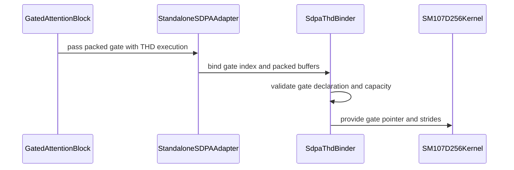

# frost(sdpa): THD x epilogue gate on the Rubin d256 f16/bf16 prefill -- the packed gate map, the native THD binder's per-call gate slot, and the gated attention block's fuse_gate under thd=True

[Upstream PR](https://github.com/NVIDIA/cudnn-frontend/pull/1617) · state: closed · merged: True

## Original PR description

## Before submitting

- [x] I agree to license this contribution under the terms of [LICENSE.txt](https://github.com/NVIDIA/cudnn-frontend/blob/develop/LICENSE.txt).
- [x] I ran `pre-commit run` and committed any formatting changes.
- [x] I reviewed the Hard Rules in the `AGENTS.md` for each directory this PR touches (`python/cudnn/AGENTS.md` Rule 7 -- the DSL gate stays the adapter's existing `check_support` gate; Rule 9 -- one caller contract: the gate under packed sequences rides the same `SdpaFwdDslSm100(thd=True, sample_gate=...)` spelling as dense, no env var, no engine-specific handling; `python/cudnn/sdpa/AGENTS.md` Rule S2 -- the tracker's gate row and footnote land in the binding commit; no `Capabilities` / `EngineSpec` change, the graph rows keep their dense-only decline) and my changes comply.
- [x] Labels: `cat-feature`, `area:frost`, `mod-frost`, `orig-nv-eng`.

## Affected area

FE OSS kernels or CuTeDSL -- the FROST SDPA forward adapter for Rubin (`python/cudnn/sdpa/fwd/`: `api_dsl.py`, `prepared.py`, `config_sm107.py`, the kernel HOST half of `kernels/sm107/prefill_d256_f16.py`, `kernels/_common_blackwell.py`), the native Python extension's THD binder (`python/pygraph/sdpa_thd_binding.cpp`; a compatible wheel must include this binder change), the gated attention block (`python/cudnn/gated_attention_block/api.py`), their docs, the tracker and tests. No kernel BODY change (pinned by cubin md5, table below). No engine row.

**Builds on merged #1606.** This branch now incorporates `develop` through #1606’s merge (`5addfa7aa`) using a normal merge. This PR’s own scope is the Rubin f16/bf16 d256 packed epilogue gate: the host gate descriptor, the native THD binder’s per-call gate operand, and the gated attention block’s `fuse_gate` under `thd=True`, with their documentation and tests. The integration retains the standalone sparse adapter’s dense-template rejection and support-matrix coverage.

## Summary

The fused epilogue gate (`O := O * sigmoid(G)`) was dense-only on every Rubin kernel. It is now served under packed sequences (THD) on the f16/bf16 d256 prefill -- the one Rubin body with the gate seams, whose THD arm already loads the gate tile at the THD coordinates -- by making the HOST side agree, in three steps:

1. **The SDPA adapter** (`frost(sdpa)`). (a) The kernel host maps `G` in the same packed `[1, T, H_q, D_v]` form `Q` / `O` take (`sdpa_gate_tensor(..., thd=)`, an appended kwarg whose default keeps every other caller's trace byte-identical) -- the kernel body is untouched: the dense gated and the ungated THD renderings trace-compile for `sm_107a` to the same cubins as before. (b) The prepared THD launch had no gate: the one production binder (`_SdpaThdBinder`) carried no gate role and `build_thd_spec` pinned the gate pointer to None at build. `G` is now a PER-CALL operand of the native binder, outside the fixed role pack (its pack index travels as an appended argument, `-1` = none), validated like `Q` / `O` -- `Q`'s dtype, this plan's device, a 16-byte-aligned base, the declared (token, head, elem) strides in the packed `(T, H, D)` or the graph's `(B, H, S, D)` form, a capacity covering every packed `Q` token (a shorter gate is a typed `ValueError`, never a shortened launch) -- and refused both ways (a gate on an ungated plan, none on a gated one). `_SdpaThdBinder.supports_epilogue_gate` is the tripwire the adapter reads: a native Python extension older than this role declines a gated THD plan typed at `check_support` instead of launching with a null gate pointer. (c) The adapter's THD x gate decline is INVERTED for the f16/bf16 d256 prefill; the quantized THD bodies (per-tensor FP8, MXFP8) stay declined by name (they build the dense gate map); `G` joins the packed-layout rule and the native THD stride rule under THD; `_execute_thd` carries the gate; the config backstop admits `thd_varlen + epilogue_gate` on the f16/bf16 "sm107 d256" body only. The GRAPH rows keep their "dense-only" decline: the graph's THD lowering binds no gate operand, so the standalone adapter is wider than the engine row here by design, never the reverse.
2. **The gated attention block** (`frost(gated_attention_block)`). `fuse_gate=True` with `thd=True` declares the gated d256 THD specialization -- `G` declared at the same `(B_env, H_q, S_max, D)` envelope as `O`, at the fused projection slab's gate column stride (zero-copy, as under dense), bound at execute as the packed `(T, H_q, D)` view like `Q` / `K` / `V` / `O` -- so the packed block is `proj(+norm+RoPE) -> sdpa(+gate) -> out_proj` plus the packed SDPA's setup launch: one launch fewer than the packed block without the knob. The former "fuse_gate=True is dense-only" decline is inverted, not deleted; the fully fused quantized pipelines stay declined under THD (the quantized THD SDPA bodies have no THD gate descriptor; the fused MXFP8 projection fork decodes `(b, s_tile)` per 128-row tile).
3. **The EXTEND form's own `fuse_gate` row.** With the packed block's `fuse_gate` served, a `kv_source="paged"` + `fuse_gate=True` declaration no longer meets the block's former THD gate decline first; the EXTEND declines table gains a `fuse_gate` row, so `serving_envelope` keeps predicting every typed decline the form raises at declaration (the row-by-row CPU proof gains the trip). **The EXTEND form is NOT gated by this PR:** its attention stage binds the shared d256 paged / THD body compiled for Rubin, which carries no epilogue-gate seam; the EXTEND form keeps running the gate as its own stage, and a gate on that body is a later kernel change.

What is served and what is not, in one place: the tracker's SM107 "Fused epilogue gate" row and its footnote (`python/cudnn/sdpa/frost/SUPPORT_MATRIX_TRACKER.md`, the binding commit).

The numerical measurements, cubin hashes, and launch census below are the original pre-integration evidence on the stated hardware. The current integration reuses the previously built native extension after checking its repository build inputs; it does not claim a new extension build or new measurements for these tables.

### Numerics -- the fused THD gate vs the ungated THD run followed by the separate gate stage (Rubin cc 10.7, a 204-SM development part; `G` a column slice of a wider slab)

| arm (`lens`) | max ulp (the unit: the ulp at the larger magnitude of the pair) | max abs diff | elements one rounding apart | LSE | max abs O vs the fp32 oracle |
|---|---|---|---|---|---|
| bf16, causal, `[300, 128, 200]` | **1.000** | 3.906e-03 | 25.9 % | bitwise the ungated run's | 3.835e-03 |
| fp16, causal, `[300, 128, 200]` | **1.000** | 4.883e-04 | 25.7 % | bitwise | 4.902e-04 |
| bf16, dense, `[300, 128, 200]` | **1.000** | 9.766e-04 | 26.1 % | bitwise | 5.805e-04 |
| bf16, causal, `[1000, 24, 512, 300]` | **1.000** | 7.812e-03 | 25.9 % | bitwise | 3.892e-03 |

Exactly one output rounding on every arm -- the dense gate's own convention. `B = 1` packed vs the dense gated plan: `O` and LSE BITWISE (bf16 and fp16). A sequence with `Q` rows and zero keys under a +-1e4 gate: `O` exactly 0, LSE `-inf`; a zero-length sequence in the packing owns no rows; 128 spare rows past the packed total untouched. No tolerance moved: the suite's `atol` / `rtol` / `_GATE_*_TOL` are unchanged against `develop`; the ulp bar literal is `<= 1.0`.

### The kernel body is unchanged -- cubin md5 of the `sm_107a` trace-compile: three of them pinned by `test_sm107_thd_gate_descriptor_leaves_the_dense_gated_and_ungated_thd_cubins_byte_identical` (the dense gated bf16 LSE, the ungated THD head-major LSE, the new THD gated); the other three unchanged renderings measured byte-identical in the change's record

| rendering of `sm107/prefill_d256_f16.py` | before | after |
|---|---|---|
| dense, gated, bf16, LSE | `50657ada1609d250868f34068d58d93f` (127 848 B) | identical |
| dense, gated, bf16, no LSE | `4f3378f04cc256cc87a5d65c6080fb71` (126 272 B) | identical |
| dense, gated, fp16, LSE | `5beb490e26509284acb08735a998855f` (125 768 B) | identical |
| THD, ungated, bf16, head-major LSE | `2a3467773a4dfa420660002a49c59fe0` (173 256 B) | identical |
| THD, ungated, bf16, token-major LSE | `fd521bfb1f6c0667a3fa410d2fc24b3e` (171 640 B) | identical |
| THD, gated, bf16 -- the NEW rendering | did not trace (declined) | `88a6956e90cc110697611583095ac47f` (194 176 B) |

### Launch census (CUPTI; the packed block with `fuse_norm_rope=True`)

`fuse_gate=True`: 4 kernel records (the projection GEMM, the packed SDPA's setup kernel, the gated THD SDPA, the out-projection GEMM) vs 5 without the knob (+ the separate gate kernel) vs the dense fused block's 3 -- the stage launches go 4 -> 3; no hidden memset / memcpy. Pinned by `test_thd_fuse_gate_launch_count_is_one_fewer`.

## Why

A serving stack packs a step's sequences and declares the layer once; the gate as its own launch was the one stage the packed block still paid for that the dense block did not. The kernel already had everything (the gate seams, the THD coordinates in the gate load); what was missing was the host contract -- the packed tensor map and a binder that binds the gate per call -- under the ONE caller contract (`python/cudnn/AGENTS.md` Rule 9): the same spelling as dense, no env var, no engine branching, every unserved spelling a typed decline (the quantized THD bodies, the graph tail, an older native Python extension, the EXTEND form).

## Related issues

Builds on merged #1606 (the serving EXTEND form). Related to merged #1543 (the Rubin d256 decode tile, whose split COMBINE applies the gate -- unchanged here). The integrated base also includes #1609’s capture-safe projection route.

## API and compatibility impact

- No new public name and no op function; `docs/fe-oss-apis/api_conventions.md` is not engaged; the API index is unchanged.
- Signatures are append-only: `sdpa_gate_tensor(..., thd=False)` (the kernel-host helper), `SdpaFwdDslSm100._execute_thd(..., gate=None)`, `prepared.execute_native_thd_tensors(..., gate=None)`, the native binder's `bind(..., gate=-1)` / `execute(..., gate=-1)`. `GatedAttentionBlockFwd` gains no parameter: an existing knob combination (`thd=True, fuse_gate=True`) is now served.
- Behaviour: `SdpaFwdDslSm100(thd=True, sample_gate=G)` on the f16/bf16 d256 prefill (cc 10.7) now passes `check_support` and runs; `GatedAttentionBlockFwd(thd=True, fuse_gate=True)` (bf16 / fp16 inference) likewise. Every other path is unchanged (five renderings byte-identical; the dense gate path's trace identical through the appended kwarg's default); `kv_source="paged"` with `fuse_gate=True` is a typed decline by its own row.
- The native Python extension changes (`python/pygraph/sdpa_thd_binding.cpp`: the THD binder's per-call gate slot and `supports_epilogue_gate`); the wheel build carries it. A Python tree running an OLDER extension declines a gated THD plan typed at `check_support`; it never launches with a null gate pointer.
- `Capabilities` / `EngineSpec` / manifest: unchanged (the graph rows keep "dense-only"; `engines.py` gains a comment saying the standalone adapter is wider than the row). Rule S2: the tracker's gate row + footnote are in the binding commit.
- GPU / versions: Rubin cc 10.7 only (the d256 f16/bf16 prefill); the DSL floor is the adapter's existing gate. No new dependency.

## Testing

### Integrated-head validation — 2026-10-13

At `f90b8ff800fa3eb44d2f74e9a13437e1ebb43738`, the Rubin correctness rerun passed **296 tests, 0 skipped**: 65 gate/THD tests, 59 packed-block tests, 170 all-level EXTEND tests (including packed fused gating with write-through), and 2 import/typed-decline regressions. A separate config follow-up passed **32 tests, 0 skipped**, checking inert sparse defaults and dense-factory rejection of sparse records across 16 factories.

Environment: SM107, cuDNN 9.27, CuTeDSL 4.8.0, PyTorch 2.14.1+cu130, Python 3.10.22. The runner verified the exact clean source head, source hashes, worktree imports and the gate-capable native extension's recorded binary hash. Every stage returned 0 and its JUnit report had no failures, errors or skips. These are shared-hardware functional checks; no performance measurement is claimed.

### Historical validation

The measurements and validation counts below are the original pre-integration evidence, retained with their stated hardware and scope. They do not claim a new run on the integrated head.

Rubin (cc 10.7, a 204-SM development part; functional cells, never a perf number), on the tree these commits come from:

- `sdpa/frost/test_sdpa_fwd_dsl_sm107.py`: the ten THD x gate cells pass -- `test_sm107_thd_gate_matches_the_oracle_and_the_separate_gate_within_one_ulp[bf16-causal | fp16-causal | bf16-dense]` (the table above), `test_sm107_thd_gate_b1_packed_is_bitwise_the_dense_gated_plan[bf16 | fp16]`, `test_sm107_thd_gate_keyless_sequence_is_exactly_zero_and_a_zero_length_sequence_owns_no_rows[bf16 | fp16]`, the every-layer pin, the host bind probe, the cubin pin; the suite's 48 other gate cells and 19 THD cells unchanged and green.
- `gated_attention_block/cutedsl/test_block_thd.py`: **59 passed** -- the 50 existing cells + 9 new (`fuse_gate` under `thd=True` vs the per-sequence oracle and the unfused packed block at the dense suite's bar on four arms: causal, dense mask, fp16, fused norm + RoPE; `B = 1` packed BITWISE the dense fused block; the head-major packed LSE bitwise the unfused packed block's; zero-length sequences in the middle and first; the launch census).
- `gated_attention_block/cutedsl/test_block_serving_extend.py`: **117 passed** at that commit (the packed declaration loop gains the `fuse_gate` arms).
- A second Rubin part (cc 10.7, 212 SMs, aarch64 host; the extension REBUILT there from this change): the ten THD x gate cells **10 passed**; `test_block_thd.py -k fuse_gate` **10 passed** -- the gate under THD on a freshly built aarch64 extension.

The historical pre-integration PR tree on a Rubin part (cc 10.7, 212 SMs, aarch64 host; functional, one process per module, `cudnn` imported from the PR tree, the extension built from this tree's own binder sources): `sdpa/frost/test_sdpa_fwd_dsl_sm107.py -k thd_gate` -> **10 passed** (31 s); `test_block_thd.py` -> **59 passed** (67 s); `test_block_serving_extend.py` -> **167 passed, 1 skipped** (77 s; the one skip in that historical run was #1606's capture cell, before integration of #1609's capture-safe projection route).

Host (an A100, cc 8.0; cudnn-frontend 1.32.0 on cuDNN 9.27, nvidia-cutlass-dsl 4.8.0, torch 2.13; `cudnn` imported from this PR's tree; the Rubin cells skip):

- `sdpa/frost/test_sdpa_fwd_dsl_sm107.py -k "gate or thd"` -> **27 passed, 38 skipped** (37 s): the cubin md5 pin (the dense gated and the ungated THD renderings byte-identical, the THD-gated rendering's md5 as recorded), the every-layer pin, the host bind probe (the gated THD plan compiled for `sm_107a` in a fresh interpreter; `bind()` returns a frame whose gate slots carry `G`'s address and the slab's strides; five typed refusals), the inverted typed-decline tests.
- `gated_attention_block/cutedsl/test_block_thd.py` + `test_block_serving_extend.py` -> **88 passed, 139 skipped** (186 s): the inverted block decline, the stage list, `G` at the slab stride, the EXTEND form's `fuse_gate` row in the row-by-row envelope proof.
- `api_index/test_api_index.py` + `core/test_import_boundaries.py` -> **36 passed, 1 skipped, 13 subtests passed** (57 s); `test_tiers.py` -> **11 passed** (65 s).
- The SDPA commit alone on `develop` (no #1606 content): `-k "gate or thd"` -> **27 passed, 38 skipped** (37 s) -- the adapter half composes independently of #1606; only the block half needs it.
- `pre-commit run --files <the 13 touched files>`: clang-format, black, black-jupyter, SPDX license header passed.

🤖 Generated with [Claude Code](https://claude.com/claude-code)

<!-- This is an auto-generated comment: release notes by coderabbit.ai -->

## Summary by CodeRabbit

- **New Features**
  - Packed THD/variable-length attention now supports fused gating for FP16 and BF16 D256 prefill.
  - Fused gating can reduce kernel launches compared with applying the gate as a separate stage.
- **Limitations**
  - Fused gating remains unavailable for paged-KV extend operations and quantized THD attention.

<!-- end of auto-generated comment: release notes by coderabbit.ai -->

## Review and discussion

### reviews

- YangXu1990uiuc · APPROVED · 2026-10-14T00:20:26Z · [source](https://github.com/NVIDIA/cudnn-frontend/pull/1617#pullrequestreview-5511610418)

**Codex bot review · model: `gpt-6-astra`**

Reviewed `f90b8ff800fa` against base `ede50d84de04`.

No new approval-blocking issue found. The packed gate descriptor agrees with the kernel's token coordinates, and the native binder observes and validates the gate on each call. The narrower quantized, paged-EXTEND and graph-tail eligibility remains explicit. I rebuilt the native extension from this exact head rather than reusing an older binding binary.

Validation: Fresh Release native-extension build passed. On SM100, the native THD and padded-Stats binding suites passed all 379 tests, including unchanged ungated, split, paged and empty-input contracts. On native SM107, focused THD-gate adapter and packed-block suites passed 20 tests. They cover FP16/BF16 numerics, separate-gate and dense controls, empty/keyless sequences, packed tails, typed declines and native gate binding. Two additional tests skipped: the cubin hash pin requires its exact recorded DSL release, and the launch census had no CUPTI events. An independent native SM107 probe reused one prepared plan with a different gate pointer and different physical token/head strides, compared O/LSE against per-sequence references, and verified short, CPU and wrong-dtype gates reject after warmup without changing O. Captured replays with changed gate contents and length vectors [128,0,500] and [0,500,128] also matched reference, with compilation forbidden after preparation. Reused the author's active pipeline 73659913; its mirror records the full reviewed SHA. SM80/SM90/SM100 CuTeDSL and SM80 FROST lanes had passed at the latest check; other selected lanes remain pending. No duplicate CI was started. Labels, project membership and the Frontend 1.32.0 milestone are already appropriate. Checked the newer target-branch delta beyond the PR's merge base: it fixes an unrelated SM100 MXFP8 D128 mask bound and does not change the THD gate/binder/block contracts reviewed here.

Limitations: CI is still running. The native SM107 SDPA lane currently omits test_sdpa_fwd_dsl_sm107.py; please include that module so the new adapter-level regressions continue to run there. The independent native run above supplies current-head evidence, not ongoing CI coverage. The cubin-hash and CUPTI checks remain unverified independently for the reasons above. No public performance claim is made.

Approved: no P0 or high-risk P1 found. Remaining findings stay with the owner; merge timing stays with the owner.

<!-- codex-fe-review:v2:1617:f90b8ff800fa3eb44d2f74e9a13437e1ebb43738:complete:no-blocker -->

### issue_comments

- RomanAnders90 · comment · 2026-10-13T14:22:10Z · [source](https://github.com/NVIDIA/cudnn-frontend/pull/1617#issuecomment-6147733110)

@cudnn-ci-bot run python_tests,frost

- cudnn-ci-bot · comment · 2026-10-13T14:22:16Z · [source](https://github.com/NVIDIA/cudnn-frontend/pull/1617#issuecomment-6147735509)

🏁 Pipeline finished

SHA: `914b596`
Targets: `python_tests`, `frost`
Branch: [cudnn-gh/pr-1617-914b596](https://nv/cudnn-gitlab-ci/-/tree/cudnn-gh/pr-1617-914b596)
Pipeline: [73538324](https://nv/cudnn-gitlab-ci/-/pipelines/73538324)
Last updated: 2026-10-13 16:26 UTC

**33 passed, 5 failed, 7 manual**

### <code>manual</code>

- <code>manual:python_samples</code> - Manual
- <code>manual:python</code> - ✅ Passed
- <code>manual:python/sdpa/frost</code> - ✅ Passed
- <code>manual:python/linear_attention/frost</code> - ✅ Passed
- <code>manual:python/gemm/frost</code> - ✅ Passed
- <code>manual:python/*/frost</code> - ✅ Passed
- <code>manual:python/gemm/cutedsl</code> - Manual
- <code>manual:python/*/cutedsl</code> - Manual
- <code>manual:python/*/jax</code> - Manual
- <code>manual:pycudnn</code> - Manual
- <code>manual:multi_gpu</code> - Manual
- <code>manual:backend</code> - Manual

### <code>analysis</code>

- <code>analysis:cudnn_clang_disable_exception</code> - ✅ Passed
- <code>analysis:cudnn_v9_no_half_conversion</code> - ✅ Passed
- <code>analysis:cudnn_clang</code> - ✅ Passed
- <code>analysis:check-relative-includes</code> - ✅ Passed
- <code>analysis:check-CUDNN_FRONTEND_SKIP_JSON_LIB</code> - ✅ Passed
- <code>analysis:guardwords_scan</code> - ✅ Passed
- <code>analysis:jax-import-guard</code> - ✅ Passed
- <code>analysis:pytest-gpu</code> - ✅ Passed
- <code>san:build</code> - ✅ Passed

### <code>build</code>

- <code>analysis:api_index</code> - ✅ Passed
- <code>build:dev:linux:amd64</code> - ✅ Passed
- <code>build:rel:linux:amd64</code> - ✅ Passed
- <code>build:dev:linux:arm64</code> - ✅ Passed
- <code>build:rel:linux:arm64</code> - ✅ Passed
- <code>build:rel:win:amd64</code> - ✅ Passed

### <code>frost_tests</code>

- <code>python/sdpa/frost:cutlass-rel:sm80</code> - ❌ **New Failure!** (nightly passed)
- <code>python/sdpa/frost:cutlass-rel:sm100</code> - ❌ **New Failure!** (nightly passed)
- <code>python/sdpa/frost:cutlass-rel:sm120</code> - ❌ **New Failure!** (nightly passed)
- <code>python/linear_attention/frost:cutlass-rel:sm100</code> - ✅ Passed
- <code>python/gemm/frost:cutlass-rel:sm100</code> - ✅ Passed
- <code>python/*/frost:cutlass-rel:sm100</code> - ✅ Passed
- <code>python/sdpa/frost:cutlass-rel:sm103</code> - ❌ **New Failure!** (nightly passed)
- <code>python/sdpa/frost:cutlass-4.8:sm107</code> - ❌ **New Failure!** (nightly passed)

### <code>python_tests</code>

- <code>python:dev:sm80</code> - ✅ Passed
- <code>python:dev:sm90</code> - ✅ Passed
- <code>python:dev:sm100</code> - ✅ Passed
- <code>python:rel:sm80</code> - ✅ Passed
- <code>python:rel:sm90</code> - ✅ Passed
- <code>python:rel:sm100</code> - ✅ Passed

### <code>sanitizer_tests</code>

- <code>san:cpp_test:sm80</code> - ✅ Passed
- <code>san:cpp_test:sm90</code> - ✅ Passed
- <code>san:cpp_test:sm100</code> - ✅ Passed

### <code>triage</code>

- <code>triage:ai</code> - ✅ Passed

- coderabbitai[bot] · comment · 2026-10-13T14:22:27Z · [source](https://github.com/NVIDIA/cudnn-frontend/pull/1617#issuecomment-6147739376)

<!-- This is an auto-generated comment: summarize by coderabbit.ai -->
<!-- review_stack_entry_start -->

<a href="https://app.coderabbit.ai/change-stack/NVIDIA/cudnn-frontend/pull/1617?scope=ghh_OusAJGA4HG8ljoOV0wJvVx8NmnZIjc2DdjmxOu0xZWA&amp;cs_source=review_comment"><picture><source media="(prefers-color-scheme: dark)" srcset="https://storage.googleapis.com/coderabbit_public_assets/review-stack-in-coderabbit-ui-dark.svg?v=3"><source media="(prefers-color-scheme: light)" srcset="https://storage.googleapis.com/coderabbit_public_assets/review-stack-in-coderabbit-ui.svg?v=3"></picture></a>

<!-- review_stack_entry_end -->
<!-- recent_review_start -->

No actionable comments were generated in the recent review. 🎉

<strong>ℹ️ Recent review info</strong>

<dl>
<dd>

<strong>⚙️ Run configuration</strong>

<dl>
<dd>

- **Configuration used**: Repository: NVIDIA/cudnn-frontend/.coderabbit.yaml
- **Review profile**: CHILL
- **Plan**: Enterprise
- **Run ID**: `ff5d85c2-f99c-4300-964f-f2415c1e5b6f`

</dd>
</dl>

<strong>📥 Commits</strong>

<dl>
<dd>

Reviewing files that changed from the base of the PR and between 5addfa7aa929b2b31745fd9337b1c32c88436602 and f90b8ff800fa3eb44d2f74e9a13437e1ebb43738.

</dd>
</dl>

<strong>📒 Files selected for processing: 14</strong>

<dl>
<dd>

* `docs/fe-oss-apis/gated_attention_block.md`
* `python/cudnn/gated_attention_block/api.py`
* `python/cudnn/sdpa/frost/SUPPORT_MATRIX_TRACKER.md`
* `python/cudnn/sdpa/fwd/api_dsl.py`
* `python/cudnn/sdpa/fwd/config_sm107.py`
* `python/cudnn/sdpa/fwd/engines.py`
* `python/cudnn/sdpa/fwd/kernels/_common_blackwell.py`
* `python/cudnn/sdpa/fwd/kernels/sm107/prefill_d256_f16.py`
* `python/cudnn/sdpa/fwd/prepared.py`
* `python/pygraph/sdpa_thd_binding.cpp`
* `test/python/gated_attention_block/cutedsl/test_block_serving_extend.py`
* `test/python/gated_attention_block/cutedsl/test_block_thd.py`
* `test/python/sdpa/frost/test_sdpa_fp8_sm107.py`
* `test/python/sdpa/frost/test_sdpa_fwd_dsl_sm107.py`

</dd>
</dl>

**Included review availability:** This review used your included allowance. Your plan provides up to 12 included reviews per hour; 11 remain after this review.

</dd>
</dl>

<!-- recent_review_end -->
<!-- walkthrough_start -->

<strong>📝 Walkthrough</strong>

<dl>
<dd>

The pull request adds fused gating for FP16/BF16 packed THD attention on the standalone D256 prefill path. The native binder validates and passes the packed gate to the kernel. Quantized THD gates and paged EXTEND fused gating remain declined.

**Changes: Packed THD fused-gate support**

|Layer / File(s)|Summary|
|:---|:---|
|**Gated attention block integration**   `docs/fe-oss-apis/gated_attention_block.md`, `python/cudnn/gated_attention_block/api.py`, `test/python/gated_attention_block/cutedsl/*`|The packed THD declaration passes the gate through the SDPA epilogue instead of a separate gate stage. Serving checks retain declines for quantized pipelines and paged EXTEND.|
|**SDPA eligibility and packed gate mapping**   `python/cudnn/sdpa/fwd/api_dsl.py`, `python/cudnn/sdpa/fwd/config_sm107.py`, `python/cudnn/sdpa/fwd/engines.py`, `python/cudnn/sdpa/fwd/kernels/*`, `python/cudnn/sdpa/frost/SUPPORT_MATRIX_TRACKER.md`, `test/python/sdpa/frost/*`|The SM107 D256 path admits FP16/BF16 THD gates and maps them using packed Q/O coordinates. Quantized THD gates and THD graph-tail lowering remain declined.|
|**Per-call native gate binding**   `python/cudnn/sdpa/fwd/prepared.py`, `python/pygraph/sdpa_thd_binding.cpp`, `test/python/sdpa/frost/test_sdpa_fwd_dsl_sm107.py`|Prepared launches pass the gate as an additional per-call operand. The binder checks gate presence, dtype, device, alignment, strides, and packed-token capacity before supplying its pointer and strides to the invocation frame.|
|**Packed execution and numerical validation**   `test/python/gated_attention_block/cutedsl/test_block_thd.py`, `test/python/sdpa/frost/test_sdpa_fwd_dsl_sm107.py`|Tests compare fused packed outputs with references and dense execution. They also check LSE, empty and keyless sequences, output bounds, and launch counts.|

<!-- change_assessment_start -->
**Priority:** ⬇️ Low

**Estimated code review effort:** 4 (Complex) | ~60 minutes

<!-- change_assessment_commit:"f90b8ff800fa3eb44d2f74e9a13437e1ebb43738" -->
**Change:** Feature
<!-- change_assessment_end -->

### Sequence Diagram(s)

**Suggested reviewers:** `yangxu1990uiuc`

</dd>
</dl>

<!-- walkthrough_end -->

<strong>Merge Risk:</strong> <strong>⚪ Minimal</strong> · up to <code>f90b8</code>

<dl>
<dd>

<!-- final_review_risk_start -->
<!-- final_review_risk_label
**Merge Risk:** **⚪ Minimal** · up to `f90b8`
-->
<!-- final_review_risk_coverage:{"sourceCommitId":"f90b8ff800fa3eb44d2f74e9a13437e1ebb43738","coveredCommitId":"f90b8ff800fa3eb44d2f74e9a13437e1ebb43738","kind":"reviewed"} -->

This change adds fused gating for packed f16/bf16 d256 prefill, with typed declines kept for unsupported cases. No actionable merge-blocking issue was found. Confirm the final CI run passes before merging.
<!-- final_review_risk_end -->

</dd>
</dl>

<!-- pre_merge_checks_walkthrough_start -->

<strong>Pre-merge checks: <picture></picture> 4 · <picture></picture> 1</strong>

<dl>
<dd>

<strong><picture></picture> Failed checks: 1 warning</strong>

|     Check name     |                                              Status                                              | Explanation                                                                                                                                                                                               | Resolution                                                                         |
| :---------------- | :----------------------------------------------------------------------------------------------: | :-------------------------------------------------------------------------------------------------------------------------------------------------------------------------------------------------------- | :--------------------------------------------------------------------------------- |
| Docstring Coverage |  | Docstring coverage is 71.43% which is insufficient. The required threshold is 80.00%. Docstring coverage is scoped to functions touched by this diff. Analyzed 63 functions across 12 files. (2 skipped:… | Write docstrings for the functions missing them to satisfy the coverage threshold. |

<strong><picture></picture> Passed checks: 4 passed</strong>

<dl>
<dd>

|         Check name         |                                             Status                                             | Explanation                                                                                                                                                                                               |
| :------------------------ | :--------------------------------------------------------------------------------------------: | :-------------------------------------------------------------------------------------------------------------------------------------------------------------------------------------------------------- |
|         Title check        |  | The title accurately identifies the main change: THD epilogue gating for Rubin d256 f16/bf16 prefill and the related binder and gated-attention updates. It is longer than necessary but remains clear a… |
|      Description check     |  | The description includes all required sections and provides detailed scope, rationale, compatibility impact, related issues, testing results, and limitations. It is complete and directly related to th… |
|     Linked Issues check    |  | Check skipped because no linked issues were found for this pull request.                                                                                                                                  |
| Out of Scope Changes check |  | Check skipped because no linked issues were found for this pull request.                                                                                                                                  |

</dd>
</dl>

<strong>Full details: Docstring Coverage</strong>

<dl>
<dd>

**Explanation**

Docstring coverage is 71.43% which is insufficient. The required threshold is 80.00%. Docstring coverage is scoped to functions touched by this diff. Analyzed 63 functions across 12 files. (2 skipped: 2 unsupported.)

</dd>
</dl>

</dd>
</dl>

<!-- pre_merge_checks_walkthrough_end -->

- [ ] <!-- {"checkboxId":"585bb3f6-faf5-4dbf-96d2-74e382adf19a"} --> Fix all pre-merge checks with AI
<!-- finishing_touch_checkbox_start -->

<strong>✨ Finishing Touches</strong>

<dl>
<dd>

<strong>🧪 Generate unit tests (beta)</strong>

<dl>
<dd>

- [ ] <!-- {"checkboxId": "f47ac10b-58cc-4372-a567-0e02b2c3d479", "radioGroupId": "utg-output-choice-group-unknown_comment_id"} --> Create a new PR

</dd>
</dl>

</dd>
</dl>

<!-- finishing_touch_checkbox_end -->

<!-- autopilot:start -->
- [ ] <!-- {"checkboxId":"2708ad07-9f24-4260-9c11-7dc76a49f2e3"} --> <strong title="Keep fixing CodeRabbit findings and required CI, and resolving merge conflicts">Autofix</strong> · Keep fixing CodeRabbit findings and required CI, and resolving merge conflicts
<!-- autopilot:end -->
<!-- tips_start -->

Comment `@coderabbitai help` to get the list of available commands.

<!-- tips_end -->

- RomanAnders90 · comment · 2026-10-13T21:40:42Z · [source](https://github.com/NVIDIA/cudnn-frontend/pull/1617#issuecomment-6155778344)

@cudnn-ci-bot run python/*/cutedsl

- RomanAnders90 · comment · 2026-10-13T21:41:41Z · [source](https://github.com/NVIDIA/cudnn-frontend/pull/1617#issuecomment-6155793804)

@cudnn-ci-bot run python/sdpa/frost

- cudnn-ci-bot · comment · 2026-10-13T21:42:02Z · [source](https://github.com/NVIDIA/cudnn-frontend/pull/1617#issuecomment-6155799669)

🚀 Running pipeline

SHA: `6d9216b`
Targets: `python/*/cutedsl`
Branch: [cudnn-gh/pr-1617-6d9216b](https://nv/cudnn-gitlab-ci/-/tree/cudnn-gh/pr-1617-6d9216b)
Pipeline: [73635421](https://nv/cudnn-gitlab-ci/-/pipelines/73635421)
Last updated: 2026-10-13 21:43 UTC

- cudnn-ci-bot · comment · 2026-10-13T21:45:20Z · [source](https://github.com/NVIDIA/cudnn-frontend/pull/1617#issuecomment-6155855825)

🏁 Pipeline finished

SHA: `6d9216b`
Targets: `python/*/cutedsl`, `python/sdpa/frost`
Branch: [cudnn-gh/pr-1617-6d9216b](https://nv/cudnn-gitlab-ci/-/tree/cudnn-gh/pr-1617-6d9216b)
Pipeline: [73635421](https://nv/cudnn-gitlab-ci/-/pipelines/73635421)
Last updated: 2026-10-13 23:45 UTC

**25 passed, 2 failed, 3 canceled, 5 skipped, 10 manual**

### <code>manual</code>

- <code>manual:python_samples</code> - Manual
- <code>manual:python</code> - Manual
- <code>manual:python/sdpa/frost</code> - ✅ Passed
- <code>manual:python/linear_attention/frost</code> - Manual
- <code>manual:python/gemm/frost</code> - Manual
- <code>manual:python/*/frost</code> - Manual
- <code>manual:python/gemm/cutedsl</code> - Manual
- <code>manual:python/*/cutedsl</code> - ✅ Passed
- <code>manual:python/*/jax</code> - Manual
- <code>manual:pycudnn</code> - Manual
- <code>manual:multi_gpu</code> - Manual
- <code>manual:backend</code> - Manual

### <code>analysis</code>

- <code>analysis:cudnn_clang_disable_exception</code> - ✅ Passed
- <code>analysis:cudnn_v9_no_half_conversion</code> - ✅ Passed
- <code>analysis:cudnn_clang</code> - ✅ Passed
- <code>analysis:check-relative-includes</code> - ✅ Passed
- <code>analysis:check-CUDNN_FRONTEND_SKIP_JSON_LIB</code> - ✅ Passed
- <code>analysis:guardwords_scan</code> - ✅ Passed
- <code>analysis:jax-import-guard</code> - ✅ Passed
- <code>analysis:pytest-gpu</code> - ✅ Passed
- <code>san:build</code> - ✅ Passed

### <code>build</code>

- <code>analysis:api_index</code> - ✅ Passed
- <code>build:dev:linux:amd64</code> - ✅ Passed
- <code>build:rel:linux:amd64</code> - ✅ Passed
- <code>build:dev:linux:arm64</code> - ✅ Passed
- <code>build:rel:linux:arm64</code> - ✅ Passed
- <code>build:rel:win:amd64</code> - ✅ Passed

### <code>oss_tests</code>

- <code>python/gemm/cutedsl:cutlass-rel:sm100</code> - Skipped
- <code>python/*/cutedsl:cutlass-rel:sm80</code> - ✅ Passed
- <code>python/*/cutedsl:cutlass-rel:sm90</code> - ✅ Passed
- <code>python/*/cutedsl:cutlass-rel:sm100</code> - ✅ Passed
- <code>python/*/jax:cutlass-rel:sm100</code> - Skipped
- <code>python/*/cutedsl:cutlass-4.8:sm107</code> - Canceled

### <code>frost_tests</code>

- <code>python/sdpa/frost:cutlass-rel:sm80</code> - ✅ Passed
- <code>python/sdpa/frost:cutlass-rel:sm100</code> - ❌ **Old Failure** (nightly failed)
- <code>python/sdpa/frost:cutlass-rel:sm120</code> - ✅ Passed
- <code>python/linear_attention/frost:cutlass-rel:sm100</code> - Skipped
- <code>python/gemm/frost:cutlass-rel:sm100</code> - Skipped
- <code>python/*/frost:cutlass-rel:sm100</code> - Skipped
- <code>python/sdpa/frost:cutlass-rel:sm103</code> - ❌ **Old Failure** (nightly failed)
- <code>python/sdpa/frost:cutlass-4.8:sm107</code> - Canceled

### <code>sanitizer_tests</code>

- <code>san:cpp_test:sm80</code> - ✅ Passed
- <code>san:cpp_test:sm90</code> - ✅ Passed
- <code>san:cpp_test:sm100</code> - ✅ Passed

### <code>triage</code>

- <code>triage:ai</code> - Canceled

- RomanAnders90 · comment · 2026-10-13T23:43:18Z · [source](https://github.com/NVIDIA/cudnn-frontend/pull/1617#issuecomment-6157556870)

@cudnn-ci-bot run python/*/cutedsl

- RomanAnders90 · comment · 2026-10-13T23:43:19Z · [source](https://github.com/NVIDIA/cudnn-frontend/pull/1617#issuecomment-6157557201)

@cudnn-ci-bot run python/sdpa/frost

- cudnn-ci-bot · comment · 2026-10-13T23:43:22Z · [source](https://github.com/NVIDIA/cudnn-frontend/pull/1617#issuecomment-6157557723)

🚀 Running pipeline

SHA: `f90b8ff`
Targets: `python/*/cutedsl`
Branch: [cudnn-gh/pr-1617-f90b8ff](https://nv/cudnn-gitlab-ci/-/tree/cudnn-gh/pr-1617-f90b8ff)
Pipeline: [73659913](https://nv/cudnn-gitlab-ci/-/pipelines/73659913)
Cancelled this PR's older pipelines: 73635421
Last updated: 2026-10-13 23:44 UTC

- cudnn-ci-bot · comment · 2026-10-13T23:44:19Z · [source](https://github.com/NVIDIA/cudnn-frontend/pull/1617#issuecomment-6157569255)

🏁 Pipeline finished

SHA: `f90b8ff`
Targets: `python/*/cutedsl`, `python/sdpa/frost`
Branch: [cudnn-gh/pr-1617-f90b8ff](https://nv/cudnn-gitlab-ci/-/tree/cudnn-gh/pr-1617-f90b8ff)
Pipeline: [73659913](https://nv/cudnn-gitlab-ci/-/pipelines/73659913)
Cancelled this PR's older pipelines: 73635421
Last updated: 2026-10-14 01:47 UTC

**26 passed, 4 failed, 5 skipped, 10 manual**

### <code>manual</code>

- <code>manual:python_samples</code> - Manual
- <code>manual:python</code> - Manual
- <code>manual:python/sdpa/frost</code> - ✅ Passed
- <code>manual:python/linear_attention/frost</code> - Manual
- <code>manual:python/gemm/frost</code> - Manual
- <code>manual:python/*/frost</code> - Manual
- <code>manual:python/gemm/cutedsl</code> - Manual
- <code>manual:python/*/cutedsl</code> - ✅ Passed
- <code>manual:python/*/jax</code> - Manual
- <code>manual:pycudnn</code> - Manual
- <code>manual:multi_gpu</code> - Manual
- <code>manual:backend</code> - Manual

### <code>analysis</code>

- <code>analysis:cudnn_clang_disable_exception</code> - ✅ Passed
- <code>analysis:cudnn_v9_no_half_conversion</code> - ✅ Passed
- <code>analysis:cudnn_clang</code> - ✅ Passed
- <code>analysis:check-relative-includes</code> - ✅ Passed
- <code>analysis:check-CUDNN_FRONTEND_SKIP_JSON_LIB</code> - ✅ Passed
- <code>analysis:guardwords_scan</code> - ✅ Passed
- <code>analysis:jax-import-guard</code> - ✅ Passed
- <code>analysis:pytest-gpu</code> - ✅ Passed
- <code>san:build</code> - ✅ Passed

### <code>build</code>

- <code>analysis:api_index</code> - ✅ Passed
- <code>build:dev:linux:amd64</code> - ✅ Passed
- <code>build:rel:linux:amd64</code> - ✅ Passed
- <code>build:dev:linux:arm64</code> - ✅ Passed
- <code>build:rel:linux:arm64</code> - ✅ Passed
- <code>build:rel:win:amd64</code> - ✅ Passed

### <code>oss_tests</code>

- <code>python/gemm/cutedsl:cutlass-rel:sm100</code> - Skipped
- <code>python/*/cutedsl:cutlass-rel:sm80</code> - ✅ Passed
- <code>python/*/cutedsl:cutlass-rel:sm90</code> - ✅ Passed
- <code>python/*/cutedsl:cutlass-rel:sm100</code> - ✅ Passed
- <code>python/*/jax:cutlass-rel:sm100</code> - Skipped
- <code>python/*/cutedsl:cutlass-4.8:sm107</code> - ❌ **Old Failure** (nightly failed)

### <code>frost_tests</code>

- <code>python/sdpa/frost:cutlass-rel:sm80</code> - ✅ Passed
- <code>python/sdpa/frost:cutlass-rel:sm100</code> - ❌ **New Failure!** (nightly passed)
- <code>python/sdpa/frost:cutlass-rel:sm120</code> - ✅ Passed
- <code>python/linear_attention/frost:cutlass-rel:sm100</code> - Skipped
- <code>python/gemm/frost:cutlass-rel:sm100</code> - Skipped
- <code>python/*/frost:cutlass-rel:sm100</code> - Skipped
- <code>python/sdpa/frost:cutlass-rel:sm103</code> - ❌ **New Failure!** (nightly passed)
- <code>python/sdpa/frost:cutlass-4.8:sm107</code> - ❌ **New Failure!** (nightly passed)

### <code>sanitizer_tests</code>

- <code>san:cpp_test:sm80</code> - ✅ Passed
- <code>san:cpp_test:sm90</code> - ✅ Passed
- <code>san:cpp_test:sm100</code> - ✅ Passed

### <code>triage</code>

- <code>triage:ai</code> - ✅ Passed

- YangXu1990uiuc · comment · 2026-10-14T00:43:00Z · [source](https://github.com/NVIDIA/cudnn-frontend/pull/1617#issuecomment-6158289404)

CI triage for `f90b8ff800fa3`, pipeline **73659913**: SM80 and SM120 FROST plus SM80/SM90/SM100 CuTeDSL passed. The failed SM100 and SM103 FROST lanes have **exactly the same failed test cases** as pipeline 73644837 on #1590: 25 standalone-backward `std::bad_cast` cases per lane, plus the known `test34` worker crash.

The backward failures are the inherited nanobind list/tuple regression [independently reproduced here](https://github.com/NVIDIA/cudnn-frontend/pull/1590#issuecomment-6157371136); the separate `test34` fix is in #1621, outside this tested head. These results add no THD-gate-specific failure and do not change my approval. Both SM107 CI jobs remain pending; the review's independent native validation and its explicit skip/coverage limits still apply.

Codex bot review — model `gpt-6-astra`.

<!-- codex-fe-ci:v1:1617:f90b8ff800fa3eb44d2f74e9a13437e1ebb43738:pipeline-73659913-inherited-backward-failures -->

- YangXu1990uiuc · comment · 2026-10-14T01:48:21Z · [source](https://github.com/NVIDIA/cudnn-frontend/pull/1617#issuecomment-6159067047)

Post-merge CI follow-up for `f90b8ff800fa3`: pipeline **73659913** has finished, with remaining failures requiring follow-up. This is not an all-green result.

- SM80/SM120 FROST and SM80/SM90/SM100 CuTeDSL passed. SM100/SM103 FROST have the inherited failures described [above](https://github.com/NVIDIA/cudnn-frontend/pull/1617#issuecomment-6158289404).
- SM107 CuTeDSL completed with **6,205 passed, 130 failed, 2,450 skipped**. **127** failures are the standalone-backward `std::bad_cast` through `prepared_sm107.execute_standalone` and the shared native binder, matching the [independently reproduced list/tuple regression](https://github.com/NVIDIA/cudnn-frontend/pull/1590#issuecomment-6157371136). The follow-up fix needs to cover both SM100 and SM107 callers.
- One failure is an outdated expectation in `test_mxfp8_block_second_execute_agrees_bitwise_and_runs_natural_cga1`: the selected record uses `cta_mma=2`, while the test requires 1. It fails identically on this head and pre-PR baseline `5addfa7aa929` on the same native SM107 node. Update the test's policy expectation while retaining its repeat-execution correctness assertions.
- The remaining two failures are the dense/packed BF16 HND page-16 K-cache oracle comparisons in `test_block_serving_extend.py`. Each CI case reports one mismatching element out of 232,960; the preceding bitwise cache-versus-consumed-K checks passed. Both tests pass on both source revisions on my independent SM107 node. The failing CI inputs were not saved, so these remain **unresolved CI numerics**, not established flakes or proven PR regressions. Preserve those inputs for a same-input base/head comparison before changing tolerances.

The SM107 FROST job started tests but reached its job time limit without a final pytest result; it provides incomplete coverage. The earlier independent THD-gate validation remains valid only for its stated scope. No additional CI was launched.

Codex bot review — model `gpt-6-astra`.

<!-- codex-fe-post-merge:v1:1617:f90b8ff800fa3eb44d2f74e9a13437e1ebb43738:pipeline-73659913-finished -->

### inline_comments

## Changed files and fixed code

- `docs/fe-oss-apis/gated_attention_block.md` · modified · additions 13 / deletions 8
  - [head](https://github.com/RomanAnders90/cudnn-frontend/blob/f90b8ff800fa3eb44d2f74e9a13437e1ebb43738/docs/fe-oss-apis/gated_attention_block.md)
  - [base](https://github.com/NVIDIA/cudnn-frontend/blob/5addfa7aa929b2b31745fd9337b1c32c88436602/docs/fe-oss-apis/gated_attention_block.md)
- `python/cudnn/gated_attention_block/api.py` · modified · additions 46 / deletions 35
  - [head](https://github.com/RomanAnders90/cudnn-frontend/blob/f90b8ff800fa3eb44d2f74e9a13437e1ebb43738/python/cudnn/gated_attention_block/api.py)
  - [base](https://github.com/NVIDIA/cudnn-frontend/blob/5addfa7aa929b2b31745fd9337b1c32c88436602/python/cudnn/gated_attention_block/api.py)
- `python/cudnn/sdpa/frost/SUPPORT_MATRIX_TRACKER.md` · modified · additions 28 / deletions 3
  - [head](https://github.com/RomanAnders90/cudnn-frontend/blob/f90b8ff800fa3eb44d2f74e9a13437e1ebb43738/python/cudnn/sdpa/frost/SUPPORT_MATRIX_TRACKER.md)
  - [base](https://github.com/NVIDIA/cudnn-frontend/blob/5addfa7aa929b2b31745fd9337b1c32c88436602/python/cudnn/sdpa/frost/SUPPORT_MATRIX_TRACKER.md)
- `python/cudnn/sdpa/fwd/api_dsl.py` · modified · additions 42 / deletions 7
  - [head](https://github.com/RomanAnders90/cudnn-frontend/blob/f90b8ff800fa3eb44d2f74e9a13437e1ebb43738/python/cudnn/sdpa/fwd/api_dsl.py)
  - [base](https://github.com/NVIDIA/cudnn-frontend/blob/5addfa7aa929b2b31745fd9337b1c32c88436602/python/cudnn/sdpa/fwd/api_dsl.py)
- `python/cudnn/sdpa/fwd/config_sm107.py` · modified · additions 15 / deletions 6
  - [head](https://github.com/RomanAnders90/cudnn-frontend/blob/f90b8ff800fa3eb44d2f74e9a13437e1ebb43738/python/cudnn/sdpa/fwd/config_sm107.py)
  - [base](https://github.com/NVIDIA/cudnn-frontend/blob/5addfa7aa929b2b31745fd9337b1c32c88436602/python/cudnn/sdpa/fwd/config_sm107.py)
- `python/cudnn/sdpa/fwd/engines.py` · modified · additions 5 / deletions 0
  - [head](https://github.com/RomanAnders90/cudnn-frontend/blob/f90b8ff800fa3eb44d2f74e9a13437e1ebb43738/python/cudnn/sdpa/fwd/engines.py)
  - [base](https://github.com/NVIDIA/cudnn-frontend/blob/5addfa7aa929b2b31745fd9337b1c32c88436602/python/cudnn/sdpa/fwd/engines.py)
- `python/cudnn/sdpa/fwd/kernels/_common_blackwell.py` · modified · additions 9 / deletions 3
  - [head](https://github.com/RomanAnders90/cudnn-frontend/blob/f90b8ff800fa3eb44d2f74e9a13437e1ebb43738/python/cudnn/sdpa/fwd/kernels/_common_blackwell.py)
  - [base](https://github.com/NVIDIA/cudnn-frontend/blob/5addfa7aa929b2b31745fd9337b1c32c88436602/python/cudnn/sdpa/fwd/kernels/_common_blackwell.py)
- `python/cudnn/sdpa/fwd/kernels/sm107/prefill_d256_f16.py` · modified · additions 8 / deletions 3
  - [head](https://github.com/RomanAnders90/cudnn-frontend/blob/f90b8ff800fa3eb44d2f74e9a13437e1ebb43738/python/cudnn/sdpa/fwd/kernels/sm107/prefill_d256_f16.py)
  - [base](https://github.com/NVIDIA/cudnn-frontend/blob/5addfa7aa929b2b31745fd9337b1c32c88436602/python/cudnn/sdpa/fwd/kernels/sm107/prefill_d256_f16.py)
- `python/cudnn/sdpa/fwd/prepared.py` · modified · additions 27 / deletions 3
  - [head](https://github.com/RomanAnders90/cudnn-frontend/blob/f90b8ff800fa3eb44d2f74e9a13437e1ebb43738/python/cudnn/sdpa/fwd/prepared.py)
  - [base](https://github.com/NVIDIA/cudnn-frontend/blob/5addfa7aa929b2b31745fd9337b1c32c88436602/python/cudnn/sdpa/fwd/prepared.py)
- `python/pygraph/sdpa_thd_binding.cpp` · modified · additions 96 / deletions 20
  - [head](https://github.com/RomanAnders90/cudnn-frontend/blob/f90b8ff800fa3eb44d2f74e9a13437e1ebb43738/python/pygraph/sdpa_thd_binding.cpp)
  - [base](https://github.com/NVIDIA/cudnn-frontend/blob/5addfa7aa929b2b31745fd9337b1c32c88436602/python/pygraph/sdpa_thd_binding.cpp)
- `test/python/gated_attention_block/cutedsl/test_block_serving_extend.py` · modified · additions 4 / deletions 3
  - [head](https://github.com/RomanAnders90/cudnn-frontend/blob/f90b8ff800fa3eb44d2f74e9a13437e1ebb43738/test/python/gated_attention_block/cutedsl/test_block_serving_extend.py)
  - [base](https://github.com/NVIDIA/cudnn-frontend/blob/5addfa7aa929b2b31745fd9337b1c32c88436602/test/python/gated_attention_block/cutedsl/test_block_serving_extend.py)
- `test/python/gated_attention_block/cutedsl/test_block_thd.py` · modified · additions 135 / deletions 5
  - [head](https://github.com/RomanAnders90/cudnn-frontend/blob/f90b8ff800fa3eb44d2f74e9a13437e1ebb43738/test/python/gated_attention_block/cutedsl/test_block_thd.py)
  - [base](https://github.com/NVIDIA/cudnn-frontend/blob/5addfa7aa929b2b31745fd9337b1c32c88436602/test/python/gated_attention_block/cutedsl/test_block_thd.py)
- `test/python/sdpa/frost/test_sdpa_fp8_sm107.py` · modified · additions 4 / deletions 1
  - [head](https://github.com/RomanAnders90/cudnn-frontend/blob/f90b8ff800fa3eb44d2f74e9a13437e1ebb43738/test/python/sdpa/frost/test_sdpa_fp8_sm107.py)
  - [base](https://github.com/NVIDIA/cudnn-frontend/blob/5addfa7aa929b2b31745fd9337b1c32c88436602/test/python/sdpa/frost/test_sdpa_fp8_sm107.py)
- `test/python/sdpa/frost/test_sdpa_fwd_dsl_sm107.py` · modified · additions 447 / deletions 2
  - [head](https://github.com/RomanAnders90/cudnn-frontend/blob/f90b8ff800fa3eb44d2f74e9a13437e1ebb43738/test/python/sdpa/frost/test_sdpa_fwd_dsl_sm107.py)
  - [base](https://github.com/NVIDIA/cudnn-frontend/blob/5addfa7aa929b2b31745fd9337b1c32c88436602/test/python/sdpa/frost/test_sdpa_fwd_dsl_sm107.py)

## Evidence and interpretation boundary

[Original JSON, discussions and patches](../../../../../../evidence/prs/NVIDIA--cudnn-frontend/1617-bd96e365acab309bc92b913dca0a5f7e873012de5272f029692bf99964bfc7e8.json) · SHA-256 `bd96e365acab309bc92b913dca0a5f7e873012de5272f029692bf99964bfc7e8`.

Diff complete: True. Missing/binary/truncated patches require pinned source inspection. This is a source page, not an independently verified optimization case. Open, merged and released are different states; recheck the deployed dependency.
