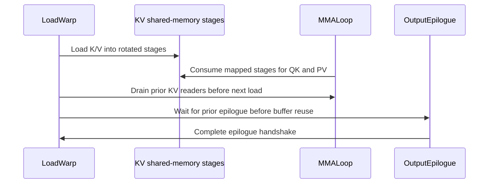

# Improve SM100 blk64 forward performance for small TopK

[Upstream PR](https://github.com/NVIDIA/cudnn-frontend/pull/1635) · state: closed · merged: True

## Original PR description

## Before submitting

- [x] I agree to license this contribution under the terms of [LICENSE.txt](https://github.com/NVIDIA/cudnn-frontend/blob/develop/LICENSE.txt).
- [x] I ran `pre-commit run` on all changed files and included formatting changes.
- [x] I reviewed the applicable root, Python, and test `AGENTS.md` rules.
- [ ] Labels: `cat-enhancements`, `area:sparse_attention`, `orig-external` (maintainer assistance needed: GitHub denied this author's `AddLabelsToLabelable` request).

## Affected area

FE OSS kernels / CuTeDSL block-sparse attention forward; benchmark and correctness coverage.

## Summary

The persistent SM100 blk64 forward loader currently waits for a query tile's output epilogue before loading the next query. That exposed handoff is expensive when each query attends to only a few sparse blocks. Prefetch the next Q and first K pack while the previous output epilogue finishes. On the tested 131072-token BF16 workload, TopK 8/16/32/64 throughput improves by approximately 23%/19%/11%/8% against `10b2280ef2e312598e48182fccecefa0927295b2`.

- Rotate the logical KV ring's mapping to physical shared-memory stages so each tile's first K pack starts in stage 2, outside the half-precision epilogue's alias of stages 0 and 1.
- Drain the previous KV readers before changing that mapping; preserve the monotonically advancing logical barrier state. Drain a **clone** because `producer_tail` advances its input state.
- Move the epilogue handshake after the first K load and before any subsequent load can overwrite output/exchange storage. Empty tiles consume the handshake without advancing KV; the final tile drains it at loop exit.
- Add multiple-wave, changed-input CUDA Graph replay tests and a same-buffer, interleaved A/B benchmark with an independently compiled A/A control.

## Why

This transfers the cross-query prefetch approach used in Omni-Attn to the existing cuDNN FE pipeline. It overlaps work at the query boundary using the existing three KV stages, without adding shared memory or barriers. Softmax arithmetic and reduction order are unchanged. The benefit is concentrated at small TopK; larger TopK is approximately flat.

## Related issues

None.

## API and compatibility impact

No public API, compile-key, dependency-floor, or host execution changes. Enable the new schedule only for persistent, unsplit BF16 blk64 forward. Nonpersistent, Sage FP8, and split-KV execution retain their existing schedule. Current blk64 admission remains BF16 MHA with D=DV=128.

## Testing

Tested the actual kernel imported from this checkout with Python 3.13.15, PyTorch 2.14.0+cu132, and CuTe DSL 4.7.1.

### Performance

NVIDIA B20Z (SM100, 148 SMs, 1000 W power limit; clocks not locked), B=1, Hq=Hkv=40, Sq=Skv=131072, D=DV=128, BF16, BSHD, blk64, unsplit forward. Ascending mean-pool TopK sparse indices. CUDA Graph timing includes attention O and LSE, excluding routing, allocation, compilation, and references.

Each shape uses three seeds, 15 randomized interleaved timing rounds per seed, and three kernel calls per graph. All variants share the same Q/K/V and sparse-index addresses; construction order is reversed for the middle seed. Baseline is compiled independently twice. Maximum absolute A/A variation across the 27 cases was 1.79%.


| TopK | Baseline ms | Prefetch ms | Baseline TFLOPS | Prefetch TFLOPS | Throughput gain |
| ---: | ---: | ---: | ---: | ---: | ---: |
| 8 | 3.179 | 2.575 | 432.4 | 533.8 | +23.42% |
| 16 | 4.900 | 4.121 | 560.9 | 667.0 | +18.99% |
| 32 | 7.829 | 7.034 | 702.2 | 781.6 | +11.30% |
| 64 | 13.797 | 12.810 | 796.9 | 858.3 | +7.83% |
| 128 | 24.871 | 24.360 | 884.2 | 902.7 | +2.06% |
| 256 | 47.037 | 46.995 | 935.0 | 935.9 | +0.06% |
| 512 | 91.921 | 92.245 | 956.9 | 953.6 | -0.39% |
| 1024 | 180.909 | 181.405 | 972.4 | 969.8 | -0.27% |
| 2048 | 327.180 | 323.998 | 1075.4 | 1085.9 | +0.97% |

Latencies are medians across seed medians; gain is the median of the paired seed gains, `baseline_ms / candidate_ms - 1`. FLOPs count `4 * B * H * Sq * TopK * 64 * D`. TopK=2048 is 0% sparsity.

A shorter Sq=Skv=16384 check (same configuration, three seeds, nine rounds) gives +24.77%, +16.58%, +14.12%, and +9.13% for TopK 8/16/32/64. Its maximum A/A variation was 0.17%.

Reproduce from the repository root after installing this checkout:

```bash
python benchmark/bsa/benchmark_sm100_blk64_prefetch.py \
  --baseline-ref 10b2280ef2e312598e48182fccecefa0927295b2 --output main.json
python benchmark/bsa/benchmark_sm100_blk64_prefetch.py \
  --baseline-ref 10b2280ef2e312598e48182fccecefa0927295b2 \
  --length 16384 --topks 8 16 32 64 --rounds 9 --output short.json
```

### Accuracy and synchronization

- Full O and LSE tensors are **bitwise identical to the baseline in all 39 benchmark cases** (27 long + 12 short).
- Each benchmark case also checks 18 sampled rows against an independent FP32 reference with TF32 disabled. Across both sweeps, worst output absolute error is `9.56e-4`, worst output relative L2 is `2.40e-3`, and worst LSE absolute error is `1.91e-6`.
- **29 tests passed on SM100 / B20Z and 29 on SM103 / B30Z**, including the 16 new replay cases and existing blk64 / split-KV / FP8 checks. The new cases cover fixed and variable counts, empty query tiles, poisoned unused indices, partial Q and KV tiles, zero/partial block sizes, BHSD/BSHD, CLC enabled/disabled, and changed inputs/counts during graph replay. Test-owned graphs are explicitly reset in `finally`.
- Compute Sanitizer racecheck on SM103: both CLC variable-count BSHD replay cases passed, with **0 hazards**. Verified the detector separately: a valid shared-memory control had 0 hazards/exit 0; a deliberate shared-memory write race had 1 hazard/exit 1.

```bash
cd test/python
python -m pytest -q \
  block_sparse_attention/cutedsl/test_BSA_attention_forward.py \
  block_sparse_attention/cutedsl/test_BSA_attention_fp8.py \
  -m 'L0 or L1' -k 'sm100_blk64 or sm100_bf16_forward_matches_reference' \
  -n 1 --max-worker-restart=0

CUDNN_TEST_TIMEOUT=600 compute-sanitizer --tool racecheck \
  --target-processes all --error-exitcode 1 \
  python -m pytest -q block_sparse_attention/cutedsl/test_BSA_attention_forward.py \
  -m L1 -k 'persistent_query_replay and bshd and True and variable_with_empty' \
  -n 1 --max-worker-restart=0
```

Formatting: scoped `pre-commit run --files` and `git diff --check` pass. SM110 was not available for runtime validation.


<!-- This is an auto-generated comment: release notes by coderabbit.ai -->

## Summary by CodeRabbit

* **Performance**
  * Improved persistent blk64 attention execution on supported GPUs by prefetching query data and rotating KV memory stages during processing.

* **Tests**
  * Added coverage for repeated CUDA Graph replay across layouts, scheduling modes, and varied block counts, including empty and partial blocks.

* **Benchmarking**
  * Added a benchmark comparing the installed kernel with baseline implementations, including timing and numerical accuracy results.

<!-- end of auto-generated comment: release notes by coderabbit.ai -->

## Review and discussion

### reviews

- vedaanta · APPROVED · 2026-10-14T06:32:39Z · [source](https://github.com/NVIDIA/cudnn-frontend/pull/1635#pullrequestreview-5513932009)

**Codex bot review · model: `gpt-6.1-sol`**

Reviewed `04171d2ede28` against base `a8de8c8e2cc4`.

Thank you for your contribution! The prefetch keeps the first K pack outside the previous output alias, drains old KV readers before remapping physical stages, and retains the epilogue acknowledgment before later loads reuse aliased storage. No actionable finding.

Validation: Traced shared-memory extents, logical barrier state versus physical KV stages, Q release, both K/V consumers and the output-drain handshake. Producer and MMA derive the same rotation from matching logical states; producer_tail operates on a clone. Empty tiles consume the output handshake without advancing KV, and loop exit drains the last output. Nonpersistent, split-KV and Sage FP8 remain on the old schedule. Current public blk64 admission remains BF16 MHA D128. 29 focused tests passed on native SM100 with public CuTe DSL 4.7.0 and cuDNN 9.28.0.16, including all 16 new L1 multi-wave changed-input CUDA Graph replay cases and existing blk64/split-KV/FP8 controls. Coverage includes CLC on/off, BHSD/BSHD, fixed/variable/empty counts, poisoned unused indices, partial Q/KV blocks and zero block sizes. Used exact-head Python kernel sources with a compatible reused FE native extension; verified loaded paths. No binding changes are being qualified by this reuse. Ran the committed benchmark through an explicit source loader: six cases at two TopK values and three seeds, same Q/K/V/index addresses, randomized interleaving, two independently compiled baseline modules, nine rounds and three launches per graph. All six O/LSE results were bitwise equal to baseline and passed sampled FP32 reference checks. The bounded test-device observations support the intended small-TopK direction; they do not qualify the author's full production hardware sweep or serving performance. Timing excludes routing, allocation, compilation and reference work. Requested current-head CI through the shared helper after source review and focused tests established readiness. Verified pipeline 73730136 running on integration SHA 15fe9041023a and verified its kernel source matches the reviewed head. The smallest available BSA gate is python/*/cutedsl. Its ordinary L0 selection covers existing controls; the new L1 replay cases were explicitly run locally and must not be counted as CI coverage without an expanded selection. No duplicate pipeline requested. Added the missing existing cat-enhancements, area:sparse_attention and orig-external labels, and assigned Frontend 1.32.0 to match develop's declared version and the open release milestone. Verified the resulting metadata and retained other fields. Reviewed source remained clean. Publication recheck: head, base and PR body are unchanged. Discussion additions are the author's request for another reviewer and the targeted CI notices/receipt, with no new substantive defect report or review decision. Reused the completed exact-head evidence.

Limitations: Native execution was SM100. SM103 racecheck and other device results in the PR remain author evidence; I did not independently rerun sanitizer or SM110 validation. Target CI is pending. The performance spot check used a smaller workload on a test device; raw platform measurements remain private. CPU enqueue overhead was not benchmarked because this change alters only the device schedule, with no new host execution work.

Approved: no P0 or high-risk P1 found. Remaining findings stay with the owner; merge timing stays with the owner.

<!-- codex-fe-review:v2:1635:04171d2ede28dc368bbb438a79fc5e70e9e037f0:complete:no-blocker -->

### issue_comments

- coderabbitai[bot] · comment · 2026-10-14T06:05:35Z · [source](https://github.com/NVIDIA/cudnn-frontend/pull/1635#issuecomment-6162052048)

<!-- This is an auto-generated comment: summarize by coderabbit.ai -->
<!-- review_stack_entry_start -->

<a href="https://app.coderabbit.ai/change-stack/NVIDIA/cudnn-frontend/pull/1635?scope=ghh_OusAJGA4HG8ljoOV0wJvVx8NmnZIjc2DdjmxOu0xZWA&amp;cs_source=review_comment"><picture><source media="(prefers-color-scheme: dark)" srcset="https://storage.googleapis.com/coderabbit_public_assets/review-stack-in-coderabbit-ui-dark.svg?v=3"><source media="(prefers-color-scheme: light)" srcset="https://storage.googleapis.com/coderabbit_public_assets/review-stack-in-coderabbit-ui.svg?v=3"></picture></a>

<!-- review_stack_entry_end -->
<!-- recent_review_start -->

No actionable comments were generated in the recent review. 🎉

<details>
<summary><strong>ℹ️ Recent review info</strong></summary>
<dl>
<dd>

<details>
<summary><strong>⚙️ Run configuration</strong></summary>
<dl>
<dd>

- **Configuration used**: Repository: NVIDIA/cudnn-frontend/.coderabbit.yaml
- **Review profile**: CHILL
- **Plan**: Advanced
- **Run ID**: `0674878c-03a6-4365-9f00-cb3a04bb5d46`

</dd>
</dl>
</details>

<details>
<summary><strong>📥 Commits</strong></summary>
<dl>
<dd>

Reviewing files that changed from the base of the PR and between 10b2280ef2e312598e48182fccecefa0927295b2 and 04171d2ede28dc368bbb438a79fc5e70e9e037f0.

</dd>
</dl>
</details>

<details>
<summary><strong>📒 Files selected for processing: 3</strong></summary>
<dl>
<dd>

* `benchmark/bsa/benchmark_sm100_blk64_prefetch.py`
* `python/cudnn/block_sparse_attention/csrc/fwd/sm100_blk64/bsa_fwd_sm100.py`
* `test/python/block_sparse_attention/cutedsl/test_BSA_attention_forward.py`

</dd>
</dl>
</details>

**Included review availability:** This review used your included allowance. Your plan provides up to 4 included reviews per hour; 3 remain after this review.

</dd>
</dl>
</details>


<!-- recent_review_end -->
<!-- walkthrough_start -->

<details>
<summary><strong>📝 Walkthrough</strong></summary>
<dl>
<dd>

The SM100 blk64 persistent execution path now prefetches the next query and rotates KV shared-memory stages. New replay tests cover multiple execution configurations. A benchmark compares the candidate kernel with two baseline instances.

**Changes: SM100 blk64 persistent prefetch**

|Layer / File(s)|Summary|
|:---|:---|
|**Prefetch synchronization and stage rotation** <br> `python/cudnn/block_sparse_attention/csrc/fwd/sm100_blk64/bsa_fwd_sm100.py`|The eligible persistent path rotates KV producer and consumer stages. It drains prior readers and waits for output epilogues before reusing aliased storage. Other execution modes retain direct stage indexing.|
|**Persistent query replay coverage** <br> `test/python/block_sparse_attention/cutedsl/test_BSA_attention_forward.py`|Parameterized tests cover SM100/SM110, both layouts, scheduling modes, fixed and variable block counts, and full and partial KV blocks. CUDA Graph replays refresh metadata and compare output and LSE with a dense reference.|
|**Baseline comparison benchmark** <br> `benchmark/bsa/benchmark_sm100_blk64_prefetch.py`|The script compares the installed kernel with a Git baseline and a separately loaded baseline instance. It checks numerical results, measures CUDA Graph timings, and saves case results and GPU metadata to JSON.|

<!-- change_assessment_start -->
**Priority:** ➖ Normal


**Estimated code review effort:** 3 (Moderate) | ~25 minutes

<!-- change_assessment_commit:"04171d2ede28dc368bbb438a79fc5e70e9e037f0" -->
**Change:** Feature
<!-- change_assessment_end -->

### Sequence Diagram(s)



**Suggested reviewers:** `jiayus-nvidia`

</dd>
</dl>
</details>

<!-- walkthrough_end -->
<details>
<summary><strong>Merge Risk:</strong> <strong>⚪ Minimal</strong> · up to <code>04171</code></summary>
<dl>
<dd>

<!-- final_review_risk_start -->
<!-- final_review_risk_label
**Merge Risk:** **⚪ Minimal** · up to `04171`
-->
<!-- final_review_risk_coverage:{"sourceCommitId":"04171d2ede28dc368bbb438a79fc5e70e9e037f0","coveredCommitId":"04171d2ede28dc368bbb438a79fc5e70e9e037f0","kind":"reviewed"} -->

No actionable merge-blocking issue remains; proceed with normal validation.
<!-- final_review_risk_end -->

</dd>
</dl>
</details>
<!-- pre_merge_checks_walkthrough_start -->

<details>
<summary><strong>Pre-merge checks: <sup><picture></picture></sup> 4 · <sup><picture></picture></sup> 1</strong></summary>
<dl>
<dd>

<strong><sup><picture></picture></sup> Failed checks: 1 warning</strong>

|     Check name     |                                              Status                                              | Explanation                                                                                                                                                                                | Resolution                                                                         |
| :---------------- | :----------------------------------------------------------------------------------------------: | :----------------------------------------------------------------------------------------------------------------------------------------------------------------------------------------- | :--------------------------------------------------------------------------------- |
| Docstring Coverage |  | Docstring coverage is 9.52% which is insufficient. The required threshold is 80.00%. Docstring coverage is scoped to functions touched by this diff. Analyzed 21 functions across 3 files. | Write docstrings for the functions missing them to satisfy the coverage threshold. |

<details>
<summary><strong><sup><picture></picture></sup> Passed checks: 4 passed</strong></summary>
<dl>
<dd>

|         Check name         |                                             Status                                             | Explanation                                                                                                                                                                               |
| :------------------------ | :--------------------------------------------------------------------------------------------: | :---------------------------------------------------------------------------------------------------------------------------------------------------------------------------------------- |
|     Linked Issues check    |  | Check skipped because no linked issues were found for this pull request.                                                                                                                  |
| Out of Scope Changes check |  | Check skipped because no linked issues were found for this pull request.                                                                                                                  |
|         Title check        |  | The title clearly and concisely describes the main change: improving SM100 blk64 forward performance for small TopK workloads.                                                            |
|      Description check     |  | The description includes all required sections and provides clear scope, rationale, compatibility impact, related issues, testing commands, results, and the documented label limitation. |

</dd>
</dl>
</details>

</dd>
</dl>
</details>

<!-- pre_merge_checks_walkthrough_end -->

- [ ] <!-- {"checkboxId":"585bb3f6-faf5-4dbf-96d2-74e382adf19a"} --> Fix all pre-merge checks with AI
<!-- finishing_touch_checkbox_start -->

<details>
<summary><strong>✨ Finishing Touches: 💡 1</strong></summary>
<dl>
<dd>

<!-- finishing_touch_suggestion:fix_ci -->
<details open>
<summary><strong>🛠️ Fix failing CI checks: 💡</strong></summary>
<dl>
<dd>

- [ ] <!-- {"checkboxId": "9f0d24fb-b419-4f01-baf0-8b26b6424f34", "radioGroupId": "fix-ci-output-choice-group-unknown_comment_id"} --> Commit to this branch
- [ ] <!-- {"checkboxId": "6d21cfe8-ec3f-40e2-9222-b8318b64d3b0", "radioGroupId": "fix-ci-output-choice-group-unknown_comment_id"} --> Create a new PR

</dd>
</dl>
</details>
<details open>
<summary><strong>🧪 Generate unit tests (beta)</strong></summary>
<dl>
<dd>

- [ ] <!-- {"checkboxId": "f47ac10b-58cc-4372-a567-0e02b2c3d479", "radioGroupId": "utg-output-choice-group-unknown_comment_id"} --> Create a new PR

</dd>
</dl>
</details>

</dd>
</dl>
</details>

<!-- finishing_touch_checkbox_end -->

<!-- autopilot:start -->
- [ ] <!-- {"checkboxId":"2708ad07-9f24-4260-9c11-7dc76a49f2e3"} --> <strong title="Keep fixing CodeRabbit findings and required CI, and resolving merge conflicts">Autofix</strong> · Keep fixing CodeRabbit findings and required CI, and resolving merge conflicts
<!-- autopilot:end -->
<!-- tips_start -->


<sub>Comment `@coderabbitai help` to get the list of available commands.</sub>

<!-- tips_end -->

- wplf · comment · 2026-10-14T06:23:47Z · [source](https://github.com/NVIDIA/cudnn-frontend/pull/1635#issuecomment-6162289477)

Hi, @jiayus-nvidia.
Could you please review this PR?  Thanks a lot. This PR targets small topk and blk64 sparse attention.

- vedaanta · comment · 2026-10-14T06:26:00Z · [source](https://github.com/NVIDIA/cudnn-frontend/pull/1635#issuecomment-6162320404)

The shared-memory handoff review and 29 focused local SM100 tests found no blocker, so this is ready for targeted CI. I am requesting `python/*/cutedsl`, the smallest available gate covering block-sparse attention. Its normal L0 selection covers the existing blk64 controls; the 16 newly added L1 replay cases were run explicitly locally and should not be counted as CI coverage unless the CI selection includes them. The performance spot check and final review are still in progress.

Codex bot review — model `gpt-6.1-sol`.

<!-- codex-fe-ci:v1:1635:04171d2ede28dc368bbb438a79fc5e70e9e037f0:request-cutedsl-notice -->

- vedaanta · comment · 2026-10-14T06:26:38Z · [source](https://github.com/NVIDIA/cudnn-frontend/pull/1635#issuecomment-6162328878)

@cudnn-ci-bot run python/*/cutedsl

- cudnn-ci-bot · comment · 2026-10-14T06:26:43Z · [source](https://github.com/NVIDIA/cudnn-frontend/pull/1635#issuecomment-6162329874)

🏁 Pipeline finished

SHA: `04171d2`
Targets: `python/*/cutedsl`
Branch: [cudnn-gh/pr-1635-04171d2](https://nv/cudnn-gitlab-ci/-/tree/cudnn-gh/pr-1635-04171d2)
Pipeline: [73730136](https://nv/cudnn-gitlab-ci/-/pipelines/73730136)
Last updated: 2026-10-14 06:43 UTC

**23 passed, 1 failed, 2 skipped, 11 manual**

### <code>manual</code>

- <code>manual:python_samples</code> - Manual
- <code>manual:python</code> - Manual
- <code>manual:python/sdpa/frost</code> - Manual
- <code>manual:python/linear_attention/frost</code> - Manual
- <code>manual:python/gemm/frost</code> - Manual
- <code>manual:python/*/frost</code> - Manual
- <code>manual:python/gemm/cutedsl</code> - Manual
- <code>manual:python/*/cutedsl</code> - ✅ Passed
- <code>manual:python/*/jax</code> - Manual
- <code>manual:pycudnn</code> - Manual
- <code>manual:multi_gpu</code> - Manual
- <code>manual:backend</code> - Manual

### <code>analysis</code>

- <code>analysis:cudnn_clang_disable_exception</code> - ✅ Passed
- <code>analysis:cudnn_v9_no_half_conversion</code> - ✅ Passed
- <code>analysis:cudnn_clang</code> - ✅ Passed
- <code>analysis:check-relative-includes</code> - ✅ Passed
- <code>analysis:check-CUDNN_FRONTEND_SKIP_JSON_LIB</code> - ✅ Passed
- <code>analysis:guardwords_scan</code> - ✅ Passed
- <code>analysis:jax-import-guard</code> - ✅ Passed
- <code>analysis:pytest-gpu</code> - ✅ Passed
- <code>san:build</code> - ✅ Passed

### <code>build</code>

- <code>analysis:api_index</code> - ✅ Passed
- <code>build:dev:linux:amd64</code> - ✅ Passed
- <code>build:rel:linux:amd64</code> - ✅ Passed
- <code>build:dev:linux:arm64</code> - ✅ Passed
- <code>build:rel:linux:arm64</code> - ✅ Passed
- <code>build:rel:win:amd64</code> - ✅ Passed

### <code>oss_tests</code>

- <code>python/gemm/cutedsl:cutlass-rel:sm100</code> - Skipped
- <code>python/*/cutedsl:cutlass-rel:sm80</code> - ✅ Passed
- <code>python/*/cutedsl:cutlass-rel:sm90</code> - ✅ Passed
- <code>python/*/cutedsl:cutlass-rel:sm100</code> - ✅ Passed
- <code>python/*/jax:cutlass-rel:sm100</code> - Skipped
- <code>python/*/cutedsl:cutlass-4.8:sm107</code> - ❌ **Old Failure** (nightly failed)

### <code>sanitizer_tests</code>

- <code>san:cpp_test:sm80</code> - ✅ Passed
- <code>san:cpp_test:sm90</code> - ✅ Passed
- <code>san:cpp_test:sm100</code> - ✅ Passed

### <code>triage</code>

- <code>triage:ai</code> - ✅ Passed

- vedaanta · comment · 2026-10-14T06:47:13Z · [source](https://github.com/NVIDIA/cudnn-frontend/pull/1635#issuecomment-6162610789)

Pipeline 73730136 finished with an overall failure. The SM80, SM90 and SM100 jobs passed. The SM107 job reports three failures in unchanged gated-attention tests: two single-element BF16 cache/reference differences and one expectation of CGA=1 where the selected plan uses CGA=2. These match previously observed failure categories outside this PR's changed BSA path; I did not run a clean-base Rubin control.

The BSA portion reports 61 passing cases on SM100 and 60 on SM107, with no BSA failures. The new 16 L1 persistent replay cases were not selected by normal CI; all 16 passed in the explicit local SM100 run. No new BSA defect was established by this CI result, and no duplicate pipeline is requested.

Codex bot review — model `gpt-6.1-sol`.

<!-- codex-fe-ci:v1:1635:04171d2ede28dc368bbb438a79fc5e70e9e037f0:pipeline-73730136-finished -->

### inline_comments

## Changed files and fixed code

- `benchmark/bsa/benchmark_sm100_blk64_prefetch.py` · added · additions 250 / deletions 0
  - [head](https://github.com/wplf/cudnn-frontend/blob/04171d2ede28dc368bbb438a79fc5e70e9e037f0/benchmark/bsa/benchmark_sm100_blk64_prefetch.py)
  - [base](https://github.com/NVIDIA/cudnn-frontend/blob/10b2280ef2e312598e48182fccecefa0927295b2/benchmark/bsa/benchmark_sm100_blk64_prefetch.py)
- `python/cudnn/block_sparse_attention/csrc/fwd/sm100_blk64/bsa_fwd_sm100.py` · modified · additions 61 / deletions 10
  - [head](https://github.com/wplf/cudnn-frontend/blob/04171d2ede28dc368bbb438a79fc5e70e9e037f0/python/cudnn/block_sparse_attention/csrc/fwd/sm100_blk64/bsa_fwd_sm100.py)
  - [base](https://github.com/NVIDIA/cudnn-frontend/blob/10b2280ef2e312598e48182fccecefa0927295b2/python/cudnn/block_sparse_attention/csrc/fwd/sm100_blk64/bsa_fwd_sm100.py)
- `test/python/block_sparse_attention/cutedsl/test_BSA_attention_forward.py` · modified · additions 85 / deletions 0
  - [head](https://github.com/wplf/cudnn-frontend/blob/04171d2ede28dc368bbb438a79fc5e70e9e037f0/test/python/block_sparse_attention/cutedsl/test_BSA_attention_forward.py)
  - [base](https://github.com/NVIDIA/cudnn-frontend/blob/10b2280ef2e312598e48182fccecefa0927295b2/test/python/block_sparse_attention/cutedsl/test_BSA_attention_forward.py)

## Evidence and interpretation boundary

[Original JSON, discussions and patches](../../../../../../evidence/prs/NVIDIA--cudnn-frontend/1635-0d6abc86d297c04e2716a16bd9c35ca9b7b090d14277d36663d6b5743bb182c2.json) · SHA-256 `0d6abc86d297c04e2716a16bd9c35ca9b7b090d14277d36663d6b5743bb182c2`.

Diff complete: True. Missing/binary/truncated patches require pinned source inspection. This is a source page, not an independently verified optimization case. Open, merged and released are different states; recheck the deployed dependency.
