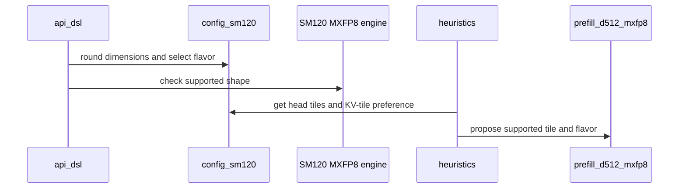

# frost(sdpa): add a specialized SM120 D512 MXFP8 prefill kernel and speed up MXFP8 d256

[Upstream PR](https://github.com/NVIDIA/cudnn-frontend/pull/1636) · state: closed · merged: True

## Original PR description

## Before submitting

- [x] I agree to license this contribution under the terms of [LICENSE.txt](https://github.com/NVIDIA/cudnn-frontend/blob/develop/LICENSE.txt).
- [x] I ran `pre-commit run` and committed any formatting changes.
- [x] I reviewed the Hard Rules in the `AGENTS.md` for each directory this PR touches (see [root AGENTS.md § Reviewing a PR](https://github.com/NVIDIA/cudnn-frontend/blob/develop/AGENTS.md#reviewing-a-pr-human-or-agent)) and my changes comply, or I explain the exception below.
- [x] I added GitHub labels: one `cat-*`, one or more `area:*` / `op:*`, and one `orig-*` (see [label list](https://github.com/NVIDIA/cudnn-frontend/labels)).

## Affected area

FE OSS kernels or CuTeDSL

## Summary

Two changes to the SM120/SM121 MXFP8 forward engine (`sdpa_fwd_prefill_sm120_mxfp8`), following #1599:

1. **D512 support.** New kernel `sm120/prefill_d512_mxfp8.py` serves both head dims in (256, 512], in multiples of 16.
   - It reuses the layout of the FP8 d512 kernel (`sm120/prefill_d512_fp8.py`): a 64x64 CTA with eight compute warps, two per 16-row Q slab, each owning half of the head dim. Every MMA is the block-scaled `mma.sync ... kind::mxf8f6f4.block_scale ... m16n8k32`.
   - It serves the same features as the FP8 d512 row: masks, sliding window, sinks, GQA/MQA with PackGQA, split-KV, THD, base-2 Stats, Amax_O, and FP16 / BF16 / E4M3 / E5M2 O. The block-scaled MXFP8 O stays d128-only.
   - Pad rows, pad columns and KV blocks past the valid length use the unit scale, so stored pad scales (possibly NaN) never reach O.
   - The module docstring describes how Q, K and V scales are loaded.
2. **Faster d256.** MXFP8 graphs with Q/K head tiles of 224 or more now default to 64-key KV tiles. At these widths the 128-key tile crowds the compute warps' registers, and at (256, 256) it spills. The order lives in `config_sm120.kv_tile_preference`, and the heuristic, PackGQA plans and the adapter's default `tile_n` all follow it. The 128-key tile is still admitted, so a pinned or stored `TILE_N=128` builds. The MXFP8 general kernel (`sm120/prefill_mxfp8.py`) is unchanged.

## Why

Before this PR, SM120 MXFP8 stopped at d = 256 and ran 1.28–1.39x slower than per-tensor FP8 there. This PR gives d512 MQA (DeepSeek-V4 style) an MXFP8 path and brings d256 (e.g. Qwen3.5) to 1.05–1.08x.

## Related issues

Related to #381. Follows #1599.

## API and compatibility impact

- No API or dependency changes. The engine stays opt-in (`CUDNN_FRONTEND_ENABLE_FROST_ENGINES=1`).
- New eligibility: `sdpa_mxfp8` graphs with both head dims in (256, 512] on SM 12.x.
- MXFP8 graphs with Q/K head tiles ≥ 224 default to 64-key KV tiles; `TILE_N=128` is still admitted.
- SM121 is admitted by the cc 12.x row but not tested.

## Performance

RTX PRO 6000 Blackwell Server Edition, SM clock locked at 85% of max and memory clock at max. Direct adapter, E4M3 inputs, BF16 O with Stats and Amax_O, default tiles. Each number is the median of 5 rounds of alternating processes; between-run CV ≤ 1.8% on every leg.

D256, per-tensor FP8 vs MXFP8 before and after:

| Shape | FP8 (µs) | MXFP8 develop (µs) | MXFP8 this PR (µs) | develop / FP8 | this PR / FP8 |
|---|---:|---:|---:|---:|---:|
| B1 H16/16 S4096, non-causal | 477.6 | 661.7 | 521.4 | 1.39 | 1.08 |
| B1 H16/16 S4096, causal | 261.9 | 336.4 | 275.8 | 1.28 | 1.05 |
| B2 H32/8 S8192, causal | 3481.6 | 4694.0 | 3731.2 | 1.35 | 1.07 |
| B1 H32/2 S8192, causal | 1775.7 | 2435.0 | 1887.9 | 1.37 | 1.07 |

Other wide Q/K heads, MXFP8 on the 128-key tile (the previous default) vs the new 64-key default:

| Shape | 128-key (µs) | 64-key (µs) | 64 / 128 |
|---|---:|---:|---:|
| B1 H16/16 S4096 D(256, 224), non-causal | 491.5 | 471.7 | 0.96 |
| B2 H32/8 S8192 D(224, 224), causal | 3287.5 | 3207.4 | 0.98 |
| B1 H16/16 S4096 D(224, 256), causal | 280.4 | 259.7 | 0.93 |
| B2 H32/8 S8192 D(256, 128), causal | 2874.4 | 2776.0 | 0.97 |

Narrower Q/K heads (e.g. (192, 192), (128, 256), (64, 256)) are 1–10% faster on the 128-key tile and keep it.

D512, per-tensor FP8 (`prefill_d512_fp8.py`) vs MXFP8 (`prefill_d512_mxfp8.py`):

| Shape | FP8 (µs) | MXFP8 (µs) | MXFP8 / FP8 |
|---|---:|---:|---:|
| B2 H16/1 S4096, non-causal | 2185.1 | 2248.3 | 1.03 |
| B2 H16/1 S4096, causal | 1151.1 | 1174.4 | 1.02 |
| B1 H32/8 S8192, causal | 4479.3 | 4572.2 | 1.02 |
| B2 H128/1 S2048, causal, 128-token window | 703.8 | 715.0 | 1.02 |
| B2 H64/1 S8192, causal, 128-token window | 1405.8 | 1432.7 | 1.02 |

`benchmark/attention_training/benchmark_single_sdpa.py` shows larger d512 gaps because its `fp8` leg writes E4M3 O and its `mxfp8` leg writes BF16 O.

## Testing

- RTX 5090: the SM120 FP8 / MXFP8 forward suites (command below), 1641 passed, 389 skipped. The skips are other-arch suites, two-GPU cases and rows that decline by design.
- RTX PRO 6000: the MXFP8 forward, prepared and staged suites (291 passed) and the >2**32-byte stride cases (24 passed).
- SM121 is not tested.

New tests:
- **d512:** masks, both input dtypes, every O dtype, envelope head dims (3-plane scale tiles), poisoned pads with sinks, PackGQA, persistent CTAs, split-KV, windowed MQA, THD (both Stats layouts), no-Stats, conversion layouts, base-2 Stats, routing, and the prepared / staged plans including >2**32-byte strides.
- **d256:** numerics on both KV tiles; both tiles admitted by the heuristic and the adapter; PackGQA plans follow the tile order.

<details><summary>Test command (from <code>test/python</code>)</summary>

```
pytest -m 'L0 or L1' -rs \
  sdpa/frost/test_sdpa_fwd_mxfp8_sm120.py sdpa/frost/test_sdpa_prepared_mxfp8.py sdpa/frost/test_sdpa_fwd_heuristics.py \
  sdpa/frost/test_sdpa_fwd_fp8_sm120.py sdpa/frost/test_sdpa_fwd_split_kv_sm120.py sdpa/frost/test_sdpa_prepared_sm120_mxfp8.py \
  sdpa/frost/test_sdpa_staged_sm120_mxfp8.py sdpa/frost/test_sdpa_staged_forward_mxfp8.py sdpa/frost/test_sdpa_prepared_sm120_fp8.py \
  sdpa/frost/test_sdpa_staged_forward_sm120.py sdpa/frost/test_sdpa_staged_forward_half.py sdpa/frost/test_sdpa_prepared_block_output.py \
  sdpa/frost/test_sdpa_fwd_api_contract.py sdpa/frost/test_sdpa_fwd_placement.py sdpa/frost/test_split_kv_heuristic.py \
  sdpa/test_mxfp8_block_scaled_fold.py sdpa/frost/test_sdpa_native_sm120_binding.py sdpa/frost/test_sdpa_native_mxfp8_binding.py \
  sdpa/frost/test_mxfp8_sf_desc_shared.py sdpa/frost/test_sdpa_mxfp8_sf_bind.py
```

</details>

🤖 Generated with [Claude Code](https://claude.com/claude-code)


<!-- This is an auto-generated comment: release notes by coderabbit.ai -->

## Summary by CodeRabbit

* **New Features**
  * MXFP8 attention on SM120 now supports head dimensions up to 512, including dimensions above 256, with the appropriate kernel selection.
  * Expanded support covers varied layouts, masks, grouped-query attention, and windowed attention.
* **Bug Fixes**
  * Improved tile selection for larger MXFP8 dimensions and packed grouped-query workloads.
  * Improved handling of MXFP8 scale storage when selecting plans within shared-memory limits.

<!-- end of auto-generated comment: release notes by coderabbit.ai -->

## Review and discussion

### reviews

- yihuawei · APPROVED · 2026-10-15T08:34:43Z · [source](https://github.com/NVIDIA/cudnn-frontend/pull/1636#pullrequestreview-5530300881)

**Codex bot review · model: `gpt-6-astra`**

Reviewed `ccca92d7f948` against base `d2e433647b66`.

Reviewed the D512 MXFP8 kernel, scale-factor addressing and padding guards, K/V pipeline barriers, persistent/THD and split-KV paths, prepared/staged binding, engine admission and the shared KV-tile preference. I found no approval-blocking issue. The explicit KV128 path remains admitted, and the D512 envelope requires both head dimensions above 256. The independent validation below is host-side; native SM120 numerical and GPU performance evidence remains the author's reported testing, with the current CI run still pending.

Validation: Fresh Python 3.10 extension built from the reviewed head. With Torch 2.11, DSL 4.7 and cuDNN 9.27, the heuristic and three SM120 MXFP8 suites produced 136 passed and 293 platform skips on this A100 worker. These passes do not establish native SM120 execution. Independent exact-source host emulation compared Q/K/V scale loaders with a packed-layout oracle over every head dimension from 272 through 512 in steps of 16: 98,304 K words, 172,032 Q words and 655,360 V scales, including all lanes, both 64-key halves, three/four-plane boundaries, PackGQA ratios 1 through 64, trimmed Q rows and poisoned padding. All matched. Removing the Q/K pad mask made the negative control fail. This checks address and masking arithmetic, not asynchronous visibility or MMA numerics. Compared merge-base and head host recommendations across 960 half-precision graphs modeled on SM80/90/100/103/107/120: no order changes. Another 1,024 SM120 general-envelope FP8/MXFP8 graphs retained FP8 order and emitted admissible plans; the 128 MXFP8 changes follow the intended wide-Q/K KV64 preference. Alternating host timing batches for one D256 MXFP8 recommendation measured approximately 272 versus 274 microseconds per call; no GPU speedup is inferred. Reused the author's current-head pipeline 74035414 for python/sdpa/frost. Its SM120 lane selects the affected directory. The integration retains the new kernel, SM120 configuration, engine specification and changed tests byte-for-byte. Its shared adapter/heuristic files also include newer-base changes: the SM120 adapter class is AST-identical, and 4,096 FP8/MXFP8 modeled recommendations agree with the reviewed head. The pipeline is still running. Reviewed the author's separately reported RTX 5090 and RTX PRO 6000 numerical, rebinding/capture, wide-stride and controlled performance results as author evidence, without presenting them as independent reruns. Added area:global_attention and retained the existing origin/category/FROST labels and Frontend 1.32.0 milestone. The repository's project/milestone merge check passes.

Limitations: No SM120 or SM121 device is available on this worker. I did not independently execute the new kernel, exercise its GPU barriers/capture/wide-address behavior, or reproduce the GPU performance numbers. SM121 is also untested in the author's report. Current CI results and failing traces, if any, still need follow-up. The host emulation uses Python integers and does not validate compiler lowering, device race freedom or fixed-width overflow. Direct project inspection is unavailable with the current token scope; the passing repository check supplies the assignment evidence.

Approved: no P0 or high-risk P1 found. Remaining findings stay with the owner; merge timing stays with the owner.

<!-- codex-fe-review:v2:1636:ccca92d7f948cd41754e84de7412c163fa867bc6:complete:no-blocker -->

### issue_comments

- Aneureka · comment · 2026-10-14T06:06:30Z · [source](https://github.com/NVIDIA/cudnn-frontend/pull/1636#issuecomment-6162063951)

@cudnn-ci-bot run python/sdpa/frost

- coderabbitai[bot] · comment · 2026-10-14T06:06:31Z · [source](https://github.com/NVIDIA/cudnn-frontend/pull/1636#issuecomment-6162064059)

<!-- This is an auto-generated comment: summarize by coderabbit.ai -->
<!-- review_stack_entry_start -->

<a href="https://app.coderabbit.ai/change-stack/NVIDIA/cudnn-frontend/pull/1636?scope=ghh_OusAJGA4HG8ljoOV0wJvVx8NmnZIjc2DdjmxOu0xZWA&amp;cs_source=review_comment"><picture><source media="(prefers-color-scheme: dark)" srcset="https://storage.googleapis.com/coderabbit_public_assets/review-stack-in-coderabbit-ui-dark.svg?v=3"><source media="(prefers-color-scheme: light)" srcset="https://storage.googleapis.com/coderabbit_public_assets/review-stack-in-coderabbit-ui.svg?v=3"></picture></a>

<!-- review_stack_entry_end -->
<!-- recent_review_start -->

No actionable comments were generated in the recent review. 🎉

<details>
<summary><strong>ℹ️ Recent review info</strong></summary>
<dl>
<dd>

<details>
<summary><strong>⚙️ Run configuration</strong></summary>
<dl>
<dd>

- **Configuration used**: Repository: NVIDIA/cudnn-frontend/.coderabbit.yaml
- **Review profile**: CHILL
- **Plan**: Enterprise
- **Run ID**: `bbd9b63f-2a91-4841-9958-1ad221fd95a1`

</dd>
</dl>
</details>

<details>
<summary><strong>📥 Commits</strong></summary>
<dl>
<dd>

Reviewing files that changed from the base of the PR and between 10b2280ef2e312598e48182fccecefa0927295b2 and ccca92d7f948cd41754e84de7412c163fa867bc6.

</dd>
</dl>
</details>

<details>
<summary><strong>📒 Files selected for processing: 14</strong></summary>
<dl>
<dd>

* `python/cudnn/frost/README.md`
* `python/cudnn/sdpa/frost/SUPPORT_MATRIX_TRACKER.md`
* `python/cudnn/sdpa/fwd/api_dsl.py`
* `python/cudnn/sdpa/fwd/config_sm120.py`
* `python/cudnn/sdpa/fwd/engines.py`
* `python/cudnn/sdpa/fwd/heuristics.py`
* `python/cudnn/sdpa/fwd/kernels/__init__.py`
* `python/cudnn/sdpa/fwd/kernels/sm120/prefill_d512_mxfp8.py`
* `python/cudnn/sdpa/fwd/kernels/sm120/prepared_mxfp8_host.py`
* `test/python/sdpa/frost/test_sdpa_fwd_heuristics.py`
* `test/python/sdpa/frost/test_sdpa_fwd_mxfp8_sm120.py`
* `test/python/sdpa/frost/test_sdpa_prepared_mxfp8.py`
* `test/python/sdpa/frost/test_sdpa_prepared_sm120_mxfp8.py`
* `test/python/sdpa/frost/test_sdpa_staged_sm120_mxfp8.py`

</dd>
</dl>
</details>

**Included review availability:** This review used your included allowance. Your plan provides up to 12 included reviews per hour; 11 remain after this review.

</dd>
</dl>
</details>


<!-- recent_review_end -->
<!-- walkthrough_start -->

<details>
<summary><strong>📝 Walkthrough</strong></summary>
<dl>
<dd>

SM120 MXFP8 forward support now includes D512 kernels for supported head dimensions in (256, 512]. Tile selection and shared-memory accounting handle the D512 flavor, and tests cover routing, admissibility, execution, prepared plans, and staged paths.

**Changes: SM120 MXFP8 D512 Forward Support**

|Layer / File(s)|Summary|
|:---|:---|
|**D512 flavor and resource rules** <br> `python/cudnn/sdpa/fwd/config_sm120.py`, `python/cudnn/sdpa/fwd/engines.py`|The SM120 engine adds the D512 flavor. Configuration helpers round head dimensions, set KV-tile preferences, and account for D512 MXFP8 scale storage in shared memory.|
|**Dispatch, heuristics, and coverage** <br> `python/cudnn/sdpa/fwd/api_dsl.py`, `python/cudnn/sdpa/fwd/heuristics.py`, `python/cudnn/frost/README.md`, `python/cudnn/sdpa/frost/SUPPORT_MATRIX_TRACKER.md`, `python/cudnn/sdpa/fwd/kernels/__init__.py`, `python/cudnn/sdpa/fwd/kernels/sm120/prepared_mxfp8_host.py`|The API maps the D512 flavor and selects KV tiles using configured preferences. Heuristics use the shared head-tile helpers and exclude MXFP8 from D512 windowed packing. Kernel and support documentation lists the expanded coverage.|
|**D512 and tile-selection validation** <br> `test/python/sdpa/frost/test_sdpa_fwd_heuristics.py`, `test/python/sdpa/frost/test_sdpa_fwd_mxfp8_sm120.py`, `test/python/sdpa/frost/test_sdpa_prepared_mxfp8.py`, `test/python/sdpa/frost/test_sdpa_prepared_sm120_mxfp8.py`, `test/python/sdpa/frost/test_sdpa_staged_sm120_mxfp8.py`|Tests add supported and rejected dimension cases, tile and shared-memory checks, and D512 coverage across forward, prepared, and staged paths.|

<!-- change_assessment_start -->
**Priority:** ➖ Normal

**Estimated code review effort:** 3 (Moderate) | ~25 minutes

<!-- change_assessment_commit:"ccca92d7f948cd41754e84de7412c163fa867bc6" -->
**Change:** Feature
<!-- change_assessment_end -->

### Sequence Diagram(s)



**Suggested reviewers:** `yangxu1990uiuc`

</dd>
</dl>
</details>

<!-- walkthrough_end -->
<details>
<summary><strong>Merge Risk:</strong> <strong>⚪ Minimal</strong> · up to <code>ccca9</code></summary>
<dl>
<dd>

<!-- final_review_risk_start -->
<!-- final_review_risk_label
**Merge Risk:** **⚪ Minimal** · up to `ccca9`
-->
<!-- final_review_risk_coverage:{"sourceCommitId":"ccca92d7f948cd41754e84de7412c163fa867bc6","coveredCommitId":"ccca92d7f948cd41754e84de7412c163fa867bc6","kind":"reviewed"} -->

No actionable issue remains from the reviewed changes; the PR is mergeable after normal checks.
<!-- final_review_risk_end -->

</dd>
</dl>
</details>
<!-- pre_merge_checks_walkthrough_start -->

<details>
<summary><strong>Pre-merge checks: <sup><picture></picture></sup> 4 · <sup><picture></picture></sup> 1</strong></summary>
<dl>
<dd>

<strong><sup><picture></picture></sup> Failed checks: 1 warning</strong>

|     Check name     |                                              Status                                              | Explanation                                                                                                                                                                                               | Resolution                                                                         |
| :---------------- | :----------------------------------------------------------------------------------------------: | :-------------------------------------------------------------------------------------------------------------------------------------------------------------------------------------------------------- | :--------------------------------------------------------------------------------- |
| Docstring Coverage |  | Docstring coverage is 58.06% which is insufficient. The required threshold is 80.00%. Docstring coverage is scoped to functions touched by this diff. Analyzed 62 functions across 11 files. (2 skipped:… | Write docstrings for the functions missing them to satisfy the coverage threshold. |

<details>
<summary><strong><sup><picture></picture></sup> Passed checks: 4 passed</strong></summary>
<dl>
<dd>

|         Check name         |                                             Status                                             | Explanation                                                                                                                                                                                               |
| :------------------------ | :--------------------------------------------------------------------------------------------: | :-------------------------------------------------------------------------------------------------------------------------------------------------------------------------------------------------------- |
|         Title check        |  | The title clearly summarizes both primary changes: adding the specialized SM120 D512 MXFP8 prefill kernel and improving MXFP8 D256 performance.                                                           |
|      Description check     |  | The description completes all required sections, explains the implementation and motivation, documents compatibility impact, related issues, performance results, and provides testing commands and resu… |
|     Linked Issues check    |  | Check skipped because no linked issues were found for this pull request.                                                                                                                                  |
| Out of Scope Changes check |  | Check skipped because no linked issues were found for this pull request.                                                                                                                                  |

</dd>
</dl>
</details>

<details>
<summary><strong>Full details: Docstring Coverage</strong></summary>
<dl>
<dd>

**Explanation**

Docstring coverage is 58.06% which is insufficient. The required threshold is 80.00%. Docstring coverage is scoped to functions touched by this diff. Analyzed 62 functions across 11 files. (2 skipped: 2 unsupported.)

</dd>
</dl>
</details>

</dd>
</dl>
</details>

<!-- pre_merge_checks_walkthrough_end -->

- [ ] <!-- {"checkboxId":"585bb3f6-faf5-4dbf-96d2-74e382adf19a"} --> Fix all pre-merge checks with AI
<!-- finishing_touch_checkbox_start -->

<details>
<summary><strong>✨ Finishing Touches</strong></summary>
<dl>
<dd>

<details open>
<summary><strong>🧪 Generate unit tests (beta)</strong></summary>
<dl>
<dd>

- [ ] <!-- {"checkboxId": "f47ac10b-58cc-4372-a567-0e02b2c3d479", "radioGroupId": "utg-output-choice-group-unknown_comment_id"} --> Create a new PR

</dd>
</dl>
</details>

</dd>
</dl>
</details>

<!-- finishing_touch_checkbox_end -->

<!-- autopilot:start -->
- [ ] <!-- {"checkboxId":"2708ad07-9f24-4260-9c11-7dc76a49f2e3"} --> <strong title="Keep fixing CodeRabbit findings and required CI, and resolving merge conflicts">Autofix</strong> · Keep fixing CodeRabbit findings and required CI, and resolving merge conflicts
<!-- autopilot:end -->
<!-- tips_start -->


<sub>Comment `@coderabbitai help` to get the list of available commands.</sub>

<!-- tips_end -->

- cudnn-ci-bot · comment · 2026-10-14T06:06:34Z · [source](https://github.com/NVIDIA/cudnn-frontend/pull/1636#issuecomment-6162064668)

🏁 Pipeline finished

SHA: `989ea72`
Targets: `python/sdpa/frost`
Branch: [cudnn-gh/pr-1636-989ea72](https://nv/cudnn-gitlab-ci/-/tree/cudnn-gh/pr-1636-989ea72)
Pipeline: [73726433](https://nv/cudnn-gitlab-ci/-/pipelines/73726433)
Last updated: 2026-10-14 06:57 UTC

**23 passed, 2 failed, 3 skipped, 11 manual**

### <code>manual</code>

- <code>manual:python_samples</code> - Manual
- <code>manual:python</code> - Manual
- <code>manual:python/sdpa/frost</code> - ✅ Passed
- <code>manual:python/linear_attention/frost</code> - Manual
- <code>manual:python/gemm/frost</code> - Manual
- <code>manual:python/*/frost</code> - Manual
- <code>manual:python/gemm/cutedsl</code> - Manual
- <code>manual:python/*/cutedsl</code> - Manual
- <code>manual:python/*/jax</code> - Manual
- <code>manual:pycudnn</code> - Manual
- <code>manual:multi_gpu</code> - Manual
- <code>manual:backend</code> - Manual

### <code>analysis</code>

- <code>analysis:cudnn_clang_disable_exception</code> - ✅ Passed
- <code>analysis:cudnn_v9_no_half_conversion</code> - ✅ Passed
- <code>analysis:cudnn_clang</code> - ✅ Passed
- <code>analysis:check-relative-includes</code> - ✅ Passed
- <code>analysis:check-CUDNN_FRONTEND_SKIP_JSON_LIB</code> - ✅ Passed
- <code>analysis:guardwords_scan</code> - ✅ Passed
- <code>analysis:jax-import-guard</code> - ✅ Passed
- <code>analysis:pytest-gpu</code> - ✅ Passed
- <code>san:build</code> - ✅ Passed

### <code>build</code>

- <code>analysis:api_index</code> - ✅ Passed
- <code>build:dev:linux:amd64</code> - ✅ Passed
- <code>build:rel:linux:amd64</code> - ✅ Passed
- <code>build:dev:linux:arm64</code> - ✅ Passed
- <code>build:rel:linux:arm64</code> - ✅ Passed
- <code>build:rel:win:amd64</code> - ✅ Passed

### <code>frost_tests</code>

- <code>python/sdpa/frost:cutlass-rel:sm80</code> - ✅ Passed
- <code>python/sdpa/frost:cutlass-rel:sm100</code> - ❌ **Old Failure** (nightly failed)
- <code>python/sdpa/frost:cutlass-rel:sm120</code> - ✅ Passed
- <code>python/linear_attention/frost:cutlass-rel:sm100</code> - Skipped
- <code>python/gemm/frost:cutlass-rel:sm100</code> - Skipped
- <code>python/*/frost:cutlass-rel:sm100</code> - Skipped
- <code>python/sdpa/frost:cutlass-rel:sm103</code> - ❌ **Old Failure** (nightly failed)
- <code>python/sdpa/frost:cutlass-4.8:sm107</code> - ✅ Passed

### <code>sanitizer_tests</code>

- <code>san:cpp_test:sm80</code> - ✅ Passed
- <code>san:cpp_test:sm90</code> - ✅ Passed
- <code>san:cpp_test:sm100</code> - ✅ Passed

### <code>triage</code>

- <code>triage:ai</code> - ✅ Passed

- Aneureka · comment · 2026-10-14T11:21:21Z · [source](https://github.com/NVIDIA/cudnn-frontend/pull/1636#issuecomment-6167181313)

@cudnn-ci-bot run python/sdpa/frost

- cudnn-ci-bot · comment · 2026-10-14T11:21:26Z · [source](https://github.com/NVIDIA/cudnn-frontend/pull/1636#issuecomment-6167182666)

🏁 Pipeline finished

SHA: `9543f2b`
Targets: `python/sdpa/frost`
Branch: [cudnn-gh/pr-1636-9543f2b](https://nv/cudnn-gitlab-ci/-/tree/cudnn-gh/pr-1636-9543f2b)
Pipeline: [73784062](https://nv/cudnn-gitlab-ci/-/pipelines/73784062)
Last updated: 2026-10-14 12:16 UTC

**25 passed, 3 skipped, 11 manual**

### <code>manual</code>

- <code>manual:python_samples</code> - Manual
- <code>manual:python</code> - Manual
- <code>manual:python/sdpa/frost</code> - ✅ Passed
- <code>manual:python/linear_attention/frost</code> - Manual
- <code>manual:python/gemm/frost</code> - Manual
- <code>manual:python/*/frost</code> - Manual
- <code>manual:python/gemm/cutedsl</code> - Manual
- <code>manual:python/*/cutedsl</code> - Manual
- <code>manual:python/*/jax</code> - Manual
- <code>manual:pycudnn</code> - Manual
- <code>manual:multi_gpu</code> - Manual
- <code>manual:backend</code> - Manual

### <code>analysis</code>

- <code>analysis:cudnn_clang_disable_exception</code> - ✅ Passed
- <code>analysis:cudnn_v9_no_half_conversion</code> - ✅ Passed
- <code>analysis:cudnn_clang</code> - ✅ Passed
- <code>analysis:check-relative-includes</code> - ✅ Passed
- <code>analysis:check-CUDNN_FRONTEND_SKIP_JSON_LIB</code> - ✅ Passed
- <code>analysis:guardwords_scan</code> - ✅ Passed
- <code>analysis:jax-import-guard</code> - ✅ Passed
- <code>analysis:pytest-gpu</code> - ✅ Passed
- <code>san:build</code> - ✅ Passed

### <code>build</code>

- <code>analysis:api_index</code> - ✅ Passed
- <code>build:dev:linux:amd64</code> - ✅ Passed
- <code>build:rel:linux:amd64</code> - ✅ Passed
- <code>build:dev:linux:arm64</code> - ✅ Passed
- <code>build:rel:linux:arm64</code> - ✅ Passed
- <code>build:rel:win:amd64</code> - ✅ Passed

### <code>frost_tests</code>

- <code>python/sdpa/frost:cutlass-rel:sm80</code> - ✅ Passed
- <code>python/sdpa/frost:cutlass-rel:sm100</code> - ✅ Passed
- <code>python/sdpa/frost:cutlass-rel:sm120</code> - ✅ Passed
- <code>python/linear_attention/frost:cutlass-rel:sm100</code> - Skipped
- <code>python/gemm/frost:cutlass-rel:sm100</code> - Skipped
- <code>python/*/frost:cutlass-rel:sm100</code> - Skipped
- <code>python/sdpa/frost:cutlass-rel:sm103</code> - ✅ Passed
- <code>python/sdpa/frost:cutlass-4.8:sm107</code> - ✅ Passed

### <code>sanitizer_tests</code>

- <code>san:cpp_test:sm80</code> - ✅ Passed
- <code>san:cpp_test:sm90</code> - ✅ Passed
- <code>san:cpp_test:sm100</code> - ✅ Passed

### <code>triage</code>

- <code>triage:ai</code> - ✅ Passed

- Aneureka · comment · 2026-10-15T07:58:51Z · [source](https://github.com/NVIDIA/cudnn-frontend/pull/1636#issuecomment-6187367944)

@cudnn-ci-bot run python/sdpa/frost

- cudnn-ci-bot · comment · 2026-10-15T07:59:22Z · [source](https://github.com/NVIDIA/cudnn-frontend/pull/1636#issuecomment-6187375926)

🏁 Pipeline finished

SHA: `ccca92d`
Targets: `python/sdpa/frost`
Branch: [cudnn-gh/pr-1636-ccca92d](https://nv/cudnn-gitlab-ci/-/tree/cudnn-gh/pr-1636-ccca92d)
Pipeline: [74035414](https://nv/cudnn-gitlab-ci/-/pipelines/74035414)
Last updated: 2026-10-15 09:17 UTC

**13 passed, 6 failed, 6 skipped, 11 manual**

### <code>manual</code>

- <code>manual:python_samples</code> - Manual
- <code>manual:python</code> - Manual
- <code>manual:python/sdpa/frost</code> - ✅ Passed
- <code>manual:python/linear_attention/frost</code> - Manual
- <code>manual:python/gemm/frost</code> - Manual
- <code>manual:python/*/frost</code> - Manual
- <code>manual:python/gemm/cutedsl</code> - Manual
- <code>manual:python/*/cutedsl</code> - Manual
- <code>manual:python/*/jax</code> - Manual
- <code>manual:pycudnn</code> - Manual
- <code>manual:multi_gpu</code> - Manual
- <code>manual:backend</code> - Manual

### <code>analysis</code>

- <code>analysis:cudnn_clang_disable_exception</code> - ✅ Passed
- <code>analysis:cudnn_v9_no_half_conversion</code> - ✅ Passed
- <code>analysis:cudnn_clang</code> - ❌ **New Failure!** (nightly passed)
- <code>analysis:check-relative-includes</code> - ✅ Passed
- <code>analysis:check-CUDNN_FRONTEND_SKIP_JSON_LIB</code> - ✅ Passed
- <code>analysis:guardwords_scan</code> - ✅ Passed
- <code>analysis:jax-import-guard</code> - ✅ Passed
- <code>analysis:pytest-gpu</code> - ✅ Passed
- <code>san:build</code> - ❌ **New Failure!** (nightly passed)

### <code>build</code>

- <code>analysis:api_index</code> - Skipped
- <code>build:dev:linux:amd64</code> - ❌ **New Failure!** (nightly passed)
- <code>build:rel:linux:amd64</code> - ❌ **New Failure!** (nightly passed)
- <code>build:dev:linux:arm64</code> - ✅ Passed
- <code>build:rel:linux:arm64</code> - ✅ Passed
- <code>build:rel:win:amd64</code> - ✅ Passed

### <code>frost_tests</code>

- <code>python/sdpa/frost:cutlass-rel:sm80</code> - Skipped
- <code>python/sdpa/frost:cutlass-rel:sm100</code> - ✅ Passed
- <code>python/sdpa/frost:cutlass-rel:sm120</code> - Skipped
- <code>python/linear_attention/frost:cutlass-rel:sm100</code> - Skipped
- <code>python/gemm/frost:cutlass-rel:sm100</code> - Skipped
- <code>python/*/frost:cutlass-rel:sm100</code> - Skipped
- <code>python/sdpa/frost:cutlass-rel:sm103</code> - ❌ **New Failure!** (nightly passed)
- <code>python/sdpa/frost:cutlass-4.8:sm107</code> - ❌ **New Failure!** (nightly passed)

### <code>triage</code>

- <code>triage:ai</code> - ✅ Passed

- yihuawei · comment · 2026-10-15T09:20:47Z · [source](https://github.com/NVIDIA/cudnn-frontend/pull/1636#issuecomment-6188773142)

Pipeline 74035414 for reviewed head ccca92d7f948 finished with **13 passed, 6 failed, 6 skipped and 11 manual**. The SM100 SDPA FROST lane and the ARM64/Windows builds passed. The SM120 and SM80 SDPA lanes were skipped.

The failures are `analysis:cudnn_clang`, `san:build`, both AMD64 builds, and the SM103 and SM107 SDPA FROST lanes. CI labels all six New Failure. I have not independently inspected their failing traces or per-test results, so those labels do not establish the cause or attribution to this PR.

In particular, the skipped SM120 lane means this pipeline does **not** validate the new D512 MXFP8 kernel or the D256 tile change on their native platform. Native evidence remains the author's reported SM120 runs; the independent host arithmetic/routing checks retain their stated scope. SM121 remains untested. The failed gates need triage and the intended SM120 validation still needs a successful run before CI can supply that evidence.

Codex bot review — model `gpt-6-astra`.

<!-- codex-fe-ci:v1:1636:ccca92d7f948cd41754e84de7412c163fa867bc6:pipeline-74035414-finished -->

### inline_comments

## Changed files and fixed code

- `python/cudnn/frost/README.md` · modified · additions 1 / deletions 0
  - [head](https://github.com/Aneureka/cudnn-frontend/blob/ccca92d7f948cd41754e84de7412c163fa867bc6/python/cudnn/frost/README.md)
  - [base](https://github.com/NVIDIA/cudnn-frontend/blob/10b2280ef2e312598e48182fccecefa0927295b2/python/cudnn/frost/README.md)
- `python/cudnn/sdpa/frost/SUPPORT_MATRIX_TRACKER.md` · modified · additions 8 / deletions 7
  - [head](https://github.com/Aneureka/cudnn-frontend/blob/ccca92d7f948cd41754e84de7412c163fa867bc6/python/cudnn/sdpa/frost/SUPPORT_MATRIX_TRACKER.md)
  - [base](https://github.com/NVIDIA/cudnn-frontend/blob/10b2280ef2e312598e48182fccecefa0927295b2/python/cudnn/sdpa/frost/SUPPORT_MATRIX_TRACKER.md)
- `python/cudnn/sdpa/fwd/api_dsl.py` · modified · additions 15 / deletions 16
  - [head](https://github.com/Aneureka/cudnn-frontend/blob/ccca92d7f948cd41754e84de7412c163fa867bc6/python/cudnn/sdpa/fwd/api_dsl.py)
  - [base](https://github.com/NVIDIA/cudnn-frontend/blob/10b2280ef2e312598e48182fccecefa0927295b2/python/cudnn/sdpa/fwd/api_dsl.py)
- `python/cudnn/sdpa/fwd/config_sm120.py` · modified · additions 39 / deletions 4
  - [head](https://github.com/Aneureka/cudnn-frontend/blob/ccca92d7f948cd41754e84de7412c163fa867bc6/python/cudnn/sdpa/fwd/config_sm120.py)
  - [base](https://github.com/NVIDIA/cudnn-frontend/blob/10b2280ef2e312598e48182fccecefa0927295b2/python/cudnn/sdpa/fwd/config_sm120.py)
- `python/cudnn/sdpa/fwd/engines.py` · modified · additions 10 / deletions 6
  - [head](https://github.com/Aneureka/cudnn-frontend/blob/ccca92d7f948cd41754e84de7412c163fa867bc6/python/cudnn/sdpa/fwd/engines.py)
  - [base](https://github.com/NVIDIA/cudnn-frontend/blob/10b2280ef2e312598e48182fccecefa0927295b2/python/cudnn/sdpa/fwd/engines.py)
- `python/cudnn/sdpa/fwd/heuristics.py` · modified · additions 27 / deletions 14
  - [head](https://github.com/Aneureka/cudnn-frontend/blob/ccca92d7f948cd41754e84de7412c163fa867bc6/python/cudnn/sdpa/fwd/heuristics.py)
  - [base](https://github.com/NVIDIA/cudnn-frontend/blob/10b2280ef2e312598e48182fccecefa0927295b2/python/cudnn/sdpa/fwd/heuristics.py)
- `python/cudnn/sdpa/fwd/kernels/__init__.py` · modified · additions 3 / deletions 1
  - [head](https://github.com/Aneureka/cudnn-frontend/blob/ccca92d7f948cd41754e84de7412c163fa867bc6/python/cudnn/sdpa/fwd/kernels/__init__.py)
  - [base](https://github.com/NVIDIA/cudnn-frontend/blob/10b2280ef2e312598e48182fccecefa0927295b2/python/cudnn/sdpa/fwd/kernels/__init__.py)
- `python/cudnn/sdpa/fwd/kernels/sm120/prefill_d512_mxfp8.py` · added · additions 2573 / deletions 0
  - [head](https://github.com/Aneureka/cudnn-frontend/blob/ccca92d7f948cd41754e84de7412c163fa867bc6/python/cudnn/sdpa/fwd/kernels/sm120/prefill_d512_mxfp8.py)
  - [base](https://github.com/NVIDIA/cudnn-frontend/blob/10b2280ef2e312598e48182fccecefa0927295b2/python/cudnn/sdpa/fwd/kernels/sm120/prefill_d512_mxfp8.py)
- `python/cudnn/sdpa/fwd/kernels/sm120/prepared_mxfp8_host.py` · modified · additions 2 / deletions 1
  - [head](https://github.com/Aneureka/cudnn-frontend/blob/ccca92d7f948cd41754e84de7412c163fa867bc6/python/cudnn/sdpa/fwd/kernels/sm120/prepared_mxfp8_host.py)
  - [base](https://github.com/NVIDIA/cudnn-frontend/blob/10b2280ef2e312598e48182fccecefa0927295b2/python/cudnn/sdpa/fwd/kernels/sm120/prepared_mxfp8_host.py)
- `test/python/sdpa/frost/test_sdpa_fwd_heuristics.py` · modified · additions 101 / deletions 1
  - [head](https://github.com/Aneureka/cudnn-frontend/blob/ccca92d7f948cd41754e84de7412c163fa867bc6/test/python/sdpa/frost/test_sdpa_fwd_heuristics.py)
  - [base](https://github.com/NVIDIA/cudnn-frontend/blob/10b2280ef2e312598e48182fccecefa0927295b2/test/python/sdpa/frost/test_sdpa_fwd_heuristics.py)
- `test/python/sdpa/frost/test_sdpa_fwd_mxfp8_sm120.py` · modified · additions 209 / deletions 8
  - [head](https://github.com/Aneureka/cudnn-frontend/blob/ccca92d7f948cd41754e84de7412c163fa867bc6/test/python/sdpa/frost/test_sdpa_fwd_mxfp8_sm120.py)
  - [base](https://github.com/NVIDIA/cudnn-frontend/blob/10b2280ef2e312598e48182fccecefa0927295b2/test/python/sdpa/frost/test_sdpa_fwd_mxfp8_sm120.py)
- `test/python/sdpa/frost/test_sdpa_prepared_mxfp8.py` · modified · additions 7 / deletions 1
  - [head](https://github.com/Aneureka/cudnn-frontend/blob/ccca92d7f948cd41754e84de7412c163fa867bc6/test/python/sdpa/frost/test_sdpa_prepared_mxfp8.py)
  - [base](https://github.com/NVIDIA/cudnn-frontend/blob/10b2280ef2e312598e48182fccecefa0927295b2/test/python/sdpa/frost/test_sdpa_prepared_mxfp8.py)
- `test/python/sdpa/frost/test_sdpa_prepared_sm120_mxfp8.py` · modified · additions 12 / deletions 11
  - [head](https://github.com/Aneureka/cudnn-frontend/blob/ccca92d7f948cd41754e84de7412c163fa867bc6/test/python/sdpa/frost/test_sdpa_prepared_sm120_mxfp8.py)
  - [base](https://github.com/NVIDIA/cudnn-frontend/blob/10b2280ef2e312598e48182fccecefa0927295b2/test/python/sdpa/frost/test_sdpa_prepared_sm120_mxfp8.py)
- `test/python/sdpa/frost/test_sdpa_staged_sm120_mxfp8.py` · modified · additions 11 / deletions 8
  - [head](https://github.com/Aneureka/cudnn-frontend/blob/ccca92d7f948cd41754e84de7412c163fa867bc6/test/python/sdpa/frost/test_sdpa_staged_sm120_mxfp8.py)
  - [base](https://github.com/NVIDIA/cudnn-frontend/blob/10b2280ef2e312598e48182fccecefa0927295b2/test/python/sdpa/frost/test_sdpa_staged_sm120_mxfp8.py)

## Evidence and interpretation boundary

[Original JSON, discussions and patches](../../../../../../evidence/prs/NVIDIA--cudnn-frontend/1636-d993c3caf82c24dd51bda1ad13b27686b63751d02fff4030942654a089650fde.json) · SHA-256 `d993c3caf82c24dd51bda1ad13b27686b63751d02fff4030942654a089650fde`.

Diff complete: False. Missing/binary/truncated patches require pinned source inspection. This is a source page, not an independently verified optimization case. Open, merged and released are different states; recheck the deployed dependency.
