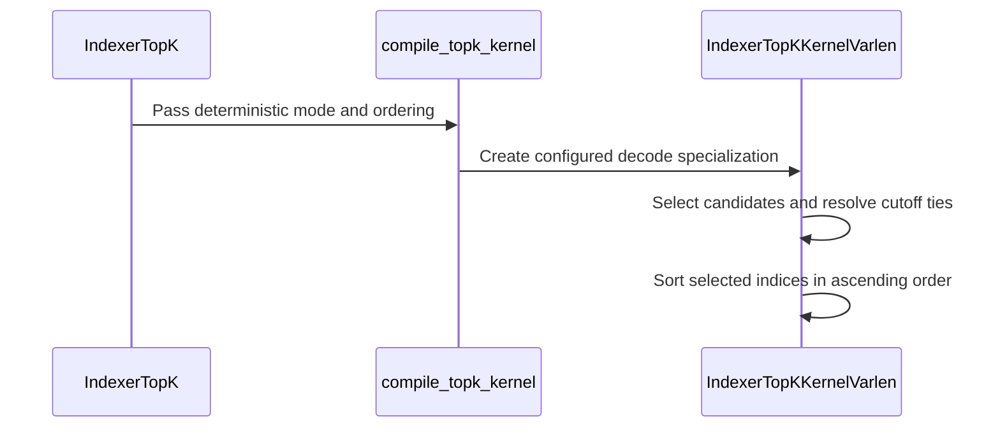

# feat(dsa): add deterministic standalone indexer top-k

[Upstream PR](https://github.com/NVIDIA/cudnn-frontend/pull/1637) · state: closed · merged: True

## Original PR description

## Before submitting

- [x] I agree to license this contribution under the terms of [LICENSE.txt](https://github.com/NVIDIA/cudnn-frontend/blob/develop/LICENSE.txt).
- [x] I ran `pre-commit run` on every changed file and committed all formatting changes.
- [x] I reviewed the applicable root, `python/cudnn`, and `test` `AGENTS.md` hard rules.
- [x] Add one `cat-*`, one or more `area:*` / `op:*`, and one `orig-*` label after the upstream draft PR is opened.

## Affected area

- FE OSS kernels / CuTeDSL
- Python API
- Tests, documentation, and benchmarks

## Summary

Add an opt-in deterministic specialization to the standalone DSA indexer Top-K API:

- append `deterministic: bool = False` to `DSA.IndexerTopK` and `DSA.indexer_top_k_wrapper`;
- deterministically choose the smaller source index at an exact cutoff tie when `tie_break=0`;
- return valid selected local indices in ascending order, with values gathered from those indices;
- retain canonical `-1` / `-inf` padding for rows shorter than `top_k`, including empty speculative rows;
- preserve the existing fast specialization and its default behavior when `deterministic=False`.

The implementation remains one CuTe DSL kernel. It introduces no extra kernel launch, device allocation, host synchronization, or runtime dependency.

## Why

Compressor/indexer pipelines need a stable Top-K selected set and stable output slots to make the end-to-end sparse-attention path reproducible. The existing radix filter uses shared-memory atomics to claim output slots, so exact cutoff ties and slot order are scheduler-dependent even when the selected values are numerically equivalent.

This change canonicalizes both decisions inside the existing kernel while keeping determinism opt-in, so current callers retain the original performance-oriented path.

A concrete optimization target is the common long-context configuration with
a 1,048,576-token window and a compression factor of 4, which produces
262,144 indexer columns. The SM100 route covers this 256K bucket without making
shared-memory use grow beyond the architecture limit: it uses bounded-K
bitonic ordering for large FP32 grids and retains bitmap ordering where larger
K, low-precision input, or a small grid amortizes it better.

## Design

1. The radix pass still identifies the exact cutoff key.
2. When the cutoff key is over-subscribed, the kernel recollects equal-key candidates in source-column order. `tie_break=0` maps to smaller-index-first in deterministic mode; explicit `tie_break=1/2` semantics are retained.
3. The selected set is canonicalized in ascending local-index order:
   - on SM100, `top_k < 256` always uses an in-place bitonic sort;
   - larger K uses a small set of compile-time column thresholds to choose between a CTA shared-memory bitmap scan and bitonic sorting of the at-most-2048 selected indices;
   - other SM90+ targets retain the conservative 256K bitmap cutoff.
4. A CTA-local mbarrier supplies release/acquire ordering for deterministic shared-memory handoffs. Every thread tracks the same phase, and scan scratch is drained before reuse.
5. The compile and wrapper caches include the deterministic specialization bit
   and CUDA device.

## API and compatibility impact

- Public signatures remain positional-call compatible because the new argument is append-only and defaults to `False`.
- `deterministic=False` retains the existing specialization, synchronization primitive, output semantics, workspace size, and wrapper behavior.
- `deterministic=True` guarantees:
  - repeatable cutoff selection;
  - smaller-index cutoff preference for default `tie_break=0`;
  - ascending valid local indices;
  - values exactly gathered from those indices;
  - `-1` / `-inf` padding for short or empty rows.
- Exact `torch.topk` value multisets are required at `atol=0, rtol=0`. Index equality with `torch.topk` is intentionally not required for ties because PyTorch does not specify a stable tie policy; the tests instead check the documented smaller-index reference.
- Core algorithm constraints remain SM90+, `0 < top_k <= 2048`, and
  FP32/FP16/BF16 input. On SM120, deterministic FP32 supports at most 16,384
  columns and deterministic FP16/BF16 at most 32,768 columns; larger shapes are
  rejected before compilation. The API also rejects zero launch extents,
  cross-device bindings, overlapping writable byte ranges, and misaligned
  strict-API input bases before launch; the eager wrapper repairs a misaligned
  contiguous view.
- The `IndexerTopK.execute()` hot path still uses caller-owned outputs/workspace, performs no allocation or conversion, honors the caller stream, and is CUDA Graph capturable after compilation/warmup.
- No new dependency is added.

Compatibility audit: passed. The default and deterministic paths,
indices-only/value-return modes, all supported dtypes, `K={1, 512, 1024,
2048}`, random/tied/special values, short/empty/speculative rows, exact,
strided, and misaligned-wrapper inputs, zero extents, wrong-device execution,
precise alias rejection, disjoint arena slices, workspace/output validation,
CUDA Graph replay, and the >262144-column fallback are covered.

Docstring audit: passed. The class, wrapper, execute/capture contract, tie policy, ordering, padding, allocation/workspace behavior, constraints, and implementation cost are documented.

Fence audit: passed. All changed communication is generic CUDA-core shared memory within one CTA. `mbarrier.arrive.release.cta` is paired with `mbarrier.try_wait.parity.acquire.cta`; initialization is published by the mbarrier-init fence plus a CTA barrier; bitmap, scan scratch, selected indices, and scratch reuse have explicit producer/consumer and consume/reuse edges. There is no TMA, WGMMA, TMEM, DSMEM, or cross-CTA data handoff in this path.

## Testing

Validated on NVIDIA GB200 (SM100), CUDA 13.0, cuDNN 9.19, and CuTe DSL
4.7.0/4.8.0; compatibility probes also passed with the repository floor,
CuTe DSL 4.6.2.

- Previous exact-head Top-K L0 suite: 136 passed on SM90, SM100, and SM107,
  covering FP32/FP16/BF16, fast and deterministic modes, cutoff ties, boundary
  K/column sizes, short and empty rows, buffer validation, and both ordering
  paths. The current head adds four SM120 resource-boundary cases; current-head
  GPU CI is pending.
- CUDA Graph replay passed with caller-owned buffers after changing both scores
  and device sequence lengths between capture and replay.
- Compute Sanitizer passed: racecheck reported zero hazards, and memcheck,
  synccheck, and initcheck reported zero errors. The matrix covered random and
  dense-tie inputs across FP32/FP16/BF16; the >262144-column bitonic fallback
  was racechecked separately.
- Formatting, syntax, and changed-file pre-commit checks passed.

## Performance

Measured on GB200 using CUDA Graph replay, FP32 random input, 1024 rows, and
30 interleaved samples after warmup. A 256 MiB L2 flush runs outside the timed
interval.

| cols | K | selected ordering | fast baseline (`deterministic=False`) | deterministic | extra cost |
|---:|---:|:---|---:|---:|---:|
| 8192 | 128 | bitonic | 0.032 ms | 0.050 ms | +57.6% |
| 8192 | 512 | bitmap | 0.038 ms | 0.048 ms | +26.9% |
| 131072 | 512 | bitonic | 0.244 ms | 0.284 ms | +16.4% |
| 131072 | 2048 | bitmap | 0.304 ms | 0.364 ms | +19.5% |
| 262144 | 2048 | bitonic | 0.614 ms | 0.761 ms | +24.0% |

Disabling determinism retains the existing compile-time fast specialization;
it does not execute the bitmap, deterministic scan, or bitonic ordering code.
Repeated fast-path measurements before and after the final review changes were
within 0.4%, indicating no performance regression when
`deterministic=False`.

## Related issues

None linked yet.

## Out of scope

The compressor backward `dAPE` FP32 atomic change is intentionally excluded and will be handled in a separate PR.

<!-- This is an auto-generated comment: release notes by coderabbit.ai -->
## Summary by CodeRabbit

* **New Features**
  * Added deterministic Top-K selection with repeatable results, consistent tie-breaking, and selected indices returned in ascending order.
  * The wrapper now prepares strided or misaligned inputs for execution.
* **Bug Fixes**
  * Empty speculative rows now return `-1` indices and `-inf` values.
  * Invalid devices, empty extents, and overlapping writable buffers are rejected before execution.
* **Documentation**
  * Clarified deterministic ordering, input and output constraints, alignment requirements, and empty-row behavior.
* **Benchmarks**
  * Added a CUDA benchmark comparing deterministic and fast Top-K performance, with optional comparisons of deterministic ordering strategies.
<!-- end of auto-generated comment: release notes by coderabbit.ai -->

## Review and discussion

### reviews

- vedaanta · APPROVED · 2026-10-14T10:08:39Z · [source](https://github.com/NVIDIA/cudnn-frontend/pull/1637#pullrequestreview-5516304753)

**Codex bot review · model: `gpt-6.1-sol`**

Reviewed `ff1ea7015bd7` against base `986ef4d90780`.

Thank you for your contribution! The opt-in specialization makes cutoff selection and output slots repeatable without adding a kernel. Native SM100/H100 checks passed. One nonblocking P2 remains: deterministic FP32 scratch can exceed the admitted SM120 resource budget. No P0 or high-risk P1 found.

**[P2] Bound deterministic scratch for the admitted SM120 target** ([source](https://github.com/NVIDIA/cudnn-frontend/blob/ff1ea7015bd7503b601ee4cd2d08ccbfac2e9dc7/python/cudnn/deepseek_sparse_attention/indexer_top_k/indexer_top_k_varlen_util.py#L114))

For FP32 input shaped [1, 16384], K=512 and deterministic=True, check_support() admits SM120 under the documented SM90+ contract. Forcing 32-bit indices makes s_input_idx alone allocate 2 * 16384 * 4 = 131072 bytes, before the selected-index array, bitmap and other shared buffers. SM120 permits only 99 KiB per block ([NVIDIA tuning guide](https://docs.nvidia.com/cuda/blackwell-tuning-guide/index.html#occupancy)), so this advertised specialization cannot fit. The default specialization's corresponding array is 65536 bytes. Cap/rework the deterministic scratch for the target, or explicitly reject and document unsupported target/shape combinations before compilation. Changing only bitmap versus bitonic ordering does not remove this oversized input-index array.

Evidence: Exact constructor probe reports 65536-byte default versus 131072-byte deterministic input-index scratch. Modeled SM120 host admission returns True for the concrete case. The allocation dimensions are explicit in indexer_topk_kernel. This is resource/source proof against NVIDIA's documented limit, not a native SM120 run. Attribution: New deterministic specialization widens input-index scratch on a target still admitted by the public API.

Validation: Reviewed all production changes, append-only signatures, device/specialization cache keys, precise overlap rejection, stream-aware alignment staging, and CTA producer/consumer/reuse edges. Deterministic barriers count every CTA thread; bitmap publication and scan scratch reuse are ordered. Bitonic pairs write disjoint locations per stage, synchronize between stages and retain a distinct 32-bit sentinel. The default compile-time branch retains its original selection algorithm. Exact-head Python sources with public CuTe DSL 4.7.0: full L0 Top-K suite 136 passed on SM100; focused deterministic suite 17 passed on H100. Both selected runs had zero skips. Coverage includes all supported dtypes, explicit/default tie policies, exact Top-K values, signed zeros/infinities, empty/speculative rows, K boundaries, indices-only mode, both ordering strategies, above-256K columns and changed-input/length CUDA Graph replay. The reused FE extension is an import carrier; these standalone Torch/CuTe kernels do not test native FE binding changes. Four committed benchmark cases compared fast, automatic deterministic, forced bitmap and forced bitonic ordering with interleaved graph replay. Exact value multisets, value/index gather consistency and repeated deterministic identity passed. Raw test-platform timings remain private; these checks do not qualify the full reported production sweep. Host metadata controls show the added validation has CPU cost, so unchanged GPU specialization should not be read as zero host overhead. Ten actual warm deterministic executes added no device allocations and triggered no detected host synchronization. Six native calls across two SM100 devices exercised fast/deterministic device0-device1-device0 cache reuse with a foreign current device; values and canonical indices were correct and the caller device was restored. A mixed SM100/H100 process fails at the second architecture with cudaErrorNoKernelImageForDevice on both exact-base production sources and the head; it is retained as a pre-existing validation limit, not attributed as a regression here. Started the smallest available DSA gate, python/*/cutedsl, after substantive review and passing native checks. Current-head pipeline 73768736 is running on integration SHA 5d1c566154c5; verified its Top-K API and utility source hashes match this head. The normal L0 selection includes the new deterministic tests. Existing category/area/origin labels and Frontend 1.32.0 milestone are appropriate and retained. Reviewed source is clean. Publication recheck: head, base and PR body are unchanged. Discussion additions are only the targeted CI notice, command and running receipt, with no new substantive review request or decision. Reused the completed exact-head evidence.

Limitations: No native SM120 execution or independent sanitizer rerun. The resource finding is established by exact allocation arithmetic and the documented per-block limit. Native SM100 and H100 passes do not qualify SM120. Performance controls are bounded test-device observations, not serving latency or production-hardware qualification. Host timing used a no-op compiled launch to isolate metadata handling; actual GPU enqueue and execution were excluded from that CPU control. Mixed-architecture same-process use remains unqualified. CI is pending.

Approved: no P0 or high-risk P1 found. Remaining findings stay with the owner; merge timing stays with the owner.

<!-- codex-fe-review:v2:1637:ff1ea7015bd7503b601ee4cd2d08ccbfac2e9dc7:complete:no-blocker -->

- yihuawei · COMMENTED · 2026-10-14T12:20:38Z · [source](https://github.com/NVIDIA/cudnn-frontend/pull/1637#pullrequestreview-5517763411)

**Codex bot review · model: `gpt-6-astra`**

Reviewed `fe8e88063fdb` against base `986ef4d90780`.

Thank you for your contribution! The focused follow-up resolves the shared-memory-budget P2 from the [previous review](https://github.com/NVIDIA/cudnn-frontend/pull/1637#pullrequestreview-5516304753): compact indices reduce scratch, and the documented SM120 limits reject larger deterministic shapes before compilation. No remaining actionable finding or serious regression was established in this delta.

Validation: Reviewed all four files changed since ff1ea7015bd7, including power-of-two column bucketing, resource admission, index storage and bitonic padding. The 65,536-column bitonic bucket retains 32-bit indices so column 65,535 remains distinct from the sentinel; bitmap ordering needs no sentinel. The non-deterministic index-width selection is unchanged. Current-head standalone Python/DSL sources, H100 NVL (SM90), CuTe DSL 4.7.0: the full Top-K L0 selection passed 140 tests, with 18 deselected and zero skips. This includes the four new resource/compact-index cases, exact numerical checks, tie policies, empty/speculative rows, allocation checks and changed-input/length CUDA Graph replay. An additional native probe passed 12 configurations, each repeated three times: FP32/FP16/BF16, 32,768/65,536 columns and K=127/129, forcing bitonic ordering. Exact indices and gathered values passed for full, shortened, three-element and empty rows, including selection of the last valid column beside the padding sentinel. Source-derived accounting of the aligned shared allocations at the admitted small-grid limits is 73,472 bytes for FP32 and 75,520 bytes for FP16/BF16, below the documented SM120 99 KiB per-block limit (https://docs.nvidia.com/cuda/blackwell-tuning-guide/index.html#occupancy). The modeled SM120 admission tests accept the boundary and reject boundary+1 before compilation. The large-grid scratch specialization is smaller. Head and actual develop base are unchanged at publication recheck.

Limitations: No native SM120 run: the SM120 conclusion is resource accounting and modeled admission, not hardware qualification. Prior SM100/SM107 CI evidence belongs to ff1ea7015bd7; it is not reported as a current-head pass. No new performance or sanitizer claim is made. The existing FE extension served only as an import carrier; the DSA API, kernel, utility and shared Python API base were verified to resolve to this exact head. No C++ binding behavior is covered by these standalone kernel runs.

Comment only: this PR already has an active approval; preserving existing approvals.

<!-- codex-fe-review:v2:1637:fe8e88063fdbc18e94d1afae7596f949af34a0e9:complete:no-blocker -->

### issue_comments

- coderabbitai[bot] · comment · 2026-10-14T07:58:31Z · [source](https://github.com/NVIDIA/cudnn-frontend/pull/1637#issuecomment-6163707899)

<!-- This is an auto-generated comment: summarize by coderabbit.ai -->
<!-- review_stack_entry_start -->

<a href="https://app.coderabbit.ai/change-stack/NVIDIA/cudnn-frontend/pull/1637?scope=ghh_OusAJGA4HG8ljoOV0wJvVx8NmnZIjc2DdjmxOu0xZWA&amp;cs_source=review_comment"><picture><source media="(prefers-color-scheme: dark)" srcset="https://storage.googleapis.com/coderabbit_public_assets/review-stack-in-coderabbit-ui-dark.svg?v=3"><source media="(prefers-color-scheme: light)" srcset="https://storage.googleapis.com/coderabbit_public_assets/review-stack-in-coderabbit-ui.svg?v=3"></picture></a>

<!-- review_stack_entry_end -->
<!-- recent_review_start -->

No actionable comments were generated in the recent review. 🎉

<strong>ℹ️ Recent review info</strong>

<dl>
<dd>

<strong>⚙️ Run configuration</strong>

<dl>
<dd>

- **Configuration used**: Repository: NVIDIA/cudnn-frontend/.coderabbit.yaml
- **Review profile**: CHILL
- **Plan**: Enterprise
- **Run ID**: `5915df90-0b7d-48f9-a3dc-23ba0f438fa8`

</dd>
</dl>

<strong>📥 Commits</strong>

<dl>
<dd>

Reviewing files that changed from the base of the PR and between fe8e88063fdbc18e94d1afae7596f949af34a0e9 and 4b6362c1c2fad6b257fbc2588f687a9c061f509b.

</dd>
</dl>

<strong>📒 Files selected for processing: 4</strong>

<dl>
<dd>

* `python/cudnn/AGENTS.md`
* `python/cudnn/deepseek_sparse_attention/indexer_top_k/indexer_top_k_decode_varlen.py`
* `python/cudnn/deepseek_sparse_attention/utils/compiler.py`
* `test/python/deepseek_sparse_attention/cutedsl/test_DSA_indexer_top_k.py`

</dd>
</dl>

**Included review availability:** This review used your included allowance. Your plan provides up to 12 included reviews per hour; 11 remain after this review.

</dd>
</dl>

<!-- recent_review_end -->
<!-- walkthrough_start -->

<strong>📝 Walkthrough</strong>

<dl>
<dd>

Indexer Top-K now supports deterministic selection and ascending valid-index output. The change adds API validation and input staging, updates kernel ordering and synchronization, expands tests and documentation, adds scoped architecture compilation, and introduces a CUDA graph benchmark.

**Changes: Deterministic Indexer Top-K**

|Layer / File(s)|Summary|
|:---|:---|
|**API validation and execution contract**   `python/cudnn/deepseek_sparse_attention/indexer_top_k/api.py`, `docs/fe-oss-apis/dsa.md`, `test/python/deepseek_sparse_attention/cutedsl/test_DSA_indexer_top_k.py`|The API accepts a deterministic option and checks devices, extents, alignment, and byte-range overlap. The wrapper stages strided or misaligned inputs. Documentation and tests cover these constraints, SM120 limits, and empty-row padding.|
|**Deterministic kernel selection and ordering**   `python/cudnn/deepseek_sparse_attention/indexer_top_k/indexer_top_k_varlen_util.py`, `python/cudnn/deepseek_sparse_attention/indexer_top_k/indexer_top_k_decode_varlen.py`, `python/cudnn/deepseek_sparse_attention/utils/compiler.py`, `python/cudnn/AGENTS.md`, `test/python/deepseek_sparse_attention/cutedsl/test_DSA_indexer_top_k.py`|The kernel supports bitmap and bitonic ordering, deterministic cutoff-tie handling, and ascending valid indices. Compilation can use a scoped architecture target. Tests cover ties, multiple dtypes and shapes, speculative rows, and graph replay.|
|**CUDA graph benchmark**   `benchmark/dsa/benchmark_deterministic_top_k.py`|The benchmark compares fast and deterministic paths using validated CUDA graph replays. It reports timing medians and ratios, with optional CSV output and a performance gate.|

<!-- change_assessment_start -->
**Priority:** ➖ Normal

**Estimated code review effort:** 4 (Complex) | ~60 minutes

<!-- change_assessment_commit:"4b6362c1c2fad6b257fbc2588f687a9c061f509b" -->
**Change:** Feature
<!-- change_assessment_end -->

### Sequence Diagram(s)

**Suggested reviewers:** `yangxu1990uiuc`, `anerudhan`

</dd>
</dl>

<!-- walkthrough_end -->

<strong>Merge Risk:</strong> <strong>⚪ Minimal</strong> · up to <code>4b636</code>

<dl>
<dd>

<!-- final_review_risk_start -->
<!-- final_review_risk_label
**Merge Risk:** **⚪ Minimal** · up to `4b636`
-->
<!-- final_review_risk_coverage:{"sourceCommitId":"4b6362c1c2fad6b257fbc2588f687a9c061f509b","coveredCommitId":"4b6362c1c2fad6b257fbc2588f687a9c061f509b","kind":"reviewed"} -->

No actionable merge-blocking issue is established; complete the planned current-head checks before merging.
<!-- final_review_risk_end -->

</dd>
</dl>

<!-- pre_merge_checks_walkthrough_start -->

<strong>Pre-merge checks: <picture></picture> 5</strong>

<dl>
<dd>

<strong><picture></picture> Passed checks: 5 passed</strong>

<dl>
<dd>

|         Check name         |                                             Status                                             | Explanation                                                                                                                                                                                               |
| :------------------------ | :--------------------------------------------------------------------------------------------: | :-------------------------------------------------------------------------------------------------------------------------------------------------------------------------------------------------------- |
|         Title check        |  | The title clearly and concisely identifies the main change: adding deterministic standalone indexer Top-K support.                                                                                        |
|      Description check     |  | The description includes all required template sections and provides detailed scope, rationale, API impact, compatibility notes, testing results, and performance data.                                   |
|     Docstring Coverage     |  | Docstring coverage is 88.71% which is sufficient. The required threshold is 80.00%. Docstring coverage is scoped to functions touched by this diff. Analyzed 62 functions across 6 files. (1 skipped: 1 … |
|     Linked Issues check    |  | Check skipped because no linked issues were found for this pull request.                                                                                                                                  |
| Out of Scope Changes check |  | Check skipped because no linked issues were found for this pull request.                                                                                                                                  |

</dd>
</dl>

</dd>
</dl>

<!-- pre_merge_checks_walkthrough_end -->
<!-- finishing_touch_checkbox_start -->

<strong>✨ Finishing Touches</strong>

<dl>
<dd>

<strong>🧪 Generate unit tests (beta)</strong>

<dl>
<dd>

- [ ] <!-- {"checkboxId": "f47ac10b-58cc-4372-a567-0e02b2c3d479", "radioGroupId": "utg-output-choice-group-unknown_comment_id"} --> Create a new PR

</dd>
</dl>

</dd>
</dl>

<!-- finishing_touch_checkbox_end -->

<!-- autopilot:start -->
- [ ] <!-- {"checkboxId":"2708ad07-9f24-4260-9c11-7dc76a49f2e3"} --> <strong title="Keep fixing CodeRabbit findings and required CI, and resolving merge conflicts">Autofix</strong> · Keep fixing CodeRabbit findings and required CI, and resolving merge conflicts
<!-- autopilot:end -->
<!-- tips_start -->

Comment `@coderabbitai help` to get the list of available commands.

<!-- tips_end -->

- YangXu1990uiuc · comment · 2026-10-14T08:03:30Z · [source](https://github.com/NVIDIA/cudnn-frontend/pull/1637#issuecomment-6163788408)

Thank you for the contribution! Making both cutoff-tie selection and output slots repeatable is useful for reproducible sparse-attention pipelines, and the opt-in API keeps the determinism tradeoff explicit. I've added this PR to our external-contribution tracking.

When you consider it ready, please mark it ready for review and leave a comment saying **ready**. We can help finish independent review, current-head CI, and integration, then merge once the requirements are satisfied; you do not need merge permissions yourself.

Codex-assisted maintainer follow-up.

<!-- codex-external-maintenance:20261014:1637:ready-invitation -->

- vedaanta · comment · 2026-10-14T09:55:35Z · [source](https://github.com/NVIDIA/cudnn-frontend/pull/1637#issuecomment-6165703093)

The exact-head Top-K L0 suite passed 136 cases on local SM100, and 17 focused deterministic cases passed on H100. The API and shared-memory synchronization review found no blocker. I am requesting `python/*/cutedsl`, the smallest available gate covering the DSA Top-K L0 tests, while finishing bounded performance checks. No current-head run was present at the last check.

Codex bot review — model `gpt-6.1-sol`.

<!-- codex-fe-ci:v1:1637:ff1ea7015bd7503b601ee4cd2d08ccbfac2e9dc7:request-cutedsl-notice -->

- vedaanta · comment · 2026-10-14T09:56:17Z · [source](https://github.com/NVIDIA/cudnn-frontend/pull/1637#issuecomment-6165716708)

@cudnn-ci-bot run python/*/cutedsl

- cudnn-ci-bot · comment · 2026-10-14T09:56:21Z · [source](https://github.com/NVIDIA/cudnn-frontend/pull/1637#issuecomment-6165717955)

🏁 Pipeline finished

SHA: `ff1ea70`
Targets: `python/*/cutedsl`
Branch: [cudnn-gh/pr-1637-ff1ea70](https://nv/cudnn-gitlab-ci/-/tree/cudnn-gh/pr-1637-ff1ea70)
Pipeline: [73768736](https://nv/cudnn-gitlab-ci/-/pipelines/73768736)
Last updated: 2026-10-14 10:11 UTC

**23 passed, 1 failed, 2 skipped, 11 manual**

### <code>manual</code>

- <code>manual:python_samples</code> - Manual
- <code>manual:python</code> - Manual
- <code>manual:python/sdpa/frost</code> - Manual
- <code>manual:python/linear_attention/frost</code> - Manual
- <code>manual:python/gemm/frost</code> - Manual
- <code>manual:python/*/frost</code> - Manual
- <code>manual:python/gemm/cutedsl</code> - Manual
- <code>manual:python/*/cutedsl</code> - ✅ Passed
- <code>manual:python/*/jax</code> - Manual
- <code>manual:pycudnn</code> - Manual
- <code>manual:multi_gpu</code> - Manual
- <code>manual:backend</code> - Manual

### <code>analysis</code>

- <code>analysis:cudnn_clang_disable_exception</code> - ✅ Passed
- <code>analysis:cudnn_v9_no_half_conversion</code> - ✅ Passed
- <code>analysis:cudnn_clang</code> - ✅ Passed
- <code>analysis:check-relative-includes</code> - ✅ Passed
- <code>analysis:check-CUDNN_FRONTEND_SKIP_JSON_LIB</code> - ✅ Passed
- <code>analysis:guardwords_scan</code> - ✅ Passed
- <code>analysis:jax-import-guard</code> - ✅ Passed
- <code>analysis:pytest-gpu</code> - ✅ Passed
- <code>san:build</code> - ✅ Passed

### <code>build</code>

- <code>analysis:api_index</code> - ✅ Passed
- <code>build:dev:linux:amd64</code> - ✅ Passed
- <code>build:rel:linux:amd64</code> - ✅ Passed
- <code>build:dev:linux:arm64</code> - ✅ Passed
- <code>build:rel:linux:arm64</code> - ✅ Passed
- <code>build:rel:win:amd64</code> - ✅ Passed

### <code>oss_tests</code>

- <code>python/gemm/cutedsl:cutlass-rel:sm100</code> - Skipped
- <code>python/*/cutedsl:cutlass-rel:sm80</code> - ✅ Passed
- <code>python/*/cutedsl:cutlass-rel:sm90</code> - ✅ Passed
- <code>python/*/cutedsl:cutlass-rel:sm100</code> - ✅ Passed
- <code>python/*/jax:cutlass-rel:sm100</code> - Skipped
- <code>python/*/cutedsl:cutlass-4.8:sm107</code> - ❌ **Old Failure** (nightly failed)

### <code>sanitizer_tests</code>

- <code>san:cpp_test:sm80</code> - ✅ Passed
- <code>san:cpp_test:sm90</code> - ✅ Passed
- <code>san:cpp_test:sm100</code> - ✅ Passed

### <code>triage</code>

- <code>triage:ai</code> - ✅ Passed

- vedaanta · comment · 2026-10-14T10:22:30Z · [source](https://github.com/NVIDIA/cudnn-frontend/pull/1637#issuecomment-6166181348)

Pipeline 73768736 finished. The full Top-K L0 module reports **136 passed on each of SM90, SM100 and SM107**, with no Top-K failures or skips on those targets. SM80 skipped all 136 as expected for this SM90+ API.

The pipeline failed overall because SM107 reports three assertions in unchanged gated-attention tests: two single-element BF16 cache/reference differences and one stale CGA=1 expectation against a CGA=2 plan. The same failure names and assertions were observed in pipeline 73730136 outside this Top-K change. No new Top-K failure was established, and no duplicate pipeline is requested.

This does not resolve the review's nonblocking SM120 shared-memory-budget finding: the selected CI gate does not run that target.

Codex bot review — model `gpt-6.1-sol`.

<!-- codex-fe-ci:v1:1637:ff1ea7015bd7503b601ee4cd2d08ccbfac2e9dc7:pipeline-73768736-finished -->

- YangXu1990uiuc · comment · 2026-10-15T05:36:00Z · [source](https://github.com/NVIDIA/cudnn-frontend/pull/1637#issuecomment-6185252649)

Thanks @icavan for the contribution! Merged as [558103e624e2](https://github.com/NVIDIA/cudnn-frontend/commit/558103e624e2cea8f40df15bf7d124bb56f28b02).

I added one bounded integration commit, [4b6362c1c2fa](https://github.com/NVIDIA/cudnn-frontend/commit/4b6362c1c2fad6b257fbc2588f687a9c061f509b), after native SM120 validation exposed two existing integration gaps:

- The shared DSA compiler target map rejects SM120 before compiling Top-K. The fix selects the target only for standalone Top-K, without widening the shared support map for unrelated DSA operations.
- Small-row, long-input default Top-K could exceed SM120's 99 KiB shared-memory limit. Those configurations now reuse the existing spilling specialization. The documented deterministic column limits remain enforced before compilation.

Validation uses the actual imported sources from the final develop integration: **149 Top-K L0 tests passed on native SM120**, and **140 passed on SM100**, with the nine SM120-only cases skipped there. The added tests cover FP32/FP16/BF16 deterministic boundaries, bytewise repeatability with poisoned scratch/outputs, changed-input CUDA Graph replay, and the default-mode spill path. The complete API index matches **1568 names**, and local formatting/license checks passed.

This is fresh integration validation; the earlier GPU pipeline remains tied to `ff1ea70`, with its separately attributed unrelated failures. It is not a full current-head GPU CI pass. The new head's required, Style, Docs and CodeRabbit checks passed, with no unresolved review threads. The normal full-head squash merge succeeded, and the merged tree matches the validated final integration tree.

Codex-assisted maintainer follow-up.

<!-- codex-external-maintenance:20261015:1637:closeout -->

- icavan · comment · 2026-10-15T06:44:18Z · [source](https://github.com/NVIDIA/cudnn-frontend/pull/1637#issuecomment-6186194431)

> Thanks @icavan for the contribution! Merged as [558103e624e2](https://github.com/NVIDIA/cudnn-frontend/commit/558103e624e2cea8f40df15bf7d124bb56f28b02).
> 
> I added one bounded integration commit, [4b6362c1c2fa](https://github.com/NVIDIA/cudnn-frontend/commit/4b6362c1c2fad6b257fbc2588f687a9c061f509b), after native SM120 validation exposed two existing integration gaps:
> 
> * The shared DSA compiler target map rejects SM120 before compiling Top-K. The fix selects the target only for standalone Top-K, without widening the shared support map for unrelated DSA operations.
> * Small-row, long-input default Top-K could exceed SM120's 99 KiB shared-memory limit. Those configurations now reuse the existing spilling specialization. The documented deterministic column limits remain enforced before compilation.
> 
> Validation uses the actual imported sources from the final develop integration: **149 Top-K L0 tests passed on native SM120**, and **140 passed on SM100**, with the nine SM120-only cases skipped there. The added tests cover FP32/FP16/BF16 deterministic boundaries, bytewise repeatability with poisoned scratch/outputs, changed-input CUDA Graph replay, and the default-mode spill path. The complete API index matches **1568 names**, and local formatting/license checks passed.
> 
> This is fresh integration validation; the earlier GPU pipeline remains tied to `ff1ea70`, with its separately attributed unrelated failures. It is not a full current-head GPU CI pass. The new head's required, Style, Docs and CodeRabbit checks passed, with no unresolved review threads. The normal full-head squash merge succeeded, and the merged tree matches the validated final integration tree.
> 
> Codex-assisted maintainer follow-up.

sure, thanks

### inline_comments

## Changed files and fixed code

- `benchmark/dsa/benchmark_deterministic_top_k.py` · added · additions 221 / deletions 0
  - [head](https://github.com/icavan/cudnn-frontend/blob/4b6362c1c2fad6b257fbc2588f687a9c061f509b/benchmark/dsa/benchmark_deterministic_top_k.py)
  - [base](https://github.com/NVIDIA/cudnn-frontend/blob/986ef4d9078089ae9f0656dd65f15011309e4347/benchmark/dsa/benchmark_deterministic_top_k.py)
- `docs/fe-oss-apis/dsa.md` · modified · additions 33 / deletions 10
  - [head](https://github.com/icavan/cudnn-frontend/blob/4b6362c1c2fad6b257fbc2588f687a9c061f509b/docs/fe-oss-apis/dsa.md)
  - [base](https://github.com/NVIDIA/cudnn-frontend/blob/986ef4d9078089ae9f0656dd65f15011309e4347/docs/fe-oss-apis/dsa.md)
- `python/cudnn/AGENTS.md` · modified · additions 6 / deletions 0
  - [head](https://github.com/icavan/cudnn-frontend/blob/4b6362c1c2fad6b257fbc2588f687a9c061f509b/python/cudnn/AGENTS.md)
  - [base](https://github.com/NVIDIA/cudnn-frontend/blob/986ef4d9078089ae9f0656dd65f15011309e4347/python/cudnn/AGENTS.md)
- `python/cudnn/deepseek_sparse_attention/indexer_top_k/api.py` · modified · additions 138 / deletions 22
  - [head](https://github.com/icavan/cudnn-frontend/blob/4b6362c1c2fad6b257fbc2588f687a9c061f509b/python/cudnn/deepseek_sparse_attention/indexer_top_k/api.py)
  - [base](https://github.com/NVIDIA/cudnn-frontend/blob/986ef4d9078089ae9f0656dd65f15011309e4347/python/cudnn/deepseek_sparse_attention/indexer_top_k/api.py)
- `python/cudnn/deepseek_sparse_attention/indexer_top_k/indexer_top_k_decode_varlen.py` · modified · additions 76 / deletions 9
  - [head](https://github.com/icavan/cudnn-frontend/blob/4b6362c1c2fad6b257fbc2588f687a9c061f509b/python/cudnn/deepseek_sparse_attention/indexer_top_k/indexer_top_k_decode_varlen.py)
  - [base](https://github.com/NVIDIA/cudnn-frontend/blob/986ef4d9078089ae9f0656dd65f15011309e4347/python/cudnn/deepseek_sparse_attention/indexer_top_k/indexer_top_k_decode_varlen.py)
- `python/cudnn/deepseek_sparse_attention/indexer_top_k/indexer_top_k_varlen_util.py` · modified · additions 254 / deletions 34
  - [head](https://github.com/icavan/cudnn-frontend/blob/4b6362c1c2fad6b257fbc2588f687a9c061f509b/python/cudnn/deepseek_sparse_attention/indexer_top_k/indexer_top_k_varlen_util.py)
  - [base](https://github.com/NVIDIA/cudnn-frontend/blob/986ef4d9078089ae9f0656dd65f15011309e4347/python/cudnn/deepseek_sparse_attention/indexer_top_k/indexer_top_k_varlen_util.py)
- `python/cudnn/deepseek_sparse_attention/utils/compiler.py` · modified · additions 4 / deletions 2
  - [head](https://github.com/icavan/cudnn-frontend/blob/4b6362c1c2fad6b257fbc2588f687a9c061f509b/python/cudnn/deepseek_sparse_attention/utils/compiler.py)
  - [base](https://github.com/NVIDIA/cudnn-frontend/blob/986ef4d9078089ae9f0656dd65f15011309e4347/python/cudnn/deepseek_sparse_attention/utils/compiler.py)
- `test/python/deepseek_sparse_attention/cutedsl/test_DSA_indexer_top_k.py` · modified · additions 620 / deletions 6
  - [head](https://github.com/icavan/cudnn-frontend/blob/4b6362c1c2fad6b257fbc2588f687a9c061f509b/test/python/deepseek_sparse_attention/cutedsl/test_DSA_indexer_top_k.py)
  - [base](https://github.com/NVIDIA/cudnn-frontend/blob/986ef4d9078089ae9f0656dd65f15011309e4347/test/python/deepseek_sparse_attention/cutedsl/test_DSA_indexer_top_k.py)

## Evidence and interpretation boundary

[Original JSON, discussions and patches](../../../../../../evidence/prs/NVIDIA--cudnn-frontend/1637-268bc6ec6188f10060b83be512ab5085f86d5461680549c5df1aa87f897fc21d.json) · SHA-256 `268bc6ec6188f10060b83be512ab5085f86d5461680549c5df1aa87f897fc21d`.

Diff complete: True. Missing/binary/truncated patches require pinned source inspection. This is a source page, not an independently verified optimization case. Open, merged and released are different states; recheck the deployed dependency.
