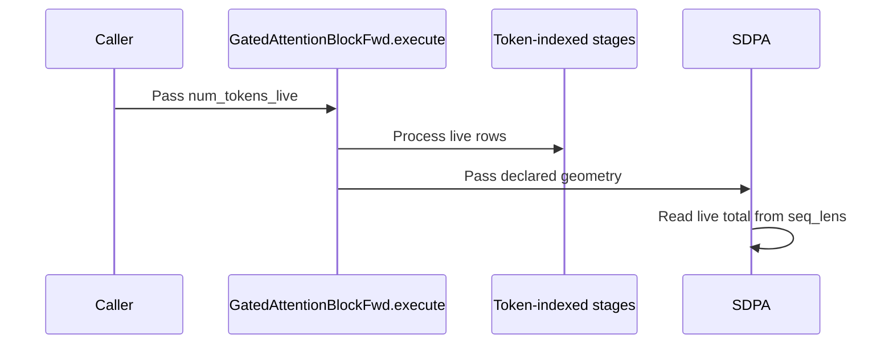

# frost(gated_attention_block): `num_tokens_live` -- the bounded packed form's live token count as an execute-time host int (no recompile, no staging copy)

[Upstream PR](https://github.com/NVIDIA/cudnn-frontend/pull/1645) · state: closed · merged: True

## Original PR description

## What

The gated attention block's bounded packed form (`token_capacity=T_max`, the serving EXTEND declaration) gains `num_tokens_live`, an
**execute-time host int** appended LAST to `GatedAttentionBlockFwd.execute` with default `None` (= the declared capacity, bitwise as
before). With `num_tokens_live=T_live` the token-indexed stages -- the projection with norm + RoPE (or the unfused pair), the paged
KV-cache write, the sigmoid gate and the out projection -- run over `T_live <= T_max` rows with **no recompile**: the block kernels
take the token count symbolically, and the two dense projections' forced-tile JIT route infers M from the buffers. The SDPA keeps
the declared geometry and reads the live total from `seq_lens` on device (the lengths must sum to `T_live`).

`h` / `cos` / `sin` / `slot_mapping` / `out` may carry the declared `T_max` rows (the first `T_live` are read / written) **or exactly
`T_live` rows**, so a serving stack hands `hidden_states[rows]`, `output[rows]` and `slot_mapping[rows]` directly -- the two D2D
staging copies per layer its uncaptured extend steps paid for the capacity form disappear. Rows `[T_live, T_max)` of `out` are
left untouched.

## Contract (typed, before any launch)

- a block declared without `token_capacity` refuses the argument by name (a dense block, a tight packed block);
- `T_live` outside `[1, T_max]` names the bound (`T_live > T_max` is the decline: more tokens are another declaration); a bool or
  a float is a `TypeError`;
- a quantized pipeline declines (its scale-factor blobs and quantize stages are sized by the capacity);
- a dense projection on the graph route (a bounded block declared without `kv_source="paged"`) declines: the graph binds the
  declared `M`;
- the slot mapping's form check admits exactly the two counts (`T_max` or `T_live`), appended the same way (`t_live=None`).

A CUDA-graph capture bakes the host int into the captured launches: a replay serves the live count it was captured with, so a
serving stack captures one graph per live-count bucket and pads a shorter step to the bucket (finite pad rows, slot `-1`) --
documented in the extend form's table; the uncaptured extend steps are where the count removes the copies.

## Tests (`test_block_serving_extend.py`)

Host (L0): the append-only pin on the signature, the refusal on blocks declared without the capacity, the typed rows and the slot
mapping's two admitted counts. cc 10.7 (L1): the matrix packing (T_live 412 of 512) at `num_tokens_live=412` -- the live rows
BITWISE the capacity launch and the pools identical, rows [412, 512) of a sentinel-filled `out` untouched, the same step with the
token tensors at exactly 412 rows bitwise too (the declared `out` untouched entirely), the next chunk at 300 live tokens bitwise
on [0, 300) and untouched past it; a capture of the FIRST execute at T_live 412 (a new stream, no warm-up, no host sync) replaying
bitwise the eager arm and serving the padded next chunk. RED on the pre-change tree (the unexpected keyword: 3 host cells, 2
device cells), GREEN with the change (5 cells; the module's L0 / L1 tier 177 passed on a cc 10.7 development GPU; the host L0 tier 49
passed, 3 skipped).

## Docs

`docs/fe-oss-apis/gated_attention_block.md`: the execute listing, the extend form's example, paragraph and table (`num_tokens_live`
row), the validated-on-Rubin note.

🤖 Generated with [Claude Code](https://claude.com/claude-code)

<!-- This is an auto-generated comment: release notes by coderabbit.ai -->
## Summary by CodeRabbit

* **New Features**
  * Bounded packed requests can process only their live token rows, with inputs sized to either capacity or live count. Output rows beyond the live count remain untouched.
  * Attention uses the live token total, and slot mappings may match either capacity or live count.
  * CUDA graph capture is tied to the captured live-token count.
* **Documentation**
  * Updated serving guidance with live-token behavior, input sizing, validation limits, and configuration requirements.
<!-- end of auto-generated comment: release notes by coderabbit.ai -->

## Review and discussion

### reviews

- vedaanta · APPROVED · 2026-10-14T19:19:41Z · [source](https://github.com/NVIDIA/cudnn-frontend/pull/1645#pullrequestreview-5523410168)

**Codex bot review · model: `gpt-6.1-sol`**

Reviewed `7b6106004ac8` against base `949c759865a1`.

The live-count argument is appended compatibly, rejects unsupported declarations and counts, and passes bounded host/dispatch checks. One nonblocking P2 remains: the new inferred row views break the existing RMSNorm-only rope_dim=0 geometry even for callers that omit num_tokens_live. Native Rubin live-count execution and capture were not independently reproduced here.

**[P2] Preserve zero-width RoPE tables when flattening token rows** ([source](https://github.com/NVIDIA/cudnn-frontend/blob/7b6106004ac8ba31e96bb1062b81d579e27829e0/python/cudnn/gated_attention_block/api.py#L6861))

GatedAttentionBlockGeometry accepts rope_dim=0 with qk_norm=True, so an RMSNorm-only block legitimately has cos/sin shaped [T, 0] (or [B, S, 0]). The new unconditional tok(cos/sin, ..., width=0) calls view(-1, 0), which PyTorch rejects because the inferred dimension is ambiguous for an empty tensor. This breaks the existing default num_tokens_live=None path before any stage runs. The same new view(-1, g.rope_dim) in _QkNormRope.execute also breaks its direct entry. In a no-launch comparison using the same valid declaration and intercepted stage entries, the fixed base reaches all five stages and its norm entry reaches the runner; this head raises the reshape error in both. Derive the row count from leading shape metadata for zero-width tables and handle both sites, with a rope_dim=0 regression for the default and live-count paths.

Evidence: zero_rope_probe.py and zero-rope-probe.log: exact base/head execute methods, validated rope_dim=0 geometry, no native launch; base succeeds through intercepted entries, head raises RuntimeError about ambiguous [-1, 0]. Attribution: Independently identified and reproduced in this review.

Validation: Read the complete four-file diff and surrounding declaration, workspace, preflight, projection-driver and stage-runner contracts. Checked append-only signature, normalized capacity count, typed declines, stream forwarding, token views and retained declared attention geometry. Exact-head overlay on native SM100, public CuTeDSL 4.7: serving-extend L0 selection excluding Rubin-only tests: 49 passed, 129 deselected. These include host preflight and cache-write checks, not native Rubin block numerics. 18 stage-interception cases across live counts 1/17/32, capacity-sized versus live-sized inputs, fused/unfused projection and in-place/out-of-place variants: all token-stage extents matched the live count and SDPA retained capacity 32. All block stage entries were intercepted; this does not establish numerical execution. No-launch base/head control confirmed the rope_dim=0 regression at both block and norm-stage entries, including the default num_tokens_live=None call. Reused author current-head CI 73881723 (python_tests, frost, python/*/cutedsl), integration 216357092beb2b5d06f17290441ca16c65060881; all three changed code/test files matched reviewed source hashes. Pipeline running; no duplicate trigger.

Limitations: No local SM107 GPU: native end-to-end live-count numerics, first-execute capture/replay and performance benefit were not independently reproduced. New live-count execution/capture tests are L1 and are not established by ordinary L0 CI coverage. Initial CPU-only serving selection had 44 passes, 3 skips and 2 failures at existing CUDA-only pool-metadata checks. The complete 49-test L0 selection passed on SM100; those CPU failures are not attributed to this PR. Existing origin/category/FROST-area labels and Frontend 1.32.0 milestone are appropriate. Project membership could not be inspected with the available project scope.

Approved: no P0 or high-risk P1 found. Remaining findings stay with the owner; merge timing stays with the owner.

<!-- codex-fe-review:v2:1645:7b6106004ac8ba31e96bb1062b81d579e27829e0:complete:no-blocker -->

- vedaanta · COMMENTED · 2026-10-14T19:56:18Z · [source](https://github.com/NVIDIA/cudnn-frontend/pull/1645#pullrequestreview-5523828491)

**Codex bot review · model: `gpt-6.1-sol`**

Reviewed `6ebe144ba630` against base `519adfdacdc9`.

The zero-width RoPE-table P2 from my previous review is resolved at both sites: the block derives token rows from leading shape metadata, and the norm/RoPE stage uses its known token count for the table view. The unchanged default path again accepts the valid RMSNorm-only geometry. No new actionable finding in the bounded follow-up; preserving the existing approval.

Validation: Reviewed the complete two-file incremental diff, new helper shape/count branches, both consumers, new width-zero/width-64 regression cells and prior shared review finding. Reran the original no-launch base/head control with the fixed source: both the default block entry and direct norm-stage entry now reach their intercepted stages/runners with rope_dim=0. The previous head's failing control remains in the original review evidence. Exact-head overlay on SM100 with public CuTeDSL 4.7: 51 serving-extend L0 tests passed, 129 deselected. Includes the new zero-width and ordinary-width helper checks plus the prior form/cache-write checks. Reused valid original source/dispatch evidence for unchanged live-count behavior. Adopted author's replacement pipeline 73887725, integration 538b91ca9ef604ef7777df7e40b13069939f13c0; both changed files match reviewed source hashes. Pipeline running, no duplicate trigger. Old-head pipeline 73881723 was canceled and remains historical.

Limitations: No independent native SM107 end-to-end or capture/replay validation in this follow-up. Intercepted entry checks establish host behavior only; the new native live-count/capture cases remain L1 and ordinary L0 CI does not establish their execution. Existing labels and milestone remain appropriate; project scope remains unavailable. Current CI is pending, not asserted green.

Comment only: this PR already has an active approval; preserving existing approvals.

<!-- codex-fe-review:v2:1645:6ebe144ba6305faace17452de816cd809c4ff883:complete:no-blocker -->

### issue_comments

- RomanAnders90 · comment · 2026-10-14T18:59:07Z · [source](https://github.com/NVIDIA/cudnn-frontend/pull/1645#issuecomment-6176003413)

@cudnn-ci-bot run python_tests,frost

- RomanAnders90 · comment · 2026-10-14T18:59:09Z · [source](https://github.com/NVIDIA/cudnn-frontend/pull/1645#issuecomment-6176003854)

@codex review

- RomanAnders90 · comment · 2026-10-14T18:59:10Z · [source](https://github.com/NVIDIA/cudnn-frontend/pull/1645#issuecomment-6176004316)

@coderabbitai review

- cudnn-ci-bot · comment · 2026-10-14T18:59:11Z · [source](https://github.com/NVIDIA/cudnn-frontend/pull/1645#issuecomment-6176004557)

🚀 Running pipeline

SHA: `7b61060`
Targets: `python_tests`, `frost`
Branch: [cudnn-gh/pr-1645-7b61060](https://nv/cudnn-gitlab-ci/-/tree/cudnn-gh/pr-1645-7b61060)
Pipeline: [73881723](https://nv/cudnn-gitlab-ci/-/pipelines/73881723)
Last updated: 2026-10-14 19:03 UTC

- coderabbitai[bot] · comment · 2026-10-14T18:59:34Z · [source](https://github.com/NVIDIA/cudnn-frontend/pull/1645#issuecomment-6176012021)

<!-- This is an auto-generated comment: summarize by coderabbit.ai -->
<!-- review_stack_entry_start -->

<a href="https://app.coderabbit.ai/change-stack/NVIDIA/cudnn-frontend/pull/1645?scope=ghh_OusAJGA4HG8ljoOV0wJvVx8NmnZIjc2DdjmxOu0xZWA&amp;cs_source=review_comment"><picture><source media="(prefers-color-scheme: dark)" srcset="https://storage.googleapis.com/coderabbit_public_assets/review-stack-in-coderabbit-ui-dark.svg?v=3"><source media="(prefers-color-scheme: light)" srcset="https://storage.googleapis.com/coderabbit_public_assets/review-stack-in-coderabbit-ui.svg?v=3"></picture></a>

<!-- review_stack_entry_end -->
<!-- recent_review_start -->

No actionable comments were generated in the recent review. 🎉

<strong>ℹ️ Recent review info</strong>

<dl>
<dd>

<strong>⚙️ Run configuration</strong>

<dl>
<dd>

- **Configuration used**: Repository: NVIDIA/cudnn-frontend/.coderabbit.yaml
- **Review profile**: CHILL
- **Plan**: Enterprise
- **Run ID**: `d49f8cd5-005b-4e7c-beaa-0480d22031f9`

</dd>
</dl>

<strong>📥 Commits</strong>

<dl>
<dd>

Reviewing files that changed from the base of the PR and between 7b6106004ac8ba31e96bb1062b81d579e27829e0 and 6ebe144ba6305faace17452de816cd809c4ff883.

</dd>
</dl>

<strong>📒 Files selected for processing: 2</strong>

<dl>
<dd>

* `python/cudnn/gated_attention_block/api.py`
* `test/python/gated_attention_block/cutedsl/test_block_serving_extend.py`

</dd>
</dl>

**Included review availability:** This review used your included allowance. Your plan provides up to 12 included reviews per hour; 8 remain after this review.

</dd>
</dl>

<!-- recent_review_end -->
<!-- walkthrough_start -->

<strong>📝 Walkthrough</strong>

<dl>
<dd>

The EXTEND serving API adds optional `num_tokens_live` support for bounded packed requests. Token-indexed stages can process live rows, while SDPA uses the live total from `seq_lens`. Tests and documentation cover accepted tensor sizes, output padding, and CUDA-graph capture.

**Changes: Bounded EXTEND execution**

|Layer / File(s)|Summary|
|:---|:---|
|**Live-count API and validation**   `python/cudnn/gated_attention_block/cache_write_contract.py`, `test/python/gated_attention_block/cutedsl/test_block_serving_extend.py`|Slot mappings can contain either capacity-sized or live-sized entries when a live count is provided. Tests cover the API signature, token-row flattening, and validation behavior.|
|**Live-row execution and coverage**   `test/python/gated_attention_block/cutedsl/test_block_serving_extend.py`, `docs/fe-oss-apis/gated_attention_block.md`|Tests cover live-row inputs, unchanged output rows beyond the live count, and CUDA-graph capture and replay. The documentation describes bounded execution and its input and output constraints.|

<!-- change_assessment_start -->
**Priority:** ⬇️ Low

**Estimated code review effort:** 3 (Moderate) | ~25 minutes

<!-- change_assessment_commit:"6ebe144ba6305faace17452de816cd809c4ff883" -->
**Change:** Feature
<!-- change_assessment_end -->

### Sequence Diagram(s)

**Suggested reviewers:** `yangxu1990uiuc`

</dd>
</dl>

<!-- walkthrough_end -->

<strong>Merge Risk:</strong> <strong>⚪ Minimal</strong> · up to <code>6ebe1</code>

<dl>
<dd>

<!-- final_review_risk_start -->
<!-- final_review_risk_label
**Merge Risk:** **⚪ Minimal** · up to `6ebe1`
-->
<!-- final_review_risk_coverage:{"sourceCommitId":"6ebe144ba6305faace17452de816cd809c4ff883","coveredCommitId":"6ebe144ba6305faace17452de816cd809c4ff883","kind":"reviewed"} -->

No actionable issue remains from this review; the change is mergeable after normal checks.
<!-- final_review_risk_end -->

</dd>
</dl>

<!-- pre_merge_checks_walkthrough_start -->

<strong>Pre-merge checks: <picture></picture> 5</strong>

<dl>
<dd>

<strong><picture></picture> Passed checks: 5 passed</strong>

<dl>
<dd>

|         Check name         |                                             Status                                             | Explanation                                                                                                                                                                                               |
| :------------------------ | :--------------------------------------------------------------------------------------------: | :-------------------------------------------------------------------------------------------------------------------------------------------------------------------------------------------------------- |
|         Title check        |  | The title clearly identifies the main change: adding execute-time num_tokens_live support for bounded packed gated attention blocks. It is specific and related to the changeset.                         |
|      Description check     |  | The description clearly covers the change, rationale, API and compatibility behavior, testing results, CUDA-graph behavior, and documentation updates. It omits some template headings and checklist ite… |
|     Docstring Coverage     |  | Docstring coverage is 100.00% which is sufficient. The required threshold is 80.00%. Docstring coverage is scoped to functions touched by this diff. Analyzed 23 functions across 3 files.                |
|     Linked Issues check    |  | Check skipped because no linked issues were found for this pull request.                                                                                                                                  |
| Out of Scope Changes check |  | Check skipped because no linked issues were found for this pull request.                                                                                                                                  |

</dd>
</dl>

</dd>
</dl>

<!-- pre_merge_checks_walkthrough_end -->
<!-- finishing_touch_checkbox_start -->

<strong>✨ Finishing Touches</strong>

<dl>
<dd>

<strong>🧪 Generate unit tests (beta)</strong>

<dl>
<dd>

- [ ] <!-- {"checkboxId": "f47ac10b-58cc-4372-a567-0e02b2c3d479", "radioGroupId": "utg-output-choice-group-unknown_comment_id"} --> Create a new PR

</dd>
</dl>

</dd>
</dl>

<!-- finishing_touch_checkbox_end -->

<!-- autopilot:start -->
- [ ] <!-- {"checkboxId":"2708ad07-9f24-4260-9c11-7dc76a49f2e3"} --> <strong title="Keep fixing CodeRabbit findings and required CI, and resolving merge conflicts">Autofix</strong> · Keep fixing CodeRabbit findings and required CI, and resolving merge conflicts
<!-- autopilot:end -->
<!-- tips_start -->

Comment `@coderabbitai help` to get the list of available commands.

<!-- tips_end -->

- coderabbitai[bot] · comment · 2026-10-14T19:10:33Z · [source](https://github.com/NVIDIA/cudnn-frontend/pull/1645#issuecomment-6176222122)

<!-- This is an auto-generated reply by CodeRabbit -->
<!-- CodeRabbit review command invocation: v2:3fa59f63ba631ec7a08f32410b300d9bcdafcca8d788c0273c99bc4ebeb520d2 -->

⚠️ Action not completed

Already reviewed the last commit. Use `@coderabbitai full review` to rerun a review of the entire changeset.

> Note: CodeRabbit is an incremental review system and does not re-review already reviewed commits. This command is applicable only when automatic reviews are paused.

- RomanAnders90 · comment · 2026-10-14T19:10:49Z · [source](https://github.com/NVIDIA/cudnn-frontend/pull/1645#issuecomment-6176227253)

@cudnn-ci-bot run python/*/cutedsl

- cudnn-ci-bot · comment · 2026-10-14T19:12:50Z · [source](https://github.com/NVIDIA/cudnn-frontend/pull/1645#issuecomment-6176268914)

🏁 Pipeline finished

SHA: `7b61060`
Targets: `python_tests`, `frost`, `python/*/cutedsl`
Branch: [cudnn-gh/pr-1645-7b61060](https://nv/cudnn-gitlab-ci/-/tree/cudnn-gh/pr-1645-7b61060)
Pipeline: [73881723](https://nv/cudnn-gitlab-ci/-/pipelines/73881723)
Last updated: 2026-10-14 19:30 UTC

**31 passed, 12 canceled, 2 skipped, 6 manual**

### <code>manual</code>

- <code>manual:python_samples</code> - Manual
- <code>manual:python</code> - ✅ Passed
- <code>manual:python/sdpa/frost</code> - ✅ Passed
- <code>manual:python/linear_attention/frost</code> - ✅ Passed
- <code>manual:python/gemm/frost</code> - ✅ Passed
- <code>manual:python/*/frost</code> - ✅ Passed
- <code>manual:python/gemm/cutedsl</code> - Manual
- <code>manual:python/*/cutedsl</code> - ✅ Passed
- <code>manual:python/*/jax</code> - Manual
- <code>manual:pycudnn</code> - Manual
- <code>manual:multi_gpu</code> - Manual
- <code>manual:backend</code> - Manual

### <code>analysis</code>

- <code>analysis:cudnn_clang_disable_exception</code> - ✅ Passed
- <code>analysis:cudnn_v9_no_half_conversion</code> - ✅ Passed
- <code>analysis:cudnn_clang</code> - ✅ Passed
- <code>analysis:check-relative-includes</code> - ✅ Passed
- <code>analysis:check-CUDNN_FRONTEND_SKIP_JSON_LIB</code> - ✅ Passed
- <code>analysis:guardwords_scan</code> - ✅ Passed
- <code>analysis:jax-import-guard</code> - ✅ Passed
- <code>analysis:pytest-gpu</code> - ✅ Passed
- <code>san:build</code> - ✅ Passed

### <code>build</code>

- <code>analysis:api_index</code> - ✅ Passed
- <code>build:dev:linux:amd64</code> - ✅ Passed
- <code>build:rel:linux:amd64</code> - ✅ Passed
- <code>build:dev:linux:arm64</code> - ✅ Passed
- <code>build:rel:linux:arm64</code> - ✅ Passed
- <code>build:rel:win:amd64</code> - ✅ Passed

### <code>oss_tests</code>

- <code>python/gemm/cutedsl:cutlass-rel:sm100</code> - Skipped
- <code>python/*/cutedsl:cutlass-rel:sm80</code> - Canceled
- <code>python/*/cutedsl:cutlass-rel:sm90</code> - ✅ Passed
- <code>python/*/cutedsl:cutlass-rel:sm100</code> - Canceled
- <code>python/*/jax:cutlass-rel:sm100</code> - Skipped
- <code>python/*/cutedsl:cutlass-4.8:sm107</code> - Canceled

### <code>frost_tests</code>

- <code>python/sdpa/frost:cutlass-rel:sm80</code> - Canceled
- <code>python/sdpa/frost:cutlass-rel:sm100</code> - Canceled
- <code>python/sdpa/frost:cutlass-rel:sm120</code> - Canceled
- <code>python/linear_attention/frost:cutlass-rel:sm100</code> - ✅ Passed
- <code>python/gemm/frost:cutlass-rel:sm100</code> - ✅ Passed
- <code>python/*/frost:cutlass-rel:sm100</code> - ✅ Passed
- <code>python/sdpa/frost:cutlass-rel:sm103</code> - Canceled
- <code>python/sdpa/frost:cutlass-4.8:sm107</code> - Canceled

### <code>python_tests</code>

- <code>python:dev:sm80</code> - Canceled
- <code>python:dev:sm90</code> - ✅ Passed
- <code>python:dev:sm100</code> - ✅ Passed
- <code>python:rel:sm80</code> - Canceled
- <code>python:rel:sm90</code> - ✅ Passed
- <code>python:rel:sm100</code> - ✅ Passed

### <code>sanitizer_tests</code>

- <code>san:cpp_test:sm80</code> - Canceled
- <code>san:cpp_test:sm90</code> - ✅ Passed
- <code>san:cpp_test:sm100</code> - ✅ Passed

### <code>triage</code>

- <code>triage:ai</code> - Canceled

- RomanAnders90 · comment · 2026-10-14T19:29:44Z · [source](https://github.com/NVIDIA/cudnn-frontend/pull/1645#issuecomment-6176594302)

Thanks -- the [P2] is right and is fixed in 6ebe144ba: the token-row view now takes its row count from the leading shape (`[T, w]` / `[1, T, w]` / `[B, S, w]`) in a module-level helper that the block's `execute` and the norm + RoPE stage share, so a `rope_dim=0` table of width 0 flattens on the default path and under `num_tokens_live` alike; the admitted counts and the typed error are unchanged. A host pin covers every form at width 64 and width 0 (RED on 7b6106004: the `-1` view's ambiguous-dimension error, GREEN now). The live-count cells and the extend module are being re-run on a cc 10.7 development GPU at the new head; one pipeline is requested for it.

- RomanAnders90 · comment · 2026-10-14T19:29:45Z · [source](https://github.com/NVIDIA/cudnn-frontend/pull/1645#issuecomment-6176594762)

@cudnn-ci-bot run python_tests,frost,python/*/cutedsl

- RomanAnders90 · comment · 2026-10-14T19:29:47Z · [source](https://github.com/NVIDIA/cudnn-frontend/pull/1645#issuecomment-6176595178)

@codex review

- cudnn-ci-bot · comment · 2026-10-14T19:29:48Z · [source](https://github.com/NVIDIA/cudnn-frontend/pull/1645#issuecomment-6176595542)

🏁 Pipeline finished

SHA: `6ebe144`
Targets: `python_tests`, `frost`, `python/*/cutedsl`
Branch: [cudnn-gh/pr-1645-6ebe144](https://nv/cudnn-gitlab-ci/-/tree/cudnn-gh/pr-1645-6ebe144)
Pipeline: [73887725](https://nv/cudnn-gitlab-ci/-/pipelines/73887725)
Cancelled this PR's older pipelines: 73881723
Last updated: 2026-10-14 20:46 UTC

**38 passed, 1 failed, 4 canceled, 2 skipped, 6 manual**

### <code>manual</code>

- <code>manual:python_samples</code> - Manual
- <code>manual:python</code> - ✅ Passed
- <code>manual:python/sdpa/frost</code> - ✅ Passed
- <code>manual:python/linear_attention/frost</code> - ✅ Passed
- <code>manual:python/gemm/frost</code> - ✅ Passed
- <code>manual:python/*/frost</code> - ✅ Passed
- <code>manual:python/gemm/cutedsl</code> - Manual
- <code>manual:python/*/cutedsl</code> - ✅ Passed
- <code>manual:python/*/jax</code> - Manual
- <code>manual:pycudnn</code> - Manual
- <code>manual:multi_gpu</code> - Manual
- <code>manual:backend</code> - Manual

### <code>analysis</code>

- <code>analysis:cudnn_clang_disable_exception</code> - ✅ Passed
- <code>analysis:cudnn_v9_no_half_conversion</code> - ✅ Passed
- <code>analysis:cudnn_clang</code> - ✅ Passed
- <code>analysis:check-relative-includes</code> - ✅ Passed
- <code>analysis:check-CUDNN_FRONTEND_SKIP_JSON_LIB</code> - ✅ Passed
- <code>analysis:guardwords_scan</code> - ✅ Passed
- <code>analysis:jax-import-guard</code> - ✅ Passed
- <code>analysis:pytest-gpu</code> - ✅ Passed
- <code>san:build</code> - ✅ Passed

### <code>build</code>

- <code>analysis:api_index</code> - ✅ Passed
- <code>build:dev:linux:amd64</code> - ✅ Passed
- <code>build:rel:linux:amd64</code> - ✅ Passed
- <code>build:dev:linux:arm64</code> - ✅ Passed
- <code>build:rel:linux:arm64</code> - ✅ Passed
- <code>build:rel:win:amd64</code> - ✅ Passed

### <code>oss_tests</code>

- <code>python/gemm/cutedsl:cutlass-rel:sm100</code> - Skipped
- <code>python/*/cutedsl:cutlass-rel:sm80</code> - ✅ Passed
- <code>python/*/cutedsl:cutlass-rel:sm90</code> - ✅ Passed
- <code>python/*/cutedsl:cutlass-rel:sm100</code> - ✅ Passed
- <code>python/*/jax:cutlass-rel:sm100</code> - Skipped
- <code>python/*/cutedsl:cutlass-4.8:sm107</code> - Canceled

### <code>frost_tests</code>

- <code>python/sdpa/frost:cutlass-rel:sm80</code> - ✅ Passed
- <code>python/sdpa/frost:cutlass-rel:sm100</code> - ✅ Passed
- <code>python/sdpa/frost:cutlass-rel:sm120</code> - ✅ Passed
- <code>python/linear_attention/frost:cutlass-rel:sm100</code> - ✅ Passed
- <code>python/gemm/frost:cutlass-rel:sm100</code> - ✅ Passed
- <code>python/*/frost:cutlass-rel:sm100</code> - ✅ Passed
- <code>python/sdpa/frost:cutlass-rel:sm103</code> - ✅ Passed
- <code>python/sdpa/frost:cutlass-4.8:sm107</code> - Canceled

### <code>python_tests</code>

- <code>python:dev:sm80</code> - ❌ **New Failure!** (nightly passed)
- <code>python:dev:sm90</code> - ✅ Passed
- <code>python:dev:sm100</code> - ✅ Passed
- <code>python:rel:sm80</code> - Canceled
- <code>python:rel:sm90</code> - ✅ Passed
- <code>python:rel:sm100</code> - ✅ Passed

### <code>sanitizer_tests</code>

- <code>san:cpp_test:sm80</code> - ✅ Passed
- <code>san:cpp_test:sm90</code> - ✅ Passed
- <code>san:cpp_test:sm100</code> - ✅ Passed

### <code>triage</code>

- <code>triage:ai</code> - Canceled

- vedaanta · comment · 2026-10-14T20:50:46Z · [source](https://github.com/NVIDIA/cudnn-frontend/pull/1645#issuecomment-6178173002)

Pipeline 73887725 for reviewed head `6ebe144ba630` finished failed: 38 jobs passed, one failed, four were canceled and two were skipped. The PR merged while this CI watch was already underway, so this is a post-merge validation note.

The sole failed job is SM80 development Python: GEMM fuzz case `t1441_b32_M3848xN4096xK1936_f32_gelu` runs out of memory while constructing an input mask, requesting 7.39 GiB with 5.35 GiB free. The stack stops in `create_tensors -> create_sparse_int_tensor -> fill_sparse_small_int`, before the changed gated-block serving path. The fuzzer and helper sources are unchanged from this PR's base. This does not establish a regression in `num_tokens_live`; without a resource-matched base control, I also cannot classify it as a proven pre-existing failure.

SM100/SM103 SDPA lanes and the SM80/SM90/SM100 wildcard CuTeDSL lanes passed. Both SM107 lanes were canceled, so they provide no completed native qualification here. The new live-count capture matrix is L1 and is not covered by ordinary L0 CI. The earlier exact-head local L0 checks and zero-width view fix remain separately recorded. No new product finding or duplicate CI request from this terminal result.

Codex bot review — model `gpt-6.1-sol`.

<!-- codex-fe-post-merge:v1:1645:6ebe144ba6305faace17452de816cd809c4ff883:pipeline-73887725-finished -->

### inline_comments

## Changed files and fixed code

- `docs/fe-oss-apis/gated_attention_block.md` · modified · additions 11 / deletions 5
  - [head](https://github.com/RomanAnders90/cudnn-frontend/blob/6ebe144ba6305faace17452de816cd809c4ff883/docs/fe-oss-apis/gated_attention_block.md)
  - [base](https://github.com/NVIDIA/cudnn-frontend/blob/949c759865a17a6fed1e42c63aa8b591fc514250/docs/fe-oss-apis/gated_attention_block.md)
- `python/cudnn/gated_attention_block/api.py` · modified · additions 149 / deletions 21
  - [head](https://github.com/RomanAnders90/cudnn-frontend/blob/6ebe144ba6305faace17452de816cd809c4ff883/python/cudnn/gated_attention_block/api.py)
  - [base](https://github.com/NVIDIA/cudnn-frontend/blob/949c759865a17a6fed1e42c63aa8b591fc514250/python/cudnn/gated_attention_block/api.py)
- `python/cudnn/gated_attention_block/cache_write_contract.py` · modified · additions 11 / deletions 4
  - [head](https://github.com/RomanAnders90/cudnn-frontend/blob/6ebe144ba6305faace17452de816cd809c4ff883/python/cudnn/gated_attention_block/cache_write_contract.py)
  - [base](https://github.com/NVIDIA/cudnn-frontend/blob/949c759865a17a6fed1e42c63aa8b591fc514250/python/cudnn/gated_attention_block/cache_write_contract.py)
- `test/python/gated_attention_block/cutedsl/test_block_serving_extend.py` · modified · additions 229 / deletions 8
  - [head](https://github.com/RomanAnders90/cudnn-frontend/blob/6ebe144ba6305faace17452de816cd809c4ff883/test/python/gated_attention_block/cutedsl/test_block_serving_extend.py)
  - [base](https://github.com/NVIDIA/cudnn-frontend/blob/949c759865a17a6fed1e42c63aa8b591fc514250/test/python/gated_attention_block/cutedsl/test_block_serving_extend.py)

## Evidence and interpretation boundary

[Original JSON, discussions and patches](../../../../../../evidence/prs/NVIDIA--cudnn-frontend/1645-fbce4fd16627b86af32607c7f2e6b52e58c58e66699f7422674f92b6b7bab028.json) · SHA-256 `fbce4fd16627b86af32607c7f2e6b52e58c58e66699f7422674f92b6b7bab028`.

Diff complete: True. Missing/binary/truncated patches require pinned source inspection. This is a source page, not an independently verified optimization case. Open, merged and released are different states; recheck the deployed dependency.
