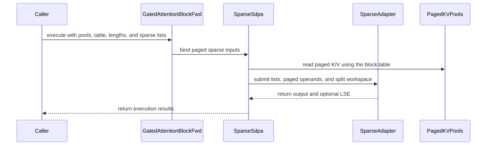

# frost(gated_attention_block): the block-sparse DECODE mode -- a `QsaSpec` block over the paged KV cache: one list per sequence at S_q <= 4, one per row past it, the gate and the LSE, split-KV; the MTP matrix of the sparse decode form

[Upstream PR](https://github.com/NVIDIA/cudnn-frontend/pull/1652) · state: closed · merged: True

## Original PR description

## Summary

The gated attention block serves the Flash-Next / QSA **decode step over a paged KV cache**: a dense `[B, S_q]` declaration on a
`QsaSpec` geometry (`causal_bottom_right=True`) with `kv_source="paged"`, `paged_kv_page_size=P` and the pools' and block table's
samples.  The step's tokens are written through into the pools (and the raw indexer key into `index_k_raw` when the band is declared),
then stage (4) is the Rubin index-list sparse core **reading the pools** (`sdpa/fwd/sparse_gqa_sm107`'s paged read on the
bottom-right diagonal): per sequence the listed 4-token blocks plus the open tail over the first `kv_lens[b]` tokens of
`block_table[b]`, row `j` at position `kv_lens[b] - S_q + j`.

* **The list form is a declaration fact derived from `S_q`.**  At `S_q <= 4` ONE list per sequence -- `execute(block_ids=)`
  `[B, top_k]` int32 (+ `block_lens [B]`), selected at the step-0 position `kv_lens[b] - S_q` and shared by the step's rows: a
  speculative (MTP) row sees the listed blocks plus every token from the step-0 tail start to its own position (the contract page's
  definition; the adapter's `list_per_sequence` arm).  Past four rows one list per row (`[B, S_q, top_k]` / `[B x S_q, top_k]`) at
  bottom-right positions: a chunked prefill / prefix-cache hit over the pools, at any `S_q` (the sparse core runs one work item per
  query row: no 32-row cap, no decode-tile route).
* **`decode_split_kv`** is the one performance knob: `None` = the fill rule `ceil(SMs / (B x H_kv x S_q))` capped at the item's
  tile count `ceil((top_k + 1) / 32)`, or a pinned int in that range; fp32 partials inside `get_workspace_size()`, the split combine
  as a second launch; the same function under every value.  `fuse_gate` is served at every split (the core's epilogue unsplit, the
  combine otherwise); `return_lse` is served (`[B, H_q, S_q]` fp32).
* **Typed declines** (each naming its feature, every one pinned): the packed (`thd=True`) form over the pools -- the serving table's
  `sparse` row now reads "the sparse core serves packed sequences and paged pools one at a time"; a block-table sample that is not
  contiguous (the core binds the whole `[B, max_pages]` table; `execute(block_table=)` is exactly that table); a split past the
  item's tile count; `fuse_prepare`; the in-block indexer over the pools; `causal_bottom_right` on the block's own K / V now names
  this mode.  `_EXTEND_DECLINES`' `decode_rows` and `return_lse` rows exempt `QsaSpec` geometries; `serving_envelope(...).decode`
  gains `sparse_core` (appended) and spells both list forms in `requires`; `routes` is empty for a sparse geometry (the dense tile's
  facts do not apply).
* **Two execute-path details the cells caught**: at `S_q = 1` torch's `.view` gives the unit seq dim a stride that differs from the
  declared one and the adapter's exact `_bind` refused it -- the sparse stage now re-strides UNIT dims of its bound views to the
  declaration (an exact view; a non-unit mismatch stays the typed refusal); the serving declaration's capture-safe projections exist
  only for an `N` that 256 divides, so the indexer band (+640 columns) keeps the driver's route (eager steps; a capture is the
  driver's typed refusal at the first captured execute) instead of declining the whole block at compile.
* **The MTP matrix of the standalone sparse decode form** (the kernel-side cells cut out of the sparse-core PR as planned): every
  residue of the step-0 position at `S_q` 1..4, the shared list bitwise the replicated per-token list plus the completed block
  appended explicitly, the `S_q = 5` boundary decline, and the tracker's MTP wording with the bytes per step.

No kernel, barrier, ring or SMEM change: the mode binds the sparse core's served arms (`bottom_right` / `list_per_sequence` /
`split_kv` / `paged_kv`).  The `SparseCapabilities` record's fields do not move (its `decode` comment names the block); the
tracker's serving-forms section, index-list section, feature row and gaps rows and the doc page's contract table, decode-mode
paragraph, decode-form section and limits bullets flip in the same commit.

## Tests

`test/python/gated_attention_block/cutedsl/test_block_qsa_decode.py` (new, L0).  Host cells (any device): the declaration facts
(the list form per `S_q`, no dense route, where the gate runs, the split rule, the capture-safe projections per geometry), the typed
declines, the static envelope, the execute-time form checks on an uncompiled block under `set_sync_debug_mode("error")` (the 16-byte
base-alignment refusal of `block_ids` before any stage on both list forms, with an aligned storage-offset control -- a review item), the split
rule.  Rubin cells (cc 10.7, a development node, 204 SMs; functional, no perf claim): the decode ladder -- 9 cells, `S_q` 1..4 shared
and 8 / 64 per row, `B` 1 / 2 / 4, `kv_lens` 2 .. 20000 with a dead entry and a sequence shorter than the step, pages 16 / 32 / 64
on HND / NHD / unified pools, bf16 / f16, splits 1 / 2 / 4 / 17 and the rule, the gate fused and separate, the LSE, the indexer
band's raw-key write-through, the 24 / 2 geometry at `d_model` 2560 -- against the fp32 oracle of the WHOLE sequence (the dense block
reference's post-norm / post-RoPE Q, K, V and gate; the prefix rows fill NaN pools, the step rows are the block's own write-through;
the step rows' attention over `qsa_visible_mask(..., pos0=)`): `cos(out) >= 0.99998`, the gated O within 3.9e-3 bf16 / 3.1e-5 f16
(the suite's `atol 2e-2`, never widened), the LSE within 7.3e-5, dead rows exactly `0` / `-inf`, the pools' step rows BITWISE the
slab's K / V bands, the prefix rows and the NULL block untouched, two launches bitwise; the MTP matrix at every residue of the step-0
position on ~60-token sequences (the step-0-anchored oracle within budget; the per-row-tail reading 0.07-0.11 off on exactly the rows
that see a block completed after step 0, equal elsewhere); the block's form BITWISE the standalone adapter on the block's own Q / gate
views, pools, table and list (split 1 and 4); `get_workspace_size()` honest under a split (a sentinel past the carve untouched); the
FIRST execute of a fresh declaration captured into a CUDA graph on a new stream with no warm-up under `set_sync_debug_mode("error")`,
the replay bitwise eager, the replay over new lengths / tables / lists / slots / inputs bitwise eager.

Also on Rubin, at the head rebased onto develop's fused write-through (#1649) and live-token count (#1645) -- the decode module
32 passed again --: the serving modules (`test_block_serving_extend.py` / `_decode.py` / `_capture.py`: 177 passed, the fold's
and the live-count cells among them), the two QSA block modules (124 passed), the sparse kernel module (327 passed).  Host (an
A100, cc 8.0): the new module, the QSA block modules, the serving modules, the sparse module's host cells and the tier lists
353 passed / 452 skipped / 0 failed.  The API index gains the one row the appended envelope field adds
(`DecodeEnvelope.sparse_core`; no other export changes).

## Performance

Measured on ONE exclusive GPU of a 212-SM Rubin part (cc 10.7, 2376 MHz lock sampled every window, the clock-event counters' delta 0;
CUPTI per-kernel device medians, 3 rounds x 100 executes, slots shuffled per round, a control pair 0.65 % apart; every cell validated
against the oracle / the dense function before timing).  The Flash-Next 24 / 2 d256 geometry at `d_model` 2560, bf16, page 16 HND pools,
`fuse_norm_rope` + `fuse_gate` on both arms, random 512-lists at the step-0 position.  **baseline** = the block's DENSE decode form (the
Rubin d256 decode tile over the same pools, its own split model); **FROST** = the block-sparse decode mode (the sparse core reading the
pools; the fill rule's default split -- 8 on the B <= 4 cells (re-read after the cap below), 4 / 1 on the B = 32 cells).  Speed-ups are `baseline / FROST - 1`; **SOL % is against BYTES-HBM**: the
attention kernels' ideal bytes (sparse: the ids row + the gathered K / V rows of the listed blocks and the tail per sequence x KV head x
row, + the fp32 partials under a split; dense: `B x H_kv x S_kv x (K + V)`) over their device time against the part's HBM copy pin
(13179.3 GB/s).

| B x S_kv x S_q | baseline: dense step us | FROST: sparse step us | speed-up (step) | dense tile [+combine] us | sparse core [+combine] us | speed-up (attention) | sparse split | sparse SOL % of BYTES-HBM | dense SOL % |
|---|---|---|---|---|---|---|---|---|---|
| 4x2048x1 (the same function) | 63.8 | 60.2 | +5.9 % | 14.0 [+2.8] | 7.4 [+5.8] | +27.3 % | 8 | 10.6 % | 7.6 % |
| 1x8192x1 | 80.5 | 64.3 | +25.2 % | 8.6 [+20.1] | 7.2 [+5.4] | +127.4 % | 8 | 2.8 % | 4.4 % |
| 1x32768x1 | 100.4 | 59.7 | +68.1 % | 11.5 [+41.5] | 7.2 [+5.4] | +319.9 % | 8 | 2.8 % | 9.6 % |
| 1x131072x1 | 123.5 | 67.6 | +82.8 % | 27.2 [+41.4] | 7.4 [+5.8] | +420.5 % | 8 | 2.6 % | 29.7 % |
| 4x8192x1 | 69.1 | 60.0 | +15.1 % | 11.5 [+10.7] | 7.4 [+5.7] | +69.1 % | 8 | 10.6 % | 23.0 % |
| 4x32768x1 | 84.6 | 59.2 | +43.0 % | 27.1 [+10.9] | 7.5 [+5.6] | +189.5 % | 8 | 10.6 % | 53.6 % |
| 4x131072x1 | 149.9 | 60.6 | +147.2 % | 89.6 [+11.3] | 7.7 [+5.7] | +649.8 % | 8 | 10.4 % | 80.8 % |
| 32x8192x1 | 96.8 | 66.7 | +45.1 % | 49.2 [+3.4] | 19.2 [+3.6] | +130.1 % | 4 | 46.7 % | 77.4 % |
| 32x32768x1 | 221.9 | 67.0 | +231.0 % | 172.7 [+3.4] | 19.5 [+3.7] | +657.5 % | 4 | 45.9 % | 92.6 % |
| 32x131072x1 | 705.6 | 67.4 | +946.1 % | 656.5 [+3.4] | 20.1 [+3.6] | +2678.3 % | 4 | 44.9 % | 98.8 % |
| 1x8192x4 | 78.2 | 60.8 | +28.7 % | 10.7 [+21.5] | 8.1 [+6.8] | +115.2 % | 8 | 9.3 % | 4.0 % |
| 4x32768x4 | 116.8 | 64.4 | +81.3 % | 57.8 [+11.6] | 12.1 [+5.7] | +289.3 % | 7 | 31.0 % | 29.4 % |
| 32x131072x4 | 1438.6 | 92.0 | +1463.2 % | 1388.9 [+4.1] | 48.3 [+0.0] | +2784.7 % | 1 | 84.6 % | 46.8 % |

The split sweep (4 x 32K x 1; the sparse arm): split 1 / 2 / 4 / 8 / 17 -> step 69.2 / 64.3 / 59.9 / 59.8 / 65.0 us (the core
22.8 / 14.3 / 9.8 / 7.5 / 6.9 us, the combine 0 / 2.8 / 2.9 / 5.8 / 12.2 us) -- the core flattens past 4-8 chunks while the combine's
cost grows with the partial count, hence the default's cap of 8.  Launch census: 5 device events per step on both arms (the fused
projection GEMM, the cache write, the attention kernel, its combine, the out GEMM; 4 when unsplit).  The whole step is GEMM-dominated
at these `M = B x S_q` (the two projection GEMMs 45-50 us on the forced 128-row tile), which is why the attention kernels' 1.2-28x gains
over the dense tile show as +5.9 % .. +1463 % at the step; a small-M tile route for the serving projections is the next lever (#1646).
Limits: one node class; device-time medians of back-to-back executes; the sparse ideal bytes omit Q / O / the slab (identical for both
arms); the B <= 4 rows were re-read at the shipped default (split 8) after the sweep set the cap -- at the pre-cap split 17 the same
cells read -2.8 % (4 x 2048 x 1) .. +126 % (4 x 128K x 1) at the step.

## Open items

* The in-block indexer's decode step (the step-0 selection over the compressed-key cache and the raw-key ring): a follow-up; a
  serving stack hands the step's list in.
* A caller who wants per-row lists at `S_q <= 4` has no declaration for it (the form follows `S_q`); an append-only `QsaSpec` field
  would be the way, once a stack asks.
* The band geometry's projection has no forced tile, so no capture-safe route (eager only) until the band is padded to 256 columns.
* The split combine's cost grows with the partial count (12 us at 17 chunks; the dense decode tile's own combine reads 20-42 us at its
  32 / 64-way splits): a combine-kernel lever, not touched here.

🤖 Generated with [Claude Code](https://claude.com/claude-code)

<!-- This is an auto-generated comment: release notes by coderabbit.ai -->

## Summary by CodeRabbit

* **New Features**
  * Added paged block-sparse decode and extend-with-prefix support for eligible QsaSpec geometries, including shared or per-row block lists.
  * Sparse decode supports gating, LSE output, and split-KV execution. Unlike dense paged decode, it has no 32-query-row limit.
* **Documentation**
  * Updated serving guidance and support information for the new sparse decode mode and its supported configurations.

<!-- end of auto-generated comment: release notes by coderabbit.ai -->

## Review and discussion

### reviews

- vedaanta · APPROVED · 2026-10-14T23:34:52Z · [source](https://github.com/NVIDIA/cudnn-frontend/pull/1652#pullrequestreview-5526098188)

**Codex bot review · model: `gpt-6.1-sol`**

Reviewed `35fe5c0743ea` against base `e50337e5a388`.

The new block mode routes the declared paged pools, shared/per-row lists, split workspace, gate and LSE through the existing sparse adapter without changing executable device code. One P2: the new shared-list preflight returns before the existing block_ids alignment check, allowing earlier stage entries before a malformed call is rejected. No P0 or high-risk P1 found; the P2 is nonblocking under this review policy. Native Rubin and performance qualification remain separately attributed to the author and pending CI.

**[P2] Check shared-list alignment before returning from preflight** ([source](https://github.com/NVIDIA/cudnn-frontend/blob/35fe5c0743ea4b8ba229e2a0f597431f643295aa/python/cudnn/gated_attention_block/api.py#L6347))

The new qsa_shared_list branch returns before the common 16-byte block_ids base-alignment check below it. A contiguous int32 [B, top_k] storage-offset view starting four bytes off alignment therefore passes the block's initial validation and is rejected only by the sparse adapter at stage (4), after projection, norm/RoPE and cache-write stage entries. The per-row path correctly rejects it before any stage. Keep the alignment check common to both forms, before this return, so a refused decode call cannot first run the earlier stages or write its cache. Include the shared form in the rejection test as well as an aligned storage-offset control.

Evidence: Exact-head no-launch probe, S_q=2 shared list: offset 1 int32 (pointer mod16=4) reaches _proj, _norm_rope and _cache_write before the adapter raises its 16-byte error. The same offset under S_q=8 per-row mode raises with no stage calls. Offsets 0 and 4 int32 pass metadata binding through the intercepted sparse launch in both modes. All six controls pass; every stage/compiled launch is intercepted, so this proves validation order rather than measured native cache writes. Attribution: Introduced by the new early-return branch; the existing per-row preflight remains correct. This is the same requirement fixed for the earlier prefill form, now bypassed by the newly admitted shared form.

Validation: Reviewed the eleven-file change, new public-stage wiring and declaration/preflight branches, existing adapter binding/workspace/list contracts, tests and support-matrix/documentation changes. The kernel and standalone-adapter changes are explanatory comments; no executable device code, barrier or memory-layout change. Sparse mode bypasses the dense tile route and its row cap, uses the declared whole table, and binds kv_lens only to the KV side. Exact-head Python package with public DSL 4.8.0 on an A100: 318 passed, 342 skipped, 134 deselected across the new decode module, both prior QSA block modules, three serving modules and the standalone sparse module under L0 selection. Skipped native Rubin tests are not counted as numerical/capture qualification. Six actual-validation/intercepted-launch controls establish the alignment finding and aligned/per-row controls. Another 32 metadata/call-order controls pass for S_q=1/4/5/64, split=1/2, fused/separate gate and LSE on/off. They check singleton-stride normalization, actual pool/table forwarding, shared/per-row list extents, split scratch and stage order against the real adapter's form/device validation. SM107 availability is modeled; no sparse kernel or other stage launches. All 11 tier tests passed after pinning child processes to the exact package. The initial tier attempt loaded an older global package in subprocesses and failed collection; this harness error is retained separately and is not a PR failure. Exact-base/head scoped runtime API inventories differ only by cudnn.gated_attention_block.DecodeEnvelope.sparse_core, matching the committed inventory addition. All native binding sources are unchanged from the reused extension's source. Full runtime API-index qualification is not claimed. Reused author-requested pipeline 73932684 for python/*/cutedsl and python/sdpa/frost. Verified all eleven changed files match integration 2042cb563975a1ac8bbba39e87964c54c7a1d20c by SHA-256. The added decode and MTP tests are L0 and are included by these selections. CI remains running; no duplicate trigger. Existing labels and Frontend 1.32.0 milestone are appropriate; project scope remains unavailable. Head was mergeable with no merge automation or existing effective approval at the final manual check; publication helper rechecks these decisions.

Limitations: No independent native SM107 numerical, graph-capture or performance run on this machine. The author's native matrices and performance report are separate evidence; local host tests, descriptor models and intercepted calls do not establish those results. No private-platform timings are repeated here. Full API-index run is blocked by missing optional JAX modules. The first attempt also used a symlink package rejected by the scanner's package-root guard; a real copied package corrected that harness issue. The scoped baseline has inherited ProjBlock-member differences also present on the base; the exact-base/head runtime comparison isolates the single intended new field. The reusable native extension predates this PR, whose native binding sources are unchanged. This review makes no new native ABI-build or exhaustive scheduling claim.

Approved: no P0 or high-risk P1 found. Remaining findings stay with the owner; merge timing stays with the owner.

<!-- codex-fe-review:v2:1652:35fe5c0743ea4b8ba229e2a0f597431f643295aa:complete:no-blocker -->

### issue_comments

- coderabbitai[bot] · comment · 2026-10-14T20:41:04Z · [source](https://github.com/NVIDIA/cudnn-frontend/pull/1652#issuecomment-6177982412)

<!-- This is an auto-generated comment: summarize by coderabbit.ai -->
<!-- review_stack_entry_start -->

<a href="https://app.coderabbit.ai/change-stack/NVIDIA/cudnn-frontend/pull/1652?scope=ghh_OusAJGA4HG8ljoOV0wJvVx8NmnZIjc2DdjmxOu0xZWA&amp;cs_source=review_comment"><picture><source media="(prefers-color-scheme: dark)" srcset="https://storage.googleapis.com/coderabbit_public_assets/review-stack-in-coderabbit-ui-dark.svg?v=3"><source media="(prefers-color-scheme: light)" srcset="https://storage.googleapis.com/coderabbit_public_assets/review-stack-in-coderabbit-ui.svg?v=3"></picture></a>

<!-- review_stack_entry_end -->
<!-- recent_review_start -->

No actionable comments were generated in the recent review. 🎉

<strong>ℹ️ Recent review info</strong>

<dl>
<dd>

<strong>⚙️ Run configuration</strong>

<dl>
<dd>

- **Configuration used**: Repository: NVIDIA/cudnn-frontend/.coderabbit.yaml
- **Review profile**: CHILL
- **Plan**: Enterprise
- **Run ID**: `4fe07760-e534-4224-828a-7fa496f347e2`

</dd>
</dl>

<strong>📥 Commits</strong>

<dl>
<dd>

Reviewing files that changed from the base of the PR and between 35fe5c0743ea4b8ba229e2a0f597431f643295aa and 84709679c3ec616ea9a5d64424a78a030fe111dc.

</dd>
</dl>

<strong>📒 Files selected for processing: 2</strong>

<dl>
<dd>

* `python/cudnn/gated_attention_block/api.py`
* `test/python/gated_attention_block/cutedsl/test_block_qsa_decode.py`

</dd>
</dl>

**Included review availability:** This review used your included allowance. Your plan provides up to 12 included reviews per hour; 10 remain after this review.

</dd>
</dl>

<!-- recent_review_end -->
<!-- walkthrough_start -->

<strong>📝 Walkthrough</strong>

<dl>
<dd>

The gated attention block now supports block-sparse decode and extend-with-prefix over paged KV pools for supported QsaSpec geometries. The change adds declaration and execution handling, sparse serving-envelope metadata, documentation, and tests for list forms, split-KV, gating, and LSE.

**Changes: Paged sparse decode**

|Layer / File(s)|Summary|
|:---|:---|
|**Sparse declaration and input contract**   `python/cudnn/gated_attention_block/api.py`|Paged sparse declarations validate supported modes, bottom-right geometry, list shapes, table layout, and split-KV settings. Shared lists apply through `S_q <= 4`; larger steps use per-row lists.|
|**Paged-pool execution and adapter binding**   `python/cudnn/gated_attention_block/api.py`|The sparse stage binds paged pools, block tables, lists, and workspace to the sparse adapter. It returns attention output and optional LSE.|
|**Serving envelope and published support**   `python/cudnn/gated_attention_block/api.py`, `docs/fe-oss-apis/gated_attention_block.md`, `python/cudnn/sdpa/frost/SUPPORT_MATRIX_TRACKER.md`, `python/cudnn/sdpa/fwd/kernels/sm107/sparse_d256_f16.py`, `python/cudnn/sdpa/fwd/sparse_gqa_sm107.py`, `test/python/api_index/api_index.txt`, `test/python/gated_attention_block/cutedsl/test_block_serving_*`|The envelope marks sparse-core decode separately from dense routes. Documentation and support records describe supported paged sparse forms and typed declines.|
|**Declaration and execution validation**   `test/python/gated_attention_block/cutedsl/test_block_qsa_decode.py`, `test/python/gated_attention_block/cutedsl/test_block_qsa_end_to_end.py`, `test/python/gated_attention_block/cutedsl/test_block_serving_*`, `test/python/sdpa/frost/test_sdpa_fwd_sparse_sm107.py`|Tests cover declaration and runtime validation, oracle comparisons, gate and LSE results, cache writes, split workspace, repeatability, CUDA-graph replay, and shared-list decode semantics.|

<!-- change_assessment_start -->
**Priority:** ➖ Normal

**Estimated code review effort:** 4 (Complex) | ~60 minutes

<!-- change_assessment_commit:"84709679c3ec616ea9a5d64424a78a030fe111dc" -->
**Change:** Feature
<!-- change_assessment_end -->

### Sequence Diagram(s)

**Possibly related PRs**

- [NVIDIA/cudnn-frontend#1619](https://github.com/NVIDIA/cudnn-frontend/pull/1619): Adds the gated attention block’s dense paged-KV decode API and serving envelope, which this change extends with sparse paged decode.

**Suggested reviewers:** `yangxu1990uiuc`

</dd>
</dl>

<!-- walkthrough_end -->

<strong>Merge Risk:</strong> <strong>⚪ Minimal</strong> · up to <code>84709</code>

<dl>
<dd>

<!-- final_review_risk_start -->
<!-- final_review_risk_label
**Merge Risk:** **⚪ Minimal** · up to `84709`
-->
<!-- final_review_risk_coverage:{"sourceCommitId":"84709679c3ec616ea9a5d64424a78a030fe111dc","coveredCommitId":"84709679c3ec616ea9a5d64424a78a030fe111dc","kind":"reviewed"} -->

No actionable merge-blocking issue is identified; merge after normal validation.
<!-- final_review_risk_end -->

</dd>
</dl>

<!-- pre_merge_checks_walkthrough_start -->

<strong>Pre-merge checks: <picture></picture> 4 · <picture></picture> 1</strong>

<dl>
<dd>

<strong><picture></picture> Failed checks: 1 warning</strong>

|     Check name     |                                              Status                                              | Explanation                                                                                                                                                                                 | Resolution                                                                         |
| :---------------- | :----------------------------------------------------------------------------------------------: | :------------------------------------------------------------------------------------------------------------------------------------------------------------------------------------------ | :--------------------------------------------------------------------------------- |
| Docstring Coverage |  | Docstring coverage is 70.31% which is insufficient. The required threshold is 80.00%. Docstring coverage is scoped to functions touched by this diff. Analyzed 64 functions across 8 files. | Write docstrings for the functions missing them to satisfy the coverage threshold. |

<strong><picture></picture> Passed checks: 4 passed</strong>

<dl>
<dd>

|         Check name         |                                             Status                                             | Explanation                                                                                                                                                                                               |
| :------------------------ | :--------------------------------------------------------------------------------------------: | :-------------------------------------------------------------------------------------------------------------------------------------------------------------------------------------------------------- |
|     Linked Issues check    |  | Check skipped because no linked issues were found for this pull request.                                                                                                                                  |
| Out of Scope Changes check |  | Check skipped because no linked issues were found for this pull request.                                                                                                                                  |
|         Title check        |  | The title clearly identifies the main change: block-sparse DECODE support in the gated attention block for QsaSpec paged KV caches. It is unusually long and includes many implementation details, but i… |
|      Description check     |  | The description is detailed and covers the change scope, rationale, API behavior, compatibility limits, testing, performance, and open items. It does not reproduce the template's checklist or separate… |

</dd>
</dl>

</dd>
</dl>

<!-- pre_merge_checks_walkthrough_end -->

- [ ] <!-- {"checkboxId":"585bb3f6-faf5-4dbf-96d2-74e382adf19a"} --> Fix all pre-merge checks with AI
<!-- finishing_touch_checkbox_start -->

<strong>✨ Finishing Touches</strong>

<dl>
<dd>

<strong>🧪 Generate unit tests (beta)</strong>

<dl>
<dd>

- [ ] <!-- {"checkboxId": "f47ac10b-58cc-4372-a567-0e02b2c3d479", "radioGroupId": "utg-output-choice-group-unknown_comment_id"} --> Create a new PR

</dd>
</dl>

</dd>
</dl>

<!-- finishing_touch_checkbox_end -->

<!-- autopilot:start -->
- [ ] <!-- {"checkboxId":"2708ad07-9f24-4260-9c11-7dc76a49f2e3"} --> <strong title="Keep fixing CodeRabbit findings and required CI, and resolving merge conflicts">Autofix</strong> · Keep fixing CodeRabbit findings and required CI, and resolving merge conflicts
<!-- autopilot:end -->
<!-- tips_start -->

Comment `@coderabbitai help` to get the list of available commands.

<!-- tips_end -->

- RomanAnders90 · comment · 2026-10-14T22:56:14Z · [source](https://github.com/NVIDIA/cudnn-frontend/pull/1652#issuecomment-6180316815)

@cudnn-ci-bot run python/*/cutedsl,python/sdpa/frost

- RomanAnders90 · comment · 2026-10-14T22:56:15Z · [source](https://github.com/NVIDIA/cudnn-frontend/pull/1652#issuecomment-6180317120)

@codex review

- RomanAnders90 · comment · 2026-10-14T22:56:17Z · [source](https://github.com/NVIDIA/cudnn-frontend/pull/1652#issuecomment-6180317453)

@coderabbitai review

- cudnn-ci-bot · comment · 2026-10-14T22:56:17Z · [source](https://github.com/NVIDIA/cudnn-frontend/pull/1652#issuecomment-6180317560)

🏁 Pipeline finished

SHA: `35fe5c0`
Targets: `python/*/cutedsl`, `python/sdpa/frost`
Branch: [cudnn-gh/pr-1652-35fe5c0](https://nv/cudnn-gitlab-ci/-/tree/cudnn-gh/pr-1652-35fe5c0)
Pipeline: [73932684](https://nv/cudnn-gitlab-ci/-/pipelines/73932684)
Last updated: 2026-10-14 23:54 UTC

**26 passed, 4 canceled, 5 skipped, 10 manual**

### <code>manual</code>

- <code>manual:python_samples</code> - Manual
- <code>manual:python</code> - Manual
- <code>manual:python/sdpa/frost</code> - ✅ Passed
- <code>manual:python/linear_attention/frost</code> - Manual
- <code>manual:python/gemm/frost</code> - Manual
- <code>manual:python/*/frost</code> - Manual
- <code>manual:python/gemm/cutedsl</code> - Manual
- <code>manual:python/*/cutedsl</code> - ✅ Passed
- <code>manual:python/*/jax</code> - Manual
- <code>manual:pycudnn</code> - Manual
- <code>manual:multi_gpu</code> - Manual
- <code>manual:backend</code> - Manual

### <code>analysis</code>

- <code>analysis:cudnn_clang_disable_exception</code> - ✅ Passed
- <code>analysis:cudnn_v9_no_half_conversion</code> - ✅ Passed
- <code>analysis:cudnn_clang</code> - ✅ Passed
- <code>analysis:check-relative-includes</code> - ✅ Passed
- <code>analysis:check-CUDNN_FRONTEND_SKIP_JSON_LIB</code> - ✅ Passed
- <code>analysis:guardwords_scan</code> - ✅ Passed
- <code>analysis:jax-import-guard</code> - ✅ Passed
- <code>analysis:pytest-gpu</code> - ✅ Passed
- <code>san:build</code> - ✅ Passed

### <code>build</code>

- <code>analysis:api_index</code> - ✅ Passed
- <code>build:dev:linux:amd64</code> - ✅ Passed
- <code>build:rel:linux:amd64</code> - ✅ Passed
- <code>build:dev:linux:arm64</code> - ✅ Passed
- <code>build:rel:linux:arm64</code> - ✅ Passed
- <code>build:rel:win:amd64</code> - ✅ Passed

### <code>oss_tests</code>

- <code>python/gemm/cutedsl:cutlass-rel:sm100</code> - Skipped
- <code>python/*/cutedsl:cutlass-rel:sm80</code> - ✅ Passed
- <code>python/*/cutedsl:cutlass-rel:sm90</code> - ✅ Passed
- <code>python/*/cutedsl:cutlass-rel:sm100</code> - ✅ Passed
- <code>python/*/jax:cutlass-rel:sm100</code> - Skipped
- <code>python/*/cutedsl:cutlass-4.8:sm107</code> - Canceled

### <code>frost_tests</code>

- <code>python/sdpa/frost:cutlass-rel:sm80</code> - ✅ Passed
- <code>python/sdpa/frost:cutlass-rel:sm100</code> - ✅ Passed
- <code>python/sdpa/frost:cutlass-rel:sm120</code> - ✅ Passed
- <code>python/linear_attention/frost:cutlass-rel:sm100</code> - Skipped
- <code>python/gemm/frost:cutlass-rel:sm100</code> - Skipped
- <code>python/*/frost:cutlass-rel:sm100</code> - Skipped
- <code>python/sdpa/frost:cutlass-rel:sm103</code> - Canceled
- <code>python/sdpa/frost:cutlass-4.8:sm107</code> - Canceled

### <code>sanitizer_tests</code>

- <code>san:cpp_test:sm80</code> - ✅ Passed
- <code>san:cpp_test:sm90</code> - ✅ Passed
- <code>san:cpp_test:sm100</code> - ✅ Passed

### <code>triage</code>

- <code>triage:ai</code> - Canceled

- coderabbitai[bot] · comment · 2026-10-14T22:56:24Z · [source](https://github.com/NVIDIA/cudnn-frontend/pull/1652#issuecomment-6180319161)

<!-- This is an auto-generated reply by CodeRabbit -->
<!-- CodeRabbit review command invocation: v2:07dcf2c554faf708d44b6513667af17da59b4d59cd031d84131e5a70c46df443 -->

✅ Action performed

Review finished.

> Note: CodeRabbit is an incremental review system and does not re-review already reviewed commits. This command is applicable only when automatic reviews are paused.

- RomanAnders90 · comment · 2026-10-14T23:52:13Z · [source](https://github.com/NVIDIA/cudnn-frontend/pull/1652#issuecomment-6181067448)

@cudnn-ci-bot run python/*/cutedsl,python/sdpa/frost

- RomanAnders90 · comment · 2026-10-14T23:52:14Z · [source](https://github.com/NVIDIA/cudnn-frontend/pull/1652#issuecomment-6181067716)

Thanks -- the [P2] is folded in 84709679c: `_check_qsa_execute_args` now checks the shape per list form and runs the 16-byte base-alignment refusal (and the `block_lens` check) after it for BOTH forms, with no branch returning ahead of it, so a misaligned shared-list `block_ids` is refused before the projection, the norm + RoPE or a write-through runs -- as the per-row form already did. The form-check cell gained the shared-form rejection (a storage-offset view one id in) and the aligned storage-offset control (four ids in: every form check passes, the uncompiled block stops at its own gate); the cell was RED on the previous head (the misaligned call reached the compile gate) and is GREEN now. Host tier and the Rubin decode / serving / QSA block modules re-run at the new head; one new pipeline requested for it.

- cudnn-ci-bot · comment · 2026-10-14T23:52:17Z · [source](https://github.com/NVIDIA/cudnn-frontend/pull/1652#issuecomment-6181068199)

🏁 Pipeline finished

SHA: `8470967`
Targets: `python/*/cutedsl`, `python/sdpa/frost`
Branch: [cudnn-gh/pr-1652-8470967](https://nv/cudnn-gitlab-ci/-/tree/cudnn-gh/pr-1652-8470967)
Pipeline: [73944357](https://nv/cudnn-gitlab-ci/-/pipelines/73944357)
Cancelled this PR's older pipelines: 73932684
Last updated: 2026-10-15 02:03 UTC

**28 passed, 2 failed, 5 skipped, 10 manual**

### <code>manual</code>

- <code>manual:python_samples</code> - Manual
- <code>manual:python</code> - Manual
- <code>manual:python/sdpa/frost</code> - ✅ Passed
- <code>manual:python/linear_attention/frost</code> - Manual
- <code>manual:python/gemm/frost</code> - Manual
- <code>manual:python/*/frost</code> - Manual
- <code>manual:python/gemm/cutedsl</code> - Manual
- <code>manual:python/*/cutedsl</code> - ✅ Passed
- <code>manual:python/*/jax</code> - Manual
- <code>manual:pycudnn</code> - Manual
- <code>manual:multi_gpu</code> - Manual
- <code>manual:backend</code> - Manual

### <code>analysis</code>

- <code>analysis:cudnn_clang_disable_exception</code> - ✅ Passed
- <code>analysis:cudnn_v9_no_half_conversion</code> - ✅ Passed
- <code>analysis:cudnn_clang</code> - ✅ Passed
- <code>analysis:check-relative-includes</code> - ✅ Passed
- <code>analysis:check-CUDNN_FRONTEND_SKIP_JSON_LIB</code> - ✅ Passed
- <code>analysis:guardwords_scan</code> - ✅ Passed
- <code>analysis:jax-import-guard</code> - ✅ Passed
- <code>analysis:pytest-gpu</code> - ✅ Passed
- <code>san:build</code> - ✅ Passed

### <code>build</code>

- <code>analysis:api_index</code> - ✅ Passed
- <code>build:dev:linux:amd64</code> - ✅ Passed
- <code>build:rel:linux:amd64</code> - ✅ Passed
- <code>build:dev:linux:arm64</code> - ✅ Passed
- <code>build:rel:linux:arm64</code> - ✅ Passed
- <code>build:rel:win:amd64</code> - ✅ Passed

### <code>oss_tests</code>

- <code>python/gemm/cutedsl:cutlass-rel:sm100</code> - Skipped
- <code>python/*/cutedsl:cutlass-rel:sm80</code> - ✅ Passed
- <code>python/*/cutedsl:cutlass-rel:sm90</code> - ✅ Passed
- <code>python/*/cutedsl:cutlass-rel:sm100</code> - ✅ Passed
- <code>python/*/jax:cutlass-rel:sm100</code> - Skipped
- <code>python/*/cutedsl:cutlass-4.8:sm107</code> - ❌ **Old Failure** (nightly failed)

### <code>frost_tests</code>

- <code>python/sdpa/frost:cutlass-rel:sm80</code> - ✅ Passed
- <code>python/sdpa/frost:cutlass-rel:sm100</code> - ✅ Passed
- <code>python/sdpa/frost:cutlass-rel:sm120</code> - ✅ Passed
- <code>python/linear_attention/frost:cutlass-rel:sm100</code> - Skipped
- <code>python/gemm/frost:cutlass-rel:sm100</code> - Skipped
- <code>python/*/frost:cutlass-rel:sm100</code> - Skipped
- <code>python/sdpa/frost:cutlass-rel:sm103</code> - ✅ Passed
- <code>python/sdpa/frost:cutlass-4.8:sm107</code> - ❌ **New Failure!** (nightly passed)

### <code>sanitizer_tests</code>

- <code>san:cpp_test:sm80</code> - ✅ Passed
- <code>san:cpp_test:sm90</code> - ✅ Passed
- <code>san:cpp_test:sm100</code> - ✅ Passed

### <code>triage</code>

- <code>triage:ai</code> - ✅ Passed

- vedaanta · comment · 2026-10-15T02:03:17Z · [source](https://github.com/NVIDIA/cudnn-frontend/pull/1652#issuecomment-6182705588)

CI follow-up for 84709679c3ec: replacement pipeline73944357 finished with failures in both SM107 test lanes. The wildcard CuTeDSL and SDPA FROST jobs ended at their execution limits; neither completed, so native SM107 qualification remains incomplete. The selected non-SM107 wildcard CuTeDSL and SDPA FROST lanes passed.

The earlier shared-list preflight alignment finding was fixed in the merged change and independently checked with targeted CPU preflight controls; that check is separate from native device qualification. No additional CI run was requested here.

Codex bot review — model `gpt-6.1-sol`.

<!-- codex-fe-post-merge:v1:1652:84709679c3ec616ea9a5d64424a78a030fe111dc:pipeline-73944357-finished -->

### inline_comments

## Changed files and fixed code

- `docs/fe-oss-apis/gated_attention_block.md` · modified · additions 47 / deletions 8
  - [head](https://github.com/RomanAnders90/cudnn-frontend/blob/84709679c3ec616ea9a5d64424a78a030fe111dc/docs/fe-oss-apis/gated_attention_block.md)
  - [base](https://github.com/NVIDIA/cudnn-frontend/blob/e50337e5a3882d47001a28d6ea6714c8aa8c3b01/docs/fe-oss-apis/gated_attention_block.md)
- `python/cudnn/gated_attention_block/api.py` · modified · additions 372 / deletions 53
  - [head](https://github.com/RomanAnders90/cudnn-frontend/blob/84709679c3ec616ea9a5d64424a78a030fe111dc/python/cudnn/gated_attention_block/api.py)
  - [base](https://github.com/NVIDIA/cudnn-frontend/blob/e50337e5a3882d47001a28d6ea6714c8aa8c3b01/python/cudnn/gated_attention_block/api.py)
- `python/cudnn/sdpa/frost/SUPPORT_MATRIX_TRACKER.md` · modified · additions 62 / deletions 10
  - [head](https://github.com/RomanAnders90/cudnn-frontend/blob/84709679c3ec616ea9a5d64424a78a030fe111dc/python/cudnn/sdpa/frost/SUPPORT_MATRIX_TRACKER.md)
  - [base](https://github.com/NVIDIA/cudnn-frontend/blob/e50337e5a3882d47001a28d6ea6714c8aa8c3b01/python/cudnn/sdpa/frost/SUPPORT_MATRIX_TRACKER.md)
- `python/cudnn/sdpa/fwd/kernels/sm107/sparse_d256_f16.py` · modified · additions 6 / deletions 0
  - [head](https://github.com/RomanAnders90/cudnn-frontend/blob/84709679c3ec616ea9a5d64424a78a030fe111dc/python/cudnn/sdpa/fwd/kernels/sm107/sparse_d256_f16.py)
  - [base](https://github.com/NVIDIA/cudnn-frontend/blob/e50337e5a3882d47001a28d6ea6714c8aa8c3b01/python/cudnn/sdpa/fwd/kernels/sm107/sparse_d256_f16.py)
- `python/cudnn/sdpa/fwd/sparse_gqa_sm107.py` · modified · additions 1 / deletions 1
  - [head](https://github.com/RomanAnders90/cudnn-frontend/blob/84709679c3ec616ea9a5d64424a78a030fe111dc/python/cudnn/sdpa/fwd/sparse_gqa_sm107.py)
  - [base](https://github.com/NVIDIA/cudnn-frontend/blob/e50337e5a3882d47001a28d6ea6714c8aa8c3b01/python/cudnn/sdpa/fwd/sparse_gqa_sm107.py)
- `test/python/api_index/api_index.txt` · modified · additions 1 / deletions 0
  - [head](https://github.com/RomanAnders90/cudnn-frontend/blob/84709679c3ec616ea9a5d64424a78a030fe111dc/test/python/api_index/api_index.txt)
  - [base](https://github.com/NVIDIA/cudnn-frontend/blob/e50337e5a3882d47001a28d6ea6714c8aa8c3b01/test/python/api_index/api_index.txt)
- `test/python/gated_attention_block/cutedsl/test_block_qsa_decode.py` · added · additions 931 / deletions 0
  - [head](https://github.com/RomanAnders90/cudnn-frontend/blob/84709679c3ec616ea9a5d64424a78a030fe111dc/test/python/gated_attention_block/cutedsl/test_block_qsa_decode.py)
  - [base](https://github.com/NVIDIA/cudnn-frontend/blob/e50337e5a3882d47001a28d6ea6714c8aa8c3b01/test/python/gated_attention_block/cutedsl/test_block_qsa_decode.py)
- `test/python/gated_attention_block/cutedsl/test_block_qsa_end_to_end.py` · modified · additions 5 / deletions 5
  - [head](https://github.com/RomanAnders90/cudnn-frontend/blob/84709679c3ec616ea9a5d64424a78a030fe111dc/test/python/gated_attention_block/cutedsl/test_block_qsa_end_to_end.py)
  - [base](https://github.com/NVIDIA/cudnn-frontend/blob/e50337e5a3882d47001a28d6ea6714c8aa8c3b01/test/python/gated_attention_block/cutedsl/test_block_qsa_end_to_end.py)
- `test/python/gated_attention_block/cutedsl/test_block_serving_decode.py` · modified · additions 19 / deletions 6
  - [head](https://github.com/RomanAnders90/cudnn-frontend/blob/84709679c3ec616ea9a5d64424a78a030fe111dc/test/python/gated_attention_block/cutedsl/test_block_serving_decode.py)
  - [base](https://github.com/NVIDIA/cudnn-frontend/blob/e50337e5a3882d47001a28d6ea6714c8aa8c3b01/test/python/gated_attention_block/cutedsl/test_block_serving_decode.py)
- `test/python/gated_attention_block/cutedsl/test_block_serving_extend.py` · modified · additions 24 / deletions 11
  - [head](https://github.com/RomanAnders90/cudnn-frontend/blob/84709679c3ec616ea9a5d64424a78a030fe111dc/test/python/gated_attention_block/cutedsl/test_block_serving_extend.py)
  - [base](https://github.com/NVIDIA/cudnn-frontend/blob/e50337e5a3882d47001a28d6ea6714c8aa8c3b01/test/python/gated_attention_block/cutedsl/test_block_serving_extend.py)
- `test/python/sdpa/frost/test_sdpa_fwd_sparse_sm107.py` · modified · additions 248 / deletions 5
  - [head](https://github.com/RomanAnders90/cudnn-frontend/blob/84709679c3ec616ea9a5d64424a78a030fe111dc/test/python/sdpa/frost/test_sdpa_fwd_sparse_sm107.py)
  - [base](https://github.com/NVIDIA/cudnn-frontend/blob/e50337e5a3882d47001a28d6ea6714c8aa8c3b01/test/python/sdpa/frost/test_sdpa_fwd_sparse_sm107.py)

## Evidence and interpretation boundary

[Original JSON, discussions and patches](../../../../../../evidence/prs/NVIDIA--cudnn-frontend/1652-e4bda5e469390846a33d39492ec63b8de81985c7c096b674895672db9b424489.json) · SHA-256 `e4bda5e469390846a33d39492ec63b8de81985c7c096b674895672db9b424489`.

Diff complete: True. Missing/binary/truncated patches require pinned source inspection. This is a source page, not an independently verified optimization case. Open, merged and released are different states; recheck the deployed dependency.
