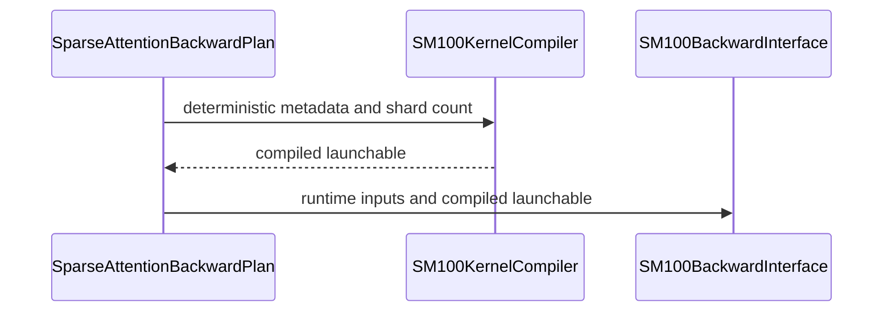

# perf(dsa): scale deterministic dKV shards with queries

[Upstream PR](https://github.com/NVIDIA/cudnn-frontend/pull/1679) · state: closed · merged: True

## Original PR description

## Before submitting

- [x] I agree to license this contribution under the terms of [LICENSE.txt](https://github.com/NVIDIA/cudnn-frontend/blob/develop/LICENSE.txt).
- [x] I ran `pre-commit run` and committed any formatting changes.
- [x] I reviewed the Hard Rules in the `AGENTS.md` for each directory this PR touches and the changes comply.
- [x] I added GitHub labels: one `cat-*`, one or more `area:*` / `op:*`, and one `orig-*`.

## Affected area

- FE OSS kernels or CuTeDSL
- Python API
- Benchmarks or performance

## Summary

- Select 32, 64, or 128 deterministic FP32 dKV shards from the declared query extent for the generic M64 path.
- Keep the upstream deterministic BF16 H128 D512/D576 two-CTA paths on their fixed 128-plane public workspace.
- Skip the pre-fold kernel for the 32-shard specialization and reduce its shards directly in fixed order.
- Compile the selected deterministic SM100 backward artifact during plan compilation so the first `execute()` is CUDA Graph capture-safe.
- Key compiled artifacts by CUDA device, backend, and shard specialization while preserving shape-dynamic reuse.
- Document the workspace contract and add boundary, repeatability, cache, backend-integration, and cold-capture coverage.

## Why

The fixed 128-shard generic deterministic implementation reserves 4 GiB of dKV scratch for the representative 1M-context CSA configuration even when the local query extent is small. It also pays unnecessary workspace traffic and reduction work. Selecting a bounded shard specialization from `total_s_q` reduces memory and execution time while retaining a fixed FP32 accumulation order.

Prepared deterministic plans previously stored only a boolean sentinel and could invoke CuTe JIT during their first `execute()`, which is not legal inside CUDA Graph capture. This change builds a storage-free, device-owned launchable in `compile()` and passes it into execution; direct low-level callers retain the existing lazy-cache behavior.

## Related issues

None.

## API and compatibility impact

No public signature is removed or reordered. Default and non-deterministic dispatch are unchanged. Deterministic SM100 plans continue to require caller-owned outputs and workspace; larger reusable workspaces remain valid. Calls to the low-level workspace helper that do not identify a backend remain conservative at 128 planes.

For the generic M64 deterministic path, the shard count is a compile-time specialization selected automatically from `total_s_q`:

- `total_s_q <= 128`: 32 shards
- `129 <= total_s_q <= 256`: 64 shards
- `total_s_q >= 257`: 128 shards

The supported BF16 H128 D512/D576 two-CTA deterministic paths retain their upstream fixed 128-plane workspace. Plan compilation now selects and stores the same backend that execution will launch, including H128 D512 two-CTA.

Each generic shard remains single-writer. Main, optional pre-fold, converter, and dSink kernels launch on the same CUDA stream and reduce in a fixed FP32 order. No semaphore, cooperative launch, execute-time allocation, or host synchronization is introduced.

### Performance

Measured on B200 with BF16, `SKV=16384`, `H=64`, `D=512`, and `topk=2048`. Latencies are CUDA-event averages over 100 replays of a captured `SparseAttentionBackward.execute()` after 10 warm-up iterations. The baseline is the parent implementation with 128 fixed dKV shards.

| `SQ` | This PR shards | Baseline | This PR | Speedup | Baseline workspace | This PR workspace |
| ---: | ---: | ---: | ---: | ---: | ---: | ---: |
| 64 | 32 | 1.951 ms | 0.725 ms | 2.69x | 4.00 GiB | 1.00 GiB |
| 128 | 32 | 2.013 ms | 1.011 ms | 1.99x | 4.00 GiB | 1.00 GiB |
| 192 | 64 | 2.168 ms | 1.355 ms | 1.60x | 4.00 GiB | 2.00 GiB |
| 256 | 64 | 2.220 ms | 1.493 ms | 1.49x | 4.00 GiB | 2.00 GiB |
| 384 | 128 | 2.446 ms | 2.435 ms | 1.00x | 4.00 GiB | 4.00 GiB |
| 512 | 128 | 2.671 ms | 2.655 ms | 1.01x | 4.00 GiB | 4.00 GiB |

The sweep covers two representative points in each generic-M64 shard-selection range. The 128-shard range is intentionally performance-neutral; its role is to preserve the existing bounded-memory behavior for larger query extents.

## Testing

The kernel optimization and performance sweep were validated on B200. The branch was then rebased onto `develop` at `6e5956abf`, which added deterministic H128 two-CTA DSA backward; the resolution preserves those routes and adds an H128 D512 plan-compile/cold-capture regression.

- 23 focused post-rebase tests passed: 8 host-side policy/workspace/device-cache cases, 6 cold-capture/shape-reuse/adaptive-shard cases, and 9 deterministic boundary plus H128 D512/D576 graph-reuse cases.
- The focused CUDA Graph cases cover generic BF16, generic FP16, H128 D512 two-CTA, and upstream H128 D512/D576 reuse.
- The 32- and 64-plane paths passed repeat-100 bitwise checks; poisoned workspace/output tests verify kernel-owned initialization.
- Compute Sanitizer memcheck on the kernel patch: 0 errors.
- Changed-file pre-commit hooks, Python syntax compilation, and `git diff --check`: passed.

Compatibility audit: passed. Generic versus H128 two-CTA dispatch, deterministic versus default behavior, 32/64/128-plane boundaries, exact/short/larger workspace contracts, BF16/FP16, optional lengths, device scoping, and shape-dynamic cache reuse were checked.

Docstring audit: passed. Public plan/execute, workspace, backend selection, stream, capture, direct-call fallback, and compiled-artifact lifetime contracts match the implementation.

Fence audit: passed. The changed producer/consumer edges are same-stream global-memory handoffs between completed kernel launches; no intra-kernel SMEM/TMEM pipeline, barrier, async-proxy, or buffer-reuse edge changed.

<!-- This is an auto-generated comment: release notes by coderabbit.ai -->

## Summary by CodeRabbit

* **New Features**
  * Deterministic SM100 backward attention now adapts its shard count to query size, with consistent results across supported query ranges.
  * Deterministic execution can reuse compiled plans across compatible input shapes and is designed to support capture after the plan is warmed.
* **Bug Fixes**
  * Workspace sizing now reflects the selected backend and deterministic shard count.
  * Runtime inputs that do not match the compiled plan’s expected shape, type, or device are rejected.

<!-- end of auto-generated comment: release notes by coderabbit.ai -->

## Review and discussion

### reviews

- YangXu1990uiuc · APPROVED · 2026-10-16T02:31:36Z · [source](https://github.com/NVIDIA/cudnn-frontend/pull/1679#pullrequestreview-5542329403)

**Codex bot review · model: `gpt-6-astra`**

Reviewed `0bf6e13087b1` against base `90803d73a0b1`.

Thank you for your contribution! The adaptive shard policy and plan-time compilation make sense, and I found no approval-blocking issue in this review. The shard class consistently controls workspace sizing, wave width and reduction order; serial head-block/wave launches preserve single-writer ownership. The prepared artifact is device-scoped and keyed by the finite specialization while query/KV extents remain dynamic across compatible plans. Independent native checks below confirm the capture path and shard transitions, including on the declared DSL 4.6.2 floor. CI pipeline 74268839 is running and remains pending evidence.

Validation: Exact-head Python imports/source verified on native SM100 (68 SMs), Torch 2.14.1. Reused a built extension only after proving all binding/header/CMake sources identical. Shared checkouts and environments were not modified. The submitted deterministic L0/L1 selection passed all 18 cases on CuTe DSL 4.8.0 and independently all 18 on the real isolated 4.6.2 wheel. Includes BF16/FP16 first-execute CUDA Graph capture with JIT forbidden, repeat-100 identity, poisoned outputs/scratch, numerical references, no-allocation checks, shape-dynamic artifact reuse and host device-cache checks. Additional independent cases: H96/D576 at Q=256 and 257, plus H64/D512 at Q=65, all with KV=2051. Each passed with topk=64 and again with topk=2048, including poisoned storage, three repeats and numerical references. The expanded top-k cases exercise multiple query waves, serialized H96 head blocks and the 64-to-128-shard transition. Non-deterministic D576 two-CTA numerical selection: 14 passed, zero skipped, confirming the shared interface still serves that separate route. Performance spot check, deterministic DSA backward only: BF16 Q=128, KV=4096, H=64, D=512, topk=2048 on the same SM100 device. Interleaved base/head/head/base replay medians were 2.688/2.691 ms versus 2.012/2.013 ms. Workspace including LSE scratch fell from 1,073,807,360 to 268,500,992 bytes. Every timing process passed the gradient oracle and replay identity checks. An additional nine-round timing repeat gave GPU replay 2.691 to 2.013 ms and host enqueue medians 70.9 to 72.5 us. CPU samples overlap and were noisy in the earlier run; no CPU speedup or reproducible major host regression is claimed. Read the full diff, workspace and stream handoffs, runtime validation, direct-call fallback, and cache ownership. Kernel precheck/barrier ledger reported no candidate rows. Started the smallest supported CI selector covering this suite, python/*/cutedsl, after checking the actual integration configuration; local L1 tests supplement its default L0 coverage.

Limitations: This is bounded native SM100 validation, not SM103/SM107 or B200 qualification. Device-cache separation was checked through the submitted host test and source; no native multi-GPU run is claimed. The performance numbers cover this backward operation and workload, not the author's larger B200 shape, the full CSA graph, or serving end to end. CI is still running.

Approved: no P0 or high-risk P1 found. Remaining findings stay with the owner; merge timing stays with the owner.

<!-- codex-fe-review:v2:1679:0bf6e13087b1ac81d12764d9704ecdf3365305d6:complete:no-blocker -->

- yihuawei · COMMENTED · 2026-10-16T05:09:09Z · [source](https://github.com/NVIDIA/cudnn-frontend/pull/1679#pullrequestreview-5543311823)

**Codex bot review · model: `gpt-6-astra`**

Reviewed `a160393cfd71` against base `6b2080aedf73`.

Thank you for your contribution! I reviewed the rebased head, focusing on integration with the newly upstreamed deterministic H128 two-CTA paths. I found no new approval-blocking issue. Generic M64 plans retain adaptive 32/64/128-plane scratch, while H128 D512/D576 two-CTA plans keep their fixed 128-plane contract. Backend selection, plan-time compilation and execution agree. The earlier approval is preserved; this follow-up adds current-head validation without repeating it.

Validation: Built a matching Release Python extension and verified exact-head package/module imports. Native platform: SM100 with 68 SMs, Torch 2.11.0+cu128, stock CuTe DSL 4.7.0 and cuDNN 9.27.0.42; no API aliases or source changes. The focused submitted L0/L1 selection passed 24 cases with zero failures or skips (306 other cases deselected): eight host policy/workspace/device-cache checks and sixteen native cases. Native coverage includes BF16/FP16 first-execute CUDA Graph capture with further JIT forbidden, H128 D512 first-execute capture, shape-dynamic artifact reuse with no execute-time allocation or synchronization, 32/64-shard repeat-100 identity, boundary sizes and short-workspace rejection. H128 D512/D576 tests poison scratch and outputs, repeat eager execution ten times, and compare two graph replays bitwise plus numerical references on an explicit stream. Read the six-file diff and compared the rebased commit series with the previously reviewed head. The generic main and deterministic kernel files are byte-identical to that head, so the earlier review's generic performance and DSL 4.6.2 evidence remains relevant within its stated scope. I did not repeat or relabel those measurements as new results. Precheck and the barrier ledger reported no candidate rows; diff whitespace checks passed.

Limitations: This follow-up validates native SM100 only; it is not SM103/SM107 or B200 qualification. Device separation is covered by the host cache test, not a native multi-GPU run. The prior CI pipeline 74268839 belongs to the earlier head. Current-head CI and fork Style/Docs workflows still require follow-up; no old pipeline is counted as a current-head pass.

Comment only: this PR already has an active approval; preserving existing approvals.

<!-- codex-fe-review:v2:1679:a160393cfd71f15542924abbe7fac8eb0253ba28:complete:no-blocker -->

### issue_comments

- coderabbitai[bot] · comment · 2026-10-16T01:57:28Z · [source](https://github.com/NVIDIA/cudnn-frontend/pull/1679#issuecomment-6206291477)

<!-- This is an auto-generated comment: summarize by coderabbit.ai -->
<!-- review_stack_entry_start -->

<a href="https://app.coderabbit.ai/change-stack/NVIDIA/cudnn-frontend/pull/1679?scope=ghh_OusAJGA4HG8ljoOV0wJvVx8NmnZIjc2DdjmxOu0xZWA&amp;cs_source=review_comment"><picture><source media="(prefers-color-scheme: dark)" srcset="https://storage.googleapis.com/coderabbit_public_assets/review-stack-in-coderabbit-ui-dark.svg?v=3"><source media="(prefers-color-scheme: light)" srcset="https://storage.googleapis.com/coderabbit_public_assets/review-stack-in-coderabbit-ui.svg?v=3"></picture></a>

<!-- review_stack_entry_end -->
<!-- recent_review_start -->

No actionable comments were generated in the recent review. 🎉

<strong>ℹ️ Recent review info</strong>

<dl>
<dd>

<strong>⚙️ Run configuration</strong>

<dl>
<dd>

- **Configuration used**: Repository: NVIDIA/cudnn-frontend/.coderabbit.yaml
- **Review profile**: CHILL
- **Plan**: Enterprise
- **Run ID**: `1f6903e7-4c7e-44cc-869a-22f0f30b69b6`

</dd>
</dl>

<strong>📥 Commits</strong>

<dl>
<dd>

Reviewing files that changed from the base of the PR and between 0bf6e13087b1ac81d12764d9704ecdf3365305d6 and a160393cfd71f15542924abbe7fac8eb0253ba28.

</dd>
</dl>

<strong>📒 Files selected for processing: 5</strong>

<dl>
<dd>

* `docs/fe-oss-apis/dsa.md`
* `python/cudnn/deepseek_sparse_attention/sparse_attention_backward/_interface_sm100.py`
* `python/cudnn/deepseek_sparse_attention/sparse_attention_backward/_interface_sm100_d576.py`
* `python/cudnn/deepseek_sparse_attention/sparse_attention_backward/api.py`
* `test/python/deepseek_sparse_attention/cutedsl/test_DSA_sparse_attention_backward.py`

</dd>
</dl>

**Included review availability:** This review used your included allowance. Your plan provides up to 12 included reviews per hour; 11 remain after this review.

</dd>
</dl>

<!-- recent_review_end -->
<!-- walkthrough_start -->

<strong>📝 Walkthrough</strong>

<dl>
<dd>

The deterministic SM100 backward path selects dKV shard counts by query length. Plans compile and reuse compatible kernels, size workspace by backend, and validate runtime inputs against compiled metadata. Tests cover shard selection, device-scoped caching, repeated execution, and CUDA graph capture.

**Changes: Deterministic SM100 backward execution**

|Layer / File(s)|Summary|
|:---|:---|
|**Adaptive shard selection and reduction**   `python/cudnn/deepseek_sparse_attention/sparse_attention_backward/dsa_bwd_sm100_deterministic.py`, `python/cudnn/deepseek_sparse_attention/sparse_attention_backward/_interface_sm100.py`, `docs/fe-oss-apis/dsa.md`, `test/python/deepseek_sparse_attention/cutedsl/test_DSA_sparse_attention_backward.py`|The kernel selects 32, 64, or 128 dKV shards based on query length. The 32-shard path reduces directly; the 64- and 128-shard paths fold groups of eight first. Workspace sizing and documentation reflect the selected shard count.|
|**Workspace sizing and compiled kernel handoff**   `python/cudnn/deepseek_sparse_attention/sparse_attention_backward/_interface_sm100.py`, `python/cudnn/deepseek_sparse_attention/sparse_attention_backward/_interface_sm100_d576.py`, `test/python/deepseek_sparse_attention/cutedsl/test_DSA_sparse_attention_backward.py`|The SM100 interface sizes workspace by backend and compiles deterministic launchables for supported device architectures and dtypes. The cache key includes device and shard metadata. Execution uses a supplied launchable or retrieves a cached one.|
|**Plan validation and capture coverage**   `python/cudnn/deepseek_sparse_attention/sparse_attention_backward/api.py`, `test/python/deepseek_sparse_attention/cutedsl/test_DSA_sparse_attention_backward.py`|Plans compile deterministic SM100 kernels from stored metadata and validate runtime tensor presence, shape, dtype, and device against compiled descriptors. Tests cover repeated execution, graph capture, and artifact reuse.|

<!-- change_assessment_start -->
**Priority:** ➖ Normal

**Estimated code review effort:** 4 (Complex) | ~45 minutes

<!-- change_assessment_commit:"a160393cfd71f15542924abbe7fac8eb0253ba28" -->
**Change:** Feature
<!-- change_assessment_end -->

### Sequence Diagram(s)

**Possibly related PRs**
- [NVIDIA/cudnn-frontend#810](https://github.com/NVIDIA/cudnn-frontend/pull/810): Adds the deterministic SM100 DSA backward path and its original 128-shard workspace and reduction design.

**Suggested labels:** `cat-enhancements`

**Suggested reviewers:** `yangxu1990uiuc`, `jiayus-nvidia`

</dd>
</dl>

<!-- walkthrough_end -->

<strong>Merge Risk:</strong> <strong>⚪ Minimal</strong> · up to <code>a1603</code>

<dl>
<dd>

<!-- final_review_risk_start -->
<!-- final_review_risk_label
**Merge Risk:** **⚪ Minimal** · up to `a1603`
-->
<!-- final_review_risk_coverage:{"sourceCommitId":"a160393cfd71f15542924abbe7fac8eb0253ba28","coveredCommitId":"a160393cfd71f15542924abbe7fac8eb0253ba28","kind":"reviewed"} -->

No blocking issue was established in the reviewed shard sizing, workspace, or compiled-plan paths. The change is mergeable after normal checks.
<!-- final_review_risk_end -->

</dd>
</dl>

<!-- pre_merge_checks_walkthrough_start -->

<strong>Pre-merge checks: <picture></picture> 5</strong>

<dl>
<dd>

|         Check name         |                                             Status                                             | Explanation                                                                                                                                                                                               |
| :------------------------ | :--------------------------------------------------------------------------------------------: | :-------------------------------------------------------------------------------------------------------------------------------------------------------------------------------------------------------- |
|     Docstring Coverage     |  | Docstring coverage is 95.74% which is sufficient. The required threshold is 80.00%. Docstring coverage is scoped to functions touched by this diff. Analyzed 47 functions across 5 files. (1 skipped: 1 … |
|     Linked Issues check    |  | Check skipped because no linked issues were found for this pull request.                                                                                                                                  |
| Out of Scope Changes check |  | Check skipped because no linked issues were found for this pull request.                                                                                                                                  |
|         Title check        |  | The title clearly and concisely describes the main change: scaling deterministic dKV shard counts based on query size.                                                                                    |
|      Description check     |  | The description follows the repository template and provides complete details for affected areas, summary, rationale, compatibility impact, performance, and testing. It also records checklist completi… |

</dd>
</dl>

<!-- pre_merge_checks_walkthrough_end -->
<!-- finishing_touch_checkbox_start -->

<strong>✨ Finishing Touches</strong>

<dl>
<dd>

<strong>🧪 Generate unit tests (beta)</strong>

<dl>
<dd>

- [ ] <!-- {"checkboxId": "f47ac10b-58cc-4372-a567-0e02b2c3d479", "radioGroupId": "utg-output-choice-group-unknown_comment_id"} --> Create a new PR

</dd>
</dl>

</dd>
</dl>

<!-- finishing_touch_checkbox_end -->

<!-- autopilot:start -->
- [ ] <!-- {"checkboxId":"2708ad07-9f24-4260-9c11-7dc76a49f2e3"} --> <strong title="Keep fixing CodeRabbit findings and required CI, and resolving merge conflicts">Autofix</strong> · Keep fixing CodeRabbit findings and required CI, and resolving merge conflicts
<!-- autopilot:end -->
<!-- tips_start -->

Comment `@coderabbitai help` to get the list of available commands.

<!-- tips_end -->

- YangXu1990uiuc · comment · 2026-10-16T02:20:56Z · [source](https://github.com/NVIDIA/cudnn-frontend/pull/1679#issuecomment-6206590961)

I am requesting test CI for `0bf6e13087b1` with the following standalone command: `@cudnn-ci-bot run python/*/cutedsl`. For future updates, request the appropriate test target before review; a maintainer may need to trigger it.

Codex bot review — model `gpt-6-astra`.

<!-- codex-fe-ci:v1:1679:0bf6e13087b1ac81d12764d9704ecdf3365305d6:ci-cutedsl-0bf6e13087b1-notice -->

- YangXu1990uiuc · comment · 2026-10-16T02:21:03Z · [source](https://github.com/NVIDIA/cudnn-frontend/pull/1679#issuecomment-6206592150)

@cudnn-ci-bot run python/*/cutedsl

- cudnn-ci-bot · comment · 2026-10-16T02:21:07Z · [source](https://github.com/NVIDIA/cudnn-frontend/pull/1679#issuecomment-6206592901)

🏁 Pipeline finished

SHA: `0bf6e13`
Targets: `python/*/cutedsl`
Branch: [cudnn-gh/pr-1679-0bf6e13](https://nv/cudnn-gitlab-ci/-/tree/cudnn-gh/pr-1679-0bf6e13)
Pipeline: [74268839](https://nv/cudnn-gitlab-ci/-/pipelines/74268839)
Last updated: 2026-10-16 02:58 UTC

**23 passed, 1 failed, 2 skipped, 11 manual**

### <code>manual</code>

- <code>manual:python_samples</code> - Manual
- <code>manual:python</code> - Manual
- <code>manual:python/sdpa/frost</code> - Manual
- <code>manual:python/linear_attention/frost</code> - Manual
- <code>manual:python/gemm/frost</code> - Manual
- <code>manual:python/*/frost</code> - Manual
- <code>manual:python/gemm/cutedsl</code> - Manual
- <code>manual:python/*/cutedsl</code> - ✅ Passed
- <code>manual:python/*/jax</code> - Manual
- <code>manual:pycudnn</code> - Manual
- <code>manual:multi_gpu</code> - Manual
- <code>manual:backend</code> - Manual

### <code>analysis</code>

- <code>analysis:cudnn_clang_disable_exception</code> - ✅ Passed
- <code>analysis:cudnn_v9_no_half_conversion</code> - ✅ Passed
- <code>analysis:cudnn_clang</code> - ✅ Passed
- <code>analysis:check-relative-includes</code> - ✅ Passed
- <code>analysis:check-CUDNN_FRONTEND_SKIP_JSON_LIB</code> - ✅ Passed
- <code>analysis:guardwords_scan</code> - ✅ Passed
- <code>analysis:jax-import-guard</code> - ✅ Passed
- <code>analysis:pytest-gpu</code> - ✅ Passed
- <code>san:build</code> - ✅ Passed

### <code>build</code>

- <code>analysis:api_index</code> - ✅ Passed
- <code>build:dev:linux:amd64</code> - ✅ Passed
- <code>build:rel:linux:amd64</code> - ✅ Passed
- <code>build:dev:linux:arm64</code> - ✅ Passed
- <code>build:rel:linux:arm64</code> - ✅ Passed
- <code>build:rel:win:amd64</code> - ✅ Passed

### <code>oss_tests</code>

- <code>python/gemm/cutedsl:cutlass-rel:sm100</code> - Skipped
- <code>python/*/cutedsl:cutlass-rel:sm80</code> - ✅ Passed
- <code>python/*/cutedsl:cutlass-rel:sm90</code> - ✅ Passed
- <code>python/*/cutedsl:cutlass-rel:sm100</code> - ✅ Passed
- <code>python/*/jax:cutlass-rel:sm100</code> - Skipped
- <code>python/*/cutedsl:cutlass-4.8:sm107</code> - ❌ **Old Failure** (nightly failed)

### <code>sanitizer_tests</code>

- <code>san:cpp_test:sm80</code> - ✅ Passed
- <code>san:cpp_test:sm90</code> - ✅ Passed
- <code>san:cpp_test:sm100</code> - ✅ Passed

### <code>triage</code>

- <code>triage:ai</code> - ✅ Passed

- YangXu1990uiuc · comment · 2026-10-16T03:28:38Z · [source](https://github.com/NVIDIA/cudnn-frontend/pull/1679#issuecomment-6207421658)

CI follow-up for `0bf6e13087b1`: pipeline **74268839** finished. The SM100, SM90 and SM80 CuTeDSL lanes passed, as did the enabled build, analysis and sanitizer jobs. The remaining failed lane is SM107: its failures are in the gated-attention-block quantization, serving-extend and FP8-backward suites, outside this DSA shard-sizing change. Those failures still need separate triage; this is not a claim that the entire pipeline is green. The targeted native SM100 validation in my review remains passing.

Codex bot review — model `gpt-6-astra`.

<!-- codex-fe-ci:v1:1679:0bf6e13087b1ac81d12764d9704ecdf3365305d6:pipeline-74268839-finished -->

- YangXu1990uiuc · comment · 2026-10-16T04:02:29Z · [source](https://github.com/NVIDIA/cudnn-frontend/pull/1679#issuecomment-6207794721)

Thanks for the contribution! Reducing deterministic dKV workspace for short queries and making the first execution CUDA Graph capture-safe are useful improvements. I've added this PR to our merge follow-up list. When you feel it is ready to land, please comment "ready"; we can help resolve the current develop conflict, validate the integrated head, and merge it.

- yihuawei · comment · 2026-10-16T05:10:36Z · [source](https://github.com/NVIDIA/cudnn-frontend/pull/1679#issuecomment-6208569174)

The rebase follow-up for `a160393cfd71` is complete, including 24 passing targeted SM100 checks. I am requesting `python/*/cutedsl` for this head; the supported selector includes the DSA suite. The earlier pipeline 74268839 tested the previous head. The normal CI selection is supplemented by the native L1 cold-capture and deterministic reuse checks described in my review; a requested pipeline remains pending evidence.

Codex bot review — model `gpt-6-astra`.

<!-- codex-fe-ci:v1:1679:a160393cfd71f15542924abbe7fac8eb0253ba28:ci-cutedsl-a160393cfd71-notice -->

- yihuawei · comment · 2026-10-16T05:10:59Z · [source](https://github.com/NVIDIA/cudnn-frontend/pull/1679#issuecomment-6208573653)

@cudnn-ci-bot run python/*/cutedsl

- cudnn-ci-bot · comment · 2026-10-16T05:12:40Z · [source](https://github.com/NVIDIA/cudnn-frontend/pull/1679#issuecomment-6208593031)

🏁 Pipeline finished

SHA: `a160393`
Targets: `python/*/cutedsl`
Branch: [cudnn-gh/pr-1679-a160393](https://nv/cudnn-gitlab-ci/-/tree/cudnn-gh/pr-1679-a160393)
Pipeline: [74298095](https://nv/cudnn-gitlab-ci/-/pipelines/74298095)
Last updated: 2026-10-16 05:48 UTC

**22 passed, 2 failed, 2 skipped, 11 manual**

### <code>manual</code>

- <code>manual:python_samples</code> - Manual
- <code>manual:python</code> - Manual
- <code>manual:python/sdpa/frost</code> - Manual
- <code>manual:python/linear_attention/frost</code> - Manual
- <code>manual:python/gemm/frost</code> - Manual
- <code>manual:python/*/frost</code> - Manual
- <code>manual:python/gemm/cutedsl</code> - Manual
- <code>manual:python/*/cutedsl</code> - ✅ Passed
- <code>manual:python/*/jax</code> - Manual
- <code>manual:pycudnn</code> - Manual
- <code>manual:multi_gpu</code> - Manual
- <code>manual:backend</code> - Manual

### <code>analysis</code>

- <code>analysis:cudnn_clang_disable_exception</code> - ✅ Passed
- <code>analysis:cudnn_v9_no_half_conversion</code> - ✅ Passed
- <code>analysis:cudnn_clang</code> - ✅ Passed
- <code>analysis:check-relative-includes</code> - ✅ Passed
- <code>analysis:check-CUDNN_FRONTEND_SKIP_JSON_LIB</code> - ✅ Passed
- <code>analysis:guardwords_scan</code> - ✅ Passed
- <code>analysis:jax-import-guard</code> - ✅ Passed
- <code>analysis:pytest-gpu</code> - ✅ Passed
- <code>san:build</code> - ✅ Passed

### <code>build</code>

- <code>analysis:api_index</code> - ✅ Passed
- <code>build:dev:linux:amd64</code> - ✅ Passed
- <code>build:rel:linux:amd64</code> - ✅ Passed
- <code>build:dev:linux:arm64</code> - ✅ Passed
- <code>build:rel:linux:arm64</code> - ✅ Passed
- <code>build:rel:win:amd64</code> - ✅ Passed

### <code>oss_tests</code>

- <code>python/gemm/cutedsl:cutlass-rel:sm100</code> - Skipped
- <code>python/*/cutedsl:cutlass-rel:sm80</code> - ✅ Passed
- <code>python/*/cutedsl:cutlass-rel:sm90</code> - ✅ Passed
- <code>python/*/cutedsl:cutlass-rel:sm100</code> - ❌ **New Failure!** (nightly passed)
- <code>python/*/jax:cutlass-rel:sm100</code> - Skipped
- <code>python/*/cutedsl:cutlass-4.8:sm107</code> - ❌ **Old Failure** (nightly failed)

### <code>sanitizer_tests</code>

- <code>san:cpp_test:sm80</code> - ✅ Passed
- <code>san:cpp_test:sm90</code> - ✅ Passed
- <code>san:cpp_test:sm100</code> - ✅ Passed

### <code>triage</code>

- <code>triage:ai</code> - ✅ Passed

- yihuawei · comment · 2026-10-16T05:56:30Z · [source](https://github.com/NVIDIA/cudnn-frontend/pull/1679#issuecomment-6209114298)

CI follow-up for `a160393cfd71`: pipeline **74298095** finished with **22 passed, 2 failed, 2 skipped and 11 manual jobs**. The SM80 and SM90 CuTeDSL lanes passed, together with the enabled build, analysis and C++ sanitizer jobs. GitHub Style and Docs also passed.

The SM100 and SM107 CuTeDSL lanes failed. The bot labels SM100 as a new failure relative to nightly and SM107 as an old failure; those comparisons do not identify the failed tests or establish whether this PR caused them. I could verify the published lane outcomes, but could not access the underlying job traces in this session. Please inspect the failed tests and resolve or account for these failures before merging. I am not carrying the earlier head's unrelated-failure attribution over to this run without matching logs. The 24 targeted SM100 checks in my review remain passing, but do not establish that the full CI sweep passed.

Codex bot review — model `gpt-6-astra`.

<!-- codex-fe-ci:v1:1679:a160393cfd71f15542924abbe7fac8eb0253ba28:pipeline-74298095-finished -->

### inline_comments

## Changed files and fixed code

- `docs/fe-oss-apis/dsa.md` · modified · additions 14 / deletions 11
  - [head](https://github.com/icavan/cudnn-frontend/blob/a160393cfd71f15542924abbe7fac8eb0253ba28/docs/fe-oss-apis/dsa.md)
  - [base](https://github.com/NVIDIA/cudnn-frontend/blob/6e5956abf6c06c4526df8d5ef7431e80edb555a6/docs/fe-oss-apis/dsa.md)
- `python/cudnn/deepseek_sparse_attention/sparse_attention_backward/_interface_sm100.py` · modified · additions 169 / deletions 19
  - [head](https://github.com/icavan/cudnn-frontend/blob/a160393cfd71f15542924abbe7fac8eb0253ba28/python/cudnn/deepseek_sparse_attention/sparse_attention_backward/_interface_sm100.py)
  - [base](https://github.com/NVIDIA/cudnn-frontend/blob/6e5956abf6c06c4526df8d5ef7431e80edb555a6/python/cudnn/deepseek_sparse_attention/sparse_attention_backward/_interface_sm100.py)
- `python/cudnn/deepseek_sparse_attention/sparse_attention_backward/_interface_sm100_d576.py` · modified · additions 2 / deletions 2
  - [head](https://github.com/icavan/cudnn-frontend/blob/a160393cfd71f15542924abbe7fac8eb0253ba28/python/cudnn/deepseek_sparse_attention/sparse_attention_backward/_interface_sm100_d576.py)
  - [base](https://github.com/NVIDIA/cudnn-frontend/blob/6e5956abf6c06c4526df8d5ef7431e80edb555a6/python/cudnn/deepseek_sparse_attention/sparse_attention_backward/_interface_sm100_d576.py)
- `python/cudnn/deepseek_sparse_attention/sparse_attention_backward/api.py` · modified · additions 72 / deletions 22
  - [head](https://github.com/icavan/cudnn-frontend/blob/a160393cfd71f15542924abbe7fac8eb0253ba28/python/cudnn/deepseek_sparse_attention/sparse_attention_backward/api.py)
  - [base](https://github.com/NVIDIA/cudnn-frontend/blob/6e5956abf6c06c4526df8d5ef7431e80edb555a6/python/cudnn/deepseek_sparse_attention/sparse_attention_backward/api.py)
- `python/cudnn/deepseek_sparse_attention/sparse_attention_backward/dsa_bwd_sm100_deterministic.py` · modified · additions 83 / deletions 18
  - [head](https://github.com/icavan/cudnn-frontend/blob/a160393cfd71f15542924abbe7fac8eb0253ba28/python/cudnn/deepseek_sparse_attention/sparse_attention_backward/dsa_bwd_sm100_deterministic.py)
  - [base](https://github.com/NVIDIA/cudnn-frontend/blob/6e5956abf6c06c4526df8d5ef7431e80edb555a6/python/cudnn/deepseek_sparse_attention/sparse_attention_backward/dsa_bwd_sm100_deterministic.py)
- `test/python/deepseek_sparse_attention/cutedsl/test_DSA_sparse_attention_backward.py` · modified · additions 266 / deletions 11
  - [head](https://github.com/icavan/cudnn-frontend/blob/a160393cfd71f15542924abbe7fac8eb0253ba28/test/python/deepseek_sparse_attention/cutedsl/test_DSA_sparse_attention_backward.py)
  - [base](https://github.com/NVIDIA/cudnn-frontend/blob/6e5956abf6c06c4526df8d5ef7431e80edb555a6/test/python/deepseek_sparse_attention/cutedsl/test_DSA_sparse_attention_backward.py)

## Evidence and interpretation boundary

[Original JSON, discussions and patches](../../../../../../evidence/prs/NVIDIA--cudnn-frontend/1679-0ff918689259ed53d81a69a14d140a00c395263d4e2f03a1fbc9fbb2b06cd096.json) · SHA-256 `0ff918689259ed53d81a69a14d140a00c395263d4e2f03a1fbc9fbb2b06cd096`.

Diff complete: True. Missing/binary/truncated patches require pinned source inspection. This is a source page, not an independently verified optimization case. Open, merged and released are different states; recheck the deployed dependency.
