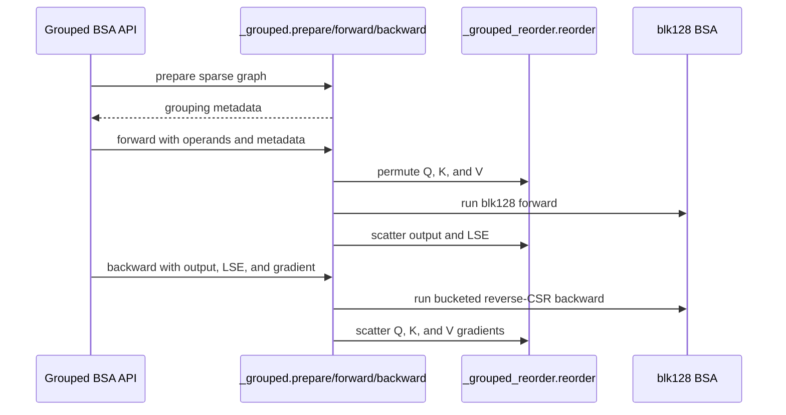

# Optimize blk64 BSA with independent Q/KV pairing and split TMA loads

[Upstream PR](https://github.com/NVIDIA/cudnn-frontend/pull/1681) · state: open · merged: False

## Original PR description

## Before submitting

- [x] I agree to license this contribution under the terms of [LICENSE.txt](https://github.com/NVIDIA/cudnn-frontend/blob/develop/LICENSE.txt).
- [x] I ran `pre-commit run` on the changed files and committed the formatting changes.
- [x] I reviewed the applicable `AGENTS.md` Hard Rules; the allocating Torch-wrapper scope is explained below.
- [x] Labels: `cat-feature`, `area:sparse_attention`, `orig-external`, `mod-cutedsl`.

## Affected area

FE OSS kernels / CuTeDSL, existing Python BSA forward/backward APIs.

## Summary

Exact repeated neighborhoods in a blk64 sparse graph can use 128-wide MMA without requiring both axes to pair. This adds explicit `block_sparse_attention_blk64_prepare(...)` and an optional `blk64_plan=` argument to the existing forward/backward entry points.

- **FWD:** pair Q64 rows with identical KV neighborhoods. Load two arbitrary KV64 blocks through TMA into the existing KV128 shared-memory tile; QK and PV remain 128×128×128. Gather Q and scatter O/LSE only when needed.
- **BWD:** independently pair KV64 columns with identical reverse-Q neighborhoods. Keep KV ownership and loop over Q. Load two arbitrary Q64/dO64 blocks through TMA; all five MMA tiles remain 128×128×128. Gather K/V and scatter dK/dV only when needed. Odd Q degrees use a zero-contribution sentinel.
- Missing plans, unpairable directions and unsupported runtime declarations retain native dispatch. Native blk64 FWD/BWD kernel files are unchanged relative to `develop`.

Includes API docs, numerical/capture/fallback tests and **one standalone benchmark**, `benchmark/bsa/benchmark_sm100_blk64_grouped.py`. No benchmark directories or result files are added to the repository. The charts below are PR attachments.

## Why

Split TMA loads preserve the efficient 128-wide compute pipeline while relaxing the requirement for exact pairing on both axes. FWD needs only Q pairing, and BWD needs only KV pairing. Explicit preparation lets callers reuse routing analysis without adding discovery or synchronization to ordinary blk64 execution.

## Related issues

Based on `develop` at `ea97aab7`, including the native blk64 backward zero-fill/tail fix in #1682.

## API and compatibility impact

`blk64_plan` is appended as an optional keyword. The preparation function is lazily exported through `cudnn`, `cudnn.BSA` and `cudnn.torch`. The default forward/backward bodies are unchanged apart from the opt-in branch.

The paired path supports SM100/SM103, CuTe DSL >= 4.7, contiguous aligned BSHD BF16 tensors, MHA, D128, and full 128-token sequence tiles. SM100 was tested; SM103 was not available. Pair equality uses valid-prefix index sets, allowing reordered lists and nonadjacent pairs. Duplicate/out-of-range valid indices are rejected; unused capacity is ignored. Unsupported layouts, tails, block sizes or launch declarations fall back to native dispatch.

Preparation is explicit, blocking CPU analysis/upload outside graph capture. Reuse the plan with the same immutable routing/count tensors and fresh Q/K/V/dO storage; rebuild when routing changes. Ordinary Torch mutations are detected through version counters. Raw CUDA, captured writes and inference-tensor mutations remain the caller's responsibility.

**Hard-rule scope:** these are allocating standalone Torch wrappers, not workspace-based `execute()` APIs or graph engines. Warmed execution does not read device metadata on the host, performs no blocking CPU/GPU synchronization, runs on the operand device's current stream and supports CUDA Graph replay. Scratch is per call, and replay resets accumulators and odd-row sentinels. Caller-provided gradient outputs are honored. No topK/length cutoff is imposed; short topK=2 cases can be slower because fixed overheads are not amortized.

## Performance

Measured at `9b624cf3` on one idle NVIDIA B20Z / SM100 GPU: B=1, Hq=Hkv=40, D=128, BF16, Nq=Nkv=N, fully paired synthetic routing, bucket width 1024 Q64 blocks. Each configuration uses **3 seeds × 15 randomized rounds × 3 calls per CUDA Graph**, after 8 warmup replays. Clocks are unlocked.

This measures the **complete captured GPU path**, including permutations, resets, pre/postprocessing and native CSR construction. The grouped path reuses prepared CSR. CPU plan build, allocations, compilation and host enqueue time are excluded. Throughput is useful sparse work (`4 × B × H × N × topK × 64 × D` for FWD; factor 10 for BWD), not dense-equivalent work. Bars show medians of seed medians, with seed min–max error bars. Bar labels show TFLOPS and latency; the labels above each pair show the median within-seed speedup and throughput improvement percentage.


All 12 seed/configuration cases passed checks before and after timing: **120 tensor comparisons** against native blk64. Maximum relative L2: O **0.298%**, gradients **0.112%**. Independent FP64 oracle checks are covered by the test suite.

Plan construction is a separate blocking cost, including metadata transfer and CPU analysis:


These plan costs must be amortized by reusing unchanged routing. A plan rebuilt per layer/iteration can cost more than the GPU time saved; the FWD/BWD charts report GPU execution speedup with reusable metadata.

Reproduce (optional results go outside the checkout):

```bash
python benchmark/bsa/benchmark_sm100_blk64_grouped.py \
  --lengths 32768 131072 --topks 64 256 --seeds 4593 4594 4595 \
  --rounds 15 --repeats 3 --output /tmp/blk64-grouped.jsonl
```

The same script supports `--sparsities .95 .90 .50 0`, independent `--patterns both q kv neither`, and separate forward/backward selection.


## Testing

Environment: NVIDIA B20Z / SM100, Torch 2.14.0+cu132, CUDA 13.2, cuDNN 9.24, CuTe DSL 4.7.1. Verified imports resolve to the tested checkout.

```bash
PYTHONPATH=python CUDNN_TEST_NO_ISOLATION=1 python -m pytest -q -o addopts='' \
  test/python/block_sparse_attention/cutedsl/test_BSA_blk64_plan.py \
  test/python/block_sparse_attention/cutedsl/test_BSA_attention_forward.py \
  test/python/block_sparse_attention/cutedsl/test_BSA_attention_backward.py
```

**76 passed, 93 skipped.** New coverage includes independent FP64-autograd O/LSE/dQ/dK/dV, independent Q/KV eligibility, variable valid counts, nonadjacent per-batch/head pairs, odd reverse degrees, unused NaN KV columns, asymmetric lengths, multiple buckets, changed scale/fresh pointer bindings, caller outputs, side streams, no warmed host reads, changed-input/poisoned-output capture replay, invalid/stale routing rejection and native fallbacks.

The standalone benchmark also passed a short N=512, H=2, topK=2 FWD+BWD smoke across all four pattern generators. `pre-commit run --files ...` passed Black, Black/Jupyter and SPDX checks; `git diff --check` passed. A fresh `import cudnn` does not import Torch, CuTeDSL or paired helpers. Source checks confirm native blk64 kernels are byte-identical to the current base and the blk128 BWD MMA/compute loops are unchanged.


## Review and discussion

### reviews

- yihuawei · APPROVED · 2026-10-16T07:16:29Z · [source](https://github.com/NVIDIA/cudnn-frontend/pull/1681#pullrequestreview-5544265070)

**Codex bot review · model: `gpt-6-astra`**

Reviewed `68eb31f5b8ac` against base `bd4ebdddeab3`.

Thank you for your contribution! The exact coarsening preserves the attention graph, and the explicit preparation/permutation contract is clear. I found no approval-blocking issue. Forward and backward preserve original ordering, including independent batch/head permutations, and reuse prepared sparse metadata without host reads during warmed execution. Keeping this opt-in is appropriate: preparation cost and the short-list permutation overhead matter, as the documentation explains.

Validation: Native SM100, 68 SMs, Python 3.10, Torch 2.11.0+cu128, CuTe DSL 4.7.0 and cuDNN 9.27. Exact-head Python imports verified; reused a built extension only after proving its C++/header/build inputs identical. No compatibility aliases. The grouped and existing BSA forward/backward L0 selection plus kernel-name tests gave 52 passed, 33 skipped and 76 deselected. Includes independent FP64 O/LSE/gradient references, variable counts, unused NaN KV, side streams and changed-input CUDA Graph replay. Nine additional checks passed: exhaustive coarsening of all 50,625 nonempty-row 4x4 binary graphs (61 accepted, each matching an independent pairing predicate and exact edge reconstruction), plus eight native cases covering coarse degrees 1/2/3/4 and one/multiple backward buckets. Same-shape A→B→A metadata changes and captured A replay interleaved with B remained correct for O, LSE and every gradient after changing Q/K/V/dO and poisoning outputs. Three bounded native64-versus-grouped performance cases passed numerical checks at B=1, H=4, N=8192, D=128 BF16, topK=8/32/128. Whole-call GPU graph replay includes grouped permutations and backward resets. At topK=8 grouped forward/backward took about 86.8/247.8 us versus 72.1/237.1 us; at topK=128, 328.1/942.8 us versus 421.4/1823.5 us. The topK=32 forward difference overlaps repeated-control variation. Grouped eager host enqueue was measured separately (about 84–270 us forward and 132–452 us backward, including allocation). These unlocked-clock spot checks support the documented workload dependence, not a universal speedup. Checked the public exports, admission and version gates, element/Int64 address arithmetic, stream ordering, CSR ownership and accumulator reset paths. Verified the 27 submitted benchmark records' sample medians/FLOP formulas and all nine source hashes, including the two precisely documented post-measurement edits. The consumed BSA/cache/stream contracts are unchanged between merge-base and reviewed base.

Limitations: No native SM103 or multi-GPU validation, and no reproduction of the author's 131K/H40 B20Z or CAKE measurements. The 33 skipped cases are not validated by this run. Current-head CI remains separate pending evidence. Labels and the current develop release milestone are assigned. Project membership still needs a maintainer with Projects access; the current review account cannot read or modify it.

Approved: no P0 or high-risk P1 found. Remaining findings stay with the owner; merge timing stays with the owner.

<!-- codex-fe-review:v2:1681:68eb31f5b8acfd4262548bb324be344b72a07f28:complete:no-blocker -->

### issue_comments

- coderabbitai[bot] · comment · 2026-10-16T06:45:33Z · [source](https://github.com/NVIDIA/cudnn-frontend/pull/1681#issuecomment-6209772925)

<!-- This is an auto-generated comment: summarize by coderabbit.ai -->
<!-- review_stack_entry_start -->

<a href="https://app.coderabbit.ai/change-stack/NVIDIA/cudnn-frontend/pull/1681?scope=ghh_OusAJGA4HG8ljoOV0wJvVx8NmnZIjc2DdjmxOu0xZWA&amp;cs_source=review_comment"><picture><source media="(prefers-color-scheme: dark)" srcset="https://storage.googleapis.com/coderabbit_public_assets/review-stack-in-coderabbit-ui-dark.svg?v=3"><source media="(prefers-color-scheme: light)" srcset="https://storage.googleapis.com/coderabbit_public_assets/review-stack-in-coderabbit-ui.svg?v=3"></picture></a>

<!-- review_stack_entry_end -->
<!-- recent_review_start -->

No actionable comments were generated in the recent review. 🎉

<details>
<summary><strong>ℹ️ Recent review info</strong></summary>
<dl>
<dd>

<details>
<summary><strong>⚙️ Run configuration</strong></summary>
<dl>
<dd>

- **Configuration used**: Repository: NVIDIA/cudnn-frontend/.coderabbit.yaml
- **Review profile**: CHILL
- **Plan**: Advanced
- **Run ID**: `b444f09f-730e-48fa-ac81-8f39d25bef2e`

</dd>
</dl>
</details>

<details>
<summary><strong>📥 Commits</strong></summary>
<dl>
<dd>

Reviewing files that changed from the base of the PR and between bd4ebdddeab3cb384e15d29871e652aa0a032fcb and 68eb31f5b8acfd4262548bb324be344b72a07f28.

</dd>
</dl>
</details>

<details>
<summary><strong>⛔ Files ignored due to path filters: 4</strong></summary>
<dl>
<dd>

* `benchmark/bsa_grouped/results/performance.pdf` is excluded by `!**/*.pdf`
* `benchmark/bsa_grouped/results/performance.png` is excluded by `!**/*.png`
* `benchmark/bsa_grouped/results/performance.svg` is excluded by `!**/*.svg`
* `benchmark/bsa_grouped/results/summary.csv` is excluded by `!**/*.csv`

</dd>
</dl>
</details>

<details>
<summary><strong>📒 Files selected for processing: 16</strong></summary>
<dl>
<dd>

* `benchmark/bsa_grouped/README.md`
* `benchmark/bsa_grouped/bench.py`
* `benchmark/bsa_grouped/plot.py`
* `benchmark/bsa_grouped/results/PROVENANCE.md`
* `benchmark/bsa_grouped/results/b20z_131k.json`
* `benchmark/bsa_grouped/results/table.md`
* `docs/fe-oss-apis/bsa.md`
* `docs/fe-oss-apis/bsa_grouped.md`
* `docs/fe-oss-apis/overview.md`
* `python/cudnn/__init__.py`
* `python/cudnn/block_sparse_attention/__init__.py`
* `python/cudnn/block_sparse_attention/_grouped.py`
* `python/cudnn/block_sparse_attention/_grouped_reorder.py`
* `python/cudnn/block_sparse_attention/api.py`
* `python/cudnn/torch/__init__.py`
* `test/python/block_sparse_attention/cutedsl/test_BSA_grouped.py`

</dd>
</dl>
</details>

**Included review availability:** This review used your included allowance. Your plan provides up to 4 included reviews per hour; 3 remain after this review.

</dd>
</dl>
</details>


<!-- recent_review_end -->
<!-- walkthrough_start -->

<details>
<summary><strong>📝 Walkthrough</strong></summary>
<dl>
<dd>

This change adds an opt-in API that prepares fully pairable blk64 sparse graphs for blk128 BSA forward and backward operations. It also adds API tests, documentation, and benchmark tooling for grouped, native blk64, and optional CAKE measurements.

**Changes: Grouped BSA API**

|Layer / File(s)|Summary|
|:---|:---|
|**Pairing and preparation** <br> `python/cudnn/block_sparse_attention/_grouped.py`, `python/cudnn/block_sparse_attention/api.py`, `test/python/block_sparse_attention/cutedsl/test_BSA_grouped.py`, `docs/fe-oss-apis/bsa_grouped.md`, `docs/fe-oss-apis/bsa.md`, `docs/fe-oss-apis/overview.md`|Preparation validates the sparse graph and groups matching Q and KV neighborhoods into blk128 routes and reverse-CSR metadata. The API documentation describes supported inputs, pairing rules, and preparation behavior.|
|**Grouped forward and backward execution** <br> `python/cudnn/block_sparse_attention/_grouped.py`, `python/cudnn/block_sparse_attention/_grouped_reorder.py`, `python/cudnn/block_sparse_attention/api.py`, `python/cudnn/block_sparse_attention/__init__.py`, `python/cudnn/__init__.py`, `python/cudnn/torch/__init__.py`, `test/python/block_sparse_attention/cutedsl/test_BSA_grouped.py`, `docs/fe-oss-apis/bsa_grouped.md`|Forward and backward permute tensors for blk128 operations and restore outputs and gradients to original order. The new functions are exported through the supported modules. Tests cover numerical results, validation, CUDA Graph replay, and stream behavior.|
|**Benchmark measurement and reporting** <br> `benchmark/bsa_grouped/*`, `docs/fe-oss-apis/bsa_grouped.md`|The benchmark measures grouped and native blk64 calls, with an optional CAKE forward comparison. The plotting tool writes CSV, plot, and Markdown outputs. Results, provenance, and benchmark methodology are documented.|

<!-- change_assessment_start -->
**Priority:** ➖ Normal


**Estimated code review effort:** 4 (Complex) | ~60 minutes

<!-- change_assessment_commit:"68eb31f5b8acfd4262548bb324be344b72a07f28" -->
**Change:** Feature
<!-- change_assessment_end -->

### Sequence Diagram(s)



</dd>
</dl>
</details>

<!-- walkthrough_end -->
<details>
<summary><strong>Merge Risk:</strong> <strong>⚪ Minimal</strong> · up to <code>68eb3</code></summary>
<dl>
<dd>

<!-- final_review_risk_start -->
<!-- final_review_risk_label
**Merge Risk:** **⚪ Minimal** · up to `68eb3`
-->
<!-- final_review_risk_coverage:{"sourceCommitId":"68eb31f5b8acfd4262548bb324be344b72a07f28","coveredCommitId":"68eb31f5b8acfd4262548bb324be344b72a07f28","kind":"reviewed"} -->

No identified issue blocks merging after normal checks.
<!-- final_review_risk_end -->

</dd>
</dl>
</details>
<!-- pre_merge_checks_walkthrough_start -->

<details>
<summary><strong>Pre-merge checks: <sup><picture></picture></sup> 3 · <sup><picture></picture></sup> 2</strong></summary>
<dl>
<dd>

<strong><sup><picture></picture></sup> Failed checks: 2 warnings</strong>

|     Check name     |                                              Status                                              | Explanation                                                                                                                                                                                               | Resolution                                                                                                                                                                                                           |
| :---------------- | :----------------------------------------------------------------------------------------------: | :-------------------------------------------------------------------------------------------------------------------------------------------------------------------------------------------------------- | :------------------------------------------------------------------------------------------------------------------------------------------------------------------------------------------------------------------- |
| Docstring Coverage |  | Docstring coverage is 12.24% which is insufficient. The required threshold is 80.00%. Docstring coverage is scoped to functions touched by this diff. Analyzed 49 functions across 9 files. (6 skipped: … | Write docstrings for the functions missing them to satisfy the coverage threshold.                                                                                                                                   |
|  Description check |  | The description has all required sections and detailed testing information, but it materially conflicts with the changeset. It describes `block_sparse_attention_blk64_prepare`, `blk64_plan`, and `benc… | Update the description to match the actual grouped BSA APIs, files, benchmark paths, supported behavior, and reported results. Remove references to `blk64_plan` and other changes not present in this pull request. |

<details>
<summary><strong><sup><picture></picture></sup> Passed checks: 3 passed</strong></summary>
<dl>
<dd>

|         Check name         |                                             Status                                             | Explanation                                                                                      |
| :------------------------ | :--------------------------------------------------------------------------------------------: | :----------------------------------------------------------------------------------------------- |
|     Linked Issues check    |  | Check skipped because no linked issues were found for this pull request.                         |
| Out of Scope Changes check |  | Check skipped because no linked issues were found for this pull request.                         |
|         Title check        |  | The title is concise and describes the main optimization: blk64 BSA pairing and split TMA loads. |

</dd>
</dl>
</details>

<details>
<summary><strong>Full details: Docstring Coverage</strong></summary>
<dl>
<dd>

**Explanation**

Docstring coverage is 12.24% which is insufficient. The required threshold is 80.00%. Docstring coverage is scoped to functions touched by this diff. Analyzed 49 functions across 9 files. (6 skipped: 6 unsupported.)

**Resolution**

Write docstrings for the functions missing them to satisfy the coverage threshold.

</dd>
</dl>
</details>

<details>
<summary><strong>Full details: Description check</strong></summary>
<dl>
<dd>

**Explanation**

The description has all required sections and detailed testing information, but it materially conflicts with the changeset. It describes `block_sparse_attention_blk64_prepare`, `blk64_plan`, and `benchmark/bsa/`, while the changes add grouped APIs and `benchmark/bsa_grouped/` files.

**Resolution**

Update the description to match the actual grouped BSA APIs, files, benchmark paths, supported behavior, and reported results. Remove references to `blk64_plan` and other changes not present in this pull request.

</dd>
</dl>
</details>

</dd>
</dl>
</details>

<!-- pre_merge_checks_walkthrough_end -->

- [ ] <!-- {"checkboxId":"585bb3f6-faf5-4dbf-96d2-74e382adf19a"} --> Fix all pre-merge checks with AI
<!-- finishing_touch_checkbox_start -->

<details>
<summary><strong>✨ Finishing Touches: 💡 1</strong></summary>
<dl>
<dd>

<!-- finishing_touch_suggestion:fix_ci -->
<details open>
<summary><strong>🛠️ Fix failing CI checks: 💡</strong></summary>
<dl>
<dd>

- [ ] <!-- {"checkboxId": "9f0d24fb-b419-4f01-baf0-8b26b6424f34", "radioGroupId": "fix-ci-output-choice-group-unknown_comment_id"} --> Commit to this branch
- [ ] <!-- {"checkboxId": "6d21cfe8-ec3f-40e2-9222-b8318b64d3b0", "radioGroupId": "fix-ci-output-choice-group-unknown_comment_id"} --> Create a new PR

</dd>
</dl>
</details>
<details open>
<summary><strong>🧪 Generate unit tests (beta)</strong></summary>
<dl>
<dd>

- [ ] <!-- {"checkboxId": "f47ac10b-58cc-4372-a567-0e02b2c3d479", "radioGroupId": "utg-output-choice-group-unknown_comment_id"} --> Create a new PR

</dd>
</dl>
</details>

</dd>
</dl>
</details>

<!-- finishing_touch_checkbox_end -->

<!-- autopilot:start -->
- [ ] <!-- {"checkboxId":"2708ad07-9f24-4260-9c11-7dc76a49f2e3"} --> <strong title="Keep fixing CodeRabbit findings and required CI, and resolving merge conflicts">Autofix</strong> · Keep fixing CodeRabbit findings and required CI, and resolving merge conflicts
<!-- autopilot:end -->
<!-- tips_start -->


<sub>Comment `@coderabbitai help` to get the list of available commands.</sub>

<!-- tips_end -->

- yihuawei · comment · 2026-10-16T07:17:31Z · [source](https://github.com/NVIDIA/cudnn-frontend/pull/1681#issuecomment-6210237209)

The review of `68eb31f5b8ac` is complete, with 64 passing bounded local checks. I am requesting `python/*/cutedsl`, the supported selector covering the BSA suite, and approving the pending Style/Docs test workflows for this head. The CI result remains pending evidence; local SM100 coverage does not establish SM103 validation. Labels and the develop release milestone are assigned; Project membership still requires a maintainer with Projects access.

Codex bot review — model `gpt-6-astra`.

<!-- codex-fe-ci:v1:1681:68eb31f5b8acfd4262548bb324be344b72a07f28:ci-cutedsl-68eb31f5b8ac-notice -->

- yihuawei · comment · 2026-10-16T07:17:48Z · [source](https://github.com/NVIDIA/cudnn-frontend/pull/1681#issuecomment-6210241802)

@cudnn-ci-bot run python/*/cutedsl

- cudnn-ci-bot · comment · 2026-10-16T07:17:52Z · [source](https://github.com/NVIDIA/cudnn-frontend/pull/1681#issuecomment-6210242822)

🏁 Pipeline finished

SHA: `68eb31f`
Targets: `python/*/cutedsl`
Branch: [cudnn-gh/pr-1681-68eb31f](https://nv/cudnn-gitlab-ci/-/tree/cudnn-gh/pr-1681-68eb31f)
Pipeline: [74320553](https://nv/cudnn-gitlab-ci/-/pipelines/74320553)
Last updated: 2026-10-16 07:50 UTC

**21 passed, 3 failed, 2 skipped, 11 manual**

### <code>manual</code>

- <code>manual:python_samples</code> - Manual
- <code>manual:python</code> - Manual
- <code>manual:python/sdpa/frost</code> - Manual
- <code>manual:python/linear_attention/frost</code> - Manual
- <code>manual:python/gemm/frost</code> - Manual
- <code>manual:python/*/frost</code> - Manual
- <code>manual:python/gemm/cutedsl</code> - Manual
- <code>manual:python/*/cutedsl</code> - ✅ Passed
- <code>manual:python/*/jax</code> - Manual
- <code>manual:pycudnn</code> - Manual
- <code>manual:multi_gpu</code> - Manual
- <code>manual:backend</code> - Manual

### <code>analysis</code>

- <code>analysis:cudnn_clang_disable_exception</code> - ✅ Passed
- <code>analysis:cudnn_v9_no_half_conversion</code> - ✅ Passed
- <code>analysis:cudnn_clang</code> - ✅ Passed
- <code>analysis:check-relative-includes</code> - ✅ Passed
- <code>analysis:check-CUDNN_FRONTEND_SKIP_JSON_LIB</code> - ✅ Passed
- <code>analysis:guardwords_scan</code> - ✅ Passed
- <code>analysis:jax-import-guard</code> - ✅ Passed
- <code>analysis:pytest-gpu</code> - ✅ Passed
- <code>san:build</code> - ✅ Passed

### <code>build</code>

- <code>analysis:api_index</code> - ❌ **New Failure!** (nightly passed)
- <code>build:dev:linux:amd64</code> - ✅ Passed
- <code>build:rel:linux:amd64</code> - ✅ Passed
- <code>build:dev:linux:arm64</code> - ✅ Passed
- <code>build:rel:linux:arm64</code> - ✅ Passed
- <code>build:rel:win:amd64</code> - ✅ Passed

### <code>oss_tests</code>

- <code>python/gemm/cutedsl:cutlass-rel:sm100</code> - Skipped
- <code>python/*/cutedsl:cutlass-rel:sm80</code> - ✅ Passed
- <code>python/*/cutedsl:cutlass-rel:sm90</code> - ✅ Passed
- <code>python/*/cutedsl:cutlass-rel:sm100</code> - ❌ **New Failure!** (nightly passed)
- <code>python/*/jax:cutlass-rel:sm100</code> - Skipped
- <code>python/*/cutedsl:cutlass-4.8:sm107</code> - ❌ **Old Failure** (nightly failed)

### <code>sanitizer_tests</code>

- <code>san:cpp_test:sm80</code> - ✅ Passed
- <code>san:cpp_test:sm90</code> - ✅ Passed
- <code>san:cpp_test:sm100</code> - ✅ Passed

### <code>triage</code>

- <code>triage:ai</code> - ✅ Passed

- wplf · comment · 2026-10-16T07:19:33Z · [source](https://github.com/NVIDIA/cudnn-frontend/pull/1681#issuecomment-6210268397)

@yihuawei  please don't merge it right now. I'm still working on it with @NVIDIA-JerryChen.

- YangXu1990uiuc · comment · 2026-10-16T08:02:56Z · [source](https://github.com/NVIDIA/cudnn-frontend/pull/1681#issuecomment-6210948730)

Thanks for the contribution and the update. I've added this PR to our follow-up list with your request to keep it on hold. Once you and the maintainer you're working with consider it ready, please comment "ready" and we can help finish validation and merge.


### inline_comments

## Changed files and fixed code

- `benchmark/bsa/benchmark_sm100_blk64_grouped.py` · added · additions 273 / deletions 0
  - [head](https://github.com/wplf/cudnn-frontend/blob/9b624cf3732a72bb7855b890a4b3cba90e840724/benchmark/bsa/benchmark_sm100_blk64_grouped.py)
  - [base](https://github.com/NVIDIA/cudnn-frontend/blob/ea97aab73c1dc38d464a50212d37a4808fa47311/benchmark/bsa/benchmark_sm100_blk64_grouped.py)
- `docs/fe-oss-apis/bsa.md` · modified · additions 84 / deletions 0
  - [head](https://github.com/wplf/cudnn-frontend/blob/9b624cf3732a72bb7855b890a4b3cba90e840724/docs/fe-oss-apis/bsa.md)
  - [base](https://github.com/NVIDIA/cudnn-frontend/blob/ea97aab73c1dc38d464a50212d37a4808fa47311/docs/fe-oss-apis/bsa.md)
- `docs/fe-oss-apis/overview.md` · modified · additions 1 / deletions 0
  - [head](https://github.com/wplf/cudnn-frontend/blob/9b624cf3732a72bb7855b890a4b3cba90e840724/docs/fe-oss-apis/overview.md)
  - [base](https://github.com/NVIDIA/cudnn-frontend/blob/ea97aab73c1dc38d464a50212d37a4808fa47311/docs/fe-oss-apis/overview.md)
- `python/cudnn/__init__.py` · modified · additions 1 / deletions 0
  - [head](https://github.com/wplf/cudnn-frontend/blob/9b624cf3732a72bb7855b890a4b3cba90e840724/python/cudnn/__init__.py)
  - [base](https://github.com/NVIDIA/cudnn-frontend/blob/ea97aab73c1dc38d464a50212d37a4808fa47311/python/cudnn/__init__.py)
- `python/cudnn/block_sparse_attention/__init__.py` · modified · additions 1 / deletions 0
  - [head](https://github.com/wplf/cudnn-frontend/blob/9b624cf3732a72bb7855b890a4b3cba90e840724/python/cudnn/block_sparse_attention/__init__.py)
  - [base](https://github.com/NVIDIA/cudnn-frontend/blob/ea97aab73c1dc38d464a50212d37a4808fa47311/python/cudnn/block_sparse_attention/__init__.py)
- `python/cudnn/block_sparse_attention/_blk64_paired.py` · added · additions 160 / deletions 0
  - [head](https://github.com/wplf/cudnn-frontend/blob/9b624cf3732a72bb7855b890a4b3cba90e840724/python/cudnn/block_sparse_attention/_blk64_paired.py)
  - [base](https://github.com/NVIDIA/cudnn-frontend/blob/ea97aab73c1dc38d464a50212d37a4808fa47311/python/cudnn/block_sparse_attention/_blk64_paired.py)
- `python/cudnn/block_sparse_attention/_blk64_plan.py` · added · additions 207 / deletions 0
  - [head](https://github.com/wplf/cudnn-frontend/blob/9b624cf3732a72bb7855b890a4b3cba90e840724/python/cudnn/block_sparse_attention/_blk64_plan.py)
  - [base](https://github.com/NVIDIA/cudnn-frontend/blob/ea97aab73c1dc38d464a50212d37a4808fa47311/python/cudnn/block_sparse_attention/_blk64_plan.py)
- `python/cudnn/block_sparse_attention/_blk64_reorder.py` · added · additions 71 / deletions 0
  - [head](https://github.com/wplf/cudnn-frontend/blob/9b624cf3732a72bb7855b890a4b3cba90e840724/python/cudnn/block_sparse_attention/_blk64_reorder.py)
  - [base](https://github.com/NVIDIA/cudnn-frontend/blob/ea97aab73c1dc38d464a50212d37a4808fa47311/python/cudnn/block_sparse_attention/_blk64_reorder.py)
- `python/cudnn/block_sparse_attention/api.py` · modified · additions 77 / deletions 0
  - [head](https://github.com/wplf/cudnn-frontend/blob/9b624cf3732a72bb7855b890a4b3cba90e840724/python/cudnn/block_sparse_attention/api.py)
  - [base](https://github.com/NVIDIA/cudnn-frontend/blob/ea97aab73c1dc38d464a50212d37a4808fa47311/python/cudnn/block_sparse_attention/api.py)
- `python/cudnn/block_sparse_attention/csrc/bwd/sm100_blk128/bsa_bwd_sm100.py` · modified · additions 181 / deletions 52
  - [head](https://github.com/wplf/cudnn-frontend/blob/9b624cf3732a72bb7855b890a4b3cba90e840724/python/cudnn/block_sparse_attention/csrc/bwd/sm100_blk128/bsa_bwd_sm100.py)
  - [base](https://github.com/NVIDIA/cudnn-frontend/blob/ea97aab73c1dc38d464a50212d37a4808fa47311/python/cudnn/block_sparse_attention/csrc/bwd/sm100_blk128/bsa_bwd_sm100.py)
- `python/cudnn/block_sparse_attention/csrc/fwd/sm100_blk128/bsa_fwd_sm100.py` · modified · additions 96 / deletions 39
  - [head](https://github.com/wplf/cudnn-frontend/blob/9b624cf3732a72bb7855b890a4b3cba90e840724/python/cudnn/block_sparse_attention/csrc/fwd/sm100_blk128/bsa_fwd_sm100.py)
  - [base](https://github.com/NVIDIA/cudnn-frontend/blob/ea97aab73c1dc38d464a50212d37a4808fa47311/python/cudnn/block_sparse_attention/csrc/fwd/sm100_blk128/bsa_fwd_sm100.py)
- `python/cudnn/torch/__init__.py` · modified · additions 6 / deletions 1
  - [head](https://github.com/wplf/cudnn-frontend/blob/9b624cf3732a72bb7855b890a4b3cba90e840724/python/cudnn/torch/__init__.py)
  - [base](https://github.com/NVIDIA/cudnn-frontend/blob/ea97aab73c1dc38d464a50212d37a4808fa47311/python/cudnn/torch/__init__.py)
- `test/python/block_sparse_attention/cutedsl/test_BSA_blk64_plan.py` · added · additions 321 / deletions 0
  - [head](https://github.com/wplf/cudnn-frontend/blob/9b624cf3732a72bb7855b890a4b3cba90e840724/test/python/block_sparse_attention/cutedsl/test_BSA_blk64_plan.py)
  - [base](https://github.com/NVIDIA/cudnn-frontend/blob/ea97aab73c1dc38d464a50212d37a4808fa47311/test/python/block_sparse_attention/cutedsl/test_BSA_blk64_plan.py)

## Evidence and interpretation boundary

[Original JSON, discussions and patches](../../../../../../evidence/prs/NVIDIA--cudnn-frontend/1681-e8bbb043eef6992c99bfb8c1c861a59e8322f087324f5ad67a3929a4d00a6dd9.json) · SHA-256 `e8bbb043eef6992c99bfb8c1c861a59e8322f087324f5ad67a3929a4d00a6dd9`.

Diff complete: True. Missing/binary/truncated patches require pinned source inspection. This is a source page, not an independently verified optimization case. Open, merged and released are different states; recheck the deployed dependency.
