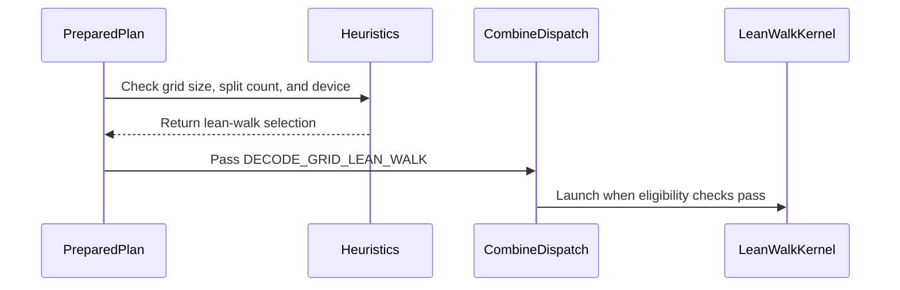

# frost(sdpa): restore the lean group walk as the Rubin split-combine form for lean-grid-overflow launches

[Upstream PR](https://github.com/NVIDIA/cudnn-frontend/pull/1693) · state: closed · merged: True

## Original PR description

## Before submitting

- [x] I agree to license this contribution under the terms of [LICENSE.txt](https://github.com/NVIDIA/cudnn-frontend/blob/develop/LICENSE.txt).
- [x] I ran `pre-commit run` and committed any formatting changes (black -l 160, black-jupyter, SPDX on the seven files).
- [x] I reviewed the Hard Rules in the `AGENTS.md` for each directory this PR touches (see [root AGENTS.md § Reviewing a PR](https://github.com/NVIDIA/cudnn-frontend/blob/develop/AGENTS.md#reviewing-a-pr-human-or-agent)) and my changes comply: the support-matrix tracker gets one dated sentence and no `Capabilities` field or `EngineSpec` changes (Rule S2 exempt scope); no public knob, no numerics-changing attribute, no DSL-version or backend-parity surface is touched.
- [x] I added GitHub labels: `cat-perf-bug`, `area:frost`, `area:global_attention`, `orig-nv-eng`, `mod-frost`.

## Affected area

FE OSS kernels or CuTeDSL (the FROST SDPA split combine on the Rubin line; performance).

## Status

Ready for review.  Six commits on develop `eaace52aa` (the #1680 squash); develop has since gained #1689 and #1675, which touch none of this PR's files (a trial merge is clean).  No C++ / binding change: the extension built from develop serves this tree, and every GPU record below attests the tree, the head `b8a92a631` and the binary in the test process.

## Summary

**What.**  The shared SM100 split combine (`python/cudnn/sdpa/fwd/kernels/sm100/split_combine.py`) gets its former lean kernel back as a fifth form, `_combine_lean_walk_kernel`, selected by the appended `compile_ptr(decode_grid=DECODE_GRID_LEAN_WALK)` value; on the cc 10.7 line the plan pins that form for a lean-grid-OVERFLOW split launch -- a lean combine grid past `heuristics.DECODE_COMBINE_MAX_LEAN_BLOCKS` (128 blocks: batch 32 and 128 at 24-32 query heads, decode S_q 1 and MTP S_q 4) -- at a split of at most 4 (`heuristics.DECODE_COMBINE_LEAN_WALK_MAX_SPLIT`, the measured regime: split 2-3 on those cells).  A deeper split past the grid bound keeps the module's own forms, exactly what it runs on develop.

**Why.**  On the merged tree (#1680 squashed onto #1627's combine module) those overflow launches took the module's own forms -- the wide lean group at S_q <= 2, the one-warp-per-row serial walk at S_q >= 3 -- where #1680's measured tree ran its retired lean group walk.  On the Rubin performance class (212 SMs) the module's forms cost 5.9 / 12.4 / 5.9 / 5.3 / 11.7 / 5.5 us per launch against the walk's 3.4 / 5.9 / 3.3 / 4.0 / 8.9 / 4.0 on the six batch-32 / batch-128 serving cells, the serving step +0.7 .. +6.2 % slower (geomean +3.4 %): the regression recorded in #1680's develop-merge comment, and the item owed there.  Restoring the walk for exactly those launches removes it (same-GPU A/B/A below: the six cells **+3.9 / +5.3 / +5.2 / +0.5 / +2.4 / +0.7 %**, geomean **+3.00 %**, the combine kernel back at 3.4 / 5.7 / 3.3 / 4.0 / 7.6 / 3.9 us per launch), while the decode-grid form (the batch-1 class, B 4 x kv 128K), the Blackwell line (cc 10.0 / 10.3) and every within-bound launch are unchanged: pick identity and the Blackwell kernel-name readback equal develop, and every pre-existing kernel of the module renders byte-identical PTX.

## What changed, by file

| area | file | change |
|---|---|---|
| the kernel | `python/cudnn/sdpa/fwd/kernels/sm100/split_combine.py` | `_combine_lean_walk_kernel`: the module's former lean kernel, verbatim -- one warp per (q_row, head, batch), four rows per 128-thread block, a lane owning 4 columns; four splits loaded up front (`LEAN_WALK_G_S = 4`), then sixteen per memory round trip (`LEAN_WALK_G_T = 16`); the row accumulated in split order from +0 after a full max pass.  It keeps the ragged placement, the gate, the amax / output-scale arms and the griddepcontrol pair of the kernel it was, folds no sink, and has no CTA barrier and no shared memory; the half-partial element path that kernel also carried is `_combine_kernel`'s and is not duplicated.  `DECODE_GRID_LEAN_WALK = 3` is appended after `OFF = 2`; `compile_ptr` accepts it and hands it to the dense / pdl / gated / ragged / sink entries as their trailing form constexpr (the positional ABI is unchanged); the quantized and packed entries keep naming no form.  In `_launch_combine` a trace-time branch (fp32 partials, no sink, no per-batch Q lengths) launches the walk on the lean grid `(ceil(S_q / 4), H, B) x 128 threads` where the lean geometry holds (`d_v % 4 == 0`, a 16-byte-aligned slab: the decode-grid kernel's own runtime test), else the module's three-way rule, which moved verbatim (59 lines) into `_launch_own_forms` so both branches call one definition.  A LEAN_WALK entry never launches the decode-grid kernel. |
| the rule | `python/cudnn/sdpa/fwd/heuristics.py` | `decode_combine_lean_walk_selected(b, h_q, s_q, split, device_cc=None)`: True on the cc 10.7 line only, for a lean grid of at least `DECODE_COMBINE_LEAN_WALK_MIN_LEAN_BLOCKS` blocks (= `DECODE_COMBINE_MAX_LEAN_BLOCKS + 1` = 129, so the two rules partition the grid axis and the decode-grid kernel is never eligible where the walk is) at a split of at most `DECODE_COMBINE_LEAN_WALK_MAX_SPLIT` (= 4 = the walk's up-front group; the tests pin it equal to `split_combine.LEAN_WALK_G_S`).  The constants' comments carry the measured numbers, the counter-evidence inside the bound and the widening recipe.  The split model is untouched: its lean-form price (`_DECODE_TILE_COMBINE_PER_PARTIAL`, 0.17 a partial) was measured on this walk, so no pick moves. |
| the plan-time pin | `python/cudnn/sdpa/fwd/prepared.py` | `_split_combine_decode_grid` returns `DECODE_GRID_LEAN_WALK` where the rule says so, ahead of the decode-grid / force-OFF logic; a deeper overflow split compiles the AUTO entry (= the module's own forms there, as before); a plan off cc 10.7 never names the walk. |
| tests | `test/python/sdpa/frost/test_sdpa_split_combine_lean_walk.py` (new, 131 cells, L0); `test_split_kv_heuristic.py` (+8 ids); `test_sdpa_prepared_geometry.py` (+7 ids) | Host: the appended constants; the rule per device line (None / 10.7 / 10.0 / 10.3 / 12.0 / 12.1 / 9.0 / 8.0) over the six measured cells, the smallest overflow grids, prefill grids and within-bound grids; the partition of the grid axis with the decode-grid rule; the plan-time pin per adapter line; `compile_ptr` accepting 3 and refusing 4 / -1; the frame check (the selector is the last positional of the dense / pdl / gated / ragged / sink entries and absent from the quantized / packed ones).  Device (any SM100-line part): the walk against a float64 reference and BITWISE the module's own forms inside their windows at 13 split counts on 6 shapes; stats bases and output dtypes; strided outputs; the kernel name from the profiler on an overflow grid, a small grid and at S_q 4, the fallback on an unaligned head dim, the AUTO entry unchanged; the gated, ragged and programmatic-dependent-launch twins; the quantized and sink entries unchanged under the walk value.  Graph (cc 10.7): the measured B 32 x 24/2 x S_q 1 x kv 4K cell and its S_q 4 twin at split 2, and the smallest overflow grid (B 6), launch `_combine_lean_walk_kernel`; B 32 at split 8 and B 4 at split 2 keep the module's own forms; B 1 at split 16 keeps the decode-grid kernel.  The two restatement modules pin the rule and the plan-time form per line.  RED before the change: the new and restated tests against develop's package fail 30 ids (17 the missing rule, 13 the missing selector) and pass or skip otherwise; the split-bound refinement adds 14 more reds against the unbounded rule (6 behavioural pins, 8 the missing bound constant). |
| the tracker | `python/cudnn/sdpa/frost/SUPPORT_MATRIX_TRACKER.md` | one dated sentence on the cc 10.7 row naming which launches changed kernel and the split bound; no `Capabilities` field or `EngineSpec` changes. |

Seven files, +1227 / -127.  No `docs/fe-oss-apis` change (no user-facing knob changes); `import cudnn` stays at 0.1 s with no torch / cutlass.

### Behaviour by launch class

| launch (cc 10.7 unless stated) | #1680 as measured (pre-merge) | develop `eaace52aa` | this PR |
|---|---|---|---|
| lean grid <= 128 blocks (the batch-1 class, B 4 x kv 128K, every small grid) | walk, or the decode-grid kernel per its rule | the decode-grid rule / the module's own forms | unchanged |
| lean grid > 128 blocks, split <= 4 (B 32 / B 128 at 24-32 heads; the six measured cells run split 2-3) | walk | the module's own forms (the regression) | **walk** |
| lean grid > 128 blocks, split >= 5 | walk | the module's own forms | the module's own forms (= develop; the regime is bounded by the sweep below, not measured on an overflow grid) |
| Blackwell line (cc 10.0 / 10.3), every launch | the module's own forms | the module's own forms | unchanged |
| a sink, a quantized or packed entry, half partials, an unaligned slab -- every line | the module's forms | the module's three-way rule | unchanged under every selector value |

## Numbers

**Caption.**  One GPU of the Rubin performance class (212 SMs, SM clock locked at 2376 MHz; busy clocks observed 2364-2376 MHz in every process; the power-cap counter unchanged before and after every process); the gated-attention-block DECODE / MTP serving step under CUDA-graph replay, 3 rounds x 100 iterations per cell, one process per arm in the order develop / PR / develop (baseline = develop `eaace52aa`, the merged default, the mean of its two processes), the same aarch64 extension in both trees (no binding change), vLLM main's decode chain (its TensorRT-LLM decode kernel via FlashInfer) measured in the same processes as the day control (its drift within +-0.8 %).  Speed-up = baseline / FROST - 1, POSITIVE = this PR faster.  SOL % = BYTES-HBM: the step's weight + KV bytes against this GPU's MEASURED copy bandwidth (13.0 TB/s), never the datasheet figure.  24/2 and 32/2 = query / KV heads; d 256, bf16, page 16.

| cell | class | baseline (develop, us) | FROST (this PR, us) | speed-up (+X %) | SOL % (HBM bytes) | combine kernel, device us per launch: develop -> PR |
|---|---|---|---|---|---|---|
| B 32 x kv 4K, S_q 1, 24/2, split 2 | overflow | 57.7 | **55.5** | **+3.9 %** | 50.0 % | wide lean group 5.9 -> lean walk 3.4 |
| B 128 x kv 4K, S_q 1, 24/2, split 2 | overflow | 129.2 | **122.8** | **+5.3 %** | 71.7 % | wide lean group 12.5 -> lean walk 5.7 |
| B 32 x kv 4K, S_q 1, 32/2, split 2 | overflow | 68.6 | **65.2** | **+5.2 %** | 55.5 % | wide lean group 5.8 -> lean walk 3.3 |
| B 32 x kv 32K, S_q 4 (MTP), 24/2, split 3 | overflow | 202.6 | **201.5** | **+0.5 %** | 85.0 % | serial walk 5.0 -> lean walk 4.0 |
| B 128 x kv 4K, S_q 4 (MTP), 24/2, split 2 | overflow | 174.2 | **170.0** | **+2.4 %** | 51.8 % | serial walk 12.0 -> lean walk 7.6 |
| B 32 x kv 32K, S_q 4 (MTP), 32/2, split 3 | overflow | 215.6 | **214.2** | **+0.7 %** | 83.9 % | serial walk 5.4 -> lean walk 3.9 |
| B 1 x kv 4K, S_q 1, 24/2, split 32 | decode-grid | 32.2 | 32.2 | +0.1 % | 25.8 % | decode-grid 2.8 -> 2.8 |
| B 1 x kv 32K, S_q 1, 24/2, split 64 | decode-grid | 36.0 | 35.9 | +0.3 % (reported, not quoted) | 35.7 % | decode-grid 2.9 -> 2.9 |
| B 1 x kv 128K, S_q 1, 24/2, split 64 | decode-grid | 53.3 | 53.2 | +0.2 % (reported, not quoted) | 53.2 % | decode-grid 3.1 -> 3.1 |
| B 4 x kv 128K, S_q 1, 24/2, split 16 | decode-grid | 119.7 | 119.8 | -0.1 % | 75.2 % | decode-grid 3.5 -> 3.5 |
| B 1 x kv 4K, S_q 1, 32/2, split 32 | decode-grid | 42.1 | 42.0 | +0.4 % | 40.0 % | decode-grid 2.7 -> 2.7 |
| B 1 x kv 32K, S_q 1, 32/2, split 64 | decode-grid | 45.9 | 45.8 | +0.2 % | 46.5 % | decode-grid 2.8 -> 2.8 |
| B 1 x kv 32K, S_q 4 (MTP), 24/2, split 64 | decode-grid | 42.4 | 42.5 | -0.4 % | 30.1 % | decode-grid 3.1 -> 3.0 |
| B 1 x kv 32K, S_q 4 (MTP), 32/2, split 64 | decode-grid | 51.6 | 51.5 | +0.2 % | 41.3 % | decode-grid 3.6 -> 3.3 |

- Geomean speed-up: the six lean-grid-overflow cells **+3.00 %**; the eight decode-grid cells **+0.12 %** (every cell within 0.4 % of develop, the same `combine_decode_grid_kernel` at the same cost within 0.3 us, the route / split / fusion / PDL readbacks EQUAL across the three processes on 14 / 14 cells); all fourteen +1.34 %.
- The step delta equals the combine delta on every overflow cell (combine -2.4 / -6.9 / -2.6 / -1.0 / -4.3 / -1.7 us against step -2.2 / -6.5 / -3.4 / -1.1 / -4.2 / -1.4 us; the decode tile within noise).
- Control pair (develop measured first and last, 14 cells): median 0.10 %, max 1.08 % (the B 32 x 32/2 cell, whose effect is +5.2 %), 13 / 14 within 1 %.  Twelve of the fourteen cells are quotable by the runner's own rule (control pair <= 1 %, clock CLEAN, cap delta 0, oracle OK, two launches bitwise); the two B 1 cells marked above carry an in-process control pair past 1 % (1.4-1.7 % on the kv 32K cell in every process, 1.4 % in one process on the kv 128K cell; the kernel is unchanged there and their steps agree across the three processes to 0.3 %).
- Against #1680's own measurement of the pre-merge tree (a different GPU of the same class): that walk read 3.4 / 5.9 / 3.3 / 4.0 / 8.9 / 4.0 us per launch on these six cells; this PR's walk reads 3.4 / 5.7 / 3.3 / 4.0 / 7.6 / 3.9, at or below on every cell, while develop's forms cost the same on both GPUs (within 0.3 us).  The two GPUs' STEP numbers are not compared: on identical kernels this GPU reads +3.3 % (the FROST step) / +1.9 % (vLLM main's chain) above the other, so the eight unchanged cells sit +4.1 .. +6.5 % above the earlier step numbers as well.  The restore is complete by the node-insensitive measure (the kernel's device time per launch), and the regression is removed by the same-GPU A/B/A.
- Against vLLM main's decode chain in the same processes (speed-up = chain / FROST - 1): the six overflow cells **+6.6 / +11.7 / +4.8 / +0.3 / -4.0 / +0.9 %** (develop: +2.4 / +6.2 / +0.4 / -0.2 / -6.4 / +0.1 %); the batch-1 class +18.0 .. +44.0 % and B 4 x kv 128K -2.1 %, unchanged from develop.

**The standalone combine sweep** (the same GPU and lock; the forms forced at the pointer entry, device us per launch from the profiler, 3 rounds x 100 launches, control pair max 2.7 % = the profiler's resolution on a 2.2-us kernel; 24 query heads, d 256, bf16 O + fp32 LSE, live fp32 partials; 84 cells, 0 errors): at splits 2 / 3 / 4 the walk is faster than develop's three-way rule at EVERY row count from 24 to 3072 rows at S_q 1 -- +13 .. +18 % up to 768 rows (2.24-2.40 against 2.58-2.78 us), +58 % at 1536 rows (2.75 against 4.35), +81 .. +83 % at 3072 rows (4.03-4.13 against 7.36-7.46) -- and +7 .. +29 % over the S_q 4 series (96 .. 12288 rows).  There is no crossover in rows at those splits: the 128-block bound is the decode-grid kernel's territory, not a walk-vs-own-forms crossover (that kernel is the faster form only at deep splits: 2.4 us at split 32 against the walk's 5.5).  At split 8 the walk loses on every grid (-22 .. -26 % up to 768 rows, -2 / -8 % at 1536 / 3072 rows; -22 .. -47 % over the S_q 4 series), which holds `DECODE_COMBINE_LEAN_WALK_MAX_SPLIT = 4` as an upper bound; splits 5-7 were not measured.  At splits 16 / 32 the picture is mixed (the own forms win up to 768 rows, the walk from 1536 rows at split 16, a crossover near 990 rows) -- (rows, split) pairs the split model does not produce.  Inside the grid bound at split <= 4 the walk would also be the fastest form (2.24-2.27 us against the decode-grid kernel's 2.40-3.07 and the own forms' 2.58-2.62 at 24-120 rows), 0.1-0.8 us per launch on launches the serving plan rarely produces (B <= 5 at split <= 4 = short caches; the batch-1 / batch-4 serving cells run at splits 16-64, where the decode-grid kernel wins by 1.3-3 us): reported, not acted on.

## Numerics

- **Bitwise where the arithmetic is the same.**  The walk is bitwise the one-warp-per-row serial walk (`_combine_kernel`, S_q >= 3) at EVERY split count and bitwise the wide lean group (`_combine_kernel(lean_wide=True)`, S_q <= 2) within 16 splits: the same sequential chain in split order from +0 after an exact max pass, the clamped slots adding +0.0 or selected out.  Pinned on both device classes (the new module 131 / 131 on cc 10.7; 125 passed / 6 Rubin-only graph skips on cc 10.0) and read again by the sweep (bitwise the OFF form on all 75 in-window cells).  Past 16 splits at S_q <= 2 develop's decode form associates differently: the float64 reference at the suite's existing tolerances (`atol = rtol = 0.004` on O, `2e-5` on the LSE).  No tolerance changed anywhere in the diff.
- **What the walk never serves.**  A sink launch, a quantized or packed entry, half partials and an unaligned slab keep the module's three-way rule under every selector value; the walk kernel's amax / output-scale arms are kept verbatim from the kernel it was and are reachable by a direct `_launch_combine` call only (the quantized entries name no form, as on develop).
- **Knob-free.**  The form is a plan-time specialization on the declared (B, H_q, S_q, split) and the plan's device, never a runtime value; a plan computes the same function under every form; no public knob, `Capabilities` field or `EngineSpec` changes.
- **Pick identity (mechanical).**  Over 643 968 cc 10.7 split-model scenarios and 724 cc 10.7 graph-level ranked lists this head equals #1680's measured tree (0 differ); over 249 792 Blackwell scenarios and 300 SM100 graph-level ranked lists it equals develop (0 differ).
- **Kernel identity.**  Every pre-existing pointer entry of the module (31 specializations: dense / gated / ragged / sink / sink + Q lengths / ragged-sink, 5 quantized, 3 packed, 3 half-partial, under OFF / AUTO / ON / pdl) trace-compiled before (`eaace52aa`) and after (this head): every `.entry` kernel block byte-identical PTX modulo source-location directives (116 kernel blocks), module headers identical; the 8 LEAN_WALK entries exist on the after side only: the five that can reach the walk trace the walk, develop's decode form, the wide lean group and the serial walk (never the decode-grid kernel); the half-partial, quantized and sink flavours under the walk value trace develop's own four kernels, as develop's branch does.  (The render is the host trace-compile for sm_100a; on the devices the kernel-name readback and the unchanged per-launch costs corroborate it.)
- **Blackwell kernel-name readback** on a GB200 (cc 10.0, 152 SMs): the plan-time pin and the kernel name of the pinned / OFF / AUTO entries EQUAL between develop and this head on 18 pointer cells (B 1 / 32 / 128 x S_q 1 / 4 x splits 2 / 16 / 32) and 24 plan cases through the SM100 d256 decode graph; `combine_lean_walk_kernel` appears in no log of either tree.
- **Barriers.**  The walk kernel has no CTA barrier, no named barrier and no shared memory (the only cross-lane traffic is the amax butterfly and one atomicMax per warp, inside the amax arm); the griddepcontrol pair sits before the first global read of any path under the same compile-time switch as the other forms, and `use_pdl` reaches the launch as on every other form.

## Related issues

Related to #1680 (the item owed in its develop-merge comment) and #1627 (the combine module's own forms, which keep every launch this PR does not name).

## API and compatibility impact

None on the public API: no new knob, no `Capabilities` field, no `EngineSpec` change, no C++ / binding change.  Performance only, on cc 10.7 lean-grid-overflow split launches at a split of at most 4; every other launch, every other device line (cc 10.0 / 10.3 / 12.x) and every other entry computes the same kernel as develop.  The selector value is appended (`DECODE_GRID_LEAN_WALK = 3`) and the combine entry's positional ABI is unchanged.

## Testing

| node class | what | result |
|---|---|---|
| an A100 host (cc 8.0; every Rubin / Blackwell device cell skips) | `cd test/python && pytest -m "L0 or L1"` over the touched and consuming modules (the SDPA decode / split-combine / heuristics / prepared-geometry modules, the block serving modules, the tier list: 21 modules); the api index in its own session; `python -c "import cudnn"`; whole-tree `pytest --collect-only`; the six decode-tile spill pins; the RED half | **880 passed, 0 failed, 1591 device-gated skips**; api index 9 passed + 15 subtests, 1 environmental skip; `import cudnn` 0.105 s with no torch / cutlass; 60521 / 71425 collected with the one pre-existing environmental error (a jax module in a venv without jax, identical on develop); spill pins unchanged (registers 94-96, stack 0, local loads / stores 0); RED: the new and restated tests against develop's package **30 failed** (17 x the missing rule, 13 x the missing selector), 269 passed, 105 skipped, and the split-bound refinement **14 failed** against the unbounded rule's package; `pre-commit run --files <the seven files>` passed |
| a Rubin development node (cc 10.7, 204 SMs, shared, functional) | `test_sdpa_split_combine_lean_walk.py`; `test_sdpa_split_combine_decode_grid.py`; `test_sdpa_fwd_decode_d256_sm107.py`; `test_split_kv_heuristic.py` + `test_sdpa_fwd_heuristics.py`; `test_sdpa_prepared_geometry.py`; `test_sdpa_split_combine_sm100.py` + `_many_splits.py`; the SM100-line modules; `test_sdpa_fwd_dsl_sm107.py -k decode`; the block serving modules (decode, mtp route, pdl, capture, extend), all at `L0 or L1` | **1284 distinct cells passed, 0 failed, 533 device-gated skips** over 44 attested sessions: the new module **131 / 131** (the six graph cells prove the selection by kernel name at the measured B 32 geometry), decode grid 168 / 168 (the bitwise pins against the module's forms at <= 16 splits and the budget cells past 16 HOLD), decode d256 122 / 122, heuristics 365 + 2 device-gated skips, prepared geometry 49 / 49, split combine sm100 + many splits 17 passed / 202 pre-Rubin-gated skips, the SM100-line modules 38 passed / 329 pre-Rubin-gated skips, dsl decode 1 / 1, block decode 126, mtp route 39, pdl 17, capture 23, extend 188.  No kernel timeout; three sessions on the shared node hit their session budget under a node-wide stall with every cell before the stop passing and were re-cut into smaller sessions, all green |
| a GB200 (cc 10.0, 152 SMs, functional, compiled-plan cache on) | 16 module runs: the new module, decode grid, split combine sm100 / many splits / artifact cache, decode d128 / d256 (plus the d256 module's PDL-switched twin), fp8 dual-KV, split-KV, paged, the exp2 split gate, the mask form, prepared geometry + the split-KV heuristic, the block host cells; the kernel-name readback above | **1566 cells: 1408 passed, 6 failed, 152 device-gated skips, 0 errors** -- the new module 125 passed / 6 Rubin-gated skips (its Blackwell pins read "never selected"), decode grid 106 / 62 Rubin-gated skips, split combine sm100 202 / 202, many splits 17 / 17, artifact cache 5 / 5, decode d128 128 / 128, decode d256 50 / 50, fp8 dual-KV 30 / 30, split-KV 121 / 121, paged 209 / 209, exp2 gate 20 / 20, mask form 18 / 18, prepared geometry + split-KV heuristic 274 / 274, block host 59 / 84 SM107-gated skips; the 134 sink + split ids pass.  The 6 reds are the PDL-switched twin's same six pre-existing ids as in #1680's merge record (a test switch sets `use_pdl` after `check_support` on sink + split cells; typed declines; all six pass with the switch off): pre-existing, the same six ids and mechanism as at #1680's head |

Every GPU process printed the tree's `cudnn.__file__`, the head (`b8a92a631`, clean) and the extension's md5 before its first cell; the x86 and aarch64 extensions are the develop (`eaace52aa`) builds, which serve this tree because its C++ / binding sources are byte-identical to develop's.

## Follow-ups

- Refit `_DECODE_TILE_COMBINE_PER_PARTIAL` (0.17 a partial, measured on this walk) per form on cc 10.7: the module's own forms inside the grid bound and past the split bound keep the walk's price, conservative for them there.
- Widen the walk's split bound only with a measurement at a mid-overflow grid (B 8-16 x 24 heads at kv 32K-128K, where the split model picks 8-16 splits): a walk win there moves one constant, its comment and three test expectations; splits 5-7 are the unmeasured part of the walk's split axis.
- The in-bound split <= 4 regime (the walk 0.1-0.8 us faster than the decode-grid kernel at 24-120 rows): a rule only if a serving plan produces those launches.
- The remaining items from #1680's develop-merge comment: the split model's wave term deciding the B 4 x kv 128K S_q 3 / 4 pick and the prefill route's fill rule above 256 CTAs; `use_pdl` through the three sink entries with one device run; a barrier audit of the programmatic-dependent-launch sites on the module's own two combine forms before `use_pdl` defaults on; the perf runners keying the combine form by kernel name (`combine_decode_grid_kernel`, now also `combine_lean_walk_kernel`).
- A decision for review: the walk kernel keeps its amax / output-scale arms (reachable by a direct `_launch_combine` call only) and the quantized entries keep the three-way rule, as develop's `compile_ptr` names no form for them; dropping the arms, or routing the quantized entries to the walk, is one line and unmeasured on cc 10.7.

🤖 Generated with [Claude Code](https://claude.com/claude-code)

<!-- This is an auto-generated comment: release notes by coderabbit.ai -->

## Summary by CodeRabbit

* **Performance**
  * Improved launch efficiency for qualifying FP16 and BF16 attention workloads on cc 10.7 when using up to four splits.
  * Workloads on other architectures, deeper splits, and quantized or packed formats retain their existing behavior.
* **Bug Fixes**
  * Preserved numerical results and output behavior across supported launch configurations.

<!-- end of auto-generated comment: release notes by coderabbit.ai -->

## Review and discussion

### reviews

- yihuawei · APPROVED · 2026-10-16T22:18:10Z · [source](https://github.com/NVIDIA/cudnn-frontend/pull/1693#pullrequestreview-5554293069)

**Codex bot review · model: `gpt-6-astra`**

Reviewed `b8a92a6319b2` against base `70a1791c8653`.

No actionable findings in this bounded restore. The cc 10.7, lean-grid-overflow, split-at-most-four selection preserves the other devices and the sink/quantized/packed routes. Keep the measured bound; widening it should remain a separate target-hardware experiment.

Validation: Reviewed all seven changed files and the prepared-to-pointer call chain. An AST comparison confirms the restored FP32 walk matches the pre-merge implementation after renaming its group constants, all four retained kernels are unchanged, and the extracted fallback branch is unchanged. Checked dead-row substitution, ragged capacity guards, wide output addressing, Stats bases and the PDL wait before global reads (checklist C04/C05/C06/C15, D14). The new walk has no CTA barrier or shared-memory handoff. Exact-head tests on native SM100 with DSL 4.8.0 and Torch 2.13: 399 passed, 6 Rubin-only graph cases skipped across the new combine suite, split heuristics and prepared geometry. This includes split counts 2 through 130, FP16/BF16 outputs, poisoned dead partials, strided/ragged outputs, gates, PDL, unchanged sink/quantized routes and profiler-confirmed kernel selection. Four additional native CUDA Graph tests passed with changed inputs: plain, PDL, gated PDL and the half-partial fallback, checked against the retained OFF form; FP32-partial cases also checked against the independent reference. Source and extension provenance were verified, with byte-identical C++/binding inputs for the reused extension.

Limitations: No native Rubin execution or independent Rubin performance measurement in this session; the PR's target-hardware functional and A/B/A timing results remain author evidence. SM100 direct-entry execution does not qualify the Rubin serving route. The initial DSL 4.7/Torch 2.11 run passed 120 tests before two profiler assertions failed because CUPTI_ERROR_INVALID_DEVICE left the activity set empty. The unchanged tests, including those profiler checks, passed in the subsequent DSL 4.8/Torch 2.13 run. This is not a claim of a completely passing 4.7 suite.

Approved: no P0 or high-risk P1 found. Remaining findings stay with the owner; merge timing stays with the owner.

<!-- codex-fe-review:v2:1693:b8a92a6319b2fabbc11ea8969b1591e3972ed3ac:complete:no-blocker -->

### issue_comments

- coderabbitai[bot] · comment · 2026-10-16T21:57:37Z · [source](https://github.com/NVIDIA/cudnn-frontend/pull/1693#issuecomment-6225470875)

<!-- This is an auto-generated comment: summarize by coderabbit.ai -->
<!-- review_stack_entry_start -->

<a href="https://app.coderabbit.ai/change-stack/NVIDIA/cudnn-frontend/pull/1693?scope=ghh_OusAJGA4HG8ljoOV0wJvVx8NmnZIjc2DdjmxOu0xZWA&amp;cs_source=review_comment"><picture><source media="(prefers-color-scheme: dark)" srcset="https://storage.googleapis.com/coderabbit_public_assets/review-stack-in-coderabbit-ui-dark.svg?v=3"><source media="(prefers-color-scheme: light)" srcset="https://storage.googleapis.com/coderabbit_public_assets/review-stack-in-coderabbit-ui.svg?v=3"></picture></a>

<!-- review_stack_entry_end -->
<!-- recent_review_start -->

No actionable comments were generated in the recent review. 🎉

<strong>ℹ️ Recent review info</strong>

<dl>
<dd>

<strong>⚙️ Run configuration</strong>

<dl>
<dd>

- **Configuration used**: Repository: NVIDIA/cudnn-frontend/.coderabbit.yaml
- **Review profile**: CHILL
- **Plan**: Enterprise
- **Run ID**: `24a2e8c4-e472-4a94-8d4b-1388a86e6521`

</dd>
</dl>

<strong>📥 Commits</strong>

<dl>
<dd>

Reviewing files that changed from the base of the PR and between 70a1791c86536bd4f23d90dc2a2441afecf829a4 and b8a92a6319b2fabbc11ea8969b1591e3972ed3ac.

</dd>
</dl>

<strong>📒 Files selected for processing: 7</strong>

<dl>
<dd>

* `python/cudnn/sdpa/frost/SUPPORT_MATRIX_TRACKER.md`
* `python/cudnn/sdpa/fwd/heuristics.py`
* `python/cudnn/sdpa/fwd/kernels/sm100/split_combine.py`
* `python/cudnn/sdpa/fwd/prepared.py`
* `test/python/sdpa/frost/test_sdpa_prepared_geometry.py`
* `test/python/sdpa/frost/test_sdpa_split_combine_lean_walk.py`
* `test/python/sdpa/frost/test_split_kv_heuristic.py`

</dd>
</dl>

**Included review availability:** This review used your included allowance. Your plan provides up to 12 included reviews per hour; 11 remain after this review.

</dd>
</dl>

<!-- recent_review_end -->
<!-- walkthrough_start -->

<strong>📝 Walkthrough</strong>

<dl>
<dd>

The change adds a lean group-walk split-combine kernel and selects it for qualifying cc 10.7 launches with split counts up to 4. Other selectors and ineligible launches retain existing combine forms.

**Changes: Lean-Walk Combine**

|Layer / File(s)|Summary|
|:---|:---|
|**Lean-walk kernel and dispatch**   `python/cudnn/sdpa/fwd/kernels/sm100/split_combine.py`, `test/python/sdpa/frost/test_sdpa_split_combine_lean_walk.py`|The module adds a lean group-walk kernel and dispatches eligible launches to it. Tests cover numerical results, supported entry types, and fallback behavior.|
|**cc 10.7 selection and prepared-plan wiring**   `python/cudnn/sdpa/fwd/heuristics.py`, `python/cudnn/sdpa/fwd/prepared.py`, `test/python/sdpa/frost/test_sdpa_prepared_geometry.py`, `test/python/sdpa/frost/test_split_kv_heuristic.py`, `python/cudnn/sdpa/frost/SUPPORT_MATRIX_TRACKER.md`|The heuristic selects the form beyond the lean-grid bound for splits up to 4 on cc 10.7. Prepared plans pass that selection to combine dispatch. Tests and the tracker document the selection cases.|

<!-- change_assessment_start -->
**Priority:** ➖ Normal

**Estimated code review effort:** 4 (Complex) | ~45 minutes

<!-- change_assessment_commit:"b8a92a6319b2fabbc11ea8969b1591e3972ed3ac" -->
**Change:** Bug fix
<!-- change_assessment_end -->

### Sequence Diagram(s)

**Suggested reviewers:** `yanzhuo607`, `yangxu1990uiuc`

</dd>
</dl>

<!-- walkthrough_end -->

<strong>Merge Risk:</strong> <strong>⚪ Minimal</strong> · up to <code>b8a92</code>

<dl>
<dd>

<!-- final_review_risk_start -->
<!-- final_review_risk_label
**Merge Risk:** **⚪ Minimal** · up to `b8a92`
-->
<!-- final_review_risk_coverage:{"sourceCommitId":"b8a92a6319b2fabbc11ea8969b1591e3972ed3ac","coveredCommitId":"b8a92a6319b2fabbc11ea8969b1591e3972ed3ac","kind":"reviewed"} -->

The change adds a new combine kernel. It is selected only for cc 10.7 launches whose lean grid exceeds 128 blocks and whose split count is at most 4. Ineligible launches fall back to the existing kernels, and dedicated tests cover numerical results and selection. No outstanding merge-blocking issue was identified.
<!-- final_review_risk_end -->

</dd>
</dl>

<!-- pre_merge_checks_walkthrough_start -->

<strong>Pre-merge checks: <picture></picture> 5</strong>

<dl>
<dd>

|         Check name         |                                             Status                                             | Explanation                                                                                                                                                                                               |
| :------------------------ | :--------------------------------------------------------------------------------------------: | :-------------------------------------------------------------------------------------------------------------------------------------------------------------------------------------------------------- |
|         Title check        |  | The title clearly and concisely identifies the main change: restoring the lean group walk for Rubin split-combine overflow launches.                                                                      |
|      Description check     |  | The description includes all required template sections and provides detailed scope, rationale, compatibility impact, related issues, testing results, and known pre-existing failures.                   |
|     Docstring Coverage     |  | Docstring coverage is 82.86% which is sufficient. The required threshold is 80.00%. Docstring coverage is scoped to functions touched by this diff. Analyzed 35 functions across 6 files. (1 skipped: 1 … |
|     Linked Issues check    |  | Check skipped because no linked issues were found for this pull request.                                                                                                                                  |
| Out of Scope Changes check |  | Check skipped because no linked issues were found for this pull request.                                                                                                                                  |

<strong>Full details: Docstring Coverage</strong>

<dl>
<dd>

**Explanation**

Docstring coverage is 82.86% which is sufficient. The required threshold is 80.00%. Docstring coverage is scoped to functions touched by this diff. Analyzed 35 functions across 6 files. (1 skipped: 1 unsupported.)

</dd>
</dl>

</dd>
</dl>

<!-- pre_merge_checks_walkthrough_end -->
<!-- finishing_touch_checkbox_start -->

<strong>✨ Finishing Touches: 💡 1</strong>

<dl>
<dd>

<!-- finishing_touch_suggestion:fix_ci -->

<strong>🛠️ Fix failing CI checks: 💡</strong>

<dl>
<dd>

- [ ] <!-- {"checkboxId": "9f0d24fb-b419-4f01-baf0-8b26b6424f34", "radioGroupId": "fix-ci-output-choice-group-unknown_comment_id"} --> Commit to this branch
- [ ] <!-- {"checkboxId": "6d21cfe8-ec3f-40e2-9222-b8318b64d3b0", "radioGroupId": "fix-ci-output-choice-group-unknown_comment_id"} --> Create a new PR

</dd>
</dl>

<strong>🧪 Generate unit tests (beta)</strong>

<dl>
<dd>

- [ ] <!-- {"checkboxId": "f47ac10b-58cc-4372-a567-0e02b2c3d479", "radioGroupId": "utg-output-choice-group-unknown_comment_id"} --> Create a new PR

</dd>
</dl>

</dd>
</dl>

<!-- finishing_touch_checkbox_end -->

<!-- autopilot:start -->
- [ ] <!-- {"checkboxId":"2708ad07-9f24-4260-9c11-7dc76a49f2e3"} --> <strong title="Keep fixing CodeRabbit findings and required CI, and resolving merge conflicts">Autofix</strong> · Keep fixing CodeRabbit findings and required CI, and resolving merge conflicts
<!-- autopilot:end -->
<!-- tips_start -->

Comment `@coderabbitai help` to get the list of available commands.

<!-- tips_end -->

- yihuawei · comment · 2026-10-16T22:19:30Z · [source](https://github.com/NVIDIA/cudnn-frontend/pull/1693#issuecomment-6225784257)

I am requesting test CI for `b8a92a6319b2` with the following standalone command: `@cudnn-ci-bot run python/sdpa/frost`. For future updates, request the appropriate test target before review; a maintainer may need to trigger it.

Codex bot review — model `gpt-6-astra`.

<!-- codex-fe-ci:v1:1693:b8a92a6319b2fabbc11ea8969b1591e3972ed3ac:ci-sdpa-frost-b8a92a6319b2-notice -->

- yihuawei · comment · 2026-10-16T22:20:26Z · [source](https://github.com/NVIDIA/cudnn-frontend/pull/1693#issuecomment-6225796132)

@cudnn-ci-bot run python/sdpa/frost

- cudnn-ci-bot · comment · 2026-10-16T22:20:29Z · [source](https://github.com/NVIDIA/cudnn-frontend/pull/1693#issuecomment-6225796813)

🏁 Pipeline finished

SHA: `b8a92a6`
Targets: `python/sdpa/frost`
Branch: [cudnn-gh/pr-1693-b8a92a6](https://nv/cudnn-gitlab-ci/-/tree/cudnn-gh/pr-1693-b8a92a6)
Pipeline: [74495698](https://nv/cudnn-gitlab-ci/-/pipelines/74495698)
Last updated: 2026-10-16 23:17 UTC

**21 passed, 4 failed, 3 skipped, 11 manual**

### <code>manual</code>

- <code>manual:python_samples</code> - Manual
- <code>manual:python</code> - Manual
- <code>manual:python/sdpa/frost</code> - ✅ Passed
- <code>manual:python/linear_attention/frost</code> - Manual
- <code>manual:python/gemm/frost</code> - Manual
- <code>manual:python/*/frost</code> - Manual
- <code>manual:python/gemm/cutedsl</code> - Manual
- <code>manual:python/*/cutedsl</code> - Manual
- <code>manual:python/*/jax</code> - Manual
- <code>manual:pycudnn</code> - Manual
- <code>manual:multi_gpu</code> - Manual
- <code>manual:backend</code> - Manual

### <code>analysis</code>

- <code>analysis:cudnn_clang_disable_exception</code> - ✅ Passed
- <code>analysis:cudnn_v9_no_half_conversion</code> - ✅ Passed
- <code>analysis:cudnn_clang</code> - ✅ Passed
- <code>analysis:check-relative-includes</code> - ✅ Passed
- <code>analysis:check-CUDNN_FRONTEND_SKIP_JSON_LIB</code> - ✅ Passed
- <code>analysis:guardwords_scan</code> - ✅ Passed
- <code>analysis:jax-import-guard</code> - ✅ Passed
- <code>analysis:pytest-gpu</code> - ✅ Passed
- <code>san:build</code> - ✅ Passed

### <code>build</code>

- <code>analysis:api_index</code> - ✅ Passed
- <code>build:dev:linux:amd64</code> - ✅ Passed
- <code>build:rel:linux:amd64</code> - ✅ Passed
- <code>build:dev:linux:arm64</code> - ✅ Passed
- <code>build:rel:linux:arm64</code> - ✅ Passed
- <code>build:rel:win:amd64</code> - ✅ Passed

### <code>frost_tests</code>

- <code>python/sdpa/frost:cutlass-rel:sm80</code> - ❌ **New Failure!** (nightly passed)
- <code>python/sdpa/frost:cutlass-rel:sm100</code> - ❌ **Old Failure** (nightly failed)
- <code>python/sdpa/frost:cutlass-rel:sm120</code> - ❌ **New Failure!** (nightly passed)
- <code>python/linear_attention/frost:cutlass-rel:sm100</code> - Skipped
- <code>python/gemm/frost:cutlass-rel:sm100</code> - Skipped
- <code>python/*/frost:cutlass-rel:sm100</code> - Skipped
- <code>python/sdpa/frost:cutlass-rel:sm103</code> - ❌ **Old Failure** (nightly failed)
- <code>python/sdpa/frost:cutlass-4.8:sm107</code> - ✅ Passed

### <code>sanitizer_tests</code>

- <code>san:cpp_test:sm80</code> - ✅ Passed
- <code>san:cpp_test:sm90</code> - ✅ Passed
- <code>san:cpp_test:sm100</code> - ✅ Passed

### <code>triage</code>

- <code>triage:ai</code> - ✅ Passed

- RomanAnders90 · comment · 2026-10-16T23:21:30Z · [source](https://github.com/NVIDIA/cudnn-frontend/pull/1693#issuecomment-6226526718)

Merge note for the pipeline on `b8a92a631` (`python/sdpa/frost`): analysis, api_index and all five builds passed; the Rubin lane (`cutlass-4.8:sm107`, the line this PR changes) passed; the four `cutlass-rel` lanes (sm80 / sm100 / sm103 / sm120) each report exactly ONE failure, the same id on all four:

`test/python/sdpa/frost/test_sdpa_fwd_api_contract.py::test_mxfp8_omitted_scale_o_is_compiled_out_not_a_cached_dummy` -- its signature-tail pin still expects `["sample_scale_o", "ragged_divisors", "ragged_offsets_int64"]` as the last three constructor parameters, but #1680 appended `decode_q_tile_max` and `use_pdl` after them.

That failure is develop's own: this PR does not touch `api_dsl.py` or that test, and the same id fails identically on the merge-base (`eaace52aa`) in a local run (`1 failed in 6.10s`) exactly as on this head. Everything else in those lanes is green (sm100 15566 passed, sm103 15291, sm120 10277, sm80 9544). The pin is corrected by #1607, whose signature pin already carries the appended tail; if that PR does not land first, the one-line update to the expected list is the fix.

Merging on the approval, the required checks and the per-line lane that covers this change.

### inline_comments

## Changed files and fixed code

- `python/cudnn/sdpa/frost/SUPPORT_MATRIX_TRACKER.md` · modified · additions 2 / deletions 0
  - [head](https://github.com/RomanAnders90/cudnn-frontend/blob/b8a92a6319b2fabbc11ea8969b1591e3972ed3ac/python/cudnn/sdpa/frost/SUPPORT_MATRIX_TRACKER.md)
  - [base](https://github.com/NVIDIA/cudnn-frontend/blob/70a1791c86536bd4f23d90dc2a2441afecf829a4/python/cudnn/sdpa/frost/SUPPORT_MATRIX_TRACKER.md)
- `python/cudnn/sdpa/fwd/heuristics.py` · modified · additions 56 / deletions 6
  - [head](https://github.com/RomanAnders90/cudnn-frontend/blob/b8a92a6319b2fabbc11ea8969b1591e3972ed3ac/python/cudnn/sdpa/fwd/heuristics.py)
  - [base](https://github.com/NVIDIA/cudnn-frontend/blob/70a1791c86536bd4f23d90dc2a2441afecf829a4/python/cudnn/sdpa/fwd/heuristics.py)
- `python/cudnn/sdpa/fwd/kernels/sm100/split_combine.py` · modified · additions 593 / deletions 106
  - [head](https://github.com/RomanAnders90/cudnn-frontend/blob/b8a92a6319b2fabbc11ea8969b1591e3972ed3ac/python/cudnn/sdpa/fwd/kernels/sm100/split_combine.py)
  - [base](https://github.com/NVIDIA/cudnn-frontend/blob/70a1791c86536bd4f23d90dc2a2441afecf829a4/python/cudnn/sdpa/fwd/kernels/sm100/split_combine.py)
- `python/cudnn/sdpa/fwd/prepared.py` · modified · additions 18 / deletions 11
  - [head](https://github.com/RomanAnders90/cudnn-frontend/blob/b8a92a6319b2fabbc11ea8969b1591e3972ed3ac/python/cudnn/sdpa/fwd/prepared.py)
  - [base](https://github.com/NVIDIA/cudnn-frontend/blob/70a1791c86536bd4f23d90dc2a2441afecf829a4/python/cudnn/sdpa/fwd/prepared.py)
- `test/python/sdpa/frost/test_sdpa_prepared_geometry.py` · modified · additions 13 / deletions 4
  - [head](https://github.com/RomanAnders90/cudnn-frontend/blob/b8a92a6319b2fabbc11ea8969b1591e3972ed3ac/test/python/sdpa/frost/test_sdpa_prepared_geometry.py)
  - [base](https://github.com/NVIDIA/cudnn-frontend/blob/70a1791c86536bd4f23d90dc2a2441afecf829a4/test/python/sdpa/frost/test_sdpa_prepared_geometry.py)
- `test/python/sdpa/frost/test_sdpa_split_combine_lean_walk.py` · added · additions 534 / deletions 0
  - [head](https://github.com/RomanAnders90/cudnn-frontend/blob/b8a92a6319b2fabbc11ea8969b1591e3972ed3ac/test/python/sdpa/frost/test_sdpa_split_combine_lean_walk.py)
  - [base](https://github.com/NVIDIA/cudnn-frontend/blob/70a1791c86536bd4f23d90dc2a2441afecf829a4/test/python/sdpa/frost/test_sdpa_split_combine_lean_walk.py)
- `test/python/sdpa/frost/test_split_kv_heuristic.py` · modified · additions 11 / deletions 0
  - [head](https://github.com/RomanAnders90/cudnn-frontend/blob/b8a92a6319b2fabbc11ea8969b1591e3972ed3ac/test/python/sdpa/frost/test_split_kv_heuristic.py)
  - [base](https://github.com/NVIDIA/cudnn-frontend/blob/70a1791c86536bd4f23d90dc2a2441afecf829a4/test/python/sdpa/frost/test_split_kv_heuristic.py)

## Evidence and interpretation boundary

[Original JSON, discussions and patches](../../../../../../evidence/prs/NVIDIA--cudnn-frontend/1693-2a9ea35652bfe125250cde544858befd94c20b06adb902943fbc6d0651d9463a.json) · SHA-256 `2a9ea35652bfe125250cde544858befd94c20b06adb902943fbc6d0651d9463a`.

Diff complete: True. Missing/binary/truncated patches require pinned source inspection. This is a source page, not an independently verified optimization case. Open, merged and released are different states; recheck the deployed dependency.
