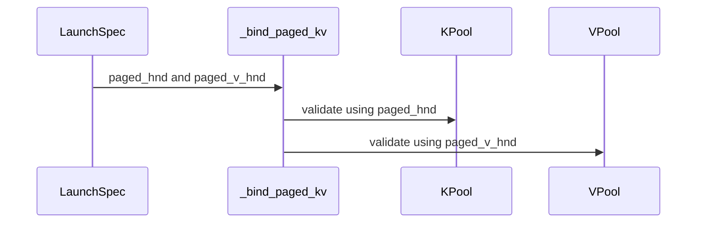

# Support independent K/V physical layouts in paged FROST attention

[Upstream PR](https://github.com/NVIDIA/cudnn-frontend/pull/1697) · state: closed · merged: True

## Original PR description

Paged K and V can have the same logical `(pages, heads, page_size, dim)` shape but different physical HND/NHD storage. FROST currently rejects that combination, which can send FlashInfer's `auto` path to a slower backend plan. Admit independent layouts within the existing paged forward capabilities.

The device kernels already support this: the K/V TMA descriptors can share their existing coordinate order while carrying each pool's own strides. Remove the matching-layout eligibility restrictions and retain V's declared layout separately in the prepared plan, so both native dense/THD binders validate the correct pool. Also remove the redundant check in the FP8 host path. Device kernel bodies, compile keys, scheduling, split/combine and public APIs are unchanged. Execution still binds and launches one prepared plan without repacking or replanning; layout changes outside each operand's declaration still reject.

Tests cover both mixed directions, singleton KV heads, FP16/BF16, per-tensor FP8 and MXFP8, dense/ragged Q, split/unsplit and packed execution, changed-input/length capture replay, O/LSE and pointer rebinding. Update the support tracker and explain why logical shape or `is_contiguous()` cannot establish a pool's physical layout.

Validation on cuDNN 9.27 / CuTe DSL 4.8:

- SM100: full paged suite **297 passed** (including the 88 mixed-layout cases), plus **24** packed-split capture/length/Stats tests at the final source.
- SM107: 28 mixed-layout numerical GPU tests and 24 packed-split capture/length/Stats tests passed with the simpler implementation.
- Native binders/storage checks and prepared FP8 regression: 821 passed. These binders are identical to the first prototype; the follow-up removes only unnecessary device specializations and renames an internal Python helper.
- Old develop fails the mixed-layout regression at the matching-layout support restriction (RED control).
- Native bindings build and scoped pre-commit hooks passed. All device kernel bodies match the base source.

This addresses the mixed-layout support gap from flashinfer-ai/flashinfer#6231. The separate mixed-length dispatch issue remains outside this change.

<!-- This is an auto-generated comment: release notes by coderabbit.ai -->
## Summary by CodeRabbit

* **New Features**
  * Paged attention supports K and V pools with different storage layouts on supported architectures and data types, including FP8 and MXFP8. Each pool’s layout is handled independently, without requiring repacking or recompilation.
* **Tests**
  * Expanded coverage for mixed K/V layouts across attention paths, including single-KV-head cases.
<!-- end of auto-generated comment: release notes by coderabbit.ai -->

## Review and discussion

### reviews

- yihuawei · APPROVED · 2026-10-17T09:41:05Z · [source](https://github.com/NVIDIA/cudnn-frontend/pull/1697#pullrequestreview-5557250035)

**Codex bot review · model: `gpt-6-astra`**

Reviewed `83dceb15f1fd` against base `dde1f51c7a5b`.

No blocking issue found. Both prepared specs retain V's declared layout independently, and the native binders validate each pool accordingly. The shared TMA coordinate order remains consistent with the separate runtime strides; device kernel bodies are unchanged.

Validation: Fresh native bindings built at this head. On native SM100 with public CuTe DSL 4.7.0 and PyTorch 2.11, all 646 dense/THD binder tests passed. All 112 selected mixed-layout GPU cases passed without skips: 88 dense/THD FP16/BF16, FP8 and MXFP8 cases plus 24 split/capture/live-length/Stats cases, including singleton KV heads and changed-input replay. Exact source imports were checked. 24 additional warm-cache negative controls rejected undersized storage, changed layout and misaligned pointers independently for K and V in both native binders. Valid rebinding still worked after each refusal. A bounded base/head comparison of warmed CPU binding with prepacked facts showed no repeatable material regression. This measures binding only, not GPU or application throughput.

Limitations: Focused validation only: the full prepared suite was not completed, and I did not independently run SM103/SM107. The author's reported SM107 results are separate evidence. FlashInfer routing and end-to-end performance were not measured.

Approved: no P0 or high-risk P1 found. Remaining findings stay with the owner; merge timing stays with the owner.

<!-- codex-fe-review:v2:1697:83dceb15f1fd7b092e7d85cf59fc5b4416cdb264:complete:no-blocker -->

- yihuawei · COMMENTED · 2026-10-18T09:22:19Z · [source](https://github.com/NVIDIA/cudnn-frontend/pull/1697#pullrequestreview-5562317921)

**Codex bot review · model: `gpt-6-astra`**

Reviewed `5119d3fa206d` against base `3d3a2716f165`.

The stale analyzer expectation is correctly fixed. The test now verifies valid paged MXFP8 facts and engine eligibility without requiring heuristic ordering. I independently reproduced the old assertion failure and the corrected full-suite pass. No remaining finding in this follow-up; the existing approval is preserved.

Validation: Reviewed the complete one-file delta and its fixture/probe contracts. Production sources are unchanged from the approved 83dceb15f1fd revision, so the prior native layout/binding/replay and bounded overhead evidence remains applicable. Exact-head analyzer suite with compatible bindings and CuTeDSL 4.7.0: 584 passed, zero failed or skipped. The original single test on 83dceb15f1fd fails at its obsolete requirement that facts.invalid be non-null. Both runs passed source-import provenance checks. These are host-side analyzer/capability tests, not additional native GPU kernel tests. Reused current-head pipeline 74773701 and verified that all 16 PR-changed files in its fetched integration tree match this head. No duplicate CI request.

Limitations: Current CI is still running. The author's separate SM107 base/head attribution identifies the same pre-existing template-name assertion after passing O/LSE comparisons; I did not rerun that native SM107 experiment. No new GPU numerical or performance matrix was needed for this test-only correction. The earlier review's platform and end-to-end performance limitations remain unchanged.

Comment only: this PR already has an active approval; preserving existing approvals.

<!-- codex-fe-review:v2:1697:5119d3fa206d375abcc31b768e2535a137763f79:complete:no-blocker -->

### issue_comments

- coderabbitai[bot] · comment · 2026-10-17T08:29:09Z · [source](https://github.com/NVIDIA/cudnn-frontend/pull/1697#issuecomment-6231752676)

<!-- This is an auto-generated comment: summarize by coderabbit.ai -->
<!-- review_stack_entry_start -->

<a href="https://app.coderabbit.ai/change-stack/NVIDIA/cudnn-frontend/pull/1697?scope=ghh_OusAJGA4HG8ljoOV0wJvVx8NmnZIjc2DdjmxOu0xZWA&amp;cs_source=review_comment"><picture><source media="(prefers-color-scheme: dark)" srcset="https://storage.googleapis.com/coderabbit_public_assets/review-stack-in-coderabbit-ui-dark.svg?v=3"><source media="(prefers-color-scheme: light)" srcset="https://storage.googleapis.com/coderabbit_public_assets/review-stack-in-coderabbit-ui.svg?v=3"></picture></a>

<!-- review_stack_entry_end -->
<!-- recent_review_start -->

No actionable comments were generated in the recent review. 🎉

<strong>ℹ️ Recent review info</strong>

<dl>
<dd>

<strong>⚙️ Run configuration</strong>

<dl>
<dd>

- **Configuration used**: Repository: NVIDIA/cudnn-frontend/.coderabbit.yaml
- **Review profile**: CHILL
- **Plan**: Enterprise
- **Run ID**: `d15f3c81-d6f1-4285-9053-3274e996e6d6`

</dd>
</dl>

<strong>📥 Commits</strong>

<dl>
<dd>

Reviewing files that changed from the base of the PR and between 83dceb15f1fd7b092e7d85cf59fc5b4416cdb264 and 5119d3fa206d375abcc31b768e2535a137763f79.

</dd>
</dl>

<strong>📒 Files selected for processing: 1</strong>

<dl>
<dd>

* `test/python/sdpa/frost/test_sdpa_graph_analyzer.py`

</dd>
</dl>

**Included review availability:** This review used your included allowance. Your plan provides up to 12 included reviews per hour; 10 remain after this review.

</dd>
</dl>

<!-- recent_review_end -->
<!-- walkthrough_start -->

<strong>📝 Walkthrough</strong>

<dl>
<dd>

Paged attention now supports independently selected HND or NHD layouts for K and V pools. Plan checks, launch specs, and bindings track each pool’s layout separately. Tests cover mixed layouts across binding and forward paths.

**Changes: Independent Paged K/V Layouts**

|Layer / File(s)|Summary|
|:---|:---|
|**Accept and record independent pool layouts**   `python/cudnn/sdpa/fwd/api_dsl.py`, `python/cudnn/sdpa/graph_analyzer.py`, `python/cudnn/sdpa/fwd/prepared.py`, `python/cudnn/sdpa/fwd/kernels/sm100/prefill_d128_fp8.py`, `python/cudnn/sdpa/frost/SUPPORT_MATRIX_TRACKER.md`, `python/cudnn/sdpa/AGENTS.md`|Plan checks no longer require matching K/V layouts. Launch specs record each pool’s declared layout, and the FP8 launcher no longer rejects mismatched layouts.|
|**Validate K and V pool geometry separately**   `python/pygraph/sdpa_dense_binding.cpp`, `python/pygraph/sdpa_thd_binding.cpp`|Dense and THD binders read a V-specific layout flag and interpret each pool using its corresponding layout.|
|**Test independent binding layouts**   `test/python/sdpa/frost/sdpa_binding_reference.py`, `test/python/sdpa/frost/test_sdpa_native_dense_binding.py`, `test/python/sdpa/frost/test_sdpa_native_thd_binding.py`, `test/python/sdpa/frost/test_sdpa_prepared_thd.py`|Binding tests cover mixed K/V layouts and validate pools against their respective declared layouts.|
|**Exercise mixed layouts in paged forward paths**   `test/python/sdpa/frost/test_sdpa_fwd_paged_sm100.py`, `test/python/sdpa/frost/test_sdpa_fwd_decode_d256_sm107.py`, `test/python/sdpa/frost/test_sdpa_fwd_paged_mxfp8_sm107.py`|Reference helpers and forward tests cover mixed layouts across paged decode, THD, FP8, and MXFP8 cases, including replay and varied dimensions.|

<!-- change_assessment_start -->
**Priority:** ➖ Normal

**Estimated code review effort:** 3 (Moderate) | ~25 minutes

<!-- change_assessment_commit:"5119d3fa206d375abcc31b768e2535a137763f79" -->
**Change:** Feature
<!-- change_assessment_end -->

### Sequence Diagram(s)

**Suggested reviewers:** `romananders90`

</dd>
</dl>

<!-- walkthrough_end -->

<strong>Merge Risk:</strong> <strong>⚪ Minimal</strong> · up to <code>5119d</code>

<dl>
<dd>

<!-- final_review_risk_start -->
<!-- final_review_risk_label
**Merge Risk:** **⚪ Minimal** · up to `5119d`
-->
<!-- final_review_risk_coverage:{"sourceCommitId":"5119d3fa206d375abcc31b768e2535a137763f79","coveredCommitId":"5119d3fa206d375abcc31b768e2535a137763f79","kind":"reviewed"} -->

The reviewed change supports independent paged K/V layouts, and the supplied evidence establishes no actionable merge-blocking risk.
<!-- final_review_risk_end -->

</dd>
</dl>

<!-- pre_merge_checks_walkthrough_start -->

<strong>Pre-merge checks: <picture></picture> 4 · <picture></picture> 1</strong>

<dl>
<dd>

<strong><picture></picture> Failed checks: 1 warning</strong>

|     Check name     |                                              Status                                              | Explanation                                                                                                                                                                                  | Resolution                                                                         |
| :---------------- | :----------------------------------------------------------------------------------------------: | :------------------------------------------------------------------------------------------------------------------------------------------------------------------------------------------- | :--------------------------------------------------------------------------------- |
| Docstring Coverage |  | Docstring coverage is 58.54% which is insufficient. The required threshold is 80.00%. Docstring coverage is scoped to functions touched by this diff. Analyzed 41 functions across 11 files. | Write docstrings for the functions missing them to satisfy the coverage threshold. |

<strong><picture></picture> Passed checks: 4 passed</strong>

<dl>
<dd>

|         Check name         |                                             Status                                             | Explanation                                                                                                                                                                                               |
| :------------------------ | :--------------------------------------------------------------------------------------------: | :-------------------------------------------------------------------------------------------------------------------------------------------------------------------------------------------------------- |
|         Title check        |  | The title clearly and concisely describes the primary change: support for independent physical K/V layouts in paged FROST attention.                                                                      |
|      Description check     |  | The description explains the problem, solution, compatibility impact, testing scope, validation results, related issue, and out-of-scope work. It does not reproduce the template headings or checklist … |
|     Linked Issues check    |  | Check skipped because no linked issues were found for this pull request.                                                                                                                                  |
| Out of Scope Changes check |  | Check skipped because no linked issues were found for this pull request.                                                                                                                                  |

<strong>Full details: Description check</strong>

<dl>
<dd>

**Explanation**

The description explains the problem, solution, compatibility impact, testing scope, validation results, related issue, and out-of-scope work. It does not reproduce the template headings or checklist statuses, but the required information is mostly present.

</dd>
</dl>

</dd>
</dl>

</dd>
</dl>

<!-- pre_merge_checks_walkthrough_end -->

- [ ] <!-- {"checkboxId":"585bb3f6-faf5-4dbf-96d2-74e382adf19a"} --> Fix all pre-merge checks with AI
<!-- finishing_touch_checkbox_start -->

<strong>✨ Finishing Touches</strong>

<dl>
<dd>

<strong>🧪 Generate unit tests (beta)</strong>

<dl>
<dd>

- [ ] <!-- {"checkboxId": "f47ac10b-58cc-4372-a567-0e02b2c3d479", "radioGroupId": "utg-output-choice-group-unknown_comment_id"} --> Create a new PR

</dd>
</dl>

</dd>
</dl>

<!-- finishing_touch_checkbox_end -->

<!-- autopilot:start -->
- [ ] <!-- {"checkboxId":"2708ad07-9f24-4260-9c11-7dc76a49f2e3"} --> <strong title="Keep fixing CodeRabbit findings and required CI, and resolving merge conflicts">Autofix</strong> · Keep fixing CodeRabbit findings and required CI, and resolving merge conflicts
<!-- autopilot:end -->
<!-- tips_start -->

Comment `@coderabbitai help` to get the list of available commands.

<!-- tips_end -->

- yihuawei · comment · 2026-10-17T09:41:47Z · [source](https://github.com/NVIDIA/cudnn-frontend/pull/1697#issuecomment-6232410413)

The review of `83dceb15f1fd` is complete, with the focused native checks passing. Requesting the SDPA FROST target for integration and platform regression coverage. The current SM107 selection does not collect the new mixed-layout suites, so this CI run will not replace their separate native validation.

Codex bot review — model `gpt-6-astra`.

<!-- codex-fe-ci:v1:1697:83dceb15f1fd7b092e7d85cf59fc5b4416cdb264:ci-sdpa-frost-83dceb15f1fd-notice -->

- yihuawei · comment · 2026-10-17T09:42:08Z · [source](https://github.com/NVIDIA/cudnn-frontend/pull/1697#issuecomment-6232413232)

@cudnn-ci-bot run python/sdpa/frost

- cudnn-ci-bot · comment · 2026-10-17T09:42:11Z · [source](https://github.com/NVIDIA/cudnn-frontend/pull/1697#issuecomment-6232413731)

🏁 Pipeline finished

SHA: `83dceb1`
Targets: `python/sdpa/frost`
Branch: [cudnn-gh/pr-1697-83dceb1](https://nv/cudnn-gitlab-ci/-/tree/cudnn-gh/pr-1697-83dceb1)
Pipeline: [74597793](https://nv/cudnn-gitlab-ci/-/pipelines/74597793)
Last updated: 2026-10-17 10:35 UTC

**19 passed, 6 failed, 3 skipped, 11 manual**

### <code>manual</code>

- <code>manual:python_samples</code> - Manual
- <code>manual:python</code> - Manual
- <code>manual:python/sdpa/frost</code> - ✅ Passed
- <code>manual:python/linear_attention/frost</code> - Manual
- <code>manual:python/gemm/frost</code> - Manual
- <code>manual:python/*/frost</code> - Manual
- <code>manual:python/gemm/cutedsl</code> - Manual
- <code>manual:python/*/cutedsl</code> - Manual
- <code>manual:python/*/jax</code> - Manual
- <code>manual:pycudnn</code> - Manual
- <code>manual:multi_gpu</code> - Manual
- <code>manual:backend</code> - Manual

### <code>analysis</code>

- <code>analysis:cudnn_clang_disable_exception</code> - ✅ Passed
- <code>analysis:cudnn_v9_no_half_conversion</code> - ✅ Passed
- <code>analysis:cudnn_clang</code> - ✅ Passed
- <code>analysis:check-relative-includes</code> - ✅ Passed
- <code>analysis:check-CUDNN_FRONTEND_SKIP_JSON_LIB</code> - ✅ Passed
- <code>analysis:guardwords_scan</code> - ❌ **New Failure!** (nightly passed)
- <code>analysis:jax-import-guard</code> - ✅ Passed
- <code>analysis:pytest-gpu</code> - ✅ Passed
- <code>san:build</code> - ✅ Passed

### <code>build</code>

- <code>analysis:api_index</code> - ✅ Passed
- <code>build:dev:linux:amd64</code> - ✅ Passed
- <code>build:rel:linux:amd64</code> - ✅ Passed
- <code>build:dev:linux:arm64</code> - ✅ Passed
- <code>build:rel:linux:arm64</code> - ✅ Passed
- <code>build:rel:win:amd64</code> - ✅ Passed

### <code>frost_tests</code>

- <code>python/sdpa/frost:cutlass-rel:sm80</code> - ❌ **New Failure!** (nightly passed)
- <code>python/sdpa/frost:cutlass-rel:sm100</code> - ❌ **Old Failure** (nightly failed)
- <code>python/sdpa/frost:cutlass-rel:sm120</code> - ❌ **New Failure!** (nightly passed)
- <code>python/linear_attention/frost:cutlass-rel:sm100</code> - Skipped
- <code>python/gemm/frost:cutlass-rel:sm100</code> - Skipped
- <code>python/*/frost:cutlass-rel:sm100</code> - Skipped
- <code>python/sdpa/frost:cutlass-rel:sm103</code> - ❌ **Old Failure** (nightly failed)
- <code>python/sdpa/frost:cutlass-4.8:sm107</code> - ❌ **Old Failure** (nightly failed)

### <code>sanitizer_tests</code>

- <code>san:cpp_test:sm80</code> - ✅ Passed
- <code>san:cpp_test:sm90</code> - ✅ Passed
- <code>san:cpp_test:sm100</code> - ✅ Passed

### <code>triage</code>

- <code>triage:ai</code> - ✅ Passed

- yihuawei · comment · 2026-10-17T10:45:57Z · [source](https://github.com/NVIDIA/cudnn-frontend/pull/1697#issuecomment-6232977649)

Pipeline `74597793` for `83dceb15f1fd` finished with **19 jobs passed, 6 failed, 3 skipped and 11 manual**. The API-index check, all five builds and all three sanitizer jobs passed; Style also passed on the reviewed head.

The failures are `analysis:guardwords_scan` and all five SDPA lanes: SM80, SM100, SM120, SM103 and SM107. The report labels SM80/SM120 as new relative to nightly and the other SDPA failures as old, but those labels alone do not establish their causes. I do not have the failing job traces, so I cannot attribute the failures or claim the new cases passed in CI. Please inspect the first failing traces before merging.

All 15 changed files match the reviewed source in the CI integration. The local 646 binder tests and 112 mixed-layout GPU tests remain bounded SM100 evidence, not a green CI suite. The SM107 CI selection does not include the new mixed-layout suites; its result cannot close that validation gap.

Codex bot review — model `gpt-6-astra`.

<!-- codex-fe-ci:v1:1697:83dceb15f1fd7b092e7d85cf59fc5b4416cdb264:pipeline-74597793-finished -->

- YangXu1990uiuc · comment · 2026-10-18T08:57:28Z · [source](https://github.com/NVIDIA/cudnn-frontend/pull/1697#issuecomment-6247952768)

The internal pipeline did find one missed test expectation: `test_paged_mxfp8_mixed_pool_layouts_are_invalid` still required the rejection that this PR intentionally removes. Fixed in 5119d3fa2; it now checks graph validity and MXFP8 engine eligibility, without asserting heuristic ordering. The original test reproduces red locally, and the full analyzer suite passes after the correction (584 passed). Production code is unchanged from the approved 83dceb15f.

The SM80, SM100, SM103 and SM120 SDPA jobs each had only this failure. I am separately checking the SM107 dense D64 template-routing assertion; that job completed, with O/LSE numerics passing before the route assertion, so it is not a runtime hang. The guardword failures are in unchanged normalization files.

Host-overhead review found no repeatable material regression on the existing FROST path, consistent with the independent review. Switching newly supported mixed layouts from backend to FROST can have a modest eager submission cost; the separate plan/submit/replay measurements are retained, rather than claiming every host path becomes faster.

@cudnn-ci-bot run python/sdpa/frost

- YangXu1990uiuc · comment · 2026-10-18T09:00:56Z · [source](https://github.com/NVIDIA/cudnn-frontend/pull/1697#issuecomment-6247981954)

@cudnn-ci-bot run python/sdpa/frost

- cudnn-ci-bot · comment · 2026-10-18T09:01:00Z · [source](https://github.com/NVIDIA/cudnn-frontend/pull/1697#issuecomment-6247982426)

🏁 Pipeline finished

SHA: `5119d3f`
Targets: `python/sdpa/frost`
Branch: [cudnn-gh/pr-1697-5119d3f](https://nv/cudnn-gitlab-ci/-/tree/cudnn-gh/pr-1697-5119d3f)
Pipeline: [74773701](https://nv/cudnn-gitlab-ci/-/pipelines/74773701)
Last updated: 2026-10-18 09:52 UTC

**23 passed, 2 failed, 3 skipped, 11 manual**

### <code>manual</code>

- <code>manual:python_samples</code> - Manual
- <code>manual:python</code> - Manual
- <code>manual:python/sdpa/frost</code> - ✅ Passed
- <code>manual:python/linear_attention/frost</code> - Manual
- <code>manual:python/gemm/frost</code> - Manual
- <code>manual:python/*/frost</code> - Manual
- <code>manual:python/gemm/cutedsl</code> - Manual
- <code>manual:python/*/cutedsl</code> - Manual
- <code>manual:python/*/jax</code> - Manual
- <code>manual:pycudnn</code> - Manual
- <code>manual:multi_gpu</code> - Manual
- <code>manual:backend</code> - Manual

### <code>analysis</code>

- <code>analysis:cudnn_clang_disable_exception</code> - ✅ Passed
- <code>analysis:cudnn_v9_no_half_conversion</code> - ✅ Passed
- <code>analysis:cudnn_clang</code> - ✅ Passed
- <code>analysis:check-relative-includes</code> - ✅ Passed
- <code>analysis:check-CUDNN_FRONTEND_SKIP_JSON_LIB</code> - ✅ Passed
- <code>analysis:guardwords_scan</code> - ❌ **Old Failure** (nightly failed)
- <code>analysis:jax-import-guard</code> - ✅ Passed
- <code>analysis:pytest-gpu</code> - ✅ Passed
- <code>san:build</code> - ✅ Passed

### <code>build</code>

- <code>analysis:api_index</code> - ✅ Passed
- <code>build:dev:linux:amd64</code> - ✅ Passed
- <code>build:rel:linux:amd64</code> - ✅ Passed
- <code>build:dev:linux:arm64</code> - ✅ Passed
- <code>build:rel:linux:arm64</code> - ✅ Passed
- <code>build:rel:win:amd64</code> - ✅ Passed

### <code>frost_tests</code>

- <code>python/sdpa/frost:cutlass-rel:sm80</code> - ✅ Passed
- <code>python/sdpa/frost:cutlass-rel:sm100</code> - ✅ Passed
- <code>python/sdpa/frost:cutlass-rel:sm120</code> - ✅ Passed
- <code>python/linear_attention/frost:cutlass-rel:sm100</code> - Skipped
- <code>python/gemm/frost:cutlass-rel:sm100</code> - Skipped
- <code>python/*/frost:cutlass-rel:sm100</code> - Skipped
- <code>python/sdpa/frost:cutlass-rel:sm103</code> - ✅ Passed
- <code>python/sdpa/frost:cutlass-4.8:sm107</code> - ❌ **Failed** (nightly unknown)

### <code>sanitizer_tests</code>

- <code>san:cpp_test:sm80</code> - ✅ Passed
- <code>san:cpp_test:sm90</code> - ✅ Passed
- <code>san:cpp_test:sm100</code> - ✅ Passed

### <code>triage</code>

- <code>triage:ai</code> - ✅ Passed

- YangXu1990uiuc · comment · 2026-10-18T09:03:26Z · [source](https://github.com/NVIDIA/cudnn-frontend/pull/1697#issuecomment-6248003319)

Completed the remaining failure attribution on the same local SM107 GPU, using separate exact-source checkouts and native extensions:

- Baseline `dde1f51c7` and PR head `5119d3fa2` both reproduce the same `test_sdpa_fwd_cc107_decode_tile_envelope_pinned_L0[gpt_oss_d64_sink_swa]` failure.
- Both pass O/Stats numerical comparisons and serve the same FROST `prefill_d128_f16` template. The failure is the subsequent assertion requiring `decode_d128_f16`; neither run hangs.
- The baseline already has the small D32/D64 flavor selection. This dense, nonpaged case does not enter the layout-check branch changed here. The unchanged test still assumes the former D128 decode envelope.
- The normalization guardword failures likewise originate in unchanged files from #1509.

The correction in `5119d3fa2` addresses this PR's actual analyzer-test omission; its production tree is identical to the approved and benchmarked `83dceb15f`. Current-head SDPA CI is running as pipeline 74773701. No failing test is being presented as a passing suite, and the unrelated template assertion should be corrected separately.

- YangXu1990uiuc · comment · 2026-10-18T09:52:54Z · [source](https://github.com/NVIDIA/cudnn-frontend/pull/1697#issuecomment-6248453847)

Final closeout for `5119d3fa2`: all selected SDPA jobs have now completed in pipeline 74773701. I checked their actual traces and source identity.

- SM80: 10,523 passed; SM100: 16,797 passed; SM103: 16,499 passed; SM120: 11,262 passed. These four lanes completed successfully.
- SM107: 15,507 passed, with exactly one failure: the dense D64 template-name assertion documented above. The new trace explicitly passes O and Stats numerics before that assertion, matching the independent exact-baseline/head reproduction. It is not a hang or a mixed-layout failure.
- The remaining guardword failure is in the unchanged normalization README. All builds and C++ sanitizer jobs passed.

The incremental independent review reproduced the corrected analyzer suite (584 passed) and preserved approval. Production is unchanged from the approved and performance-qualified `83dceb15f`; the prior local mixed-layout/capture/binding and host-overhead evidence still applies. Public merge requirements and style checks pass, with no unresolved review threads. The two attributed baseline failures are recorded as failures, not as passing CI. Proceeding with the normal merge under the existing approval.

### inline_comments

## Changed files and fixed code

- `python/cudnn/sdpa/AGENTS.md` · modified · additions 10 / deletions 0
  - [head](https://github.com/YangXu1990uiuc/cudnn-frontend/blob/5119d3fa206d375abcc31b768e2535a137763f79/python/cudnn/sdpa/AGENTS.md)
  - [base](https://github.com/NVIDIA/cudnn-frontend/blob/dde1f51c7a5b52d52cdaee4e9e512c2b579591b9/python/cudnn/sdpa/AGENTS.md)
- `python/cudnn/sdpa/frost/SUPPORT_MATRIX_TRACKER.md` · modified · additions 14 / deletions 1
  - [head](https://github.com/YangXu1990uiuc/cudnn-frontend/blob/5119d3fa206d375abcc31b768e2535a137763f79/python/cudnn/sdpa/frost/SUPPORT_MATRIX_TRACKER.md)
  - [base](https://github.com/NVIDIA/cudnn-frontend/blob/dde1f51c7a5b52d52cdaee4e9e512c2b579591b9/python/cudnn/sdpa/frost/SUPPORT_MATRIX_TRACKER.md)
- `python/cudnn/sdpa/fwd/api_dsl.py` · modified · additions 0 / deletions 4
  - [head](https://github.com/YangXu1990uiuc/cudnn-frontend/blob/5119d3fa206d375abcc31b768e2535a137763f79/python/cudnn/sdpa/fwd/api_dsl.py)
  - [base](https://github.com/NVIDIA/cudnn-frontend/blob/dde1f51c7a5b52d52cdaee4e9e512c2b579591b9/python/cudnn/sdpa/fwd/api_dsl.py)
- `python/cudnn/sdpa/fwd/kernels/sm100/prefill_d128_fp8.py` · modified · additions 0 / deletions 2
  - [head](https://github.com/YangXu1990uiuc/cudnn-frontend/blob/5119d3fa206d375abcc31b768e2535a137763f79/python/cudnn/sdpa/fwd/kernels/sm100/prefill_d128_fp8.py)
  - [base](https://github.com/NVIDIA/cudnn-frontend/blob/dde1f51c7a5b52d52cdaee4e9e512c2b579591b9/python/cudnn/sdpa/fwd/kernels/sm100/prefill_d128_fp8.py)
- `python/cudnn/sdpa/fwd/prepared.py` · modified · additions 21 / deletions 8
  - [head](https://github.com/YangXu1990uiuc/cudnn-frontend/blob/5119d3fa206d375abcc31b768e2535a137763f79/python/cudnn/sdpa/fwd/prepared.py)
  - [base](https://github.com/NVIDIA/cudnn-frontend/blob/dde1f51c7a5b52d52cdaee4e9e512c2b579591b9/python/cudnn/sdpa/fwd/prepared.py)
- `python/cudnn/sdpa/graph_analyzer.py` · modified · additions 0 / deletions 2
  - [head](https://github.com/YangXu1990uiuc/cudnn-frontend/blob/5119d3fa206d375abcc31b768e2535a137763f79/python/cudnn/sdpa/graph_analyzer.py)
  - [base](https://github.com/NVIDIA/cudnn-frontend/blob/dde1f51c7a5b52d52cdaee4e9e512c2b579591b9/python/cudnn/sdpa/graph_analyzer.py)
- `python/pygraph/sdpa_dense_binding.cpp` · modified · additions 9 / deletions 3
  - [head](https://github.com/YangXu1990uiuc/cudnn-frontend/blob/5119d3fa206d375abcc31b768e2535a137763f79/python/pygraph/sdpa_dense_binding.cpp)
  - [base](https://github.com/NVIDIA/cudnn-frontend/blob/dde1f51c7a5b52d52cdaee4e9e512c2b579591b9/python/pygraph/sdpa_dense_binding.cpp)
- `python/pygraph/sdpa_thd_binding.cpp` · modified · additions 8 / deletions 5
  - [head](https://github.com/YangXu1990uiuc/cudnn-frontend/blob/5119d3fa206d375abcc31b768e2535a137763f79/python/pygraph/sdpa_thd_binding.cpp)
  - [base](https://github.com/NVIDIA/cudnn-frontend/blob/dde1f51c7a5b52d52cdaee4e9e512c2b579591b9/python/pygraph/sdpa_thd_binding.cpp)
- `test/python/sdpa/frost/sdpa_binding_reference.py` · modified · additions 9 / deletions 1
  - [head](https://github.com/YangXu1990uiuc/cudnn-frontend/blob/5119d3fa206d375abcc31b768e2535a137763f79/test/python/sdpa/frost/sdpa_binding_reference.py)
  - [base](https://github.com/NVIDIA/cudnn-frontend/blob/dde1f51c7a5b52d52cdaee4e9e512c2b579591b9/test/python/sdpa/frost/sdpa_binding_reference.py)
- `test/python/sdpa/frost/test_sdpa_fwd_decode_d256_sm107.py` · modified · additions 40 / deletions 0
  - [head](https://github.com/YangXu1990uiuc/cudnn-frontend/blob/5119d3fa206d375abcc31b768e2535a137763f79/test/python/sdpa/frost/test_sdpa_fwd_decode_d256_sm107.py)
  - [base](https://github.com/NVIDIA/cudnn-frontend/blob/dde1f51c7a5b52d52cdaee4e9e512c2b579591b9/test/python/sdpa/frost/test_sdpa_fwd_decode_d256_sm107.py)
- `test/python/sdpa/frost/test_sdpa_fwd_paged_mxfp8_sm107.py` · modified · additions 6 / deletions 0
  - [head](https://github.com/YangXu1990uiuc/cudnn-frontend/blob/5119d3fa206d375abcc31b768e2535a137763f79/test/python/sdpa/frost/test_sdpa_fwd_paged_mxfp8_sm107.py)
  - [base](https://github.com/NVIDIA/cudnn-frontend/blob/dde1f51c7a5b52d52cdaee4e9e512c2b579591b9/test/python/sdpa/frost/test_sdpa_fwd_paged_mxfp8_sm107.py)
- `test/python/sdpa/frost/test_sdpa_fwd_paged_sm100.py` · modified · additions 146 / deletions 30
  - [head](https://github.com/YangXu1990uiuc/cudnn-frontend/blob/5119d3fa206d375abcc31b768e2535a137763f79/test/python/sdpa/frost/test_sdpa_fwd_paged_sm100.py)
  - [base](https://github.com/NVIDIA/cudnn-frontend/blob/dde1f51c7a5b52d52cdaee4e9e512c2b579591b9/test/python/sdpa/frost/test_sdpa_fwd_paged_sm100.py)
- `test/python/sdpa/frost/test_sdpa_graph_analyzer.py` · modified · additions 5 / deletions 3
  - [head](https://github.com/YangXu1990uiuc/cudnn-frontend/blob/5119d3fa206d375abcc31b768e2535a137763f79/test/python/sdpa/frost/test_sdpa_graph_analyzer.py)
  - [base](https://github.com/NVIDIA/cudnn-frontend/blob/dde1f51c7a5b52d52cdaee4e9e512c2b579591b9/test/python/sdpa/frost/test_sdpa_graph_analyzer.py)
- `test/python/sdpa/frost/test_sdpa_native_dense_binding.py` · modified · additions 7 / deletions 5
  - [head](https://github.com/YangXu1990uiuc/cudnn-frontend/blob/5119d3fa206d375abcc31b768e2535a137763f79/test/python/sdpa/frost/test_sdpa_native_dense_binding.py)
  - [base](https://github.com/NVIDIA/cudnn-frontend/blob/dde1f51c7a5b52d52cdaee4e9e512c2b579591b9/test/python/sdpa/frost/test_sdpa_native_dense_binding.py)
- `test/python/sdpa/frost/test_sdpa_native_thd_binding.py` · modified · additions 7 / deletions 5
  - [head](https://github.com/YangXu1990uiuc/cudnn-frontend/blob/5119d3fa206d375abcc31b768e2535a137763f79/test/python/sdpa/frost/test_sdpa_native_thd_binding.py)
  - [base](https://github.com/NVIDIA/cudnn-frontend/blob/dde1f51c7a5b52d52cdaee4e9e512c2b579591b9/test/python/sdpa/frost/test_sdpa_native_thd_binding.py)
- `test/python/sdpa/frost/test_sdpa_prepared_thd.py` · modified · additions 16 / deletions 16
  - [head](https://github.com/YangXu1990uiuc/cudnn-frontend/blob/5119d3fa206d375abcc31b768e2535a137763f79/test/python/sdpa/frost/test_sdpa_prepared_thd.py)
  - [base](https://github.com/NVIDIA/cudnn-frontend/blob/dde1f51c7a5b52d52cdaee4e9e512c2b579591b9/test/python/sdpa/frost/test_sdpa_prepared_thd.py)

## Evidence and interpretation boundary

[Original JSON, discussions and patches](../../../../../../evidence/prs/NVIDIA--cudnn-frontend/1697-d3600d69c29a8bb1c865e66a3c9a461331dd4eaaa8c62859c11f914df7404a56.json) · SHA-256 `d3600d69c29a8bb1c865e66a3c9a461331dd4eaaa8c62859c11f914df7404a56`.

Diff complete: True. Missing/binary/truncated patches require pinned source inspection. This is a source page, not an independently verified optimization case. Open, merged and released are different states; recheck the deployed dependency.
