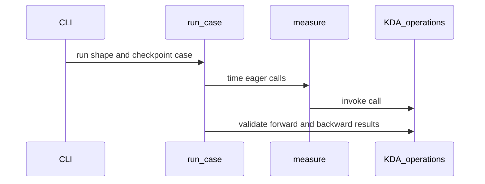

# perf(kda): optimize SM100 KDA backward for pretraining

[Upstream PR](https://github.com/NVIDIA/cudnn-frontend/pull/1699) · state: open · merged: False

## Original PR description

## Before submitting

- [x] I agree to license this contribution under the terms of [LICENSE.txt](https://github.com/NVIDIA/cudnn-frontend/blob/develop/LICENSE.txt).
- [x] I ran changed-file `pre-commit run` and no formatting changes remain.
- [x] I reviewed the applicable `AGENTS.md` Hard Rules; compatibility and docstring audits passed.
- [ ] Required labels: `cat-enhancements`, `area:linear_attention`, `orig-external` (external contributor; label assignment depends on repository permissions).

## Affected area

FE OSS CuTeDSL kernels: SM100 FROST KDA backward, its existing execution tests, and an E2E benchmark.

## Summary

Optimize **KDA pretraining**, primarily `mbs=1, H=96, S=8192, D=128`: measured backward latency decreases by **19.18%** and forward-plus-backward E2E latency by **15.13%**. The same B/H/D configuration retains approximately **19% backward / 15% E2E** reductions at 128K and 256K tokens.

- Reuse raw Q/K and gradient values in registers across the normalized D128 L2 projection instead of rereading them for the correction step.
- Remap the projection to token-owning 8-lane subwarps, preserving the original rounded intermediates, four 32-channel partial sums and their reduction order.
- Rebalance CG1/CG2 register budgets and move the independent dQ MMA later to shorten the state-gradient critical path.
- Keep associated lifetime protections: dO ready/reuse credit, independent decay-reader acknowledgements, the in-place gate load/store barrier, TMEM load completion, and elected-lane TMA store issue with warp-wide completion.
- Add regressions to the existing execution test file and a standalone E2E benchmark. No raw results, audit scripts, profiler artifacts or `AGENTS.md` edits are included.


“Cache” in the illustration means register-resident operand reuse, not a software or L1/L2 cache. Timelines illustrate issue order and overlap, not measured durations. The measured gains are the combined PR effect, not isolated per-change gains.

## Why

The original normalized projection rereads operands and uses channel-oriented ownership for both the reduction and correction. Register reuse and token-oriented mapping reduce that work; dQ rescheduling exposes independent work before the state-gradient dependency. The tuning targets common small-microbatch pretraining shapes without trading precision for speed or claiming uniform gains for every shape.

## Related issues

No issue closure requested. The known upstream recompute racecheck findings below are deliberately left for a separate follow-up PR.

## API and compatibility impact

No public API, caller preparation step, host binding, compile-key axis, knob, dtype, checkpoint-precision or dependency-floor change. Production edits are confined to the backward config/main/summary files. The host executor, shared LA helper, chain/uncut launchers, forward and recompute kernels are unchanged relative to the measured base; raw-ring stage defaults also match it. The existing DSL-version gate remains unchanged (Python Rule 7), as does the common backend/FROST graph contract (Rule 9).

This single-commit submission has the **exact same source tree** as the validated fork head, without its intermediate experiment/cleanup history. It is based on measured upstream commit `bd4ebdddeab3cb384e15d29871e652aa0a032fcb`. Subsequent develop updates merge without conflicts in a local merge-tree check; the numbers below are pinned to that measured base, not claimed as a new A/B against a later tip.

## Performance

SM100; Python 3.12, Torch 2.11.0+cu130, CuTeDSL 4.7.0 cu13, cuDNN 9.19. Independent full-source baseline/optimized processes in ABBA order, with actual import paths and production source hashes checked. No profiler during timing. All rows use BF16 Q/K/V/dO, FP32 gate/beta, Q/K L2 norm, beta sigmoid, safe gate, checkpoint=16, and no initial state or learnable gate parameters. E2E is public forward plus autograd backward, not model/optimizer time. Reduction is `100 * (1 - optimized / baseline)`.

### 8K tokens, D128

CUDA Graph latency in microseconds; average of two process medians per variant, each nine rounds × 25 replays × four captured complete calls. `1 × 64` uses chain backward; the other rows use uncut.

| B × H | Backward baseline → optimized, µs | Reduction | E2E baseline → optimized, µs | Reduction |
| --- | ---: | ---: | ---: | ---: |
| 1 × 64 | 2033.29 → 1924.35 | 5.36% | 2517.86 → 2408.79 | 4.33% |
| 1 × 96 | 2331.33 → 1884.10 | 19.18% | 2965.62 → 2516.84 | 15.13% |
| 1 × 128 | 2580.02 → 2291.66 | 11.18% | 3293.83 → 3006.37 | 8.73% |
| 2 × 64 | 2588.59 → 2300.79 | 11.12% | 3296.15 → 3009.18 | 8.71% |
| 2 × 128 | 5166.87 → 4686.87 | 9.29% | 6610.25 → 6125.43 | 7.33% |

Output and all five input-gradient hashes match across all four processes for every shape. Eager backward/E2E also improves in every measured row; no CPU-binding speedup is claimed.

### 128K and 256K tokens, B1/H96/D128

K=1024 tokens. Both backward plans select **uncut**. Each long-context graph captures **one complete call**, rather than the four-call 8K capture, to bound live storage. Five rounds × seven replays per process; median of two process medians per variant. Compilation, input generation, validation and graph capture are excluded; E2E includes forward checkpoint production.

| Length | Backward baseline → optimized, ms | Reduction | E2E baseline → optimized, ms | Reduction | Peak allocated memory, both versions |
| --- | ---: | ---: | ---: | ---: | ---: |
| 128K | 37.345 → 30.073 | 19.47% | 47.273 → 40.135 | 15.10% | 60.10 GiB |
| 256K | 74.385 → 60.142 | 19.15% | 94.595 → 80.349 | 15.06% | 120.19 GiB |

Forward is unchanged within noise: 10.072 → 10.066 ms and 20.210 → 20.213 ms. Eager E2E is 47.356 → 40.222 ms (15.06%) and 94.699 → 80.443 ms (15.05%). Peak figures are PyTorch **allocated** device memory for this operator workload, maximum over methods/runs, not whole-model training memory. No OOM in any of the eight workers.

Every input, output and dQ/dK/dV/dG/dBeta element is checked for finiteness. Full-tensor raw-byte hashes match baseline/optimized and independent runs. Graph/eager, forward-only/E2E and standalone-backward/autograd checks also pass. This is full-tensor baseline non-regression, **not an independent 128K/256K FP64 oracle**. Long-context scripts and raw logs remain local; no long-context sanitizer or all-B/H coverage is claimed.

## Testing

- Changed-file pre-commit, AST syntax and whitespace checks pass.
- Retained regression coverage: **57 cases** passed within the preceding 68-case run; 11 standalone script/source-structure checks were subsequently removed without changing production code. Includes native cache reuse, grouped heads/output strides, raw-ring wraps, fresh operands and changed-input graph replay.
- **12 reusable FP64-reference cases** in the existing execution suite: FP16/BF16 × D64/D128 × ordinary/small-norm/cancellation inputs, using `test_la.assert_bwd_parity` and unchanged tolerances. Output, final state and all five input gradients checked; all 12 pass on both sources, including the final test fixture.
- Additional locally retained paired FP64 experiment: **26 cases / 178 gradient tensors**, all finite, byte-identical to upstream, zero FP64-error increase. Covers safe/non-safe gates, checkpoint 0/16/32, D64 controls, ragged/empty/tail inputs, optional state/gate parameters and cancellation/strong-decay inputs. Its audit tool is not included in this PR.
- Same-graph, independent-workspace two-stream backward: **2 direct cases passed**, FP16/BF16.
- Compute Sanitizer memcheck: **16 passed, 0 device errors, exit 0**, uncut and chain; API diagnostics are not included in the device-error claim.
- Uncut racecheck: **8 passed, 0 hazards, exit 0**.
- Compatibility audit: passed — unchanged public/host contract; dtype, D64/D128, checkpoints/schedules, grouped heads/strides, optional inputs, current buffers/workspaces/streams and graph replay reviewed against the retained evidence.
- Docstring audit: passed — affected kernel/config helpers and benchmark; no new public contract.

Focused regressions, from `test/python` with the intended source package and an available GPU:

```bash
export CUDNN_TEST_TIMEOUT=0 CUDNN_TEST_NO_ISOLATION=1
python -m pytest -s -p no:timeout linear_attention/frost/test_kda_execution.py
```

The included benchmark supports the 8K grid, for example:

```bash
python benchmark/linear_attention/benchmark_kda_e2e.py \
  --batch 1 --tokens 8192 --heads 96 --dim 128 --checkpoint 16 \
  --dtype bfloat16 --rounds 9 --repeats 25 --json /tmp/kda-e2e.json
```

Its four-call capture is not the single-call long-context harness used above; increasing only `--tokens` is not a memory-equivalent reproduction of those runs. Run the same command against each explicitly selected source for an A/B, checking the printed source path.

### Known chain racecheck limitation

**Chain racecheck is not clean; no full-E2E racecheck-clean claim is made.** Observed `kda_recompute` synchronization hazards also reproduce on the same-input upstream control (exit 99), and that kernel is byte-identical to the base. These observed findings are pre-existing, not introduced by this PR.

Exploratory numerical tests pass, but the initial candidate run reached the 1,000,000-record budget; expanded candidate/upstream runs reached the default 100-report print limit. Those limited logs cannot prove every later kernel is clean. There are no kernel filters or suppression rules. Further chain racecheck work is deferred, and **a separate follow-up PR will address recompute synchronization**. No recompute or extreme-gate precision fix is mixed into this performance PR. Existing nanobind shutdown diagnostics are retained.


<!-- This is an auto-generated comment: release notes by coderabbit.ai -->

## Summary by CodeRabbit

* **Bug Fixes**
  * Improved reliability of KDA backward calculations across supported precisions, input patterns, and checkpoint configurations.
  * Improved handling of state and gate values during backward execution, including CUDA-graph replay.

* **Performance**
  * Adjusted backward computation settings to better balance GPU resources.

<!-- end of auto-generated comment: release notes by coderabbit.ai -->

## Review and discussion

### reviews

- YangXu1990uiuc · APPROVED · 2026-10-17T13:46:29Z · [source](https://github.com/NVIDIA/cudnn-frontend/pull/1699#pullrequestreview-5558028841)

**Codex bot review · model: `gpt-6-astra`**

Reviewed `a7f98dbb7a3b` against base `dde1f51c7a5b`.

Thank you for your contribution! I found no approval-blocking issue after reviewing the changed buffer lifetimes, dQ scheduling and normalization projection, and validating both the PR head and its combination with current develop. The independent measurements support the intended SM100 improvement. I started the scoped linear-attention CI and authorized Style; Style passed, while GPU CI is still running. The current text-analysis failures are in unchanged normalization files and remain separate from this kernel review.

Validation: On native SM100 with CuTeDSL 4.8.0, the exact-head KDA execution suite passed 54/54, including the FP64-reference, cache reuse, strided-output and changed-input CUDA Graph cases. Applied the PR patch to current develop dde1f51c7a5b in isolation: the same suite plus eight additional asymmetric Dk/Dv, ragged/empty, 16-bit-gate and initial/final-state-gradient reference cases passed 62/62. A separate non-normalized D128 case with three unequal sequences and 64 heads also passed; its 192 work items exercise persistent handoff beyond the 148-SM launch bound. The integrated D128 BF16 uncut backward changed-input replay case passed under Compute Sanitizer racecheck: 0 hazards, exit 0. Audited changed arrival counts and per-consumer reuse acknowledgements, including the no-input-state seed path. Current-develop versus integrated-PR ABBA comparison, B1/S8192/D128/BF16 with checkpoint 16 and fused Q/K normalization: H64 chain backward replay was 3.224 -> 2.903 ms and forward+backward replay 3.990 -> 3.678 ms; H96 uncut was 3.913 -> 2.999 ms and 4.960 -> 4.058 ms. Output and all five input-gradient hashes matched across all four processes. Eager event timings agreed in direction; host enqueue samples showed no consistent regression. Performance scope: SM100 engineering GPU with 148 SMs, unchanged clock settings, seven rounds of ten replays per process, four complete calls per capture; compilation and validation excluded. These are operator-call measurements. Baseline replay medians differed by less than 0.3% between the two control processes. Scoped CI pipeline 74627325 is running on this head; its main and summary KDA kernel bodies match the independently tested integration byte for byte. Style run 39034543478 passed. Completed the PR labels, project and current release milestone.

Limitations: Native review validation covered SM100 and DSL 4.8.0. Other architectures, the dependency floor, and the author's 128K/256K performance scope were not independently requalified here. The bounded uncut racecheck result does not establish full-chain racecheck cleanliness. The separately documented upstream recompute synchronization findings still need their planned follow-up. GPU CI remains pending, and the inherited text-analysis failures still need resolution before landing under the repository's merge requirements.

Approved: no P0 or high-risk P1 found. Remaining findings stay with the owner; merge timing stays with the owner.

<!-- codex-fe-review:v2:1699:a7f98dbb7a3b157febe0a91ab99fda180251186f:complete:no-blocker -->

### issue_comments

- coderabbitai[bot] · comment · 2026-10-17T12:57:06Z · [source](https://github.com/NVIDIA/cudnn-frontend/pull/1699#issuecomment-6234147745)

<!-- This is an auto-generated comment: summarize by coderabbit.ai -->
<!-- review_stack_entry_start -->

<a href="https://app.coderabbit.ai/change-stack/NVIDIA/cudnn-frontend/pull/1699?scope=ghh_OusAJGA4HG8ljoOV0wJvVx8NmnZIjc2DdjmxOu0xZWA&amp;cs_source=review_comment"><picture><source media="(prefers-color-scheme: dark)" srcset="https://storage.googleapis.com/coderabbit_public_assets/review-stack-in-coderabbit-ui-dark.svg?v=3"><source media="(prefers-color-scheme: light)" srcset="https://storage.googleapis.com/coderabbit_public_assets/review-stack-in-coderabbit-ui.svg?v=3"></picture></a>

<!-- review_stack_entry_end -->
<!-- recent_review_start -->

No actionable comments were generated in the recent review. 🎉

<details>
<summary><strong>ℹ️ Recent review info</strong></summary>
<dl>
<dd>

<details>
<summary><strong>⚙️ Run configuration</strong></summary>
<dl>
<dd>

- **Configuration used**: Repository: NVIDIA/cudnn-frontend/.coderabbit.yaml
- **Review profile**: CHILL
- **Plan**: Enterprise
- **Run ID**: `42cb948f-38d5-43b1-8609-5b73cdcc4eaa`

</dd>
</dl>
</details>

<details>
<summary><strong>📥 Commits</strong></summary>
<dl>
<dd>

Reviewing files that changed from the base of the PR and between dde1f51c7a5b52d52cdaee4e9e512c2b579591b9 and a7f98dbb7a3b157febe0a91ab99fda180251186f.

</dd>
</dl>
</details>

<details>
<summary><strong>📒 Files selected for processing: 5</strong></summary>
<dl>
<dd>

* `benchmark/linear_attention/benchmark_kda_e2e.py`
* `python/cudnn/linear_attention/frost/kernel/kda_bprop_config.py`
* `python/cudnn/linear_attention/frost/kernel/kda_bprop_f16.py`
* `python/cudnn/linear_attention/frost/kernel/kda_bprop_summary_f16.py`
* `test/python/linear_attention/frost/test_kda_execution.py`

</dd>
</dl>
</details>

**Included review availability:** This review used your included allowance. Your plan provides up to 12 included reviews per hour; 11 remain after this review.

</dd>
</dl>
</details>


<!-- recent_review_end -->
<!-- walkthrough_start -->

<details>
<summary><strong>📝 Walkthrough</strong></summary>
<dl>
<dd>

The PR updates KDA backward kernel scheduling and projection, adds backward parity and CUDA-graph replay tests, and introduces a command-line benchmark for forward-plus-autograd and standalone backward execution.

**Changes: KDA backward kernel**

|Layer / File(s)|Summary|
|:---|:---|
|**Backward scheduling and decay barriers** <br> `python/cudnn/linear_attention/frost/kernel/kda_bprop_f16.py`, `python/cudnn/linear_attention/frost/kernel/kda_bprop_summary_f16.py`|The kernels update dO and decay-stage acknowledgements, gate-prefix processing, and state-seed handling.|
|**Gradient projection and output staging** <br> `python/cudnn/linear_attention/frost/kernel/kda_bprop_f16.py`, `python/cudnn/linear_attention/frost/kernel/kda_bprop_config.py`|The backward kernel changes output-store election, nonsplit L2-normalization projections, raw-input staging, scratch allocation, and compute-group register defaults.|
|**Backward parity and graph replay tests** <br> `test/python/linear_attention/frost/test_kda_execution.py`|Tests add FP64 backward parity cases and CUDA-graph replay checks for uncut and backward-only execution.|

**KDA end-to-end benchmark**

|Layer / File(s)|Summary|
|:---|:---|
|**Eager and graph timing functions** <br> `benchmark/linear_attention/benchmark_kda_e2e.py`|The benchmark adds host and CUDA-event timing, plus CUDA-graph replay timing with output comparison.|
|**Benchmark cases and report generation** <br> `benchmark/linear_attention/benchmark_kda_e2e.py`|The benchmark builds and validates cases, collects optional profiling data, and writes results and runtime metadata through its command-line interface.|

<!-- change_assessment_start -->
**Priority:** ➖ Normal


**Estimated code review effort:** 4 (Complex) | ~50 minutes

<!-- change_assessment_commit:"a7f98dbb7a3b157febe0a91ab99fda180251186f" -->
**Change:** Refactor
<!-- change_assessment_end -->

### Sequence Diagram(s)



**Suggested reviewers:** `jhjpark`

</dd>
</dl>
</details>

<!-- walkthrough_end -->
<details>
<summary><strong>Merge Risk:</strong> <strong>⚪ Minimal</strong> · up to <code>a7f98</code></summary>
<dl>
<dd>

<!-- final_review_risk_start -->
<!-- final_review_risk_label
**Merge Risk:** **⚪ Minimal** · up to `a7f98`
-->
<!-- final_review_risk_coverage:{"sourceCommitId":"a7f98dbb7a3b157febe0a91ab99fda180251186f","coveredCommitId":"a7f98dbb7a3b157febe0a91ab99fda180251186f","kind":"reviewed"} -->

This change speeds up the SM100 KDA backward pass by reusing operands in registers, remapping the D128 normalization projection, and rescheduling the dQ computation. It also adds regression tests and an end-to-end benchmark. No concrete correctness, stability, or integration defect was found at the current head. A known recompute synchronization hazard also exists in the unmodified upstream code and is not introduced here, so the change appears ready to merge.
<!-- final_review_risk_end -->

</dd>
</dl>
</details>
<!-- pre_merge_checks_walkthrough_start -->

<details>
<summary><strong>Pre-merge checks: <sup><picture></picture></sup> 5</strong></summary>
<dl>
<dd>

|         Check name         |                                             Status                                             | Explanation                                                                                                                                                                                               |
| :------------------------ | :--------------------------------------------------------------------------------------------: | :-------------------------------------------------------------------------------------------------------------------------------------------------------------------------------------------------------- |
|     Docstring Coverage     |  | Docstring coverage is 96.15% which is sufficient. The required threshold is 80.00%. Docstring coverage is scoped to functions touched by this diff. Analyzed 26 functions across 5 files.                 |
|     Linked Issues check    |  | Check skipped because no linked issues were found for this pull request.                                                                                                                                  |
| Out of Scope Changes check |  | Check skipped because no linked issues were found for this pull request.                                                                                                                                  |
|         Title check        |  | The title clearly and concisely identifies the SM100 KDA backward performance optimization and its pretraining focus.                                                                                     |
|      Description check     |  | The description includes the required sections and provides detailed scope, rationale, compatibility impact, performance results, testing commands, test outcomes, and known limitations. The required-l… |

<details>
<summary><strong>Full details: Description check</strong></summary>
<dl>
<dd>

**Explanation**

The description includes the required sections and provides detailed scope, rationale, compatibility impact, performance results, testing commands, test outcomes, and known limitations. The required-label checkbox is unchecked but explains that assignment depends on repository permissions.

</dd>
</dl>
</details>

</dd>
</dl>
</details>

<!-- pre_merge_checks_walkthrough_end -->
<!-- finishing_touch_checkbox_start -->

<details>
<summary><strong>✨ Finishing Touches: 💡 1</strong></summary>
<dl>
<dd>

<!-- finishing_touch_suggestion:fix_ci -->
<details open>
<summary><strong>🛠️ Fix failing CI checks: 💡</strong></summary>
<dl>
<dd>

- [ ] <!-- {"checkboxId": "9f0d24fb-b419-4f01-baf0-8b26b6424f34", "radioGroupId": "fix-ci-output-choice-group-unknown_comment_id"} --> Commit to this branch
- [ ] <!-- {"checkboxId": "6d21cfe8-ec3f-40e2-9222-b8318b64d3b0", "radioGroupId": "fix-ci-output-choice-group-unknown_comment_id"} --> Create a new PR

</dd>
</dl>
</details>
<details open>
<summary><strong>🧪 Generate unit tests (beta)</strong></summary>
<dl>
<dd>

- [ ] <!-- {"checkboxId": "f47ac10b-58cc-4372-a567-0e02b2c3d479", "radioGroupId": "utg-output-choice-group-unknown_comment_id"} --> Create a new PR

</dd>
</dl>
</details>

</dd>
</dl>
</details>

<!-- finishing_touch_checkbox_end -->

<!-- autopilot:start -->
- [ ] <!-- {"checkboxId":"2708ad07-9f24-4260-9c11-7dc76a49f2e3"} --> <strong title="Keep fixing CodeRabbit findings and required CI, and resolving merge conflicts">Autofix</strong> · Keep fixing CodeRabbit findings and required CI, and resolving merge conflicts
<!-- autopilot:end -->
<!-- tips_start -->


<sub>Comment `@coderabbitai help` to get the list of available commands.</sub>

<!-- tips_end -->

- YangXu1990uiuc · comment · 2026-10-17T13:32:36Z · [source](https://github.com/NVIDIA/cudnn-frontend/pull/1699#issuecomment-6234482342)

Thank you for your contribution! The source review and focused SM100 validation are underway, with no approval-blocking issue identified so far. I am requesting `python/linear_attention/frost` for `a7f98dbb7a3b`; this scoped target collects the affected execution suite. I am also authorizing the pending Style check. Results are pending. The kernel review and the current-develop integration check will continue separately.

Codex bot review — model `gpt-6-astra`.

<!-- codex-fe-ci:v1:1699:a7f98dbb7a3b157febe0a91ab99fda180251186f:ci-linear-attention-frost-notice -->

- YangXu1990uiuc · comment · 2026-10-17T13:32:58Z · [source](https://github.com/NVIDIA/cudnn-frontend/pull/1699#issuecomment-6234485791)

@cudnn-ci-bot run python/linear_attention/frost

- cudnn-ci-bot · comment · 2026-10-17T13:33:02Z · [source](https://github.com/NVIDIA/cudnn-frontend/pull/1699#issuecomment-6234486401)

🏁 Pipeline finished

SHA: `a7f98db`
Targets: `python/linear_attention/frost`
Branch: [cudnn-gh/pr-1699-a7f98db](https://nv/cudnn-gitlab-ci/-/tree/cudnn-gh/pr-1699-a7f98db)
Pipeline: [74627325](https://nv/cudnn-gitlab-ci/-/pipelines/74627325)
Last updated: 2026-10-17 13:57 UTC

**20 passed, 1 failed, 7 skipped, 11 manual**

### <code>manual</code>

- <code>manual:python_samples</code> - Manual
- <code>manual:python</code> - Manual
- <code>manual:python/sdpa/frost</code> - Manual
- <code>manual:python/linear_attention/frost</code> - ✅ Passed
- <code>manual:python/gemm/frost</code> - Manual
- <code>manual:python/*/frost</code> - Manual
- <code>manual:python/gemm/cutedsl</code> - Manual
- <code>manual:python/*/cutedsl</code> - Manual
- <code>manual:python/*/jax</code> - Manual
- <code>manual:pycudnn</code> - Manual
- <code>manual:multi_gpu</code> - Manual
- <code>manual:backend</code> - Manual

### <code>analysis</code>

- <code>analysis:cudnn_clang_disable_exception</code> - ✅ Passed
- <code>analysis:cudnn_v9_no_half_conversion</code> - ✅ Passed
- <code>analysis:cudnn_clang</code> - ✅ Passed
- <code>analysis:check-relative-includes</code> - ✅ Passed
- <code>analysis:check-CUDNN_FRONTEND_SKIP_JSON_LIB</code> - ✅ Passed
- <code>analysis:guardwords_scan</code> - ❌ **Old Failure** (nightly failed)
- <code>analysis:jax-import-guard</code> - ✅ Passed
- <code>analysis:pytest-gpu</code> - ✅ Passed
- <code>san:build</code> - ✅ Passed

### <code>build</code>

- <code>analysis:api_index</code> - ✅ Passed
- <code>build:dev:linux:amd64</code> - ✅ Passed
- <code>build:rel:linux:amd64</code> - ✅ Passed
- <code>build:dev:linux:arm64</code> - ✅ Passed
- <code>build:rel:linux:arm64</code> - ✅ Passed
- <code>build:rel:win:amd64</code> - ✅ Passed

### <code>frost_tests</code>

- <code>python/sdpa/frost:cutlass-rel:sm80</code> - Skipped
- <code>python/sdpa/frost:cutlass-rel:sm100</code> - Skipped
- <code>python/sdpa/frost:cutlass-rel:sm120</code> - Skipped
- <code>python/linear_attention/frost:cutlass-rel:sm100</code> - ✅ Passed
- <code>python/gemm/frost:cutlass-rel:sm100</code> - Skipped
- <code>python/*/frost:cutlass-rel:sm100</code> - Skipped
- <code>python/sdpa/frost:cutlass-rel:sm103</code> - Skipped
- <code>python/sdpa/frost:cutlass-4.8:sm107</code> - Skipped

### <code>sanitizer_tests</code>

- <code>san:cpp_test:sm80</code> - ✅ Passed
- <code>san:cpp_test:sm90</code> - ✅ Passed
- <code>san:cpp_test:sm100</code> - ✅ Passed

### <code>triage</code>

- <code>triage:ai</code> - ✅ Passed

- YangXu1990uiuc · comment · 2026-10-17T14:17:05Z · [source](https://github.com/NVIDIA/cudnn-frontend/pull/1699#issuecomment-6234973870)

Scoped CI follow-up for `a7f98dbb7a3b`: the SM100 `python/linear_attention/frost` job passed with **2,083 passed, 313 skipped and 8 expected failures**. I checked the JUnit report: all **54 KDA execution cases passed**, including all **36 newly added reference/replay cases**; none of those cases were skipped. Style also passed.

Pipeline 74627325 is still red solely because the text-analysis scan flagged unchanged normalization files. The build, API-analysis and C++ sanitizer jobs passed. This separates the remaining CI cleanup from the validated kernel changes; the review approval remains unchanged.

Codex bot review — model `gpt-6-astra`.

<!-- codex-fe-ci:v1:1699:a7f98dbb7a3b157febe0a91ab99fda180251186f:pipeline-74627325-finished -->

- YangXu1990uiuc · comment · 2026-10-17T16:03:47Z · [source](https://github.com/NVIDIA/cudnn-frontend/pull/1699#issuecomment-6236285887)

Thanks for improving KDA backward and adding the reference and replay coverage.

When you feel the PR is ready for review, mark it **Ready for review** if it is still a draft, or leave a comment saying **ready** if it is already open for review. The review bot will review it or pick up any needed follow-up review, and we will help work through feedback, validation and integration toward the final merge. You do not need merge permissions yourself.

<!-- fe-external-watch:ready-invitation:v1 -->

<!-- fe-external-watch:ready-review-through-merge:v2 -->

### inline_comments

## Changed files and fixed code

- `benchmark/linear_attention/benchmark_kda_e2e.py` · added · additions 185 / deletions 0
  - [head](https://github.com/icavan/cudnn-frontend/blob/a7f98dbb7a3b157febe0a91ab99fda180251186f/benchmark/linear_attention/benchmark_kda_e2e.py)
  - [base](https://github.com/NVIDIA/cudnn-frontend/blob/dde1f51c7a5b52d52cdaee4e9e512c2b579591b9/benchmark/linear_attention/benchmark_kda_e2e.py)
- `python/cudnn/linear_attention/frost/kernel/kda_bprop_config.py` · modified · additions 2 / deletions 2
  - [head](https://github.com/icavan/cudnn-frontend/blob/a7f98dbb7a3b157febe0a91ab99fda180251186f/python/cudnn/linear_attention/frost/kernel/kda_bprop_config.py)
  - [base](https://github.com/NVIDIA/cudnn-frontend/blob/dde1f51c7a5b52d52cdaee4e9e512c2b579591b9/python/cudnn/linear_attention/frost/kernel/kda_bprop_config.py)
- `python/cudnn/linear_attention/frost/kernel/kda_bprop_f16.py` · modified · additions 250 / deletions 194
  - [head](https://github.com/icavan/cudnn-frontend/blob/a7f98dbb7a3b157febe0a91ab99fda180251186f/python/cudnn/linear_attention/frost/kernel/kda_bprop_f16.py)
  - [base](https://github.com/NVIDIA/cudnn-frontend/blob/dde1f51c7a5b52d52cdaee4e9e512c2b579591b9/python/cudnn/linear_attention/frost/kernel/kda_bprop_f16.py)
- `python/cudnn/linear_attention/frost/kernel/kda_bprop_summary_f16.py` · modified · additions 67 / deletions 96
  - [head](https://github.com/icavan/cudnn-frontend/blob/a7f98dbb7a3b157febe0a91ab99fda180251186f/python/cudnn/linear_attention/frost/kernel/kda_bprop_summary_f16.py)
  - [base](https://github.com/NVIDIA/cudnn-frontend/blob/dde1f51c7a5b52d52cdaee4e9e512c2b579591b9/python/cudnn/linear_attention/frost/kernel/kda_bprop_summary_f16.py)
- `test/python/linear_attention/frost/test_kda_execution.py` · modified · additions 139 / deletions 1
  - [head](https://github.com/icavan/cudnn-frontend/blob/a7f98dbb7a3b157febe0a91ab99fda180251186f/test/python/linear_attention/frost/test_kda_execution.py)
  - [base](https://github.com/NVIDIA/cudnn-frontend/blob/dde1f51c7a5b52d52cdaee4e9e512c2b579591b9/test/python/linear_attention/frost/test_kda_execution.py)

## Evidence and interpretation boundary

[Original JSON, discussions and patches](../../../../../../evidence/prs/NVIDIA--cudnn-frontend/1699-16c455ffd2308ae9280c6909d34daa13b0231a357b2e360e7dcae3968b6319aa.json) · SHA-256 `16c455ffd2308ae9280c6909d34daa13b0231a357b2e360e7dcae3968b6319aa`.

Diff complete: True. Missing/binary/truncated patches require pinned source inspection. This is a source page, not an independently verified optimization case. Open, merged and released are different states; recheck the deployed dependency.
