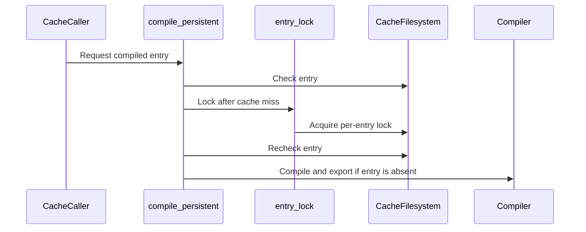

# perf(frost): deduplicate shared-cache compilation across processes

[Upstream PR](https://github.com/NVIDIA/cudnn-frontend/pull/1707) · state: open · merged: False

## Original PR description

## Before submitting

- [x] I agree to license this contribution under the terms of [LICENSE.txt](https://github.com/NVIDIA/cudnn-frontend/blob/develop/LICENSE.txt).
- [x] I ran `pre-commit run` and committed any formatting changes.
- [x] I reviewed the applicable `AGENTS.md` Hard Rules and my changes comply.
- [x] I added the required category, area, and origin labels.

## Affected area

FE OSS kernels / FROST compiled-artifact cache.

## Summary

When multiple processes start with the same empty FROST cache, each currently compiles the same kernel before publishing its artifact. Add a POSIX advisory lock per environment/artifact key, and recheck the cache after acquiring it so waiting processes load the first published artifact.

Warm cache hits remain lock-free, and different keys can compile concurrently. The OS releases locks on process exit, including compiler failure or termination. If locking is unavailable, compilation retains the existing best-effort behavior. Lock files stay outside the prunable environment directories and are not unlinked while callers may hold them.

## Why

Atomic publication prevents partial artifacts but does not prevent duplicated compilation during multi-process cold starts. This addresses that shared-cache race without changing kernel selection or generated code.

## Related issues

None.

## API and compatibility impact

No public API or cache-record changes. Cross-process deduplication requires a filesystem supporting POSIX advisory locks; other environments continue compiling without deduplication. Existing uncached execution and best-effort export fallbacks remain functional. A miss that cannot export a reusable artifact still requires each caller to compile; same-key misses are serialized while locking is available.

## Testing

- Host regressions with real subprocesses and filesystem locks, using a fake compiler: four simultaneous cold callers compile once; a warm caller avoids locking; different keys compile concurrently; compiler exceptions and process termination release the lock; unavailable locking falls back safely.
- Observed the four-caller test fail on the base implementation (four compilations), then pass with this patch.
- `PYTEST_DISABLE_PLUGIN_AUTOLOAD=1 python -m pytest -q --confcutdir=test/python/core/frost -o addopts='' test/python/core/frost/test_compiled_cache.py test/python/core/frost/test_compiled_cache_concurrency.py`: **26 passed**.
- Scoped `pre-commit run --files ...`: all applicable checks passed.
- On B200, `python -m pytest -q -o addopts='' -m L0 core/frost/test_compiled_cache.py core/frost/test_compiled_cache_concurrency.py gemm/frost/test_compiled_cache_gpu.py`: **28 passed**, including real GPU subprocesses sharing one compilation, numerical agreement with a PyTorch reference, and identical output digests.
- GPU environment: cuDNN Frontend built from this branch at `8144911ac87948d2f507c94fca4d4d8c640bc14a`, cuDNN 9.27.0.42, CuTe DSL 4.8.0, PyTorch 2.14.1+cu130, driver 615.71.09.
- A four-rank B200 comparison passed all 24 rank/phase checks (base and candidate; cold, artifact-warm, saved-winner warm), including eager and graph-replay numerical checks. Each rank used a separate GPU and eight pinned CPU cores. The route was FlashInfer `mm_bf16(backend="cudnn")` with FROST engines enabled, `M={8,64,256}`, `N=1024`, `K=2048`; traces recorded `cudnn.gemm.frost.engine.FrostGemmEngine`. FlashInfer was fixed at `89b3a6c40eae749e20ff36c3e388f98a33a9ef3e`; FE base was `e4529fe5f573e230ded3104cd9d472775c4ca9ce`.

| Cache state | Base total compilations / four ranks | Patched total compilations / four ranks | Base tuning wall time / rank | Patched tuning wall time / rank |
| --- | ---: | ---: | ---: | ---: |
| Cold | 64 | 16 | 31.73–31.77 s | 27.72–27.75 s |
| Artifacts only | 0 | 0 | 3.83–3.95 s | 6.08–6.36 s |
| Artifacts + saved winners | 0 | 0 | 3.24–3.25 s | 3.23–3.26 s |

These are one paired startup measurement, not serving throughput or a claim of uniform latency improvement. The slower artifacts-only sample came predominantly from `create_execution_plans`, before the compiled-cache path (rank 0: 0.61 s base / 3.05 s patched); compiled-cache time itself was 1.55 s / 1.43 s. All artifacts-only and saved-winner processes had zero compiler calls and zero export failures. The deterministic improvement is removing 48 duplicate cold compilations; plan enumeration and profiling remain separate startup costs.

Review follow-up: commit `5fc94bdc638ff1c33e8ec1b93e0dcfb0a1a500b9` adds contract docstrings in response to the review coverage warning; runtime behavior is unchanged. The 26 host regressions were rerun successfully.

Internal CI on `5fc94bd` (pipeline 74799147): the SM100 FROST GEMM lane passed **6,420 tests** (3,597 skipped), including both real-GPU disk-cache tests. The core/FROST lane passed all **26 cache tests**; its sole failure is the existing SDPA kernel-name-prefix guard, reproduced unchanged on base `e4529fe`. The full-repository guardword scan also flags an unchanged norm README line already present in that base. These two baseline failures keep the internal pipeline red; they are not reported as a clean pipeline.

Combined integration validation: an unpushed merge preview of #1707 `5fc94bd` and #1708 `f78a808` (merge commit `4da9afe`) passed **33 tests** on SM103 with CuTe DSL 4.8.0: 22 cache tests, 5 concurrency tests, 4 linear-attention fresh-process tests, and 2 GEMM GPU cache tests. All four linear-attention families reported zero warm-process compiler calls.

## Review and discussion

### reviews

- yihuawei · APPROVED · 2026-10-18T13:01:52Z · [source](https://github.com/NVIDIA/cudnn-frontend/pull/1707#pullrequestreview-5563091216)

**Codex bot review · model: `gpt-6-astra`**

Reviewed `5fc94bdc638f` against base `ae7493d2bae4`.

Completed review; no actionable defect found. The lock is scoped to the existing environment/artifact identity and held through publication/reload. The second lookup closes the cold-start race, while warm hits and unsupported-cache bypasses remain outside the lock. Keeping lock inodes outside pruned environment directories preserves waiter coordination.

Validation: 26 cache tests passed, including real-process checks for one compilation across four cold callers, lock-free warm hits, parallel different keys, exception/termination recovery and unavailable-lock fallback. The new four-caller test failed on the unchanged base with four compilations and passed on this head with one. Two native SM100 GPU cache tests passed with DSL 4.7.0 and verified source/binding imports in the parent and all four children. For BF16 GEMM M256/N512/K256, two concurrent cold processes produced one miss and one hit, both returned reloaded artifacts, and both passed full numerical comparison with identical output digests. Sequential fresh-process warm reload also passed; no export failures occurred. Reused current-head pipeline 74799147, whose integration matches all five changed files: 21 passed, 2 failed, 6 skipped, 10 manual. GEMM SM100 and C++ sanitizer lanes passed. The author reports the core cache tests passed and attributes its kernel-prefix assertion and guardword failure to the unchanged base; those failed jobs remain failed.

Limitations: My concurrency validation used a local POSIX filesystem and one SM100 GPU. I did not independently repeat the author's four-GPU startup timing or test a shared network filesystem. Removing duplicate compilation is verified; it is not a claim of uniform startup or serving latency improvement. CI raw traces and the author's combined #1707/#1708 SM103 run are peer evidence. The newer base only adds #1709 SDPA scheduling; cache, GEMM and binding inputs are unchanged.

Approved: no P0 or high-risk P1 found. Remaining findings stay with the owner; merge timing stays with the owner.

<!-- codex-fe-review:v2:1707:5fc94bdc638ff1c33e8ec1b93e0dcfb0a1a500b9:complete:no-blocker -->

### issue_comments

- coderabbitai[bot] · comment · 2026-10-18T10:33:22Z · [source](https://github.com/NVIDIA/cudnn-frontend/pull/1707#issuecomment-6248799747)

<!-- This is an auto-generated comment: summarize by coderabbit.ai -->
<!-- review_stack_entry_start -->

<a href="https://app.coderabbit.ai/change-stack/NVIDIA/cudnn-frontend/pull/1707?scope=ghh_OusAJGA4HG8ljoOV0wJvVx8NmnZIjc2DdjmxOu0xZWA&amp;cs_source=review_comment"><picture><source media="(prefers-color-scheme: dark)" srcset="https://storage.googleapis.com/coderabbit_public_assets/review-stack-in-coderabbit-ui-dark.svg?v=3"><source media="(prefers-color-scheme: light)" srcset="https://storage.googleapis.com/coderabbit_public_assets/review-stack-in-coderabbit-ui.svg?v=3"></picture></a>

<!-- review_stack_entry_end -->
<!-- recent_review_start -->

No actionable comments were generated in the recent review. 🎉

<strong>ℹ️ Recent review info</strong>

<dl>
<dd>

<strong>⚙️ Run configuration</strong>

<dl>
<dd>

- **Configuration used**: Repository: NVIDIA/cudnn-frontend/.coderabbit.yaml
- **Review profile**: CHILL
- **Plan**: Enterprise
- **Run ID**: `1b54ca10-221a-47eb-90b2-d3dd12178335`

</dd>
</dl>

<strong>📥 Commits</strong>

<dl>
<dd>

Reviewing files that changed from the base of the PR and between 8144911ac87948d2f507c94fca4d4d8c640bc14a and 5fc94bdc638ff1c33e8ec1b93e0dcfb0a1a500b9.

</dd>
</dl>

<strong>📒 Files selected for processing: 3</strong>

<dl>
<dd>

* `python/cudnn/frost/compiled_cache.py`
* `test/python/core/frost/test_compiled_cache_concurrency.py`
* `test/python/gemm/frost/test_compiled_cache_gpu.py`

</dd>
</dl>

<strong>🚧 Files skipped from review as they are similar to previous changes: 2</strong>

<dl>
<dd>

* python/cudnn/frost/compiled_cache.py
* test/python/gemm/frost/test_compiled_cache_gpu.py

</dd>
</dl>

**Included review availability:** This review used your included allowance. Your plan provides up to 12 included reviews per hour; 7 remain after this review.

</dd>
</dl>

<!-- recent_review_end -->
<!-- walkthrough_start -->

<strong>📝 Walkthrough</strong>

<dl>
<dd>

The compiled cache now uses per-entry process locks for cold cache entries when POSIX advisory locking is available. It rechecks the cache after acquiring a lock. New tests cover process-level and GPU cache concurrency, lock failures, and warm hits.

**Changes: Compiled cache locking**

|Layer / File(s)|Summary|
|:---|:---|
|**Per-entry locking and cache behavior**   `python/cudnn/frost/compiled_cache.py`, `docs/utilities/python_graph_and_execution_backends.md`, `test/python/core/frost/test_compiled_cache.py`|Cold cache misses acquire a per-entry lock and recheck the cache before compiling. The documentation describes locking and fallback behavior. The cache test checks warm-call reuse without requiring exactly one initial load attempt.|
|**Process-level concurrency tests**   `test/python/core/frost/test_compiled_cache_concurrency.py`|POSIX-only tests cover concurrent callers for the same and different keys, warm hits, retries after compiler failure or process termination, and unavailable lock storage.|
|**GPU cache concurrency test**   `test/python/gemm/frost/test_compiled_cache_gpu.py`|A POSIX-only test coordinates two child processes using a shared cache and checks cache statistics and GEMM output results.|

<!-- change_assessment_start -->
**Priority:** ➖ Normal

**Estimated code review effort:** 3 (Moderate) | ~25 minutes

<!-- change_assessment_commit:"5fc94bdc638ff1c33e8ec1b93e0dcfb0a1a500b9" -->
**Change:** Feature
<!-- change_assessment_end -->

### Sequence Diagram(s)

</dd>
</dl>

<!-- walkthrough_end -->

<strong>Merge Risk:</strong> <strong>⚪ Minimal</strong> · up to <code>5fc94</code>

<dl>
<dd>

<!-- final_review_risk_start -->
<!-- final_review_risk_label
**Merge Risk:** **⚪ Minimal** · up to `5fc94`
-->
<!-- final_review_risk_coverage:{"sourceCommitId":"5fc94bdc638ff1c33e8ec1b93e0dcfb0a1a500b9","coveredCommitId":"5fc94bdc638ff1c33e8ec1b93e0dcfb0a1a500b9","kind":"reviewed"} -->

The change aims to reduce duplicate cold-start compilation while preserving concurrency for separate cache entries. The supplied evidence leaves no actionable merge-blocking risk, so it appears ready for normal checks.
<!-- final_review_risk_end -->

</dd>
</dl>

<!-- pre_merge_checks_walkthrough_start -->

<strong>Pre-merge checks: <picture></picture> 5</strong>

<dl>
<dd>

|         Check name         |                                             Status                                             | Explanation                                                                                                                                                                                               |
| :------------------------ | :--------------------------------------------------------------------------------------------: | :-------------------------------------------------------------------------------------------------------------------------------------------------------------------------------------------------------- |
|     Docstring Coverage     |  | Docstring coverage is 92.86% which is sufficient. The required threshold is 80.00%. Docstring coverage is scoped to functions touched by this diff. Analyzed 14 functions across 4 files.                 |
|     Linked Issues check    |  | Check skipped because no linked issues were found for this pull request.                                                                                                                                  |
| Out of Scope Changes check |  | Check skipped because no linked issues were found for this pull request.                                                                                                                                  |
|         Title check        |  | The title clearly and concisely describes the main change: deduplicating shared FROST cache compilation across processes.                                                                                 |
|      Description check     |  | The description follows the required template and provides complete summaries, rationale, compatibility impact, related issues, and detailed testing results. It also documents expected limitations and… |

<strong>Full details: Description check</strong>

<dl>
<dd>

**Explanation**

The description follows the required template and provides complete summaries, rationale, compatibility impact, related issues, and detailed testing results. It also documents expected limitations and baseline failures.

</dd>
</dl>

</dd>
</dl>

<!-- pre_merge_checks_walkthrough_end -->
<!-- finishing_touch_checkbox_start -->

<strong>✨ Finishing Touches</strong>

<dl>
<dd>

<strong>🧪 Generate unit tests (beta)</strong>

<dl>
<dd>

- [ ] <!-- {"checkboxId": "f47ac10b-58cc-4372-a567-0e02b2c3d479", "radioGroupId": "utg-output-choice-group-unknown_comment_id"} --> Create a new PR

</dd>
</dl>

</dd>
</dl>

<!-- finishing_touch_checkbox_end -->

<!-- autopilot:start -->
- [ ] <!-- {"checkboxId":"2708ad07-9f24-4260-9c11-7dc76a49f2e3"} --> <strong title="Keep fixing CodeRabbit findings and required CI, and resolving merge conflicts">Autofix</strong> · Keep fixing CodeRabbit findings and required CI, and resolving merge conflicts
<!-- autopilot:end -->
<!-- tips_start -->

Comment `@coderabbitai help` to get the list of available commands.

<!-- tips_end -->

- YangXu1990uiuc · comment · 2026-10-18T12:02:56Z · [source](https://github.com/NVIDIA/cudnn-frontend/pull/1707#issuecomment-6249680545)

@cudnn-ci-bot run python/gemm/frost python/*/frost

- cudnn-ci-bot · comment · 2026-10-18T12:03:00Z · [source](https://github.com/NVIDIA/cudnn-frontend/pull/1707#issuecomment-6249681290)

🏁 Pipeline finished

SHA: `5fc94bd`
Targets: `python/gemm/frost`, `python/*/frost`
Branch: [cudnn-gh/pr-1707-5fc94bd](https://nv/cudnn-gitlab-ci/-/tree/cudnn-gh/pr-1707-5fc94bd)
Pipeline: [74799147](https://nv/cudnn-gitlab-ci/-/pipelines/74799147)
Last updated: 2026-10-18 12:15 UTC

**21 passed, 2 failed, 6 skipped, 10 manual**

### <code>manual</code>

- <code>manual:python_samples</code> - Manual
- <code>manual:python</code> - Manual
- <code>manual:python/sdpa/frost</code> - Manual
- <code>manual:python/linear_attention/frost</code> - Manual
- <code>manual:python/gemm/frost</code> - ✅ Passed
- <code>manual:python/*/frost</code> - ✅ Passed
- <code>manual:python/gemm/cutedsl</code> - Manual
- <code>manual:python/*/cutedsl</code> - Manual
- <code>manual:python/*/jax</code> - Manual
- <code>manual:pycudnn</code> - Manual
- <code>manual:multi_gpu</code> - Manual
- <code>manual:backend</code> - Manual

### <code>analysis</code>

- <code>analysis:cudnn_clang_disable_exception</code> - ✅ Passed
- <code>analysis:cudnn_v9_no_half_conversion</code> - ✅ Passed
- <code>analysis:cudnn_clang</code> - ✅ Passed
- <code>analysis:check-relative-includes</code> - ✅ Passed
- <code>analysis:check-CUDNN_FRONTEND_SKIP_JSON_LIB</code> - ✅ Passed
- <code>analysis:guardwords_scan</code> - ❌ **Old Failure** (nightly failed)
- <code>analysis:jax-import-guard</code> - ✅ Passed
- <code>analysis:pytest-gpu</code> - ✅ Passed
- <code>san:build</code> - ✅ Passed

### <code>build</code>

- <code>analysis:api_index</code> - ✅ Passed
- <code>build:dev:linux:amd64</code> - ✅ Passed
- <code>build:rel:linux:amd64</code> - ✅ Passed
- <code>build:dev:linux:arm64</code> - ✅ Passed
- <code>build:rel:linux:arm64</code> - ✅ Passed
- <code>build:rel:win:amd64</code> - ✅ Passed

### <code>frost_tests</code>

- <code>python/sdpa/frost:cutlass-rel:sm80</code> - Skipped
- <code>python/sdpa/frost:cutlass-rel:sm100</code> - Skipped
- <code>python/sdpa/frost:cutlass-rel:sm120</code> - Skipped
- <code>python/linear_attention/frost:cutlass-rel:sm100</code> - Skipped
- <code>python/gemm/frost:cutlass-rel:sm100</code> - ✅ Passed
- <code>python/*/frost:cutlass-rel:sm100</code> - ❌ **Failed** (nightly unknown)
- <code>python/sdpa/frost:cutlass-rel:sm103</code> - Skipped
- <code>python/sdpa/frost:cutlass-4.8:sm107</code> - Skipped

### <code>sanitizer_tests</code>

- <code>san:cpp_test:sm80</code> - ✅ Passed
- <code>san:cpp_test:sm90</code> - ✅ Passed
- <code>san:cpp_test:sm100</code> - ✅ Passed

### <code>triage</code>

- <code>triage:ai</code> - ✅ Passed

### inline_comments

## Changed files and fixed code

- `docs/utilities/python_graph_and_execution_backends.md` · modified · additions 10 / deletions 0
  - [head](https://github.com/YangXu1990uiuc/cudnn-frontend/blob/5fc94bdc638ff1c33e8ec1b93e0dcfb0a1a500b9/docs/utilities/python_graph_and_execution_backends.md)
  - [base](https://github.com/NVIDIA/cudnn-frontend/blob/e4529fe5f573e230ded3104cd9d472775c4ca9ce/docs/utilities/python_graph_and_execution_backends.md)
- `python/cudnn/frost/compiled_cache.py` · modified · additions 50 / deletions 0
  - [head](https://github.com/YangXu1990uiuc/cudnn-frontend/blob/5fc94bdc638ff1c33e8ec1b93e0dcfb0a1a500b9/python/cudnn/frost/compiled_cache.py)
  - [base](https://github.com/NVIDIA/cudnn-frontend/blob/e4529fe5f573e230ded3104cd9d472775c4ca9ce/python/cudnn/frost/compiled_cache.py)
- `test/python/core/frost/test_compiled_cache.py` · modified · additions 4 / deletions 2
  - [head](https://github.com/YangXu1990uiuc/cudnn-frontend/blob/5fc94bdc638ff1c33e8ec1b93e0dcfb0a1a500b9/test/python/core/frost/test_compiled_cache.py)
  - [base](https://github.com/NVIDIA/cudnn-frontend/blob/e4529fe5f573e230ded3104cd9d472775c4ca9ce/test/python/core/frost/test_compiled_cache.py)
- `test/python/core/frost/test_compiled_cache_concurrency.py` · added · additions 183 / deletions 0
  - [head](https://github.com/YangXu1990uiuc/cudnn-frontend/blob/5fc94bdc638ff1c33e8ec1b93e0dcfb0a1a500b9/test/python/core/frost/test_compiled_cache_concurrency.py)
  - [base](https://github.com/NVIDIA/cudnn-frontend/blob/e4529fe5f573e230ded3104cd9d472775c4ca9ce/test/python/core/frost/test_compiled_cache_concurrency.py)
- `test/python/gemm/frost/test_compiled_cache_gpu.py` · modified · additions 48 / deletions 1
  - [head](https://github.com/YangXu1990uiuc/cudnn-frontend/blob/5fc94bdc638ff1c33e8ec1b93e0dcfb0a1a500b9/test/python/gemm/frost/test_compiled_cache_gpu.py)
  - [base](https://github.com/NVIDIA/cudnn-frontend/blob/e4529fe5f573e230ded3104cd9d472775c4ca9ce/test/python/gemm/frost/test_compiled_cache_gpu.py)

## Evidence and interpretation boundary

[Original JSON, discussions and patches](../../../../../../evidence/prs/NVIDIA--cudnn-frontend/1707-4b5f04da9fa60af69fcd98b668866d314931bb4581a3bcdddcb7ccfb29baa84a.json) · SHA-256 `4b5f04da9fa60af69fcd98b668866d314931bb4581a3bcdddcb7ccfb29baa84a`.

Diff complete: True. Missing/binary/truncated patches require pinned source inspection. This is a source page, not an independently verified optimization case. Open, merged and released are different states; recheck the deployed dependency.
