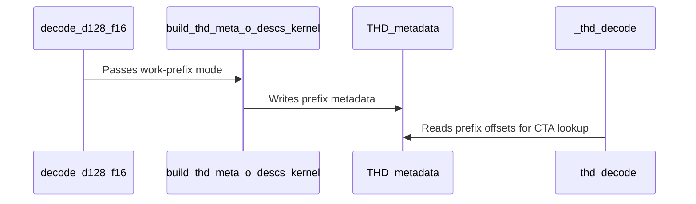

# Use work prefixes for packed paged split task lookup

[Upstream PR](https://github.com/NVIDIA/cudnn-frontend/pull/1711) · state: closed · merged: True

## Original PR description

Packed paged split attention currently scans every request each time a persistent CTA decodes a task. That repeats length loads and tile arithmetic even after the task's request has been found, so the scheduler cost grows with batch size.

Compute a cumulative tile/head count in the existing metadata setup kernel, in the existing request order. Task decoding then uses an upper-bound lookup; a single request uses direct indexing. The split count, request order, per-request head/tile order, partial outputs and combine kernel are unchanged. This applies to the existing single-CTA FP16/BF16 D128 packed paged prefix path. It does not change candidate selection or add a public tuning knob.

The prefix occupies B+1 additional int32 words in caller-owned workspace. Existing metadata offsets, launch count and native binding ABI stay unchanged. Its contents are rebuilt from current device lengths in the existing setup launch, with the existing publication barrier. There is no new per-run host preparation or device-to-host read.

Validation so far:

- SM100: 232 existing/new tests passed; 16 Rubin sink cases skipped. This includes different GQA/split values, layouts, O/Stats, native graph and standalone execution, rebinding and retained capture.
- Additional dynamic-capture probes cover batch sizes 33 and 65, empty requests and poisoned workspace. The new durable metadata test covers B0/1/2/31/32/33/65/257, length/prefix inputs, replay with changed lengths and guard words.
- Rubin: 248 tests passed, including sink-aware split cases. No Rubin performance data is included here.
- Metadata memcheck and racecheck: 16 tests each, zero errors/hazards. Full attention memcheck and racecheck also passed two retained-capture geometries each, with zero errors/hazards.
- Local paired measurements and independent hold-outs support the indexing change. Full-power B200 qualification remains a pre-merge requirement; no serving-throughput claim is made.

Ready for review while the remaining target qualification runs. Do not merge until those results and actual CI are complete and attributed.

<!-- This is an auto-generated comment: release notes by coderabbit.ai -->
## Summary by CodeRabbit

* **New Features**
  * Added prefix-based work distribution for a supported paged attention configuration, using batch-specific metadata to map tasks to their work.
* **Bug Fixes**
  * Improved split-attention workspace size queries so reported sizes remain consistent before and after compilation.
* **Tests**
  * Added coverage for configuration eligibility and replay with changing sequence lengths, empty requests, input prefixes, and guarded metadata storage. Also checks that unrelated configuration families do not enable the feature.
<!-- end of auto-generated comment: release notes by coderabbit.ai -->

## Review and discussion

### reviews

- yihuawei · APPROVED · 2026-10-18T14:04:13Z · [source](https://github.com/NVIDIA/cudnn-frontend/pull/1711#pullrequestreview-5563303101)

**Codex bot review · model: `gpt-6-astra`**

Reviewed `ef1dab8ba016` against base `e2301f2f5bc9`.

Completed review with one nonblocking P2 in standalone workspace sizing. The prefix producer, upper-bound task mapping, split ordering and descriptor layout agree for the reviewed path; no approval-blocking defect found. The author's pending target qualification and CI remain pre-merge requirements.

**[P2] Preserve workspace queries before compilation** ([source](https://github.com/NVIDIA/cudnn-frontend/blob/ef1dab8ba016d21d75f66d144fa5b67a664033e1/python/cudnn/sdpa/fwd/api_dsl.py#L4592))

scratch_workspace_bytes() explicitly permits calls after check_support(), but _k_mod is still None until compile(). For a supported packed THD split plan this new expression dereferences _k_mod.CFG and raises AttributeError, preventing callers from sizing their workspace in the documented order. It also affects paged unpacked-GQA and nonpaged packed-GQA split plans, since packed_thd_split is true before the prefix predicate can reject them. Derive the required metadata extent from checked plan geometry without requiring a compiled module, and test that pre/post-compile queries agree, including a batch size that changes the aligned extent. Compiling first is a working workaround.

Evidence: Native SM100/DSL 4.7.0, BF16 B3 H8/Hkv2 Q129/KV2304 D128, CGA1 split4: all three configurations passed check_support(). Base e2301f2f returned 6,391,296 bytes before and after compile; head ef1dab8 raised AttributeError: 'NoneType' object has no attribute 'CFG' before compile and returned 6,391,296 afterward. Attribution: Independently found and reproduced during this review.

Validation: Native SM100 with DSL 4.7.0: 152 metadata tests and 56 selected paged D128 GQA attention tests passed. Coverage includes B0/1/2/31/32/33/65/257 metadata, length/cumulative inputs, FP16/BF16, page16/128, layouts, Stats, natural/LPT scheduling, standalone/native graph execution and changed-length retained capture. Independent B1/33/65 BF16 probes passed full FP64 O/LSE comparisons, changed Q/KV lengths, interspersed empty requests, causal-empty rows, all-empty replay, poisoned workspace/output and untouched output tails. Actual native packed split4/CGA1 route was asserted; B65 exercised LPT_L2. Base/head/head/base, four fresh processes, H8/Hkv2 Q65 KV1024 D128 page128 HND: complete captured setup+attention+combine GPU times were 24.74 to 23.76 us (B1), 275.03 to 164.47 us (B33), and 767.70 to 310.43 us (B65). Separate host enqueue times were approximately 26.65 to 26.21, 30.79 to 28.32, and 36.68 to 30.29 us. These bounded measurements support the larger-batch indexing benefit. All 16 new metadata cases passed racecheck with zero hazards. A B65 LPT_L2 full-attention replay probe passed memcheck with zero device-memory errors using API-error reporting disabled. The initial unfiltered metadata memcheck completed all 16 tests but exited on host API probing diagnostics; it is not recorded as a clean whole-tool pass.

Limitations: Own runtime evidence is limited to local SM100 with unlocked clocks. SM103/SM107 and full-power B200 qualification were not independently run here; no serving-throughput claim is made. Author-triggered current-head pipeline 74810048 is still running. Its integration matches all seven PR-diff files; the only additional base change is the previously reviewed page128 selection update. CI is pending evidence, and the PR's stated full-power B200 qualification remains outstanding.

Approved: no P0 or high-risk P1 found. Remaining findings stay with the owner; merge timing stays with the owner.

<!-- codex-fe-review:v2:1711:ef1dab8ba016d21d75f66d144fa5b67a664033e1:complete:no-blocker -->

- yihuawei · COMMENTED · 2026-10-18T14:24:48Z · [source](https://github.com/NVIDIA/cudnn-frontend/pull/1711#pullrequestreview-5563373507)

**Codex bot review · model: `gpt-6-astra`**

Reviewed `baaaa546d275` against base `e2301f2f5bc9`.

Verified the author's D512 compilation fix, which addresses the shared-helper regression missed in my first review. Rejecting other head geometries before reading family-specific fields preserves the intended D128 predicate. The existing nonblocking workspace-query P2 remains reproducible; no new approval blocker found in this follow-up.

- **[P2] Still open:** [Preserve workspace queries before compilation](https://github.com/NVIDIA/cudnn-frontend/pull/1711#pullrequestreview-5563303101).

Validation: Native SM100, DSL 4.7.0: 37 focused tests passed in 5.84 s: FP16/BF16 D512 packed THD graph execution with reference-output and tail-sentinel checks, all 19 new real-configuration predicate cases, and all 16 metadata replay cases. The unchanged BF16 D512 test failed on ef1dab8 with the exact missing-PAGED_KV AttributeError and passes on this head. Real SM100 and SM107 D512 configuration factories now return false from the predicate; both raised AttributeError on ef1dab8. The SM107 part is a host configuration check, not native SM107 execution. Reproduced the remaining workspace-query P2 on this head for paged packed, paged unpacked and nonpaged packed split configurations. All pass support checking and fail only when querying scratch before compile; compile-first queries still succeed. Reused the first review's D128 full-output/capture, B1/33/65 paired performance and scoped sanitizer evidence. This follow-up changes predicate evaluation order, adds configuration tests and documents the shared contract; the D128 kernel, metadata producer, workspace and native binding implementations are byte-identical.

Limitations: Replacement pipeline 74816862 is running and all eight PR-diff paths match its integration. The failed ef1dab8 pipeline remains separately recorded in the CI follow-up. Author-reported broader SM100 fixes and Rubin validation are peer evidence; own native SM103/SM107 and full-power B200 qualification remain unperformed. The PR's stated CI/B200 merge prerequisites remain outstanding.

Comment only: this PR already has an active approval; preserving existing approvals.

<!-- codex-fe-review:v2:1711:baaaa546d27538d977cb5c07c871b977efc02252:complete:no-blocker -->

- yihuawei · COMMENTED · 2026-10-18T15:10:21Z · [source](https://github.com/NVIDIA/cudnn-frontend/pull/1711#pullrequestreview-5563611510)

**Codex bot review · model: `gpt-6-astra`**

Reviewed `6b8f637e1849` against base `e2301f2f5bc9`.

The workspace-query P2 from my first review is resolved. Metadata sizing now depends on checked plan geometry, remains stable through compilation, and reserves the extra tail for all packed THD splits. Nonindexed variants safely leave that tail unused. No unresolved finding remains from this review.

Validation: Native SM100 with DSL 4.7.0: all six new standalone regression cases passed (7.70 s), covering B3/B13 and paged packed, paged unpacked, and nonpaged packed configurations. Each allocates the exact queried workspace before compilation, verifies equal pre/post-compile sizes, then executes with that buffer and checks O and analytical causal LSE. B13 covers the metadata alignment boundary. The same six cases also passed device-memory memcheck with zero errors, with API-error reporting disabled. The previously saved old-head controls reproduce AttributeError before compile for all three supported configuration types. Checked that the workspace layout, prepared descriptor offsets and native binding all consume the same metadata extent. Reused the preceding D512 fix verification and D128 numerical/capture/performance evidence: this revision changes only workspace sizing, six tests and contract documentation; kernel bodies and the corrected eligibility predicate are unchanged. The indexed D128 path retains its previous allocation and execution geometry.

Limitations: Current-head pipeline 74822690 is still running; all eight PR-diff paths match its integration. The preceding baaaa546d pipeline passed SDPA SM100/SM103 but had canceled SM107/SM120 lanes, which do not establish current-head coverage. Author-reported local SM107 tests remain peer evidence. Own native validation is SM100 only, and the stated full-power B200 qualification remains outstanding.

Comment only: this PR already has an active approval; preserving existing approvals.

<!-- codex-fe-review:v2:1711:6b8f637e18497173530bd540a1a0eaf258573fe2:complete:no-blocker -->

### issue_comments

- coderabbitai[bot] · comment · 2026-10-18T13:21:51Z · [source](https://github.com/NVIDIA/cudnn-frontend/pull/1711#issuecomment-6250420348)

<!-- This is an auto-generated comment: summarize by coderabbit.ai -->
<!-- review_stack_entry_start -->

<a href="https://app.coderabbit.ai/change-stack/NVIDIA/cudnn-frontend/pull/1711?scope=ghh_OusAJGA4HG8ljoOV0wJvVx8NmnZIjc2DdjmxOu0xZWA&amp;cs_source=review_comment"><picture><source media="(prefers-color-scheme: dark)" srcset="https://storage.googleapis.com/coderabbit_public_assets/review-stack-in-coderabbit-ui-dark.svg?v=3"><source media="(prefers-color-scheme: light)" srcset="https://storage.googleapis.com/coderabbit_public_assets/review-stack-in-coderabbit-ui.svg?v=3"></picture></a>

<!-- review_stack_entry_end -->
<!-- recent_review_start -->

No actionable comments were generated in the recent review. 🎉

<strong>ℹ️ Recent review info</strong>

<dl>
<dd>

<strong>⚙️ Run configuration</strong>

<dl>
<dd>

- **Configuration used**: Repository: NVIDIA/cudnn-frontend/.coderabbit.yaml
- **Review profile**: CHILL
- **Plan**: Enterprise
- **Run ID**: `af5a1726-885e-482f-9eb3-6600cd0de755`

</dd>
</dl>

<strong>📥 Commits</strong>

<dl>
<dd>

Reviewing files that changed from the base of the PR and between baaaa546d27538d977cb5c07c871b977efc02252 and 6b8f637e18497173530bd540a1a0eaf258573fe2.

</dd>
</dl>

<strong>📒 Files selected for processing: 3</strong>

<dl>
<dd>

* `python/cudnn/sdpa/AGENTS.md`
* `python/cudnn/sdpa/fwd/api_dsl.py`
* `test/python/sdpa/frost/test_sdpa_prepared_thd.py`

</dd>
</dl>

**Included review availability:** This review used your included allowance. Your plan provides up to 12 included reviews per hour; 10 remain after this review.

</dd>
</dl>

<!-- recent_review_end -->
<!-- walkthrough_start -->

<strong>📝 Walkthrough</strong>

<dl>
<dd>

The THD forward path adds optional work-prefix metadata. Eligible configurations size and populate this metadata, then use it to map CTA indices to batches and local work items. Other configurations retain the existing THD metadata path.

**Changes: THD Work-Prefix Task Lookup**

|Layer / File(s)|Summary|
|:---|:---|
|**Prefix metadata layout and production**   `python/cudnn/frost/tile_dsl/thd.py`, `python/cudnn/sdpa/fwd/kernels/thd_helpers.py`|THD metadata gains prefix offsets and a work-prefix writer. The metadata setup kernel selects that writer when enabled; otherwise, it retains the existing live-count and counter write.|
|**Configuration selection and metadata sizing**   `python/cudnn/sdpa/fwd/config_sm100.py`, `python/cudnn/sdpa/AGENTS.md`, `python/cudnn/sdpa/fwd/api_dsl.py`, `python/cudnn/sdpa/fwd/kernels/sm100/decode_d128_f16.py`, `python/cudnn/sdpa/fwd/kernels/_common_blackwell.py`, `test/python/sdpa/frost/test_sdpa_prepared_thd.py`|A configuration predicate selects work-prefix mode. Workspace and operand metadata sizing use the corresponding word count, and the kernel setup passes the mode to metadata setup and operand allocation. Tests cover configuration selection and scratch sizing before and after compilation.|
|**Prefix-based CTA decoding and validation**   `python/cudnn/sdpa/fwd/kernels/_common_blackwell.py`, `test/python/sdpa/frost/test_sdpa_prepared_thd.py`|The decoder uses prefix offsets and remapping metadata to map CTA indices to batch, row, and head. Replay tests check prefix values, totals, remapping, and storage bounds across length states.|

<!-- change_assessment_start -->
**Priority:** ⬇️ Low

**Estimated code review effort:** 3 (Moderate) | ~25 minutes

<!-- change_assessment_commit:"6b8f637e18497173530bd540a1a0eaf258573fe2" -->
**Change:** Refactor
<!-- change_assessment_end -->

### Sequence Diagram(s)

</dd>
</dl>

<!-- walkthrough_end -->

<strong>Merge Risk:</strong> <strong>⚪ Minimal</strong> · up to <code>6b8f6</code>

<dl>
<dd>

<!-- final_review_risk_start -->
<!-- final_review_risk_label
**Merge Risk:** **⚪ Minimal** · up to `6b8f6`
-->
<!-- final_review_risk_coverage:{"sourceCommitId":"6b8f637e18497173530bd540a1a0eaf258573fe2","coveredCommitId":"6b8f637e18497173530bd540a1a0eaf258573fe2","kind":"reviewed"} -->

No actionable regression was established in the reviewed changes. Merge readiness remains subject to the stated CI and hardware qualification requirements.
<!-- final_review_risk_end -->

</dd>
</dl>

<!-- pre_merge_checks_walkthrough_start -->

<strong>Pre-merge checks: <picture></picture> 4 · <picture></picture> 1</strong>

<dl>
<dd>

<strong><picture></picture> Failed checks: 1 warning</strong>

|     Check name     |                                              Status                                              | Explanation                                                                                                                                                                                               | Resolution                                                                         |
| :---------------- | :----------------------------------------------------------------------------------------------: | :-------------------------------------------------------------------------------------------------------------------------------------------------------------------------------------------------------- | :--------------------------------------------------------------------------------- |
| Docstring Coverage |  | Docstring coverage is 60.00% which is insufficient. The required threshold is 80.00%. Docstring coverage is scoped to functions touched by this diff. Analyzed 25 functions across 7 files. (1 skipped: … | Write docstrings for the functions missing them to satisfy the coverage threshold. |

<strong><picture></picture> Passed checks: 4 passed</strong>

<dl>
<dd>

|         Check name         |                                             Status                                             | Explanation                                                                                                                                                                                               |
| :------------------------ | :--------------------------------------------------------------------------------------------: | :-------------------------------------------------------------------------------------------------------------------------------------------------------------------------------------------------------- |
|         Title check        |  | The title clearly summarizes the primary change: using work prefixes for packed paged split task lookup.                                                                                                  |
|      Description check     |  | The description clearly explains the problem, implementation, compatibility impact, scope, and extensive validation. It does not explicitly include the template headings, affected area, related issues… |
|     Linked Issues check    |  | Check skipped because no linked issues were found for this pull request.                                                                                                                                  |
| Out of Scope Changes check |  | Check skipped because no linked issues were found for this pull request.                                                                                                                                  |

<strong>Full details: Description check</strong>

<dl>
<dd>

**Explanation**

The description clearly explains the problem, implementation, compatibility impact, scope, and extensive validation. It does not explicitly include the template headings, affected area, related issues, or completion status for the submission checklist, but the substantive required information is mostly present.

</dd>
</dl>

</dd>
</dl>

<strong>Full details: Docstring Coverage</strong>

<dl>
<dd>

**Explanation**

Docstring coverage is 60.00% which is insufficient. The required threshold is 80.00%. Docstring coverage is scoped to functions touched by this diff. Analyzed 25 functions across 7 files. (1 skipped: 1 unsupported.)

**Resolution**

Write docstrings for the functions missing them to satisfy the coverage threshold.

</dd>
</dl>

</dd>
</dl>

<!-- pre_merge_checks_walkthrough_end -->

- [ ] <!-- {"checkboxId":"585bb3f6-faf5-4dbf-96d2-74e382adf19a"} --> Fix all pre-merge checks with AI
<!-- finishing_touch_checkbox_start -->

<strong>✨ Finishing Touches: 💡 1</strong>

<dl>
<dd>

<!-- finishing_touch_suggestion:docstrings -->

<strong>📝 Generate docstrings: 💡</strong>

<dl>
<dd>

- [ ] <!-- {"checkboxId":"3e1879ae-f29b-4d0d-8e06-d12b7ba33d98"} --> Commit to this branch
- [ ] <!-- {"checkboxId":"7962f53c-55bc-4827-bfbf-6a18da830691"} --> Create a new PR

</dd>
</dl>

<strong>🧪 Generate unit tests (beta)</strong>

<dl>
<dd>

- [ ] <!-- {"checkboxId": "6ba7b810-9dad-11d1-80b4-00c04fd430c8", "radioGroupId": "utg-output-choice-group-unknown_comment_id"} --> Commit to this branch
- [ ] <!-- {"checkboxId": "f47ac10b-58cc-4372-a567-0e02b2c3d479", "radioGroupId": "utg-output-choice-group-unknown_comment_id"} --> Create a new PR

</dd>
</dl>

</dd>
</dl>

<!-- finishing_touch_checkbox_end -->

<!-- autopilot:start -->
- [ ] <!-- {"checkboxId":"2708ad07-9f24-4260-9c11-7dc76a49f2e3"} --> <strong title="Keep fixing CodeRabbit findings and required CI, and resolving merge conflicts">Autofix</strong> · Keep fixing CodeRabbit findings and required CI, and resolving merge conflicts
<!-- autopilot:end -->
<!-- tips_start -->

Comment `@coderabbitai help` to get the list of available commands.

<!-- tips_end -->

- YangXu1990uiuc · comment · 2026-10-18T13:22:05Z · [source](https://github.com/NVIDIA/cudnn-frontend/pull/1711#issuecomment-6250422530)

@cudnn-ci-bot run python/sdpa/frost

- cudnn-ci-bot · comment · 2026-10-18T13:22:09Z · [source](https://github.com/NVIDIA/cudnn-frontend/pull/1711#issuecomment-6250423106)

🏁 Pipeline finished

SHA: `ef1dab8`
Targets: `python/sdpa/frost`
Branch: [cudnn-gh/pr-1711-ef1dab8](https://nv/cudnn-gitlab-ci/-/tree/cudnn-gh/pr-1711-ef1dab8)
Pipeline: [74810048](https://nv/cudnn-gitlab-ci/-/pipelines/74810048)
Last updated: 2026-10-18 14:13 UTC

**21 passed, 4 failed, 3 skipped, 11 manual**

### <code>manual</code>

- <code>manual:python_samples</code> - Manual
- <code>manual:python</code> - Manual
- <code>manual:python/sdpa/frost</code> - ✅ Passed
- <code>manual:python/linear_attention/frost</code> - Manual
- <code>manual:python/gemm/frost</code> - Manual
- <code>manual:python/*/frost</code> - Manual
- <code>manual:python/gemm/cutedsl</code> - Manual
- <code>manual:python/*/cutedsl</code> - Manual
- <code>manual:python/*/jax</code> - Manual
- <code>manual:pycudnn</code> - Manual
- <code>manual:multi_gpu</code> - Manual
- <code>manual:backend</code> - Manual

### <code>analysis</code>

- <code>analysis:cudnn_clang_disable_exception</code> - ✅ Passed
- <code>analysis:cudnn_v9_no_half_conversion</code> - ✅ Passed
- <code>analysis:cudnn_clang</code> - ✅ Passed
- <code>analysis:check-relative-includes</code> - ✅ Passed
- <code>analysis:check-CUDNN_FRONTEND_SKIP_JSON_LIB</code> - ✅ Passed
- <code>analysis:guardwords_scan</code> - ❌ **Old Failure** (nightly failed)
- <code>analysis:jax-import-guard</code> - ✅ Passed
- <code>analysis:pytest-gpu</code> - ✅ Passed
- <code>san:build</code> - ✅ Passed

### <code>build</code>

- <code>analysis:api_index</code> - ✅ Passed
- <code>build:dev:linux:amd64</code> - ✅ Passed
- <code>build:rel:linux:amd64</code> - ✅ Passed
- <code>build:dev:linux:arm64</code> - ✅ Passed
- <code>build:rel:linux:arm64</code> - ✅ Passed
- <code>build:rel:win:amd64</code> - ✅ Passed

### <code>frost_tests</code>

- <code>python/sdpa/frost:cutlass-rel:sm80</code> - ✅ Passed
- <code>python/sdpa/frost:cutlass-rel:sm100</code> - ❌ **New Failure!** (nightly passed)
- <code>python/sdpa/frost:cutlass-rel:sm120</code> - ✅ Passed
- <code>python/linear_attention/frost:cutlass-rel:sm100</code> - Skipped
- <code>python/gemm/frost:cutlass-rel:sm100</code> - Skipped
- <code>python/*/frost:cutlass-rel:sm100</code> - Skipped
- <code>python/sdpa/frost:cutlass-rel:sm103</code> - ❌ **New Failure!** (nightly passed)
- <code>python/sdpa/frost:cutlass-4.8:sm107</code> - ❌ **Old Failure** (nightly failed)

### <code>sanitizer_tests</code>

- <code>san:cpp_test:sm80</code> - ✅ Passed
- <code>san:cpp_test:sm90</code> - ✅ Passed
- <code>san:cpp_test:sm100</code> - ✅ Passed

### <code>triage</code>

- <code>triage:ai</code> - ✅ Passed

- YangXu1990uiuc · comment · 2026-10-18T14:10:33Z · [source](https://github.com/NVIDIA/cudnn-frontend/pull/1711#issuecomment-6250899762)

Fixed the D512 build regression in baaaa546d. The new task-prefix predicate is called from shared decoding, but `CfgD512X2` does not define `PAGED_KV`. It now rejects unrelated head geometry before reading family-specific fields. This preserves the predicate result for the intended D128 path and adds no per-execute work or kernel launch.

I reproduced the exact D512 THD failure locally before the fix. All 76 failing SM100 CI test IDs now pass on the corrected source, including the graph stride cases. The D128 metadata/capture suite plus new real-config checks also passes: 251 passed, 16 architecture-specific skips. Scoped formatting/license checks pass. The original SM107 failures have the same missing-field cause (242 wrapped build exceptions and two stride cases), alongside the previously established unrelated D64 route assertion. Independent Rubin validation is also running; no runtime hang is being waived.

The PR remains Ready for review. A separate command below requests CI for this updated head.

- YangXu1990uiuc · comment · 2026-10-18T14:12:46Z · [source](https://github.com/NVIDIA/cudnn-frontend/pull/1711#issuecomment-6250922268)

@cudnn-ci-bot run python/sdpa/frost

- cudnn-ci-bot · comment · 2026-10-18T14:12:47Z · [source](https://github.com/NVIDIA/cudnn-frontend/pull/1711#issuecomment-6250922491)

🏁 Pipeline finished

SHA: `baaaa54`
Targets: `python/sdpa/frost`
Branch: [cudnn-gh/pr-1711-baaaa54](https://nv/cudnn-gitlab-ci/-/tree/cudnn-gh/pr-1711-baaaa54)
Pipeline: [74816862](https://nv/cudnn-gitlab-ci/-/pipelines/74816862)
Last updated: 2026-10-18 14:55 UTC

**21 passed, 1 failed, 3 canceled, 3 skipped, 11 manual**

### <code>manual</code>

- <code>manual:python_samples</code> - Manual
- <code>manual:python</code> - Manual
- <code>manual:python/sdpa/frost</code> - ✅ Passed
- <code>manual:python/linear_attention/frost</code> - Manual
- <code>manual:python/gemm/frost</code> - Manual
- <code>manual:python/*/frost</code> - Manual
- <code>manual:python/gemm/cutedsl</code> - Manual
- <code>manual:python/*/cutedsl</code> - Manual
- <code>manual:python/*/jax</code> - Manual
- <code>manual:pycudnn</code> - Manual
- <code>manual:multi_gpu</code> - Manual
- <code>manual:backend</code> - Manual

### <code>analysis</code>

- <code>analysis:cudnn_clang_disable_exception</code> - ✅ Passed
- <code>analysis:cudnn_v9_no_half_conversion</code> - ✅ Passed
- <code>analysis:cudnn_clang</code> - ✅ Passed
- <code>analysis:check-relative-includes</code> - ✅ Passed
- <code>analysis:check-CUDNN_FRONTEND_SKIP_JSON_LIB</code> - ✅ Passed
- <code>analysis:guardwords_scan</code> - ❌ **Old Failure** (nightly failed)
- <code>analysis:jax-import-guard</code> - ✅ Passed
- <code>analysis:pytest-gpu</code> - ✅ Passed
- <code>san:build</code> - ✅ Passed

### <code>build</code>

- <code>analysis:api_index</code> - ✅ Passed
- <code>build:dev:linux:amd64</code> - ✅ Passed
- <code>build:rel:linux:amd64</code> - ✅ Passed
- <code>build:dev:linux:arm64</code> - ✅ Passed
- <code>build:rel:linux:arm64</code> - ✅ Passed
- <code>build:rel:win:amd64</code> - ✅ Passed

### <code>frost_tests</code>

- <code>python/sdpa/frost:cutlass-rel:sm80</code> - ✅ Passed
- <code>python/sdpa/frost:cutlass-rel:sm100</code> - ✅ Passed
- <code>python/sdpa/frost:cutlass-rel:sm120</code> - Canceled
- <code>python/linear_attention/frost:cutlass-rel:sm100</code> - Skipped
- <code>python/gemm/frost:cutlass-rel:sm100</code> - Skipped
- <code>python/*/frost:cutlass-rel:sm100</code> - Skipped
- <code>python/sdpa/frost:cutlass-rel:sm103</code> - ✅ Passed
- <code>python/sdpa/frost:cutlass-4.8:sm107</code> - Canceled

### <code>sanitizer_tests</code>

- <code>san:cpp_test:sm80</code> - ✅ Passed
- <code>san:cpp_test:sm90</code> - ✅ Passed
- <code>san:cpp_test:sm100</code> - ✅ Passed

### <code>triage</code>

- <code>triage:ai</code> - Canceled

- yihuawei · comment · 2026-10-18T14:15:42Z · [source](https://github.com/NVIDIA/cudnn-frontend/pull/1711#issuecomment-6250953042)

Pipeline 74810048 for ef1dab8 has finished: 21 passed, 4 failed, 3 skipped and 11 manual. The failed jobs are SDPA SM100/SM103/SM107 and guardwords; the status marks guardwords as an existing nightly failure. SDPA SM80/SM120 and the C++ sanitizer jobs passed.

The author traced the D512 failures to the shared predicate reading a field absent from CfgD512X2. I independently reproduced that AttributeError with the real SM100 and SM107 configuration factories on ef1dab8. I missed this shared-helper regression in my first review; the D128 results reported there do not cover it. The author's 76 corrected SM100 cases and 251-test D128/configuration follow-up are peer evidence. I have not independently classified the SM103 lane failure or inspected the raw CI logs.

The author has pushed baaaa546d and started replacement pipeline 74816862. That run is pending; I will verify the fix in the follow-up review. The previously reported workspace-query P2 also remains to be checked.

Codex bot review — model `gpt-6-astra`.

<!-- codex-fe-ci:v1:1711:baaaa546d27538d977cb5c07c871b977efc02252:pipeline-74810048-finished -->

- YangXu1990uiuc · comment · 2026-10-18T14:48:10Z · [source](https://github.com/NVIDIA/cudnn-frontend/pull/1711#issuecomment-6251278888)

Fixed the workspace-query P2 in `6b8f637e1`. `scratch_workspace_bytes()` now derives the split metadata extent from checked plan geometry, so it works before compilation. All packed THD split variants reserve the small `B+1`-integer tail; variants that do not use the prefix leave it unused. This avoids duplicating kernel eligibility rules or importing a compiled kernel during sizing. The execution path and kernel bodies are unchanged.

The regression test allocates workspace before compilation, verifies identical pre/post-compile sizes, and executes with that exact buffer. It covers paged packed, paged unpacked, and nonpaged packed configurations at B3/B13, including the alignment boundary. The old code reproduces the reported AttributeError. All six new cases pass on both SM100 and SM107. Broader validation: SM100 407 passed / 78 skipped; focused SM107 76 passed / 6 skipped (the six are existing D192 FP16 automatic-placement skips). Scoped formatting/license hooks pass.

The preceding shared-config fix also completed independent SM107 validation: all 244 originally failing CI nodes plus 267 metadata/capture cases passed. Current-head internal CI is being requested separately; these local results are not reported as CI completion.

- YangXu1990uiuc · comment · 2026-10-18T14:49:06Z · [source](https://github.com/NVIDIA/cudnn-frontend/pull/1711#issuecomment-6251288052)

@cudnn-ci-bot run python/sdpa/frost

- cudnn-ci-bot · comment · 2026-10-18T14:49:10Z · [source](https://github.com/NVIDIA/cudnn-frontend/pull/1711#issuecomment-6251288686)

🏁 Pipeline finished

SHA: `6b8f637`
Targets: `python/sdpa/frost`
Branch: [cudnn-gh/pr-1711-6b8f637](https://nv/cudnn-gitlab-ci/-/tree/cudnn-gh/pr-1711-6b8f637)
Pipeline: [74822690](https://nv/cudnn-gitlab-ci/-/pipelines/74822690)
Cancelled this PR's older pipelines: 74816862
Last updated: 2026-10-18 15:38 UTC

**23 passed, 2 failed, 3 skipped, 11 manual**

### <code>manual</code>

- <code>manual:python_samples</code> - Manual
- <code>manual:python</code> - Manual
- <code>manual:python/sdpa/frost</code> - ✅ Passed
- <code>manual:python/linear_attention/frost</code> - Manual
- <code>manual:python/gemm/frost</code> - Manual
- <code>manual:python/*/frost</code> - Manual
- <code>manual:python/gemm/cutedsl</code> - Manual
- <code>manual:python/*/cutedsl</code> - Manual
- <code>manual:python/*/jax</code> - Manual
- <code>manual:pycudnn</code> - Manual
- <code>manual:multi_gpu</code> - Manual
- <code>manual:backend</code> - Manual

### <code>analysis</code>

- <code>analysis:cudnn_clang_disable_exception</code> - ✅ Passed
- <code>analysis:cudnn_v9_no_half_conversion</code> - ✅ Passed
- <code>analysis:cudnn_clang</code> - ✅ Passed
- <code>analysis:check-relative-includes</code> - ✅ Passed
- <code>analysis:check-CUDNN_FRONTEND_SKIP_JSON_LIB</code> - ✅ Passed
- <code>analysis:guardwords_scan</code> - ❌ **Old Failure** (nightly failed)
- <code>analysis:jax-import-guard</code> - ✅ Passed
- <code>analysis:pytest-gpu</code> - ✅ Passed
- <code>san:build</code> - ✅ Passed

### <code>build</code>

- <code>analysis:api_index</code> - ✅ Passed
- <code>build:dev:linux:amd64</code> - ✅ Passed
- <code>build:rel:linux:amd64</code> - ✅ Passed
- <code>build:dev:linux:arm64</code> - ✅ Passed
- <code>build:rel:linux:arm64</code> - ✅ Passed
- <code>build:rel:win:amd64</code> - ✅ Passed

### <code>frost_tests</code>

- <code>python/sdpa/frost:cutlass-rel:sm80</code> - ✅ Passed
- <code>python/sdpa/frost:cutlass-rel:sm100</code> - ✅ Passed
- <code>python/sdpa/frost:cutlass-rel:sm120</code> - ✅ Passed
- <code>python/linear_attention/frost:cutlass-rel:sm100</code> - Skipped
- <code>python/gemm/frost:cutlass-rel:sm100</code> - Skipped
- <code>python/*/frost:cutlass-rel:sm100</code> - Skipped
- <code>python/sdpa/frost:cutlass-rel:sm103</code> - ✅ Passed
- <code>python/sdpa/frost:cutlass-4.8:sm107</code> - ❌ **Old Failure** (nightly failed)

### <code>sanitizer_tests</code>

- <code>san:cpp_test:sm80</code> - ✅ Passed
- <code>san:cpp_test:sm90</code> - ✅ Passed
- <code>san:cpp_test:sm100</code> - ✅ Passed

### <code>triage</code>

- <code>triage:ai</code> - ✅ Passed

- yihuawei · comment · 2026-10-18T14:56:47Z · [source](https://github.com/NVIDIA/cudnn-frontend/pull/1711#issuecomment-6251363773)

Pipeline 74816862 for baaaa546d has finished: 21 passed, 1 failed, 3 canceled, 3 skipped and 11 manual. SDPA SM80/SM100/SM103 and all three C++ sanitizer jobs passed. Guardwords remains marked as an existing nightly failure. SDPA SM107/SM120 and triage were canceled when the newer pipeline started, so their coverage is incomplete.

This supplies CI confirmation on SM100/SM103 after the shared-predicate fix. The author separately reports that all 244 formerly failing SM107 nodes plus 267 metadata/capture cases passed locally; that remains peer validation, not a completed SM107 CI run.

The author has now submitted the workspace-query fix in 6b8f637e1 and started pipeline 74822690. Its outcome is pending; I will verify the pre-compile workspace allocation and execution regression tests in the follow-up review. The stated full-power B200 qualification remains outstanding.

Codex bot review — model `gpt-6-astra`.

<!-- codex-fe-ci:v1:1711:6b8f637e18497173530bd540a1a0eaf258573fe2:pipeline-74816862-finished -->

- YangXu1990uiuc · comment · 2026-10-18T15:42:00Z · [source](https://github.com/NVIDIA/cudnn-frontend/pull/1711#issuecomment-6251822285)

Current-head CI follow-up for `6b8f637e1849`: all architecture lanes in pipeline 74822690 have finished. The tested integration matches all eight files changed by this PR.

- SM80: 10,539 passed.
- SM100: 16,906 passed.
- SM103: 16,608 passed.
- SM120: 11,274 passed.
- SM107: 15,507 passed and one failure in the existing dense D64 `gpt_oss_d64_sink_swa` template-route assertion. The captured output reports O/LSE numerical success before that assertion. This matches the independently reproduced baseline/head behavior documented [here](https://github.com/NVIDIA/cudnn-frontend/pull/1697#issuecomment-6248003319); this PR's paged D128 THD predicate excludes that dense D64 path.

All three C++ sanitizer jobs passed. The other failed check remains the unchanged normalization README guardword. There are no remaining PR-attributed failures in these completed traces, and no runtime hang was waived. The earlier D512 compile regression and workspace-query finding are both fixed and covered by the current-head checks.

### inline_comments

## Changed files and fixed code

- `python/cudnn/frost/tile_dsl/thd.py` · modified · additions 39 / deletions 0
  - [head](https://github.com/NVIDIA/cudnn-frontend/blob/6b8f637e18497173530bd540a1a0eaf258573fe2/python/cudnn/frost/tile_dsl/thd.py)
  - [base](https://github.com/NVIDIA/cudnn-frontend/blob/e2301f2f5bc99e2f6ca7df05f9cdf53d74ebeb3e/python/cudnn/frost/tile_dsl/thd.py)
- `python/cudnn/sdpa/AGENTS.md` · modified · additions 13 / deletions 0
  - [head](https://github.com/NVIDIA/cudnn-frontend/blob/6b8f637e18497173530bd540a1a0eaf258573fe2/python/cudnn/sdpa/AGENTS.md)
  - [base](https://github.com/NVIDIA/cudnn-frontend/blob/e2301f2f5bc99e2f6ca7df05f9cdf53d74ebeb3e/python/cudnn/sdpa/AGENTS.md)
- `python/cudnn/sdpa/fwd/api_dsl.py` · modified · additions 10 / deletions 2
  - [head](https://github.com/NVIDIA/cudnn-frontend/blob/6b8f637e18497173530bd540a1a0eaf258573fe2/python/cudnn/sdpa/fwd/api_dsl.py)
  - [base](https://github.com/NVIDIA/cudnn-frontend/blob/e2301f2f5bc99e2f6ca7df05f9cdf53d74ebeb3e/python/cudnn/sdpa/fwd/api_dsl.py)
- `python/cudnn/sdpa/fwd/config_sm100.py` · modified · additions 18 / deletions 0
  - [head](https://github.com/NVIDIA/cudnn-frontend/blob/6b8f637e18497173530bd540a1a0eaf258573fe2/python/cudnn/sdpa/fwd/config_sm100.py)
  - [base](https://github.com/NVIDIA/cudnn-frontend/blob/e2301f2f5bc99e2f6ca7df05f9cdf53d74ebeb3e/python/cudnn/sdpa/fwd/config_sm100.py)
- `python/cudnn/sdpa/fwd/kernels/_common_blackwell.py` · modified · additions 44 / deletions 1
  - [head](https://github.com/NVIDIA/cudnn-frontend/blob/6b8f637e18497173530bd540a1a0eaf258573fe2/python/cudnn/sdpa/fwd/kernels/_common_blackwell.py)
  - [base](https://github.com/NVIDIA/cudnn-frontend/blob/e2301f2f5bc99e2f6ca7df05f9cdf53d74ebeb3e/python/cudnn/sdpa/fwd/kernels/_common_blackwell.py)
- `python/cudnn/sdpa/fwd/kernels/sm100/decode_d128_f16.py` · modified · additions 3 / deletions 0
  - [head](https://github.com/NVIDIA/cudnn-frontend/blob/6b8f637e18497173530bd540a1a0eaf258573fe2/python/cudnn/sdpa/fwd/kernels/sm100/decode_d128_f16.py)
  - [base](https://github.com/NVIDIA/cudnn-frontend/blob/e2301f2f5bc99e2f6ca7df05f9cdf53d74ebeb3e/python/cudnn/sdpa/fwd/kernels/sm100/decode_d128_f16.py)
- `python/cudnn/sdpa/fwd/kernels/thd_helpers.py` · modified · additions 6 / deletions 1
  - [head](https://github.com/NVIDIA/cudnn-frontend/blob/6b8f637e18497173530bd540a1a0eaf258573fe2/python/cudnn/sdpa/fwd/kernels/thd_helpers.py)
  - [base](https://github.com/NVIDIA/cudnn-frontend/blob/e2301f2f5bc99e2f6ca7df05f9cdf53d74ebeb3e/python/cudnn/sdpa/fwd/kernels/thd_helpers.py)
- `test/python/sdpa/frost/test_sdpa_prepared_thd.py` · modified · additions 130 / deletions 9
  - [head](https://github.com/NVIDIA/cudnn-frontend/blob/6b8f637e18497173530bd540a1a0eaf258573fe2/test/python/sdpa/frost/test_sdpa_prepared_thd.py)
  - [base](https://github.com/NVIDIA/cudnn-frontend/blob/e2301f2f5bc99e2f6ca7df05f9cdf53d74ebeb3e/test/python/sdpa/frost/test_sdpa_prepared_thd.py)

## Evidence and interpretation boundary

[Original JSON, discussions and patches](../../../../../../evidence/prs/NVIDIA--cudnn-frontend/1711-4446407464cae7c6ffaa6038c7403602a6a18de2ffaa6b350eeabcd17f7793a4.json) · SHA-256 `4446407464cae7c6ffaa6038c7403602a6a18de2ffaa6b350eeabcd17f7793a4`.

Diff complete: True. Missing/binary/truncated patches require pinned source inspection. This is a source page, not an independently verified optimization case. Open, merged and released are different states; recheck the deployed dependency.
