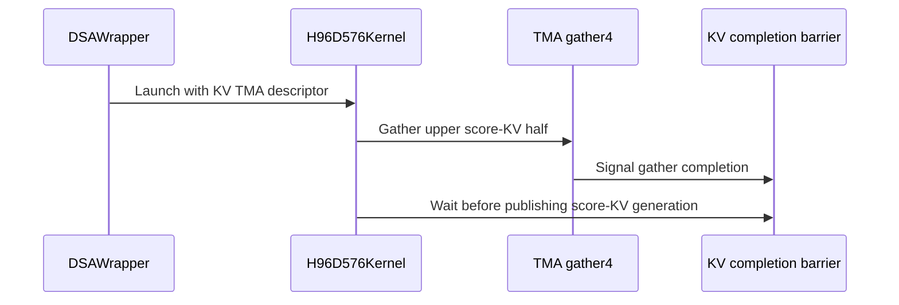

# perf(dsa): add native H96 D576 two-CTA backward

[Upstream PR](https://github.com/NVIDIA/cudnn-frontend/pull/1766) · state: closed · merged: True

## Original PR description


## Before submitting

- [x] I agree to license this contribution under the terms of [LICENSE.txt](https://github.com/NVIDIA/cudnn-frontend/blob/develop/LICENSE.txt).
- [x] I ran `pre-commit run` and committed any formatting changes.
- [x] I reviewed the Hard Rules in the `AGENTS.md` for each directory this PR touches and the changes comply.
- [ ] I added GitHub labels: one `cat-*`, one or more `area:*` / `op:*`, and one `orig-*`.

## Affected area

FE OSS kernels or CuTeDSL

## Summary

Route eligible ordinary H96 DSA backward workloads to the native D576 two-CTA Tensor Core kernel instead of composing separate H64 and H32 kernels. The native route is limited to contiguous BF16 inputs with Dqk=576, Dv=512, supported Top-K widths, and SM100/SM103.

Specialize the ordinary H96 schedule to:

- produce 12 useful dV/dK round operands instead of the fixed H128 schedule's 16;
- shorten the live range of the global O·dO reduction;
- prefetch all 32 rank-owned KV rows, including the D512:576 tail, one score iteration earlier; and
- use TMA gather4 for the critical D256:512 score-KV refill while retaining cp.async for the earlier half.

The deterministic H96 schedule keeps its fixed producer geometry and reduction order. H128 retains its established schedule. Compact Top-K 128 and split H96 execution use the native kernel with the existing cp.async refill, while unavailable gather4 support, non-contiguous inputs, unsupported dtypes/devices, and unsupported Top-K widths retain their existing fallbacks.

## Why

Ordinary H96 D576 previously launched the H64 and H32 backward kernels separately. That duplicated scheduling work and left the random KV gather as the dominant long-scoreboard stall.

Reusing the existing two-CTA D576 kernel removes the composite launch and lets the ordinary H96 specialization skip padded H96:128 work. The subsequent changes preserve the existing shared-memory footprint while moving sparse KV traffic earlier and replacing only the refill half that remains on the critical path with gather4. Converting both halves to TMA was measured and rejected because it increased TMA pressure and regressed steady-state performance.

### Performance

BF16, H96, Dqk=576, Dv=512, KV length 65,536, Top-K 2,048, ordinary backward.

Native path through full-tile prefetch (`13a9ee1c`) versus upstream H64+H32 composition on L20D / SM103:

| Query rows | Upstream | Native H96 | Latency change |
| ---: | ---: | ---: | ---: |
| 4K | 13.511 ms | 11.415 ms | -15.51% |
| 8K | 26.688 ms | 22.686 ms | -14.99% |
| 16K | 53.084 ms | 45.170 ms | -14.91% |

Final upper-half gather4 step (`cc048f58`) versus its parent on GB200 / SM100:

| Query rows | Parent | Gather4 | Latency change |
| ---: | ---: | ---: | ---: |
| 4K | 9.582 ms | 9.411 ms | -1.79% |
| 8K | 19.074 ms | 18.804 ms | -1.41% |
| 16K | 38.036 ms | 37.561 ms | -1.25% |

The final kernel remains at 96 registers per thread and 227,328 bytes of dynamic shared memory. PyTorch allocated and reserved peaks were unchanged in the gather4 A/B runs.

## Related issues

None.

## API and compatibility impact

No public API or workspace contract changes.

The dispatch change applies only to ordinary H96 D576/Dv512 BF16 workloads inside the validated SM100/SM103, contiguous-input, supported-Top-K envelope. Other configurations retain the existing backend. Deterministic H96 continues to use the established fixed-order two-CTA specialization.

## Testing

- `pre-commit run --files python/cudnn/deepseek_sparse_attention/sparse_attention_backward/_interface_sm100.py python/cudnn/deepseek_sparse_attention/sparse_attention_backward/dsa_bwd_sm100_h128_d576_2cta.py test/python/deepseek_sparse_attention/cutedsl/test_DSA_sparse_attention_backward.py`
  - Passed: black, black-jupyter, SPDX header.
- `python3 -m py_compile` on all three changed Python files.
  - Passed.
- Before rebasing, the same seven-patch series was tested on GB200 / SM100 with CUDA 13.0, cuDNN 9.19, and CUTLASS DSL 4.6.2. The focused L0/L1 DSA suite covered dispatch, ordinary H96 specialization, full Top-K and length-based wrapper execution, empty/partial/multi-tile boundaries, and Top-K 2048 deterministic reuse:
  - `8 passed, 348 deselected`.
- Additional focused regressions covered non-split and split H96 boundaries, H96 deterministic execution, and H128 ordinary/deterministic fallback behavior.
- After rebasing onto `upstream/develop@4f175f3f`, the seven-patch series remains 0 commits behind and 7 commits ahead. The merged H128 full-tile guard folding from #1738 remains in place. `py_compile` and `git diff --check` pass on the rebased head.
- The rebased source was rerun on `aistudio-workflow_62750423-ssctl`: 4 x NVIDIA L20D reported by the CUDA runtime as SM103 `(10, 3)`, 148 SMs per GPU, CUDA 13.0, cuDNN backend 9.20, and CUTLASS DSL 4.7.1. The test process kept the installed compiled cudnn extension and loaded the DSA Python modules from this source tree.
- Focused post-rebase L0/L1 command selected dispatch, padded-dKV skipping, Top-K 2048 repeated execution, H128 fail-closed fallback, wrappers, and native H96 boundary coverage:
  - `8 passed, 348 deselected, 4 warnings in 54.63s`.

The full native H96 path was benchmarked on SM103, and the final gather4 step was separately A/B performance-tested on SM100. The post-rebase SM103 run verifies the final source against a compatible architecture; CI remains the source of truth for the full platform matrix.


<!-- This is an auto-generated comment: release notes by coderabbit.ai -->
<!-- coderabbit-ai-generated:v1 -->

## Summary by CodeRabbit

* **New Features**
  * Added native H96/D576 sparse-attention backward execution for supported deterministic and nondeterministic workloads on compatible Blackwell devices.
  * Improved memory gathering, synchronization, and prefetching for supported H96 configurations.

* **Bug Fixes**
  * Updated backend selection to use the native kernel within its validated support range while preserving fallback behavior for unsupported layouts, top-k widths, and devices.

* **Tests**
  * Expanded coverage for native execution, boundary conditions, dispatch behavior, and allocation and synchronization scenarios.
<!-- end of auto-generated comment: release notes by coderabbit.ai -->

## Review and discussion

### reviews

- YangXu1990uiuc · APPROVED · 2026-10-21T21:50:49Z · [source](https://github.com/NVIDIA/cudnn-frontend/pull/1766#pullrequestreview-5606684254)

**Codex bot review · model: `gpt-6-astra`**

Reviewed `37979aafcad1` against base `03794f1af946`.

Thank you for your contribution! The native H96 dispatch and 12-generation operand schedule make sense; I found no approval-blocking issue in the reviewed envelope. I checked the new gather4 transaction accounting and phase progression, as well as the preserved deterministic/H128 paths. One nonblocking coverage suggestion: add an L0 ordinary-H96 non-split case (for example S_q=129, TopK=512, with a route assertion). The changed L0 boundary test uses S_q=4 and takes the split path, which disables gather4; the longer H96 wrapper case is L1. Keeping a small non-split regression in L0 would protect the new gather4 refill under the default test selection.

Validation: On native SM100 with CuTe DSL 4.7.1, seven focused in-tree tests passed: the H96 12/16-generation contract, H96 deterministic TopK2048 repeat, and retained H128 graph/deterministic/workspace paths. Six additional ordinary-H96 reference checks passed across split and non-split schedules and TopK 128/512/1024/1152/2048. They include duplicate and out-of-range sparse indices, empty/partial/clamped lengths, ignored NaN rows, poisoned workspace with canaries, and CUDA Graph replay after changing dO. A fresh-process control with gather4 support disabled also passed native H96 eager and changed-input graph replay at S_q=129, TopK=512. Manual barrier audit: one elected arrival per CTA matches the new barrier's count of one; the four gather warps issue exactly the expected 16,384 bytes per refill. The ordinary H96 12-generation schedule restores the two-slot ring index and parity at each tile boundary. Automatic precheck produced no candidates; its empty ledger did not cover this legacy kernel path and was not used as barrier evidence. Checked the current labels, project and milestone; the existing assignments are appropriate. Reused the existing exact-head CI run instead of launching a duplicate. Its SM100 CuTeDSL lane failed before pytest during image retrieval; the local native checks provide the targeted evidence here.

Limitations: This is targeted SM100 validation, not a full regression or new independent SM103 qualification. The existing SM107 failures are in other test suites and are not classified as resolved by this review. A small warmed native-versus-H64+H32 comparison also checked both routes numerically, but unrelated GPU work was observed during the timing window. I do not treat those timings as a reliable performance verdict.

Approved: no P0 or high-risk P1 found. Remaining findings stay with the owner; merge timing stays with the owner.

<!-- codex-fe-review:v2:1766:37979aafcad1ab1d6a34a34945d5b6e20b05ac9a:complete:no-blocker -->

### issue_comments

- coderabbitai[bot] · comment · 2026-10-21T08:05:27Z · [source](https://github.com/NVIDIA/cudnn-frontend/pull/1766#issuecomment-6311159749)

<!-- coderabbit-ai-generated:v1 -->

<!-- This is an auto-generated comment: summarize by coderabbit.ai -->
<!-- review_stack_entry_start -->

<a href="https://app.coderabbit.ai/change-stack/NVIDIA/cudnn-frontend/pull/1766?scope=ghh_OusAJGA4HG8ljoOV0wJvVx8NmnZIjc2DdjmxOu0xZWA&amp;cs_source=review_comment"><picture><source media="(prefers-color-scheme: dark)" srcset="https://storage.googleapis.com/coderabbit_public_assets/review-stack-in-coderabbit-ui-dark.svg?v=3"><source media="(prefers-color-scheme: light)" srcset="https://storage.googleapis.com/coderabbit_public_assets/review-stack-in-coderabbit-ui.svg?v=3"></picture></a>

<!-- review_stack_entry_end -->
<!-- recent_review_start -->

No actionable comments were generated in the recent review. 🎉

<details>
<summary><strong>ℹ️ Recent review info</strong></summary>
<dl>
<dd>

<details>
<summary><strong>⚙️ Run configuration</strong></summary>
<dl>
<dd>

- **Configuration used**: Repository: NVIDIA/cudnn-frontend/.coderabbit.yaml
- **Review profile**: CHILL
- **Plan**: Enterprise
- **Run ID**: `2dca521e-dad3-4a74-b6a0-bd61dccdd966`

</dd>
</dl>
</details>

<details>
<summary><strong>📥 Commits</strong></summary>
<dl>
<dd>

Reviewing files that changed from the base of the PR and between cc048f58633c29d844dcce2d5f9c6c8f8ba90f0d and 37979aafcad1ab1d6a34a34945d5b6e20b05ac9a.

</dd>
</dl>
</details>

<details>
<summary><strong>📒 Files selected for processing: 1</strong></summary>
<dl>
<dd>

* `test/python/deepseek_sparse_attention/cutedsl/test_DSA_sparse_attention_backward.py`

</dd>
</dl>
</details>

**Included review availability:** This review used your included allowance. Your plan provides up to 12 included reviews per hour; 11 remain after this review.

</dd>
</dl>
</details>


<!-- recent_review_end -->
<!-- walkthrough_start -->

<details>
<summary><strong>📝 Walkthrough</strong></summary>
<dl>
<dd>

The SM100 selector routes qualifying ordinary H96 D576 executions to the native two-CTA kernel. The kernel adds H96-specific DKV scheduling, optional TMA gather4 support, expanded KV prefetching, and a two-row O·dO reduction. Tests cover dispatch, boundaries, and generation counts.

**Changes: SM100 H96 D576 backward execution**

|Layer / File(s)|Summary|
|:---|:---|
|**Backend selection and native route** <br> `python/cudnn/deepseek_sparse_attention/sparse_attention_backward/_interface_sm100.py`, `test/python/deepseek_sparse_attention/cutedsl/test_DSA_sparse_attention_backward.py`|The selector enables the native H96 D576 two-CTA backend for qualifying ordinary executions. Tests cover selector results, wrapper routing, native boundaries, stride specialization, and allocation-free execution.|
|**DKV sweep and round scheduling** <br> `python/cudnn/deepseek_sparse_attention/sparse_attention_backward/dsa_bwd_sm100_h128_d576_2cta.py`, `test/python/deepseek_sparse_attention/cutedsl/test_DSA_sparse_attention_backward.py`|The kernel uses sweep-indexed round slots and configured generation counts for ordinary H96. Deterministic scheduling retains its fixed generation alignment. Tests check ordinary H96 and H128 generation counts.|
|**H96 KV gather, prefetch, and reduction** <br> `python/cudnn/deepseek_sparse_attention/sparse_attention_backward/dsa_bwd_sm100_h128_d576_2cta.py`|Eligible ordinary H96 runs can gather the upper score-KV half with TMA gather4 and wait on its completion barrier. The kernel expands H96 KV prefetching and uses a two-row O·dO reduction.|

<!-- change_assessment_start -->
**Priority:** ⬇️ Low

**Estimated code review effort:** 4 (Complex) | ~45 minutes

<!-- change_assessment_commit:"37979aafcad1ab1d6a34a34945d5b6e20b05ac9a" -->
**Change:** Feature
<!-- change_assessment_end -->

### Sequence Diagram(s)



**Suggested reviewers:** `thynics`

</dd>
</dl>
</details>

<!-- walkthrough_end -->
<details>
<summary><strong>Merge Risk:</strong> <strong>⚪ Minimal</strong> · up to <code>37979</code></summary>
<dl>
<dd>

<!-- final_review_risk_start -->
<!-- final_review_risk_label
**Merge Risk:** **⚪ Minimal** · up to `37979`
-->
<!-- final_review_risk_coverage:{"sourceCommitId":"37979aafcad1ab1d6a34a34945d5b6e20b05ac9a","coveredCommitId":"37979aafcad1ab1d6a34a34945d5b6e20b05ac9a","kind":"reviewed"} -->

No actionable issue is established for the current change. It is mergeable after normal validation.
<!-- final_review_risk_end -->

</dd>
</dl>
</details>
<!-- pre_merge_checks_walkthrough_start -->

<details>
<summary><strong>Pre-merge checks: <sup><picture></picture></sup> 5</strong></summary>
<dl>
<dd>

|         Check name         |                                             Status                                             | Explanation                                                                                                                                                                                               |
| :------------------------ | :--------------------------------------------------------------------------------------------: | :-------------------------------------------------------------------------------------------------------------------------------------------------------------------------------------------------------- |
|         Title check        |  | The title clearly identifies the main change: adding native H96 D576 two-CTA backward performance support for DSA.                                                                                        |
|      Description check     |  | The description follows the required template and covers the affected area, summary, rationale, compatibility impact, performance results, testing, and related issues. The GitHub labels checklist rema… |
|     Docstring Coverage     |  | Docstring coverage is 95.83% which is sufficient. The required threshold is 80.00%. Docstring coverage is scoped to functions touched by this diff. Analyzed 24 functions across 3 files.                 |
|     Linked Issues check    |  | Check skipped because no linked issues were found for this pull request.                                                                                                                                  |
| Out of Scope Changes check |  | Check skipped because no linked issues were found for this pull request.                                                                                                                                  |

<details>
<summary><strong>Full details: Description check</strong></summary>
<dl>
<dd>

**Explanation**

The description follows the required template and covers the affected area, summary, rationale, compatibility impact, performance results, testing, and related issues. The GitHub labels checklist remains unchecked, but the technical description is complete.

</dd>
</dl>
</details>

</dd>
</dl>
</details>

<!-- pre_merge_checks_walkthrough_end -->
<!-- finishing_touch_checkbox_start -->

<details>
<summary><strong>✨ Finishing Touches</strong></summary>
<dl>
<dd>

<details open>
<summary><strong>🧪 Generate unit tests (beta)</strong></summary>
<dl>
<dd>

- [ ] <!-- {"checkboxId": "f47ac10b-58cc-4372-a567-0e02b2c3d479", "radioGroupId": "utg-output-choice-group-unknown_comment_id"} --> Create a new PR

</dd>
</dl>
</details>

</dd>
</dl>
</details>

<!-- finishing_touch_checkbox_end -->

<!-- autopilot:start -->
- [ ] <!-- {"checkboxId":"2708ad07-9f24-4260-9c11-7dc76a49f2e3"} --> <strong title="Keep fixing CodeRabbit findings and required CI, and resolving merge conflicts">Autofix</strong> · Keep fixing CodeRabbit findings and required CI, and resolving merge conflicts
<!-- autopilot:end -->
<!-- tips_start -->


<sub>Comment `@coderabbitai help` to get the list of available commands.</sub>

<!-- tips_end -->

- YangXu1990uiuc · comment · 2026-10-21T08:13:08Z · [source](https://github.com/NVIDIA/cudnn-frontend/pull/1766#issuecomment-6311297485)

Thanks for the contribution! Routing ordinary H96 to the native two-CTA kernel and avoiding padded-head work is useful. I have added this PR to our external-contribution tracking and filled in the labels and current milestone.

The post-rebase eight-case validation and the two separately measured performance steps are recorded as contributor-provided evidence. Review and integration validation still need to cover the dispatch boundaries, preserved deterministic/H128 behavior, and the gather4 fallback. Please keep the reported kernel gains distinct from a full platform or end-to-end qualification.

When you consider this ready to land, please comment **ready**. The review bot will review or follow up, and we will help address feedback, validate the integration and take it through merge; you do not need merge permission yourself.

<!-- fe-external-watch:1766:ready-invitation-v2 -->


- tongke6 · comment · 2026-10-21T08:37:53Z · [source](https://github.com/NVIDIA/cudnn-frontend/pull/1766#issuecomment-6311738447)

ready

- jiayus-nvidia · comment · 2026-10-21T09:47:44Z · [source](https://github.com/NVIDIA/cudnn-frontend/pull/1766#issuecomment-6313006306)

@cudnn-ci-bot run python/*/cutedsl

- cudnn-ci-bot · comment · 2026-10-21T09:47:49Z · [source](https://github.com/NVIDIA/cudnn-frontend/pull/1766#issuecomment-6313008030)

🏁 Pipeline finished

SHA: `cc048f5`
Targets: `python/*/cutedsl`
Branch: [cudnn-gh/pr-1766-cc048f5](https://nv/cudnn-gitlab-ci/-/tree/cudnn-gh/pr-1766-cc048f5)
Pipeline: [75529333](https://nv/cudnn-gitlab-ci/-/pipelines/75529333)
Last updated: 2026-10-21 10:04 UTC

**20 passed, 4 failed, 2 skipped, 11 manual**

### <code>manual</code>

- <code>manual:python_samples</code> - Manual
- <code>manual:python</code> - Manual
- <code>manual:python/sdpa/frost</code> - Manual
- <code>manual:python/linear_attention/frost</code> - Manual
- <code>manual:python/gemm/frost</code> - Manual
- <code>manual:python/*/frost</code> - Manual
- <code>manual:python/gemm/cutedsl</code> - Manual
- <code>manual:python/*/cutedsl</code> - ✅ Passed
- <code>manual:python/*/jax</code> - Manual
- <code>manual:pycudnn</code> - Manual
- <code>manual:multi_gpu</code> - Manual
- <code>manual:backend</code> - Manual

### <code>analysis</code>

- <code>analysis:cudnn_clang_disable_exception</code> - ✅ Passed
- <code>analysis:cudnn_v9_no_half_conversion</code> - ✅ Passed
- <code>analysis:cudnn_clang</code> - ✅ Passed
- <code>analysis:check-relative-includes</code> - ✅ Passed
- <code>analysis:check-CUDNN_FRONTEND_SKIP_JSON_LIB</code> - ✅ Passed
- <code>analysis:guardwords_scan</code> - ✅ Passed
- <code>analysis:jax-import-guard</code> - ✅ Passed
- <code>analysis:pytest-gpu</code> - ✅ Passed
- <code>san:build</code> - ✅ Passed

### <code>build</code>

- <code>analysis:api_index</code> - ✅ Passed
- <code>build:dev:linux:amd64</code> - ✅ Passed
- <code>build:rel:linux:amd64</code> - ✅ Passed
- <code>build:dev:linux:arm64</code> - ✅ Passed
- <code>build:rel:linux:arm64</code> - ✅ Passed
- <code>build:rel:win:amd64</code> - ✅ Passed

### <code>oss_tests</code>

- <code>python/gemm/cutedsl:cutlass-rel:sm100</code> - Skipped
- <code>python/*/cutedsl:cutlass-rel:sm80</code> - ❌ **New Failure!** (nightly passed)
- <code>python/*/cutedsl:cutlass-rel:sm90</code> - ❌ **New Failure!** (nightly passed)
- <code>python/*/cutedsl:cutlass-rel:sm100</code> - ❌ **New Failure!** (nightly passed)
- <code>python/*/jax:cutlass-rel:sm100</code> - Skipped
- <code>python/*/cutedsl:cutlass-4.8:sm107</code> - ❌ **New Failure!** (nightly passed)

### <code>sanitizer_tests</code>

- <code>san:cpp_test:sm80</code> - ✅ Passed
- <code>san:cpp_test:sm90</code> - ✅ Passed
- <code>san:cpp_test:sm100</code> - ✅ Passed

### <code>triage</code>

- <code>triage:ai</code> - ✅ Passed

- jiayus-nvidia · comment · 2026-10-21T10:33:53Z · [source](https://github.com/NVIDIA/cudnn-frontend/pull/1766#issuecomment-6313854692)

The CI failures include a test expectation that needs updating for this PR's dispatch change.

`test_DSA_sparse_attention_backward_sm100_topk_stride_specialization` still expects `h96_h64_h32` for H96/D576 at Top-K 512 and 1024. This PR intentionally routes those eligible ordinary workloads to `h96_d576_2cta_m64`, so both cases now fail at `assert backend == expected_backend`:

```text
AssertionError: assert 'h96_d576_2cta_m64' == 'h96_h64_h32'
```

This is a host-side selector test that explicitly supplies `device_capability=(10, 0)`, so the same assertion fails on the SM80, SM90 and SM107 lanes; it does not indicate that the native kernel was dispatched onto those devices.

Could you update the H96/D576 parameter row's expected backend to `h96_d576_2cta_m64`, retaining the `static_stride=True` check and the remaining stride-specialization assertions?


- tongke6 · comment · 2026-10-21T12:06:16Z · [source](https://github.com/NVIDIA/cudnn-frontend/pull/1766#issuecomment-6315482313)

@jiayus-nvidia Fixed in 37979aaf. The H96/D576 stride-specialization expectation now uses h96_d576_2cta_m64, while retaining static_stride=True and the existing stride assertions.

I reproduced the failure on an actual SM90 device and reran the full DSA backward L0 file after the fix: 121 passed, 125 skipped.
Could you please rerun python/*/cutedsl on the updated SHA?

- YangXu1990uiuc · comment · 2026-10-21T12:08:21Z · [source](https://github.com/NVIDIA/cudnn-frontend/pull/1766#issuecomment-6315525706)

@cudnn-ci-bot run python/*/cutedsl


- cudnn-ci-bot · comment · 2026-10-21T12:09:42Z · [source](https://github.com/NVIDIA/cudnn-frontend/pull/1766#issuecomment-6315552309)

🏁 Pipeline finished

SHA: `37979aa`
Targets: `python/*/cutedsl`
Branch: [cudnn-gh/pr-1766-37979aa](https://nv/cudnn-gitlab-ci/-/tree/cudnn-gh/pr-1766-37979aa)
Pipeline: [75553951](https://nv/cudnn-gitlab-ci/-/pipelines/75553951)
Last updated: 2026-10-21 12:43 UTC

**22 passed, 2 failed, 2 skipped, 11 manual**

### <code>manual</code>

- <code>manual:python_samples</code> - Manual
- <code>manual:python</code> - Manual
- <code>manual:python/sdpa/frost</code> - Manual
- <code>manual:python/linear_attention/frost</code> - Manual
- <code>manual:python/gemm/frost</code> - Manual
- <code>manual:python/*/frost</code> - Manual
- <code>manual:python/gemm/cutedsl</code> - Manual
- <code>manual:python/*/cutedsl</code> - ✅ Passed
- <code>manual:python/*/jax</code> - Manual
- <code>manual:pycudnn</code> - Manual
- <code>manual:multi_gpu</code> - Manual
- <code>manual:backend</code> - Manual

### <code>analysis</code>

- <code>analysis:cudnn_clang_disable_exception</code> - ✅ Passed
- <code>analysis:cudnn_v9_no_half_conversion</code> - ✅ Passed
- <code>analysis:cudnn_clang</code> - ✅ Passed
- <code>analysis:check-relative-includes</code> - ✅ Passed
- <code>analysis:check-CUDNN_FRONTEND_SKIP_JSON_LIB</code> - ✅ Passed
- <code>analysis:guardwords_scan</code> - ✅ Passed
- <code>analysis:jax-import-guard</code> - ✅ Passed
- <code>analysis:pytest-gpu</code> - ✅ Passed
- <code>san:build</code> - ✅ Passed

### <code>build</code>

- <code>analysis:api_index</code> - ✅ Passed
- <code>build:dev:linux:amd64</code> - ✅ Passed
- <code>build:rel:linux:amd64</code> - ✅ Passed
- <code>build:dev:linux:arm64</code> - ✅ Passed
- <code>build:rel:linux:arm64</code> - ✅ Passed
- <code>build:rel:win:amd64</code> - ✅ Passed

### <code>oss_tests</code>

- <code>python/gemm/cutedsl:cutlass-rel:sm100</code> - Skipped
- <code>python/*/cutedsl:cutlass-rel:sm80</code> - ✅ Passed
- <code>python/*/cutedsl:cutlass-rel:sm90</code> - ✅ Passed
- <code>python/*/cutedsl:cutlass-rel:sm100</code> - ❌ **New Failure!** (nightly passed)
- <code>python/*/jax:cutlass-rel:sm100</code> - Skipped
- <code>python/*/cutedsl:cutlass-4.8:sm107</code> - ❌ **New Failure!** (nightly passed)

### <code>sanitizer_tests</code>

- <code>san:cpp_test:sm80</code> - ✅ Passed
- <code>san:cpp_test:sm90</code> - ✅ Passed
- <code>san:cpp_test:sm100</code> - ✅ Passed

### <code>triage</code>

- <code>triage:ai</code> - ✅ Passed

- YangXu1990uiuc · comment · 2026-10-21T12:14:09Z · [source](https://github.com/NVIDIA/cudnn-frontend/pull/1766#issuecomment-6315633730)

Thanks for confirming **ready**, and for fixing the stride-specialization expectation identified by @jiayus-nvidia. I checked `37979aafcad1ab1d6a34a34945d5b6e20b05ac9a`: only the H96/D576 expected backend changed; `static_stride=True` and the remaining stride assertions are preserved.

With a freshly built native extension and imports pinned to this head, the focused SM100 run passed **25/25, with no skips** on CuTeDSL 4.8.0 with quack 0.6.2 imported first: 18 stride-selector cases, three H96 dispatch/layout/composition checks, and four native H96 boundary/wrapper cases. This verifies the reported selector fix and focused ordinary H96 behavior; it does not claim full DSA, H128/deterministic/split/fallback or final integration qualification.

<!-- fe-external-watch:1766:37979aafcad1ab1d6a34a34945d5b6e20b05ac9a:ready-validation -->


Completed-CI update for the same head: SM80 and SM90 now pass, and the reported H96 selector assertions no longer fail. The SM100 lane again stopped at container startup with `403 Forbidden`, before pytest. Another lane reports these remaining failures:

```text
gated_attention_block/cutedsl/test_quantize.py::test_init_scalars_zeroes_and_reciprocates[3]
  cudaErrorIllegalAddress (700); the worker then lost its CUDA context
gemm/jax/test_grouped_gemm_canonical_jax.py::test_canonical_jax_parity[namespace-False-False-False-4-swiglu]
gemm/jax/test_grouped_gemm_canonical_jax.py::test_canonical_jax_parity[wrapper-False-False-False-4-swiglu]
  CUDA_LAUNCH_INVALID_CONFIG / cudaErrorInvalidValue
gated_attention_block/cutedsl/test_block_qsa_end_to_end.py::test_indexer_identity_block_first_use_on_an_explicit_stream_with_the_ambient_stream_parked_past_compile
gated_attention_block/cutedsl/test_block_backward_fp8.py::test_fp8_first_use_on_an_explicit_stream_with_the_ambient_stream_parked_past_compile[class]
  watchdog timeout while synchronizing
```

These are distinct from the corrected selector expectation. Their exact-case baseline attribution remains unverified, so the overall CI is not being reported as green. The focused native H96 validation above is unchanged; independent review and broader integration qualification remain pending. No duplicate CI request was sent.

<!-- fe-external-watch:1766:37979aaf:completed-ci -->


- YangXu1990uiuc · comment · 2026-10-22T00:16:36Z · [source](https://github.com/NVIDIA/cudnn-frontend/pull/1766#issuecomment-6329508426)

Merged as 028d4199b400e52ccf110f83ea544fc1d763b23f. Thank you @tongke6 for the native H96 work and for promptly fixing the selector regression!

Following the exact-head approval, I validated the current develop integration on native SM100 with CuTe DSL 4.7.1: all seven selected in-tree H96/H128, deterministic, graph and workspace tests passed. Six additional ordinary-H96 probes passed across split/non-split schedules and TopK 128/512/1024/1152/2048, including duplicate/out-of-range indices, empty/partial lengths, ignored NaNs, workspace canaries and CUDA Graph replay with changed dO. A fresh-process gather4-disabled control also passed. All imported cuDNN modules resolved to the tested integration; the final merged tree and parent match it.

This remains targeted DSA qualification. The existing pipeline's SM100 lane stopped during container startup, and failures in other suites on another CI lane remain unclassified; these checks do not claim green integration CI. Required merge checks passed and the normal merge completed. The reviewer's small non-split H96 L0 coverage suggestion remains a useful follow-up.

<!-- fe-external-watch:1766:37979aafcad1ab1d6a34a34945d5b6e20b05ac9a:merged -->


### inline_comments

## Changed files and fixed code

- `python/cudnn/deepseek_sparse_attention/sparse_attention_backward/_interface_sm100.py` · modified · additions 6 / deletions 6
  - [head](https://github.com/tongke6/cudnn-frontend/blob/37979aafcad1ab1d6a34a34945d5b6e20b05ac9a/python/cudnn/deepseek_sparse_attention/sparse_attention_backward/_interface_sm100.py)
  - [base](https://github.com/NVIDIA/cudnn-frontend/blob/faffa9ca823fc0f17f5aa5de1ee72b98424a7f9c/python/cudnn/deepseek_sparse_attention/sparse_attention_backward/_interface_sm100.py)
- `python/cudnn/deepseek_sparse_attention/sparse_attention_backward/dsa_bwd_sm100_h128_d576_2cta.py` · modified · additions 220 / deletions 40
  - [head](https://github.com/tongke6/cudnn-frontend/blob/37979aafcad1ab1d6a34a34945d5b6e20b05ac9a/python/cudnn/deepseek_sparse_attention/sparse_attention_backward/dsa_bwd_sm100_h128_d576_2cta.py)
  - [base](https://github.com/NVIDIA/cudnn-frontend/blob/faffa9ca823fc0f17f5aa5de1ee72b98424a7f9c/python/cudnn/deepseek_sparse_attention/sparse_attention_backward/dsa_bwd_sm100_h128_d576_2cta.py)
- `test/python/deepseek_sparse_attention/cutedsl/test_DSA_sparse_attention_backward.py` · modified · additions 36 / deletions 9
  - [head](https://github.com/tongke6/cudnn-frontend/blob/37979aafcad1ab1d6a34a34945d5b6e20b05ac9a/test/python/deepseek_sparse_attention/cutedsl/test_DSA_sparse_attention_backward.py)
  - [base](https://github.com/NVIDIA/cudnn-frontend/blob/faffa9ca823fc0f17f5aa5de1ee72b98424a7f9c/test/python/deepseek_sparse_attention/cutedsl/test_DSA_sparse_attention_backward.py)

## Evidence and interpretation boundary

[Original JSON, discussions and patches](../../../../../../evidence/prs/NVIDIA--cudnn-frontend/1766-d9fb7522d70732e8cb0dc8ef2531f648ad8955e166951694919da13cb5aa1bc8.json) · SHA-256 `d9fb7522d70732e8cb0dc8ef2531f648ad8955e166951694919da13cb5aa1bc8`.

Diff complete: True. Missing/binary/truncated patches require pinned source inspection. This is a source page, not an independently verified optimization case. Open, merged and released are different states; recheck the deployed dependency.
