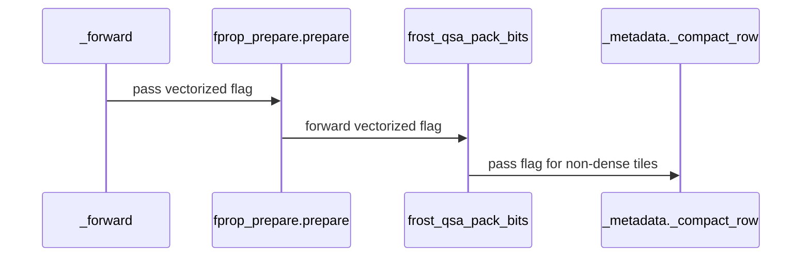

# Enable QSA vector compaction and paired backward on Rubin

[Upstream PR](https://github.com/NVIDIA/cudnn-frontend/pull/1778) · state: closed · merged: True

## Original PR description

## Before submitting

- [x] I agree to license this contribution under the terms of LICENSE.txt.
- [x] I ran pre-commit and committed the formatting changes.
- [x] I reviewed the applicable AGENTS.md Hard Rules.
- [x] Labels cover change type, affected area, and originator.

## Affected area

FE OSS kernels / CuTeDSL, tests, and documentation.

## Summary

Enable stable 16-byte-per-lane selection compaction on SM107 and route Rubin 12:1 QSA backward through the paired-query kernel compiled for SM107. Retain the device-side nonfinite fallback and the native 24:2 backward path.

Add compaction boundary, unaligned-storage, and changed-input CUDA graph tests. Extend owner-encoding bounds coverage to SM107 and document dispatch and scratch shapes.

## Why

Rubin can share K/V loads between adjacent 12:1 queries and compact selection rows in larger chunks. The scalar Blackwell compaction path remains selected on SM100/SM103.

## Related issues

Follow-up to #1765, based on its merge into develop.

## API and compatibility impact

Public qsa_forward and qsa_backward functions retain the Miles argument order, return order, and block_size=4. No new dependencies or public options.

## Testing

On B200 (SM100), B300 SXM (SM103), and Rubin (SM107), with CuTeDSL 4.8.1, from test/python:

```sh
python -m pytest -n 1 -m 'L0 or L1' QSA/cutedsl/test_qsa.py core/frost/test_frost_kernel_name_prefix.py gemm/cutedsl/test_rubin_kernel_dispatch.py
```

81 passed on each architecture, with no failures or skips. The compaction cases cover 144 boundary, alignment, selection, and replay checks. Additional forward/backward reference, cancellation, dense/range, stream, and replay checks pass.

Pre-commit passes for all seven changed files. The 81-test suite and all 12 validation phases pass again on SM107 after removing the unused compaction initializer. Fresh before/after compilation gives byte-identical PTX and cubins for standalone compaction, gated compaction, and hybrid preparation on SM100, SM103, and SM107 (18 artifact comparisons, without normalization).

Native and pinned Relax regression checks pass on B200 and B300 SXM at `9511604`, including packed inputs, both selector modes, and reverse-order runs. The cleanup changes only the unused initializer; benchmark measurements remain tied to that measured commit.

Local image-tag lint and Fern 5.56.3 report no errors. GitHub Actions tracks checks for the current commit.


<!-- This is an auto-generated comment: release notes by coderabbit.ai -->
<!-- coderabbit-ai-generated:v1 -->

## Summary by CodeRabbit

* **New Features**
  * Added support for paired 12:1 QSA backward processing on Blackwell and Rubin architectures.
  * Improved metadata compaction on Rubin, including support for larger selections and boundary cases.
* **Documentation**
  * Clarified QSA backward kernel selection for 12:1 and 24:2 configurations, along with compaction behavior across Blackwell and Rubin.
<!-- end of auto-generated comment: release notes by coderabbit.ai -->

## Review and discussion

### reviews

- github-advanced-security[bot] · COMMENTED · 2026-10-22T04:06:14Z · [source](https://github.com/NVIDIA/cudnn-frontend/pull/1778#pullrequestreview-5609130697)

(No body; status only.)

### issue_comments

- coderabbitai[bot] · comment · 2026-10-21T22:39:43Z · [source](https://github.com/NVIDIA/cudnn-frontend/pull/1778#issuecomment-6328132997)

<!-- coderabbit-ai-generated:v1 -->

<!-- This is an auto-generated comment: summarize by coderabbit.ai -->
<!-- review_stack_entry_start -->

<a href="https://app.coderabbit.ai/change-stack/NVIDIA/cudnn-frontend/pull/1778?scope=ghh_OusAJGA4HG8ljoOV0wJvVx8NmnZIjc2DdjmxOu0xZWA&amp;cs_source=review_comment"><picture><source media="(prefers-color-scheme: dark)" srcset="https://storage.googleapis.com/coderabbit_public_assets/review-stack-in-coderabbit-ui-dark.svg?v=3"><source media="(prefers-color-scheme: light)" srcset="https://storage.googleapis.com/coderabbit_public_assets/review-stack-in-coderabbit-ui.svg?v=3"></picture></a>

<!-- review_stack_entry_end -->
<!-- recent_review_start -->

No actionable comments were generated in the recent review. 🎉

<details>
<summary><strong>ℹ️ Recent review info</strong></summary>
<dl>
<dd>

<details>
<summary><strong>⚙️ Run configuration</strong></summary>
<dl>
<dd>

- **Configuration used**: Repository: NVIDIA/cudnn-frontend/.coderabbit.yaml
- **Review profile**: CHILL
- **Plan**: Enterprise
- **Run ID**: `c15eb462-d989-4fe3-b5db-9891b5fb17dd`

</dd>
</dl>
</details>

<details>
<summary><strong>📥 Commits</strong></summary>
<dl>
<dd>

Reviewing files that changed from the base of the PR and between 9511604be973e70295ba545a0b9125c00c79744b and 6494962461b8a1e9c8ac877a1d3f40ed03448834.

</dd>
</dl>
</details>

<details>
<summary><strong>📒 Files selected for processing: 1</strong></summary>
<dl>
<dd>

* `python/cudnn/QSA/_metadata.py`

</dd>
</dl>
</details>

<details>
<summary><strong>💤 Files with no reviewable changes: 1</strong></summary>
<dl>
<dd>

* python/cudnn/QSA/_metadata.py

</dd>
</dl>
</details>

**Included review availability:** This review used your included allowance. Your plan provides up to 12 included reviews per hour; 10 remain after this review.

</dd>
</dl>
</details>


<!-- recent_review_end -->
<!-- walkthrough_start -->

<details>
<summary><strong>📝 Walkthrough</strong></summary>
<dl>
<dd>

QSA now routes 12:1 backward calls through the paired SM100 kernel family on Rubin. SM107 enables vectorized metadata compaction. Tests cover compaction patterns across block counts and offsets, direct launches, and CUDA graph replays.

**Changes: Rubin QSA Backward Support**

|Layer / File(s)|Summary|
|:---|:---|
|**Paired backward routing and kernel support** <br> `python/cudnn/QSA/api.py`, `python/cudnn/QSA/kernels/bprop_sm100.py`, `docs/fe-oss-apis/qsa.md`|The 12:1 backward path selects the paired SM100 kernel family for SM107. The compiler accepts SM107. The documentation describes paired-query handling and kernel selection across Blackwell and Rubin.|
|**SM107 vectorized metadata compaction** <br> `python/cudnn/QSA/_metadata.py`, `python/cudnn/QSA/kernels/fprop_prepare.py`, `python/cudnn/QSA/_forward.py`, `test/python/QSA/cutedsl/test_qsa.py`, `docs/fe-oss-apis/qsa.md`|Preparation and metadata compaction pass an architecture-specific vectorization flag. For SM107, compaction processes 16 selection entries per lane in complete chunks and handles remaining entries without vectorized loads. Tests cover selection patterns, block counts, offsets, direct launches, and CUDA graph replays.|

<!-- change_assessment_start -->
**Priority:** ➖ Normal

**Estimated code review effort:** 3 (Moderate) | ~25 minutes

<!-- change_assessment_commit:"6494962461b8a1e9c8ac877a1d3f40ed03448834" -->
**Change:** Feature
<!-- change_assessment_end -->

### Sequence Diagram(s)



</dd>
</dl>
</details>

<!-- walkthrough_end -->
<details>
<summary><strong>Merge Risk:</strong> <strong>⚪ Minimal</strong> · up to <code>64949</code></summary>
<dl>
<dd>

<!-- final_review_risk_start -->
<!-- final_review_risk_label
**Merge Risk:** **⚪ Minimal** · up to `64949`
-->
<!-- final_review_risk_coverage:{"sourceCommitId":"6494962461b8a1e9c8ac877a1d3f40ed03448834","coveredCommitId":"6494962461b8a1e9c8ac877a1d3f40ed03448834","kind":"reviewed"} -->

No identified issue blocks merging after normal checks.
<!-- final_review_risk_end -->

</dd>
</dl>
</details>
<!-- pre_merge_checks_walkthrough_start -->

<details>
<summary><strong>Pre-merge checks: <sup><picture></picture></sup> 4 · <sup><picture></picture></sup> 1</strong></summary>
<dl>
<dd>

<strong><sup><picture></picture></sup> Failed checks: 1 warning</strong>

|     Check name     |                                              Status                                              | Explanation                                                                                                                                                                                 | Resolution                                                                         |
| :---------------- | :----------------------------------------------------------------------------------------------: | :------------------------------------------------------------------------------------------------------------------------------------------------------------------------------------------ | :--------------------------------------------------------------------------------- |
| Docstring Coverage |  | Docstring coverage is 12.50% which is insufficient. The required threshold is 80.00%. Docstring coverage is scoped to functions touched by this diff. Analyzed 16 functions across 6 files. | Write docstrings for the functions missing them to satisfy the coverage threshold. |

<details>
<summary><strong><sup><picture></picture></sup> Passed checks: 4 passed</strong></summary>
<dl>
<dd>

|         Check name         |                                             Status                                             | Explanation                                                                                                                                              |
| :------------------------ | :--------------------------------------------------------------------------------------------: | :------------------------------------------------------------------------------------------------------------------------------------------------------- |
|         Title check        |  | The title clearly summarizes the two main changes: QSA vector compaction and paired backward support on Rubin.                                           |
|      Description check     |  | The description covers all required sections, explains the changes and rationale, documents compatibility impact, and provides detailed testing results. |
|     Linked Issues check    |  | Check skipped because no linked issues were found for this pull request.                                                                                 |
| Out of Scope Changes check |  | Check skipped because no linked issues were found for this pull request.                                                                                 |

</dd>
</dl>
</details>

</dd>
</dl>
</details>

<!-- pre_merge_checks_walkthrough_end -->
<!-- finishing_touch_checkbox_start -->

<details>
<summary><strong>✨ Finishing Touches: 💡 2</strong></summary>
<dl>
<dd>

<!-- finishing_touch_suggestion:docstrings -->
<details open>
<summary><strong>📝 Generate docstrings: 💡</strong></summary>
<dl>
<dd>

- [ ] <!-- {"checkboxId":"3e1879ae-f29b-4d0d-8e06-d12b7ba33d98"} --> Commit to this branch
- [ ] <!-- {"checkboxId":"7962f53c-55bc-4827-bfbf-6a18da830691"} --> Create a new PR

</dd>
</dl>
</details>
<!-- finishing_touch_suggestion:fix_ci -->
<details open>
<summary><strong>🛠️ Fix failing CI checks: 💡</strong></summary>
<dl>
<dd>

- [ ] <!-- {"checkboxId": "9f0d24fb-b419-4f01-baf0-8b26b6424f34", "radioGroupId": "fix-ci-output-choice-group-unknown_comment_id"} --> Commit to this branch
- [ ] <!-- {"checkboxId": "6d21cfe8-ec3f-40e2-9222-b8318b64d3b0", "radioGroupId": "fix-ci-output-choice-group-unknown_comment_id"} --> Create a new PR

</dd>
</dl>
</details>
<details open>
<summary><strong>🧪 Generate unit tests (beta)</strong></summary>
<dl>
<dd>

- [ ] <!-- {"checkboxId": "6ba7b810-9dad-11d1-80b4-00c04fd430c8", "radioGroupId": "utg-output-choice-group-unknown_comment_id"} --> Commit to this branch
- [ ] <!-- {"checkboxId": "f47ac10b-58cc-4372-a567-0e02b2c3d479", "radioGroupId": "utg-output-choice-group-unknown_comment_id"} --> Create a new PR

</dd>
</dl>
</details>

</dd>
</dl>
</details>

<!-- finishing_touch_checkbox_end -->

<!-- autopilot:start -->
- [ ] <!-- {"checkboxId":"2708ad07-9f24-4260-9c11-7dc76a49f2e3"} --> <strong title="Keep fixing CodeRabbit findings and required CI, and resolving merge conflicts">Autofix</strong> · Keep fixing CodeRabbit findings and required CI, and resolving merge conflicts
<!-- autopilot:end -->
<!-- tips_start -->


<sub>Comment `@coderabbitai help` to get the list of available commands.</sub>

<!-- tips_end -->

### inline_comments

- github-advanced-security[bot] · comment · 2026-10-22T04:06:14Z · [source](https://github.com/NVIDIA/cudnn-frontend/pull/1778#discussion_r4344437828)

File: `python/cudnn/QSA/_metadata.py` · line None

## CodeQL / Variable defined multiple times

This assignment to 'marked' is unnecessary as it is [redefined](1) before this value is used.
This assignment to 'marked' is unnecessary as it is [redefined](2) before this value is used.

[Show more details](https://github.com/NVIDIA/cudnn-frontend/security/code-scanning/3990)

## Changed files and fixed code

- `docs/fe-oss-apis/qsa.md` · modified · additions 6 / deletions 4
  - [head](https://github.com/NVIDIA/cudnn-frontend/blob/6494962461b8a1e9c8ac877a1d3f40ed03448834/docs/fe-oss-apis/qsa.md)
  - [base](https://github.com/NVIDIA/cudnn-frontend/blob/f24960bceb5b792fe18e023fffd78fcdae99810b/docs/fe-oss-apis/qsa.md)
- `python/cudnn/QSA/_forward.py` · modified · additions 2 / deletions 2
  - [head](https://github.com/NVIDIA/cudnn-frontend/blob/6494962461b8a1e9c8ac877a1d3f40ed03448834/python/cudnn/QSA/_forward.py)
  - [base](https://github.com/NVIDIA/cudnn-frontend/blob/f24960bceb5b792fe18e023fffd78fcdae99810b/python/cudnn/QSA/_forward.py)
- `python/cudnn/QSA/_metadata.py` · modified · additions 80 / deletions 17
  - [head](https://github.com/NVIDIA/cudnn-frontend/blob/6494962461b8a1e9c8ac877a1d3f40ed03448834/python/cudnn/QSA/_metadata.py)
  - [base](https://github.com/NVIDIA/cudnn-frontend/blob/f24960bceb5b792fe18e023fffd78fcdae99810b/python/cudnn/QSA/_metadata.py)
- `python/cudnn/QSA/api.py` · modified · additions 3 / deletions 1
  - [head](https://github.com/NVIDIA/cudnn-frontend/blob/6494962461b8a1e9c8ac877a1d3f40ed03448834/python/cudnn/QSA/api.py)
  - [base](https://github.com/NVIDIA/cudnn-frontend/blob/f24960bceb5b792fe18e023fffd78fcdae99810b/python/cudnn/QSA/api.py)
- `python/cudnn/QSA/kernels/bprop_sm100.py` · modified · additions 3 / deletions 3
  - [head](https://github.com/NVIDIA/cudnn-frontend/blob/6494962461b8a1e9c8ac877a1d3f40ed03448834/python/cudnn/QSA/kernels/bprop_sm100.py)
  - [base](https://github.com/NVIDIA/cudnn-frontend/blob/f24960bceb5b792fe18e023fffd78fcdae99810b/python/cudnn/QSA/kernels/bprop_sm100.py)
- `python/cudnn/QSA/kernels/fprop_prepare.py` · modified · additions 24 / deletions 3
  - [head](https://github.com/NVIDIA/cudnn-frontend/blob/6494962461b8a1e9c8ac877a1d3f40ed03448834/python/cudnn/QSA/kernels/fprop_prepare.py)
  - [base](https://github.com/NVIDIA/cudnn-frontend/blob/f24960bceb5b792fe18e023fffd78fcdae99810b/python/cudnn/QSA/kernels/fprop_prepare.py)
- `test/python/QSA/cutedsl/test_qsa.py` · modified · additions 52 / deletions 2
  - [head](https://github.com/NVIDIA/cudnn-frontend/blob/6494962461b8a1e9c8ac877a1d3f40ed03448834/test/python/QSA/cutedsl/test_qsa.py)
  - [base](https://github.com/NVIDIA/cudnn-frontend/blob/f24960bceb5b792fe18e023fffd78fcdae99810b/test/python/QSA/cutedsl/test_qsa.py)

## Evidence and interpretation boundary

[Original JSON, discussions and patches](../../../../../../evidence/prs/NVIDIA--cudnn-frontend/1778-c1f2edae0134f2c8bb7fbaa94a0414291a2523bbd0802ee99233668be04086f6.json) · SHA-256 `c1f2edae0134f2c8bb7fbaa94a0414291a2523bbd0802ee99233668be04086f6`.

Diff complete: True. Missing/binary/truncated patches require pinned source inspection. This is a source page, not an independently verified optimization case. Open, merged and released are different states; recheck the deployed dependency.
