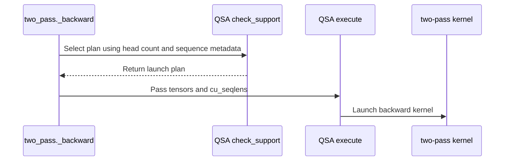

# QSA backward: packed 12Q/1KV with bounded records and native FP32 saved state

[Upstream PR](https://github.com/NVIDIA/cudnn-frontend/pull/1781) · state: closed · merged: True

## Original PR description

## Before submitting

- [x] I agree to license this contribution under the terms of LICENSE.txt.
- [x] I ran pre-commit and committed formatting changes.
- [x] I reviewed the applicable AGENTS.md Hard Rules.
- [x] Required category, affected-area, and originator labels are present.

## Summary

Extend the two-pass QSA backward to the 12Q/1KV head geometry and packed variable-length sequences while bounding its probability/score-gradient records. The implementation and tests now live under `cudnn.QSA.two_pass` and `test/python/QSA`, following the API consolidation in #1774. The shared DSA scorer/top-k stays in place.

The 12Q/1KV query pass pairs adjacent queries; per-sequence positions, complete blocks, and causal tails come from device `cu_seqlens` metadata. Both 2051- and 2052-column canonical token-index carriers are accepted. Two-pass execution streams at most 4096 compacted sparse queries through reusable records and an inverted index. dK/dV accumulate across windows; the dense contribution runs once. Current sequence counts and window boundaries are rebuilt on every call and graph replay, without device-to-host reads.

Native FP32 saved output and contiguous `[Hq, T]` LSE are supported alongside the earlier internal BF16 output / `[T, Hq]` pair. The kernel reads the chosen layout directly, with no output downcast or LSE repack. Head-major LSE needs only scalar alignment.

This remains a private backend. Public `cudnn.ops.qsa_*` signatures, return order, and Rubin routes are unchanged; no algorithm-specific public entry or compatibility alias is added. The two-pass selection contract is still canonical top-512 complete four-token blocks plus the causal tail, with `cu_seqlens` for packed input. It is not automatically dispatched for the more general public bitmap/indexed selection contracts. Native saved-state support alone does not make it a drop-in Miles autograd implementation.

## Workspace and performance

At 128K, excluding caller inputs and final BF16 outputs:

| Geometry | Previous #1781 scratch | Bounded scratch |
|---|---:|---:|
| 12Q/1KV, one sequence | 12.92 GiB | 2.49 GiB |
| 12Q/1KV, three packed sequences | 14.93 GiB | 2.49 GiB |
| 24Q/2KV, one sequence | 25.07 GiB | 4.87 GiB |

Records are capped at approximately 0.376 GiB for 12Q/1KV and 0.752 GiB for 24Q/2KV. Gradient accumulators and sequence metadata still grow with total tokens; these are exact plan allocations, not a claim of constant total workspace or allocator-reserved memory.

B300 SXM6 AC, BF16 Q/K/V/dO, D256, block size 4, top-512 complete blocks plus the causal tail:

| 128K workload | Combined two-pass | Pinned Relax Triton | Speedup |
|---|---:|---:|---:|
| 12Q/1KV, one sequence | 87.01 ms | 143.95 ms | 1.65x |
| 12Q/1KV, three packed sequences | 71.29 ms | 131.23 ms | 1.84x |
| 24Q/2KV, one sequence | 139.06 ms | 294.31 ms | 2.12x |

These are warm GPU latencies for standalone bundles of the full backward sequence, including metadata, gradient preparation, allocation wrappers, and final casts/copies. The kernel source matches this PR, with only the package workspace-alignment helper replaced by the same standalone formula. Both arms consume the same synthetic inputs and saved state; the Relax adapter includes its required head-major-to-token-major LSE conversion. Selection, forward, compilation, TP communication, and training E2E are excluded. Timing uses 10 warmups and 50 samples; clocks are unlocked and arms are separate runs. Environment: PyTorch 2.13.0+cu132, Triton 3.7.1, CuTe DSL 4.7.0, CUDA 13.4. Reference arithmetic comes from the public Relax QSA implementation at `77f717d757e5407f5960c7eec0b183d81d82cf56`.

The workspace-only A/B against unchanged #1781 also passes independent FP32 gradients and changed-input graph replay on SM100. At 128K, 12Q/1KV latency is approximately unchanged, while 24Q/2KV improves; the B300 table above measures the final native-saved-state implementation against Relax, not an attribution of that entire gain to windowing.

## Compiler support

12Q/1KV sparse execution requires the CUDA 13 compiler flavor of CuTe DSL: `pip install 'nvidia-cutlass-dsl[cu13]>=4.7.0'` and a CUDA 13 compatible driver. The unchanged #1781 key-major kernel crashes the CUDA 12 compiler in both DSL 4.7 and 4.8; CUDA 13 builds pass. `check_support()` now rejects the affected route before compilation with an actionable error. Dense-only 12Q/1KV and 24Q/2KV remain available with the CUDA 12 flavor. The check uses `cutlass.base_dsl.version_info.CUDA_VERSION`, not PyTorch's CUDA version or `CUDA_HOME`.

## Validation

- 90 L0/L1 tests passed on SM100 with DSL 4.8 / CUDA 13 compiler, including 64K/262K, both head geometries, unaligned packed origins, empty sequences, tiny gradients, native FP32 saved state, scalar-aligned LSE, no-allocation/no-synchronization execution, explicit streams, and changed-input graph replay.
- The bounded implementation also passed 66 L0 tests on DSL 4.7 / CUDA 13; native FP32 saved state passed 12 additional numerical cases there.
- CUDA 12 decline and retained 24Q/2KV native-state execution: 2 passed. QSA/DSA import boundaries after merging current develop: 2 passed.
- Compute Sanitizer memcheck: 2 packed/window-boundary cases, 0 errors, both geometries. QSA kernel instrumentation with ordinary CUDA allocations; unrelated framework kernels and API-negotiation diagnostics excluded.
- B300 final-source evaluation: all 8 workloads passed with 10 correctness seeds per workload against Relax, including 12Q/1KV at 128K single and packed. The standalone launch sequence is graph compatible.
- Formatting and SPDX checks passed.

Follow-up of #1739, incorporating #1774. A later dispatch change must preserve the public selection/empty-row/nonfinite contracts before enabling this backend behind general `qsa_*` calls.

<!-- This is an auto-generated comment: release notes by coderabbit.ai -->

<!-- coderabbit-ai-generated:v1 -->

## Summary by CodeRabbit

* **New Features**
  * Expanded two-pass QSA backward support to additional query/KV head configurations, packed sequences, and FP32 saved outputs.
  * Added support for wider top-k index selections and updated workspace handling for supported configurations.
* **Documentation**
  * Updated QSA support notes with configuration requirements, sequence limits, saved-output layouts, and compiler compatibility.

<!-- end of auto-generated comment: release notes by coderabbit.ai -->

## Review and discussion

### reviews

- Anerudhan · APPROVED · 2026-10-22T06:59:07Z · [source](https://github.com/NVIDIA/cudnn-frontend/pull/1781#pullrequestreview-5610357091)

**Codex bot review · model: `gpt-6-astra`**

Reviewed `f6319949ed49` against base `85217217bfff`.

Reviewed the packed 12Q/1KV route, bounded record windows and native FP32 saved state. No actionable defect found. The canonical selection contract remains private; this does not qualify dispatch through the general public QSA entry points. Local correctness and bounded memory checks passed. Pipeline 75779915 is still running; its SM100 job failed during runner setup before pytest.

Validation: Exact head on SM100 with CuTeDSL 4.7.1, its CUDA 13 compiler flavor, and quack 0.6.5 imported first: all 86 L0 tests passed, with four L1 tests deselected. This covers both head geometries, packed origins and empty sequences, sparse-window transitions, native FP32 output/head-major LSE, scalar LSE alignment, tiny gradients, explicit streams, allocation/synchronization checks, and changed-input graph replay. Verified the imported source and identical native/build inputs before reusing bindings. Reviewed sequence scans, range/record capacities, paired-query tails, tensor-map geometry, barrier reuse and launch ordering. Content-dependent sequence/window metadata is rebuilt on device, and each window is consumed before record reuse. Reviewed compiler-flavor rejection, saved-state layout addressing and caller-workspace checks. git diff --check passed. Compute Sanitizer memcheck on the actual QSA kernels: six graph replays passed with zero reported memory errors. The bounded probe uses T=24583, both KV-head counts, FP32 saved state, unaligned origins, a two-window to dense-only to two-window transition, poisoned scratch/outputs, and analytic gradient checks. Kernel code and tolerances were unchanged; CUDA API diagnostics and unrelated kernels were excluded. Interleaved base/head comparison on the shared SM100 device, T=131072/Hq=24/Hkv=2/D=256 with BF16 saved state: scratch fell from 24.56 GiB to 4.87 GiB (80.2%). Across 30 samples per arm after warmup, median CUDA Graph time was 329.82 ms at base 439ab1e5 versus 331.38 ms at head; direct CPU enqueue medians were 405.5 us versus 1136.9 us. Both arms passed independent FP32 gradient checks before and after timing. These measurements include the prepared backward sequence with caller workspace; compilation and wrapper allocation are excluded. Requested the smallest documented applicable integration target, python/*/cutedsl. Pipeline 75779915 acknowledged f631994; all eight changed files match its integration tree. Its normal SM100 DSL4.6.2 lane skips this >=4.7 backend's runtime tests, so the local run supplies runtime evidence. Docs, Style, Security and the updated merge-metadata check passed.

Limitations: The local engineering SM100 device does not establish B300/SM103 performance or reproduce the PR's Relax comparison. Shared-device timing is a bounded comparison; direct CPU enqueue cost increases with the additional windows. The full randomized sanitizer tests exhausted memory during reference construction and did not complete. The successful kernel-only probe supports only its stated memory/replay cases, not general sanitizer cleanliness. No 262K local run or actual CUDA 12 compiler run was added. The compiler rejection was tested through the submitted controlled gate test. CI remains pending.

Approved: no P0 or high-risk P1 found. Remaining findings stay with the owner; merge timing stays with the owner.

<!-- codex-fe-review:v2:1781:f6319949ed491237ae983006711883a7f7339795:complete:no-blocker -->

### issue_comments

- coderabbitai[bot] · comment · 2026-10-22T05:36:59Z · [source](https://github.com/NVIDIA/cudnn-frontend/pull/1781#issuecomment-6333601212)

<!-- coderabbit-ai-generated:v1 -->

<!-- This is an auto-generated comment: summarize by coderabbit.ai -->
<!-- review_stack_entry_start -->

<a href="https://app.coderabbit.ai/change-stack/NVIDIA/cudnn-frontend/pull/1781?scope=ghh_OusAJGA4HG8ljoOV0wJvVx8NmnZIjc2DdjmxOu0xZWA&amp;cs_source=review_comment"><picture><source media="(prefers-color-scheme: dark)" srcset="https://storage.googleapis.com/coderabbit_public_assets/review-stack-in-coderabbit-ui-dark.svg?v=3"><source media="(prefers-color-scheme: light)" srcset="https://storage.googleapis.com/coderabbit_public_assets/review-stack-in-coderabbit-ui.svg?v=3"></picture></a>

<!-- review_stack_entry_end -->
<!-- recent_review_start -->

No actionable comments were generated in the recent review. 🎉

<strong>ℹ️ Recent review info</strong>

<dl>
<dd>

<strong>⚙️ Run configuration</strong>

<dl>
<dd>

- **Configuration used**: Repository: NVIDIA/cudnn-frontend/.coderabbit.yaml
- **Review profile**: CHILL
- **Plan**: Enterprise
- **Run ID**: `8696283f-5dcd-4a6a-8d2e-6b274728ce17`

</dd>
</dl>

<strong>📥 Commits</strong>

<dl>
<dd>

Reviewing files that changed from the base of the PR and between 439ab1e5f6f5536779870192d83783ef239b6043 and f6319949ed491237ae983006711883a7f7339795.

</dd>
</dl>

<strong>📒 Files selected for processing: 8</strong>

<dl>
<dd>

* `docs/fe-oss-apis/qsa.md`
* `docs/fe-oss-apis/qsa_two_pass.md`
* `python/cudnn/AGENTS.md`
* `python/cudnn/QSA/two_pass/api.py`
* `python/cudnn/QSA/two_pass/qsa_bwd_sm100.py`
* `python/cudnn/sdpa/frost/SUPPORT_MATRIX_TRACKER.md`
* `test/python/QSA/cutedsl/test_qsa_two_pass_backward.py`
* `test/python/QSA/cutedsl/two_pass_reference.py`

</dd>
</dl>

**Included review availability:** This review used your included allowance. Your plan provides up to 12 included reviews per hour; 11 remain after this review.

</dd>
</dl>

<!-- recent_review_end -->
<!-- walkthrough_start -->

<strong>📝 Walkthrough</strong>

<dl>
<dd>

The QSA two-pass backward path now supports 12Q/1KV and 24Q/2KV configurations, packed sequences, and FP32 saved outputs. The change updates plan validation, execution, reference helpers, tests, and backend documentation.

**Changes: QSA Two-Pass Backward**

|Layer / File(s)|Summary|
|:---|:---|
|**Contracts and plan selection**   `python/cudnn/QSA/two_pass/api.py`, `docs/fe-oss-apis/qsa.md`, `docs/fe-oss-apis/qsa_two_pass.md`|The API and documentation describe supported head counts, index widths, output and LSE layouts, packed-sequence bounds, and plan constraints.|
|**Packed execution and launch**   `python/cudnn/QSA/two_pass/api.py`, `docs/fe-oss-apis/qsa_two_pass.md`, `python/cudnn/AGENTS.md`, `python/cudnn/sdpa/frost/SUPPORT_MATRIX_TRACKER.md`|Execution passes `cu_seqlens` to the kernel and includes sequence metadata in plan caching. The documentation describes sparse-query windows and workspace estimates, and records compiler requirements and support limits.|
|**Reference coverage and validation**   `test/python/QSA/cutedsl/two_pass_reference.py`, `test/python/QSA/cutedsl/test_qsa_two_pass_backward.py`|Reference helpers and tests cover both KV-head counts, packed sequences, both saved-output dtypes, workspace bounds, graph replay, stream behavior, and invalid inputs.|

<!-- change_assessment_start -->
**Priority:** ➖ Normal

**Estimated code review effort:** 3 (Moderate) | ~25 minutes

<!-- change_assessment_commit:"f6319949ed491237ae983006711883a7f7339795" -->
**Change:** Feature
<!-- change_assessment_end -->

### Sequence Diagram(s)

**Suggested reviewers:** `yangxu1990uiuc`

</dd>
</dl>

<!-- walkthrough_end -->

<strong>Merge Risk:</strong> <strong>⚪ Minimal</strong> · up to <code>f6319</code>

<dl>
<dd>

<!-- final_review_risk_start -->
<!-- final_review_risk_label
**Merge Risk:** **⚪ Minimal** · up to `f6319`
-->
<!-- final_review_risk_coverage:{"sourceCommitId":"f6319949ed491237ae983006711883a7f7339795","coveredCommitId":"f6319949ed491237ae983006711883a7f7339795","kind":"reviewed"} -->

No identified issue remains that would prevent merging after normal checks.
<!-- final_review_risk_end -->

</dd>
</dl>

<!-- pre_merge_checks_walkthrough_start -->

<strong>Pre-merge checks: <picture></picture> 4 · <picture></picture> 1</strong>

<dl>
<dd>

<strong><picture></picture> Failed checks: 1 warning</strong>

|     Check name     |                                              Status                                              | Explanation                                                                                                                                                                                               | Resolution                                                                         |
| :---------------- | :----------------------------------------------------------------------------------------------: | :-------------------------------------------------------------------------------------------------------------------------------------------------------------------------------------------------------- | :--------------------------------------------------------------------------------- |
| Docstring Coverage |  | Docstring coverage is 27.27% which is insufficient. The required threshold is 80.00%. Docstring coverage is scoped to functions touched by this diff. Analyzed 33 functions across 3 files. (4 skipped: … | Write docstrings for the functions missing them to satisfy the coverage threshold. |

<strong><picture></picture> Passed checks: 4 passed</strong>

<dl>
<dd>

|         Check name         |                                             Status                                             | Explanation                                                                                                                                                                                               |
| :------------------------ | :--------------------------------------------------------------------------------------------: | :-------------------------------------------------------------------------------------------------------------------------------------------------------------------------------------------------------- |
|         Title check        |  | The title clearly summarizes the main changes: packed 12Q/1KV QSA backward support, bounded records, and native FP32 saved state.                                                                         |
|      Description check     |  | The description is detailed and covers the change, rationale, compatibility impact, related issues, testing, performance, and compiler support. It omits the exact “Affected area” and “Why” headings, b… |
|     Linked Issues check    |  | Check skipped because no linked issues were found for this pull request.                                                                                                                                  |
| Out of Scope Changes check |  | Check skipped because no linked issues were found for this pull request.                                                                                                                                  |

<strong>Full details: Description check</strong>

<dl>
<dd>

**Explanation**

The description is detailed and covers the change, rationale, compatibility impact, related issues, testing, performance, and compiler support. It omits the exact “Affected area” and “Why” headings, but the required information is largely present elsewhere.

</dd>
</dl>

</dd>
</dl>

<strong>Full details: Docstring Coverage</strong>

<dl>
<dd>

**Explanation**

Docstring coverage is 27.27% which is insufficient. The required threshold is 80.00%. Docstring coverage is scoped to functions touched by this diff. Analyzed 33 functions across 3 files. (4 skipped: 4 unsupported.)

**Resolution**

Write docstrings for the functions missing them to satisfy the coverage threshold.

</dd>
</dl>

</dd>
</dl>

<!-- pre_merge_checks_walkthrough_end -->
<!-- finishing_touch_checkbox_start -->

<strong>✨ Finishing Touches: 💡 1</strong>

<dl>
<dd>

<!-- finishing_touch_suggestion:fix_ci -->

<strong>🛠️ Fix failing CI checks: 💡</strong>

<dl>
<dd>

- [ ] <!-- {"checkboxId": "9f0d24fb-b419-4f01-baf0-8b26b6424f34", "radioGroupId": "fix-ci-output-choice-group-unknown_comment_id"} --> Commit to this branch
- [ ] <!-- {"checkboxId": "6d21cfe8-ec3f-40e2-9222-b8318b64d3b0", "radioGroupId": "fix-ci-output-choice-group-unknown_comment_id"} --> Create a new PR

</dd>
</dl>

<strong>🧪 Generate unit tests (beta)</strong>

<dl>
<dd>

- [ ] <!-- {"checkboxId": "f47ac10b-58cc-4372-a567-0e02b2c3d479", "radioGroupId": "utg-output-choice-group-unknown_comment_id"} --> Create a new PR

</dd>
</dl>

</dd>
</dl>

<!-- finishing_touch_checkbox_end -->

<!-- autopilot:start -->
- [ ] <!-- {"checkboxId":"2708ad07-9f24-4260-9c11-7dc76a49f2e3"} --> <strong title="Keep fixing CodeRabbit findings and required CI, and resolving merge conflicts">Autofix</strong> · Keep fixing CodeRabbit findings and required CI, and resolving merge conflicts
<!-- autopilot:end -->
<!-- tips_start -->

Comment `@coderabbitai help` to get the list of available commands.

<!-- tips_end -->

- Anerudhan · comment · 2026-10-22T06:51:57Z · [source](https://github.com/NVIDIA/cudnn-frontend/pull/1781#issuecomment-6334674520)

Requesting current-head CuTeDSL integration checks for `f6319949ed491237ae983006711883a7f7339795`. Local SM100 validation passed all 86 L0 tests with CuTeDSL 4.7.1, including packed/window replay and native FP32 saved state; focused memory and performance checks continue.

The wildcard target collects `QSA/cutedsl`. Its normal SM100 lane uses DSL 4.6.2, so this backend's >=4.7 guard skips its runtime cases there; the local run supplies that runtime evidence. CI still checks collection, dependency guards and surrounding integration. No existing current-head pipeline was found.

Codex bot review — model `gpt-6-astra`.

<!-- codex-fe-ci:v1:1781:f6319949ed491237ae983006711883a7f7339795:packed-native-state-ci-notice -->

- Anerudhan · comment · 2026-10-22T06:52:28Z · [source](https://github.com/NVIDIA/cudnn-frontend/pull/1781#issuecomment-6334682227)

@cudnn-ci-bot run python/*/cutedsl

- cudnn-ci-bot · comment · 2026-10-22T06:52:31Z · [source](https://github.com/NVIDIA/cudnn-frontend/pull/1781#issuecomment-6334683097)

🏁 Pipeline finished

SHA: `f631994`
Targets: `python/*/cutedsl`
Branch: [cudnn-gh/pr-1781-f631994](https://nv/cudnn-gitlab-ci/-/tree/cudnn-gh/pr-1781-f631994)
Pipeline: [75779915](https://nv/cudnn-gitlab-ci/-/pipelines/75779915)
Last updated: 2026-10-22 07:06 UTC

**22 passed, 2 failed, 2 skipped, 11 manual**

### <code>manual</code>

- <code>manual:python_samples</code> - Manual
- <code>manual:python</code> - Manual
- <code>manual:python/sdpa/frost</code> - Manual
- <code>manual:python/linear_attention/frost</code> - Manual
- <code>manual:python/gemm/frost</code> - Manual
- <code>manual:python/*/frost</code> - Manual
- <code>manual:python/gemm/cutedsl</code> - Manual
- <code>manual:python/*/cutedsl</code> - ✅ Passed
- <code>manual:python/*/jax</code> - Manual
- <code>manual:pycudnn</code> - Manual
- <code>manual:multi_gpu</code> - Manual
- <code>manual:backend</code> - Manual

### <code>analysis</code>

- <code>analysis:cudnn_clang_disable_exception</code> - ✅ Passed
- <code>analysis:cudnn_v9_no_half_conversion</code> - ✅ Passed
- <code>analysis:cudnn_clang</code> - ✅ Passed
- <code>analysis:check-relative-includes</code> - ✅ Passed
- <code>analysis:check-CUDNN_FRONTEND_SKIP_JSON_LIB</code> - ✅ Passed
- <code>analysis:guardwords_scan</code> - ✅ Passed
- <code>analysis:jax-import-guard</code> - ✅ Passed
- <code>analysis:pytest-gpu</code> - ✅ Passed
- <code>san:build</code> - ✅ Passed

### <code>build</code>

- <code>analysis:api_index</code> - ✅ Passed
- <code>build:dev:linux:amd64</code> - ✅ Passed
- <code>build:rel:linux:amd64</code> - ✅ Passed
- <code>build:dev:linux:arm64</code> - ✅ Passed
- <code>build:rel:linux:arm64</code> - ✅ Passed
- <code>build:rel:win:amd64</code> - ✅ Passed

### <code>oss_tests</code>

- <code>python/gemm/cutedsl:cutlass-rel:sm100</code> - Skipped
- <code>python/*/cutedsl:cutlass-rel:sm80</code> - ✅ Passed
- <code>python/*/cutedsl:cutlass-rel:sm90</code> - ✅ Passed
- <code>python/*/cutedsl:cutlass-rel:sm100</code> - ❌ **New Failure!** (nightly passed)
- <code>python/*/jax:cutlass-rel:sm100</code> - Skipped
- <code>python/*/cutedsl:cutlass-4.8:sm107</code> - ❌ **Old Failure** (nightly failed)

### <code>sanitizer_tests</code>

- <code>san:cpp_test:sm80</code> - ✅ Passed
- <code>san:cpp_test:sm90</code> - ✅ Passed
- <code>san:cpp_test:sm100</code> - ✅ Passed

### <code>triage</code>

- <code>triage:ai</code> - ✅ Passed

- yihuawei · comment · 2026-10-22T07:06:00Z · [source](https://github.com/NVIDIA/cudnn-frontend/pull/1781#issuecomment-6334898116)

Supplementary native validation for `f6319949ed49`, preserving the completed review and approval above.

On SM100 with the actual CuTe DSL 4.7.0 CUDA 13 compiler and quack 0.6.2 imported first, all **86 L0 and 4 L1 tests passed**, with no skips. The four additional long-sequence cases cover **65,536 and 262,144 tokens with both 12Q/1KV and 24Q/2KV**, checked against the FP32 gather reference. These close the earlier review's explicit 262K validation gap. The L0 run also covers packed boundaries, multiple record windows, native FP32 saved output/head-major LSE, scalar LSE alignment, explicit streams and changed-input CUDA Graph replay. Exact-head Python imports and compatible native bindings were verified.

Limits: the full randomized memcheck and synccheck attempts on a smaller SM100 device exhausted memory during reference/input construction, before the QSA kernel ran; neither is counted as passing sanitizer evidence. This adds no SM103/B300 qualification or actual CUDA 12 compiler evidence. Existing pipeline 75779915 is reused; no additional approval or CI run is requested.

Codex bot review — model `gpt-6-astra`.

<!-- codex-fe-ci:v1:1781:f6319949ed491237ae983006711883a7f7339795:native-validation-sm100-dsl470-long-sequences -->

- Anerudhan · comment · 2026-10-22T07:12:20Z · [source](https://github.com/NVIDIA/cudnn-frontend/pull/1781#issuecomment-6334999764)

Pipeline 75779915 finished for `f6319949ed49`. All eight changed files match the tested integration tree. There were 22 successful jobs and two failed jobs:

- SM100 job 502419188 failed during runner setup, before pytest; it supplies no kernel result.
- SM107 job 502419190 had 8,107 passed, 2 failed, 2,695 skipped and 2 xfailed tests. Both failures were grouped GEMM/JAX cases (`test_canonical_jax_parity[wrapper-False-False-False-4-swiglu]` and `test_canonical_jax_glu_parity[wrapper-1-geglu]`) rejected at CUDA launch. Those paths are outside this PR's diff; this run does not establish their cause.

The local 86-test SM100 run and focused memory checks remain valid. The [independent supplement](https://github.com/NVIDIA/cudnn-frontend/pull/1781#issuecomment-6334898116) also passed all 86 L0 and four L1 cases, including 262K tokens. No duplicate CI run is needed.

Codex bot review — model `gpt-6-astra`.

<!-- codex-fe-ci:v1:1781:f6319949ed491237ae983006711883a7f7339795:pipeline-75779915-finished -->

### inline_comments

## Changed files and fixed code

- `docs/fe-oss-apis/qsa.md` · modified · additions 5 / deletions 4
  - [head](https://github.com/Adnios/cudnn-frontend/blob/f6319949ed491237ae983006711883a7f7339795/docs/fe-oss-apis/qsa.md)
  - [base](https://github.com/NVIDIA/cudnn-frontend/blob/439ab1e5f6f5536779870192d83783ef239b6043/docs/fe-oss-apis/qsa.md)
- `docs/fe-oss-apis/qsa_two_pass.md` · modified · additions 33 / deletions 15
  - [head](https://github.com/Adnios/cudnn-frontend/blob/f6319949ed491237ae983006711883a7f7339795/docs/fe-oss-apis/qsa_two_pass.md)
  - [base](https://github.com/NVIDIA/cudnn-frontend/blob/439ab1e5f6f5536779870192d83783ef239b6043/docs/fe-oss-apis/qsa_two_pass.md)
- `python/cudnn/AGENTS.md` · modified · additions 7 / deletions 0
  - [head](https://github.com/Adnios/cudnn-frontend/blob/f6319949ed491237ae983006711883a7f7339795/python/cudnn/AGENTS.md)
  - [base](https://github.com/NVIDIA/cudnn-frontend/blob/439ab1e5f6f5536779870192d83783ef239b6043/python/cudnn/AGENTS.md)
- `python/cudnn/QSA/two_pass/api.py` · modified · additions 92 / deletions 34
  - [head](https://github.com/Adnios/cudnn-frontend/blob/f6319949ed491237ae983006711883a7f7339795/python/cudnn/QSA/two_pass/api.py)
  - [base](https://github.com/NVIDIA/cudnn-frontend/blob/439ab1e5f6f5536779870192d83783ef239b6043/python/cudnn/QSA/two_pass/api.py)
- `python/cudnn/QSA/two_pass/qsa_bwd_sm100.py` · modified · additions 1259 / deletions 542
  - [head](https://github.com/Adnios/cudnn-frontend/blob/f6319949ed491237ae983006711883a7f7339795/python/cudnn/QSA/two_pass/qsa_bwd_sm100.py)
  - [base](https://github.com/NVIDIA/cudnn-frontend/blob/439ab1e5f6f5536779870192d83783ef239b6043/python/cudnn/QSA/two_pass/qsa_bwd_sm100.py)
- `python/cudnn/sdpa/frost/SUPPORT_MATRIX_TRACKER.md` · modified · additions 1 / deletions 1
  - [head](https://github.com/Adnios/cudnn-frontend/blob/f6319949ed491237ae983006711883a7f7339795/python/cudnn/sdpa/frost/SUPPORT_MATRIX_TRACKER.md)
  - [base](https://github.com/NVIDIA/cudnn-frontend/blob/439ab1e5f6f5536779870192d83783ef239b6043/python/cudnn/sdpa/frost/SUPPORT_MATRIX_TRACKER.md)
- `test/python/QSA/cutedsl/test_qsa_two_pass_backward.py` · modified · additions 176 / deletions 17
  - [head](https://github.com/Adnios/cudnn-frontend/blob/f6319949ed491237ae983006711883a7f7339795/test/python/QSA/cutedsl/test_qsa_two_pass_backward.py)
  - [base](https://github.com/NVIDIA/cudnn-frontend/blob/439ab1e5f6f5536779870192d83783ef239b6043/test/python/QSA/cutedsl/test_qsa_two_pass_backward.py)
- `test/python/QSA/cutedsl/two_pass_reference.py` · modified · additions 74 / deletions 49
  - [head](https://github.com/Adnios/cudnn-frontend/blob/f6319949ed491237ae983006711883a7f7339795/test/python/QSA/cutedsl/two_pass_reference.py)
  - [base](https://github.com/NVIDIA/cudnn-frontend/blob/439ab1e5f6f5536779870192d83783ef239b6043/test/python/QSA/cutedsl/two_pass_reference.py)

## Evidence and interpretation boundary

[Original JSON, discussions and patches](../../../../../../evidence/prs/NVIDIA--cudnn-frontend/1781-798858f8c6e81000d4fb2d822b8427999f50b68986da60882222e3c67cb4ebfb.json) · SHA-256 `798858f8c6e81000d4fb2d822b8427999f50b68986da60882222e3c67cb4ebfb`.

Diff complete: False. Missing/binary/truncated patches require pinned source inspection. This is a source page, not an independently verified optimization case. Open, merged and released are different states; recheck the deployed dependency.
