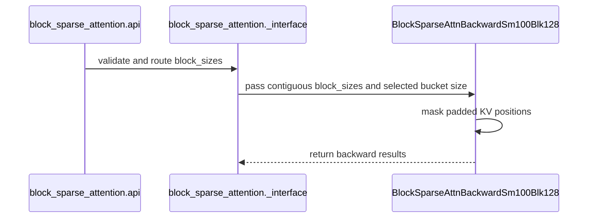

# perf(bsa): optimize SM100 blk128 backward and support padded KV blocks

[Upstream PR](https://github.com/NVIDIA/cudnn-frontend/pull/1785) · state: closed · merged: True

## Original PR description

## Before submitting

- [x] I agree to license this contribution under the terms of [LICENSE.txt](https://github.com/NVIDIA/cudnn-frontend/blob/develop/LICENSE.txt).
- [x] I ran `pre-commit run` and committed any formatting changes.
- [x] I reviewed the Hard Rules in the `AGENTS.md` for each directory this PR touches (see [root AGENTS.md § Reviewing a PR](https://github.com/NVIDIA/cudnn-frontend/blob/develop/AGENTS.md#reviewing-a-pr-human-or-agent)) and my changes comply, or I explain the exception below.
- [ ] I added GitHub labels: one `cat-*`, one or more `area:*` / `op:*`, and one `orig-*` (see [label list](https://github.com/NVIDIA/cudnn-frontend/labels)).

## Affected area

FE OSS kernels or CuTeDSL — SM100/SM103 blk128 block-sparse attention.

## Summary

- Support per-KV-block valid-prefix lengths in blk128 backward, matching forward padding semantics. Mask padded suffixes and skip dQ MMA slices beyond the valid prefix.
- Reduce repeated shared-memory loads of LSE and delta through warp shuffles.
- Enable parallel CSR offset scans on SM100/SM103 and select 2048-block automatic buckets for workloads with at least 1500 query blocks, while preserving explicit bucket overrides.
- Apply the merged blk64 subset-barrier protocol to blk128 forward and backward synchronization.
- Add regression coverage for padding, physical tails, layouts, head dimensions, bucket transitions, prefix boundaries, unsupported architectures, and changed-metadata CUDA Graph replay. Explicitly reset the test-owned graph.

## Why

Blk128 forward supports padded KV blocks, but backward previously rejected `block_sizes`. This change enables matching forward/backward semantics and reduces CSR setup, gradient postprocessing, and repeated statistics-load work for the affected workloads.

## Related issues

Related to #1724, merged as `0de76fe18`.

This PR builds on the merged blk64 work and contains only the blk128 changes.

## API and compatibility impact

Public BSA function signatures are unchanged.

The new backward padding support applies to BF16 MHA on SM100/SM103 with `sparse_block_size=128`, head dimension 64 or 128, and one-dimensional `int32` `block_sizes` shaped `(N_kv,)`. Both BHSD and BSHD layouts are supported. Each length describes the valid prefix of a physical KV block; callers must discard padded-query outputs and zero their `dout`.

SM107/SM110 blk128 backward continues to reject `block_sizes`. Existing calls with `block_sizes=None` remain supported.

The change retains the existing eager BSA allocation/layout behavior and does not introduce a prepared graph engine or change the backend/FROST graph contract (Python Rule 9). The subset-barrier helper uses the same DSL operations as merged blk64; no new DSL-version requirement is introduced (Rule 7).

## Testing

Passed locally with conda Python 3.10.13:

```bash
git diff --check origin/develop
python -m pre_commit run --from-ref origin/develop --to-ref HEAD --show-diff-on-failure
```

Black, Black-Jupyter, and SPDX checks passed.

Additional local checks passed:

- Python source compilation for all six changed Python files.
- All three public BSA signatures match develop.
- 288 host-only routing/validation combinations using the actual source functions with mock tensors, covering architectures, layouts, head dimensions, bucket boundaries/overrides, and padding.
- The new subset-barrier class is AST-identical to the merged blk64 implementation.

GPU numerical tests, CUDA Graph replay, Compute Sanitizer, and performance measurements were not run because the local host has no NVIDIA GPU. Host-only checks do not establish GPU correctness or a measured speedup.

Target GPU validation command:

```bash
cd test/python
pytest -m 'L0 or L1' block_sparse_attention/cutedsl/test_BSA_sm100_blk128_padding.py
```

<!-- This is an auto-generated comment: release notes by coderabbit.ai -->
<!-- coderabbit-ai-generated:v1 -->

## Summary by CodeRabbit

## Summary

* **New Features**
  * SM100 and SM103 now support backward attention with 128-element sparse blocks and per-block `int32` sizes. Padded KV suffixes are masked.
  * Automatic bucket selection for this mode now helps retain sufficient parallel work on long queries.
* **Bug Fixes**
  * Improved handling of padded KV blocks and results across automatic bucket-size transitions.
* **Documentation**
  * Clarified padding requirements and architecture support. Zero `dout` for padded queries and discard their outputs; SM110 still requires `block_sizes=None`.
<!-- end of auto-generated comment: release notes by coderabbit.ai -->

## Review and discussion

### reviews

- Anerudhan · APPROVED · 2026-10-22T14:49:39Z · [source](https://github.com/NVIDIA/cudnn-frontend/pull/1785#pullrequestreview-5616136081)

**Codex bot review · model: `gpt-6-astra`**

Reviewed `bc3fb76bb3b9` against base `4e27a6faf9f7`.

Thank you for your contribution! The padding and synchronization changes passed native SM100 checks. All 11 new L0/L1 tests passed, including graph replay and bucket transitions. The new automatic bucket improves a spread-KV workload but regresses a short, shared-KV workload by about 3.8x; please narrow that heuristic. I consider this a nonblocking performance finding because it is confined to that workload regime and the existing explicit bucket override restores performance. CI has been requested.

**[P1] Retain Q-group parallelism when the KV grid is small** ([source](https://github.com/NVIDIA/cudnn-frontend/blob/bc3fb76bb3b9399acf0a93bcbb2cd61109b359b7/python/cudnn/block_sparse_attention/_interface.py#L3004))

The >=1500-query-block rule selects 2048 regardless of the available KV/head parallelism. With B=1, H=2, D=128, Sq=196608 and Sk=256, both physical KV blocks are visible to every query. The new default reduces four Q groups to one and captured backward time rises from 2.01-2.07 ms on the base to 7.60-7.82 ms on this head. Explicit bucket_size_blocks=384 on the head restores 2.01 ms. A same-Q workload with 1536 spread KV blocks improves from 1.93-1.95 ms to 0.399 ms, so retain that benefit while guarding the low-parallelism case. Use available KV/head/grid work when choosing the bucket, or keep the previous default in this regime. This is nonblocking under the review policy: the demonstrated regression is limited to a short/shared-KV workload, has a direct explicit-bucket workaround, and all numerical checks pass.

Evidence: SM100 engineering device, 148 SMs, CuTeDSL 4.7.1, BF16. Exact base 4e27a6fa and head bc3fb76, same public API, analytic dQ/dK/dV checks, warmed caches and CUDA Graph capture; three batches of five replays per sample. Repeated 384/auto/2048/384/auto sequence. CPU call costs roughly 0.25-0.46 ms, measured separately. Checklist F04 and review principle 8. Attribution: Introduced by the new automatic bucket choice; same-head explicit384 control isolates it from the other optimizations.

Validation: Exact head on an SM100 engineering device, CuTeDSL 4.7.1, PyTorch 2.14.0 CUDA 13 and cuDNN 9.26: all 11 new L0/L1 tests passed in 25.09 s. This covers head dimensions 64/128, BSHD/BHSD, physical tails, strided block metadata, empty sparse rows, prefix boundaries, changed-metadata graph replay and 1499/1500/2049-query-block transitions. Two focused padding/replay cases passed Compute Sanitizer synccheck with zero errors. Source accounting gives 416 participants for each forward/backward TMEM allocation/free barrier, 256 for backward compute, 128 for backward reduction and 64 for each forward stats exchange. The changed barriers use non-aligned subset participation. An independent FP64-autograd probe passed O/dQ/dK/dV checks for three metadata phases with unsorted per-head sparse lists, unequal389/517 lengths, three heads, empty rows and NaN-poisoned caller-owned gradient buffers. Memcheck reported no device-memory violation, but did report seven cuGetProcAddress_v2 API lookup errors; a Torch-initialized device-query-only control reproduced those same seven errors without a BSA call. This is not a zero-error memcheck result. Analytic-gradient performance probes confirmed the shared-KV regression and spread-KV gain on exact base/head trees. CPU call time was measured separately from captured GPU time. These bounded measurements do not qualify B200/B300 performance or all sparse patterns. Reviewed all seven changed files, public admission and metadata layout, dynamic block-size binding, cache specialization, CSR parallel-prefix scans, dQ MMA slice masking and warp-shuffle coordinates. Precheck found no candidates; diff whitespace check passed. Completed labels, milestone and project, authorized inspected Style/Docs/Security workflows, and requested the supported python/*/cutedsl target.

Limitations: No native SM103/SM110 run or local 4.6.2 validation was performed. Pipeline 75867673 is running, but its SM100 job 503124348 failed during container setup before tests, so it supplies no dependency-floor result. CI's default L0 selection excludes the L1 bucket-transition test. The shared GPU was not isolated for benchmark timing. Repeated explicit-bucket controls showed a stable difference well above the observed variation. No kernel source was changed during review.

Approved: no P0 or high-risk P1 found. Remaining findings stay with the owner; merge timing stays with the owner.

<!-- codex-fe-review:v2:1785:bc3fb76bb3b9399acf0a93bcbb2cd61109b359b7:complete:no-blocker -->

- jiayus-nvidia · APPROVED · 2026-10-23T06:53:06Z · [source](https://github.com/NVIDIA/cudnn-frontend/pull/1785#pullrequestreview-5624909680)

(No body; status only.)

### issue_comments

- coderabbitai[bot] · comment · 2026-10-22T14:23:23Z · [source](https://github.com/NVIDIA/cudnn-frontend/pull/1785#issuecomment-6343128938)

<!-- coderabbit-ai-generated:v1 -->

<!-- This is an auto-generated comment: summarize by coderabbit.ai -->
<!-- review_stack_entry_start -->

<a href="https://app.coderabbit.ai/change-stack/NVIDIA/cudnn-frontend/pull/1785?scope=ghh_OusAJGA4HG8ljoOV0wJvVx8NmnZIjc2DdjmxOu0xZWA&amp;cs_source=review_comment"><picture><source media="(prefers-color-scheme: dark)" srcset="https://storage.googleapis.com/coderabbit_public_assets/review-stack-in-coderabbit-ui-dark.svg?v=3"><source media="(prefers-color-scheme: light)" srcset="https://storage.googleapis.com/coderabbit_public_assets/review-stack-in-coderabbit-ui.svg?v=3"></picture></a>

<!-- review_stack_entry_end -->
<!-- recent_review_start -->

No actionable comments were generated in the recent review. 🎉

<details>
<summary><strong>ℹ️ Recent review info</strong></summary>
<dl>
<dd>

<details>
<summary><strong>⚙️ Run configuration</strong></summary>
<dl>
<dd>

- **Source mode**: Auto
- **Repository**: [NVIDIA/cudnn-frontend](<https://github.com/NVIDIA/cudnn-frontend>)
- **Branch**: [develop](<https://github.com/NVIDIA/cudnn-frontend/tree/develop>)
- **File**: [.coderabbit.yaml](<https://github.com/NVIDIA/cudnn-frontend/blob/4e27a6faf9f72a9f3370f2c4d9cc0ae2cf74d4f5/.coderabbit.yaml>)
- **Commit**: [4e27a6f](<https://github.com/NVIDIA/cudnn-frontend/commit/4e27a6faf9f72a9f3370f2c4d9cc0ae2cf74d4f5>)
- **Layers**: Repository YAML
- **Review profile**: CHILL
- **Plan**: Enterprise
- **Run ID**: `0697da05-d03a-4fe8-b405-a33b385759be`

</dd>
</dl>
</details>

<details>
<summary><strong>📥 Commits</strong></summary>
<dl>
<dd>

Reviewing files that changed from the base of the PR and between bc3fb76bb3b9399acf0a93bcbb2cd61109b359b7 and 3b92bf4f0e183b4e0478038e23754779ad283cc9.

</dd>
</dl>
</details>

<details>
<summary><strong>📒 Files selected for processing: 2</strong></summary>
<dl>
<dd>

* `docs/fe-oss-apis/bsa.md`
* `python/cudnn/block_sparse_attention/_interface.py`

</dd>
</dl>
</details>

<details>
<summary><strong>🚧 Files skipped from review as they are similar to previous changes: 1</strong></summary>
<dl>
<dd>

* docs/fe-oss-apis/bsa.md

</dd>
</dl>
</details>

**Included review availability:** This review used your included allowance. Your plan provides up to 12 included reviews per hour; 11 remain after this review.

</dd>
</dl>
</details>


<!-- recent_review_end -->
<!-- walkthrough_start -->

<details>
<summary><strong>📝 Walkthrough</strong></summary>
<dl>
<dd>

SM100/SM103 blk128 backward now accepts per-KV-block `block_sizes` and masks padded KV positions. The interface also selects automatic bucket sizes and constructs bucketed K-to-Q CSR offsets. Forward and backward synchronization changes, documentation updates, and regression tests accompany the behavior.

**Changes: SM100/SM103 blk128 padding**

|Layer / File(s)|Summary|
|:---|:---|
|**API contract and dispatch** <br> `docs/fe-oss-apis/bsa.md`, `python/cudnn/block_sparse_attention/api.py`, `python/cudnn/block_sparse_attention/_interface.py`, `python/cudnn/block_sparse_attention/csrc/bwd/sm100_blk128/bsa_bwd_sm100.py`|The API and interface allow one-dimensional `block_sizes` for SM100/SM103 blk128 backward and prepare the metadata for the kernel. The interface selects automatic bucket sizes and enables parallel CSR offset construction for these architectures. The documentation describes the padding and bucket rules.|
|**Kernel masking and gradient computation** <br> `python/cudnn/block_sparse_attention/csrc/bwd/sm100_blk128/bsa_bwd_sm100.py`|The backward kernel caps valid KV extents by `block_sizes`, masks padded positions, and uses a prefix-aware dQ accumulation path. It also loads LSE and dPsum values per lane and shuffles them to Q coordinates.|
|**Synchronization and regression coverage** <br> `python/cudnn/block_sparse_attention/csrc/fwd/sm100_blk128/bsa_fwd_sm100.py`, `python/cudnn/block_sparse_attention/csrc/bwd/sm100_blk128/bsa_bwd_sm100.py`, `python/cudnn/block_sparse_attention/csrc/utils/subset_barrier.py`, `test/python/block_sparse_attention/cutedsl/test_BSA_sm100_blk128_padding.py`|Forward and backward synchronization use `_SubsetNamedBarrier`. Tests cover architecture rejection, reference comparisons, graph replay, automatic bucket transitions, and KV-prefix boundaries.|

<!-- change_assessment_start -->
**Priority:** ➖ Normal

**Estimated code review effort:** 3 (Moderate) | ~20 minutes

<!-- change_assessment_commit:"3b92bf4f0e183b4e0478038e23754779ad283cc9" -->
**Change:** Feature
<!-- change_assessment_end -->

### Sequence Diagram(s)



**Possibly related issues**

- Issue 1788 reports poor parallel scaling for short-query, long-KV attention. This change adjusts automatic bucket selection for SM100/SM103 blk128 backward, but the issue description notes that its kernels and architectures differ.
- Issue 20510 reports long-KV performance loss for few-head decode workloads. The bucket-selection changes address a related parallelism concern, but this change does not modify the MLA FP8-KV kernel.

</dd>
</dl>
</details>

<!-- walkthrough_end -->
<details>
<summary><strong>Merge Risk:</strong> <strong>⚪ Minimal</strong> · up to <code>3b92b</code></summary>
<dl>
<dd>

<!-- final_review_risk_start -->
<!-- final_review_risk_label
**Merge Risk:** **⚪ Minimal** · up to `3b92b`
-->
<!-- final_review_risk_coverage:{"sourceCommitId":"3b92bf4f0e183b4e0478038e23754779ad283cc9","coveredCommitId":"3b92bf4f0e183b4e0478038e23754779ad283cc9","kind":"reviewed"} -->

No actionable merge-blocking issue was identified in the reviewed changes; normal validation can proceed.
<!-- final_review_risk_end -->

</dd>
</dl>
</details>
<!-- pre_merge_checks_walkthrough_start -->

<details>
<summary><strong>Pre-merge checks: <sup><picture></picture></sup> 4 · <sup><picture></picture></sup> 1</strong></summary>
<dl>
<dd>

<strong><sup><picture></picture></sup> Failed checks: 1 warning</strong>

|     Check name     |                                              Status                                              | Explanation                                                                                                                                                                                               | Resolution                                                                         |
| :---------------- | :----------------------------------------------------------------------------------------------: | :-------------------------------------------------------------------------------------------------------------------------------------------------------------------------------------------------------- | :--------------------------------------------------------------------------------- |
| Docstring Coverage |  | Docstring coverage is 29.63% which is insufficient. The required threshold is 80.00%. Docstring coverage is scoped to functions touched by this diff. Analyzed 27 functions across 6 files. (1 skipped: … | Write docstrings for the functions missing them to satisfy the coverage threshold. |

<details>
<summary><strong><sup><picture></picture></sup> Passed checks: 4 passed</strong></summary>
<dl>
<dd>

|         Check name         |                                             Status                                             | Explanation                                                                                                                                                                                               |
| :------------------------ | :--------------------------------------------------------------------------------------------: | :-------------------------------------------------------------------------------------------------------------------------------------------------------------------------------------------------------- |
|      Description check     |  | The description follows the required template and covers the affected area, summary, rationale, compatibility impact, related issues, and testing. It clearly records the unchecked label requirement an… |
|         Title check        |  | The title is concise and accurately identifies the main changes: SM100 blk128 backward optimization and padded KV-block support.                                                                          |
|     Linked Issues check    |  | Check skipped because no linked issues were found for this pull request.                                                                                                                                  |
| Out of Scope Changes check |  | Check skipped because no linked issues were found for this pull request.                                                                                                                                  |

<details>
<summary><strong>Full details: Description check</strong></summary>
<dl>
<dd>

**Explanation**

The description follows the required template and covers the affected area, summary, rationale, compatibility impact, related issues, and testing. It clearly records the unchecked label requirement and the GPU testing limitation.

</dd>
</dl>
</details>

</dd>
</dl>
</details>

<details>
<summary><strong>Full details: Docstring Coverage</strong></summary>
<dl>
<dd>

**Explanation**

Docstring coverage is 29.63% which is insufficient. The required threshold is 80.00%. Docstring coverage is scoped to functions touched by this diff. Analyzed 27 functions across 6 files. (1 skipped: 1 unsupported.)

**Resolution**

Write docstrings for the functions missing them to satisfy the coverage threshold.

</dd>
</dl>
</details>

</dd>
</dl>
</details>

<!-- pre_merge_checks_walkthrough_end -->
<!-- finishing_touch_checkbox_start -->

<details>
<summary><strong>✨ Finishing Touches</strong></summary>
<dl>
<dd>

<details open>
<summary><strong>🧪 Generate unit tests (beta)</strong></summary>
<dl>
<dd>

- [ ] <!-- {"checkboxId": "f47ac10b-58cc-4372-a567-0e02b2c3d479", "radioGroupId": "utg-output-choice-group-unknown_comment_id"} --> Create a new PR

</dd>
</dl>
</details>

</dd>
</dl>
</details>

<!-- finishing_touch_checkbox_end -->

<!-- autopilot:start -->
- [ ] <!-- {"checkboxId":"2708ad07-9f24-4260-9c11-7dc76a49f2e3"} --> <strong title="Keep fixing CodeRabbit findings and required CI, and resolving merge conflicts">Autofix</strong> · Keep fixing CodeRabbit findings and required CI, and resolving merge conflicts
<!-- autopilot:end -->
<!-- tips_start -->


<sub>Comment `@coderabbitai help` to get the list of available commands.</sub>

<!-- tips_end -->

- Anerudhan · comment · 2026-10-22T14:43:28Z · [source](https://github.com/NVIDIA/cudnn-frontend/pull/1785#issuecomment-6343555374)

Requesting `python/*/cutedsl` for `bc3fb76bb3b9`. It covers the BSA CuTeDSL tests at the supported dependency floor. All 11 new L0/L1 tests passed locally on SM100 with CuTeDSL 4.7.1, and two focused cases passed synccheck with zero errors. The automatic bucket has a workload-specific performance regression, with an explicit bucket override available; I will include the measurements in the review. The CI target's default L0 selection does not run the L1 bucket-transition case.

Codex bot review — model `gpt-6-astra`.

<!-- codex-fe-ci:v1:1785:bc3fb76bb3b9399acf0a93bcbb2cd61109b359b7:blk128-ci-notice -->

- Anerudhan · comment · 2026-10-22T14:44:15Z · [source](https://github.com/NVIDIA/cudnn-frontend/pull/1785#issuecomment-6343572356)

@cudnn-ci-bot run python/*/cutedsl

- cudnn-ci-bot · comment · 2026-10-22T14:44:19Z · [source](https://github.com/NVIDIA/cudnn-frontend/pull/1785#issuecomment-6343573785)

🏁 Pipeline finished

SHA: `bc3fb76`
Targets: `python/*/cutedsl`
Branch: [cudnn-gh/pr-1785-bc3fb76](https://nv/cudnn-gitlab-ci/-/tree/cudnn-gh/pr-1785-bc3fb76)
Pipeline: [75867673](https://nv/cudnn-gitlab-ci/-/pipelines/75867673)
Last updated: 2026-10-22 15:00 UTC

**22 passed, 2 failed, 2 skipped, 11 manual**

### <code>manual</code>

- <code>manual:python_samples</code> - Manual
- <code>manual:python</code> - Manual
- <code>manual:python/sdpa/frost</code> - Manual
- <code>manual:python/linear_attention/frost</code> - Manual
- <code>manual:python/gemm/frost</code> - Manual
- <code>manual:python/*/frost</code> - Manual
- <code>manual:python/gemm/cutedsl</code> - Manual
- <code>manual:python/*/cutedsl</code> - ✅ Passed
- <code>manual:python/*/jax</code> - Manual
- <code>manual:pycudnn</code> - Manual
- <code>manual:multi_gpu</code> - Manual
- <code>manual:backend</code> - Manual

### <code>analysis</code>

- <code>analysis:cudnn_clang_disable_exception</code> - ✅ Passed
- <code>analysis:cudnn_v9_no_half_conversion</code> - ✅ Passed
- <code>analysis:cudnn_clang</code> - ✅ Passed
- <code>analysis:check-relative-includes</code> - ✅ Passed
- <code>analysis:check-CUDNN_FRONTEND_SKIP_JSON_LIB</code> - ✅ Passed
- <code>analysis:guardwords_scan</code> - ✅ Passed
- <code>analysis:jax-import-guard</code> - ✅ Passed
- <code>analysis:pytest-gpu</code> - ✅ Passed
- <code>san:build</code> - ✅ Passed

### <code>build</code>

- <code>analysis:api_index</code> - ✅ Passed
- <code>build:dev:linux:amd64</code> - ✅ Passed
- <code>build:rel:linux:amd64</code> - ✅ Passed
- <code>build:dev:linux:arm64</code> - ✅ Passed
- <code>build:rel:linux:arm64</code> - ✅ Passed
- <code>build:rel:win:amd64</code> - ✅ Passed

### <code>oss_tests</code>

- <code>python/gemm/cutedsl:cutlass-rel:sm100</code> - Skipped
- <code>python/*/cutedsl:cutlass-rel:sm80</code> - ✅ Passed
- <code>python/*/cutedsl:cutlass-rel:sm90</code> - ✅ Passed
- <code>python/*/cutedsl:cutlass-rel:sm100</code> - ❌ **New Failure!** (nightly passed)
- <code>python/*/jax:cutlass-rel:sm100</code> - Skipped
- <code>python/*/cutedsl:cutlass-4.8:sm107</code> - ❌ **Old Failure** (nightly failed)

### <code>sanitizer_tests</code>

- <code>san:cpp_test:sm80</code> - ✅ Passed
- <code>san:cpp_test:sm90</code> - ✅ Passed
- <code>san:cpp_test:sm100</code> - ✅ Passed

### <code>triage</code>

- <code>triage:ai</code> - ✅ Passed

- Anerudhan · comment · 2026-10-22T15:01:17Z · [source](https://github.com/NVIDIA/cudnn-frontend/pull/1785#issuecomment-6343940841)

CI pipeline 75867673 finished for `bc3fb76bb3b9`; all seven changed files match its integration tree.

- SM100 job 503124348 failed during container setup, before pytest. It provides no test result.
- SM107 job 503124352: 8,118 passed, 2,703 skipped, 2 xfailed, one failed. `test_canonical_jax_quant_fp4[wrapper-nvfp4]` failed in the eager grouped-GEMM reference with `CUDA_LAUNCH_INVALID_CONFIG`. That test and its GEMM call path are outside this PR's changes; the log does not establish the root cause.
- SM90: 1,254 passed, 1,540 skipped, 6 xfailed. SM80: 775 passed, 2,025 skipped. Those architectures do not validate the new SM100 kernel.

To cover the dependency-floor gap, I ran all 11 tests in `test_BSA_sm100_blk128_padding.py` with `-m 'L0 or L1'` at this exact head using an isolated CuTeDSL 4.6.2 install: **11 passed, zero skipped** in 23.04 s. This includes changed-metadata graph replay and the L1 automatic-bucket transitions. The device is an SM100 engineering GPU, with PyTorch 2.14.0 CUDA 13 and cuDNN 9.26; this is not a B200/B300 qualification or a copy of the full CI environment. No native SM103/SM110 validation was added.

The local result supplements the earlier 4.7.1 checks; it does not make the failed pipeline green. The nonblocking short/shared-KV performance finding remains open.

Codex bot review — model `gpt-6-astra`.

<!-- codex-fe-ci:v1:1785:bc3fb76bb3b9399acf0a93bcbb2cd61109b359b7:pipeline-75867673-finished -->

- YangXu1990uiuc · comment · 2026-10-22T16:02:52Z · [source](https://github.com/NVIDIA/cudnn-frontend/pull/1785#issuecomment-6345293486)

Thanks for adding blk128 backward padding support and the regression coverage! I have added this PR to our external-contribution tracking. We will keep the automatic-bucket performance finding and the remaining CI coverage in the follow-up.

When you consider the PR ready to land, please leave a comment saying `ready`. The review bot will review any remaining updates, and we will help close out review, validation and integration through to merge. You do not need merge permissions yourself.

<!-- fe-external-watch:1785:ready-invitation -->


- jiayus-nvidia · comment · 2026-10-23T06:53:25Z · [source](https://github.com/NVIDIA/cudnn-frontend/pull/1785#issuecomment-6359290103)

@cudnn-ci-bot run python/*/cutedsl

- cudnn-ci-bot · comment · 2026-10-23T06:53:29Z · [source](https://github.com/NVIDIA/cudnn-frontend/pull/1785#issuecomment-6359291009)

🏁 Pipeline finished

SHA: `3b92bf4`
Targets: `python/*/cutedsl`
Branch: [cudnn-gh/pr-1785-3b92bf4](https://nv/cudnn-gitlab-ci/-/tree/cudnn-gh/pr-1785-3b92bf4)
Pipeline: [76072597](https://nv/cudnn-gitlab-ci/-/pipelines/76072597)
Last updated: 2026-10-23 07:12 UTC

**23 passed, 1 failed, 2 skipped, 11 manual**

### <code>manual</code>

- <code>manual:python_samples</code> - Manual
- <code>manual:python</code> - Manual
- <code>manual:python/sdpa/frost</code> - Manual
- <code>manual:python/linear_attention/frost</code> - Manual
- <code>manual:python/gemm/frost</code> - Manual
- <code>manual:python/*/frost</code> - Manual
- <code>manual:python/gemm/cutedsl</code> - Manual
- <code>manual:python/*/cutedsl</code> - ✅ Passed
- <code>manual:python/*/jax</code> - Manual
- <code>manual:pycudnn</code> - Manual
- <code>manual:multi_gpu</code> - Manual
- <code>manual:backend</code> - Manual

### <code>analysis</code>

- <code>analysis:cudnn_clang_disable_exception</code> - ✅ Passed
- <code>analysis:cudnn_v9_no_half_conversion</code> - ✅ Passed
- <code>analysis:cudnn_clang</code> - ✅ Passed
- <code>analysis:check-relative-includes</code> - ✅ Passed
- <code>analysis:check-CUDNN_FRONTEND_SKIP_JSON_LIB</code> - ✅ Passed
- <code>analysis:guardwords_scan</code> - ✅ Passed
- <code>analysis:jax-import-guard</code> - ✅ Passed
- <code>analysis:pytest-gpu</code> - ✅ Passed
- <code>san:build</code> - ✅ Passed

### <code>build</code>

- <code>analysis:api_index</code> - ✅ Passed
- <code>build:dev:linux:amd64</code> - ✅ Passed
- <code>build:rel:linux:amd64</code> - ✅ Passed
- <code>build:dev:linux:arm64</code> - ✅ Passed
- <code>build:rel:linux:arm64</code> - ✅ Passed
- <code>build:rel:win:amd64</code> - ✅ Passed

### <code>oss_tests</code>

- <code>python/gemm/cutedsl:cutlass-rel:sm100</code> - Skipped
- <code>python/*/cutedsl:cutlass-rel:sm80</code> - ✅ Passed
- <code>python/*/cutedsl:cutlass-rel:sm90</code> - ✅ Passed
- <code>python/*/cutedsl:cutlass-rel:sm100</code> - ✅ Passed
- <code>python/*/jax:cutlass-rel:sm100</code> - Skipped
- <code>python/*/cutedsl:cutlass-4.8:sm107</code> - ❌ **Old Failure** (nightly failed)

### <code>sanitizer_tests</code>

- <code>san:cpp_test:sm80</code> - ✅ Passed
- <code>san:cpp_test:sm90</code> - ✅ Passed
- <code>san:cpp_test:sm100</code> - ✅ Passed

### <code>triage</code>

- <code>triage:ai</code> - ✅ Passed

### inline_comments

## Changed files and fixed code

- `docs/fe-oss-apis/bsa.md` · modified · additions 12 / deletions 3
  - [head](https://github.com/luolie0577/cudnn-frontend/blob/3b92bf4f0e183b4e0478038e23754779ad283cc9/docs/fe-oss-apis/bsa.md)
  - [base](https://github.com/NVIDIA/cudnn-frontend/blob/4e27a6faf9f72a9f3370f2c4d9cc0ae2cf74d4f5/docs/fe-oss-apis/bsa.md)
- `python/cudnn/block_sparse_attention/_interface.py` · modified · additions 28 / deletions 4
  - [head](https://github.com/luolie0577/cudnn-frontend/blob/3b92bf4f0e183b4e0478038e23754779ad283cc9/python/cudnn/block_sparse_attention/_interface.py)
  - [base](https://github.com/NVIDIA/cudnn-frontend/blob/4e27a6faf9f72a9f3370f2c4d9cc0ae2cf74d4f5/python/cudnn/block_sparse_attention/_interface.py)
- `python/cudnn/block_sparse_attention/api.py` · modified · additions 3 / deletions 3
  - [head](https://github.com/luolie0577/cudnn-frontend/blob/3b92bf4f0e183b4e0478038e23754779ad283cc9/python/cudnn/block_sparse_attention/api.py)
  - [base](https://github.com/NVIDIA/cudnn-frontend/blob/4e27a6faf9f72a9f3370f2c4d9cc0ae2cf74d4f5/python/cudnn/block_sparse_attention/api.py)
- `python/cudnn/block_sparse_attention/csrc/bwd/sm100_blk128/bsa_bwd_sm100.py` · modified · additions 55 / deletions 17
  - [head](https://github.com/luolie0577/cudnn-frontend/blob/3b92bf4f0e183b4e0478038e23754779ad283cc9/python/cudnn/block_sparse_attention/csrc/bwd/sm100_blk128/bsa_bwd_sm100.py)
  - [base](https://github.com/NVIDIA/cudnn-frontend/blob/4e27a6faf9f72a9f3370f2c4d9cc0ae2cf74d4f5/python/cudnn/block_sparse_attention/csrc/bwd/sm100_blk128/bsa_bwd_sm100.py)
- `python/cudnn/block_sparse_attention/csrc/fwd/sm100_blk128/bsa_fwd_sm100.py` · modified · additions 6 / deletions 5
  - [head](https://github.com/luolie0577/cudnn-frontend/blob/3b92bf4f0e183b4e0478038e23754779ad283cc9/python/cudnn/block_sparse_attention/csrc/fwd/sm100_blk128/bsa_fwd_sm100.py)
  - [base](https://github.com/NVIDIA/cudnn-frontend/blob/4e27a6faf9f72a9f3370f2c4d9cc0ae2cf74d4f5/python/cudnn/block_sparse_attention/csrc/fwd/sm100_blk128/bsa_fwd_sm100.py)
- `python/cudnn/block_sparse_attention/csrc/utils/subset_barrier.py` · added · additions 41 / deletions 0
  - [head](https://github.com/luolie0577/cudnn-frontend/blob/3b92bf4f0e183b4e0478038e23754779ad283cc9/python/cudnn/block_sparse_attention/csrc/utils/subset_barrier.py)
  - [base](https://github.com/NVIDIA/cudnn-frontend/blob/4e27a6faf9f72a9f3370f2c4d9cc0ae2cf74d4f5/python/cudnn/block_sparse_attention/csrc/utils/subset_barrier.py)
- `test/python/block_sparse_attention/cutedsl/test_BSA_sm100_blk128_padding.py` · added · additions 149 / deletions 0
  - [head](https://github.com/luolie0577/cudnn-frontend/blob/3b92bf4f0e183b4e0478038e23754779ad283cc9/test/python/block_sparse_attention/cutedsl/test_BSA_sm100_blk128_padding.py)
  - [base](https://github.com/NVIDIA/cudnn-frontend/blob/4e27a6faf9f72a9f3370f2c4d9cc0ae2cf74d4f5/test/python/block_sparse_attention/cutedsl/test_BSA_sm100_blk128_padding.py)

## Evidence and interpretation boundary

[Original JSON, discussions and patches](../../../../../../evidence/prs/NVIDIA--cudnn-frontend/1785-105077e1ef598d84c137209c1097dd3ff6c1bec4323b078858b7b3f3aa79ae50.json) · SHA-256 `105077e1ef598d84c137209c1097dd3ff6c1bec4323b078858b7b3f3aa79ae50`.

Diff complete: True. Missing/binary/truncated patches require pinned source inspection. This is a source page, not an independently verified optimization case. Open, merged and released are different states; recheck the deployed dependency.
