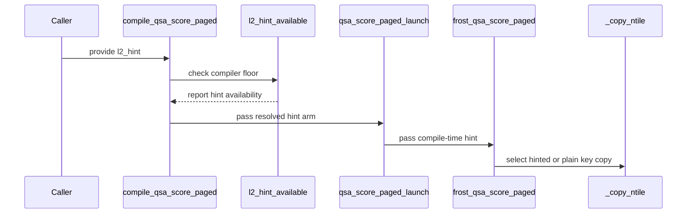

# fix(gated_attention_block): the paged scorer and the decode top-k on the public CuTe DSL 4.7.0 -- unhinted key copies below the 13.4 assembler, cluster-form cells skip below their floor, device gates before form gates, a DSL-free front door

[Upstream PR](https://github.com/NVIDIA/cudnn-frontend/pull/1792) · state: closed · merged: True

## Original PR description

## Symptom (the nightly CuTe DSL lanes on the public `nvidia-cutlass-dsl` 4.7.0 wheel -- admitted by the package floor `CUTEDSL_MIN_VERSION`)

* **sm100 (cc 10.0) and sm90 (cc 9.0): the paged decode scorer raises `cudaErrorIllegalInstruction` (error 715) at its first launch.** Every kernel cell of `test_qsa_score_paged.py` -- the scorer cells and the paged-selector cells on top of it -- fails or is killed by the crash guard (sm90: 109 failed, 48 of them crash-guard kills; sm100: 297 failed / 4 errors = 158 unique ids plus crash duplicates), nothing outside the two `gated_attention_block` modules.
* **Every 4.7.0 lane: `test_qsa_topk_decode.py`'s 17 cluster-form cells FAIL instead of skipping**, with the text of the cluster form's own typed decline (`CLUSTER_FORM_MIN_DSL` = 4.8.0; the single-CTA form passes there).
* **sm80 (cc 8.0): `test_declines_clusters_and_pdl_below_cc_9` fails** -- `compile_qsa_topk_decode` raised the cluster form's DSL-floor decline *before* the device's cc 9.0 gate, so a part below cc 9.0 was told about the wheel instead of what it lacks.
* **Every 4.7.0 lane: `test_front_door_declines_by_version_in_a_fresh_process_without_importing_the_kernel_module` fails** -- the child process dies with `ModuleNotFoundError: cutlass.experimental` instead of the front door's typed decline.
* The 4.8.0 lanes are green before and after.

## Root cause

1. The scorer's 16 key copies are `cp.async.cg.shared.global.L2::cache_hint` with a `createpolicy.fractional.L2::evict_first` register. The 13.3 PTX assembler bundled with the 4.7.0 wheel's cu13 toolchain mis-encodes them: the policy word and the ring base are built in two uniform registers, and every hinted `LDGSTS` is encoded to read two *other* uniform registers that nothing in the kernel writes (`LDGSTS.E.BYPASS.128 [R#+UR0], desc[UR1]`, zero writers of `UR0` / `UR1`; cuda-gdb: `CUDA_EXCEPTION_27 Warp Illegal Instruction Parameter` on the first key copy; compute-sanitizer memcheck clean). The 13.4 assembler of the 4.8.0 wheel's cu13 toolchain encodes the operands it defined. The PTX is identical under both. The unhinted form (plain `cp.async.cg.shared.global ... 16, size`) passes the same cell under 4.7.0. The cu12 flavour of both public wheels -- what the DSL binds under a CUDA 12 driver, a 4.8.0 wheel included -- reports CUDA 12.9, and its assembler emits the same mis-encoding (compile-only dumps for sm_90a and sm_100; not launched natively).
2. The cluster-form cells carried only a device mark (`needs_cluster_gpu`), no DSL mark: on a wheel below the form's floor the typed decline surfaced as a failure.
3. The gate order in `compile_qsa_topk_decode` put a form's DSL gate ahead of the device gates.
4. The paged and the dense selectors' front door (`QSA/selection_paged.py`, `QSA/selection.py`) imported `TupleDict` from `api_base`, whose import executes `import cutlass`; under 4.7.0 `cutlass/__init__` imports `cutlass.experimental`, which the probe's modeled 4.6.2 wheel does not ship -- so the front door could not reach its own typed decline without the DSL.

## Fix (two commits)

**Commit 1 -- the scorer and the front door** (`kernels/qsa_score_paged.py`, `QSA/selection_paged.py`, `QSA/selection.py`, `api_base.py`, new `cudnn/_tupledict.py`)

* The L2 hint becomes a compile-time arm, **`l2_hint`** (appended to `compile_qsa_score_paged` and `QsaScorePagedRecipe`, default `None` = the rule; public signatures append-only, `qsa_select_decode_paged_forward` unchanged): hinted where the DSL's bundled CUDA compiler is `L2_HINT_MIN_COMPILER` = 13.4 or later -- read from `cutlass.base_dsl.version_info.CUDA_VERSION` at one seam, i.e. the cu12 / cu13 flavour the DSL actually bound, never the wheel's version number -- and the plain `cp.async.cg.shared.global` below it. Both arms move the same bytes into the same slots in the same order, so the logits are bitwise identical across the arm. `l2_hint=False` is the plain copy on any DSL; `l2_hint=True` below the floor is a typed `NotImplementedError` (Rule 7) that names the installed wheel and the compiler it found, states the defect as observed (the 4.7.0 cu13 wheel's 13.3 assembler, the cu12 flavour's 12.9 one) rather than as a property of the found version, and prescribes `nvidia-cutlass-dsl[cu13]>=4.8.0` under a CUDA 13 driver -- a bare wheel upgrade changes nothing for a 4.8.0 wheel bound to its cu12 flavour. The gate sits after PDL's cc gate (a device gate before a form's gate). The default's memo key keeps its identity; an explicit `l2_hint` extends it.
* `TupleDict` moves verbatim to the DSL-free `cudnn/_tupledict.py`; `api_base` re-exports it, so every existing import keeps resolving; both selectors import it from there.
* Tests: the `l2_hint` knob cell (hinted == plain bitwise where the compiler serves both; the forced hint's live decline text pinned), the gate cell at the compiler seam (13.3, the cu12 flavour's 12.9 and a never-observed 13.1 each decline with the observed defect and the cu13 remedy -- never "the found version mis-encodes"; 13.4 / 13.6 / 14.0 serve), the Rule-7 gate-order extension, the strengthened fresh-process probe (`cutlass` stays out of the child's `sys.modules` after the front-door import and after the decline) and its sibling for the dense selector. The test-suite banner prints `CuTe DSL Version: <wheel> (compiles with CUDA <major.minor>)` (guarded; `CuTe DSL: not available (...)` otherwise), so every log names the compiler its kernels were built with.

**Commit 2 -- the decode top-k** (`kernels/qsa_topk_decode.py`, its tests)

* A `needs_cluster_dsl` mark built from `cluster_form_requirement_error(CLUSTER_SIZES[1])` -- the skip reason *is* the typed decline -- on the three cluster-form cells; `test_every_knob_value_is_bitwise_the_same_function` is split so the cluster loop is its own marked cell (`test_every_cluster_size_is_bitwise_the_single_cta_function`; no silent empty loop).
* The cluster form's DSL floor now comes *after* the two device gates (clusters / DSMEM cc 9.0, PDL cc 9.0) and before the shared-memory check -- a device gate before a form's DSL gate; the docstring's order sentence says so. `test_declines_clusters_and_pdl_below_cc_9` pins the order with both declines live (cc 8.0 and a 4.7.0 DSL modeled; it asserts the cluster form's decline is live and expects the cc text), and the floor's existing RED-then-green gate cell models the device too, so it survives the reorder and still fails when the gate is removed.

Docs: the scorer paragraph (the hint arm, the flavour rule, the decline) and the top-k decline-order sentence in `docs/fe-oss-apis/gated_attention_block.md`; the Rule-7 known-floors note in `python/cudnn/AGENTS.md`. **No `SUPPORT_MATRIX_TRACKER` change: not an SDPA `Capabilities` / `EngineSpec` change** (a kernel-level knob and test / gate-order fixes in `gated_attention_block`).

## Equivalence

* **The default's SASS is unchanged where the hint is served.** Under the 13.4 compiler (the 4.8.0 wheel's cu13 toolchain) the default recipe's cubins are byte-identical to develop's for all five targets -- same md5, name-normalised `nvdisasm` body diff 0 lines: sm_80 (`a1532003`, 504 instructions), sm_90a (`b5a538a4`, 528), sm_100 (`538f35b8`, 536), sm_100a (`07ecdfb0`, 536), sm_107a (`1dc3dcdc`, 536). The hinted PTX is byte-identical to develop's as well (sm_100 and sm_100a compared).
* **Below the floor the kernel is the proven plain copy.** Under 4.7.0 the unhinted sm_100 cubin (544 instructions) is byte-identical to the hand-made no-hint variant that passed the crashing cell during triage; against the crashing hinted build it differs in exactly the 16 key copies, which now read a defined descriptor register. The fixed 4.7.0 sm_90a build reads `desc[UR6]`, written by one instruction, where the crashing build read `UR0` / `UR1` with zero writers.
* **The arm is the same function.** The knob cell checks hinted == plain bitwise on cc 8.0, 10.0 and 10.7 under 4.8.0; under 4.7.0 it checks the two plain artifacts bitwise and pins the live decline text.
* **Behaviour change to be aware of (perf-only, conservative):** below the floor the scorer now traces the plain copies on *every* arch, including sm_80, where the hinted form never trapped (4.7.0 sm_80: hinted -> plain, 512 instructions either way, the 88 kernel cells pass natively), and for the cu12 flavour of a 4.8.0 wheel, which loses the evict-first hint it had.

## Verification matrix (this branch, `-m L0`; counts are passed / failed / skipped)

| arch class | DSL | `test_qsa_score_paged.py` | `test_qsa_topk_decode.py` | other |
|---|---|---|---|---|
| cc 10.0 (GB200 class, 152 SMs) | 4.7.0 | **153 / 0 / 1** (the two-device cell) | **42 / 0 / 24** (17 cluster cells skip with the typed text, 5 sm_107a render pins, 2 two-device) | the three two-device cells with two GPUs visible: 3 / 0 / 0 |
| cc 10.0 | 4.8.0 | **153 / 0 / 1** | **64 / 0 / 2** (the cluster cells run natively) | two-device cells: 3 / 0 / 0 |
| cc 10.7 (Rubin class, 204 SMs) | 4.8.0 | **153 / 0 / 1** (natively on sm_107a) | **64 / 0 / 2** | -- |
| cc 10.7 | 4.7.0 | **12 / 0 / 142** (the wheel has no sm_107a target: every kernel cell skips with that decline; the host cells incl. both fresh-process probes and the gate cells pass) | **9 / 0 / 57** (the order test and the device-modeled gate cell pass) | the scorer cell compiled for sm_100 and launched there with the arch gate bypassed in-process: passes against the fp64 reference, two launches bitwise -- where develop trapped |
| cc 8.0 (A100 class) | 4.8.0 | **88 / 0 / 66** (the selector cells skip at the radix top-k's cc 9.0 floor) | **45 / 0 / 21** | `core/test_import_boundaries.py` 31 / 0 / 0; `test_conftest_parallel.py` 18 / 0 / 0; the two fresh-process probes 2 / 0 / 0 |
| cc 8.0 | 4.7.0 | **88 / 0 / 66** (the knob cell pins the live 4.7.0 decline text) | **40 / 0 / 26** (the 18 cluster cells and the sm_107a render pins skip) | -- |

The 4.8.0 top-k counts were taken on the previous iteration of the branch; the top-k commit is patch-identical, and the later amendments to commit 1 are text-only (the decline string, docstrings, docs, the banner), exercised again by every cell above.

**RED first, green after** -- every regression test was run red on the unfixed sources before it passed: the scorer's first launch under 4.7.0 (error 715 natively on cc 10.0, and with an sm_100 cubin on cc 10.7); the top-k module under 4.7.0 on develop: 18 failed / 40 passed / 7 skipped; the new order test on the old gate order (1 failed); the device-modeled gate cell with the floor gate removed (fails: compile reached below the floor); the decline-text pin on the earlier wording (1 failed under a 4.8.0 and under a 4.7.0 DSL); the six new scorer cells on the unfixed sources (6 failed: no `l2_hint`, `cutlass` inside the child's `sys.modules`, no `L2_HINT_MIN_COMPILER`); the fresh-process probe on develop under 4.7.0 (`ModuleNotFoundError: cutlass.experimental`).

## CI: the critical checks before merge

* **The three CuTe DSL lanes on the public 4.7.0 wheel (sm80 / sm90 / sm100).** Expected: the sm90 / sm100 scorer failures become passes; the 17 cluster cells become typed skips; the order test and the fresh-process probes pass; the sm80 scorer kernel cells run the plain copies (hinted before, same function). **The sm90 one is the gate:** it is the first *native* launch of the unhinted arm on cc 9.0 (compile-side its SASS is clean, and cc 10.0 ran the same arm green natively).
* **The 4.8.0 CuTe DSL lanes:** 4 new cells (scorer: the dense front-door probe, the gate cell, the knob cell; top-k: the split cluster knob cell), 0 changed outcomes; the banner now records which compiler each lane bound.
* The repository-required checks (pre-commit, CodeQL, CodeRabbit, merge requirements).

## Open items

* **The cu12 flavour is untested on any lane** (no CUDA 12 driver machine was at hand). The compiler key keeps it on the unhinted side, and compile-only dumps show its 12.9 assembler emitting the same mis-encoding for both public wheels, so develop's unconditional hint would have trapped there too; a native launch under a CUDA 12 driver remains unevidenced.
* **The L2 evict-first hint's benefit is unmeasured.** This PR keeps develop's rendering wherever the compiler serves it; an A/B under the 13.4 compiler (`l2_hint=True` vs `False`, same function) would settle whether the hint should stay the default at all.
* **The dense selector had no fresh-process probe** although it carried the same DSL-executing import; this PR adds one (the sibling of the paged probe). Any further front door under `QSA/` should get the same probe.
* **The persistent compiled-plan cache's environment manifest** names the DSL wheel and the driver, not the compiler the DSL bound: on one host where processes alternate between the cu12 and cu13 flavours of the same wheel with the cache enabled, a plan built by the other flavour can be loaded (the same function and a correctly encoded cubin either way; the recipe's `l2_hint` field then reports the rule's answer rather than the built arm). Follow-up: add the bundled compiler to the manifest.
* On a cc < 9.0 part under 4.7.0 the cluster-form cells report the DSL-floor text rather than the cc text (pytest reports the innermost `skipif`) -- a skip either way; cosmetic.

🤖 Generated with [Claude Code](https://claude.com/claude-code)

<!-- This is an auto-generated comment: release notes by coderabbit.ai -->
<!-- coderabbit-ai-generated:v1 -->

## Summary by CodeRabbit

* **New Features**
  * Added an optional L2 cache hint for paged attention scoring. Automatic selection enables it with CUDA compiler 13.4 or later; it can also be explicitly enabled or disabled. Forcing it on with an older compiler is not supported.
* **Bug Fixes**
  * Improved capability checks so hardware limitations are reported before compiler-version limitations when both apply.
* **Documentation**
  * Clarified supported performance settings, including ring depth values, compiler requirements, and when the L2 hint is available.
<!-- end of auto-generated comment: release notes by coderabbit.ai -->

## Review and discussion

### reviews

- github-advanced-security[bot] · COMMENTED · 2026-10-22T22:07:34Z · [source](https://github.com/NVIDIA/cudnn-frontend/pull/1792#pullrequestreview-5621461375)

(No body; status only.)

- Anerudhan · APPROVED · 2026-10-22T22:25:31Z · [source](https://github.com/NVIDIA/cudnn-frontend/pull/1792#pullrequestreview-5621612577)

**Codex bot review · model: `gpt-6-astra`**

Reviewed `2dad88219cc4` against base `d929e218be68`.

The compiler gate preserves the copy geometry and synchronization while selecting the plain instruction below the supported hint floor. The selector import change preserves TupleDict behavior and lets both entry points reach their version errors without loading the DSL. No actionable finding from this review.

Validation: SM100 with public CuTeDSL 4.7.1: 226 passed, 25 skipped across the paged scorer, decode top-k and import-boundary suites. The scorer ran the plain-copy path; cluster-form tests skipped below their DSL floor. Public CuTeDSL 4.8.1: four focused tests passed, covering hinted/plain bitwise equivalence, all cluster sizes, device-gate ordering and the modeled compiler floor. Both selector entry-point probes passed in fresh interpreters with the actual DSL 4.6.2 installed: typed version errors, with no DSL or kernel imports. TupleDict's class AST is unchanged. Checked the appended recipe field, explicit-arm cache-key separation and unchanged barrier participation. Pipeline 75966601 matches all 11 PR files. SM107 passed all 154 paged-scorer and 66 decode top-k tests; its one failure is in unchanged GEMM/JAX code. SM80/SM90/SM100 release lanes and the API index passed.

Limitations: The normal SM80/SM90/SM100 CI lanes use DSL 4.6.2 and skip these kernel suites. A native SM90 run with DSL 4.7 remains needed to confirm the reported Hopper fix; a green normal lane does not cover it. No native CUDA 12 toolchain run or independent hint-performance measurement. The author already records the shared cache's compiler-flavor identity gap; this review does not validate switching flavors under one cache. The pipeline remains red due to the GEMM/JAX failure; its cause is unestablished.

Approved: no P0 or high-risk P1 found. Remaining findings stay with the owner; merge timing stays with the owner.

<!-- codex-fe-review:v2:1792:2dad88219cc4ed600ce6e925eb0620e7a4b32612:complete:no-blocker -->

- RomanAnders90 · COMMENTED · 2026-10-22T22:36:53Z · [source](https://github.com/NVIDIA/cudnn-frontend/pull/1792#pullrequestreview-5621715617)

(No body; status only.)

- RomanAnders90 · COMMENTED · 2026-10-22T22:36:57Z · [source](https://github.com/NVIDIA/cudnn-frontend/pull/1792#pullrequestreview-5621716241)

(No body; status only.)

- YangXu1990uiuc · COMMENTED · 2026-10-22T22:52:22Z · [source](https://github.com/NVIDIA/cudnn-frontend/pull/1792#pullrequestreview-5621868733)

**Codex bot review · model: `gpt-6-astra`**

Reviewed `ea3d07a2cbd5` against base `f8c400eff6b5`.

Reviewed the follow-up from 2dad88219cc4. Only TupleDict's explicit dict equality/unhashability and its compatibility re-export changed; kernel, selector and test sources are byte-identical to the version already validated. No actionable issue found. The existing approval is preserved.

Validation: Current-head Python with public DSL 4.7.0: 4 fresh-process/import-order tests passed, covering both selector version declines and both QSA entry-point import orders. 72 direct equality, inequality and unpacking comparisons against dict/TupleDict controls passed; unhashability and NotImplemented behavior for unrelated operands are preserved. Reused the unchanged-kernel native evidence explicitly: my H100/public DSL 4.7.0 run had 194 passed and 26 skipped, and the independent SM100 review covered public DSL 4.7.1/4.8.1. No redundant GPU sweep was needed for these two host-only edits. The earlier H100 supplement also identifies the pre-existing GEMM/JAX CI failure in a baseline pipeline.

Limitations: Pipeline 75966601 tested the previous head; it is not represented as CI for this new commit. Native CUDA 12 and the previously documented cross-flavor cache identity question remain outside this validation.

Comment only: this PR already has an active approval; preserving existing approvals.

<!-- codex-fe-review:v2:1792:ea3d07a2cbd52623dc3f80bd45fcfc978853de4e:complete:no-blocker -->

### issue_comments

- coderabbitai[bot] · comment · 2026-10-22T21:54:44Z · [source](https://github.com/NVIDIA/cudnn-frontend/pull/1792#issuecomment-6352160904)

<!-- coderabbit-ai-generated:v1 -->

<!-- This is an auto-generated comment: summarize by coderabbit.ai -->
<!-- review_stack_entry_start -->

<a href="https://app.coderabbit.ai/change-stack/NVIDIA/cudnn-frontend/pull/1792?scope=ghh_OusAJGA4HG8ljoOV0wJvVx8NmnZIjc2DdjmxOu0xZWA&amp;cs_source=review_comment"><picture><source media="(prefers-color-scheme: dark)" srcset="https://storage.googleapis.com/coderabbit_public_assets/review-stack-in-coderabbit-ui-dark.svg?v=3"><source media="(prefers-color-scheme: light)" srcset="https://storage.googleapis.com/coderabbit_public_assets/review-stack-in-coderabbit-ui.svg?v=3"></picture></a>

<!-- review_stack_entry_end -->
<!-- recent_review_start -->

No actionable comments were generated in the recent review. 🎉

<strong>ℹ️ Recent review info</strong>

<dl>
<dd>

<strong>⚙️ Run configuration</strong>

<dl>
<dd>

- **Source mode**: Auto
- **Repository**: [NVIDIA/cudnn-frontend](<https://github.com/NVIDIA/cudnn-frontend>)
- **Branch**: [develop](<https://github.com/NVIDIA/cudnn-frontend/tree/develop>)
- **File**: [.coderabbit.yaml](<https://github.com/NVIDIA/cudnn-frontend/blob/edc071feeb813285533612744dbea7ccad6e67c1/.coderabbit.yaml>)
- **Commit**: [edc071f](<https://github.com/NVIDIA/cudnn-frontend/commit/edc071feeb813285533612744dbea7ccad6e67c1>)
- **Layers**: Repository YAML
- **Review profile**: CHILL
- **Plan**: Enterprise
- **Run ID**: `4b1823d5-306f-4ce8-9210-6f19a7394af7`

</dd>
</dl>

<strong>📥 Commits</strong>

<dl>
<dd>

Reviewing files that changed from the base of the PR and between 2dad88219cc4ed600ce6e925eb0620e7a4b32612 and ea3d07a2cbd52623dc3f80bd45fcfc978853de4e.

</dd>
</dl>

<strong>📒 Files selected for processing: 2</strong>

<dl>
<dd>

* `python/cudnn/_tupledict.py`
* `python/cudnn/api_base.py`

</dd>
</dl>

**Included review availability:** This review used your included allowance. Your plan provides up to 12 included reviews per hour; 10 remain after this review.

</dd>
</dl>

<!-- recent_review_end -->
<!-- walkthrough_start -->

<strong>📝 Walkthrough</strong>

<dl>
<dd>

The paged QSA scorer adds compiler-dependent L2 copy selection. The change moves `TupleDict` to a DSL-independent module and changes top-k validation so device capability gates precede the cluster-form DSL floor.

**Changes: DSL-free QSA selector imports**

|Layer / File(s)|Summary|
|:---|:---|
|**Move `TupleDict` to a DSL-independent module**   `python/cudnn/_tupledict.py`, `python/cudnn/api_base.py`, `python/cudnn/QSA/selection.py`, `python/cudnn/QSA/selection_paged.py`|`TupleDict` is defined in `cudnn._tupledict` and re-exported by `api_base.py`. Both selectors import it from the DSL-independent module.|
|**Verify selector imports below the DSL floor**   `test/python/gated_attention_block/cutedsl/test_qsa_score_paged.py`|Fresh-process tests check that the paged and dense selectors return typed version declines without importing the DSL or kernel modules.|

**Paged scorer L2 hint**

|Layer / File(s)|Summary|
|:---|:---|
|**Define and resolve the compiler-dependent option**   `python/cudnn/gated_attention_block/kernels/qsa_score_paged.py`, `python/cudnn/QSA/selection_paged.py`|`compile_qsa_score_paged` accepts `l2_hint`. The default selects the hint at CUDA compiler 13.4 or later. Explicit values are validated, and the selected arm is recorded in compilation data.|
|**Pass the selected arm through the copy path**   `python/cudnn/gated_attention_block/kernels/qsa_score_paged.py`|The selected arm reaches key-copy operations, which emit either the cache-hinted or plain `cp.async` form.|
|**Validate compiler gates and scorer outputs**   `test/python/gated_attention_block/cutedsl/test_qsa_score_paged.py`, `test/python/conftest.py`, `docs/fe-oss-apis/gated_attention_block.md`, `python/cudnn/AGENTS.md`|Tests cover compiler-floor behavior, gate order, copy equivalence, recipe data, and cache identity. Documentation describes the compiler floor and hint behavior.|

**Top-k cluster gate precedence**

|Layer / File(s)|Summary|
|:---|:---|
|**Check device gates before the DSL floor**   `python/cudnn/gated_attention_block/kernels/qsa_topk_decode.py`, `test/python/gated_attention_block/cutedsl/test_qsa_topk_decode.py`, `docs/fe-oss-apis/gated_attention_block.md`|Top-k compilation checks device capability before the cluster-form DSL floor. Tests and documentation reflect this order and cluster-size availability.|

<!-- change_assessment_start -->
**Priority:** ➖ Normal

**Estimated code review effort:** 3 (Moderate) | ~25 minutes

<!-- change_assessment_commit:"ea3d07a2cbd52623dc3f80bd45fcfc978853de4e" -->
**Change:** Bug fix
<!-- change_assessment_end -->

### Sequence Diagram(s)

</dd>
</dl>

<!-- walkthrough_end -->

<strong>Merge Risk:</strong> <strong>⚪ Minimal</strong> · up to <code>ea3d0</code>

<dl>
<dd>

<!-- final_review_risk_start -->
<!-- final_review_risk_label
**Merge Risk:** **⚪ Minimal** · up to `ea3d0`
-->
<!-- final_review_risk_coverage:{"sourceCommitId":"ea3d07a2cbd52623dc3f80bd45fcfc978853de4e","coveredCommitId":"ea3d07a2cbd52623dc3f80bd45fcfc978853de4e","kind":"reviewed"} -->

The reviewed changes present no established merge-blocking risk.
<!-- final_review_risk_end -->

</dd>
</dl>

<!-- pre_merge_checks_walkthrough_start -->

<strong>Pre-merge checks: <picture></picture> 4 · <picture></picture> 1</strong>

<dl>
<dd>

<strong><picture></picture> Failed checks: 1 warning</strong>

|     Check name     |                                              Status                                              | Explanation                                                                                                                                                                                 | Resolution                                                                         |
| :---------------- | :----------------------------------------------------------------------------------------------: | :------------------------------------------------------------------------------------------------------------------------------------------------------------------------------------------ | :--------------------------------------------------------------------------------- |
| Docstring Coverage |  | Docstring coverage is 71.05% which is insufficient. The required threshold is 80.00%. Docstring coverage is scoped to functions touched by this diff. Analyzed 38 functions across 9 files. | Write docstrings for the functions missing them to satisfy the coverage threshold. |

<strong><picture></picture> Passed checks: 4 passed</strong>

<dl>
<dd>

|         Check name         |                                             Status                                             | Explanation                                                                                                                                                                                               |
| :------------------------ | :--------------------------------------------------------------------------------------------: | :-------------------------------------------------------------------------------------------------------------------------------------------------------------------------------------------------------- |
|         Title check        |  | The title accurately summarizes the main fixes, including the paged scorer compiler workaround, top-k gate ordering, and DSL-free selector imports. It is overly long, but it remains specific and direc… |
|      Description check     |  | The description is detailed and covers the symptoms, root causes, fixes, API and compatibility impact, testing results, CI requirements, and open items. It does not use the repository template heading… |
|     Linked Issues check    |  | Check skipped because no linked issues were found for this pull request.                                                                                                                                  |
| Out of Scope Changes check |  | Check skipped because no linked issues were found for this pull request.                                                                                                                                  |

<strong>Full details: Title check</strong>

<dl>
<dd>

**Explanation**

The title accurately summarizes the main fixes, including the paged scorer compiler workaround, top-k gate ordering, and DSL-free selector imports. It is overly long, but it remains specific and directly related to the changes.

</dd>
</dl>

<strong>Full details: Description check</strong>

<dl>
<dd>

**Explanation**

The description is detailed and covers the symptoms, root causes, fixes, API and compatibility impact, testing results, CI requirements, and open items. It does not use the repository template headings or include the required checklist items explicitly, but the critical technical information is present.

</dd>
</dl>

</dd>
</dl>

</dd>
</dl>

<!-- pre_merge_checks_walkthrough_end -->
<!-- finishing_touch_checkbox_start -->

<strong>✨ Finishing Touches</strong>

<dl>
<dd>

<strong>🧪 Generate unit tests (beta)</strong>

<dl>
<dd>

- [ ] <!-- {"checkboxId": "f47ac10b-58cc-4372-a567-0e02b2c3d479", "radioGroupId": "utg-output-choice-group-unknown_comment_id"} --> Create a new PR

</dd>
</dl>

</dd>
</dl>

<!-- finishing_touch_checkbox_end -->

<!-- autopilot:start -->
- [ ] <!-- {"checkboxId":"2708ad07-9f24-4260-9c11-7dc76a49f2e3"} --> <strong title="Keep fixing CodeRabbit findings and required CI, and resolving merge conflicts">Autofix</strong> · Keep fixing CodeRabbit findings and required CI, and resolving merge conflicts
<!-- autopilot:end -->
<!-- tips_start -->

Comment `@coderabbitai help` to get the list of available commands.

<!-- tips_end -->

- RomanAnders90 · comment · 2026-10-22T21:56:21Z · [source](https://github.com/NVIDIA/cudnn-frontend/pull/1792#issuecomment-6352186998)

@cudnn-ci-bot run python/*/cutedsl

- cudnn-ci-bot · comment · 2026-10-22T21:56:25Z · [source](https://github.com/NVIDIA/cudnn-frontend/pull/1792#issuecomment-6352188096)

🏁 Pipeline finished

SHA: `2dad882`
Targets: `python/*/cutedsl`
Branch: [cudnn-gh/pr-1792-2dad882](https://nv/cudnn-gitlab-ci/-/tree/cudnn-gh/pr-1792-2dad882)
Pipeline: [75966601](https://nv/cudnn-gitlab-ci/-/pipelines/75966601)
Last updated: 2026-10-22 22:10 UTC

**23 passed, 1 failed, 2 skipped, 11 manual**

### <code>manual</code>

- <code>manual:python_samples</code> - Manual
- <code>manual:python</code> - Manual
- <code>manual:python/sdpa/frost</code> - Manual
- <code>manual:python/linear_attention/frost</code> - Manual
- <code>manual:python/gemm/frost</code> - Manual
- <code>manual:python/*/frost</code> - Manual
- <code>manual:python/gemm/cutedsl</code> - Manual
- <code>manual:python/*/cutedsl</code> - ✅ Passed
- <code>manual:python/*/jax</code> - Manual
- <code>manual:pycudnn</code> - Manual
- <code>manual:multi_gpu</code> - Manual
- <code>manual:backend</code> - Manual

### <code>analysis</code>

- <code>analysis:cudnn_clang_disable_exception</code> - ✅ Passed
- <code>analysis:cudnn_v9_no_half_conversion</code> - ✅ Passed
- <code>analysis:cudnn_clang</code> - ✅ Passed
- <code>analysis:check-relative-includes</code> - ✅ Passed
- <code>analysis:check-CUDNN_FRONTEND_SKIP_JSON_LIB</code> - ✅ Passed
- <code>analysis:guardwords_scan</code> - ✅ Passed
- <code>analysis:jax-import-guard</code> - ✅ Passed
- <code>analysis:pytest-gpu</code> - ✅ Passed
- <code>san:build</code> - ✅ Passed

### <code>build</code>

- <code>analysis:api_index</code> - ✅ Passed
- <code>build:dev:linux:amd64</code> - ✅ Passed
- <code>build:rel:linux:amd64</code> - ✅ Passed
- <code>build:dev:linux:arm64</code> - ✅ Passed
- <code>build:rel:linux:arm64</code> - ✅ Passed
- <code>build:rel:win:amd64</code> - ✅ Passed

### <code>oss_tests</code>

- <code>python/gemm/cutedsl:cutlass-rel:sm100</code> - Skipped
- <code>python/*/cutedsl:cutlass-rel:sm80</code> - ✅ Passed
- <code>python/*/cutedsl:cutlass-rel:sm90</code> - ✅ Passed
- <code>python/*/cutedsl:cutlass-rel:sm100</code> - ✅ Passed
- <code>python/*/jax:cutlass-rel:sm100</code> - Skipped
- <code>python/*/cutedsl:cutlass-4.8:sm107</code> - ❌ **Old Failure** (nightly failed)

### <code>sanitizer_tests</code>

- <code>san:cpp_test:sm80</code> - ✅ Passed
- <code>san:cpp_test:sm90</code> - ✅ Passed
- <code>san:cpp_test:sm100</code> - ✅ Passed

### <code>triage</code>

- <code>triage:ai</code> - ✅ Passed

- Anerudhan · comment · 2026-10-22T22:26:03Z · [source](https://github.com/NVIDIA/cudnn-frontend/pull/1792#issuecomment-6352663088)

Pipeline 75966601 finished on `2dad88219cc4`; all 11 PR files match its integration tree. The SM80/SM90/SM100 release lanes and API index passed. Those release lanes use DSL 4.6.2 and skip the scorer/top-k kernel suites, so native SM90 validation with DSL 4.7 remains open.

SM107 reports 8,120 passed, 2,695 skipped, two expected failures and one failure. All 154 paged-scorer and 66 decode top-k tests passed. The sole failure is unchanged GEMM/JAX `test_canonical_jax_parity[wrapper-True-True-True-4-swiglu]`, which rejected a CUDA launch configuration. Its cause is unestablished; the pipeline remains red.

Codex bot review — model `gpt-6-astra`.

<!-- codex-fe-ci:v1:1792:2dad88219cc4ed600ce6e925eb0620e7a4b32612:pipeline-75966601-finished -->

- YangXu1990uiuc · comment · 2026-10-22T22:33:34Z · [source](https://github.com/NVIDIA/cudnn-frontend/pull/1792#issuecomment-6352779141)

Native Hopper validation for `2dad88219cc4`, supplementing the review above: **194 passed, 26 skipped** across the complete paged-scorer and decode top-k suites (`-m L0`) on H100 NVL with public CuTeDSL 4.7.0 (CUDA 13 package) and cuDNN 9.27. The exact-head FE extension was built locally, and the changed imported Python files were checked against this head.

This exercises the plain-copy compiler path on real SM90, including numerical comparisons, paged selection, PDL/stream-order checks, and the compiler/version gates. Skips cover unavailable multi-GPU cases, newer-DSL cluster cases, and the dense-selector comparison that requires SM100. This closes the native SM90/DSL 4.7 gap identified above; it does not establish CUDA 12 compatibility or a performance comparison between the copy variants.

For CI triage, I also checked the earlier scheduled pipeline 75836140: job 502881895 already fails the same GEMM/JAX parameter cell, `test_canonical_jax_parity[wrapper-True-True-True-4-swiglu]`, with the same invalid-launch-configuration error. That is evidence the remaining failure predates this PR, although it does not diagnose its root cause.

Codex bot review — model `gpt-6-astra`.

<!-- codex-fe-ci:v1:1792:2dad88219cc4ed600ce6e925eb0620e7a4b32612:native-validation-sm90 -->

- RomanAnders90 · comment · 2026-10-22T22:37:00Z · [source](https://github.com/NVIDIA/cudnn-frontend/pull/1792#issuecomment-6352835053)

Follow-up ea3d07a2c: the two CodeQL notes of the front-door move are closed -- TupleDict states its dict equality explicitly (behaviour unchanged), and api_base re-exports it by attribute assignment instead of an unused import. Verified with the worktree import: equality / inequality against TupleDict and dict, unhashable as before, tuple unpacking unchanged; core/test_import_boundaries.py and the scorer module's host cells green.

- RomanAnders90 · comment · 2026-10-23T03:15:22Z · [source](https://github.com/NVIDIA/cudnn-frontend/pull/1792#issuecomment-6356513114)

Follow-up measurement of the L2 evict-first hint this PR made conditional on the bundled compiler (hinted at 13.4 or later, the plain copy below it), to decide whether the hint should stay the default. It stays: the table below, kernel alone, on an exclusive 212-SM Rubin cc 10.7 GPU. Positive = faster.

**L2 evict-first hint on the paged scorer's key copies: hinted (the default under a >= 13.4 bundled compiler) vs the plain `cp.async` form, kernel alone, Rubin cc 10.7, 212 SMs at the 2376 MHz lock, CuTe DSL 4.8.0; A/B/A x 3 rounds x 100 iterations, CUDA events, shuffled slots, control twin of the hinted arm; the two forms bitwise in output on every cell.**

| cell | hinted us (chain) | unhinted us (chain) | speed-up of the hint (+X % = unhinted / hinted - 1) | pair | hinted / unhinted us (device census) | hint % (census) | hinted / unhinted us (cold L2) | hint % (cold L2) | vLLM us (chain / cold) | HBM SOL % of the hinted arm (cold; floor = own bytes / the measured copy pin) | clock | call |
|---|---|---|---|---|---|---|---|---|---|---|---|---|
| B 1 x 8K x S_q 1 | 1.980 | 1.954 | **-1.29 %** | -0.04 % (band 1.00 %) | 1.792 / 1.792 | +0.00 % | 2.769 / 2.752 | -0.61 % | 2.107 / 3.039 | 1.5 % | CLEAN(probe) (cap delta 0) | LOSS |
| B 32 x 8K x S_q 1 | 2.782 | 2.805 | **+0.81 %** | +0.78 % (band 1.00 %) | 2.752 / 2.784 | +1.16 % | 4.368 / 4.320 | -1.10 % | 3.192 / 4.880 | 30.0 % | CLEAN (cap delta 0) | NEUTRAL |
| B 1 x 128K x S_q 1 | 2.456 | 2.434 | **-0.88 %** | -0.21 % (band 1.00 %) | 2.336 / 2.336 | +0.00 % | 3.680 / 3.697 | +0.46 % | 2.672 / 4.208 | 17.8 % | CLEAN(probe) (cap delta 0) | NEUTRAL |
| B 1 x 128K x S_q 4 | 2.519 | 2.533 | **+0.54 %** | -0.49 % (band 1.00 %) | 2.464 / 2.496 | +1.30 % | 3.840 / 3.872 | +0.83 % | 2.888 / 4.576 | 17.8 % | CLEAN(probe) (cap delta 0) | NEUTRAL |
| B 4 x 128K x S_q 1 | 3.441 | 3.405 | **-1.05 %** | +0.15 % (band 1.00 %) | 3.472 / 3.488 | +0.46 % | 6.048 / 6.064 | +0.26 % | 4.121 / 6.976 | 43.3 % | CLEAN (cap delta 0) | LOSS |
| B 4 x 128K x S_q 4 | 3.713 | 3.701 | **-0.32 %** | -0.30 % (band 1.00 %) | 3.776 / 3.808 | +0.85 % | 6.144 / 6.256 | +1.82 % | 4.820 / 7.344 | 44.6 % | CLEAN (cap delta 0) | NEUTRAL |
| B 32 x 128K x S_q 1 | 22.433 | 23.784 | **+6.02 %** | +0.12 % (band 1.00 %) | 22.560 / 24.144 | +7.02 % | 25.393 / 26.511 | +4.40 % | 23.328 / 25.856 | 82.4 % | CLEAN (cap delta 0) | WIN |
| B 32 x 128K x S_q 4 | 23.447 | 25.548 | **+8.96 %** | +0.05 % (band 1.00 %) | 23.423 / 25.872 | +10.46 % | 27.360 / 28.049 | +2.52 % | 26.814 / 28.976 | 80.0 % | CLEAN (cap delta 0) | WIN |

Call per cell: WIN = the hint faster by at least max(1 %, |pair|) on the chain replay and not slower on the cold-L2 census; LOSS = slower by that band; NEUTRAL otherwise. Verdict over the eight cells: **MIXED** (wins 2, losses 2, neutral 4, incomplete 0).

Repeat and rotated-build-order control: the B 32 x 128K wins repeat at +6.0 / +9.0 % (chain) and +2.2..+4.9 % (cold L2) in all three processes; the -1.0..-1.3 % chain readings on two sub-4-us cells flip sign when the arms' build order is swapped (device census 0.000 % on them in every process), so they are a measurement artefact of the chain replay, not the copy form.

Verdict: KEEP the hinted key copies as the default where the bundled compiler is 13.4 or later (the plain form below it): the hint buys 6-9 % of the scorer's time on the long-context batched cells (1.3-2.1 us per launch) and costs nothing measurable elsewhere; the two forms are bitwise in output.

🤖 Generated with [Claude Code](https://claude.com/claude-code)

### inline_comments

- github-advanced-security[bot] · comment · 2026-10-22T22:07:34Z · [source](https://github.com/NVIDIA/cudnn-frontend/pull/1792#discussion_r4354038579)

File: `python/cudnn/_tupledict.py` · line 17

## CodeQL / `__eq__` not overridden when adding attributes

The class 'TupleDict' does not override ['__eq__'](1), but adds the new attribute [_keys](2).

[Show more details](https://github.com/NVIDIA/cudnn-frontend/security/code-scanning/4007)

- github-advanced-security[bot] · comment · 2026-10-22T22:07:34Z · [source](https://github.com/NVIDIA/cudnn-frontend/pull/1792#discussion_r4354038606)

File: `python/cudnn/api_base.py` · line None

## CodeQL / Unused import

Import of 'TupleDict' is not used.

[Show more details](https://github.com/NVIDIA/cudnn-frontend/security/code-scanning/4006)

- RomanAnders90 · comment · 2026-10-22T22:36:53Z · [source](https://github.com/NVIDIA/cudnn-frontend/pull/1792#discussion_r4354252315)

File: `python/cudnn/_tupledict.py` · line 17

Fixed in ea3d07a2c: TupleDict now states its dict equality explicitly (the behaviour is unchanged: _keys is a derived view of the insertion order, never part of the value), and api_base re-exports the class by attribute assignment instead of an unused import.

- RomanAnders90 · comment · 2026-10-22T22:36:57Z · [source](https://github.com/NVIDIA/cudnn-frontend/pull/1792#discussion_r4354252890)

File: `python/cudnn/api_base.py` · line None

Fixed in ea3d07a2c: TupleDict now states its dict equality explicitly (the behaviour is unchanged: _keys is a derived view of the insertion order, never part of the value), and api_base re-exports the class by attribute assignment instead of an unused import.

## Changed files and fixed code

- `docs/fe-oss-apis/gated_attention_block.md` · modified · additions 17 / deletions 7
  - [head](https://github.com/RomanAnders90/cudnn-frontend/blob/ea3d07a2cbd52623dc3f80bd45fcfc978853de4e/docs/fe-oss-apis/gated_attention_block.md)
  - [base](https://github.com/NVIDIA/cudnn-frontend/blob/edc071feeb813285533612744dbea7ccad6e67c1/docs/fe-oss-apis/gated_attention_block.md)
- `python/cudnn/AGENTS.md` · modified · additions 12 / deletions 0
  - [head](https://github.com/RomanAnders90/cudnn-frontend/blob/ea3d07a2cbd52623dc3f80bd45fcfc978853de4e/python/cudnn/AGENTS.md)
  - [base](https://github.com/NVIDIA/cudnn-frontend/blob/edc071feeb813285533612744dbea7ccad6e67c1/python/cudnn/AGENTS.md)
- `python/cudnn/QSA/selection.py` · modified · additions 1 / deletions 1
  - [head](https://github.com/RomanAnders90/cudnn-frontend/blob/ea3d07a2cbd52623dc3f80bd45fcfc978853de4e/python/cudnn/QSA/selection.py)
  - [base](https://github.com/NVIDIA/cudnn-frontend/blob/edc071feeb813285533612744dbea7ccad6e67c1/python/cudnn/QSA/selection.py)
- `python/cudnn/QSA/selection_paged.py` · modified · additions 9 / deletions 5
  - [head](https://github.com/RomanAnders90/cudnn-frontend/blob/ea3d07a2cbd52623dc3f80bd45fcfc978853de4e/python/cudnn/QSA/selection_paged.py)
  - [base](https://github.com/NVIDIA/cudnn-frontend/blob/edc071feeb813285533612744dbea7ccad6e67c1/python/cudnn/QSA/selection_paged.py)
- `python/cudnn/_tupledict.py` · added · additions 53 / deletions 0
  - [head](https://github.com/RomanAnders90/cudnn-frontend/blob/ea3d07a2cbd52623dc3f80bd45fcfc978853de4e/python/cudnn/_tupledict.py)
  - [base](https://github.com/NVIDIA/cudnn-frontend/blob/edc071feeb813285533612744dbea7ccad6e67c1/python/cudnn/_tupledict.py)
- `python/cudnn/api_base.py` · modified · additions 6 / deletions 32
  - [head](https://github.com/RomanAnders90/cudnn-frontend/blob/ea3d07a2cbd52623dc3f80bd45fcfc978853de4e/python/cudnn/api_base.py)
  - [base](https://github.com/NVIDIA/cudnn-frontend/blob/edc071feeb813285533612744dbea7ccad6e67c1/python/cudnn/api_base.py)
- `python/cudnn/gated_attention_block/kernels/qsa_score_paged.py` · modified · additions 133 / deletions 23
  - [head](https://github.com/RomanAnders90/cudnn-frontend/blob/ea3d07a2cbd52623dc3f80bd45fcfc978853de4e/python/cudnn/gated_attention_block/kernels/qsa_score_paged.py)
  - [base](https://github.com/NVIDIA/cudnn-frontend/blob/edc071feeb813285533612744dbea7ccad6e67c1/python/cudnn/gated_attention_block/kernels/qsa_score_paged.py)
- `python/cudnn/gated_attention_block/kernels/qsa_topk_decode.py` · modified · additions 6 / deletions 5
  - [head](https://github.com/RomanAnders90/cudnn-frontend/blob/ea3d07a2cbd52623dc3f80bd45fcfc978853de4e/python/cudnn/gated_attention_block/kernels/qsa_topk_decode.py)
  - [base](https://github.com/NVIDIA/cudnn-frontend/blob/edc071feeb813285533612744dbea7ccad6e67c1/python/cudnn/gated_attention_block/kernels/qsa_topk_decode.py)
- `test/python/conftest.py` · modified · additions 10 / deletions 0
  - [head](https://github.com/RomanAnders90/cudnn-frontend/blob/ea3d07a2cbd52623dc3f80bd45fcfc978853de4e/test/python/conftest.py)
  - [base](https://github.com/NVIDIA/cudnn-frontend/blob/edc071feeb813285533612744dbea7ccad6e67c1/test/python/conftest.py)
- `test/python/gated_attention_block/cutedsl/test_qsa_score_paged.py` · modified · additions 178 / deletions 21
  - [head](https://github.com/RomanAnders90/cudnn-frontend/blob/ea3d07a2cbd52623dc3f80bd45fcfc978853de4e/test/python/gated_attention_block/cutedsl/test_qsa_score_paged.py)
  - [base](https://github.com/NVIDIA/cudnn-frontend/blob/edc071feeb813285533612744dbea7ccad6e67c1/test/python/gated_attention_block/cutedsl/test_qsa_score_paged.py)
- `test/python/gated_attention_block/cutedsl/test_qsa_topk_decode.py` · modified · additions 45 / deletions 7
  - [head](https://github.com/RomanAnders90/cudnn-frontend/blob/ea3d07a2cbd52623dc3f80bd45fcfc978853de4e/test/python/gated_attention_block/cutedsl/test_qsa_topk_decode.py)
  - [base](https://github.com/NVIDIA/cudnn-frontend/blob/edc071feeb813285533612744dbea7ccad6e67c1/test/python/gated_attention_block/cutedsl/test_qsa_topk_decode.py)

## Evidence and interpretation boundary

[Original JSON, discussions and patches](../../../../../../evidence/prs/NVIDIA--cudnn-frontend/1792-7e13e64be47d9d85c71759c180db4da587025aa8e2c33e25da23e19f49650499.json) · SHA-256 `7e13e64be47d9d85c71759c180db4da587025aa8e2c33e25da23e19f49650499`.

Diff complete: True. Missing/binary/truncated patches require pinned source inspection. This is a source page, not an independently verified optimization case. Open, merged and released are different states; recheck the deployed dependency.
