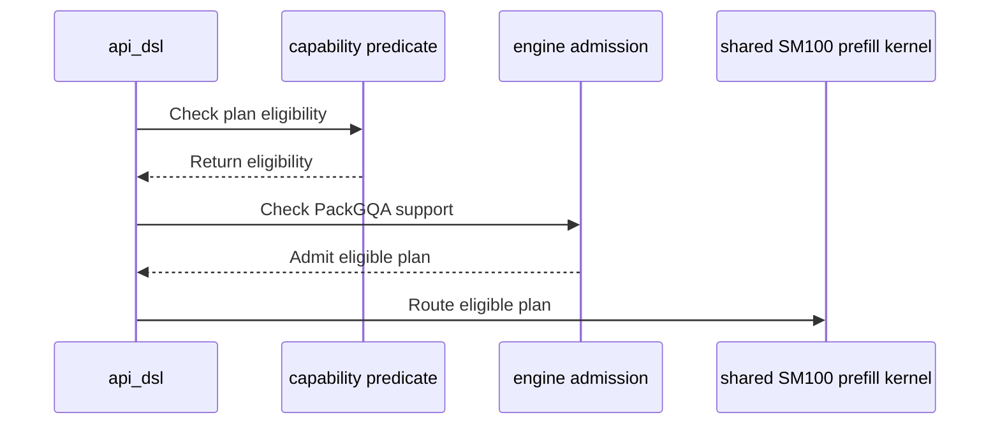

# Support unsplit ragged D128 PackGQA on SM107

[Upstream PR](https://github.com/NVIDIA/cudnn-frontend/pull/1793) · state: closed · merged: True

## Original PR description

## Before submitting

- [x] I agree to license this contribution under the terms of LICENSE.txt.
- [x] I ran scoped `pre-commit run --files` and committed formatting changes.
- [x] I reviewed the applicable AGENTS.md hard rules.
- [x] Labels include change type, affected areas, and originator.

## Affected area

FE OSS kernels or CuTeDSL.

## Summary

Allow explicit `PACK_GQA=1`, `TILE_CGA_M=2`, `SPLIT_KV=1` plans for nonpaged FP16/BF16 D128/V128 ragged attention on SM107. Route them to the existing shared SM100 D128 prefill body, already used by other SM107 paths. The shared kernel handles partial GQA groups as well as complete groups.

## Why

This configuration was rejected before lowering even though the shared kernel already implements token worklists, packed-head output/Stats addressing, and prepared THD execution. Qualifying that existing implementation adds a useful tuning candidate without another kernel body or caller API.

Graph and standalone admission use one structural predicate. Both reject pre-folded Q scaling because the shared body applies the scale itself. Other head dimensions, quantized inputs, and split paths retain their existing contracts. The support matrix documents the new combination.

## Related issues

Related to #1472; extends the existing shared D128 packing coverage to unsplit ragged inputs.

## API and compatibility impact

No public API, knob, native ABI, workspace cache, or execute-time preparation is added. Automatic candidate proposals and default placement are unchanged; this PR enables an explicitly requested configuration. Existing DSL/architecture admission remains in force. The changed production functions are plan-time support checks and template selection; execute and prepared-binding implementations are unchanged.

## Testing

Native SM107 with cuDNN9.27 and a matching development frontend/native extension:

- 52 tests passed: capability boundaries, FP16/BF16, packed NH/HN Stats, partial head groups, empty KV, padded Stats in seven storage layouts, pointer rebinding, changed device lengths, capture/replay, and pre-folded-scale rejection.
- 17 additional tests passed: all four mask modes with and without sinks, FP16/BF16 NH/HN natural-log/base-2 Stats, changed device lengths and inputs on retained captures, fresh-pointer binding, and pre-folded-scale rejection. These runs overlap in five cases; they are not 69 distinct tests.
- The explicit packed capture test fails on unchanged baseline production at the unsupported configuration, then passes with the change. Tests request a legal configuration directly; they do not pin heuristic ordering or latency.
- Additional full FP64 O/LSE comparisons, guarded outputs, poisoned replay and actual module/knob checks cover full prefill, short-Q/long-KV and mixed/anti-correlated lengths. These are component checks, not serving claims.
- Scoped format/license hooks pass. Upstream review and CI will follow on the submitted head.

Validation used the production diff on `edc071feeb81`. The subsequent develop commits through `f05b536c67ed` change Windows loading, backward D128 and gated-attention compatibility; none modifies the forward support/template files in this diff. Integration CI remains required on the submitted head.

<!-- This is an auto-generated comment: release notes by coderabbit.ai -->
<!-- coderabbit-ai-generated:v1 -->

## Summary by CodeRabbit

* **New Features**
  * Added support for packed grouped-query attention on Rubin GPUs for nonpaged THD workloads using FP16 or BF16 with head dimension 128. These workloads require two CTAs and no split-KV; partial head groups are supported.
  * Packed workloads support the declared statistics layouts and sink settings. Ragged packed workloads can use CUDA graph capture and replay with updated sequence lengths and fresh buffers.
  * Pre-folded softmax scaling is not supported for this shared THD path.
<!-- end of auto-generated comment: release notes by coderabbit.ai -->

## Review and discussion

### reviews

- github-advanced-security[bot] · COMMENTED · 2026-10-22T23:41:29Z · [source](https://github.com/NVIDIA/cudnn-frontend/pull/1793#pullrequestreview-5622244908)

(No body; status only.)

- Anerudhan · APPROVED · 2026-10-23T00:04:18Z · [source](https://github.com/NVIDIA/cudnn-frontend/pull/1793#pullrequestreview-5622391303)

**Codex bot review · model: `gpt-6-astra`**

Reviewed `537da9bb82ed` against base `f05b536c67ed`.

The new explicit ragged D128 packing route passed native SM107 validation. Graph and standalone admission agree on the bounded configuration and reject pre-folded scaling before the shared body can scale Q twice. I found no runtime correctness blocker. Two existing negative tests still describe the old rejection contract and need updating; they also fail in the author's CI run.

**[P2] Update the two existing rejection tests for the new support** ([source](https://github.com/NVIDIA/cudnn-frontend/blob/537da9bb82ed61b97f03ed4c314c5948235c9beb/python/cudnn/sdpa/fwd/engines.py#L1418))

The new ragged_pack exception correctly admits SM107 nonpaged D128 THD, but test_sm107_d128_cga_and_pack_admission still asserts that this request is rejected, and test_thd_pack_gqa_unsupported_flavors_decline[changed0-knobs0] still requires every engine to reject it. Both fail on this head and in CI job 504109106. Update those assertions and the old 'no packed leg' description, while retaining the genuinely unsupported geometry, quantization, CGA and split cases. This is a test-integration omission, not evidence that the newly enabled kernel is incorrect.

Evidence: Exact-head run of test_sdpa_fwd_heuristics.py and test_sdpa_graph_analyzer.py: 2 failed, 751 passed, 2 deselected. Failure sites are lines 1601 and 1499 respectively. CI pipeline75988114/job504109106 reports the same two failures; all changed production/test files match its integration tree. Attribution: The newly enabled admission invalidates two unchanged negative assertions.

Validation: Exact-head focused run on native SM107: 64 passed, zero skips. This comprises 50 numerical/prepared execution cases and 14 support-contract checks. Execution coverage includes FP16/BF16, complete and partial GQA groups, packed token/head-major Stats, seven padded-Stats storage layouts, all four tested mask modes with/without sinks, empty KV, fresh-pointer binding, changed device prefixes/inputs on retained captures, natural-log/base-2 Stats, and poisoned output/workspace replay. Full O/LSE reference comparisons and untouched output tails passed. Reviewed all seven changed files, shared template selection and cache identity, graph/standalone gates, partial-group geometry, prepared binding and Stats contracts (SDPA rule S1), and the updated support matrix (S2). The route reuses the existing shared two-CTA body; no kernel barrier, execute-time preparation, allocation or launch implementation changed. Automatic candidate eligibility still excludes this new explicit combination, so this patch does not change default placement. Broader admission/heuristics suites: 751 passed, two stale-negative failures, two deselected. Precheck produced no candidates. Existing Style and merge-requirement checks passed. Labels, project and Frontend 1.32.0 milestone are set. Reused the author's current-head python/sdpa/frost pipeline 75988114. Its six changed production/test blobs match this head. The SM80 lane reports the same two test failures with 10648 passed and 13244 skipped; other lanes were still running at review time. The SM107 CI selector omits these affected test modules, so the independent native run supplies that coverage.

Limitations: The native run used a compatible reused frontend extension and an isolated SM107-capable DSL runtime. It is functional evidence, not a production-SKU or end-to-end serving qualification. No performance claim is made for the new explicit tuning candidate. The old production route rejects that configuration, and automatic proposals remain unchanged. CI remains pending overall and the two stale assertions need correction.

Approved: no P0 or high-risk P1 found. Remaining findings stay with the owner; merge timing stays with the owner.

<!-- codex-fe-review:v2:1793:537da9bb82ed61b97f03ed4c314c5948235c9beb:complete:no-blocker -->

- YangXu1990uiuc · COMMENTED · 2026-10-23T00:25:50Z · [source](https://github.com/NVIDIA/cudnn-frontend/pull/1793#pullrequestreview-5622528606)

**Codex bot review · model: `gpt-6-astra`**

Reviewed `51d74aa67c34` against base `f05b536c67ed`.

The two stale rejection tests identified in the prior review are fixed. The follow-up changes only those two test files; the production implementation is identical to the independently reviewed revision. I found no remaining blocker in this update. Existing approval is preserved; this author-account follow-up does not replace independent review or CI.

Validation: Current-head test_sdpa_fwd_heuristics.py and test_sdpa_graph_analyzer.py with L0 or L1: 755 passed, zero skips. The corrected cases accept supported full/partial ragged groups and still reject CGA1 and the unsupported split combination. Read the full PR and the incremental diff from 537da9bb82ed; only the two test expectations changed in this follow-up. Graph/standalone structural admission, shared template selection, pre-folded-scale rejection, and the support-matrix update remain consistent. Reused, without relabeling as a new run, the independent native SM107 evidence on unchanged production in [the earlier review](https://github.com/NVIDIA/cudnn-frontend/pull/1793#pullrequestreview-5622391303): 64 passed, including numerical/replay and support-contract coverage. The author's replacement python/sdpa/frost pipeline 75998054 targets this head and is still running. No duplicate CI was launched.

Limitations: This follow-up adds host-contract validation, not a new native SM107 run or performance qualification. CI completion remains pending.

Comment only: GitHub does not allow reviewing one's own PR with approval/request-changes.

<!-- codex-fe-review:v2:1793:51d74aa67c34d5f7e27331614e76ce7d37347ea6:complete:no-blocker -->

- Anerudhan · COMMENTED · 2026-10-23T00:29:36Z · [source](https://github.com/NVIDIA/cudnn-frontend/pull/1793#pullrequestreview-5622550999)

**Codex bot review · model: `gpt-6-astra`**

Reviewed `51d74aa67c34` against base `f05b536c67ed`.

The P2 from my prior review is resolved. The two stale rejection tests now accept supported full/partial ragged packing while retaining unsupported CGA1 and split checks. This follow-up changes only those tests and their description; production code is identical to the approved revision. No new finding. The existing approval remains valid.

Validation: Current-head focused confirmation: 8 host-contract cases passed, zero skips, including both previously failing tests and all seven unsupported-flavor parameters. Compared the full follow-up diff with 537da9bb82ed: only two test files changed. Reused the earlier independent native SM107 validation of unchanged production: 50 execution/replay cases and 14 support-contract checks passed; these were not rerun for this test-only update. The author's replacement SDPA FROST pipeline 75998054 targets this head and is running. All eight changed production/test files match the CI integration tree. No duplicate run requested.

Limitations: CI completion remains pending. This follow-up adds host-contract confirmation, not fresh GPU or performance measurements.

Comment only: this PR already has an active approval; preserving existing approvals.

<!-- codex-fe-review:v2:1793:51d74aa67c34d5f7e27331614e76ce7d37347ea6:complete:no-blocker -->

- YangXu1990uiuc · COMMENTED · 2026-10-23T01:08:15Z · [source](https://github.com/NVIDIA/cudnn-frontend/pull/1793#pullrequestreview-5622774473)

(No body; status only.)

### issue_comments

- coderabbitai[bot] · comment · 2026-10-22T23:25:55Z · [source](https://github.com/NVIDIA/cudnn-frontend/pull/1793#issuecomment-6353559887)

<!-- coderabbit-ai-generated:v1 -->

<!-- This is an auto-generated comment: summarize by coderabbit.ai -->
<!-- review_stack_entry_start -->

<a href="https://app.coderabbit.ai/change-stack/NVIDIA/cudnn-frontend/pull/1793?scope=ghh_OusAJGA4HG8ljoOV0wJvVx8NmnZIjc2DdjmxOu0xZWA&amp;cs_source=review_comment"><picture><source media="(prefers-color-scheme: dark)" srcset="https://storage.googleapis.com/coderabbit_public_assets/review-stack-in-coderabbit-ui-dark.svg?v=3"><source media="(prefers-color-scheme: light)" srcset="https://storage.googleapis.com/coderabbit_public_assets/review-stack-in-coderabbit-ui.svg?v=3"></picture></a>

<!-- review_stack_entry_end -->
<!-- recent_review_start -->

No actionable comments were generated in the recent review. 🎉

<strong>ℹ️ Recent review info</strong>

<dl>
<dd>

<strong>⚙️ Run configuration</strong>

<dl>
<dd>

- **Source mode**: Auto
- **Repository**: [NVIDIA/cudnn-frontend](<https://github.com/NVIDIA/cudnn-frontend>)
- **Branch**: [develop](<https://github.com/NVIDIA/cudnn-frontend/tree/develop>)
- **File**: [.coderabbit.yaml](<https://github.com/NVIDIA/cudnn-frontend/blob/f05b536c67ed7b045d6457ee95383d4a4607bb2c/.coderabbit.yaml>)
- **Commit**: [f05b536](<https://github.com/NVIDIA/cudnn-frontend/commit/f05b536c67ed7b045d6457ee95383d4a4607bb2c>)
- **Layers**: Repository YAML
- **Review profile**: CHILL
- **Plan**: Enterprise
- **Run ID**: `d296fb77-040d-420c-9e2e-16a339acb55b`

</dd>
</dl>

<strong>📥 Commits</strong>

<dl>
<dd>

Reviewing files that changed from the base of the PR and between 537da9bb82ed61b97f03ed4c314c5948235c9beb and 51d74aa67c34d5f7e27331614e76ce7d37347ea6.

</dd>
</dl>

<strong>📒 Files selected for processing: 2</strong>

<dl>
<dd>

* `test/python/sdpa/frost/test_sdpa_fwd_heuristics.py`
* `test/python/sdpa/frost/test_sdpa_graph_analyzer.py`

</dd>
</dl>

**Included review availability:** This review used your included allowance. Your plan provides up to 12 included reviews per hour; 9 remain after this review.

</dd>
</dl>

<!-- recent_review_end -->
<!-- walkthrough_start -->

<strong>📝 Walkthrough</strong>

<dl>
<dd>

The change adds shared SM100 prefill routing and engine admission for eligible nonpaged SM107 D128 THD PackGQA plans. It also adds support-contract and execution tests for partial groups, Stats layouts, masks, and graph replay.

**Changes: Nonpaged THD PackGQA**

|Layer / File(s)|Summary|
|:---|:---|
|**Capability and shared-kernel routing**   `python/cudnn/sdpa/fwd/config_sm100.py`, `python/cudnn/sdpa/fwd/api_dsl.py`, `python/cudnn/sdpa/frost/SUPPORT_MATRIX_TRACKER.md`|The capability predicate restricts support to SM107, D128, non-FP8, nonpaged THD plans with `cga` unset or 2 and `split_kv == 1`. API checks route eligible plans through the shared SM100 prefill kernel, apply the partial-group divisor rule, and decline pre-folded scale.|
|**Engine admission and tile validation**   `python/cudnn/sdpa/fwd/engines.py`|The engine uses the capability predicate to admit eligible plans, reject pre-folded scale, and treat the plans as partial packing during tile validation.|
|**SM107 support contract tests**   `test/python/sdpa/frost/test_sdpa_fwd_dsl_sm107.py`, `test/python/sdpa/frost/test_sdpa_fwd_heuristics.py`, `test/python/sdpa/frost/test_sdpa_graph_analyzer.py`|Tests cover supported dtypes and group sizes, accepted Stats and sink cases, and rejection cases for pre-folded scale, other listed head shapes, and `cga=1`. Heuristic tests also check packed-plan admission and split-KV rejection.|
|**THD execution and Stats tests**   `test/python/sdpa/frost/test_sdpa_fwd_dsl_sm100.py`, `test/python/sdpa/frost/test_sdpa_prepared_thd.py`|Tests add packed THD mask and Stats-capture coverage. Prepared-THD tests cover ragged sequences, Stats layouts and scaling, buffer rebinding, and replay of a captured graph.|

<!-- change_assessment_start -->
**Priority:** ➖ Normal

**Estimated code review effort:** 3 (Moderate) | ~25 minutes

<!-- change_assessment_commit:"51d74aa67c34d5f7e27331614e76ce7d37347ea6" -->
**Change:** Feature
<!-- change_assessment_end -->

### Sequence Diagram(s)

**Suggested reviewers:** `romananders90`

</dd>
</dl>

<!-- walkthrough_end -->

<strong>Merge Risk:</strong> <strong>⚪ Minimal</strong> · up to <code>51d74</code>

<dl>
<dd>

<!-- final_review_risk_start -->
<!-- final_review_risk_label
**Merge Risk:** **⚪ Minimal** · up to `51d74`
-->
<!-- final_review_risk_coverage:{"sourceCommitId":"51d74aa67c34d5f7e27331614e76ce7d37347ea6","coveredCommitId":"51d74aa67c34d5f7e27331614e76ce7d37347ea6","kind":"reviewed"} -->

No actionable merge-blocking risk remains in the reviewed changes.
<!-- final_review_risk_end -->

</dd>
</dl>

<!-- pre_merge_checks_walkthrough_start -->

<strong>Pre-merge checks: <picture></picture> 5</strong>

<dl>
<dd>

|         Check name         |                                             Status                                             | Explanation                                                                                                                                                                                               |
| :------------------------ | :--------------------------------------------------------------------------------------------: | :-------------------------------------------------------------------------------------------------------------------------------------------------------------------------------------------------------- |
|         Title check        |  | The title clearly and concisely describes the main change: enabling unsplit ragged D128 PackGQA support on SM107.                                                                                         |
|      Description check     |  | The description covers the required sections, including affected area, summary, rationale, related issue, compatibility impact, and testing results. It provides strong technical and validation details… |
|     Docstring Coverage     |  | Docstring coverage is 80.77% which is sufficient. The required threshold is 80.00%. Docstring coverage is scoped to functions touched by this diff. Analyzed 26 functions across 8 files.                 |
|     Linked Issues check    |  | Check skipped because no linked issues were found for this pull request.                                                                                                                                  |
| Out of Scope Changes check |  | Check skipped because no linked issues were found for this pull request.                                                                                                                                  |

<strong>Full details: Description check</strong>

<dl>
<dd>

**Explanation**

The description covers the required sections, including affected area, summary, rationale, related issue, compatibility impact, and testing results. It provides strong technical and validation details, although it does not list exact test commands.

</dd>
</dl>

</dd>
</dl>

<!-- pre_merge_checks_walkthrough_end -->
<!-- finishing_touch_checkbox_start -->

<strong>✨ Finishing Touches</strong>

<dl>
<dd>

<strong>🧪 Generate unit tests (beta)</strong>

<dl>
<dd>

- [ ] <!-- {"checkboxId": "f47ac10b-58cc-4372-a567-0e02b2c3d479", "radioGroupId": "utg-output-choice-group-unknown_comment_id"} --> Create a new PR

</dd>
</dl>

</dd>
</dl>

<!-- finishing_touch_checkbox_end -->

<!-- autopilot:start -->
- [ ] <!-- {"checkboxId":"2708ad07-9f24-4260-9c11-7dc76a49f2e3"} --> <strong title="Keep fixing CodeRabbit findings and required CI, and resolving merge conflicts">Autofix</strong> · Keep fixing CodeRabbit findings and required CI, and resolving merge conflicts
<!-- autopilot:end -->
<!-- tips_start -->

Comment `@coderabbitai help` to get the list of available commands.

<!-- tips_end -->

- YangXu1990uiuc · comment · 2026-10-22T23:26:29Z · [source](https://github.com/NVIDIA/cudnn-frontend/pull/1793#issuecomment-6353567677)

@cudnn-ci-bot run python/sdpa/frost

- cudnn-ci-bot · comment · 2026-10-22T23:29:56Z · [source](https://github.com/NVIDIA/cudnn-frontend/pull/1793#issuecomment-6353613949)

🏁 Pipeline finished

SHA: `537da9b`
Targets: `python/sdpa/frost`
Branch: [cudnn-gh/pr-1793-537da9b](https://nv/cudnn-gitlab-ci/-/tree/cudnn-gh/pr-1793-537da9b)
Pipeline: [75988114](https://nv/cudnn-gitlab-ci/-/pipelines/75988114)
Last updated: 2026-10-23 00:18 UTC

**19 passed, 3 failed, 3 canceled, 3 skipped, 11 manual**

### <code>manual</code>

- <code>manual:python_samples</code> - Manual
- <code>manual:python</code> - Manual
- <code>manual:python/sdpa/frost</code> - ✅ Passed
- <code>manual:python/linear_attention/frost</code> - Manual
- <code>manual:python/gemm/frost</code> - Manual
- <code>manual:python/*/frost</code> - Manual
- <code>manual:python/gemm/cutedsl</code> - Manual
- <code>manual:python/*/cutedsl</code> - Manual
- <code>manual:python/*/jax</code> - Manual
- <code>manual:pycudnn</code> - Manual
- <code>manual:multi_gpu</code> - Manual
- <code>manual:backend</code> - Manual

### <code>analysis</code>

- <code>analysis:cudnn_clang_disable_exception</code> - ✅ Passed
- <code>analysis:cudnn_v9_no_half_conversion</code> - ✅ Passed
- <code>analysis:cudnn_clang</code> - ✅ Passed
- <code>analysis:check-relative-includes</code> - ✅ Passed
- <code>analysis:check-CUDNN_FRONTEND_SKIP_JSON_LIB</code> - ✅ Passed
- <code>analysis:guardwords_scan</code> - ✅ Passed
- <code>analysis:jax-import-guard</code> - ✅ Passed
- <code>analysis:pytest-gpu</code> - ✅ Passed
- <code>san:build</code> - ✅ Passed

### <code>build</code>

- <code>analysis:api_index</code> - ✅ Passed
- <code>build:dev:linux:amd64</code> - ✅ Passed
- <code>build:rel:linux:amd64</code> - ✅ Passed
- <code>build:dev:linux:arm64</code> - ✅ Passed
- <code>build:rel:linux:arm64</code> - ✅ Passed
- <code>build:rel:win:amd64</code> - ✅ Passed

### <code>frost_tests</code>

- <code>python/sdpa/frost:cutlass-rel:sm80</code> - ❌ **New Failure!** (nightly passed)
- <code>python/sdpa/frost:cutlass-rel:sm100</code> - ❌ **New Failure!** (nightly passed)
- <code>python/sdpa/frost:cutlass-rel:sm120</code> - Canceled
- <code>python/linear_attention/frost:cutlass-rel:sm100</code> - Skipped
- <code>python/gemm/frost:cutlass-rel:sm100</code> - Skipped
- <code>python/*/frost:cutlass-rel:sm100</code> - Skipped
- <code>python/sdpa/frost:cutlass-rel:sm103</code> - ❌ **New Failure!** (nightly passed)
- <code>python/sdpa/frost:cutlass-4.8:sm107</code> - Canceled

### <code>sanitizer_tests</code>

- <code>san:cpp_test:sm80</code> - ✅ Passed
- <code>san:cpp_test:sm90</code> - ✅ Passed
- <code>san:cpp_test:sm100</code> - ✅ Passed

### <code>triage</code>

- <code>triage:ai</code> - Canceled

- YangXu1990uiuc · comment · 2026-10-23T00:11:04Z · [source](https://github.com/NVIDIA/cudnn-frontend/pull/1793#issuecomment-6354172156)

Addressed the two stale capability assertions in `51d74aa67`. The tests now accept the newly supported unsplit nonpaged THD packing route, including a partial GQA group, while retaining the CGA1 and packed-split rejection checks. The old “no packed leg” description is updated.

Both complete affected test files pass locally: **753 passed, 2 skipped**. Scoped formatting/license hooks pass. This follow-up changes only these two test files; production code is identical to the reviewed `537da9bb8`. The reported CI failures were these admission assertions, not GPU execution failures.

- YangXu1990uiuc · comment · 2026-10-23T00:11:05Z · [source](https://github.com/NVIDIA/cudnn-frontend/pull/1793#issuecomment-6354172434)

@cudnn-ci-bot run python/sdpa/frost

- cudnn-ci-bot · comment · 2026-10-23T00:11:24Z · [source](https://github.com/NVIDIA/cudnn-frontend/pull/1793#issuecomment-6354176768)

🏁 Pipeline finished

SHA: `51d74aa`
Targets: `python/sdpa/frost`
Branch: [cudnn-gh/pr-1793-51d74aa](https://nv/cudnn-gitlab-ci/-/tree/cudnn-gh/pr-1793-51d74aa)
Pipeline: [75998054](https://nv/cudnn-gitlab-ci/-/pipelines/75998054)
Cancelled this PR's older pipelines: 75988114
Last updated: 2026-10-23 01:14 UTC

**25 passed, 3 skipped, 11 manual**

### <code>manual</code>

- <code>manual:python_samples</code> - Manual
- <code>manual:python</code> - Manual
- <code>manual:python/sdpa/frost</code> - ✅ Passed
- <code>manual:python/linear_attention/frost</code> - Manual
- <code>manual:python/gemm/frost</code> - Manual
- <code>manual:python/*/frost</code> - Manual
- <code>manual:python/gemm/cutedsl</code> - Manual
- <code>manual:python/*/cutedsl</code> - Manual
- <code>manual:python/*/jax</code> - Manual
- <code>manual:pycudnn</code> - Manual
- <code>manual:multi_gpu</code> - Manual
- <code>manual:backend</code> - Manual

### <code>analysis</code>

- <code>analysis:cudnn_clang_disable_exception</code> - ✅ Passed
- <code>analysis:cudnn_v9_no_half_conversion</code> - ✅ Passed
- <code>analysis:cudnn_clang</code> - ✅ Passed
- <code>analysis:check-relative-includes</code> - ✅ Passed
- <code>analysis:check-CUDNN_FRONTEND_SKIP_JSON_LIB</code> - ✅ Passed
- <code>analysis:guardwords_scan</code> - ✅ Passed
- <code>analysis:jax-import-guard</code> - ✅ Passed
- <code>analysis:pytest-gpu</code> - ✅ Passed
- <code>san:build</code> - ✅ Passed

### <code>build</code>

- <code>analysis:api_index</code> - ✅ Passed
- <code>build:dev:linux:amd64</code> - ✅ Passed
- <code>build:rel:linux:amd64</code> - ✅ Passed
- <code>build:dev:linux:arm64</code> - ✅ Passed
- <code>build:rel:linux:arm64</code> - ✅ Passed
- <code>build:rel:win:amd64</code> - ✅ Passed

### <code>frost_tests</code>

- <code>python/sdpa/frost:cutlass-rel:sm80</code> - ✅ Passed
- <code>python/sdpa/frost:cutlass-rel:sm100</code> - ✅ Passed
- <code>python/sdpa/frost:cutlass-rel:sm120</code> - ✅ Passed
- <code>python/linear_attention/frost:cutlass-rel:sm100</code> - Skipped
- <code>python/gemm/frost:cutlass-rel:sm100</code> - Skipped
- <code>python/*/frost:cutlass-rel:sm100</code> - Skipped
- <code>python/sdpa/frost:cutlass-rel:sm103</code> - ✅ Passed
- <code>python/sdpa/frost:cutlass-4.8:sm107</code> - ✅ Passed

### <code>sanitizer_tests</code>

- <code>san:cpp_test:sm80</code> - ✅ Passed
- <code>san:cpp_test:sm90</code> - ✅ Passed
- <code>san:cpp_test:sm100</code> - ✅ Passed

### <code>triage</code>

- <code>triage:ai</code> - ✅ Passed

### inline_comments

- github-advanced-security[bot] · comment · 2026-10-22T23:41:28Z · [source](https://github.com/NVIDIA/cudnn-frontend/pull/1793#discussion_r4354671321)

File: `test/python/sdpa/frost/test_sdpa_fwd_dsl_sm107.py` · line 976

## CodeQL / Module is imported with 'import' and 'import from'

Module 'cudnn' is imported with both 'import' and 'import from'.

[Show more details](https://github.com/NVIDIA/cudnn-frontend/security/code-scanning/4034)

- YangXu1990uiuc · comment · 2026-10-23T01:08:15Z · [source](https://github.com/NVIDIA/cudnn-frontend/pull/1793#discussion_r4355135610)

File: `test/python/sdpa/frost/test_sdpa_fwd_dsl_sm107.py` · line 976

Reviewed alert 4034: this is a CodeQL readability note (`py/import-and-import-from`), not a correctness or security finding. The new test keeps `import cudnn` local and uses `cudnn.data_type`; the reported `from cudnn import ...` statements are in other test scopes (and predate this change). No name is shadowed or rebound by this test. I am keeping the existing lazy-import pattern rather than rewriting unrelated tests as part of this support change.

## Changed files and fixed code

- `python/cudnn/sdpa/frost/SUPPORT_MATRIX_TRACKER.md` · modified · additions 8 / deletions 0
  - [head](https://github.com/YangXu1990uiuc/cudnn-frontend/blob/51d74aa67c34d5f7e27331614e76ce7d37347ea6/python/cudnn/sdpa/frost/SUPPORT_MATRIX_TRACKER.md)
  - [base](https://github.com/NVIDIA/cudnn-frontend/blob/f05b536c67ed7b045d6457ee95383d4a4607bb2c/python/cudnn/sdpa/frost/SUPPORT_MATRIX_TRACKER.md)
- `python/cudnn/sdpa/fwd/api_dsl.py` · modified · additions 31 / deletions 8
  - [head](https://github.com/YangXu1990uiuc/cudnn-frontend/blob/51d74aa67c34d5f7e27331614e76ce7d37347ea6/python/cudnn/sdpa/fwd/api_dsl.py)
  - [base](https://github.com/NVIDIA/cudnn-frontend/blob/f05b536c67ed7b045d6457ee95383d4a4607bb2c/python/cudnn/sdpa/fwd/api_dsl.py)
- `python/cudnn/sdpa/fwd/config_sm100.py` · modified · additions 5 / deletions 0
  - [head](https://github.com/YangXu1990uiuc/cudnn-frontend/blob/51d74aa67c34d5f7e27331614e76ce7d37347ea6/python/cudnn/sdpa/fwd/config_sm100.py)
  - [base](https://github.com/NVIDIA/cudnn-frontend/blob/f05b536c67ed7b045d6457ee95383d4a4607bb2c/python/cudnn/sdpa/fwd/config_sm100.py)
- `python/cudnn/sdpa/fwd/engines.py` · modified · additions 16 / deletions 5
  - [head](https://github.com/YangXu1990uiuc/cudnn-frontend/blob/51d74aa67c34d5f7e27331614e76ce7d37347ea6/python/cudnn/sdpa/fwd/engines.py)
  - [base](https://github.com/NVIDIA/cudnn-frontend/blob/f05b536c67ed7b045d6457ee95383d4a4607bb2c/python/cudnn/sdpa/fwd/engines.py)
- `test/python/sdpa/frost/test_sdpa_fwd_dsl_sm100.py` · modified · additions 29 / deletions 3
  - [head](https://github.com/YangXu1990uiuc/cudnn-frontend/blob/51d74aa67c34d5f7e27331614e76ce7d37347ea6/test/python/sdpa/frost/test_sdpa_fwd_dsl_sm100.py)
  - [base](https://github.com/NVIDIA/cudnn-frontend/blob/f05b536c67ed7b045d6457ee95383d4a4607bb2c/test/python/sdpa/frost/test_sdpa_fwd_dsl_sm100.py)
- `test/python/sdpa/frost/test_sdpa_fwd_dsl_sm107.py` · modified · additions 26 / deletions 2
  - [head](https://github.com/YangXu1990uiuc/cudnn-frontend/blob/51d74aa67c34d5f7e27331614e76ce7d37347ea6/test/python/sdpa/frost/test_sdpa_fwd_dsl_sm107.py)
  - [base](https://github.com/NVIDIA/cudnn-frontend/blob/f05b536c67ed7b045d6457ee95383d4a4607bb2c/test/python/sdpa/frost/test_sdpa_fwd_dsl_sm107.py)
- `test/python/sdpa/frost/test_sdpa_fwd_heuristics.py` · modified · additions 6 / deletions 2
  - [head](https://github.com/YangXu1990uiuc/cudnn-frontend/blob/51d74aa67c34d5f7e27331614e76ce7d37347ea6/test/python/sdpa/frost/test_sdpa_fwd_heuristics.py)
  - [base](https://github.com/NVIDIA/cudnn-frontend/blob/f05b536c67ed7b045d6457ee95383d4a4607bb2c/test/python/sdpa/frost/test_sdpa_fwd_heuristics.py)
- `test/python/sdpa/frost/test_sdpa_graph_analyzer.py` · modified · additions 1 / deletions 1
  - [head](https://github.com/YangXu1990uiuc/cudnn-frontend/blob/51d74aa67c34d5f7e27331614e76ce7d37347ea6/test/python/sdpa/frost/test_sdpa_graph_analyzer.py)
  - [base](https://github.com/NVIDIA/cudnn-frontend/blob/f05b536c67ed7b045d6457ee95383d4a4607bb2c/test/python/sdpa/frost/test_sdpa_graph_analyzer.py)
- `test/python/sdpa/frost/test_sdpa_prepared_thd.py` · modified · additions 97 / deletions 0
  - [head](https://github.com/YangXu1990uiuc/cudnn-frontend/blob/51d74aa67c34d5f7e27331614e76ce7d37347ea6/test/python/sdpa/frost/test_sdpa_prepared_thd.py)
  - [base](https://github.com/NVIDIA/cudnn-frontend/blob/f05b536c67ed7b045d6457ee95383d4a4607bb2c/test/python/sdpa/frost/test_sdpa_prepared_thd.py)

## Evidence and interpretation boundary

[Original JSON, discussions and patches](../../../../../../evidence/prs/NVIDIA--cudnn-frontend/1793-740f33bb2c6bfd4480fd18384c3eedc77449431ac8e257abe43587551ec364d9.json) · SHA-256 `740f33bb2c6bfd4480fd18384c3eedc77449431ac8e257abe43587551ec364d9`.

Diff complete: True. Missing/binary/truncated patches require pinned source inspection. This is a source page, not an independently verified optimization case. Open, merged and released are different states; recheck the deployed dependency.
