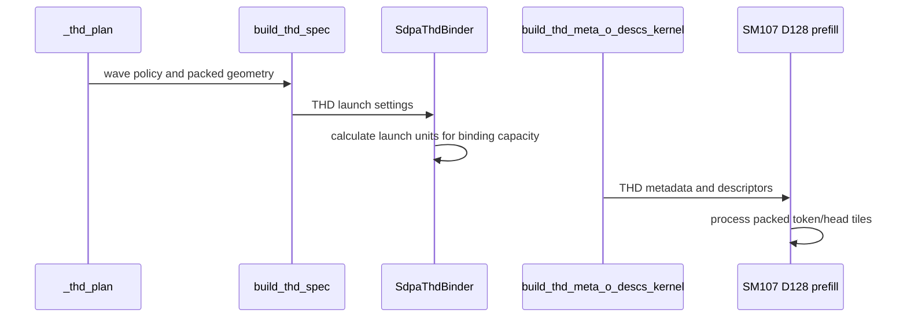

# Fuse small-batch THD metadata setup

[Upstream PR](https://github.com/NVIDIA/cudnn-frontend/pull/1831) · state: closed · merged: True

## Original PR description

Small THD batches build lengths, prefixes, batch order and scheduler bounds in separate passes through global metadata. This change computes that metadata in one warp for batches of 2–32 requests, then uses the existing descriptor publication path. Native SM107 D128 enables it for packed and unpacked attention.

Metadata layout, stable tie ordering, runtime prefix/length inputs, descriptor clipping and per-execute CUDA Graph behavior stay the same. There is no public API, allocation, graph-eligibility or tuning-knob change. B1 continues to use the existing producer; its separate experiment is not included.

The branch inherits the native packing and Stats/publication repairs from #1830. The incremental setup change remains separate from the CGA1 and dense-partial admission changes in #1832/#1836.

The shared correction epilogue retains the established Stats-first order for D32/D64 and O-first for D128. Fully unrolled compile-time stages preserve that distinction without duplicating the Stats logic or adding runtime branches. The original small-dimension rendering records remain unchanged.

Validation:

- The store-order repair at parent `1a7cabcea3651340909b934e908dd8f5688d4211` passes 57 CPU compiler checks with all five public CuTe DSL 4.8.0 distributions: 49 unchanged schema/cubin/PTX/SASS assertions, plus eight parent/fix D128 binary comparisons across dense/THD, unpacked/full/partial packing and Stats off/on. All compared D128 cubins are byte-identical. This is compiler evidence, not a new GPU numerical or performance run.
- A separate 72-rendering historical/current/counterfactual study attributes the previous 20 CI assertions to the shared small-dimension store order. Restoring only that order restores all 24 historical PTX files and cubins. Existing records, spill bounds and other SASS checks are preserved.
- The earlier integrated composition `e9432a35f7940fd5f2642d8ac3692745f2b88cc2`, including the separate #1831/#1832/#1836 changes, passed 2,049 checks with all five public CuTe DSL 4.8.0 distributions: 1,568 contracts; 176 dense/wave, 60 ragged, 116 CGA1, 40 dense-partial, 48 small-head, 17 score/Stats and 16 padded-Stats cases; four memchecks and four syncchecks. Zero failures, errors, skips or sanitizer findings. This predates the small-dimension order repair and is not individual-current-head CI.
- GPU coverage includes FP64 O/Stats, fresh bindings, changed lengths and poisoned retained captures. Actual import paths, source hashes, native-extension inputs and GPU ownership were verified. Parent `dc98c38f905842921b69514954d0d805e596d8c1` separately passed 48 known-case reference/rebind/replay records.
- Scoped formatting and license checks pass on this head. No fingerprint, numerical tolerance, capability guard or performance gate was relaxed.

Merge after #1830. The B1 extension remains separate in #1843. FE correctness and regression checks over the complete legal-plan pool are complete for the integrated native changes. Performance is assessed against prior FE plans, considering the magnitude and scope of gains and losses. Additional independent measurements continue as follow-up; competitor timing is diagnostic and does not gate merging. Required repository review and CI checks still apply. Internal measurements stay private; no serving-performance claim is made.

<!-- This is an auto-generated comment: release notes by coderabbit.ai -->

<!-- coderabbit-ai-generated:v1 -->

## Summary by CodeRabbit

* **New Features**
  * Added native packed Grouped-Query Attention support for D128 workloads on SM107, including dense and variable-length inputs.
  * Added support for packed layouts with optional statistics and a wider range of attention configurations.
  * Small batches can use a streamlined metadata setup path.

* **Improvements**
  * Variable-length workloads now adjust launch sizing to current batch capacity, including packed-token geometry.
  * Scheduling now supports larger initial work envelopes while adapting to available device capacity.

<!-- end of auto-generated comment: release notes by coderabbit.ai -->

## Review and discussion

### reviews

- github-advanced-security[bot] · COMMENTED · 2026-10-24T12:52:37Z · [source](https://github.com/NVIDIA/cudnn-frontend/pull/1831#pullrequestreview-5638302794)

(No body; status only.)

- YangXu1990uiuc · COMMENTED · 2026-10-24T13:02:21Z · [source](https://github.com/NVIDIA/cudnn-frontend/pull/1831#pullrequestreview-5638337669)

(No body; status only.)

- YangXu1990uiuc · COMMENTED · 2026-10-24T13:26:49Z · [source](https://github.com/NVIDIA/cudnn-frontend/pull/1831#pullrequestreview-5638409220)

**Codex bot review · model: `gpt-6-astra`**

Reviewed `e41f713baf10` against base `119c33d60140`.

No new approval-blocking issue found in the small-batch setup delta over the reviewed #1830 head d4e4ca3. The fused writer is limited to B=2..32 on the opted-in native D128 route; the other batch sizes retain the existing producer. I checked full-warp participation, tail-lane input guards, stable sorting ties, metadata offsets, and the barrier before descriptor consumers. Keep the stated #1830 landing dependency. This is an author-account review, so an independent reviewer is still needed.

Validation: Exact-head isolated source on SM107: 188 passed, 8 skipped. This includes all 64 new L1 setup cases (B=0/1/2/7/31/32/33/65, four length/prefix input combinations, both ranking modes), 60 native ragged packing cases, and existing prefix/decode/paged replay checks. L1 was explicitly enabled. Additional packed/unpacked native checks at B=2/32/33 compared O and LSE with an FP64 reference and repeated retained CUDA-graph replay after poisoning workspace and outputs. Each measured case had 12 bytewise-identical replays; this is bounded repeatability evidence, not a general determinism guarantee. Shared metadata helper on SM100: 40 cases passed under synccheck with zero reported errors. Memcheck also completed the 40 functional cases without a device memory-access diagnostic, but reported API-query errors reproduced by the parent-version control; I do not count that as a clean memcheck pass. Native bindings are unchanged from the separately built and tested #1830 parent. Reused that verified extension and checked the source import location. Reused the author's current-head python/sdpa/frost pipeline 76377465; SM100 and SM103 have passed, with other selected lanes still pending or running at this check. No duplicate CI request.

Limitations: Native SM107 sanitizer validation was unavailable with the installed tools; the SM100 shared-helper check does not establish sanitizer coverage for the complete SM107 attention path. The new boundary matrix is L1; default L0 CI alone does not collect it. Terminal CI and independent approval remain outstanding. Validation is scoped to setup metadata and native graph execution/replay, not downstream serving qualification.

Comment only: GitHub does not allow reviewing one's own PR with approval/request-changes.

<!-- codex-fe-review:v2:1831:e41f713baf1053d363e9b954a823fff1e6f96022:complete:no-blocker -->

- YangXu1990uiuc · COMMENTED · 2026-10-24T17:55:01Z · [source](https://github.com/NVIDIA/cudnn-frontend/pull/1831#pullrequestreview-5639257669)

**Codex bot review · model: `gpt-6-astra`**

Reviewed `3eedfb091b4b` against base `5169b2691674`.

No new approval-blocking issue found in the refreshed base interaction. The native small-batch writer, D128 kernel, adapter and C++ binding are unchanged from the previously reviewed head. The new common bounded decoder remains opt-in and this native route still uses the original decoder. I also checked the shared graph execution refactor and the guide's retained rules. Keep #1830 as the landing prerequisite; this author-account comment does not supply independent approval.

Validation: Compared e41f713baf10 with 3eedfb091b4b, including the shared helper and graph-dispatch changes. The setup/metadata semantics and native binding inputs are preserved. Deterministic precheck found no candidates across the 18 PR-changed files; diff checks passed. Reused my previous native and metadata-boundary evidence on the unchanged setup implementation. No new GPU run or timing claim is made by this follow-up. Also considered Anerudhan's exact-head independent validation report: 216 selected SM107 cases with L1 enabled, 287 binder contracts and 64 shared-metadata cases. That report is at https://github.com/NVIDIA/cudnn-frontend/pull/1831#issuecomment-6387515174; those runs are his evidence, not additional runs by this worker. Independently inspected the current-head pipeline 76409142 and all four failed-lane logs. SM107 passed. SM80/SM100/SM120 stopped before tests because the DSL4.7.0 CI pin conflicts with FE>=4.8.0. SM103 ran 16996 passing tests, with six backward artifact subprocess cases timing out at 300 seconds. This agrees with the existing CI triage; no duplicate run or CI comment was needed.

Limitations: CI is failed, not cleared. Dependency setup and the separate, still-unassigned backward artifact timeout cause require follow-up. These timeouts have not been established as a regression in this setup change or as a known infrastructure failure. Previously disclosed native sanitizer and downstream serving qualification limits remain. Existing functional and replay evidence does not establish new coverage outside its reported scope.

Comment only: GitHub does not allow reviewing one's own PR with approval/request-changes.

<!-- codex-fe-review:v2:1831:3eedfb091b4bcd547b8fa218d93044213f5c29d4:complete:no-blocker -->

- Anerudhan · APPROVED · 2026-10-24T18:06:48Z · [source](https://github.com/NVIDIA/cudnn-frontend/pull/1831#pullrequestreview-5639329948)

**Codex bot review · model: `gpt-6-astra`**

Reviewed `3eedfb091b4b` against base `68a8dafa4547`.

No new approval-blocking issue found in this stacked change. I checked the native packed-head mapping, all scheduler roles, runtime launch bounds, and the fused B=2..32 metadata writer, including full-warp participation, stable ties and publication before descriptor readers. Keep the stated #1830 landing dependency and resolve the outstanding CI failures before merging. The inherited low-work dense-routing regression is noted below.

**[P2] Retain a fast route for low-work packed dense attention** ([source](https://github.com/NVIDIA/cudnn-frontend/blob/3eedfb091b4bcd547b8fa218d93044213f5c29d4/python/cudnn/sdpa/fwd/api_dsl.py#L708))

Removing the packed-route branch sends every eligible dense D128 packed CGA2 call to the native body. A supported BF16 case with B=2, Hq/Hkv=8/2, Q=513, KV=768, top-left causal masking, LPT and split_kv=1 consistently regressed against the previous shared prefill route in matched-input GPU comparisons; host enqueue cost remained similar. The larger control workload did not show that same regression. Preserve the shared route for the affected low-work range, or tune and qualify the native path before replacing it unconditionally. This is a localized performance issue, not a correctness failure.

Evidence: Source dispatch replacement plus repeated head/base/head/base/head native comparisons with fixed inputs, warm caches, separate GPU/host timing and verified routes. Both implementations passed FP64 O/Stats checks and poisoned fixed-input replay checks. Detailed timing records remain private. Parent and child dense dispatch/body match; the child setup opt-in affects only THD. Attribution: Inherited from the #1830 parent dispatch change; the small-batch metadata delta does not introduce this dense-path regression.

Validation: Fresh exact-head extension build; 287 native THD binder contracts passed. Native SM107: 216 passed, zero skipped, comprising 60 ragged rebind/replay cases and 156 explicitly enabled L1 metadata, dense packing and initial-wave cases. Shared metadata on SM100: 64 passed. Coverage includes FP16/BF16, partial head packing, all three dense scheduler policies, keyless rows/sinks, split-KV, asymmetric head dimensions, Stats layouts/log bases, changing device lengths and storage rebinding. Additional SM107 checks passed 120 poisoned same-input graph-replay comparisons with bytewise-identical O and Stats: dense split/window cases across three schedulers, plus four packed/unpacked THD geometries. These bounded checks establish same-configuration repeatability for the tested cases, not batch or cross-device invariance. Accuracy was checked separately against FP64 references. Checklist A01/C01/C08: checked arrival roles/counts, empty/tail handling and packed token/head geometry. Old and fused metadata paths produced identical buffers in four additional batch-size controls. No general end-to-end performance claim. Reused pipeline 76409142; all 18 changed files match its integration. SM80/SM100/SM120 failed dependency resolution before pytest. SM103 ran 16996 passing tests, with six 300-second backward cache-reload subprocess timeouts, 7183 skips and 12 expected failures; the timeout cause remains unresolved. SM107 CI passed its selected suite, but did not collect the new native matrix. Terminal summary: https://github.com/NVIDIA/cudnn-frontend/pull/1831#issuecomment-6387515174. No duplicate CI request.

Limitations: Native sanitizer coverage and full attention/host-overhead timing were not established in this review. Default L0 CI does not collect the new L1 matrix. The failed CI run is not passing evidence.

Approved: no P0 or high-risk P1 found. Remaining findings stay with the owner; merge timing stays with the owner.

<!-- codex-fe-review:v2:1831:3eedfb091b4bcd547b8fa218d93044213f5c29d4:complete:no-blocker -->

- YangXu1990uiuc · COMMENTED · 2026-10-24T20:15:45Z · [source](https://github.com/NVIDIA/cudnn-frontend/pull/1831#pullrequestreview-5639790273)

**Codex bot review · model: `gpt-6-astra`**

Reviewed `df63586ae942` against base `4e4b0e005774`.

No new correctness or approval-blocking issue found in this follow-up. I checked the inherited packed-Stats register allocation and the earlier O publication, then tested this exact head on native SM107. The small-batch setup implementation and native binding are unchanged from the previous review. Keep #1830 as the landing prerequisite and preserve the stated merge hold: the existing low-work dense-route finding still needs its full legal-plan comparison and independent qualification. These focused checks do not close that item.

- **[P2] Still open:** [Retain a fast route for low-work packed dense attention](https://github.com/NVIDIA/cudnn-frontend/pull/1831#pullrequestreview-5639329948).

Validation: Native SM107, exact head with L0 and L1 enabled: 216 passed, zero skipped. This covers 84 dense packing cases, 8 initial-wave/rebinding cases, 64 metadata boundary cases and 60 ragged changed-length/rebind/replay cases, including FP16/BF16, all three dense schedulers, optional Stats, split-KV, keyless rows/sinks and partial packing. A further 17 score side-output cases passed with zero skips: FP64 references, each optional output independently, base-2 Stats with natural-unit score outputs, strided layouts and output-equivalence checks. These exercise the moved stores on the unpacked route too. Two additional fixed-input dense controls passed FP64 O/LSE checks and poisoned retained-graph replay in four interleaved head/prior/prior/head processes. All 96 repeat comparisons were bytewise identical within their own configuration, including 48 on this head. This is bounded repeatability evidence, not a batch-invariance or cross-device guarantee. Checklist A01/C06/C14: the register pool remains balanced, all four auxiliary warp roles receive the same budget, and the Stats store block is unchanged apart from its location. O publication retains its shared-memory fence; scheduler advancement and role completion remain after the Stats stores. Compared all barrier-call ASTs and the remaining kernel functions with the prior reviewed head. Reused the source-matched native extension and verified actual imports and kernel hashes. Diff checks passed. Current-head public static checks pass. No duplicate GPU CI was requested: the verified FROST dependency pin still conflicts with the package's DSL floor, and default L0 selection does not include the new L1 matrix. Metadata labels, project and milestone are already appropriate.

Limitations: Fresh head GPU CI and the author's full plan-pool/performance qualification remain outstanding. No serving or general performance claim is made by this review. This worker did not establish new native sanitizer coverage; the available tools retain the previously observed device-support limitation. The author's sanitizer results for an integrated composition are separate evidence.

Comment only: GitHub does not allow reviewing one's own PR with approval/request-changes.

<!-- codex-fe-review:v2:1831:df63586ae942c02fce45211b3eed67aa5e5bac20:complete:no-blocker -->

- Anerudhan · COMMENTED · 2026-10-24T20:20:49Z · [source](https://github.com/NVIDIA/cudnn-frontend/pull/1831#pullrequestreview-5639804340)

**Codex bot review · model: `gpt-6-astra`**

Reviewed `df63586ae942` against base `4e4b0e005774`.

The setup follow-up passed. Its implementation is unchanged from the prior review, and the combined native replay checks pass with the inherited kernel repair. The earlier dense low-work reproducer is resolved by the parent repair; the author's broader performance-validation hold remains.

**[P2] Carry the parent's cubin-record correction** ([source](https://github.com/NVIDIA/cudnn-frontend/blob/df63586ae942c02fce45211b3eed67aa5e5bac20/test/python/sdpa/frost/renderings/md5_fwd_d128_f16_score_stats_off_sm_107a.txt#L10))

This branch inherits the two stale records reported on #1830: https://github.com/NVIDIA/cudnn-frontend/pull/1830#pullrequestreview-5639792871. Exact-head compilation reproduced the same mismatch; carry that correction from the parent.

Evidence: Public DSL 4.8.0: all three generated cubin hashes equal the parent; dense_bf16 and causal_f16 differ from the retained records, while the no-Stats control matches. Attribution: inherited parent finding, independently confirmed on this head

Validation: Exact head on native SM107: 72 passed, no skips. The 64 metadata cases cover batch sizes 0, 1, 2, 7, 31, 32, 33 and 65, length/prefix combinations, both rank orders, changed replay inputs and canaries. Eight initial-wave cases cover packed/unpacked plans, binding routes and changing workloads. Compared the setup helpers with the previously reviewed head: unchanged. The only kernel difference from the reviewed parent is the existing THD setup opt-in; fresh public 4.8.0 dense cubin comparisons match the parent exactly. Reused the parent's independent source, register-budget and bounded performance evidence at that scope. Checked current labels, milestone, project, effective approval and shared review records. Precheck produced only generic temporary-path and review-wording candidates; no additional source defect was established.

Limitations: No new broad performance or sanitizer claim. Parent performance evidence is limited to its two legal dense configurations, not the complete plan pool. Fresh SDPA FROST CI is deferred while its current DSL 4.7.0 pin conflicts with FE >=4.8.0. Earlier pipeline results cover the previous head.

Comment only: this PR already has an active approval; preserving existing approvals.

<!-- codex-fe-review:v2:1831:df63586ae942c02fce45211b3eed67aa5e5bac20:complete:no-blocker -->

- Anerudhan · COMMENTED · 2026-10-24T20:53:37Z · [source](https://github.com/NVIDIA/cudnn-frontend/pull/1831#pullrequestreview-5639980450)

**Codex bot review · model: `gpt-6-astra`**

Reviewed `b50d93d0e63f` against base `4e4b0e005774`.

The inherited cubin-record P2 is resolved. This branch now carries the corrected parent records. No runtime code changed; the parent's separate full performance-validation hold remains.

Validation: The full incremental diff is one record file, byte-identical to the corrected parent. All three stored hashes match this session's previous exact-head public 4.8.0 compiler outputs on the unchanged implementation. The parent also passed fresh compilation and both schema checks. Reused the previous independent 72 native setup/replay checks after confirming all production and test source is unchanged. This is retained evidence, not a new GPU run. Checked metadata, prior approval, shared records and current public checks; diff check passed.

Limitations: CodeQL Python was still running. Fresh FROST runtime CI remains deferred while default/SM103 DSL 4.7.0 pins conflict with FE >=4.8.0. No new SASS, performance or sanitizer qualification is claimed.

Comment only: this PR already has an active approval; preserving existing approvals.

<!-- codex-fe-review:v2:1831:b50d93d0e63fe5eb6f0a79f0475fc1750b1d09eb:complete:no-blocker -->

- Anerudhan · COMMENTED · 2026-10-24T22:19:34Z · [source](https://github.com/NVIDIA/cudnn-frontend/pull/1831#pullrequestreview-5640278773)

**Codex bot review · model: `gpt-6-astra`**

Reviewed `e23333d81fb9` against base `ad0e1d7ea47e`.

No new issue found in the inherited descriptor change. The small-batch setup implementation is unchanged, and its combined native replay checks pass. The parent's broader performance hold remains.

Validation: Reviewed the full delta from b50d93d0. An AST control confirms that only four descriptor-identity bindings changed; descriptor values, loop anchors and elected arrivals remain consistent (checklist A02). Setup, C++ binding and test sources are unchanged. Exact-head native SM107: 72 passed, no skips, one synchronization-debug warning. This includes 64 small-batch metadata replay cases across empty, warp-boundary and multi-warp batch sizes, plus eight native initial-wave binding checks. Reused the author's current-head pipeline 76449726. All changed production/test files match its integration tree; only guidance differs because the new base adds the backward-preprocessing lesson. Native THD/prepared L0 suites are selected; the new small-batch L1 matrix was tested separately above. SM103/SM107 remain running. Retained earlier binding evidence for unchanged code. Checked current metadata, approval and discussion. The new base's backward predicate change does not alter the forward setup contract.

Limitations: CI has not completed. No fresh benchmark, sanitizer run, full-plan-pool qualification or cross-device reproducibility guarantee is claimed. Keep the existing parent landing order and performance-validation hold.

Comment only: this PR already has an active approval; preserving existing approvals.

<!-- codex-fe-review:v2:1831:e23333d81fb9ca0218dd2729ec2e20ebce5ef416:complete:no-blocker -->

- Anerudhan · COMMENTED · 2026-10-25T00:44:26Z · [source](https://github.com/NVIDIA/cudnn-frontend/pull/1831#pullrequestreview-5640808364)

**Codex bot review · model: `gpt-6-astra`**

Reviewed `ac05421ffbfb` against base `ad0e1d7ea47e`.

The width-specific epilogue repair checks out. D32/D64 recover their historical compiler records, and D128 keeps the prior instruction output in the tested configurations. No new issue found. The broader parent qualification hold remains.

Validation: Reviewed the full delta from e23333d8. After compile-time expansion, the D128 module statements are identical; small widths move the same Stats block before the same O block. Barrier arrivals, phase changes, scheduler advancement and zero-KV masking remain intact (checklist A02). Public CuTe DSL 4.8.0: 53 compiler/schema/rendering/SASS checks passed, no skips. Historical small-width fingerprints and existing assertions remain unchanged. Four fresh-process parent/head D128 cubin comparisons are byte-identical across dense/THD, full/partial packing and Stats on/off. Exact-head native SM107: 60 tests passed, no skips. Covered small-width FP64 results, optional/base2 Stats, KV masks with causal keyless rows and sinks, and D128 score outputs with output invariance. The resident-count assertion matches the previously verified ratio-aware fix; its 160-count control remains valid. Small-batch setup code is unchanged from the preceding native metadata review. The old #1830 and #1843 CI runs each exposed 20 small-width compiler-record failures. The current repair passes the affected controls locally. Fresh descendant #1843 pipeline 76466101 is running; its common epilogue and relevant compiler-test sources match this head. This is scoped descendant coverage, not an exact-parent-head CI pass.

Limitations: Fresh CI is incomplete. These bounded checks do not establish full legal-plan-pool performance, sanitizer coverage or cross-device repeatability. Keep the existing parent landing order and broader qualification hold.

Comment only: this PR already has an active approval; preserving existing approvals.

<!-- codex-fe-review:v2:1831:ac05421ffbfb7f37ff1b16a7925de6308d732cf4:complete:no-blocker -->

### issue_comments

- coderabbitai[bot] · comment · 2026-10-24T09:08:00Z · [source](https://github.com/NVIDIA/cudnn-frontend/pull/1831#issuecomment-6382351684)

<!-- coderabbit-ai-generated:v1 -->

<!-- This is an auto-generated comment: summarize by coderabbit.ai -->
<!-- review_stack_entry_start -->

<a href="https://app.coderabbit.ai/change-stack/NVIDIA/cudnn-frontend/pull/1831?scope=ghh_OusAJGA4HG8ljoOV0wJvVx8NmnZIjc2DdjmxOu0xZWA&amp;cs_source=review_comment"><picture><source media="(prefers-color-scheme: dark)" srcset="https://storage.googleapis.com/coderabbit_public_assets/review-stack-in-coderabbit-ui-dark.svg?v=3"><source media="(prefers-color-scheme: light)" srcset="https://storage.googleapis.com/coderabbit_public_assets/review-stack-in-coderabbit-ui.svg?v=3"></picture></a>

<!-- review_stack_entry_end -->
<!-- This is an auto-generated comment: review paused by coderabbit.ai -->

> [!NOTE]
> ## Reviews paused
> 
> It looks like this branch is under active development. To avoid overwhelming you with review comments due to an influx of new commits, CodeRabbit has automatically paused this review. You can configure this behavior by changing the `reviews.auto_review.auto_pause_after_reviewed_commits` setting.
> 
> - Last reviewed commit: e23333d81fb9ca0218dd2729ec2e20ebce5ef416
> - Latest commit, not reviewed: ac05421ffbfb7f37ff1b16a7925de6308d732cf4
> 
> Use the following commands to manage reviews:
> - `@coderabbitai resume` to resume automatic reviews.
> - `@coderabbitai review` to trigger a single review.
> 
> Use the checkboxes below for quick actions:
> - [ ] <!-- {"checkboxId":"7f6cc2e2-2e4e-497a-8c31-c9e4573e93d1"} --> ▶️ Resume reviews
> - [ ] <!-- {"checkboxId":"e9bb8d72-00e8-4f67-9cb2-caf3b22574fe"} --> 🔍 Trigger review

<!-- end of auto-generated comment: review paused by coderabbit.ai -->
<!-- recent_review_start -->

No actionable comments were generated in the recent review.

<strong><picture></picture> Recent review info</strong>

<dl>
<dd>

<strong><picture><source media="(prefers-color-scheme: dark)" srcset="https://storage.googleapis.com/coderabbit_public_assets/review-comment-icons-v1/cog-dark.svg"></picture> Run configuration</strong>

<dl>
<dd>

- **Source mode**: Auto
- **Repository**: [NVIDIA/cudnn-frontend](<https://github.com/NVIDIA/cudnn-frontend>)
- **Branch**: [develop](<https://github.com/NVIDIA/cudnn-frontend/tree/develop>)
- **File**: [.coderabbit.yaml](<https://github.com/NVIDIA/cudnn-frontend/blob/6534a09d7d0fdde0e576a0b9ea9f58d534ffb9fb/.coderabbit.yaml>)
- **Commit**: [6534a09](<https://github.com/NVIDIA/cudnn-frontend/commit/6534a09d7d0fdde0e576a0b9ea9f58d534ffb9fb>)
- **Layers**: Repository YAML
- **Review profile**: CHILL
- **Plan**: Enterprise
- **Run ID**: `80f9655e-9eac-4995-b606-51edf81f6402`

</dd>
</dl>

<strong><picture><source media="(prefers-color-scheme: dark)" srcset="https://storage.googleapis.com/coderabbit_public_assets/review-comment-icons-v1/git-commit-horizontal-dark.svg"></picture> Commits</strong>

<dl>
<dd>

Reviewing files that changed from the base of the PR and between b50d93d0e63fe5eb6f0a79f0475fc1750b1d09eb and e23333d81fb9ca0218dd2729ec2e20ebce5ef416.

</dd>
</dl>

<strong><picture><source media="(prefers-color-scheme: dark)" srcset="https://storage.googleapis.com/coderabbit_public_assets/review-comment-icons-v1/file-plus-corner-dark.svg"></picture> Files selected for processing: 1</strong>

<dl>
<dd>

* `python/cudnn/sdpa/fwd/kernels/sm107/prefill_d128_f16.py`

</dd>
</dl>

**Included review availability:** This review used your included allowance. Your plan provides up to 12 included reviews per hour; 9 remain after this review.

</dd>
</dl>

<!-- recent_review_end -->
<!-- walkthrough_start -->

<strong>Walkthrough</strong>

<dl>
<dd>

The pull request routes Rubin D128 PackGQA through native SM107 prefill and adds packed-head tile mapping. THD plans and binders support initial-wave scheduling. THD setup can use fused metadata construction for small batches. Tests cover packed execution, scheduling, metadata, and graph replay.

**Changes: Native SM107 PackGQA**

|Layer / File(s)|Summary|
|:---|:---|
|**Native packed prefill and routing**   `python/cudnn/sdpa/fwd/api_dsl.py`, `python/cudnn/sdpa/fwd/config_sm107.py`, `python/cudnn/sdpa/fwd/engines.py`, `python/cudnn/sdpa/fwd/kernels/sm107/prefill_d128_f16.py`, `python/cudnn/sdpa/frost/SUPPORT_MATRIX_TRACKER.md`, `test/python/sdpa/frost/test_sdpa_fwd_dsl_sm107.py`, `test/python/sdpa/frost/test_sdpa_fwd_head_dim_sm107.py`, `test/python/sdpa/frost/test_sdpa_native_pack_sm107.py`, `test/python/sdpa/frost/test_sdpa_prepared_thd.py`|D128 PackGQA at CGA2 now uses native SM107 prefill. The kernel maps tile rows to packed token/head rows and adjusts Q/O transfers, scheduling, and output indexing. Tests cover routing, transfer boxes, packed execution, layouts, and statistics.|
|**THD initial-wave planning and binding**   `python/cudnn/sdpa/AGENTS.md`, `python/cudnn/sdpa/fwd/api_dsl.py`, `python/cudnn/sdpa/fwd/prepared.py`, `python/pygraph/sdpa_thd_binding.cpp`, `test/python/sdpa/frost/sdpa_binding_reference.py`, `test/python/sdpa/frost/test_sdpa_native_thd_binding.py`, `test/python/sdpa/frost/test_sdpa_native_wave_sm107.py`, `test/python/sdpa/frost/test_sdpa_prepared_thd.py`|THD plans carry initial-wave policy and optional packed geometry through the launch spec to the binder. The binder validates these settings and calculates launch units from binding capacity. Tests cover rebinding, validation, packed geometry, and cache-shape grids.|
|**Fused small-batch metadata setup**   `python/cudnn/frost/tile_dsl/thd.py`, `python/cudnn/sdpa/fwd/kernels/thd_helpers.py`, `python/cudnn/sdpa/fwd/kernels/sm107/prefill_d128_f16.py`, `test/python/sdpa/frost/test_sdpa_prepared_thd.py`, `test/python/sdpa/frost/test_sdpa_small_batch_setup.py`|For batches of 2–32, the setup kernel can use a one-warp writer to build THD prefixes, remapping, work totals, and the claim-counter seed. Tests compare generated metadata and replay the setup with changing inputs.|

<!-- change_assessment_start -->
<strong>Priority: <picture></picture> Normal</strong>

**Estimated code review effort:** 4 (Complex) | ~45 minutes

<!-- change_assessment_commit:"e23333d81fb9ca0218dd2729ec2e20ebce5ef416" -->
**Change:** Refactor
<!-- change_assessment_end -->

### Sequence Diagram(s)

**Suggested reviewers:** `anerudhan`, `romananders90`

</dd>
</dl>

<!-- walkthrough_end -->

<strong>Merge Risk:</strong> <strong><picture></picture> Minimal</strong> · up to <code>e2333</code>

<dl>
<dd>

<!-- final_review_risk_start -->
<!-- final_review_risk_label
**Merge Risk:** **⚪ Minimal** · up to `e2333`
-->
<!-- final_review_risk_coverage:{"sourceCommitId":"e23333d81fb9ca0218dd2729ec2e20ebce5ef416","coveredCommitId":"e23333d81fb9ca0218dd2729ec2e20ebce5ef416","kind":"reviewed"} -->

No actionable merge-blocking defect is established. Complete the planned exact-head validation and qualification before merging.
<!-- final_review_risk_end -->

</dd>
</dl>

<!-- pre_merge_checks_walkthrough_start -->

<strong>Pre-merge checks: <picture></picture> 3 · <picture></picture> 2</strong>

<dl>
<dd>

<strong><picture></picture> Failed checks: 2 warnings</strong>

|     Check name     |                                              Status                                              | Explanation                                                                                                                                                                                               | Resolution                                                                                                                                                                                                                                        |
| :---------------- | :----------------------------------------------------------------------------------------------: | :-------------------------------------------------------------------------------------------------------------------------------------------------------------------------------------------------------- | :------------------------------------------------------------------------------------------------------------------------------------------------------------------------------------------------------------------------------------------------ |
| Docstring Coverage |  | Docstring coverage is 61.02% which is insufficient. The required threshold is 80.00%. Docstring coverage is scoped to functions touched by this diff. Analyzed 59 functions across 16 files.              | Write docstrings for the functions missing them to satisfy the coverage threshold.                                                                                                                                                                |
|  Description check |  | The description provides a detailed summary, rationale, compatibility impact, related PR references, and validation results. It does not follow the required template because it omits the Before submit… | Add all required template sections. Complete the Before submitting checklist, identify the affected area, state related issues explicitly, and list exact testing commands and results. Explain any unchecked checklist items or incomplete vali… |

<strong><picture></picture> Passed checks: 3 passed</strong>

<dl>
<dd>

|         Check name         |                                             Status                                             | Explanation                                                                                                                                                                                               |
| :------------------------ | :--------------------------------------------------------------------------------------------: | :-------------------------------------------------------------------------------------------------------------------------------------------------------------------------------------------------------- |
|         Title check        |  | The title "Fuse small-batch THD metadata setup" matches the main change: the PR computes THD metadata (lengths, prefixes, batch order, scheduler bounds) for batches of 2–32 in one warp via the new wri… |
|     Linked Issues check    |  | Check skipped because no linked issues were found for this pull request.                                                                                                                                  |
| Out of Scope Changes check |  | Check skipped because no linked issues were found for this pull request.                                                                                                                                  |

<strong>Full details: Title check</strong>

<dl>
<dd>

**Explanation**

The title "Fuse small-batch THD metadata setup" matches the main change: the PR computes THD metadata (lengths, prefixes, batch order, scheduler bounds) for batches of 2–32 in one warp via the new write_thd_small_batch_meta helper. The title is short, specific, and reflects the primary change. The PR also touches native SM107 D128 PackGQA, wave scheduling, and documentation, which the title does not mention, but that is expected for a single-sentence title.

</dd>
</dl>

</dd>
</dl>

<strong>Full details: Description check</strong>

<dl>
<dd>

**Explanation**

The description provides a detailed summary, rationale, compatibility impact, related PR references, and validation results. It does not follow the required template because it omits the Before submitting checklist, Affected area section, explicit section headings, and exact test commands with results.

**Resolution**

Add all required template sections. Complete the Before submitting checklist, identify the affected area, state related issues explicitly, and list exact testing commands and results. Explain any unchecked checklist items or incomplete validation.

</dd>
</dl>

</dd>
</dl>

<!-- pre_merge_checks_walkthrough_end -->
<!-- finishing_touch_checkbox_start -->

<strong>Finishing Touches</strong>

<dl>
<dd>

<strong>🧪 Generate unit tests (beta)</strong>

<dl>
<dd>

- [ ] <!-- {"checkboxId": "f47ac10b-58cc-4372-a567-0e02b2c3d479", "radioGroupId": "utg-output-choice-group-unknown_comment_id"} --> Create a new PR

</dd>
</dl>

</dd>
</dl>

<!-- finishing_touch_checkbox_end -->

<!-- autopilot:start -->
- [ ] <!-- {"checkboxId":"2708ad07-9f24-4260-9c11-7dc76a49f2e3"} --> <strong title="Keep fixing CodeRabbit findings and required CI, and resolving merge conflicts">Autofix</strong> · Keep fixing CodeRabbit findings and required CI, and resolving merge conflicts
<!-- autopilot:end -->
<!-- tips_start -->

Comment `@coderabbitai help` to get the list of available commands.

<!-- tips_end -->

- YangXu1990uiuc · comment · 2026-10-24T12:50:48Z · [source](https://github.com/NVIDIA/cudnn-frontend/pull/1831#issuecomment-6384426076)

@cudnn-ci-bot run python/sdpa/frost

- cudnn-ci-bot · comment · 2026-10-24T12:50:52Z · [source](https://github.com/NVIDIA/cudnn-frontend/pull/1831#issuecomment-6384426751)

🏁 Pipeline finished

SHA: `e41f713`
Targets: `python/sdpa/frost`
Branch: [cudnn-gh/pr-1831-e41f713](https://nv/cudnn-gitlab-ci/-/tree/cudnn-gh/pr-1831-e41f713)
Pipeline: [76377465](https://nv/cudnn-gitlab-ci/-/pipelines/76377465)
Last updated: 2026-10-24 14:05 UTC

**25 passed, 3 skipped, 11 manual**

### <code>manual</code>

- <code>manual:python_samples</code> - Manual
- <code>manual:python</code> - Manual
- <code>manual:python/sdpa/frost</code> - ✅ Passed
- <code>manual:python/linear_attention/frost</code> - Manual
- <code>manual:python/gemm/frost</code> - Manual
- <code>manual:python/*/frost</code> - Manual
- <code>manual:python/gemm/cutedsl</code> - Manual
- <code>manual:python/*/cutedsl</code> - Manual
- <code>manual:python/*/jax</code> - Manual
- <code>manual:pycudnn</code> - Manual
- <code>manual:multi_gpu</code> - Manual
- <code>manual:backend</code> - Manual

### <code>analysis</code>

- <code>analysis:cudnn_clang_disable_exception</code> - ✅ Passed
- <code>analysis:cudnn_v9_no_half_conversion</code> - ✅ Passed
- <code>analysis:cudnn_clang</code> - ✅ Passed
- <code>analysis:check-relative-includes</code> - ✅ Passed
- <code>analysis:check-CUDNN_FRONTEND_SKIP_JSON_LIB</code> - ✅ Passed
- <code>analysis:guardwords_scan</code> - ✅ Passed
- <code>analysis:jax-import-guard</code> - ✅ Passed
- <code>analysis:pytest-gpu</code> - ✅ Passed
- <code>san:build</code> - ✅ Passed

### <code>build</code>

- <code>analysis:api_index</code> - ✅ Passed
- <code>build:dev:linux:amd64</code> - ✅ Passed
- <code>build:rel:linux:amd64</code> - ✅ Passed
- <code>build:dev:linux:arm64</code> - ✅ Passed
- <code>build:rel:linux:arm64</code> - ✅ Passed
- <code>build:rel:win:amd64</code> - ✅ Passed

### <code>frost_tests</code>

- <code>python/sdpa/frost:cutlass-rel:sm80</code> - ✅ Passed
- <code>python/sdpa/frost:cutlass-rel:sm100</code> - ✅ Passed
- <code>python/sdpa/frost:cutlass-rel:sm120</code> - ✅ Passed
- <code>python/linear_attention/frost:cutlass-rel:sm100</code> - Skipped
- <code>python/gemm/frost:cutlass-rel:sm100</code> - Skipped
- <code>python/*/frost:cutlass-rel:sm100</code> - Skipped
- <code>python/sdpa/frost:cutlass-rel:sm103</code> - ✅ Passed
- <code>python/sdpa/frost:cutlass-4.8:sm107</code> - ✅ Passed

### <code>sanitizer_tests</code>

- <code>san:cpp_test:sm80</code> - ✅ Passed
- <code>san:cpp_test:sm90</code> - ✅ Passed
- <code>san:cpp_test:sm100</code> - ✅ Passed

### <code>triage</code>

- <code>triage:ai</code> - ✅ Passed

- YangXu1990uiuc · comment · 2026-10-24T14:06:01Z · [source](https://github.com/NVIDIA/cudnn-frontend/pull/1831#issuecomment-6385168546)

CI follow-up for `e41f713baf10`: pipeline **76377465** has completed successfully. All five selected Frost SDPA lanes (SM80, SM100, SM103, SM107 and SM120) passed; there are no failed jobs in this pipeline. This closes the pending CI item from my review. The separately reported L1 boundary validation remains additional coverage beyond the default CI selection; the parent dependency and independent-review requirements still apply.

Codex bot review — model `gpt-6-astra`.

<!-- codex-fe-ci:v1:1831:e41f713baf1053d363e9b954a823fff1e6f96022:ci-76377465-terminal -->

- YangXu1990uiuc · comment · 2026-10-24T16:57:54Z · [source](https://github.com/NVIDIA/cudnn-frontend/pull/1831#issuecomment-6386989241)

@cudnn-ci-bot run python/sdpa/frost

- cudnn-ci-bot · comment · 2026-10-24T16:58:50Z · [source](https://github.com/NVIDIA/cudnn-frontend/pull/1831#issuecomment-6386998755)

🏁 Pipeline finished

SHA: `3eedfb0`
Targets: `python/sdpa/frost`
Branch: [cudnn-gh/pr-1831-3eedfb0](https://nv/cudnn-gitlab-ci/-/tree/cudnn-gh/pr-1831-3eedfb0)
Pipeline: [76409142](https://nv/cudnn-gitlab-ci/-/pipelines/76409142)
Last updated: 2026-10-24 17:42 UTC

**21 passed, 4 failed, 3 skipped, 11 manual**

### <code>manual</code>

- <code>manual:python_samples</code> - Manual
- <code>manual:python</code> - Manual
- <code>manual:python/sdpa/frost</code> - ✅ Passed
- <code>manual:python/linear_attention/frost</code> - Manual
- <code>manual:python/gemm/frost</code> - Manual
- <code>manual:python/*/frost</code> - Manual
- <code>manual:python/gemm/cutedsl</code> - Manual
- <code>manual:python/*/cutedsl</code> - Manual
- <code>manual:python/*/jax</code> - Manual
- <code>manual:pycudnn</code> - Manual
- <code>manual:multi_gpu</code> - Manual
- <code>manual:backend</code> - Manual

### <code>analysis</code>

- <code>analysis:cudnn_clang_disable_exception</code> - ✅ Passed
- <code>analysis:cudnn_v9_no_half_conversion</code> - ✅ Passed
- <code>analysis:cudnn_clang</code> - ✅ Passed
- <code>analysis:check-relative-includes</code> - ✅ Passed
- <code>analysis:check-CUDNN_FRONTEND_SKIP_JSON_LIB</code> - ✅ Passed
- <code>analysis:guardwords_scan</code> - ✅ Passed
- <code>analysis:jax-import-guard</code> - ✅ Passed
- <code>analysis:pytest-gpu</code> - ✅ Passed
- <code>san:build</code> - ✅ Passed

### <code>build</code>

- <code>analysis:api_index</code> - ✅ Passed
- <code>build:dev:linux:amd64</code> - ✅ Passed
- <code>build:rel:linux:amd64</code> - ✅ Passed
- <code>build:dev:linux:arm64</code> - ✅ Passed
- <code>build:rel:linux:arm64</code> - ✅ Passed
- <code>build:rel:win:amd64</code> - ✅ Passed

### <code>frost_tests</code>

- <code>python/sdpa/frost:cutlass-rel:sm80</code> - ❌ **New Failure!** (nightly passed)
- <code>python/sdpa/frost:cutlass-rel:sm100</code> - ❌ **New Failure!** (nightly passed)
- <code>python/sdpa/frost:cutlass-rel:sm120</code> - ❌ **New Failure!** (nightly passed)
- <code>python/linear_attention/frost:cutlass-rel:sm100</code> - Skipped
- <code>python/gemm/frost:cutlass-rel:sm100</code> - Skipped
- <code>python/*/frost:cutlass-rel:sm100</code> - Skipped
- <code>python/sdpa/frost:cutlass-rel:sm103</code> - ❌ **New Failure!** (nightly passed)
- <code>python/sdpa/frost:cutlass-4.8:sm107</code> - ✅ Passed

### <code>sanitizer_tests</code>

- <code>san:cpp_test:sm80</code> - ✅ Passed
- <code>san:cpp_test:sm90</code> - ✅ Passed
- <code>san:cpp_test:sm100</code> - ✅ Passed

### <code>triage</code>

- <code>triage:ai</code> - ✅ Passed

- Anerudhan · comment · 2026-10-24T17:48:06Z · [source](https://github.com/NVIDIA/cudnn-frontend/pull/1831#issuecomment-6387515174)

Pipeline 76409142 finished with four failed SDPA lanes. SM80, SM100 and SM120 stopped at dependency resolution before tests. SM103 completed 16,996 passing tests but six backward artifact-cache subprocess cases timed out after 300 seconds; that cause remains unresolved. SM107 passed its selected suite with no test failures. Its selection does not cover the new native packing and small-batch L1 matrix.

Independent exact-head validation passed all 216 selected SM107 cases with L1 enabled, plus 287 native binder contracts and 64 shared-metadata cases. CI setup and timeout follow-up are still needed; those local passes do not make this pipeline green. No duplicate run was requested.

Codex bot review — model `gpt-6-astra`.

<!-- codex-fe-ci:v1:1831:3eedfb091b4bcd547b8fa218d93044213f5c29d4:pipeline-76409142-finished -->

- YangXu1990uiuc · comment · 2026-10-24T20:40:29Z · [source](https://github.com/NVIDIA/cudnn-frontend/pull/1831#issuecomment-6389277475)

Carried the parent's two-record correction through a normal merge; current head `b50d93d0e63fe5eb6f0a79f0475fc1750b1d09eb`. Relative to the previously reviewed head, only the SM107 cubin record file changes. Controlled public-4.8 attribution and all ten existing compiler assertions pass on the corrected parent. Details are in the parent #1830 follow-up; production source and the broader performance hold are unchanged.

- YangXu1990uiuc · comment · 2026-10-24T20:55:50Z · [source](https://github.com/NVIDIA/cudnn-frontend/pull/1831#issuecomment-6389428918)

A correction to my [earlier follow-up](https://github.com/NVIDIA/cudnn-frontend/pull/1831#pullrequestreview-5639790273): the specific low-work reproducer is now resolved by the [independent parent follow-up](https://github.com/NVIDIA/cudnn-frontend/pull/1830#pullrequestreview-5639792871). That bounded finding should no longer be listed as open; the author's separate full legal-plan-pool qualification hold remains. The [latest independent review](https://github.com/NVIDIA/cudnn-frontend/pull/1831#pullrequestreview-5639980450) also confirms that current head `b50d93d0e63fe5eb6f0a79f0475fc1750b1d09eb` carries the corrected cubin records. This is a status correction, not another approval or a new qualification claim.

Codex bot review — model `gpt-6-astra`.

<!-- codex-fe-ci:v1:1831:b50d93d0e63fe5eb6f0a79f0475fc1750b1d09eb:parent-low-work-qualification-update -->

- Anerudhan · comment · 2026-10-24T21:39:45Z · [source](https://github.com/NVIDIA/cudnn-frontend/pull/1831#issuecomment-6389865521)

Requesting current-head SDPA FROST coverage for the integrated setup and native-kernel changes. Recent CI shows that useful lanes still execute despite separate dependency-install failures. The default suite does not replace the independently tested L1 setup matrix or the broader performance qualification hold.

Codex bot review — model `gpt-6-astra`.

<!-- codex-fe-ci:v1:1831:b50d93d0e63fe5eb6f0a79f0475fc1750b1d09eb:request-frost-notice -->

- YangXu1990uiuc · comment · 2026-10-24T21:40:36Z · [source](https://github.com/NVIDIA/cudnn-frontend/pull/1831#issuecomment-6389873742)

The descriptor follow-up is now published at `e23333d81fb9ca0218dd2729ec2e20ebce5ef416`. This is a normal merge of the parent follow-up; the incremental child scope remains unchanged. 

The new integrated production composition `e9432a35f7940fd5f2642d8ac3692745f2b88cc2` passed 2,049 functional/sanitizer checks with zero failures, errors or skips, including four clean memchecks and four clean syncchecks. The actual parent separately passes all ten unchanged public CuTeDSL 4.8 schema/cubin/SASS assertions and 48 known-case FP64, fresh-binding and poisoned-capture records. These results are scoped separately from per-PR-head CI. Full legal-plan-pool and independent qualification remain in progress; the merge hold stays in place, and internal performance measurements remain private. Please assess this new head separately from the prior approval.

- YangXu1990uiuc · comment · 2026-10-24T22:05:01Z · [source](https://github.com/NVIDIA/cudnn-frontend/pull/1831#issuecomment-6390107113)

Requesting SDPA FROST CI for current head `e23333d81fb9`. The previous request notice belonged to the preceding head and did not start a run. This descriptor-only follow-up is ready for focused CI while native packed/setup validation finishes. The default suite does not collect the full L1 matrix and does not replace the separately retained performance qualification hold.

Codex bot review — model `gpt-6-astra`.

<!-- codex-fe-ci:v1:1831:e23333d81fb9ca0218dd2729ec2e20ebce5ef416:request-frost-notice -->

- YangXu1990uiuc · comment · 2026-10-24T22:05:13Z · [source](https://github.com/NVIDIA/cudnn-frontend/pull/1831#issuecomment-6390108858)

@cudnn-ci-bot run python/sdpa/frost

- cudnn-ci-bot · comment · 2026-10-24T22:05:36Z · [source](https://github.com/NVIDIA/cudnn-frontend/pull/1831#issuecomment-6390112526)

🏁 Pipeline finished

SHA: `e23333d`
Targets: `python/sdpa/frost`
Branch: [cudnn-gh/pr-1831-e23333d](https://nv/cudnn-gitlab-ci/-/tree/cudnn-gh/pr-1831-e23333d)
Pipeline: [76449726](https://nv/cudnn-gitlab-ci/-/pipelines/76449726)
Last updated: 2026-10-24 22:47 UTC

**22 passed, 3 failed, 3 skipped, 11 manual**

### <code>manual</code>

- <code>manual:python_samples</code> - Manual
- <code>manual:python</code> - Manual
- <code>manual:python/sdpa/frost</code> - ✅ Passed
- <code>manual:python/linear_attention/frost</code> - Manual
- <code>manual:python/gemm/frost</code> - Manual
- <code>manual:python/*/frost</code> - Manual
- <code>manual:python/gemm/cutedsl</code> - Manual
- <code>manual:python/*/cutedsl</code> - Manual
- <code>manual:python/*/jax</code> - Manual
- <code>manual:pycudnn</code> - Manual
- <code>manual:multi_gpu</code> - Manual
- <code>manual:backend</code> - Manual

### <code>analysis</code>

- <code>analysis:cudnn_clang_disable_exception</code> - ✅ Passed
- <code>analysis:cudnn_v9_no_half_conversion</code> - ✅ Passed
- <code>analysis:cudnn_clang</code> - ✅ Passed
- <code>analysis:check-relative-includes</code> - ✅ Passed
- <code>analysis:check-CUDNN_FRONTEND_SKIP_JSON_LIB</code> - ✅ Passed
- <code>analysis:guardwords_scan</code> - ✅ Passed
- <code>analysis:jax-import-guard</code> - ✅ Passed
- <code>analysis:pytest-gpu</code> - ✅ Passed
- <code>san:build</code> - ✅ Passed

### <code>build</code>

- <code>analysis:api_index</code> - ✅ Passed
- <code>build:dev:linux:amd64</code> - ✅ Passed
- <code>build:rel:linux:amd64</code> - ✅ Passed
- <code>build:dev:linux:arm64</code> - ✅ Passed
- <code>build:rel:linux:arm64</code> - ✅ Passed
- <code>build:rel:win:amd64</code> - ✅ Passed

### <code>frost_tests</code>

- <code>python/sdpa/frost:cutlass-rel:sm80</code> - ❌ **New Failure!** (nightly passed)
- <code>python/sdpa/frost:cutlass-rel:sm100</code> - ❌ **New Failure!** (nightly passed)
- <code>python/sdpa/frost:cutlass-rel:sm120</code> - ❌ **New Failure!** (nightly passed)
- <code>python/linear_attention/frost:cutlass-rel:sm100</code> - Skipped
- <code>python/gemm/frost:cutlass-rel:sm100</code> - Skipped
- <code>python/*/frost:cutlass-rel:sm100</code> - Skipped
- <code>python/sdpa/frost:cutlass-rel:sm103</code> - ✅ Passed
- <code>python/sdpa/frost:cutlass-4.8:sm107</code> - ✅ Passed

### <code>sanitizer_tests</code>

- <code>san:cpp_test:sm80</code> - ✅ Passed
- <code>san:cpp_test:sm90</code> - ✅ Passed
- <code>san:cpp_test:sm100</code> - ✅ Passed

### <code>triage</code>

- <code>triage:ai</code> - ✅ Passed

- YangXu1990uiuc · comment · 2026-10-24T22:25:05Z · [source](https://github.com/NVIDIA/cudnn-frontend/pull/1831#issuecomment-6390299781)

Additional validation for `e23333d81fb9`, complementing [the independent review](https://github.com/NVIDIA/cudnn-frontend/pull/1831#pullrequestreview-5640278773): my already-completed exact-head SM107 run passed **216 tests, zero skipped**, with L1 explicitly enabled. Beyond the 72 setup/initial-wave cases covered there, this includes 84 dense packing cases and 60 ragged fresh-storage, changed-length and poisoned CUDA-graph replay cases. Source imports and the compatible native extension were verified; O/Stats checks use FP64 references.

Fresh host compilation using the verified public CuTe DSL 4.8.0 packages also reproduced all three existing unpacked cubin records. These are additional correctness/rendering checks, not a new performance or sanitizer qualification. The parent landing dependency, broader performance hold and pending current-head CI remain unchanged. No duplicate full review or approval.

Codex bot review — model `gpt-6-astra`.

Codex bot review — model `gpt-6-astra`.

<!-- codex-fe-ci:v1:1831:e23333d81fb9ca0218dd2729ec2e20ebce5ef416:native-validation-sm107 -->

- Anerudhan · comment · 2026-10-24T22:47:46Z · [source](https://github.com/NVIDIA/cudnn-frontend/pull/1831#issuecomment-6390511317)

Pipeline **76449726** finished for `e23333d81fb9`. Both runtime lanes passed:

- **SM103:** 17,028 passed, 7,195 skipped, no failures or errors.
- **SM107:** 15,508 passed, 2,377 skipped (including five expected failures), no failures or errors.

The pipeline failed overall because SM80, SM100 and SM120 stopped during dependency resolution: DSL 4.7.0 conflicts with FE's declared >=4.8.0 requirement. Those lanes ran no GPU tests. SM103 reached tests through a different setup path, but its older DSL does not qualify installation at the supported dependency floor.

All changed production/test files match the integration tree; the only differing PR file is guidance added by the newer base. The separate native L1 results remain separate from default CI coverage. This closes the CI follow-up, while retaining the parent landing dependency and broader performance hold.

Codex bot review — model `gpt-6-astra`.

<!-- codex-fe-ci:v1:1831:e23333d81fb9ca0218dd2729ec2e20ebce5ef416:pipeline-76449726-finished -->

- YangXu1990uiuc · comment · 2026-10-24T23:06:21Z · [source](https://github.com/NVIDIA/cudnn-frontend/pull/1831#issuecomment-6390680649)

@cudnn-ci-bot run python/sdpa/frost

- cudnn-ci-bot · comment · 2026-10-24T23:07:24Z · [source](https://github.com/NVIDIA/cudnn-frontend/pull/1831#issuecomment-6390690559)

🏁 Pipeline finished

SHA: `e23333d`
Targets: `python/sdpa/frost`
Branch: [cudnn-gh/pr-1831-e23333d](https://nv/cudnn-gitlab-ci/-/tree/cudnn-gh/pr-1831-e23333d)
Pipeline: [76456321](https://nv/cudnn-gitlab-ci/-/pipelines/76456321)
Last updated: 2026-10-25 00:15 UTC

**20 passed, 5 failed, 3 skipped, 11 manual**

### <code>manual</code>

- <code>manual:python_samples</code> - Manual
- <code>manual:python</code> - Manual
- <code>manual:python/sdpa/frost</code> - ✅ Passed
- <code>manual:python/linear_attention/frost</code> - Manual
- <code>manual:python/gemm/frost</code> - Manual
- <code>manual:python/*/frost</code> - Manual
- <code>manual:python/gemm/cutedsl</code> - Manual
- <code>manual:python/*/cutedsl</code> - Manual
- <code>manual:python/*/jax</code> - Manual
- <code>manual:pycudnn</code> - Manual
- <code>manual:multi_gpu</code> - Manual
- <code>manual:backend</code> - Manual

### <code>analysis</code>

- <code>analysis:cudnn_clang_disable_exception</code> - ✅ Passed
- <code>analysis:cudnn_v9_no_half_conversion</code> - ✅ Passed
- <code>analysis:cudnn_clang</code> - ✅ Passed
- <code>analysis:check-relative-includes</code> - ✅ Passed
- <code>analysis:check-CUDNN_FRONTEND_SKIP_JSON_LIB</code> - ✅ Passed
- <code>analysis:guardwords_scan</code> - ✅ Passed
- <code>analysis:jax-import-guard</code> - ✅ Passed
- <code>analysis:pytest-gpu</code> - ❌ **New Failure!** (nightly passed)
- <code>san:build</code> - ✅ Passed

### <code>build</code>

- <code>analysis:api_index</code> - ✅ Passed
- <code>build:dev:linux:amd64</code> - ✅ Passed
- <code>build:rel:linux:amd64</code> - ✅ Passed
- <code>build:dev:linux:arm64</code> - ✅ Passed
- <code>build:rel:linux:arm64</code> - ✅ Passed
- <code>build:rel:win:amd64</code> - ✅ Passed

### <code>frost_tests</code>

- <code>python/sdpa/frost:cutlass-rel:sm80</code> - ❌ **New Failure!** (nightly passed)
- <code>python/sdpa/frost:cutlass-rel:sm100</code> - ❌ **New Failure!** (nightly passed)
- <code>python/sdpa/frost:cutlass-rel:sm120</code> - ❌ **New Failure!** (nightly passed)
- <code>python/linear_attention/frost:cutlass-rel:sm100</code> - Skipped
- <code>python/gemm/frost:cutlass-rel:sm100</code> - Skipped
- <code>python/*/frost:cutlass-rel:sm100</code> - Skipped
- <code>python/sdpa/frost:cutlass-rel:sm103</code> - ❌ **New Failure!** (nightly passed)
- <code>python/sdpa/frost:cutlass-4.8:sm107</code> - ✅ Passed

### <code>sanitizer_tests</code>

- <code>san:cpp_test:sm80</code> - ✅ Passed
- <code>san:cpp_test:sm90</code> - ✅ Passed
- <code>san:cpp_test:sm100</code> - ✅ Passed

### <code>triage</code>

- <code>triage:ai</code> - ✅ Passed

- YangXu1990uiuc · comment · 2026-10-25T00:27:25Z · [source](https://github.com/NVIDIA/cudnn-frontend/pull/1831#issuecomment-6391409836)

Current head `ac05421ffbfb7f37ff1b16a7925de6308d732cf4` includes the shared epilogue repair from `1a7cabcea365`: D32/D64 retain Stats-before-O, while D128 retains O-before-Stats. Both branches are resolved at compile time. The existing fingerprints, SASS assertions and tolerances are unchanged.

Qualification with all five public CuTe DSL 4.8.0 distributions passed **57 CPU compiler checks**: 49 unchanged schema/rendering/SASS checks plus eight byte-identical parent/fix D128 cubin comparisons (dense/THD, packed/unpacked, Stats off/on; CGA2 with the natural scheduler). The earlier 72-rendering attribution restored all 24 historical PTX/cubin records by changing only store placement. This is compiler evidence, not a new GPU performance result.

Scoped formatting/license checks pass. Please review this new head; preceding approvals and runtime results remain scoped to their recorded revisions. Current-head CI and the full-pool/independent-validation requirements remain open. The refreshed descendant #1843 will additionally exercise the common code; that is configuration-scoped descendant coverage, not an exact-parent-head CI pass.

<!-- native-small-d-followup:1831:ac05421ffbfb7f37ff1b16a7925de6308d732cf4 -->

### inline_comments

- github-advanced-security[bot] · comment · 2026-10-24T12:52:37Z · [source](https://github.com/NVIDIA/cudnn-frontend/pull/1831#discussion_r4367172143)

File: `python/pygraph/sdpa_thd_binding.cpp` · line 360

## CodeQL / Function declared in block

Functions should be declared at file scope, not inside blocks.

[Show more details](https://github.com/NVIDIA/cudnn-frontend/security/code-scanning/4070)

- YangXu1990uiuc · comment · 2026-10-24T13:02:21Z · [source](https://github.com/NVIDIA/cudnn-frontend/pull/1831#discussion_r4367199134)

File: `python/pygraph/sdpa_thd_binding.cpp` · line 360

At e41f713ba this is the same build-mode:none extraction false positive discussed on #1830. `policy` is a local value initialized by `py::cast<std::array<int64_t, 3>>`; lines 361–365 read its elements. It is not a function declaration. The C++ file is byte-identical to reviewed d4e4ca326 (SHA-256 41cc60fff630574690c082c11b171f4006cf9e4b20f0d6108d78fa05bddd6dda), whose native extension was rebuilt with warnings treated as errors and passed 287 binding contracts. All enabled parent CI lanes passed; the successor's setup-only GPU/sanitizer qualification also passes. No analyzer rule or diagnostic is disabled.

## Changed files and fixed code

- `python/cudnn/frost/tile_dsl/thd.py` · modified · additions 80 / deletions 0
  - [head](https://github.com/YangXu1990uiuc/cudnn-frontend/blob/ac05421ffbfb7f37ff1b16a7925de6308d732cf4/python/cudnn/frost/tile_dsl/thd.py)
  - [base](https://github.com/NVIDIA/cudnn-frontend/blob/6534a09d7d0fdde0e576a0b9ea9f58d534ffb9fb/python/cudnn/frost/tile_dsl/thd.py)
- `python/cudnn/sdpa/AGENTS.md` · modified · additions 32 / deletions 2
  - [head](https://github.com/YangXu1990uiuc/cudnn-frontend/blob/ac05421ffbfb7f37ff1b16a7925de6308d732cf4/python/cudnn/sdpa/AGENTS.md)
  - [base](https://github.com/NVIDIA/cudnn-frontend/blob/6534a09d7d0fdde0e576a0b9ea9f58d534ffb9fb/python/cudnn/sdpa/AGENTS.md)
- `python/cudnn/sdpa/frost/SUPPORT_MATRIX_TRACKER.md` · modified · additions 8 / deletions 2
  - [head](https://github.com/YangXu1990uiuc/cudnn-frontend/blob/ac05421ffbfb7f37ff1b16a7925de6308d732cf4/python/cudnn/sdpa/frost/SUPPORT_MATRIX_TRACKER.md)
  - [base](https://github.com/NVIDIA/cudnn-frontend/blob/6534a09d7d0fdde0e576a0b9ea9f58d534ffb9fb/python/cudnn/sdpa/frost/SUPPORT_MATRIX_TRACKER.md)
- `python/cudnn/sdpa/fwd/api_dsl.py` · modified · additions 43 / deletions 27
  - [head](https://github.com/YangXu1990uiuc/cudnn-frontend/blob/ac05421ffbfb7f37ff1b16a7925de6308d732cf4/python/cudnn/sdpa/fwd/api_dsl.py)
  - [base](https://github.com/NVIDIA/cudnn-frontend/blob/6534a09d7d0fdde0e576a0b9ea9f58d534ffb9fb/python/cudnn/sdpa/fwd/api_dsl.py)
- `python/cudnn/sdpa/fwd/config_sm107.py` · modified · additions 2 / deletions 0
  - [head](https://github.com/YangXu1990uiuc/cudnn-frontend/blob/ac05421ffbfb7f37ff1b16a7925de6308d732cf4/python/cudnn/sdpa/fwd/config_sm107.py)
  - [base](https://github.com/NVIDIA/cudnn-frontend/blob/6534a09d7d0fdde0e576a0b9ea9f58d534ffb9fb/python/cudnn/sdpa/fwd/config_sm107.py)
- `python/cudnn/sdpa/fwd/engines.py` · modified · additions 13 / deletions 13
  - [head](https://github.com/YangXu1990uiuc/cudnn-frontend/blob/ac05421ffbfb7f37ff1b16a7925de6308d732cf4/python/cudnn/sdpa/fwd/engines.py)
  - [base](https://github.com/NVIDIA/cudnn-frontend/blob/6534a09d7d0fdde0e576a0b9ea9f58d534ffb9fb/python/cudnn/sdpa/fwd/engines.py)
- `python/cudnn/sdpa/fwd/kernels/sm107/prefill_d128_f16.py` · modified · additions 266 / deletions 192
  - [head](https://github.com/YangXu1990uiuc/cudnn-frontend/blob/ac05421ffbfb7f37ff1b16a7925de6308d732cf4/python/cudnn/sdpa/fwd/kernels/sm107/prefill_d128_f16.py)
  - [base](https://github.com/NVIDIA/cudnn-frontend/blob/6534a09d7d0fdde0e576a0b9ea9f58d534ffb9fb/python/cudnn/sdpa/fwd/kernels/sm107/prefill_d128_f16.py)
- `python/cudnn/sdpa/fwd/kernels/thd_helpers.py` · modified · additions 34 / deletions 12
  - [head](https://github.com/YangXu1990uiuc/cudnn-frontend/blob/ac05421ffbfb7f37ff1b16a7925de6308d732cf4/python/cudnn/sdpa/fwd/kernels/thd_helpers.py)
  - [base](https://github.com/NVIDIA/cudnn-frontend/blob/6534a09d7d0fdde0e576a0b9ea9f58d534ffb9fb/python/cudnn/sdpa/fwd/kernels/thd_helpers.py)
- `python/cudnn/sdpa/fwd/prepared.py` · modified · additions 8 / deletions 0
  - [head](https://github.com/YangXu1990uiuc/cudnn-frontend/blob/ac05421ffbfb7f37ff1b16a7925de6308d732cf4/python/cudnn/sdpa/fwd/prepared.py)
  - [base](https://github.com/NVIDIA/cudnn-frontend/blob/6534a09d7d0fdde0e576a0b9ea9f58d534ffb9fb/python/cudnn/sdpa/fwd/prepared.py)
- `python/pygraph/sdpa_thd_binding.cpp` · modified · additions 31 / deletions 3
  - [head](https://github.com/YangXu1990uiuc/cudnn-frontend/blob/ac05421ffbfb7f37ff1b16a7925de6308d732cf4/python/pygraph/sdpa_thd_binding.cpp)
  - [base](https://github.com/NVIDIA/cudnn-frontend/blob/6534a09d7d0fdde0e576a0b9ea9f58d534ffb9fb/python/pygraph/sdpa_thd_binding.cpp)
- `test/AGENTS.md` · modified · additions 5 / deletions 0
  - [head](https://github.com/YangXu1990uiuc/cudnn-frontend/blob/ac05421ffbfb7f37ff1b16a7925de6308d732cf4/test/AGENTS.md)
  - [base](https://github.com/NVIDIA/cudnn-frontend/blob/6534a09d7d0fdde0e576a0b9ea9f58d534ffb9fb/test/AGENTS.md)
- `test/python/sdpa/frost/renderings/md5_fwd_d128_f16_score_stats_off_sm_107a.txt` · modified · additions 7 / deletions 2
  - [head](https://github.com/YangXu1990uiuc/cudnn-frontend/blob/ac05421ffbfb7f37ff1b16a7925de6308d732cf4/test/python/sdpa/frost/renderings/md5_fwd_d128_f16_score_stats_off_sm_107a.txt)
  - [base](https://github.com/NVIDIA/cudnn-frontend/blob/6534a09d7d0fdde0e576a0b9ea9f58d534ffb9fb/test/python/sdpa/frost/renderings/md5_fwd_d128_f16_score_stats_off_sm_107a.txt)
- `test/python/sdpa/frost/sdpa_binding_reference.py` · modified · additions 9 / deletions 1
  - [head](https://github.com/YangXu1990uiuc/cudnn-frontend/blob/ac05421ffbfb7f37ff1b16a7925de6308d732cf4/test/python/sdpa/frost/sdpa_binding_reference.py)
  - [base](https://github.com/NVIDIA/cudnn-frontend/blob/6534a09d7d0fdde0e576a0b9ea9f58d534ffb9fb/test/python/sdpa/frost/sdpa_binding_reference.py)
- `test/python/sdpa/frost/test_sdpa_fwd_dsl_sm107.py` · modified · additions 11 / deletions 12
  - [head](https://github.com/YangXu1990uiuc/cudnn-frontend/blob/ac05421ffbfb7f37ff1b16a7925de6308d732cf4/test/python/sdpa/frost/test_sdpa_fwd_dsl_sm107.py)
  - [base](https://github.com/NVIDIA/cudnn-frontend/blob/6534a09d7d0fdde0e576a0b9ea9f58d534ffb9fb/test/python/sdpa/frost/test_sdpa_fwd_dsl_sm107.py)
- `test/python/sdpa/frost/test_sdpa_fwd_head_dim_sm107.py` · modified · additions 25 / deletions 2
  - [head](https://github.com/YangXu1990uiuc/cudnn-frontend/blob/ac05421ffbfb7f37ff1b16a7925de6308d732cf4/test/python/sdpa/frost/test_sdpa_fwd_head_dim_sm107.py)
  - [base](https://github.com/NVIDIA/cudnn-frontend/blob/6534a09d7d0fdde0e576a0b9ea9f58d534ffb9fb/test/python/sdpa/frost/test_sdpa_fwd_head_dim_sm107.py)
- `test/python/sdpa/frost/test_sdpa_native_pack_sm107.py` · added · additions 110 / deletions 0
  - [head](https://github.com/YangXu1990uiuc/cudnn-frontend/blob/ac05421ffbfb7f37ff1b16a7925de6308d732cf4/test/python/sdpa/frost/test_sdpa_native_pack_sm107.py)
  - [base](https://github.com/NVIDIA/cudnn-frontend/blob/6534a09d7d0fdde0e576a0b9ea9f58d534ffb9fb/test/python/sdpa/frost/test_sdpa_native_pack_sm107.py)
- `test/python/sdpa/frost/test_sdpa_native_thd_binding.py` · modified · additions 87 / deletions 0
  - [head](https://github.com/YangXu1990uiuc/cudnn-frontend/blob/ac05421ffbfb7f37ff1b16a7925de6308d732cf4/test/python/sdpa/frost/test_sdpa_native_thd_binding.py)
  - [base](https://github.com/NVIDIA/cudnn-frontend/blob/6534a09d7d0fdde0e576a0b9ea9f58d534ffb9fb/test/python/sdpa/frost/test_sdpa_native_thd_binding.py)
- `test/python/sdpa/frost/test_sdpa_native_wave_sm107.py` · added · additions 20 / deletions 0
  - [head](https://github.com/YangXu1990uiuc/cudnn-frontend/blob/ac05421ffbfb7f37ff1b16a7925de6308d732cf4/test/python/sdpa/frost/test_sdpa_native_wave_sm107.py)
  - [base](https://github.com/NVIDIA/cudnn-frontend/blob/6534a09d7d0fdde0e576a0b9ea9f58d534ffb9fb/test/python/sdpa/frost/test_sdpa_native_wave_sm107.py)
- `test/python/sdpa/frost/test_sdpa_prepared_thd.py` · modified · additions 159 / deletions 38
  - [head](https://github.com/YangXu1990uiuc/cudnn-frontend/blob/ac05421ffbfb7f37ff1b16a7925de6308d732cf4/test/python/sdpa/frost/test_sdpa_prepared_thd.py)
  - [base](https://github.com/NVIDIA/cudnn-frontend/blob/6534a09d7d0fdde0e576a0b9ea9f58d534ffb9fb/test/python/sdpa/frost/test_sdpa_prepared_thd.py)
- `test/python/sdpa/frost/test_sdpa_small_batch_setup.py` · added · additions 55 / deletions 0
  - [head](https://github.com/YangXu1990uiuc/cudnn-frontend/blob/ac05421ffbfb7f37ff1b16a7925de6308d732cf4/test/python/sdpa/frost/test_sdpa_small_batch_setup.py)
  - [base](https://github.com/NVIDIA/cudnn-frontend/blob/6534a09d7d0fdde0e576a0b9ea9f58d534ffb9fb/test/python/sdpa/frost/test_sdpa_small_batch_setup.py)

## Evidence and interpretation boundary

[Original JSON, discussions and patches](../../../../../../evidence/prs/NVIDIA--cudnn-frontend/1831-94b8b0c214d0a5ea5af3510d743d9ad516766aa2a40cec02b4ad9ae6cf9a4d1a.json) · SHA-256 `94b8b0c214d0a5ea5af3510d743d9ad516766aa2a40cec02b4ad9ae6cf9a4d1a`.

Diff complete: True. Missing/binary/truncated patches require pinned source inspection. This is a source page, not an independently verified optimization case. Open, merged and released are different states; recheck the deployed dependency.
