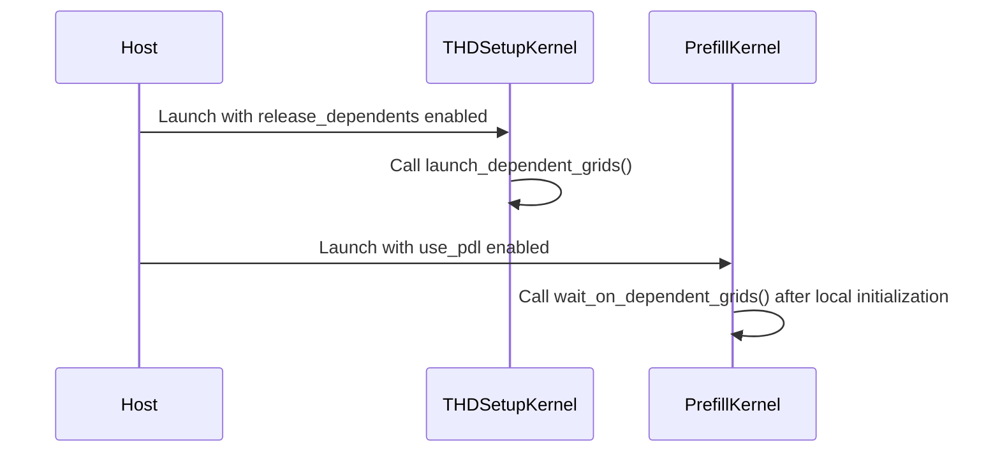

# [SDPA] Overlap native THD setup with kernel initialization

[Upstream PR](https://github.com/NVIDIA/cudnn-frontend/pull/1851) · state: closed · merged: True

## Original PR description

Native SM107 D128 ragged attention currently waits for THD setup to finish before starting its independent CTA/cluster initialization. Allow that initialization to overlap setup through an internal programmatic dependency, for both packed and unpacked plans.

The setup launch keeps ordinary stream ordering with its input producers and releases its dependent grid early. Every main-kernel role waits after local initialization and before reading metadata, tensor-map descriptors, or other dependent global inputs. Other helper callers retain the default behavior. Public APIs, plan admission, workspace, launch count, and caller-visible PDL handling are unchanged; dense and other head-size bodies remain on their existing path.

Validation:
- 204 native functional cases, including O/Stats, changed lengths, fresh bindings, and poisoned retained CUDA Graph replay. The qualified kernel/helper blobs were carried unchanged onto the landed parent; the final edit only clarifies a comment and preserves the Python AST.
- Four memcheck, four racecheck, and four synccheck workloads passed. The latter two use CPU FP64 reference arithmetic to avoid instrumenting the GPU reference; an earlier reference-side timeout is retained in the validation record.
- A fresh matched old/new run on the landed parent completed 96 full-attention observations across six shapes, CGA1/CGA2, packed/unpacked, and output/Stats modes. All numerical and poisoned-replay checks passed. Performance evidence is retained internally with its measurement limits.
- Existing compiler checks cover THD dependency instructions and unchanged dense/non-SM107 artifacts. Scoped pre-commit hooks pass.

This change is independent of #1850. Their clean composition passed 20 existing packed/unpacked CGA1/CGA2 lifecycle tests and 96 full-attention observations; all O/Stats and poisoned-replay checks passed. The two individual performance effects are not assumed to be additive.

## Review and discussion

### reviews

- YangXu1990uiuc · COMMENTED · 2026-10-25T23:42:21Z · [source](https://github.com/NVIDIA/cudnn-frontend/pull/1851#pullrequestreview-5645957774)

**Codex bot review · model: `gpt-6-astra`**

Reviewed `409e021fc00d` against base `031b157ef5c0`.

No approval-blocking issue found in this bounded review. The dependency is placed correctly: setup remains stream-ordered with its input producers, while every main-kernel role waits after independent local initialization and before consuming setup results. The native binder retains the compiled host entry, and the captured graph preserves the programmatic dependency. I also checked composition with the setup change already merged in #1850. This is a comment-only self-review; independent approval and the existing CI requirements still apply.

Validation: SM107, exact head 409e021: eight CGA1/2 x packed/unpacked x BF16 packed-Stats or FP16 padded-Stats-plus-sink combinations passed full-output CPU FP64 O/LSE comparisons. Each covers four changing length states, including empty batches/all-empty input, bottom-right keyless rows, a left window, output-tail canaries, and explicitly ordered input production on another stream. Each combination passed 24 retained-graph replays with overwritten workspace and outputs; repeated outputs were bitwise identical for the fixed inputs in this probe. Native binding and the intended kernel route were asserted. Queried the actual captured CUDA Graph edges: setup-to-main is PROGRAMMATIC, and the padded-Stats initialization retains its ordinary predecessor edge. Emitted PTX places the release/wait before the first dependent global/TMA access in the tested renderings. The same eight combinations and 192 replays also passed after composing this exact head with current develop's #1850 changes in an isolated source copy. The packed CGA2 FP16 padded-Stats/sink case passed memcheck, racecheck and synccheck, including changed-length replay and the CPU oracle; final summaries report zero errors and zero race hazards. Explicit CUDA API error reporting was retained. Existing CI request for this exact head already targets python/sdpa/frost; no duplicate pipeline was started. Added the established Frontend 1.32.0 milestone and cudnn-frontend project.

Limitations: This is focused correctness, dependency-order and repeatability validation, not a rerun of the author's complete shape/performance matrix or a serving benchmark. The full CI pipeline was still running at the last check.

Comment only: GitHub does not allow reviewing one's own PR with approval/request-changes.

<!-- codex-fe-review:v2:1851:409e021fc00d33634f86db35fcf21a05aef1e985:complete:no-blocker -->

- Anerudhan · APPROVED · 2026-10-26T00:00:53Z · [source](https://github.com/NVIDIA/cudnn-frontend/pull/1851#pullrequestreview-5646070148)

**Codex bot review · model: `gpt-6-astra`**

Reviewed `409e021fc00d` against base `ad19a3e69151`.

Independent review complete with no findings. The setup launch keeps ordinary input ordering, and every main-kernel role waits for setup completion before dependent reads. The new overlap is limited to independent initialization; arithmetic and reduction order are unchanged.

Validation: Six compiler controls with public CuTe DSL 4.8.0: SM100 THD and SM107 dense base/head cubins are byte-identical. In SM107 THD packed CGA1 and unpacked CGA2 PTX, the dependency wait follows local initialization and precedes global/TMA reads and role dispatch. This matches the completion/visibility boundary in the [PTX griddepcontrol specification](https://docs.nvidia.com/cuda/pdf/ptx_isa_8.8.pdf). Sixteen native SM107 cases passed: eight on the exact head and eight with this patch composed onto current develop, including the merged descriptor-setup change. Coverage spans CGA1/2, packed/unpacked heads, BF16 token Stats, FP16 padded Stats with sink, bottom-right causal masking, a left window, empty sequences and tail canaries. Full O/LSE outputs matched FP64 references. Each case checked fresh bindings and one retained-graph replay after changing input data and lengths and poisoning workspace/output. All 16 captured graphs had the expected PROGRAMMATIC dependency edge; padded-Stats initialization retained an ordinary edge. Reused current-head python/sdpa/frost pipeline 76629290 and verified that both changed files match its integration commit. SM107, SM103, SM100 and SM80 lanes passed at the last check; SM120 remains in progress. No duplicate CI trigger was sent.

Limitations: These are focused correctness and dependency-order checks. No independent latency comparison, sanitizer run or repeated bitwise-stability measurement was made; the author's performance, sanitizer and longer replay results remain separate evidence. Full CI completion is pending.

Approved: no P0 or high-risk P1 found. Remaining findings stay with the owner; merge timing stays with the owner.

<!-- codex-fe-review:v2:1851:409e021fc00d33634f86db35fcf21a05aef1e985:complete:no-blocker -->

### issue_comments

- coderabbitai[bot] · comment · 2026-10-25T23:08:43Z · [source](https://github.com/NVIDIA/cudnn-frontend/pull/1851#issuecomment-6404690747)

<!-- coderabbit-ai-generated:v1 -->

<!-- This is an auto-generated comment: summarize by coderabbit.ai -->
<!-- review_stack_entry_start -->

<a href="https://app.coderabbit.ai/change-stack/NVIDIA/cudnn-frontend/pull/1851?scope=ghh_OusAJGA4HG8ljoOV0wJvVx8NmnZIjc2DdjmxOu0xZWA&amp;cs_source=review_comment"><picture><source media="(prefers-color-scheme: dark)" srcset="https://storage.googleapis.com/coderabbit_public_assets/review-stack-in-coderabbit-ui-dark.svg?v=3"><source media="(prefers-color-scheme: light)" srcset="https://storage.googleapis.com/coderabbit_public_assets/review-stack-in-coderabbit-ui.svg?v=3"></picture></a>

<!-- review_stack_entry_end -->
<!-- recent_review_start -->

No actionable comments were generated in the recent review.

<strong><picture></picture> Recent review info</strong>

<dl>
<dd>

<strong><picture><source media="(prefers-color-scheme: dark)" srcset="https://storage.googleapis.com/coderabbit_public_assets/review-comment-icons-v1/cog-dark.svg"></picture> Run configuration</strong>

<dl>
<dd>

- **Source mode**: Auto
- **Repository**: [NVIDIA/cudnn-frontend](<https://github.com/NVIDIA/cudnn-frontend>)
- **Branch**: [develop](<https://github.com/NVIDIA/cudnn-frontend/tree/develop>)
- **File**: [.coderabbit.yaml](<https://github.com/NVIDIA/cudnn-frontend/blob/db871fbd5d08bd03e7ba719e84e6230e16f26069/.coderabbit.yaml>)
- **Commit**: [db871fb](<https://github.com/NVIDIA/cudnn-frontend/commit/db871fbd5d08bd03e7ba719e84e6230e16f26069>)
- **Layers**: Repository YAML
- **Review profile**: CHILL
- **Plan**: Enterprise
- **Run ID**: `8f48b633-d3c7-465a-9d74-08ebc79edb65`

</dd>
</dl>

<strong><picture><source media="(prefers-color-scheme: dark)" srcset="https://storage.googleapis.com/coderabbit_public_assets/review-comment-icons-v1/git-commit-horizontal-dark.svg"></picture> Commits</strong>

<dl>
<dd>

Reviewing files that changed from the base of the PR and between db871fbd5d08bd03e7ba719e84e6230e16f26069 and 409e021fc00d33634f86db35fcf21a05aef1e985.

</dd>
</dl>

<strong><picture><source media="(prefers-color-scheme: dark)" srcset="https://storage.googleapis.com/coderabbit_public_assets/review-comment-icons-v1/file-plus-corner-dark.svg"></picture> Files selected for processing: 2</strong>

<dl>
<dd>

* `python/cudnn/sdpa/fwd/kernels/sm107/prefill_d128_f16.py`
* `python/cudnn/sdpa/fwd/kernels/thd_helpers.py`

</dd>
</dl>

**Included review availability:** This review used your included allowance. Your plan provides up to 12 included reviews per hour; 8 remain after this review.

</dd>
</dl>

<!-- recent_review_end -->
<!-- walkthrough_start -->

<strong>Walkthrough</strong>

<dl>
<dd>

The SM107 D128 THD variable-length route conditionally enables dependent-grid release in the setup kernel, PDL for the main kernel launch, and a wait before dependent reads. Other configurations retain their prior launch behavior.

**Changes: THD D128 PDL synchronization**

|Layer / File(s)|Summary|
|:---|:---|
|**THD setup release**   `python/cudnn/sdpa/fwd/kernels/thd_helpers.py`, `python/cudnn/sdpa/fwd/kernels/sm107/prefill_d128_f16.py`|The setup kernel adds a compile-time `release_dependents` option, defaulting to `False`. When enabled, thread 0 calls `launch_dependent_grids()` before the existing setup work.|
|**D128 prefill integration**   `python/cudnn/sdpa/fwd/kernels/sm107/prefill_d128_f16.py`|For THD variable-length builds with both tile widths set to 128, the route enables setup release and PDL on the main kernel launch. The kernel waits on dependent grids after local initialization and before dependent reads.|

<!-- change_assessment_start -->
<strong>Priority: <picture></picture> Low</strong>

**Estimated code review effort:** 2 (Simple) | ~12 minutes

<!-- change_assessment_commit:"409e021fc00d33634f86db35fcf21a05aef1e985" -->
**Change:** Refactor
<!-- change_assessment_end -->

### Sequence Diagram(s)

**Possibly related PRs**

- [NVIDIA/cudnn-frontend#1832](https://github.com/NVIDIA/cudnn-frontend/pull/1832): Adds the native SM107 D128 nonpaged THD prefill route that this change updates.
- [NVIDIA/cudnn-frontend#1830](https://github.com/NVIDIA/cudnn-frontend/pull/1830): Adds the native SM107 D128 PackGQA body and packed THD setup path affected by this synchronization change.
- [NVIDIA/cudnn-frontend#1831](https://github.com/NVIDIA/cudnn-frontend/pull/1831): Adds the fused small-batch producer to the THD setup kernel that gains the release option.

**Suggested reviewers:** `romananders90`

</dd>
</dl>

<!-- walkthrough_end -->

<strong>Merge Risk:</strong> <strong><picture></picture> Minimal</strong> · up to <code>409e0</code>

<dl>
<dd>

<!-- final_review_risk_start -->
<!-- final_review_risk_label
**Merge Risk:** **⚪ Minimal** · up to `409e0`
-->
<!-- final_review_risk_coverage:{"sourceCommitId":"409e021fc00d33634f86db35fcf21a05aef1e985","coveredCommitId":"409e021fc00d33634f86db35fcf21a05aef1e985","kind":"reviewed"} -->

No merge-blocking defect is established in the reviewed change.
<!-- final_review_risk_end -->

</dd>
</dl>

<!-- pre_merge_checks_walkthrough_start -->

<strong>Pre-merge checks: <picture></picture> 4 · <picture></picture> 1</strong>

<dl>
<dd>

<strong><picture></picture> Failed checks: 1 warning</strong>

|     Check name     |                                              Status                                              | Explanation                                                                                                                                                                                | Resolution                                                                         |
| :---------------- | :----------------------------------------------------------------------------------------------: | :----------------------------------------------------------------------------------------------------------------------------------------------------------------------------------------- | :--------------------------------------------------------------------------------- |
| Docstring Coverage |  | Docstring coverage is 66.67% which is insufficient. The required threshold is 80.00%. Docstring coverage is scoped to functions touched by this diff. Analyzed 3 functions across 2 files. | Write docstrings for the functions missing them to satisfy the coverage threshold. |

<strong><picture></picture> Passed checks: 4 passed</strong>

<dl>
<dd>

|         Check name         |                                             Status                                             | Explanation                                                                                                                                                                                               |
| :------------------------ | :--------------------------------------------------------------------------------------------: | :-------------------------------------------------------------------------------------------------------------------------------------------------------------------------------------------------------- |
|         Title check        |  | The title clearly and concisely describes the main change: overlapping native THD setup with kernel initialization for SDPA.                                                                              |
|     Linked Issues check    |  | Check skipped because no linked issues were found for this pull request.                                                                                                                                  |
| Out of Scope Changes check |  | Check skipped because no linked issues were found for this pull request.                                                                                                                                  |
|      Description check     |  | The description explains the change, its rationale, compatibility impact, and validation results. It omits the affected-area selection and does not confirm the license, AGENTS.md, and label checklist … |

<strong>Full details: Description check</strong>

<dl>
<dd>

**Explanation**

The description explains the change, its rationale, compatibility impact, and validation results. It omits the affected-area selection and does not confirm the license, AGENTS.md, and label checklist items; it does report that scoped pre-commit hooks pass.

</dd>
</dl>

</dd>
</dl>

</dd>
</dl>

<!-- pre_merge_checks_walkthrough_end -->
<!-- finishing_touch_checkbox_start -->

<strong>Finishing Touches: 💡 1</strong>

<dl>
<dd>

<!-- finishing_touch_suggestion:fix_ci -->

<strong>🛠️ Fix failing CI checks: 💡</strong>

<dl>
<dd>

- [ ] <!-- {"checkboxId": "9f0d24fb-b419-4f01-baf0-8b26b6424f34", "radioGroupId": "fix-ci-output-choice-group-unknown_comment_id"} --> Commit to this branch
- [ ] <!-- {"checkboxId": "6d21cfe8-ec3f-40e2-9222-b8318b64d3b0", "radioGroupId": "fix-ci-output-choice-group-unknown_comment_id"} --> Create a new PR

</dd>
</dl>

<strong>🧪 Generate unit tests (beta)</strong>

<dl>
<dd>

- [ ] <!-- {"checkboxId": "f47ac10b-58cc-4372-a567-0e02b2c3d479", "radioGroupId": "utg-output-choice-group-unknown_comment_id"} --> Create a new PR

</dd>
</dl>

</dd>
</dl>

<!-- finishing_touch_checkbox_end -->

<!-- autopilot:start -->
- [ ] <!-- {"checkboxId":"2708ad07-9f24-4260-9c11-7dc76a49f2e3"} --> <strong title="Keep fixing CodeRabbit findings and required CI, and resolving merge conflicts">Autofix</strong> · Keep fixing CodeRabbit findings and required CI, and resolving merge conflicts
<!-- autopilot:end -->
<!-- tips_start -->

Comment `@coderabbitai help` to get the list of available commands.

<!-- tips_end -->

- YangXu1990uiuc · comment · 2026-10-25T23:09:03Z · [source](https://github.com/NVIDIA/cudnn-frontend/pull/1851#issuecomment-6404693845)

@cudnn-ci-bot run python/sdpa/frost

- cudnn-ci-bot · comment · 2026-10-25T23:09:07Z · [source](https://github.com/NVIDIA/cudnn-frontend/pull/1851#issuecomment-6404694581)

🏁 Pipeline finished

SHA: `409e021`
Targets: `python/sdpa/frost`
Branch: [cudnn-gh/pr-1851-409e021](https://nv/cudnn-gitlab-ci/-/tree/cudnn-gh/pr-1851-409e021)
Pipeline: [76629290](https://nv/cudnn-gitlab-ci/-/pipelines/76629290)
Last updated: 2026-10-26 00:31 UTC

**25 passed, 3 skipped, 11 manual**

### <code>manual</code>

- <code>manual:python_samples</code> - Manual
- <code>manual:python</code> - Manual
- <code>manual:python/sdpa/frost</code> - ✅ Passed
- <code>manual:python/linear_attention/frost</code> - Manual
- <code>manual:python/gemm/frost</code> - Manual
- <code>manual:python/*/frost</code> - Manual
- <code>manual:python/gemm/cutedsl</code> - Manual
- <code>manual:python/*/cutedsl</code> - Manual
- <code>manual:python/*/jax</code> - Manual
- <code>manual:pycudnn</code> - Manual
- <code>manual:multi_gpu</code> - Manual
- <code>manual:backend</code> - Manual

### <code>analysis</code>

- <code>analysis:cudnn_clang_disable_exception</code> - ✅ Passed
- <code>analysis:cudnn_v9_no_half_conversion</code> - ✅ Passed
- <code>analysis:cudnn_clang</code> - ✅ Passed
- <code>analysis:check-relative-includes</code> - ✅ Passed
- <code>analysis:check-CUDNN_FRONTEND_SKIP_JSON_LIB</code> - ✅ Passed
- <code>analysis:guardwords_scan</code> - ✅ Passed
- <code>analysis:jax-import-guard</code> - ✅ Passed
- <code>analysis:pytest-gpu</code> - ✅ Passed
- <code>san:build</code> - ✅ Passed

### <code>build</code>

- <code>analysis:api_index</code> - ✅ Passed
- <code>build:dev:linux:amd64</code> - ✅ Passed
- <code>build:rel:linux:amd64</code> - ✅ Passed
- <code>build:dev:linux:arm64</code> - ✅ Passed
- <code>build:rel:linux:arm64</code> - ✅ Passed
- <code>build:rel:win:amd64</code> - ✅ Passed

### <code>frost_tests</code>

- <code>python/sdpa/frost:cutlass-rel:sm80</code> - ✅ Passed
- <code>python/sdpa/frost:cutlass-rel:sm100</code> - ✅ Passed
- <code>python/sdpa/frost:cutlass-rel:sm120</code> - ✅ Passed
- <code>python/linear_attention/frost:cutlass-rel:sm100</code> - Skipped
- <code>python/gemm/frost:cutlass-rel:sm100</code> - Skipped
- <code>python/*/frost:cutlass-rel:sm100</code> - Skipped
- <code>python/sdpa/frost:cutlass-rel:sm103</code> - ✅ Passed
- <code>python/sdpa/frost:cutlass-4.8:sm107</code> - ✅ Passed

### <code>sanitizer_tests</code>

- <code>san:cpp_test:sm80</code> - ✅ Passed
- <code>san:cpp_test:sm90</code> - ✅ Passed
- <code>san:cpp_test:sm100</code> - ✅ Passed

### <code>triage</code>

- <code>triage:ai</code> - ✅ Passed

### inline_comments

## Changed files and fixed code

- `python/cudnn/sdpa/fwd/kernels/sm107/prefill_d128_f16.py` · modified · additions 14 / deletions 0
  - [head](https://github.com/YangXu1990uiuc/cudnn-frontend/blob/409e021fc00d33634f86db35fcf21a05aef1e985/python/cudnn/sdpa/fwd/kernels/sm107/prefill_d128_f16.py)
  - [base](https://github.com/NVIDIA/cudnn-frontend/blob/db871fbd5d08bd03e7ba719e84e6230e16f26069/python/cudnn/sdpa/fwd/kernels/sm107/prefill_d128_f16.py)
- `python/cudnn/sdpa/fwd/kernels/thd_helpers.py` · modified · additions 9 / deletions 0
  - [head](https://github.com/YangXu1990uiuc/cudnn-frontend/blob/409e021fc00d33634f86db35fcf21a05aef1e985/python/cudnn/sdpa/fwd/kernels/thd_helpers.py)
  - [base](https://github.com/NVIDIA/cudnn-frontend/blob/db871fbd5d08bd03e7ba719e84e6230e16f26069/python/cudnn/sdpa/fwd/kernels/thd_helpers.py)

## Evidence and interpretation boundary

[Original JSON, discussions and patches](../../../../../../evidence/prs/NVIDIA--cudnn-frontend/1851-c0391213c83365fe688af44704669b0895583181bd78ab2de0224f72aa5fb6ad.json) · SHA-256 `c0391213c83365fe688af44704669b0895583181bd78ab2de0224f72aa5fb6ad`.

Diff complete: True. Missing/binary/truncated patches require pinned source inspection. This is a source page, not an independently verified optimization case. Open, merged and released are different states; recheck the deployed dependency.
