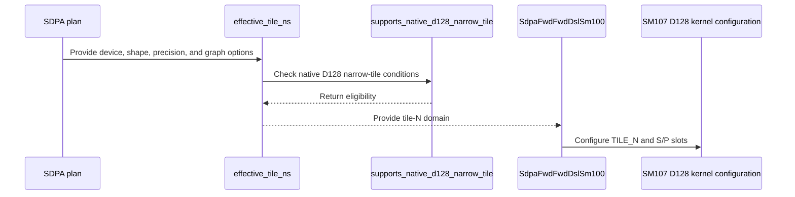

# [SDPA] Add explicit native D128 narrow tiles with two score slots

[Upstream PR](https://github.com/NVIDIA/cudnn-frontend/pull/1854) · state: closed · merged: True

## Original PR description

Native D128 prefill currently accepts only `TILE_N=128`. Add an explicit `TILE_N=64` option that uses the existing two-slot score/P pipeline, allowing the next QK step to overlap the previous PV step. Graph validation and standalone lowering share the same domain predicate and encode the selected geometry in the template record.

The new option covers FP16/BF16 native SM107 nonpaged unsplit THD at CGA1/2 and dense CGA2, including the existing dense split and head-dimension envelope paths. The default remains 128. Other kernel bodies retain their existing domains; no heuristic or placement rule changes.

Validation:
- 32 host metadata/admission checks pass; all 27 compared default candidate lists are unchanged.
- Four offline compilation controls pass: the two explicit narrow renderings match the measured prototype binaries, and the two default-width renderings match the parent binaries.
- Added dense FP64 O/Stats and ragged rebinding/changed-length/CUDA Graph replay tests, asserting the actual compiled tile and score-slot count.
- Target-device suite: 72 passed, zero failures/errors/skips (32 metadata/admission, 28 dense FP64 O/Stats replay, 12 ragged changed-length/fresh-binding/retained-capture tests).
- Compute Sanitizer: two representative cases each pass unfiltered memcheck, racecheck and synccheck, with zero errors/hazards.
- GPU-tested source is `b3c7a7290`; current `03969e064` changes two kernel comments and documentation placement only. Kernel AST and all other runtime/test files are unchanged.
- Scoped pre-commit hooks pass.

<!-- This is an auto-generated comment: release notes by coderabbit.ai -->

<!-- coderabbit-ai-generated:v1 -->

## Summary by CodeRabbit

* **New Features**
  * Added support for an optional 64-wide tile for eligible SM107 half-precision D=128 prefill workloads. The default remains 128, and supported graph configurations are unchanged beyond the newly eligible cases.
  * The 64-wide option uses two score slots per query subtile.

* **Tests**
  * Added coverage for supported configurations, kernel selection, and dense and ragged execution paths.

<!-- end of auto-generated comment: release notes by coderabbit.ai -->

## Review and discussion

### reviews

- YangXu1990uiuc · COMMENTED · 2026-10-26T01:38:25Z · [source](https://github.com/NVIDIA/cudnn-frontend/pull/1854#pullrequestreview-5646487668)

**Codex bot review · model: `gpt-6-astra`**

Reviewed `03969e064654` against base `f9fd9c51295f`.

No actionable correctness issue found on 03969e064654. This is a bounded addition to the explicit knob domain: graph and standalone admission share the same predicate, the selected tile/slot count is recorded in the template, and the existing default width and placement policy remain unchanged. I independently validated the exact current head on native SM107. This is an author-account review, so it does not supply the independent approval needed to merge.

Validation: The full new test suite passed: 72 passed, no failures or skips, with L1 explicitly enabled. This covers 32 metadata/admission checks, 28 dense FP64 O/Stats checks and 12 ragged rebinding/changed-length/capture tests; the compiled TILE_N=64 and S_SLOTS=2 were asserted. An additional 12 FP16/BF16 cases exercised LPT and LPT-L2 with dense split, keyless rows without sinks, and partial-group sliding windows. All changed-input capture/replay O/Stats checks passed against the FP64 reference. An independent graph probe covered eight CGA1/2, packed/unpacked and packed-Stats/padded-Stats-plus-sink configurations. Across four runtime-length states per configuration and 192 replays, complete O/LSE matched a CPU FP64 oracle; empty-batch transitions, all-empty Q/KV, keyless rows, side-stream prefix production and tail canaries passed. The captured programmatic setup dependency remained present. Identical-input replays with re-poisoned workspace produced bitwise-equal O/LSE in those eight configurations. This checks same-configuration repeatability, not cross-device or batch invariance. A representative packed CGA2 case with padded Stats and sinks passed Compute Sanitizer memcheck, racecheck and synccheck, including its four changed-length states and FP64 comparisons: zero reported errors or hazards. Environment: native SM107, Torch 2.14.1+cu130, cuDNN 9.27 and public CuTeDSL 4.8. Reviewed the shared admission, TMEM layout, score-slot cursors and empty-item handling. Added the missing Frontend 1.32.0 milestone and existing repository project; retained the appropriate labels.

Limitations: The author-triggered pipeline 76641839 was still running at the last check and was not duplicated. The new suite is L1, so the local command explicitly included it rather than relying on default L0 collection. No independent performance or serving-throughput claim. The sanitizer check is representative coverage, not an exhaustive configuration sweep.

Comment only: GitHub does not allow reviewing one's own PR with approval/request-changes.

<!-- codex-fe-review:v2:1854:03969e06465449808399b552d91bec477aa84afb:complete:no-blocker -->

- Anerudhan · APPROVED · 2026-10-26T02:07:57Z · [source](https://github.com/NVIDIA/cudnn-frontend/pull/1854#pullrequestreview-5646650900)

**Codex bot review · model: `gpt-6-astra`**

Reviewed `d1e8da5168f1` against base `f9fd9c51295f`.

No actionable issue remains. The test-only follow-up fixes the five stale D128 domain/error expectations and retains the unsupported-cell controls. The explicit narrow-tile admission agrees across the graph row, adapter and factory; default candidate selection remains unchanged.

Validation: Current head: 54 affected host contract tests passed, including the formerly failing expectations and new dense-CGA1 rejection controls. The prior five-test control passed on base and failed on the previous head, confirming the repair. Reused independent native SM107 evidence from 03969e064654 after verifying that only three test files changed: all 72 new tests passed with explicit L1 selection (32 metadata/admission, 28 dense FP64 O/Stats, 12 ragged changed-length/rebinding/capture cases). The compiled width64/two-slot route was asserted. Two additional BF16 causal dense shapes passed FP64 O/LSE checks at both widths; 20 poisoned replays were bitwise identical within each configuration. This is bounded repeatability evidence, not batch or cross-device invariance. All 36 sampled default candidate lists match base. Two representative default kernels are byte-identical across base/head; both explicit narrow compiler controls pass. Bounded matched-width timing checks support retaining explicit selection rather than assuming a universal narrow-tile speedup. Reviewed score-slot phase progression, elected MMA commits, barrier counts and TMEM alias boundaries (checklist C08/C09, A01/A02/A07, B17 and D01). Precheck produced no candidates. Reused current-head pipeline76647370; all13 changed files match its integration tree. Its five SDPA lanes are still pending/running. Current-head Style and Security workflows passed.

Limitations: The new suite is L1 and is not covered by the standard CI default selection; it was run separately. Current-head CI is not yet a passing result. No independent sanitizer run or broad performance sweep; the author's additional sanitizer and scheduler results are separate evidence.

Approved: no P0 or high-risk P1 found. Remaining findings stay with the owner; merge timing stays with the owner.

<!-- codex-fe-review:v2:1854:d1e8da5168f114d7ed5280a917ce275b58e39ebf:complete:no-blocker -->

### issue_comments

- coderabbitai[bot] · comment · 2026-10-26T01:01:46Z · [source](https://github.com/NVIDIA/cudnn-frontend/pull/1854#issuecomment-6405898411)

<!-- coderabbit-ai-generated:v1 -->

<!-- This is an auto-generated comment: summarize by coderabbit.ai -->
<!-- review_stack_entry_start -->

<a href="https://app.coderabbit.ai/change-stack/NVIDIA/cudnn-frontend/pull/1854?scope=ghh_OusAJGA4HG8ljoOV0wJvVx8NmnZIjc2DdjmxOu0xZWA&amp;cs_source=review_comment"><picture><source media="(prefers-color-scheme: dark)" srcset="https://storage.googleapis.com/coderabbit_public_assets/review-stack-in-coderabbit-ui-dark.svg?v=3"><source media="(prefers-color-scheme: light)" srcset="https://storage.googleapis.com/coderabbit_public_assets/review-stack-in-coderabbit-ui.svg?v=3"></picture></a>

<!-- review_stack_entry_end -->
<!-- recent_review_start -->

No actionable comments were generated in the recent review.

<strong><picture></picture> Recent review info</strong>

<dl>
<dd>

<strong><picture><source media="(prefers-color-scheme: dark)" srcset="https://storage.googleapis.com/coderabbit_public_assets/review-comment-icons-v1/cog-dark.svg"></picture> Run configuration</strong>

<dl>
<dd>

- **Source mode**: Auto
- **Repository**: [NVIDIA/cudnn-frontend](<https://github.com/NVIDIA/cudnn-frontend>)
- **Branch**: [develop](<https://github.com/NVIDIA/cudnn-frontend/tree/develop>)
- **File**: [.coderabbit.yaml](<https://github.com/NVIDIA/cudnn-frontend/blob/f9fd9c51295ff7bb13e3847713840bbcfcc7f9ff/.coderabbit.yaml>)
- **Commit**: [f9fd9c5](<https://github.com/NVIDIA/cudnn-frontend/commit/f9fd9c51295ff7bb13e3847713840bbcfcc7f9ff>)
- **Layers**: Repository YAML
- **Review profile**: CHILL
- **Plan**: Enterprise
- **Run ID**: `df24a510-698c-4f1c-8dac-5389e0ade479`

</dd>
</dl>

<strong><picture><source media="(prefers-color-scheme: dark)" srcset="https://storage.googleapis.com/coderabbit_public_assets/review-comment-icons-v1/git-commit-horizontal-dark.svg"></picture> Commits</strong>

<dl>
<dd>

Reviewing files that changed from the base of the PR and between 03969e06465449808399b552d91bec477aa84afb and d1e8da5168f114d7ed5280a917ce275b58e39ebf.

</dd>
</dl>

<strong><picture><source media="(prefers-color-scheme: dark)" srcset="https://storage.googleapis.com/coderabbit_public_assets/review-comment-icons-v1/file-plus-corner-dark.svg"></picture> Files selected for processing: 3</strong>

<dl>
<dd>

* `test/python/sdpa/frost/test_sdpa_bias_tile_n_additive_sm107.py`
* `test/python/sdpa/frost/test_sdpa_graph_analyzer.py`
* `test/python/sdpa/frost/test_sdpa_s_slots_sm107.py`

</dd>
</dl>

**Included review availability:** This review used your included allowance. Your plan provides up to 12 included reviews per hour; 7 remain after this review.

</dd>
</dl>

<!-- recent_review_end -->
<!-- walkthrough_start -->

<strong>Walkthrough</strong>

<dl>
<dd>

Eligible SM107 half-precision D128 prefill plans can now use explicit `TILE_N=64`, with two S/P slots. The default remains 128, and existing restrictions for other graph configurations remain in place.

**Changes: Native D128 Prefill**

|Layer / File(s)|Summary|
|:---|:---|
|**Narrow-tile eligibility and admission**   `python/cudnn/sdpa/frost/SUPPORT_MATRIX_TRACKER.md`, `python/cudnn/sdpa/fwd/config_sm107.py`, `python/cudnn/sdpa/fwd/engines.py`, `python/cudnn/sdpa/fwd/api_dsl.py`|Adds an eligibility predicate for native SM107 D128 narrow tiles. Eligible plans expose tile widths 64 and 128; the documented default and placement and shape-selection rules remain unchanged.|
|**Two-slot configuration and kernel validation**   `python/cudnn/sdpa/fwd/config_d128_family.py`, `python/cudnn/sdpa/fwd/config_sm107.py`, `python/cudnn/sdpa/fwd/api_dsl.py`, `python/cudnn/sdpa/fwd/kernels/sm107/prefill_d128_f16.py`|Allows two S/P slots for eligible half-precision D128 plans using `TILE_N=64`. Kernel validation permits `TILE_K` up to 128 for this double-buffered configuration.|
|**Tile selection and execution tests**   `test/python/sdpa/frost/test_sdpa_native_narrow_sm107.py`, `test/python/sdpa/frost/test_sdpa_native_pack_sm107.py`, `test/python/sdpa/frost/test_sdpa_prepared_thd.py`, `test/python/sdpa/frost/test_sdpa_fwd_dsl_sm107.py`, `test/python/sdpa/frost/test_sdpa_bias_tile_n_additive_sm107.py`, `test/python/sdpa/frost/test_sdpa_graph_analyzer.py`, `test/python/sdpa/frost/test_sdpa_s_slots_sm107.py`|Adds checks for tile admission and slot counts, plus dense replay and ragged rebind coverage with the narrow tile.|

<!-- change_assessment_start -->
<strong>Priority: <picture></picture> Normal</strong>

**Estimated code review effort:** 3 (Moderate) | ~20 minutes

<!-- change_assessment_commit:"d1e8da5168f114d7ed5280a917ce275b58e39ebf" -->
**Change:** Feature
<!-- change_assessment_end -->

### Sequence Diagram(s)

**Possibly related PRs**
- [NVIDIA/cudnn-frontend#1832](https://github.com/NVIDIA/cudnn-frontend/pull/1832): Adds native SM107 half-precision D128 nonpaged THD prefill, which this PR extends with `TILE_N=64`.
- [NVIDIA/cudnn-frontend#1836](https://github.com/NVIDIA/cudnn-frontend/pull/1836): Adds native SM107 D128 dense partial PackGQA support, which this PR extends with a narrow tile and two S/P slots.
- [NVIDIA/cudnn-frontend#1830](https://github.com/NVIDIA/cudnn-frontend/pull/1830): Adds the native SM107 D128 PackGQA body, which this PR extends with a narrow tile and two S/P slots.

**Suggested reviewers:** `romananders90`

</dd>
</dl>

<!-- walkthrough_end -->

<strong>Merge Risk:</strong> <strong><picture></picture> Minimal</strong> · up to <code>d1e8d</code>

<dl>
<dd>

<!-- final_review_risk_start -->
<!-- final_review_risk_label
**Merge Risk:** **⚪ Minimal** · up to `d1e8d`
-->
<!-- final_review_risk_coverage:{"sourceCommitId":"d1e8da5168f114d7ed5280a917ce275b58e39ebf","coveredCommitId":"d1e8da5168f114d7ed5280a917ce275b58e39ebf","kind":"reviewed"} -->

The narrow D128 path is consistently admitted and validated across graph and standalone lowering, with no merge-blocking risk identified.
<!-- final_review_risk_end -->

</dd>
</dl>

<!-- pre_merge_checks_walkthrough_start -->

<strong>Pre-merge checks: <picture></picture> 4 · <picture></picture> 1</strong>

<dl>
<dd>

<strong><picture></picture> Failed checks: 1 warning</strong>

|     Check name     |                                              Status                                              | Explanation                                                                                                                                                                                  | Resolution                                                                         |
| :---------------- | :----------------------------------------------------------------------------------------------: | :------------------------------------------------------------------------------------------------------------------------------------------------------------------------------------------- | :--------------------------------------------------------------------------------- |
| Docstring Coverage |  | Docstring coverage is 56.52% which is insufficient. The required threshold is 80.00%. Docstring coverage is scoped to functions touched by this diff. Analyzed 23 functions across 12 files. | Write docstrings for the functions missing them to satisfy the coverage threshold. |

<strong><picture></picture> Passed checks: 4 passed</strong>

<dl>
<dd>

|         Check name         |                                             Status                                             | Explanation                                                                                                                                                                                               |
| :------------------------ | :--------------------------------------------------------------------------------------------: | :-------------------------------------------------------------------------------------------------------------------------------------------------------------------------------------------------------- |
|         Title check        |  | The title clearly and concisely identifies the main change: explicit native D128 narrow tiles with two score slots.                                                                                       |
|      Description check     |  | The description provides a clear summary, rationale, compatibility scope, and detailed validation results. It does not reproduce the template headings or checklist, and it omits an explicit affected-a… |
|     Linked Issues check    |  | Check skipped because no linked issues were found for this pull request.                                                                                                                                  |
| Out of Scope Changes check |  | Check skipped because no linked issues were found for this pull request.                                                                                                                                  |

<strong>Full details: Description check</strong>

<dl>
<dd>

**Explanation**

The description provides a clear summary, rationale, compatibility scope, and detailed validation results. It does not reproduce the template headings or checklist, and it omits an explicit affected-area selection and related-issues entry, but the required change and testing information are substantially complete.

</dd>
</dl>

</dd>
</dl>

</dd>
</dl>

<!-- pre_merge_checks_walkthrough_end -->
<!-- finishing_touch_checkbox_start -->

<strong>Finishing Touches</strong>

<dl>
<dd>

<strong>🧪 Generate unit tests (beta)</strong>

<dl>
<dd>

- [ ] <!-- {"checkboxId": "f47ac10b-58cc-4372-a567-0e02b2c3d479", "radioGroupId": "utg-output-choice-group-unknown_comment_id"} --> Create a new PR

</dd>
</dl>

</dd>
</dl>

<!-- finishing_touch_checkbox_end -->

<!-- autopilot:start -->
- [ ] <!-- {"checkboxId":"2708ad07-9f24-4260-9c11-7dc76a49f2e3"} --> <strong title="Keep fixing CodeRabbit findings and required CI, and resolving merge conflicts">Autofix</strong> · Keep fixing CodeRabbit findings and required CI, and resolving merge conflicts
<!-- autopilot:end -->
<!-- tips_start -->

Comment `@coderabbitai help` to get the list of available commands.

<!-- tips_end -->

- YangXu1990uiuc · comment · 2026-10-26T01:02:55Z · [source](https://github.com/NVIDIA/cudnn-frontend/pull/1854#issuecomment-6405911101)

@cudnn-ci-bot run python/sdpa/frost

- cudnn-ci-bot · comment · 2026-10-26T01:03:00Z · [source](https://github.com/NVIDIA/cudnn-frontend/pull/1854#issuecomment-6405911859)

🏁 Pipeline finished

SHA: `03969e0`
Targets: `python/sdpa/frost`
Branch: [cudnn-gh/pr-1854-03969e0](https://nv/cudnn-gitlab-ci/-/tree/cudnn-gh/pr-1854-03969e0)
Pipeline: [76641839](https://nv/cudnn-gitlab-ci/-/pipelines/76641839)
Last updated: 2026-10-26 01:58 UTC

**20 passed, 3 failed, 2 canceled, 3 skipped, 11 manual**

### <code>manual</code>

- <code>manual:python_samples</code> - Manual
- <code>manual:python</code> - Manual
- <code>manual:python/sdpa/frost</code> - ✅ Passed
- <code>manual:python/linear_attention/frost</code> - Manual
- <code>manual:python/gemm/frost</code> - Manual
- <code>manual:python/*/frost</code> - Manual
- <code>manual:python/gemm/cutedsl</code> - Manual
- <code>manual:python/*/cutedsl</code> - Manual
- <code>manual:python/*/jax</code> - Manual
- <code>manual:pycudnn</code> - Manual
- <code>manual:multi_gpu</code> - Manual
- <code>manual:backend</code> - Manual

### <code>analysis</code>

- <code>analysis:cudnn_clang_disable_exception</code> - ✅ Passed
- <code>analysis:cudnn_v9_no_half_conversion</code> - ✅ Passed
- <code>analysis:cudnn_clang</code> - ✅ Passed
- <code>analysis:check-relative-includes</code> - ✅ Passed
- <code>analysis:check-CUDNN_FRONTEND_SKIP_JSON_LIB</code> - ✅ Passed
- <code>analysis:guardwords_scan</code> - ✅ Passed
- <code>analysis:jax-import-guard</code> - ✅ Passed
- <code>analysis:pytest-gpu</code> - ✅ Passed
- <code>san:build</code> - ✅ Passed

### <code>build</code>

- <code>analysis:api_index</code> - ✅ Passed
- <code>build:dev:linux:amd64</code> - ✅ Passed
- <code>build:rel:linux:amd64</code> - ✅ Passed
- <code>build:dev:linux:arm64</code> - ✅ Passed
- <code>build:rel:linux:arm64</code> - ✅ Passed
- <code>build:rel:win:amd64</code> - ✅ Passed

### <code>frost_tests</code>

- <code>python/sdpa/frost:cutlass-rel:sm80</code> - ❌ **New Failure!** (nightly passed)
- <code>python/sdpa/frost:cutlass-rel:sm100</code> - ❌ **New Failure!** (nightly passed)
- <code>python/sdpa/frost:cutlass-rel:sm120</code> - Canceled
- <code>python/linear_attention/frost:cutlass-rel:sm100</code> - Skipped
- <code>python/gemm/frost:cutlass-rel:sm100</code> - Skipped
- <code>python/*/frost:cutlass-rel:sm100</code> - Skipped
- <code>python/sdpa/frost:cutlass-rel:sm103</code> - ❌ **New Failure!** (nightly passed)
- <code>python/sdpa/frost:cutlass-4.8:sm107</code> - ✅ Passed

### <code>sanitizer_tests</code>

- <code>san:cpp_test:sm80</code> - ✅ Passed
- <code>san:cpp_test:sm90</code> - ✅ Passed
- <code>san:cpp_test:sm100</code> - ✅ Passed

### <code>triage</code>

- <code>triage:ai</code> - Canceled

- YangXu1990uiuc · comment · 2026-10-26T01:10:01Z · [source](https://github.com/NVIDIA/cudnn-frontend/pull/1854#issuecomment-6405991344)

Target-device validation is complete: **72 passed, zero failures/errors/skips**. The suite covers actual 64-column/two-slot lowering, FP16/BF16 dense O/Stats replay, and ragged changed-length/fresh-binding/retained-capture behavior. Two representative cases each also pass unfiltered memcheck, racecheck and synccheck with zero errors/hazards.

GPU-tested `b3c7a7290` and current `03969e064` have identical kernel AST and identical other runtime/test files; the successor only changes comments and documentation placement. The PR description now records these results. Existing standard GPU CI is running.

@Anerudhan, the requested independent review is ready. Please also set the appropriate milestone as part of maintainer review; `merge-requirements` currently reports the missing milestone.

- YangXu1990uiuc · comment · 2026-10-26T01:48:15Z · [source](https://github.com/NVIDIA/cudnn-frontend/pull/1854#issuecomment-6406419817)

CI follow-up: the completed SM80/SM100/SM103 lanes each found the same five stale contract assertions: unconditional D128 TILE_N64 rejection, the old single-width domain, and a two-slot error message that now correctly reaches the TMEM fit guard.

`d1e8da516` updates these tests to the explicit native D128 narrow-tile contract and adds dense CGA1 rejection controls. The TMEM overflow, unsupported widths, quantized types and three-warp-group rejections remain. All 54 affected local metadata/table checks and scoped repository hooks pass. This commit changes tests only; the kernel/adapter code covered by the prior 72 target tests and sanitizer results is unchanged.

@cudnn-ci-bot run python/sdpa/frost

- YangXu1990uiuc · comment · 2026-10-26T01:52:31Z · [source](https://github.com/NVIDIA/cudnn-frontend/pull/1854#issuecomment-6406467532)

@cudnn-ci-bot run python/sdpa/frost

- cudnn-ci-bot · comment · 2026-10-26T01:52:34Z · [source](https://github.com/NVIDIA/cudnn-frontend/pull/1854#issuecomment-6406468171)

🏁 Pipeline finished

SHA: `d1e8da5`
Targets: `python/sdpa/frost`
Branch: [cudnn-gh/pr-1854-d1e8da5](https://nv/cudnn-gitlab-ci/-/tree/cudnn-gh/pr-1854-d1e8da5)
Pipeline: [76647370](https://nv/cudnn-gitlab-ci/-/pipelines/76647370)
Cancelled this PR's older pipelines: 76641839
Last updated: 2026-10-26 02:51 UTC

**25 passed, 3 skipped, 11 manual**

### <code>manual</code>

- <code>manual:python_samples</code> - Manual
- <code>manual:python</code> - Manual
- <code>manual:python/sdpa/frost</code> - ✅ Passed
- <code>manual:python/linear_attention/frost</code> - Manual
- <code>manual:python/gemm/frost</code> - Manual
- <code>manual:python/*/frost</code> - Manual
- <code>manual:python/gemm/cutedsl</code> - Manual
- <code>manual:python/*/cutedsl</code> - Manual
- <code>manual:python/*/jax</code> - Manual
- <code>manual:pycudnn</code> - Manual
- <code>manual:multi_gpu</code> - Manual
- <code>manual:backend</code> - Manual

### <code>analysis</code>

- <code>analysis:cudnn_clang_disable_exception</code> - ✅ Passed
- <code>analysis:cudnn_v9_no_half_conversion</code> - ✅ Passed
- <code>analysis:cudnn_clang</code> - ✅ Passed
- <code>analysis:check-relative-includes</code> - ✅ Passed
- <code>analysis:check-CUDNN_FRONTEND_SKIP_JSON_LIB</code> - ✅ Passed
- <code>analysis:guardwords_scan</code> - ✅ Passed
- <code>analysis:jax-import-guard</code> - ✅ Passed
- <code>analysis:pytest-gpu</code> - ✅ Passed
- <code>san:build</code> - ✅ Passed

### <code>build</code>

- <code>analysis:api_index</code> - ✅ Passed
- <code>build:dev:linux:amd64</code> - ✅ Passed
- <code>build:rel:linux:amd64</code> - ✅ Passed
- <code>build:dev:linux:arm64</code> - ✅ Passed
- <code>build:rel:linux:arm64</code> - ✅ Passed
- <code>build:rel:win:amd64</code> - ✅ Passed

### <code>frost_tests</code>

- <code>python/sdpa/frost:cutlass-rel:sm80</code> - ✅ Passed
- <code>python/sdpa/frost:cutlass-rel:sm100</code> - ✅ Passed
- <code>python/sdpa/frost:cutlass-rel:sm120</code> - ✅ Passed
- <code>python/linear_attention/frost:cutlass-rel:sm100</code> - Skipped
- <code>python/gemm/frost:cutlass-rel:sm100</code> - Skipped
- <code>python/*/frost:cutlass-rel:sm100</code> - Skipped
- <code>python/sdpa/frost:cutlass-rel:sm103</code> - ✅ Passed
- <code>python/sdpa/frost:cutlass-4.8:sm107</code> - ✅ Passed

### <code>sanitizer_tests</code>

- <code>san:cpp_test:sm80</code> - ✅ Passed
- <code>san:cpp_test:sm90</code> - ✅ Passed
- <code>san:cpp_test:sm100</code> - ✅ Passed

### <code>triage</code>

- <code>triage:ai</code> - ✅ Passed

### inline_comments

## Changed files and fixed code

- `python/cudnn/sdpa/frost/SUPPORT_MATRIX_TRACKER.md` · modified · additions 9 / deletions 0
  - [head](https://github.com/YangXu1990uiuc/cudnn-frontend/blob/d1e8da5168f114d7ed5280a917ce275b58e39ebf/python/cudnn/sdpa/frost/SUPPORT_MATRIX_TRACKER.md)
  - [base](https://github.com/NVIDIA/cudnn-frontend/blob/f9fd9c51295ff7bb13e3847713840bbcfcc7f9ff/python/cudnn/sdpa/frost/SUPPORT_MATRIX_TRACKER.md)
- `python/cudnn/sdpa/fwd/api_dsl.py` · modified · additions 21 / deletions 2
  - [head](https://github.com/YangXu1990uiuc/cudnn-frontend/blob/d1e8da5168f114d7ed5280a917ce275b58e39ebf/python/cudnn/sdpa/fwd/api_dsl.py)
  - [base](https://github.com/NVIDIA/cudnn-frontend/blob/f9fd9c51295ff7bb13e3847713840bbcfcc7f9ff/python/cudnn/sdpa/fwd/api_dsl.py)
- `python/cudnn/sdpa/fwd/config_d128_family.py` · modified · additions 4 / deletions 3
  - [head](https://github.com/YangXu1990uiuc/cudnn-frontend/blob/d1e8da5168f114d7ed5280a917ce275b58e39ebf/python/cudnn/sdpa/fwd/config_d128_family.py)
  - [base](https://github.com/NVIDIA/cudnn-frontend/blob/f9fd9c51295ff7bb13e3847713840bbcfcc7f9ff/python/cudnn/sdpa/fwd/config_d128_family.py)
- `python/cudnn/sdpa/fwd/config_sm107.py` · modified · additions 22 / deletions 7
  - [head](https://github.com/YangXu1990uiuc/cudnn-frontend/blob/d1e8da5168f114d7ed5280a917ce275b58e39ebf/python/cudnn/sdpa/fwd/config_sm107.py)
  - [base](https://github.com/NVIDIA/cudnn-frontend/blob/f9fd9c51295ff7bb13e3847713840bbcfcc7f9ff/python/cudnn/sdpa/fwd/config_sm107.py)
- `python/cudnn/sdpa/fwd/engines.py` · modified · additions 14 / deletions 1
  - [head](https://github.com/YangXu1990uiuc/cudnn-frontend/blob/d1e8da5168f114d7ed5280a917ce275b58e39ebf/python/cudnn/sdpa/fwd/engines.py)
  - [base](https://github.com/NVIDIA/cudnn-frontend/blob/f9fd9c51295ff7bb13e3847713840bbcfcc7f9ff/python/cudnn/sdpa/fwd/engines.py)
- `python/cudnn/sdpa/fwd/kernels/sm107/prefill_d128_f16.py` · modified · additions 4 / deletions 4
  - [head](https://github.com/YangXu1990uiuc/cudnn-frontend/blob/d1e8da5168f114d7ed5280a917ce275b58e39ebf/python/cudnn/sdpa/fwd/kernels/sm107/prefill_d128_f16.py)
  - [base](https://github.com/NVIDIA/cudnn-frontend/blob/f9fd9c51295ff7bb13e3847713840bbcfcc7f9ff/python/cudnn/sdpa/fwd/kernels/sm107/prefill_d128_f16.py)
- `test/python/sdpa/frost/test_sdpa_bias_tile_n_additive_sm107.py` · modified · additions 6 / deletions 4
  - [head](https://github.com/YangXu1990uiuc/cudnn-frontend/blob/d1e8da5168f114d7ed5280a917ce275b58e39ebf/test/python/sdpa/frost/test_sdpa_bias_tile_n_additive_sm107.py)
  - [base](https://github.com/NVIDIA/cudnn-frontend/blob/f9fd9c51295ff7bb13e3847713840bbcfcc7f9ff/test/python/sdpa/frost/test_sdpa_bias_tile_n_additive_sm107.py)
- `test/python/sdpa/frost/test_sdpa_fwd_dsl_sm107.py` · modified · additions 2 / deletions 0
  - [head](https://github.com/YangXu1990uiuc/cudnn-frontend/blob/d1e8da5168f114d7ed5280a917ce275b58e39ebf/test/python/sdpa/frost/test_sdpa_fwd_dsl_sm107.py)
  - [base](https://github.com/NVIDIA/cudnn-frontend/blob/f9fd9c51295ff7bb13e3847713840bbcfcc7f9ff/test/python/sdpa/frost/test_sdpa_fwd_dsl_sm107.py)
- `test/python/sdpa/frost/test_sdpa_graph_analyzer.py` · modified · additions 2 / deletions 2
  - [head](https://github.com/YangXu1990uiuc/cudnn-frontend/blob/d1e8da5168f114d7ed5280a917ce275b58e39ebf/test/python/sdpa/frost/test_sdpa_graph_analyzer.py)
  - [base](https://github.com/NVIDIA/cudnn-frontend/blob/f9fd9c51295ff7bb13e3847713840bbcfcc7f9ff/test/python/sdpa/frost/test_sdpa_graph_analyzer.py)
- `test/python/sdpa/frost/test_sdpa_native_narrow_sm107.py` · added · additions 111 / deletions 0
  - [head](https://github.com/YangXu1990uiuc/cudnn-frontend/blob/d1e8da5168f114d7ed5280a917ce275b58e39ebf/test/python/sdpa/frost/test_sdpa_native_narrow_sm107.py)
  - [base](https://github.com/NVIDIA/cudnn-frontend/blob/f9fd9c51295ff7bb13e3847713840bbcfcc7f9ff/test/python/sdpa/frost/test_sdpa_native_narrow_sm107.py)
- `test/python/sdpa/frost/test_sdpa_native_pack_sm107.py` · modified · additions 9 / deletions 1
  - [head](https://github.com/YangXu1990uiuc/cudnn-frontend/blob/d1e8da5168f114d7ed5280a917ce275b58e39ebf/test/python/sdpa/frost/test_sdpa_native_pack_sm107.py)
  - [base](https://github.com/NVIDIA/cudnn-frontend/blob/f9fd9c51295ff7bb13e3847713840bbcfcc7f9ff/test/python/sdpa/frost/test_sdpa_native_pack_sm107.py)
- `test/python/sdpa/frost/test_sdpa_prepared_thd.py` · modified · additions 6 / deletions 1
  - [head](https://github.com/YangXu1990uiuc/cudnn-frontend/blob/d1e8da5168f114d7ed5280a917ce275b58e39ebf/test/python/sdpa/frost/test_sdpa_prepared_thd.py)
  - [base](https://github.com/NVIDIA/cudnn-frontend/blob/f9fd9c51295ff7bb13e3847713840bbcfcc7f9ff/test/python/sdpa/frost/test_sdpa_prepared_thd.py)
- `test/python/sdpa/frost/test_sdpa_s_slots_sm107.py` · modified · additions 4 / deletions 2
  - [head](https://github.com/YangXu1990uiuc/cudnn-frontend/blob/d1e8da5168f114d7ed5280a917ce275b58e39ebf/test/python/sdpa/frost/test_sdpa_s_slots_sm107.py)
  - [base](https://github.com/NVIDIA/cudnn-frontend/blob/f9fd9c51295ff7bb13e3847713840bbcfcc7f9ff/test/python/sdpa/frost/test_sdpa_s_slots_sm107.py)

## Evidence and interpretation boundary

[Original JSON, discussions and patches](../../../../../../evidence/prs/NVIDIA--cudnn-frontend/1854-0c9bb158f837882bbe8e1a8da4aa4d38f93d5b505b97289f8cf2210e76d91f50.json) · SHA-256 `0c9bb158f837882bbe8e1a8da4aa4d38f93d5b505b97289f8cf2210e76d91f50`.

Diff complete: True. Missing/binary/truncated patches require pinned source inspection. This is a source page, not an independently verified optimization case. Open, merged and released are different states; recheck the deployed dependency.
